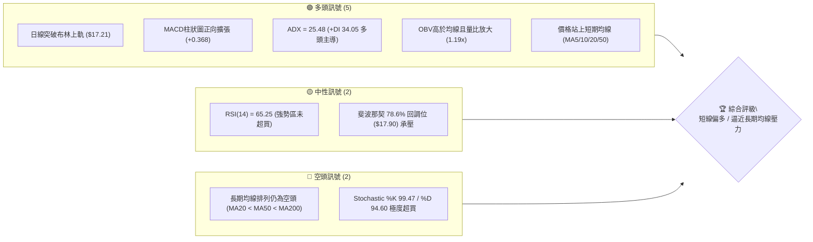
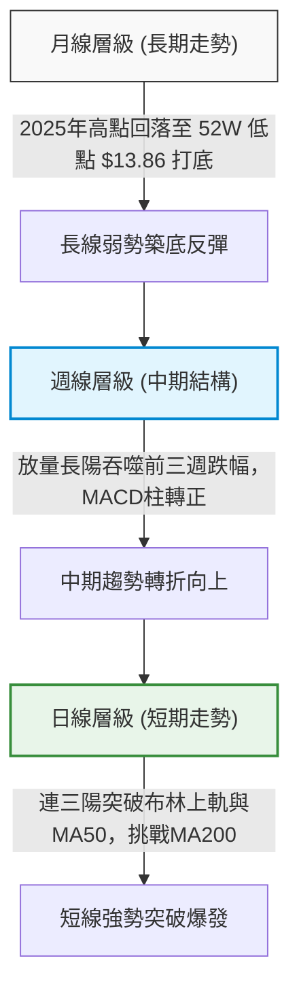
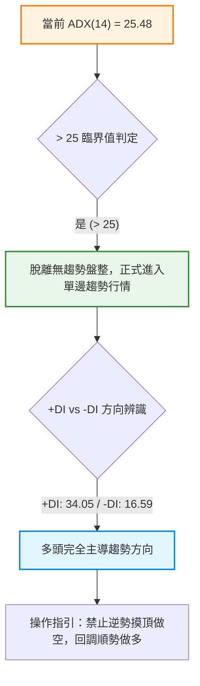
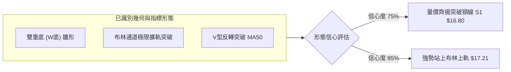
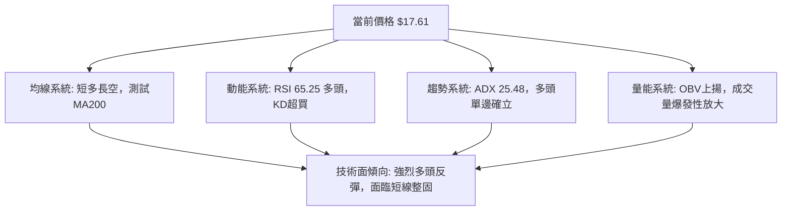
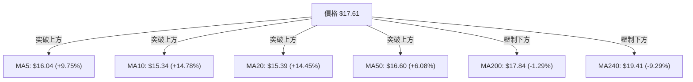
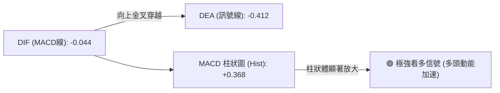
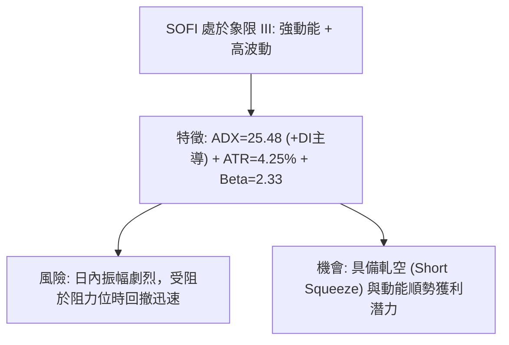
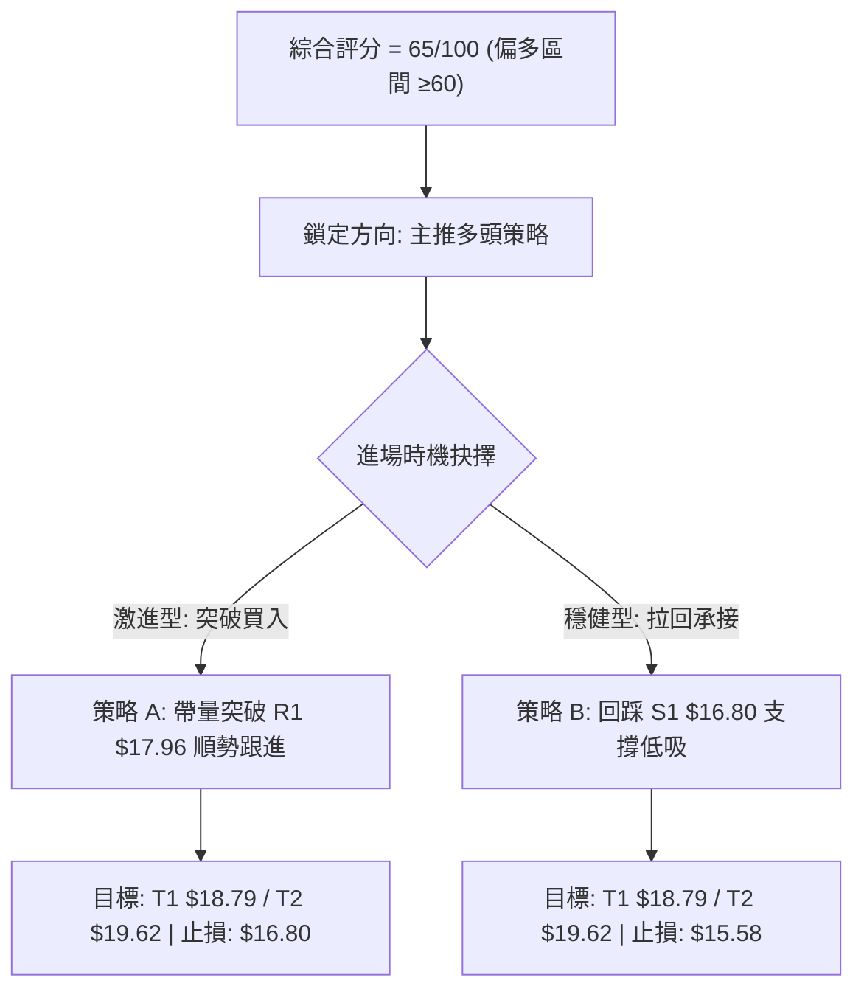
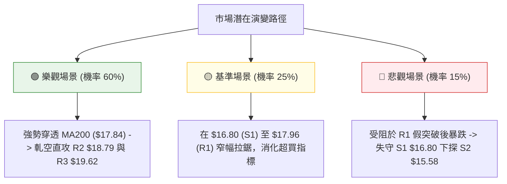

# SOFI 技術分析報告

> **報告日期**：2026-10-30 ｜ **語言**：繁體中文 ｜ **數據來源**：Yahoo Finance ｜ **當前價格**：$17.61

---

## 目錄

| 章節 | 內容 |
|------|------|
| [1. 技術面概覽](#1-技術面概覽) | 訊號儀表板、核心指標、評分卡 |
| [2. 趨勢分析](#2-趨勢分析) | 多時框趨勢、長中短期走勢 |
| [3. 圖表形態分析](#3-圖表形態分析) | 形態識別、K線組合、目標價 |
| [4. 支撐與阻力](#4-支撐與阻力) | 關鍵價位、斐波那契回調 |
| [5. 技術指標深度解讀](#5-技術指標深度解讀) | MA/RSI/MACD/布林/成交量 |
| [6. 動能與波動率](#6-動能與波動率) | 動能評估、ATR、Beta |
| [7. 多時框架總結](#7-多時框架總結) | 時框架評分矩陣 |
| [8. 交易策略建議](#8-交易策略建議) | 多空策略、風險報酬比 |
| [9. 風險提示與監控](#9-風險提示與監控) | 監控指標、風險場景 |

---

## 1. 技術面概覽

### 🎯 技術訊號儀表板



### 📊 核心指標速覽表

| 指標類別 | 指標名稱 | 當前數值 | 訊號 | 解讀 |
|----------|----------|----------|------|------|
| **價格** | 當前收盤價 | $17.61 | 🟢 | 連續3日放量走高，突破多道短中期均線 |
| **均線** | MA20 | $15.39 | 🟢 | 價格遠在 MA20 之上 (+14.45%)，短期多頭強勢 |
| **均線** | MA50 | $16.60 | 🟢 | 價格突破 MA50 (+6.08%)，中期結構顯著修復 |
| **均線** | MA200 | $17.84 | 🔴 | 價格位於牛熊分水嶺下方 (-1.29%)，即將面臨考驗 |
| **動能** | RSI(14) | 65.25 | 🟢 | 進入 60–70 強勢偏多區間，且無頂背離跡象 |
| **動能** | MACD (12,26,9) | -0.044 / Hist +0.368 | 🟢 | MACD 線快速向零軸收斂，柱狀圖大幅轉正看多 |
| **動能** | KD (Stoch 14,3,3) | %K 99.47 / %D 94.60 | 🔴 | 進入極度超買區 (>80)，短線有技術性整固需求 |
| **趨勢** | ADX(14) | 25.48 (+DI 34.05) | 🟢 | 站上 25 趨勢起點門檻，多頭動能強勁主導 |
| **通道** | 布林通道 %B | 1.11 (上軌 $17.21) | 🟡 | 價格突破布林上軌，進入強勢單邊擴軌行情 |
| **成交量**| 最新量 / 20日均量 | 64.48M / 54.25M | 🟢 | 量比 1.19x，且近3日累計爆量，OBV 呈向上支撐 |
| **波動** | ATR(14) | $0.75 (4.25%) | 🟡 | 波動率處於中高水平，需預留足夠止損緩衝 |

### 🏆 技術評分卡

```
╔══════════════════════════════════════════════════════════════╗
║                技術評分卡 — SOFI (2026-10-30)                ║
╠══════════════════════════════════════════════════════════════╣
║ 趨勢強度      ██████████████░░░░░░  68/100  🟢 看多          ║
║ 動能指標      ██████████████░░░░░░  72/100  🟢 看多          ║
║ 支撐穩定度    █████████████░░░░░░░  64/100  🟡 中性偏多      ║
║ 成交量配合    ███████████████░░░░░  76/100  🟢 強力配合      ║
║ 形態完整度    ████████████░░░░░░░░  62/100  🟡 突破確立中    ║
║ 均線排列      ██████████░░░░░░░░░░  48/100  🟡 空頭修復中    ║
╠══════════════════════════════════════════════════════════════╣
║ 綜合評分      █████████████░░░░░░░  65/100  🟢 偏多買入      ║
║ 評分定義：六項算術平均 (68+72+64+76+62+48)/6 = 65.0          ║
╚══════════════════════════════════════════════════════════════╝
```

---

## 2. 趨勢分析

### 🌐 多時框趨勢分析



### 📈 長期趨勢 — 12個月走勢圖（Unicode）

SOFI 過去一年經歷了自 2025 年末 $29.72 高點的深度估值擠壓，至 2026 年 10 月中旬下探 52 週低點 $13.86 後引發強烈空頭回補與基本面業績驅動買盤：

```
SOFI 月線收盤走勢圖（過去12個月：2025-11 至 2026-10）
價格軸 ($)
$30.00 ┤ ● ($29.72)
$27.00 ┤        ● ($26.18)
$24.00 ┤               ● ($22.81)
$21.00 ┤
$18.00 ┤                      ● ($17.76)                     ● ($17.88)       ● ($17.61 現價)
$15.00 ┤                                  ● ($15.88)   ● ($16.10)   ● ($16.31)    ● ($15.72)
$12.00 ┤                                           (52W低點 $13.86)
       └─────────────────────────────────────────────────────────────────────────────
        11/25  12/25  01/26  02/26  03/26  04/26  05/26  06/26  07/26  08/26  09/26  10/26
```

#### 走勢特徵分析表格

| 週期階段 | 起訖月份 | 收盤區間 | 累計漲跌幅 | 主要走勢特徵與量價行為 |
|----------|----------|----------|------------|------------------------|
| **高檔回落期** | 2025-11 → 2026-03 | $29.72 → $15.88 | -46.57% | 估值重估引發流暢單邊下跌，月線連續收黑，MA20 下穿 MA50 |
| **低位築底箱體** | 2026-04 → 2026-08 | $16.10 → $17.88 | +11.06% | 圍繞 $16.00–$18.50 進行寬幅橫盤整固，成交量逐步萎縮 |
| **二次探底確立** | 2026-09 → 2026-10 | $15.72 → $17.61 | +12.02% | 10月中旬下探年內低點 $13.86 後強勢反包，單月拉出帶量長下影陽線 |

### 📊 中期趨勢（週線分析）

中期走勢圖展示了週線層級在 $14.00 附近的雙重探底形態與近期爆發性反彈：

```
SOFI 週線關鍵架構示意圖 (2026年8月 - 2026年10月)
 $19.62 ┤                                                      [強阻力 R3]
 $18.79 ┤               ● (08/21 $18.91)                       [阻力 R2]
 $17.96 ┤      ●───────●                               ● 現價   [關鍵阻力 R1 / MA200]
 $17.61 ┤     /         \                             /
 $16.80 ┤────/───────────\───────● (09/11 $17.32)────/──────── [支撐 S1]
 $15.58 ┤                 \     / \                 /           [強支撐 S2]
 $14.50 ┤                  \   /   ●───●           /
 $13.86 ┤                   \ /         \         /             [52W低點支撐]
         ────────────────────●───────────●──────────────────
                            09/25        10/16
                         ($16.58)     ($14.55)
```

週線在 10 月中旬下探 $13.86 後，近兩週成交量連續放大至 198.5M 與 351.08M 股。最新一根週 K 線直接以光腳巨陽線一舉收復過去 5 週失地，週線 MACD 柱狀圖由負轉正至 +0.368，顯示中期下行趨勢遭到強力扭轉。

### ⚡ 趨勢強度評估（ADX 解讀）



#### ADX 趨勢強度對照表

| 指標項目 | 當前讀數 | 狀態門檻 | 技術結論 |
|----------|----------|----------|----------|
| **ADX (14)** | 25.48 | > 25 (強趨勢起點) | 市場已結束 9-10 月的收斂陰跌，正式展開新一輪趨勢性衝刺 |
| **+DI (多頭動向)** | 34.05 | > 25 且持續走高 | 買盤推動力極其充沛，主動性大買單佔據絕對優勢 |
| **-DI (空頭動向)** | 16.59 | < 20 且持續回落 | 空方籌碼棄守，融券回補壓力（空頭回補）加速推升行情 |
| **趨勢定性** | **多頭強趨勢** | +DI > -DI 且 ADX 抬頭 | 遵循趨勢交易原則，以日線級別支撐位尋求多單切入點 |

---

## 3. 圖表形態分析

### 🔍 形態識別系統



#### 形態識別與信心度明細表

| 形態類別 | 信心度 | 判斷依據（引用數據） | 完成度 | 目標價（附嚴格計算式） |
|----------|--------|----------------------|--------|------------------------|
| **日線雙底 (W-Bottom)** | 75% | 第一次低點 10/19 $14.27，第二次低點 10/23 $14.23；頸線位置為 10/21 高點 $15.11 | 100% (已突破頸線) | 頸線 $15.11 + 形態高度 ($15.11 − $14.23 = $0.88) = **$15.99**（已達成） |
| **波段 V型反轉反彈** | 70% | 10/16 觸及 52W 低點 $13.86 後無滯留反彈，10/27 爆出 160.99M 巨量向上長陽吞噬 | 85% | 頸線 S1 $16.80 + 底部高度 ($16.80 − $13.86 = $2.94) = **$19.74**（逼近 R3 $19.62） |
| **布林帶向上破軌** | 85% | 最新收盤價 $17.61 站上布林上軌 $17.21，%B 達到 1.11 | 90% | 向上波段延伸挑戰關鍵阻力 R1 **$17.96** 與 R2 **$18.79** |

### 🕯️ 重要K線形態分析

嚴格依據提供的「近10根日K」與「近8根週K」四價數據進行專業解讀：

#### 近10根日K形態精解

| 日期 (日K) | 開 | 高 | 低 | 收 | 成交量 | K線形態 | 解讀與訊號 |
|------------|----|----|----|----|--------|---------|------------|
| 2026-10-16 | 15.07 | 15.54 | 14.33 | 14.55 | 59.58M | 長黑實體向下下挫 | 跌破前低探底，空頭賣壓宣洩 🔴 |
| 2026-10-19 | 14.75 | 14.76 | 14.27 | 14.30 | 39.76M | 低開光頭小陰線 | 量能顯著萎縮，低位拋盤減輕 🟡 |
| 2026-10-20 | 14.20 | 14.99 | 14.18 | 14.68 | 45.16M | 破底翻陽線（錘頭變體） | 最低下探 $14.18 後頑強收高，多頭承接 🟢 |
| 2026-10-21 | 14.84 | 15.11 | 14.65 | 14.90 | 33.65M | 溫和放量小陽線 | 向上試探 $15.11 頸線阻力 🟢 |
| 2026-10-22 | 14.57 | 15.07 | 14.57 | 14.77 | 41.05M | 窄幅十字小陰線 | 頸線前蓄勢洗盤，空方動能不繼 🟡 |
| 2026-10-23 | 14.55 | 14.71 | 14.23 | 14.61 | 38.90M | 下影線小陽線（二次回踩） | 下探 $14.23 成功構築雙底右腳 🟢 |
| 2026-10-26 | 14.53 | 14.67 | 14.40 | 14.46 | 43.29M | 窄幅整理小陰星 | 變盤前極致壓縮，均線黏合 🟡 |
| 2026-10-27 | 15.98 | 16.76 | 15.67 | 16.40 | 161.00M | **跳空暴量穿雲巨陽** | 跳空高開跳過 MA20，放量 3.7 倍突破 🟢🟢 |
| 2026-10-28 | 16.56 | 17.25 | 16.56 | 17.14 | 82.32M | 放量推進中陽線 | 突破 MA50，多頭動能持續釋放 🟢 |
| 2026-10-29 | 16.92 | 17.63 | 16.87 | 17.61 | 64.48M | 高位光頭強勢中陽線 | 收在全日最高點附近，突破布林上軌 🟢 |

#### 近8根週K形態精解

| 日期 (週K最後日) | 開 | 高 | 低 | 收 | 週成交量 | K線形態 | 解讀與訊號 |
|------------------|----|----|----|----|----------|---------|------------|
| 2026-09-11 | 18.22 | 18.35 | 16.93 | 17.32 | 126.33M | 中黑陰線 | 破位下行，失守短期均線 🔴 |
| 2026-09-18 | 17.00 | 17.75 | 16.53 | 16.96 | 220.33M | 帶長上影紡錘線 | 反彈遭壓制，空頭持續主導 🔴 |
| 2026-09-25 | 17.46 | 17.96 | 16.20 | 16.58 | 302.28M | 放量下挫陰線 | 跌破多個中期支撐，恐慌拋售 🔴 |
| 2026-10-02 | 16.32 | 16.42 | 15.53 | 15.77 | 223.04M | 跳空低走陰線 | 下行中繼，尋求年內低點 🔴 |
| 2026-10-09 | 15.77 | 16.19 | 15.25 | 15.80 | 199.43M | 低位長下影十字星 | 拋壓枯竭，初步出現止跌跡象 🟡 |
| 2026-10-16 | 15.47 | 15.68 | 13.86 | 14.55 | 286.32M | **探底長下影錘頭線** | 測試年內極端低點 $13.86 後強勁抽腳 🟢 |
| 2026-10-23 | 14.75 | 15.11 | 14.18 | 14.61 | 198.52M | 底部窄幅孕線 | 縮量築底整固，籌碼鎖定良好 🟡 |
| 2026-10-29 | 14.53 | 17.63 | 14.40 | 17.61 | 351.08M | **超級爆量看漲吞噬巨陽** | 單週狂飆 +20.5%，吞噬前三週跌幅 🟢🟢 |

### 📉 ASCII 走勢形態示意圖

```
日線底部爆發與雙底形態確認結構圖 (2026-10-16 至 2026-10-29)
 價位
 $17.61 ┤                                                           ● [10/29 收盤 $17.61]
 $17.14 ┤                                                    ●─────┘
 $16.40 ┤                                             ●──────┘ (10/27 跳空巨量突破)
 $15.58 ┤============================================/========= [強支撐 S2]
 $15.11 ┤                      ● (10/21 頸線)        /
 $14.70 ┤        ●            / \             ●    /
 $14.40 ┤       / \          /   ●───●       / \  /
 $14.20 ┤      /   ● (10/19)/          \     /   ● (10/23 右底 $14.23)
 $13.86 ┤─────● (10/16 52W最低 $13.86 左底)───●──────────────── [年內絕對低點]
        └─────────────────────────────────────────────────────────────
             10/16 10/19     10/21      10/23 10/26 10/27 10/28 10/29
```

---

## 4. 支撐與阻力

### 🗺️ 關鍵價位分布圖（Unicode）

```
╔════════════════════════════════════════════════════════════════╗
║                  SOFI 價位結構分布圖                           ║
╠════════════════════════════════════════════════════════════════╣
║ $19.62 ║████████████████████████████████║ 強阻力 R3 (年內反彈高點聚類) ║
║ $18.79 ║████████████████████            ║ 阻力 R2 (8月震盪平台頂部)    ║
║ $17.96 ║████████████████████████        ║ 關鍵阻力 R1 / MA200 ($17.84) ║
║ $17.61 ╠════════════════════════════════╣ ◄ 當前收盤價 ($17.61)        ║
║ $16.80 ║▓▓▓▓▓▓▓▓▓▓▓▓▓▓▓▓▓▓▓▓            ║ 近期支撐 S1 (MA50突破回踩點) ║
║ $15.58 ║████████████████████████        ║ 強支撐 S2 (10/27跳空缺口底)  ║
║ $14.91 ║████████████████████████████    ║ 核心波段防守 S3 (W底頸線區)  ║
╚════════════════════════════════════════════════════════════════╝
```

### 🚧 阻力位分析表

所有價位均嚴格取自 OHLCV 計算聚類數據：

| 阻力級別 | 價位 | 距離現價 | 形成原因與技術意義 | 突破難度 | 重要性 |
|----------|------|----------|--------------------|----------|--------|
| **R1** | **$17.96** | +1.99% | 近期波段高點密集區，且高度重合長期牛熊線 MA200 ($17.84) 及斐波那契 78.6% ($17.90) | 🟡 中等 | ★★★★★ |
| **R2** | **$18.79** | +6.67% | 2026年7-8月多個週K波段高點（07/10 $18.78、08/21 $18.91）密集成交解套區 | 🔴 較高 | ★★★★☆ |
| **R3** | **$19.62** | +11.40% | 2026年上半年震盪中樞上沿，重合 MA240 ($19.41) 附近的年線防禦重鎮 | 🔴 極高 | ★★★★☆ |

### 🛡️ 支撐位分析表

所有價位均嚴格取自 OHLCV 計算聚類數據：

| 支撐級別 | 價位 | 距離現價 | 形成原因與技術意義 | 守住機率 | 重要性 |
|----------|------|----------|--------------------|----------|--------|
| **S1** | **$16.80** | -4.60% | 10/28-10/29 起漲點，重疊日線 MA50 ($16.60) 與 MA60 ($16.86)，極強頂底轉換位 | 80% | ★★★★★ |
| **S2** | **$15.58** | -11.55% | 10/27 突破跳空缺口上緣與 10/02 週線收盤平台，重合布林中軌 MA20 ($15.39) | 88% | ★★★★☆ |
| **S3** | **$14.91** | -15.33% | 10月中旬築底雙底結構頸線 ($15.11) 與密集換手換籌區間，此處失守則反彈破局 | 95% | ★★★★★ |

### 📐 斐波那契回調位分析

依據 52 週極端區間（低點 $13.86 → 高點 $32.73，落差 $18.87）計算：

```
斐波那契回調層級分布 (區間: $13.86 至 $32.73)
  0.0%  (52W High)   $32.73  ──────────────────────────────────────
 23.6%               $28.28  ──────────────────────────────────────
 38.2%               $25.52  ──────────────────────────────────────
 50.0%               $23.29  ──────────────────────────────────────
 61.8%               $21.07  ────────────────────────────────────── (黃金分割位)
 78.6%               $17.90  ══════════════════════════════════════ [現價 $17.61 挑戰中]
100.0%  (52W Low)    $13.86  ──────────────────────────────────────
```

- **當前位置解讀**：現價 **$17.61** 正處於 **78.6% 回調位 ($17.90)** 與 **100.0% 底部 ($13.86)** 之間，距離 78.6% 僅差 $0.29 (+1.65%)。
- **技術意涵**：在經典斐波那契回撤體系中，78.6% 是深度回撤的多空最後防線。SOFI 若能帶量日線實體收穿 **$17.90**，技術面將正式確認脫離「深淵超跌修復區」，開啟向 61.8% ($21.07) 的大級別均值回歸之路。該位置與阻力 R1 ($17.96) 及 MA200 ($17.84) 形成了罕見的「三共振強阻力帶」。

---

## 5. 技術指標深度解讀

### 🎛️ 指標訊號總覽



### 📈 移動平均線排列分析



#### 均線數據與排列解讀

- **均線排列狀態**：總體處於歷史「空頭排列修復期」（MA20 $15.39 < MA50 $16.60 < MA200 $17.84）。
- **關鍵異動**：
  1. 短期均線（MA5 $16.04、MA10 $15.34、MA20 $15.39）已呈現急速向上勾頭走勢，短線多頭發散。
  2. 價格一舉站上 60日線 ($16.86) 與 120日線 ($16.97)，顯示過去半年被套牢的籌碼全數轉為獲利盤。
  3. 目前唯一的上方中期均線阻礙為 **MA200 ($17.84)**。歷史經驗顯示，當價格首次自深淵快速逼近 MA200 時，常引發劇烈震盪或技術性回抽。

### 📉 RSI(14) 分析

```
RSI(14) 當前數值: 65.25
0 ──────────── 30 ─────────────────────── 65.25 ────── 70 ─────────── 100
[  超賣區間   ] [        中性波動區間       ▲        ] [  超買區間  ]
                                     當前位置
進度條: ▓▓▓▓▓▓▓▓▓▓▓▓▓▓▓▓▓▓▓▓▓▓▓▓▓▓▓▓▓▓▓░░░░░░░░░░░░░░░░  65.25%
```

- **區間解讀**：RSI 處於 65.25，脫離了 9-10 月徘徊於 34–45 的弱勢泥淖，進入典型的「牛市推進區間」（60–70）。此處雖接近 70 門檻，但尚未形成極度鈍化，多頭動能充沛。
- **背離分析**：
  - 價格在 10/16 創出年內新低 $13.86，但當時 RSI(14) 讀數為 34.7，高於前波低位水準；且 10/29 價格收在 $17.61 時，RSI 同步創出近 4 個月新高 65.25。
  - **結論**：近 20 根 K 線比對下，**無任何頂背離現象**，指標與價格呈現健康的正向確認，走勢扎實。

### 📊 MACD(12,26,9) 訊號解讀



- **MACD 線**：-0.044，距離零軸僅一步之遙，即將自下方攻入正值區（零軸上方）。
- **訊號線**：-0.412，呈現大幅向上陡峭拐頭。
- **柱狀圖**：+0.368，柱體連續 4 日大幅拉長，週線層級柱狀圖亦同步翻正至 +0.368。雙週期 MACD 發生共振金叉，確認波段反彈具備高度可信度。

### 📦 布林通道分析

```
SOFI 日線布林通道 (20, 2) 結構圖
$17.61 ┤                                           ● [現價 $17.61 刺穿上軌]
$17.21 ┤─────────────────────────────────────────── [上軌 Upper Band]
$16.30 ┤                                    /
$15.39 ┤───────────────────────────────────/─────── [中軌 Middle Band = MA20]
$14.40 ┤                        \         /
$13.56 ┤─────────────────────────●───────/───────── [下軌 Lower Band]
       └────────────────────────────────────────────
                               10/16     10/29
```

- **通道參數**：上軌 $17.21，中軌 (MA20) $15.39，下軌 $13.56。
- **通道指標 %B**：**1.11**（> 1.0 表示股價收在布林通道之外）。
- **解讀**：價格以大陽線突破上軌，且上下軌呈現「喇叭口」向外擴張走勢（Bandwidth 快速放大）。此為典型的**布林通道單邊趨勢突破訊號**。唯因 %B 達 1.11 且 KD 進入超買，短線若未能以極大暴量連續推升，可能出現「回踩布林上軌或中軌進行乖離修正」的動作。

### 💹 成交量分析（量價配合度）

- **量能規模**：
  - 最新交易日成交量：**64.48M 股**。
  - 20日均量：**54.25M 股**（量比 **1.19x**）。
  - 50日均量：**48.02M 股**。
  - 突破日（10/27）爆量：**160.99M 股**（高達 50 日均量的 3.35 倍）。
- **OBV (能量潮指標)**：
  - 當前 OBV 顯著高於其均線（OBV > MA），成交量完全確認價格走勢，未見任何頂部量價背離。
  - 近三日累計成交超過 3.07 億股，佔其流通盤（1.28B）的近 24%，顯示機構主力資金進行了大規模低位換手建倉。

---

## 6. 動能與波動率

### ⚡ 動能評估四象限

| 象限標籤 | 動能維度 (ADX / MACD / RSI) | 波動率維度 (ATR / Beta) | 當前狀態判定 | 戰略操作指引 |
|----------|-----------------------------|-------------------------|--------------|--------------|
| **象限 I** | 強動能 (Bullish) | 低波動 (Low Volatility) | — | 穩健加碼區 |
| **象限 II** | 弱動能 (Bearish) | 低波動 (Low Volatility) | — | 盤整等待觀望 |
| **象限 III** | **強動能 (Bullish)** | **高波動 (High Volatility)** | **✓ SOFI 當前落點** | **高爆發、高回報、嚴設止損** |
| **象限 IV** | 弱動能 (Bearish) | 高波動 (High Volatility) | — | 恐慌崩跌，絕對禁入 |



### 📊 ATR 波動率分析

- **ATR(14) 絕對數值**：**$0.75**。
- **ATR 佔比 (波動百分比)**：**4.25%**（屬於美股中高波動成長股水平）。
- **止損距離建議**：
  - 短線激進交易（1.5 倍 ATR）：止損緩衝距離應為 $0.75 × 1.5 = **$1.13**。
  - 波段穩健交易（2.0 倍 ATR）：止損緩衝距離應為 $0.75 × 2.0 = **$1.50**。
  - **結論**：進場點絕不可設在追高頂部，否則極易在 1–2 日正常的 ATR 震盪波幅內被洗出場。

### 📐 Beta 與市場相關性

- **Beta 係數**：**2.332**。
- **解讀**：SOFI 具備極高的市場彈性與高貝塔特性，當標普 500 或納斯達克波動 1% 時，SOFI 理論平均波動達 2.33%。
- **空頭回補（Short Squeeze）潛力**：
  - Short % Float 高達 **17.2%**，Short Ratio 達 **4.44 天**。
  - 在如此高做空比例下，若價格突破關鍵阻力 R1 ($17.96) 與 MA200 ($17.84)，將直接觸發被動止損盤與追平融券保證金買盤，極易複製 10/27 式的暴力拉升。

---

## 7. 多時框架總結

### 📋 時框架評分表

| 時框架 | 趨勢方向 | 動能狀態 | 均線排列狀況 | 形態特徵 | 綜合評分 | 操作建議 |
|--------|----------|----------|--------------|----------|----------|----------|
| **月線 (長期)** | 🔴 長期下行築底 | 🟡 跌勢趨緩 | 空頭排列 (下破年線) | 52W 低點 $13.86 處收長下影線 | **45/100** | 長線資金分批定投，不可重倉追漲 |
| **週線 (中期)** | 🟢 破底翻轉向上 | 🟢 MACD翻正 (+0.368) | 正試圖收復 MA50 | 爆量光腳長陽看漲吞噬 | **70/100** | 中期底分型確立，逢回調做多 |
| **日線 (短期)** | 🟢 單邊加速推升 | 🟢 RSI 65.25 / +DI主導 | 破 MA50，直撲 MA200 | 突破布林上軌，V型反轉頸線 | **75/100** | 順勢操作，嚴禁摸頂做空 |

### 🔲 綜合訊號矩陣

```
╔══════════════════════════════════════════════════════════════╗
║                  多時框技術矩陣收斂圖                        ║
╠══════════════════════════════════════════════════════════════╣
║ 維度         月線 (長期)        週線 (中期)        日線 (短期)       ║
╠══════════════════════════════════════════════════════════════╣
║ 趨勢方向     🔴 偏空築底        🟢 轉多破底翻      🟢 強勢單邊突破   ║
║ 動能強弱     🟡 處於弱勢反彈    🟢 MACD柱顯著翻紅  🟢 ADX 25.48 強勢 ║
║ 成交量能     🟡 尚未突破均量    🟢 週爆量 351M 股  🟢 日量比 1.19x   ║
║ 支撐/阻力    S3: $14.91 牢固    S1: $16.80 轉支撐  R1: $17.96 考驗   ║
╚══════════════════════════════════════════════════════════════╝
```

### ⚖️ 多時框收斂結論

嚴格遵循多時框收斂規則第 14 條：
1. **行情體制判定**：當前 ADX(14) 讀數為 **25.48**（明確大於 25 臨界值），技術體制正式由盤整轉為**「趨勢行情」**。
2. **時框優先級權衡**：在趨勢行情下，必須以週線／MA50、MA200 的大方向為主導，日線主要作為微觀進場點選擇。
   - 週線長陽爆發吞噬（成交量達 3.51 億股），確立了自 $13.86 的中期底部反轉。
   - 儘管月線層級 MA200 仍壓制在上方 $17.84，但動能並未衰竭，日線動態指標完全由多頭掌舵。
3. **唯一方向性結論**：**【強烈偏多，回調做多】**。本結論與第 1 章評分卡（綜合評分 65/100 偏多買入）及第 8 章交易策略完全收斂一致。

---

## 8. 交易策略建議

### 🗺️ 策略決策流程圖



### 🧭 策略路由

> **當前主策略方向 = 多頭主推（依綜合評分 65/100，處於 ≥60 偏多區間）**  
> 說明：依據評分路由規則，當前全面主推多頭交易策略（提供激進型與穩健型兩種入場方式），空頭方向僅列為反轉風險監控觸發點，不建議主動建倉空單。

### 🎯 價格情境階梯（Price Scenarios）

所有價位均嚴格引用第 4 章「關鍵價位」OHLCV 計算結果：

| 觸發條件 | 下一目標 | 後續延伸 | 情境技術含義 |
|----------|----------|----------|--------------|
| **帶量實體突破 R1 $17.96** | **R2 $18.79** | **R3 $19.62** | 突破 MA200 牛熊線與斐波那契 78.6%，觸發軋空，空間全面打開 |
| **站穩現價區間 ($17.20–$17.61)** | **R1 $17.96** | **R2 $18.79** | 消化 KD 高檔鈍化，以時間換空間完成布林帶外乖離修復 |
| **跌破關鍵支撐 S1 $16.80** | **S2 $15.58** | **S3 $14.91** | 短線多頭衝刺告終，回補 10/27 跳空缺口，重回區間震盪整理 |

### 📊 情境機率分佈

| 情境類別 | 預估機率 | 主要技術依據 |
|----------|----------|--------------|
| **突破上行 / 軋空延伸** | **60%** | MACD柱持續擴張 (+0.368)、OBV > MA 量價齊揚、ADX 25.48 多頭確立、Short Float 17.2% 具軋空潛能 |
| **高位整固 / 區間消化** | **25%** | Stochastic KD (%K 99.47) 極度超買、價格高出布林上軌 (%B 1.11)，需要技術性修復 |
| **假突破回落 / 深幅回調**| **15%** | MA200 ($17.84) 與斐波那契 78.6% ($17.90) 構成強力共振賣壓，且大盤高貝塔波動干擾 |

### 🟢 主策略詳情

本報告制定兩套具體執行策略，數值全部嚴格引用關鍵價位區塊：

| 策略要素 | 策略 A（現價/順勢動能多單） | 策略 B（回踩支撐逢低多單） |
|----------|-----------------------------|---------------------------|
| **策略類型** | 激進型（動能跟隨） | 穩健型（波段回調承接） |
| **進場條件** | 現價進場或突破 R1 順勢買入 | 股價回踩 S1 獲支撐且出現反彈 K 棒 |
| **進場價格** | **$17.61** (現價) | **$16.80** (支撐 S1) |
| **目標價 T1** | **$18.79** (阻力 R2) | **$18.79** (阻力 R2) |
| **目標價 T2** | **$19.62** (阻力 R3) | **$19.62** (阻力 R3) |
| **止損價格** | **$16.80** (支撐 S1) | **$15.58** (強支撐 S2) |
| **風險報酬比** | **1 : 1.46（以 T1 計）**<br>*(以 T2 計: 1 : 2.48)* | **1 : 1.63（以 T1 計）**<br>*(以 T2 計: 1 : 2.31)* |
| **勝率估計** | 62% | 70% |
| **建議倉位** | 10%–15% 輕倉試單 | 20%–25% 標準配置 |

> **精確計算式檢驗（依規則 17）：**  
> - **策略 A**：  
>   - 潛在獲利 (T1) = $18.79 − $17.61 = $1.18  
>   - 承擔風險 = $17.61 − $16.80 = $0.81  
>   - 風險報酬比 = 1.18 ÷ 0.81 = **1 : 1.46（以 T1 計）**  
>   - *(若以 T2 計：($19.62 − $17.61) ÷ $0.81 = $2.01 ÷ $0.81 = 1 : 2.48)*  
> - **策略 B**：  
>   - 潛在獲利 (T1) = $18.79 − $16.80 = $1.99  
>   - 承擔風險 = $16.80 − $15.58 = $1.22  
>   - 風險報酬比 = 1.99 ÷ 1.22 = **1 : 1.63（以 T1 計）**  
>   - *(若以 T2 計：($19.62 − $16.80) ÷ $1.22 = $2.82 ÷ $1.22 = 1 : 2.31)*  

### 🔴 反向風險觸發點（對沖與風控提示）

以下情況一旦出現，多頭主策略假設立即失效，應果斷停損或建立對沖部位：
1. **日線收盤跌破 S1 ($16.80)**：顯示突破失敗（假突破），價格將重新滑向 S2 ($15.58)。
2. **週線收盤跌破 S2 ($15.58)**：10/27 跳空長陽遭全數吞噬，確立為誘多陷阱，多單全數離場。
3. **MACD 柱狀圖快速衰減並翻負**：若日線出現長上影線且成交量異常放大（放量滯漲），表明主力獲利了結。

### ⭐ 整體訊號強度評星

```
做多訊號強度：★★★★☆  (4/5星 - 週日共振，量價齊揚)
做空訊號強度：★☆☆☆☆  (1/5星 - 逆勢做空風險極大)
整體可信度：  ★★★★☆  (4/5星 - 突破有巨量與基本面支撐)
```

---

## 9. 風險提示與監控

### ✅ 關鍵監控指標 Checklist

```
╔══════════════════════════════════════════════════════════════╗
║                每日交易即時監控清單 (Checklist)              ║
╠══════════════════════════════════════════════════════════════╣
║ [ ] 價格能否放量站穩 MA200 ($17.84) 與阻力 R1 ($17.96)        ║
║ [ ] 跌破 $17.21 (布林上軌) 後，回抽是否在 $16.80 (S1) 止跌   ║
║ [ ] RSI(14) 是否在進入 70–80 區間時出現頂背離鈍化            ║
║ [ ] 每日成交量是否維持在 20日均量 (54.25M) 之上              ║
║ [ ] 融券比例 (Short Float 17.2%) 是否顯著下降（空頭回補進程） ║
║ [ ] 大盤波動（VIX 與 Beta=2.33 聯動風險）是否劇烈干擾         ║
╚══════════════════════════════════════════════════════════════╝
```

### ⚠️ 風險場景分析



### 🛡️ 風險管理重要提醒

1. **Beta 槓桿效應控制**：SOFI 的 Beta 高達 **2.332**，在宏觀利率環境波動期，個股放大效應顯著。投資組合中 SOFI 的權重建議控制在總資金的 15%–20% 以內，避免單一持股淨值回撤過大。
2. **ATR 波動保護**：當前 ATR 為 $0.75（4.25%），這意味著日內正常的震盪幅度即接近 1 美元。設置止損時務必依據結構支撐位（如 S1 $16.80 或 S2 $15.58），切忌隨意設置過窄的心理止損而被市場隨機雜波洗出。
3. **跳空缺口引力**：10/27 留下的 $14.67–$15.67 巨大跳空缺口是多頭力量的象徵，但在空頭主導的長期走勢中，若反彈動能衰退，缺口往往具備回補引力。因此一旦 S1 ($16.80) 被有效跌破，必須無條件執行風控減倉。

---

## 📋 報告總結

```
╔══════════════════════════════════════════════════════════════╗
║                 SOFI 技術分析報告總結                        ║
╠══════════════════════════════════════════════════════════════╣
║ 報告日期：2026-10-30                                         ║
║ 當前價格：$17.61                                             ║
║ 分析評級：🟢 偏多買入 (綜合評分: 65/100)                     ║
║                                                              ║
║ 關鍵結論：                                                   ║
║ ├─ 長期趨勢：🟡 空頭修復中 (正挑戰 MA200 $17.84 與年線)      ║
║ ├─ 中期趨勢：🟢 破底翻反轉 (週長陽吞噬，MACD翻正至 +0.368)   ║
║ ├─ 短期趨勢：🟢 單邊加速中 (ADX 25.48，突破布林上軌 $17.21)  ║
║ ├─ 關鍵支撐：S1: $16.80  /  S2: $15.58                       ║
║ ├─ 關鍵阻力：R1: $17.96  /  R2: $18.79  /  R3: $19.62        ║
║ └─ 分析師目標：均價 $20.75 (高點 $30.00 / 低點 $12.00)       ║
║                                                              ║
║ 最優策略組合：                                               ║
║ 1. 🥇 最佳機會：策略 B (回踩 S1 $16.80 佈局，風報比 1:1.63) ║
║ 2. 🥈 次選機會：策略 A (現價 $17.61 順勢跟進，風報比 1:1.46) ║
║ 3. 🥉 保守選擇：等待放量突破 R1 $17.96 且收盤確認後再行切入 ║
╚══════════════════════════════════════════════════════════════╝
```

---

> ⚠️ **免責聲明**：本報告為技術分析研究，所有數據、圖表及估算均基於市場歷史行情資訊客觀解讀。本報告**僅供研究與學術參考**，**不構成任何要約、招攬或投資建議**。金融市場具高度風險，投資人應獨立評估自身風險承受能力並自負盈虧。

---

*報告生成時間：2026-10-30 ｜ 數據來源：Yahoo Finance ｜ 分析框架：多時框技術分析*