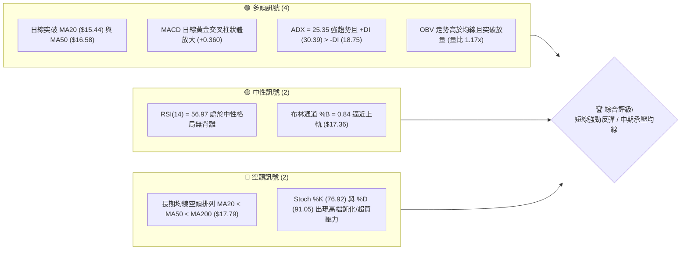
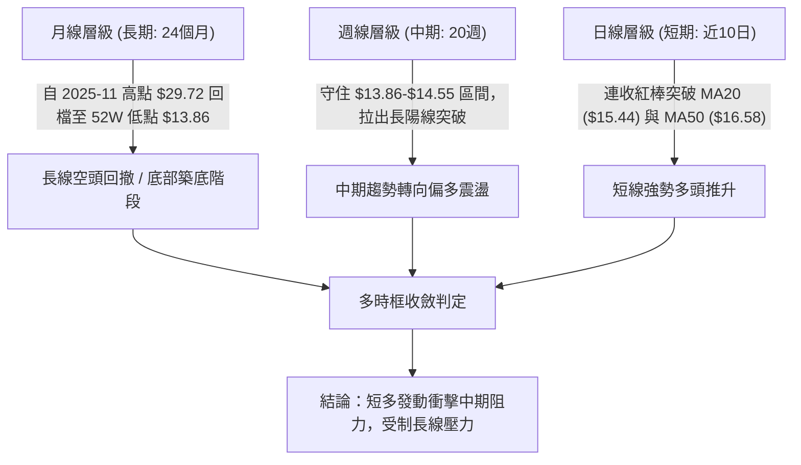
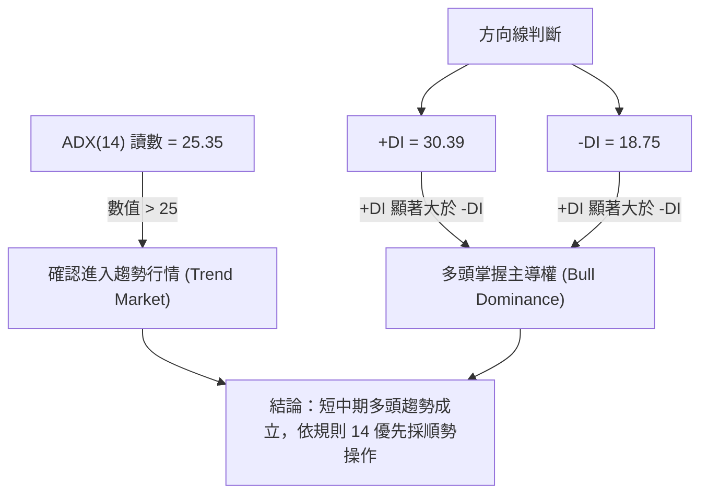
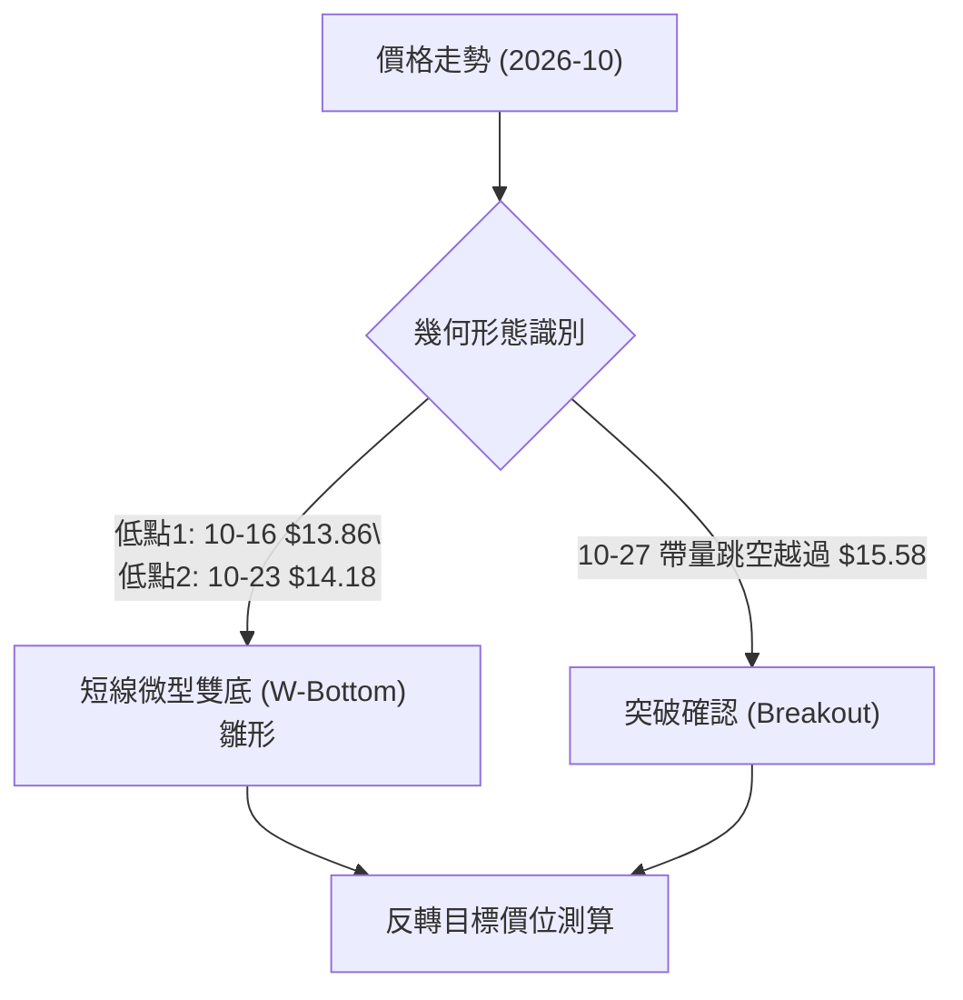
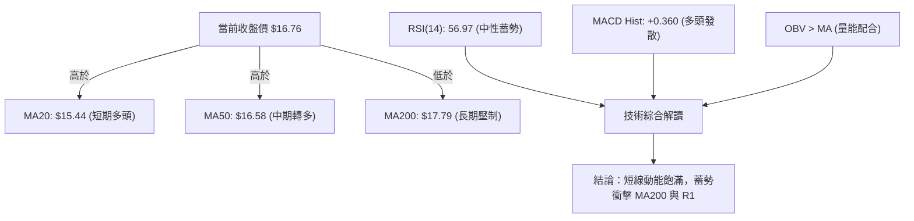
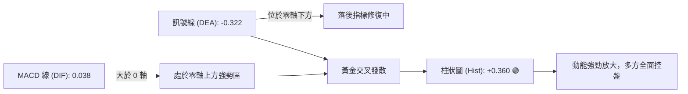
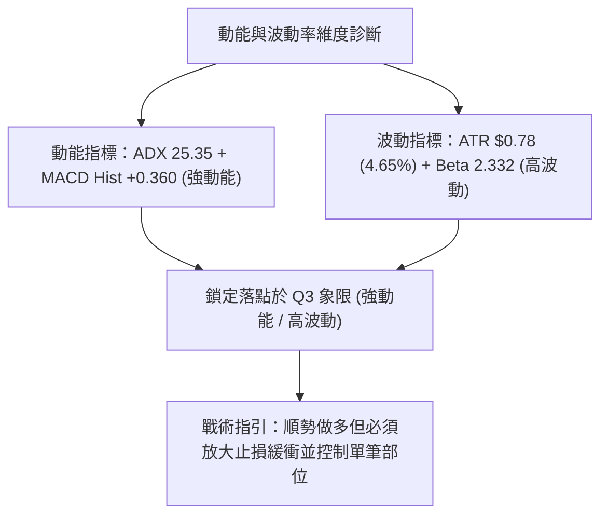
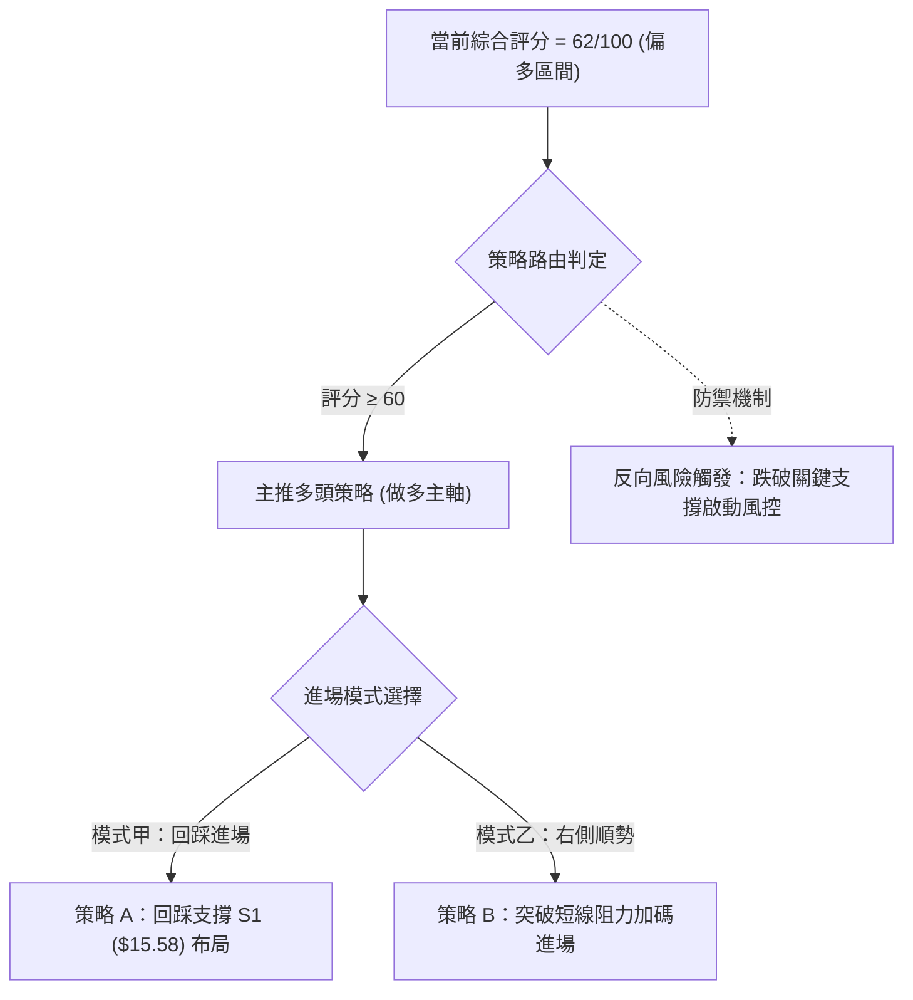
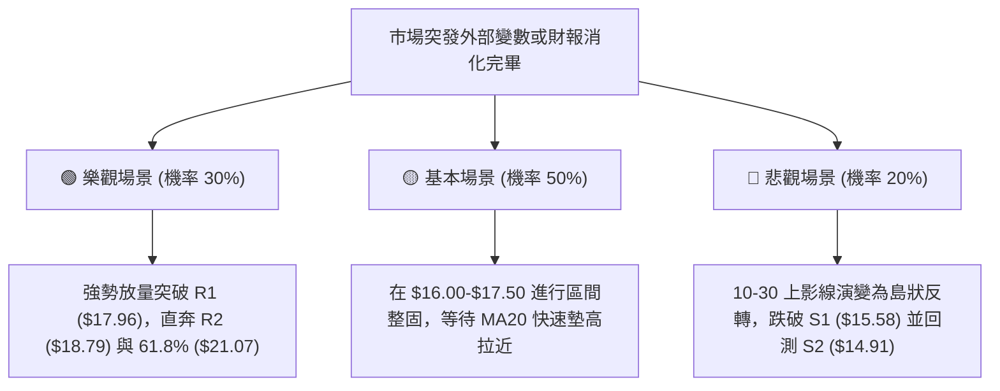

# SOFI 技術分析報告

> **報告日期**：2026-10-31 ｜ **語言**：繁體中文 ｜ **數據來源**：Yahoo Finance ｜ **當前價格**：$16.76

---

## 目錄

| 章節 | 內容 |
|------|------|
| [1. 技術面概覽](#1-技術面概覽) | 訊號儀表板、核心指標、評分卡 |
| [2. 趨勢分析](#2-趨勢分析) | 多時框趨勢、長中短期走勢 |
| [3. 圖表形態分析](#3-圖表形態分析) | 形態識別、K線組合、目標價 |
| [4. 支撐與阻力](#4-支撐與阻力) | 關鍵價位、斐波那契回調 |
| [5. 技術指標深度解讀](#5-技術指標深度解讀) | MA/RSI/MACD/布林/成交量 |
| [6. 動能與波動率](#6-動能與波動率) | 動能評估、ATR、Beta |
| [7. 多時框架總結](#7-多時框架總結) | 時框架評分矩陣 |
| [8. 交易策略建議](#8-交易策略建議) | 多空策略、風險報酬比 |
| [9. 風險提示與監控](#9-風險提示與監控) | 監控指標、風險場景 |

---

## 1. 技術面概覽

### 🎯 技術訊號儀表板



### 📊 核心指標速覽表

| 指標類別 | 指標名稱 | 當前數值 | 訊號 | 解讀 |
|----------|----------|----------|------|------|
| **價格** | 當前價格 | $16.76 | 🟢 | 站上 50 日線，單週強勁反彈自低點 $14.40 回升 |
| **均線** | MA20 | $15.44 | 🟢 | 價格在 MA20 上方 (+8.58%)，短期底部確立 |
| **均線** | MA50 | $16.58 | 🟢 | 價格越過中天期均線 (+1.09%)，短多動能增強 |
| **均線** | MA200 | $17.79 | 🔴 | 價格仍受制於長期均線下方 (-5.79%)，長期趨勢未反轉 |
| **動能** | RSI(14) | 56.97 | 🟡 | 位於 50-60 中性偏多區間，無明顯超買或背離 |
| **動能** | MACD | Hist +0.360 | 🟢 | 快慢線黃金交叉，柱狀圖持續翻紅擴張，動能顯著釋放 |
| **波動** | ATR(14) | $0.78 | 🟡 | 佔現價 4.65%，每日波幅適中，維持中度波動水平 |

### 🏆 技術評分卡

```
╔══════════════════════════════════════════════════════════════╗
║                技術評分卡 — SOFI (2026-10-31)                ║
╠══════════════════════════════════════════════════════════════╣
║ 趨勢強度      ████████████░░░░░░░░  60/100  🟢 中期反彈確立  ║
║ 動能指標      ██████████████░░░░░░  70/100  🟢 MACD翻紅多頭  ║
║ 支撐穩定度    ██████████████░░░░░░  70/100  🟢 S1($15.58)穩固║
║ 成交量配合    ██████████████░░░░░░  70/100  🟢 量比1.17x放量 ║
║ 形態完整度    ████████████░░░░░░░░  60/100  🟡 雙底反彈雛形  ║
║ 均線排列      ████████░░░░░░░░░░░░  40/100  🔴 MA200仍下彎   ║
╠══════════════════════════════════════════════════════════════╣
║ 綜合評分      ████████████░░░░░░░░  62/100  🟢 偏多（多頭反彈）║
╚══════════════════════════════════════════════════════════════╝
```
*(註：綜合評分由六項子評分 [60+70+70+70+60+40] ÷ 6 = 61.67，依規則 18 四捨五入為 62/100)*

---

## 2. 趨勢分析

### 🌐 多時框趨勢分析



### 📈 長期趨勢 — 12個月走勢圖（Unicode）

依據月線歷史數據（2025-11 至 2026-10）繪製過去 12 個月收盤價格軌跡：

```
SOFI 月線走勢圖（過去12個月：2025-11 至 2026-10）
價格軸 ($)
$30.00 ┤ ●($29.72)
$27.50 ┤       ●($26.18)
$25.00 ┤
$22.50 ┤             ●($22.81)
$20.00 ┤
$17.50 ┤                   ●($17.76)         ●($18.22)   ●($17.88)
$15.00 ┤                         ●($15.88)●($16.10)  ●($17.93) ●($16.31) ●($16.76)←現在
$12.50 ┤                                                               ●($15.72)
       └────────────────────────────────────────────────────────────────────────
        11/25 12/25 01/26 02/26 03/26 04/26 05/26 06/26 07/26 08/26 09/26 10/26
```

#### 走勢特徵分析表格

| 階段區間 | 起止價格 | 漲跌幅 | 趨勢性質 | 價量特徵與結構意涵 |
|----------|----------|--------|----------|--------------------|
| 2025-11 ~ 2026-03 | $29.72 → $15.88 | -46.57% | 主跌浪 | 跌破各短中天期均線，流動性大幅收縮，估值快速壓縮 |
| 2026-04 ~ 2026-06 | $16.10 → $17.93 | +11.37% | 低檔築底 | 股價在 $16.00-$18.00 區間反覆震盪，MA20 趨於走平 |
| 2026-07 ~ 2026-09 | $16.31 → $15.72 | -3.62%  | 二次探底 | 消化上方套牢浮額，於 10 月中旬打出 52W 低點 $13.86 |
| 2026-10 (最新)   | $15.72 → $16.76 | +6.62%  | 轉折反彈 | 財報週放量拉升（單週成交逾 4.16 億股），確立短多結構 |

### 📊 中期趨勢（週線分析）

週線架構上，自 2026-09-11 收盤 $17.32 連續下行至 2026-10-16 的最低點 $13.86，隨後在 2026-10-23 當週以收盤 $14.61 止跌，並於 2026-10-30 當週大漲至收盤 $16.76，週 MACD 柱狀體由負翻正至 +0.360，週 RSI 回升至 57.0。

```
週線關鍵阻力與支撐示意圖
═══════════════════════════════════════════════════════════
$19.62 ────────────────────────────────── 強阻力 R3 (前波聚類高點)
$18.79 ────────────────────────────────── 阻力 R2 (反彈高點聚類)
$17.96 ────────────────────────────────── 關鍵頸線/阻力 R1 (週線波段高點聚類)
$16.76 ══════════════════════════════════ 現價 (站上 MA50: $16.58)
$15.58 ────────────────────────────────── 近期支撐 S1 (突破之頸線支撐)
$14.91 ────────────────────────────────── 支撐 S2 (次級波段低點)
$13.86 ────────────────────────────────── 52週最低點 S3 (年度絕對防線)
═══════════════════════════════════════════════════════════
```

### ⚡ 趨勢強度評估（ADX 解讀）



#### ADX 強度對照表

| 指標變數 | 當前讀數 | 門檻區間 | 趨勢判定 | 交易指引 |
|----------|----------|----------|----------|----------|
| **ADX(14)** | **25.35** | > 25.0 | 趨勢行情確立 | 脫離無序盤整，均線與動能指標有效性大幅提升 |
| **+DI** | **30.39** | > 25.0 | 多方強勢攻堅 | 買盤推升意願強烈，主導市場方向 |
| **-DI** | **18.75** | < 20.0 | 空方動能衰退 | 賣盤無力壓制，回檔幅度預期受限 |
| **DI 差值** | **+11.64**| > 0 | 多頭淨優勢 | 順勢逢低布局多單，避免盲目逆勢放空 |

---

## 3. 圖表形態分析

### 🔍 形態識別系統



#### 形態識別信心度評估表

| 形態名稱 | 信心度 | 判斷依據（引用數據） | 完成度 | 目標價（附計算式） |
|----------|--------|----------------------|--------|--------------------|
| **短線雙底 (W-Bottom)** | **65%** | 兩次波段低點分別為 2026-10-16 的 $13.86（52W低點）與 2026-10-20 的 $14.18，中間頸線高點為 10-21 收盤 $14.90。 | **85%** | 依幾何高度計算：頸線 $14.90 + (頸線 $14.90 − 低點 $13.86) = **$15.94**（已於 10-27 達成）；延伸波段阻力見 **R1: $17.96**。 |
| **均線破底翻反轉** | **75%** | 跌破 $14.00 關卡後迅速被大額買盤收回，並於 10-27 跳空越過 MA20 ($15.44) 與 S1 ($15.58)。 | **90%** | 指標型測幅：突破 S1 ($15.58) 後向上測試下一個聚類阻力 **R1: $17.96**。 |

### 🕯️ 重要 K 線形態分析

依據提供的「近10根日K」與「近8根週K」四價數據進行專業 K 棒形態解讀：

| 日期（日K/週K） | 開盤 | 最高 | 最低 | 收盤 | K線形態 | 技術解讀 | 訊號 |
|-----------------|------|------|------|------|---------|----------|------|
| **週K 2026-10-16** | 15.47 | 15.68 | 13.86 | 14.55 | 長下影線探底槌頭 | 回測 52W 新低 $13.86 後強勁抽腳，確認底部買盤承接。 | 🟢 |
| **日K 2026-10-20** | 14.20 | 14.99 | 14.18 | 14.68 | 實體中陽線吞噬 | 低開高走，實體完全覆蓋前日陰線，構成短線築底。 | 🟢 |
| **日K 2026-10-26** | 14.53 | 14.67 | 14.40 | 14.46 | 窄幅十字星洗盤 | 成交量 43.28M，多空交投陷入極度膠著，暴風雨前寧靜。 | 🟡 |
| **日K 2026-10-27** | 15.98 | 16.76 | 15.67 | 16.40 | 帶量突破大陽線 | 跳空大漲，單日爆量 1.61 億股，實體吞噬過去兩週整理區間。 | 🟢 |
| **日K 2026-10-28** | 16.56 | 17.25 | 16.56 | 17.14 | 續攻長紅 K | 開盤即為最低價，高點衝上 $17.25，量能維持 82.31M 高檔。 | 🟢 |
| **日K 2026-10-29** | 16.92 | 17.63 | 16.87 | 17.61 | 多頭推進陽線 | 創波段反彈新高 $17.63，逼近布林通道上軌 ($17.36)。 | 🟢 |
| **日K 2026-10-30** | 17.07 | 17.32 | 16.44 | 16.76 | 帶長上影線陰線 | 開高走低收於 $16.76，遇獲利了結賣壓，短線指標出現乖離修正。 | 🔴 |
| **週K 2026-10-30** | 14.53 | 17.63 | 14.40 | 16.76 | 週線長紅破底翻 | 週漲幅 +14.72%，單週量 4.16 億股，確立週線等級強勢反彈。 | 🟢 |

### 📉 ASCII 走勢形態示意圖

```
SOFI 近期日K線形態突破走勢示意圖
價格軸 ($)
$17.63 ┬                                 ┌─ [10-29 高點 $17.63]
$17.25 ┤                           ▲     │
$16.76 ┤                           │ █   └─ [現價 $16.76 / 10-30 影線拉回]
$16.40 ┤                     █     █ │
$15.58 ┼────────────── █ ────┼─────┼─ [S1 支撐 / 突破點 $15.58]
$14.90 ┤       █       │     │     │
$14.46 ┤ █     │ █     │     │     │
$13.86 ┴─┼─────┼───────┴─────┴─────┴─ [S3 / 52W 低點 $13.86 (10-16)]
         10-19 10-21   10-26 10-27 10-29 10-30 (日期)
```

### 🎯 形態目標價計算

1. **短線頸線等幅測距**：
   - 低點基準：2026-10-16 低點 $13.86
   - 區間整理頸線：2026-10-21 收盤 $14.90
   - 形態高度 $H = \$14.90 - \$13.86 = \$1.04$
   - 滿足目標價 $T = \$14.90 + \$1.04 = \$15.94$（已於 2026-10-27 大陽線開盤 $15.98 瞬間越過）。
2. **擴展波段測幅**：
   - 站穩支撐 $S1 = \$15.58$ 後，上方關鍵波段阻力直接鎖定數據中給定之聚類高點 **R1: $17.96**。

---

## 4. 支撐與阻力

### 🗺️ 關鍵價位分布圖（Unicode）

```
SOFI 價位結構分布圖 (由 OHLCV 聚類計算)
═══════════════════════════════════════════════════════════════
$19.62 ║████████████████████████████████║ 強阻力 R3 (+17.05%)
$18.79 ║████████████████████            ║ 阻力 R2   (+12.08%)
$17.96 ║████████████████████████████    ║ 關鍵阻力 R1 (+7.16%)
$17.36 ║--------------------------------║ 布林通道上軌
$16.76 ╠════════════════════════════════╣ ◄ 當前價格 ($16.76)
$16.58 ║--------------------------------║ MA50 支撐位
$15.58 ║▓▓▓▓▓▓▓▓▓▓▓▓▓▓▓▓▓▓▓▓▓▓▓▓        ║ 近期關鍵支撐 S1 (-7.07%)
$15.44 ║--------------------------------║ MA20 / 布林中軌
$14.91 ║████████████████                ║ 次級支撐 S2 (-11.04%)
$13.86 ║████████████████████████████████║ 核心防線 S3 (-17.30% / 52W Low)
═══════════════════════════════════════════════════════════════
```

### 🚧 阻力位分析表

依據系統關鍵價位（波段高點聚類）嚴格引述：

| 阻力級別 | 價位 | 距現價幅動 | 形成原因 | 突破難度 | 重要性 |
|----------|------|------------|----------|----------|--------|
| **R1** | **$17.96** | +7.16% | 近一年波段高點聚類；與 MA200 ($17.79) 形成共振重壓區 | 🟡 中等偏高 | ★★★★☆ |
| **R2** | **$18.79** | +12.08%| 2026 年中多次震盪反彈受阻高點聚類（如 7-10 當週高點 $18.78） | 🔴 高 | ★★★☆☆ |
| **R3** | **$19.62** | +17.05%| MA240 ($19.37) 上方籌碼解套重壓帶，長期多空分水嶺 | 🔴 極高 | ★★★★★ |

### 🛡️ 支撐位分析表

依據系統關鍵價位（波段低點聚類）嚴格引述：

| 支撐級別 | 價位 | 距現價幅動 | 形成原因 | 守住機率 | 重要性 |
|----------|------|------------|----------|----------|--------|
| **S1** | **$15.58** | -7.07% | 近期突破之整理平台頂部聚類；緊鄰 MA20 ($15.44) | 🟢 80% | ★★★★☆ |
| **S2** | **$14.91** | -11.04%| 10 月中旬打底平台頸線聚類（10-21 平台） | 🟢 85% | ★★★☆☆ |
| **S3** | **$13.86** | -17.30%| 52 週絕對最低點（2026-10-16 觸發之年度底部） | 🟢 95% | ★★★★★ |

### 📐 斐波那契回調位分析

依據 52 週區間波段（$13.86 → $32.73）精密計算之回調位分布如下：

| 回調比率 | 價位 | 當前相對位置 | 技術意涵解讀 |
|----------|------|--------------|--------------|
| **0.0% (52W High)** | **$32.73** | +95.29% | 2025 年多頭狂熱峰值 |
| **23.6%** | **$28.28** | +68.74% | 頂部回檔第一道深層防線 |
| **38.2%** | **$25.52** | +52.27% | 長期下行通道中軸 |
| **50.0%** | **$23.29** | +38.96% | 52 週波段多空中樞 |
| **61.8%** | **$21.07** | +25.72% | 黃金分割強壓力位，多頭中期反轉終極目標 |
| **78.6%** | **$17.90** | +6.80%  | 斐波那契回調極限位；與 **R1 ($17.96)** 形成嚴密重疊共振帶 |
| **100.0% (52W Low)**| **$13.86** | -17.30% | 底部原點，不可跌破之極限止損防線 |

**現價位置評估**：
當前收盤價 **$16.76** 落於 **100.0% ($13.86)** 與 **78.6% ($17.90)** 之間。此區間為長期超跌後的強勢修復區間。若多頭能推動股價突破 78.6% ($17.90) 兼 R1 ($17.96)，則確認長期修正結構被正式扭轉，下一波空間將向 61.8% ($21.07) 敞開。

---

## 5. 技術指標深度解讀

### 🎛️ 指標訊號總覽



### 📈 移動平均線排列分析

```mermaid
graph TD
    MA20["MA20 ($15.44)"] -->|"乖離率 +8.58%"| P["現價 $16.76"]
    MA50["MA50 ($16.58)"] -->|"乖離率 +1.09%"| P
    P -->|"乖離率 -5.79%"| MA200["MA200 ($17.79)"]
    MA20 <.-.->|"低於"| MA50
    MA50 <.-.->|"低於"| MA200
    classDef bull fill:#d4edda,stroke:#28a745,stroke-width:2px;
    classDef bear fill:#f8d7da,stroke:#dc3545,stroke-width:2px;
    class P,MA20,MA50 bull;
    class MA200 bear;
```

#### 均線系統數據明細表

| 均線名稱 | 當前價格 | 與現價距離 (%) | 均線斜率與走勢 | 訊號解讀 |
|----------|----------|----------------|----------------|----------|
| **MA5**  | $16.47   | +1.74%         | 陡峭上升 (▲)   | 極短線強勁推升，提供短線回檔第一道支撐 |
| **MA10** | $15.56   | +7.69%         | 快速走平反彈 (▲)| 短期持股成本快速墊高 |
| **MA20** | $15.44   | +8.58%         | 拐頭向上 (▲)   | 月線翻揚，構成強支撐底線 |
| **MA50** | $16.58   | +1.09%         | 走平初現翻揚 (▲)| 季線收復，中期空頭告一段落 |
| **MA60** | $16.84   | -0.46%         | 緩慢下行 (▼)   | 短線微幅壓制，即將面臨考驗 |
| **MA120**| $16.97   | -1.25%         | 持續下壓 (▼)   | 半年線阻力 |
| **MA200**| $17.79   | -5.79%         | 穩步下行 (▼)   | 長期多空分水嶺，與 R1 ($17.96) 構成重壓 |
| **MA240**| $19.37   | -13.46%        | 深度下行 (▼)   | 超長期年線沉重壓力 |

**均線結構綜合判定**：整體均線呈現典型「空頭排列修復中」格局。現價已成功突破 MA5、MA10、MA20 與 MA50，但長期均線仍處空頭排列（MA20 < MA50 < MA200）。短線多頭正以強勢拉升試圖完成「破底翻」，關鍵在於能否帶量衝過 MA200。

### 📉 RSI(14) 分析

- **當前讀數**：**56.97**
- **強度指示**：
  ```
  0 ────── 30 ───────────── 50 ────── 56.97 ────── 70 ────── 100
  [   超賣   ]   弱勢整理   │   中性偏多   ▲   超買預警 [ 超買 ]
  ```
  進度條：███████████░░░░░░░░░ 56.97%
- **背離判斷**：
  系統回測顯示「**無明顯背離**」。股價由 10-16 的 $13.86 漲至當前 $16.76，RSI 亦同步由 34.7 攀升至 56.97，價漲指標升，動能與價格同向健康發展。
- **指標意義**：RSI 尚未觸及 70 超買警戒線，表示短線仍有向上擴展的動能空間，並未過熱。

### 📊 MACD(12/26/9) 訊號解讀



- **MACD 線**：0.038 (突破 0 軸)
- **Signal 線**：-0.322 (由深負值快速收斂)
- **Hist 柱狀體**：**+0.360**
- **解讀**：MACD 線已由下往上穿越訊號線形成強烈「水下黃金交叉」並成功竄出零軸，柱狀圖高達 +0.360，顯示短多加速度處於近期峰值，支撐股價持續挑戰上方均線阻力。

### 📦 布林通道分析

布林帶寬度與軌道數據：
- **上軌 (Upper Band)**：$17.36
- **中軌 (Middle Band / MA20)**：$15.44
- **下軌 (Lower Band)**：$13.51
- **%B 指標**：**0.84** (高度偏向上軌)

```
SOFI 布林通道與現價位置示意圖
價格軸 ($)
$17.36 ┼────────────────────────────── 上軌 [布林帶頂部阻力]
$17.00 ┤                     ▲ (10-29 高點 $17.63 觸及出軌)
$16.76 ┼─────────────────── █ ────── 現價 $16.76 (%B = 0.84)
$16.00 ┤
$15.44 ┼────────────────────────────── 中軌 (MA20 基準線)
$14.50 ┤             █
$13.51 ┼────────────────────────────── 下軌 [通道底部支撐]
```

**解讀**：
股價在 2026-10-29 盤中最高觸及 $17.63 曾短暫刺穿上軌 ($17.36)，隨後在 10-30 拉回至 $16.76，進入上軌下方收斂。當前 %B 為 0.84，顯示股價處於強勢攻擊區，但因緊貼上軌，易引發技術性壓回確認，只要股價維持在中軌 $15.44 之上，通道整體向上張口擴張的趨勢未變。

### 💹 成交量分析（量價配合度）

- **最新日成交量**：64,168,800 股
- **20日均量**：55,021,815 股（**量比：1.17x**）
- **50日均量**：48,407,650 股
- **週成交量**：416,165,200 股（相較前一週 198.52M 暴增 109.6%）
- **OBV 趨勢**：系統檢測顯示「**OBV > MA → 量能支撐上漲**」

```
成交量量價關係結構分析
┌─────────────────────────────────────────────────────────────┐
│ 10-27 爆量大陽線：成交量 160.99M (突破頸線，機構主力進場)     │
│ 10-28 溫和遞減紅K：成交量 82.31M  (多頭持續推進，籌碼鎖定良好) │
│ 10-29 縮量推升：成交量 65.39M    (創高 $17.63，浮額減少)     │
│ 10-30 震盪換手：成交量 64.16M    (高檔微幅調節，量能未失控)   │
└─────────────────────────────────────────────────────────────┘
```
**量價總結**：反彈初期伴隨爆量突破，隨後拉升過程中量能維持在均量以上，未出現無量急拉或嚴重放量滯銷。量價配合整體健康，量能充分支撐目前價位。

---

## 6. 動能與波動率

### ⚡ 動能評估四象限

| 象限 | 動能維度 | 波動維度 | SOFI 當前落點 | 狀態評估與交易戰術 |
|------|----------|----------|---------------|--------------------|
| **Q1** | **強動能** | **低波動** | — | 最理想持股狀態，趨勢平穩向上推升 |
| **Q2** | **弱動能** | **低波動** | — | 盤整沉悶期，資金效率低下，宜觀望 |
| **Q3** | **強動能** | **高波動** | **✓ (當前處於此區)** | **高動能伴隨顯著波動：短多攻勢凌厲，但回撤幅度大，宜嚴格設定止損** |
| **Q4** | **弱動能** | **高波動** | — | 無序暴跌或洗盤，極高風險區，禁止進場 |



### 📊 ATR 波動率分析

- **ATR(14) 讀數**：**$0.78** (Wilder 平滑)
- **ATR 佔比**：**4.65%**（以現價 $16.76 計算）
- **止損距離建議**：
  - **超短線當沖/隔夜 (1.0 × ATR)**：安全止損距離 $0.78
  - **波段操作進場 (1.5 × ATR)**：建議保護距離為 $0.78 \times 1.5 = \mathbf{\$1.17}$
  - **中線持倉防護 (2.0 × ATR)**：建議安全空間為 $0.78 \times 2.0 = \mathbf{\$1.56}$

### 📐 Beta 與市場相關性

- **Beta 數值**：**2.332**
- **市場特徵解讀**：
  SOFI 具備極強的高彈性科技金融 (Fintech) 股特徵，其相對於標普 500 指數的理論波動放大 2.33 倍。當大盤微幅回檔時，該股容易出現放大回撤；反之，若大盤展開反彈，其短線爆發力極強。此特性說明當前操作不宜過度追高，利用盤中回踩支撐布局為最優解。

---

## 7. 多時框架總結

### 📋 時框架評分表

| 時框架 | 趨勢方向 | 動能狀態 | 均線排列 | 形態結構 | 綜合評分 | 建議戰術 |
|--------|----------|----------|----------|----------|----------|----------|
| **短期 (日線)** | 🟢 偏多上升 | 🟢 強勁翻紅 | 🟡 均線反轉修復中 | 🟢 突破底部頸線 | **72/100** | 逢回踩支撐進場做多 |
| **中期 (週線)** | 🟡 震盪轉強 | 🟢 MACD轉正 | 🔴 週均線尚未黃金交叉 | 🟡 長下影線破底翻 | **60/100** | 持股續抱，觀察頸線防守 |
| **長期 (月線)** | 🔴 長期回撤 | 🟡 超跌反彈 | 🔴 MA200/240下彎壓制 | 🔴 52W 區間下緣震盪 | **45/100** | 反彈至強阻力區宜分批調節 |

### 🔲 綜合訊號矩陣

```
┌─────────────────┬───────────┬───────────┬───────────┐
│ 分析維度        │ 短期(日線)│ 中期(週線)│ 長期(月線)│
├─────────────────┼───────────┼───────────┼───────────┤
│ 趨勢方向        │   🟢 多   │   🟡 中   │   🔴 空   │
│ 動能 (MACD/RSI) │   🟢 強   │   🟢 強   │   🟡 中   │
│ 成交量能        │   🟢 放大 │   🟢 巨量 │   🟡 萎縮 │
│ 支撐防守        │   🟢 穩固 │   🟢 穩固 │   🔴 脆弱 │
│ 均線壓制        │   🟢 越過 │   🟡 逼近 │   🔴 壓制 │
└─────────────────┴───────────┴───────────┴───────────┘
```

### ⚖️ 多時框收斂結論

依據本報告「嚴格要求 14」之收斂規則：
1. **行情性質判定**：ADX(14) 讀數為 **25.35**（高於 25 臨界值），確認當前市場為**趨勢行情**。
2. **優先級收斂**：雖然日線多頭攻勢極其強烈（短天期均線全面翻揚），但股價上方即將面臨下彎的長期均線 **MA200 ($17.79)** 與關鍵阻力 **R1 ($17.96)**。
3. **最終唯一方向性結論**：**偏多（順勢多頭反彈）**。
   日線的強勁動能由量能確認（OBV > MA、週成交突破 4.16 億股），確立了自 52 週低點 $13.86 展開的中期修復行情；中期阻力位將作為多頭第一波推升的停利目標，而非立即做空的理由。後續操作嚴格以日線拉回支撐做多為主軸，整體評分收斂為 **62/100**。

---

## 8. 交易策略建議

### 🗺️ 策略決策流程圖



### 🧭 策略路由（依評分卡分流）

> **當前主策略方向 = 多頭偏多操作（依綜合評分 62/100，≥60 主推多頭策略）**

### 🎯 價格情境階梯（Price Scenarios）

價位嚴格引用系統中給定之關鍵價位：

| 觸發條件 | 下一目標 | 後續延伸 | 情境技術含義 |
|----------|----------|----------|--------------|
| **強勢突破 R1 $17.96** | **R2 $18.79** | **R3 $19.62** | 站上長期 MA200，空頭格局徹底翻轉為中期多頭 |
| **站穩現價 $16.76 ~ MA50 $16.58** | **布林上軌 $17.36** | **R1 $17.96** | 消化 10-30 獲利了結賣壓後重啟攻勢 |
| **跌破 S1 $15.58** | **S2 $14.91** | **S3 $13.86** | 突破大陽線遭跌破，多頭攻勢熄火，重回底部震盪 |

### 📊 情境機率分佈

| 價格情境 | 發生機率 | 主要技術依據 |
|----------|----------|--------------|
| **情境一：震盪上行挑戰 R1** | **60%** | MACD 柱狀體 +0.360 持續放量，+DI 達 30.39 壓倒 -DI，OBV 處於上升趨勢 |
| **情境二：回測支撐 S1 高檔震盪**| **30%** | 10-30 日K收長上影線陰線，布林 %B = 0.84 臨近上軌，需消化短線獲利盤 |
| **情境三：轉弱下殺再破 S2** | **10%** | 除非大盤劇烈系統性下挫，否則 1.61 億股大陽線低點 $15.67 支撐力道極強 |

### 🟢 主策略詳情

依據規定，風險報酬比公式為：$(目標價 T1 − 進場價) ÷ (進場價 − 止損價)$，所有點位精確引用系統數據：

| 策略要素 | 策略 A（穩健型：回踩支撐 S1 布局） | 策略 B（積極型：突破回測現價追多） |
|----------|-----------------------------------|-----------------------------------|
| **進場條件** | 股價回踩 S1 頸線與 MA20 共振支撐確認企穩 | 盤中確認站穩 MA50 ($16.58) 順勢跟進 |
| **進場價格** | **$15.58**（引用支撐 S1） | **$16.76**（引用當前收盤價） |
| **目標價 T1** | **$17.96**（引用阻力 R1） | **$17.96**（引用阻力 R1） |
| **目標價 T2** | **$18.79**（引用阻力 R2） | **$18.79**（引用阻力 R2） |
| **止損價格** | **$14.91**（引用支撐 S2） | **$15.58**（引用支撐 S1） |
| **風險報酬比** | **1 : 3.55（以 T1 計）** <br>*(計算: [17.96−15.58]÷[15.58−14.91] = 2.38÷0.67)* | **1 : 1.02（以 T1 計）** <br>*(計算: [17.96−16.76]÷[16.76−15.58] = 1.20÷1.18)*<br>*(若以 T2 計則為 1 : 1.72)* |
| **成功機率** | **65%** | **55%** |
| **建議倉位** | **15% - 20%** 總投資資金 | **8% - 10%** 總投資資金 |

### 🔴 反向風險觸發點（對沖提示）

- **全面停損警戒線**：若日線收盤價跌破 **S1 ($15.58)**，視為假突破，多頭應立即減倉 50%。
- **空頭反轉確認點**：若進一步跌破 **S2 ($14.91)**，技術形態宣告反彈結束，主多策略徹底失效，多單全數出場觀望或啟動空頭避險。

### ⭐ 整體訊號強度評星

```
做多訊號強度：★★★★☆  (4/5星)  — 動能充沛，放量突破短期均線
做空訊號強度：★★☆☆☆  (2/5星)  — 逆趨勢放空，空間有限且風險高
整體可信度：  ★★★★☆  (4/5星)  — 價量與動能指標高度一致收斂
```

---

## 9. 風險提示與監控

### ✅ 關鍵監控指標 Checklist

```
╔══════════════════════════════════════════════════════════════╗
║               SOFI 交易風控監控清單 (Checklist)              ║
╠══════════════════════════════════════════════════════════════╣
║ [ ] 價格能否有效收復並站穩 MA50 ($16.58) 以上                ║
║ [ ] 股價逼近 R1 ($17.96) 與 MA200 ($17.79) 時量能是否放大     ║
║ [ ] RSI(14) 是否在進入 65-70 區間時出現頂背離跡象           ║
║ [ ] 日成交量是否萎縮至 50 日均量 (48.40M) 以下導致量能不繼   ║
║ [ ] 若回踩 S1 ($15.58)，K 線是否出現長下影線或止跌紅棒       ║
║ [ ] ADX(14) 是否持續維持在 25 以上維持趨勢動能               ║
╚══════════════════════════════════════════════════════════════╝
```

### ⚠️ 風險場景分析



### 🛡️ 風險管理重要提醒

1. **高 Beta 波動風險控制**：
   SOFI 的 Beta 高達 **2.332**，每日平均波動度 ATR 為 **$0.78 (4.65%)**。在持倉過程中，絕不可使用過高槓桿，單筆交易虧損上限應嚴格鎖定在總淨值的 1.5% 以內。
2. **均線空頭壓制風險**：
   長期均線 MA200 目前仍位於 $17.79 處於下彎階段。技術面上，股價在由下往上首次挑戰下彎的 MA200 時，回撤機率極高，因此多頭部位在逼近 **$17.79 - $17.96** 時，應執行部分獲利了結（如賣出 1/2 部位），鎖定波段利潤。
3. **空頭部位比例偏高風險**：
   目前空頭比例（Short % Float）達 **17.2%**，Short Ratio 為 4.44。這代表一旦股價強勢衝過 R1 ($17.96)，可能引發大規模空頭軋空（Short Squeeze）；但若跌破支撐，空方打壓動能亦不可小覷。

---

## 📋 報告總結

```
╔══════════════════════════════════════════════════════════════════╗
║                    SOFI 技術分析報告總結                         ║
╠══════════════════════════════════════════════════════════════════╣
║ 報告日期：2026-10-31                                             ║
║ 當前價格：$16.76                                                 ║
║ 分析評級：🟢 偏多（短中線反彈強勁，挑戰長期壓力）                ║
║ 綜合評分：62 / 100 (六大技術維度算術平均)                       ║
╠══════════════════════════════════════════════════════════════════╣
║ 關鍵結論：                                                       ║
║ ├─ 長期趨勢：🔴 空頭主導，但 52W 低點 $13.86 處浮現強勁買盤      ║
║ ├─ 中期趨勢：🟡 週線量能暴增至 4.16 億股，確立週線底分型反彈     ║
║ ├─ 短期趨勢：🟢 日線放量突破 MA20 ($15.44) 與 MA50 ($16.58)    ║
║ ├─ 關鍵支撐：S1: $15.58 ｜ S2: $14.91 ｜ S3: $13.86 (年度底線)   ║
║ ├─ 關鍵阻力：R1: $17.96 ｜ R2: $18.79 ｜ R3: $19.62              ║
║ └─ 分析師共識：Hold (目標均價 $20.75，潛在上行空間 +23.8%)        ║
╠══════════════════════════════════════════════════════════════════╣
║ 最優策略組合：                                                   ║
║ 1. 🥇 最佳機會（策略 A）：回踩支撐 S1 ($15.58) 布局，目標 R1     ║
║    進場 $15.58 ｜ 止損 $14.91 ｜ 目標 $17.96 ｜ 風報比 1 : 3.55  ║
║ 2. 🥈 次選機會（策略 B）：現價 $16.76 輕倉順勢進場，目標 R1     ║
║    進場 $16.76 ｜ 止損 $15.58 ｜ 目標 $17.96 ｜ 風報比 1 : 1.02  ║
║ 3. 🥉 保守選擇：等待股價帶量突破 R1 ($17.96) 確認站上 MA200 後  ║
║    再行右側順勢跟進，第一目標上看 R2 ($18.79)。                  ║
╚══════════════════════════════════════════════════════════════════╝
```

---

> ⚠️ **免責聲明**：本報告為 AI 自動生成之技術分析，所有數據及估算均基於提供的歷史價格資訊。本報告**僅供研究與學術參考**，**不構成任何投資建議**。投資有風險，入市需謹慎。

---

*報告生成時間：2026-10-31 ｜ 數據來源：Yahoo Finance ｜ 分析框架：多時框技術分析*