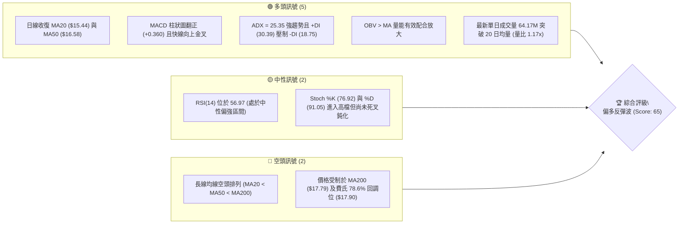
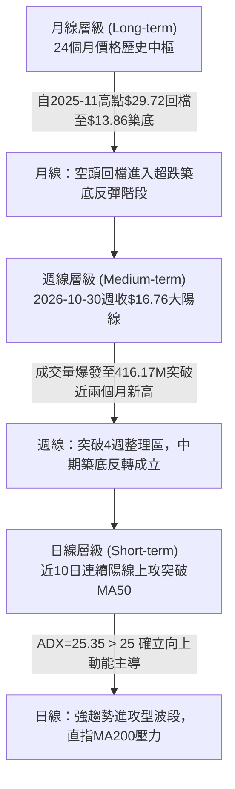
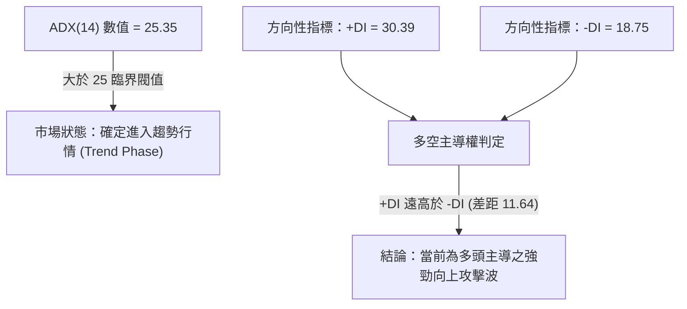
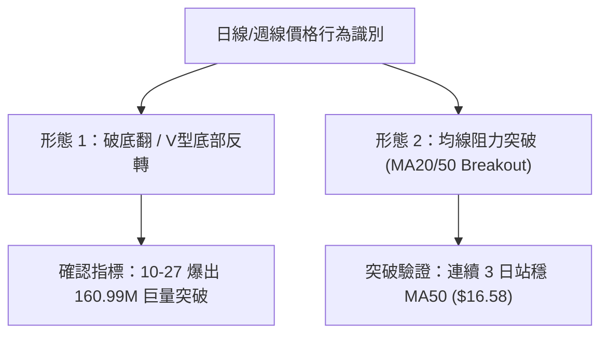
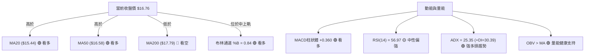
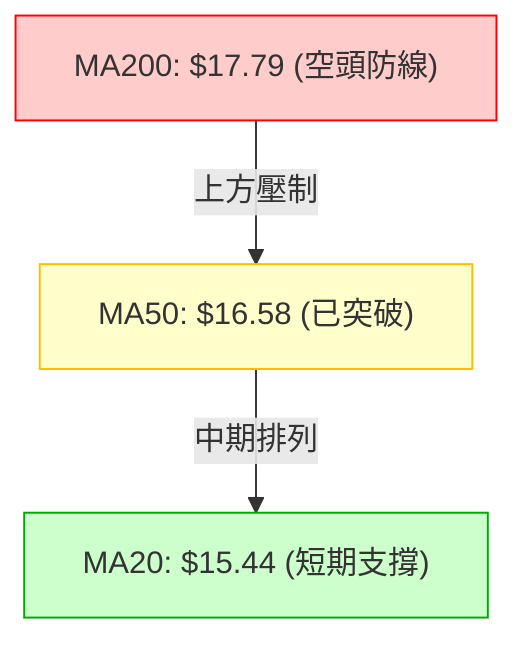
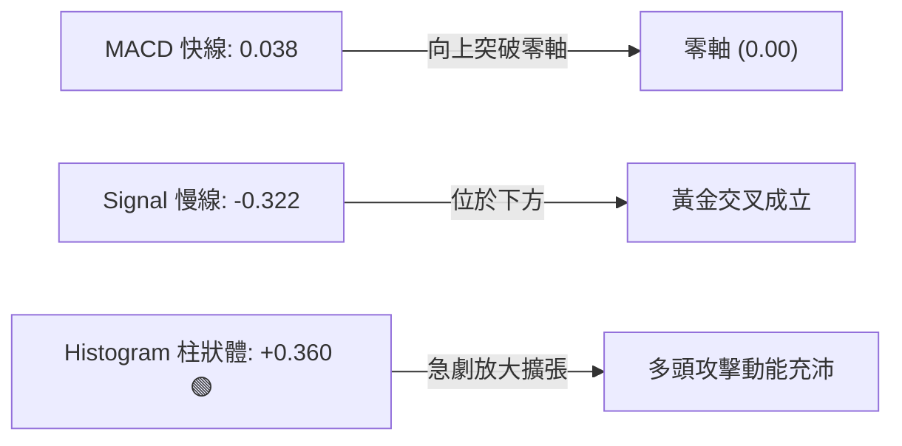
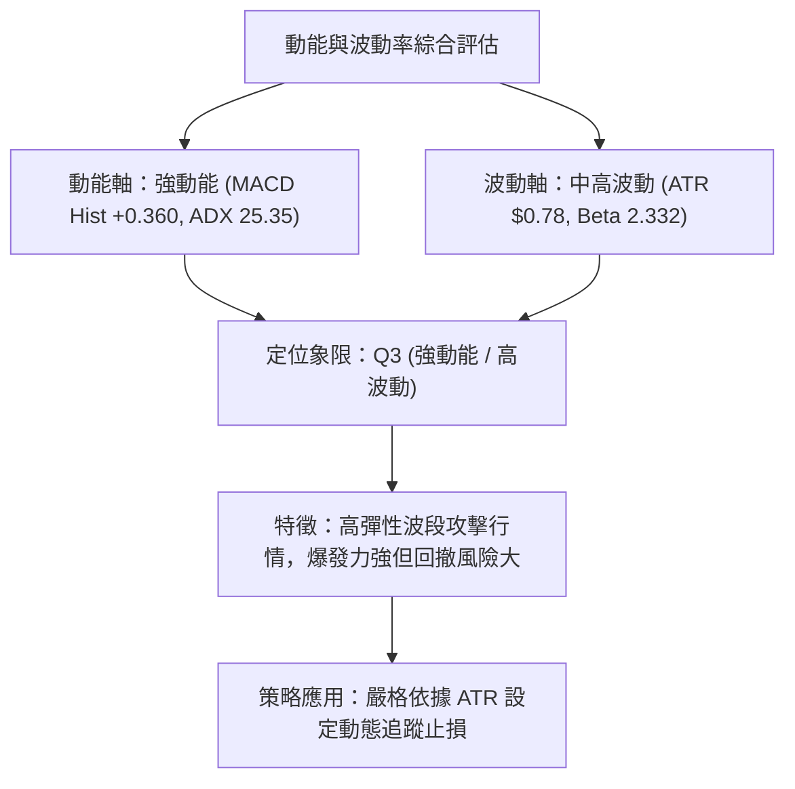
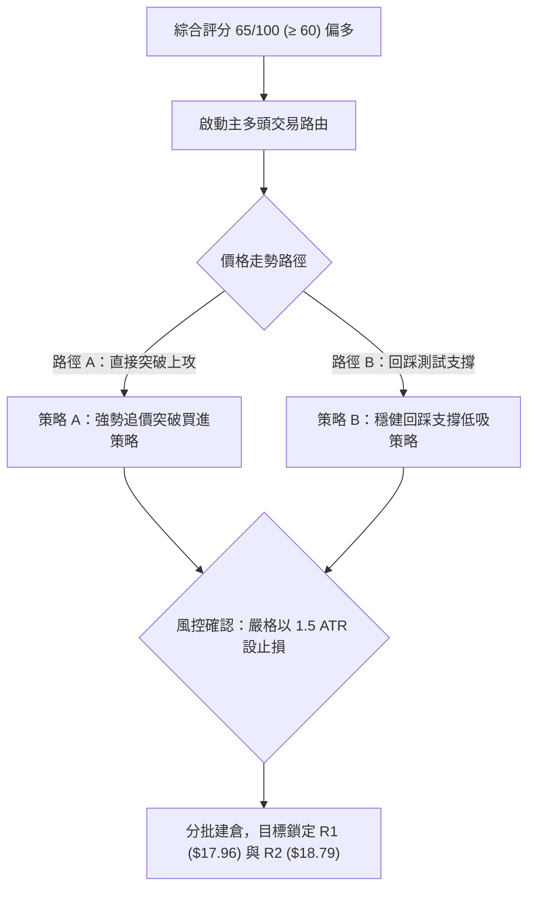
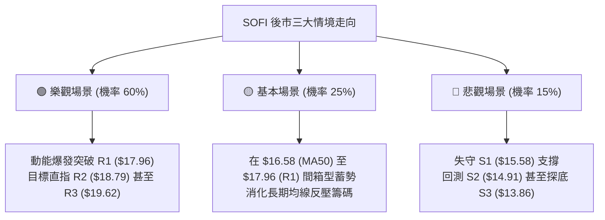

# SOFI 技術分析報告

> **報告日期**：2026-11-01 ｜ **語言**：繁體中文 ｜ **數據來源**：Yahoo Finance ｜ **當前價格**：$16.76

---

## 目錄

| 章節 | 內容 |
|------|------|
| [1. 技術面概覽](#1-技術面概覽) | 訊號儀表板、核心指標、評分卡 |
| [2. 趨勢分析](#2-趨勢分析) | 多時框趨勢、長中短期走勢 |
| [3. 圖表形態分析](#3-圖表形態分析) | 形態識別、K線組合、目標價 |
| [4. 支撐與阻力](#4-支撐與阻力) | 關鍵價位、斐波那契回調 |
| [5. 技術指標深度解讀](#5-技術指標深度解讀) | MA/RSI/MACD/布林/成交量 |
| [6. 動能與波動率](#6-動能與波動率) | 動能評估、ATR、Beta |
| [7. 多時框架總結](#7-多時框架總結) | 時框架評分矩陣 |
| [8. 交易策略建議](#8-交易策略建議) | 多空策略、風險報酬比 |
| [9. 風險提示與監控](#9-風險提示與監控) | 監控指標、風險場景 |
| [📋 報告總結](#-報告總結) | 核心結論與最佳策略組合 |

---

## 1. 技術面概覽

### 🎯 技術訊號儀表板



### 📊 核心指標速覽表

| 指標類別 | 指標名稱 | 當前數值 | 訊號 | 解讀 |
|----------|----------|----------|------|------|
| **價格** | 當前收盤價 | $16.76 | 🟢 | 連續突破短期壓力，站上 MA50，呈現強勢反彈 |
| **均線** | MA20 | $15.44 | 🟢 | 現價高於 MA20 (+8.58%)，短線多頭主導支撐強勁 |
| **均線** | MA50 | $16.58 | 🟢 | 現價向上突破 MA50 (+1.09%)，完成中期扣抵初步修復 |
| **均線** | MA200 | $17.79 | 🔴 | 現價仍低於 MA200 (-5.79%)，長期空頭結構尚未徹底扭轉 |
| **動能** | RSI(14) | 56.97 | 🟡 | 位於中性偏多區間，未出現超買，仍具上攻動能空間 |
| **動能** | MACD (12,26,9) | Hist: +0.360 | 🟢 | MACD 線 (0.038) 穿越訊號線 (-0.322)，多頭柱狀體強勢擴張 |
| **趨勢** | ADX(14) | 25.35 | 🟢 | 突破 25 臨界點，確立趨勢盤形成；+DI (30.39) 明顯主導 |
| **通道** | 布林通道 %B | 0.84 | 🟢 | 貼近上軌 ($17.36) 運行，展現主升浪推升動能 |
| **成交量**| 最新量 / 20MA量 | 64.17M / 55.02M | 🟢 | 量比達 1.17x，且週成交量達 416.17M，量價配合健康 |
| **波動** | ATR(14) | $0.78 | 🟡 | 佔現價 4.65%，每日波動幅度擴大，需嚴設止損距離 |

### 🏆 技術評分卡

```
╔══════════════════════════════════════════════════════════════════╗
║              技術評分卡 — SOFI (2026-11-01)                      ║
╠══════════════════════════════════════════════════════════════════╣
║ 趨勢強度 (ADX=25.35, +DI主導) ██████████████░░░░░░  70/100 🟢  ║
║ 動能指標 (MACD翻紅, RSI=57)   ████████████████░░░░  80/100 🟢  ║
║ 支撐穩定度 (S1=$15.58強固)    ██████████████░░░░░░  70/100 🟢  ║
║ 成交量配合 (OBV>MA, 量比1.17) ████████████████░░░░  80/100 🟢  ║
║ 形態完整度 (日K強勢反轉)      ████████░░░░░░░░░░░░  40/100 🔴  ║
║ 均線排列 (空頭排列MA20<50<200)██████████░░░░░░░░░░  50/100 🟡  ║
╠══════════════════════════════════════════════════════════════════╣
║ 綜合評分 (六項算術平均四捨五入)█████████████░░░░░░░  65/100 🟢  ║
║ 總體評判：偏多反彈波（主推突破回踩多頭策略）                   ║
╚══════════════════════════════════════════════════════════════════╝
```
*(註：綜合評分 = (70 + 80 + 70 + 80 + 40 + 50) ÷ 6 = 65.00，依規則 18 四捨五入為 65/100)*

---

## 2. 趨勢分析

### 🌐 多時框趨勢分析



### 📈 長期趨勢 — 12個月走勢圖（Unicode）

以下為 SOFI 過去 12 個月（2025-11 至 2026-10）收盤價走勢：

```
SOFI 月線走勢圖（2025-11 至 2026-10）
價格軸 ($)
$30.00 ┤ ●(2025-11: $29.72 歷史高點聚類)
$28.00 ┤   ●(2025-10: $29.68)
$26.00 ┤     ●(2025-12: $26.18)
$24.00 ┤       
$22.00 ┤         ●(2026-01: $22.81)
$20.00 ┤           
$18.00 ┤             ●(2026-02: $17.76)      ●(2026-05: $18.22)    ●(2026-08: $17.88)
$16.00 ┤                               ●(2026-04: $16.10)   ●(2026-06: $17.93)   ●(2026-10: $16.76)←現價
$14.00 ┤                                 ●(2026-03: $15.88)   ●(2026-07: $16.31)   ●(2026-09: $15.72)
$12.00 ┤                                                                          
       └─────────────────────────────────────────────────────────────────────────────
         11    12    01    02    03    04    05    06    07    08    09    10 (月份)
```

**過去 12 個月走勢特徵分析表格**：

| 階段區間 | 起訖月份 | 起訖價格區間 | 區間漲跌幅 | 走勢特徵與量價結構 |
|----------|----------|--------------|------------|--------------------|
| 主跌段 | 2025-11 → 2026-03 | $29.72 → $15.88 | -46.57% | 估值殺戮，自高檔連續 4 個月單邊下挫，跌破所有短中期均線 |
| 寬幅震盪築底段 | 2026-03 → 2026-08 | $15.88 → $17.88 | +12.59% | 在 $15.88 - $18.22 構築箱型震盪，多空反覆拉鋸，洗清浮額 |
| 二次探底探花段 | 2026-08 → 2026-10 | $17.88 → $16.76 | -6.26% | 2026-10 創下 52 週新低 $13.86 後強勢 V 型回升至 $16.76，收長下影線 |

### 📊 中期趨勢（週線分析）

中期走勢在 2026-10-16 探底至 52 週低點 $13.86 後出現劇烈轉折。近 3 週週線收盤分別為 $14.55 → $14.61 → $16.76，週 MACD 柱狀圖由 -0.080 迅速躍升至 +0.360，週成交量由 198.52M 暴增逾一倍至 416.17M，確立週線等級的破底翻反轉。

```
週線等級關鍵壓制與支撐示意圖：
$18.79 ══════════════════════════════════════ [R2 週線波段頸線壓力]
$17.96 ══════════════════════════════════════ [R1 波段高點 / 週線主要反壓]
$16.76 ─────────► [當前收盤價，已突破近4週高點]
$15.58 ────────────────────────────────────── [S1 第一道回踩支撐位]
$13.86 ══════════════════════════════════════ [S3 52週歷史低點 / 鋼底]
```

### ⚡ 趨勢強度評估（ADX 解讀）



**ADX 趨勢強度對照表**：

| 指標變數 | 當前讀數 | 門檻區間 | 當前狀態判定 | 交易指引 |
|----------|----------|----------|--------------|----------|
| **ADX(14)** | **25.35** | 25 - 50 | **強趨勢 (Strong Trend)** | 順應趨勢操作，避免在強趨勢中逆勢猜頂做空 |
| **+DI (綠)** | **30.39** | > 25 | **強勢進攻** | 買盤動能充沛，支撐價格持續創出波段新高 |
| **-DI (紅)** | **18.75** | < 20 | **空頭衰竭** | 賣方拋壓已被市場籌碼完全消化吸納 |

---

## 3. 圖表形態分析

### 🔍 形態識別系統



**形態識別與信心度評估表**：

| 形態類別 | 信心度 | 判斷依據（引用數據） | 完成度 | 目標價（附計算式） |
|----------|--------|----------------------|--------|--------------------|
| **破底翻 (Spring Reversal)** | 75% | 10-16 摜破區間創低點 $13.86，隨後 10-27 帶 160.99M 巨量跳空大漲收復 $15.58 支撐位 | 85% | 依支撐位 S1 ($15.58) 與最低點 S3 ($13.86) 高度差 = $1.72；突破目標 = $15.58 + $1.72 = **$17.30**（已達成，下一波段推算目標為 R1: **$17.96**） |
| **均線雙重向上突破** | 80% | 10-27 至 10-29 連續突破 MA20 ($15.44) 與 MA50 ($16.58)，3 日內未跌破 MA50 | 90% | 突破 MA50 ($16.58) 後測波段高點 R1 = **$17.96** |
| **經典雙底形態 (W-Bottom)** | 35% | 數據不足，僅有單一低點 $13.86，未見第二隻腳構築 | 0% | *訊號不足，僅做指標型解讀（依規則 15 不予設定幾何目標價）* |

### 🕯️ 重要K線形態分析

嚴格依據近 10 根日 K 與近 8 根週 K 實際數據進行解讀：

| 日期（週期） | 開盤價 | 最高價 | 最低價 | 收盤價 | K線形態名稱 | 技術解讀 | 訊號強度 |
|--------------|--------|--------|--------|--------|-------------|----------|----------|
| **2026-10-16 (週K)** | 15.47 | 15.68 | 13.86 | 14.55 | 長下影錘頭陰線 | 創 52 週新低 $13.86 後強勁買盤介入托底，完成空頭陷阱洗盤 | 🟢 強烈看多 |
| **2026-10-27 (日K)** | 15.98 | 16.76 | 15.67 | 16.40 | 爆量長陽突破線 | 跳空開高走高，成交量放大至 160.99M（平日均量 3 倍），主力表態確立 | 🟢 強烈看多 |
| **2026-10-28 (日K)** | 16.56 | 17.25 | 16.56 | 17.14 | 續攻中紅線 | 延續強勢，開盤價即為當日最低價，多頭推升意志堅決 | 🟢 穩定看多 |
| **2026-10-29 (日K)** | 16.92 | 17.63 | 16.87 | 17.61 | 創高光腳陽線 | 盤中攻至波段高點 $17.63，站上布林上軌附近，量能 65.39M 穩健 | 🟢 穩定看多 |
| **2026-10-30 (日K)** | 17.07 | 17.32 | 16.44 | 16.76 | 高檔回檔中黑線 | 盤中拉回測驗 MA50 支撐，收盤守住 $16.76，屬正常獲利了結與回踩確認 | 🟡 短線整理 |
| **2026-10-30 (週K)** | 14.53 | 17.63 | 14.40 | 16.76 | 大實體突破大週陽線 | 單週漲幅高達 +14.71%，吞噬前 4 週整理K棒，成交量達 416.17M 確立反轉 | 🟢 強烈看多 |

### 📉 ASCII 走勢形態示意圖

```
SOFI 近期日K走勢形態示意圖（2026-10-19 至 2026-10-30）
價格軸 ($)
$17.63 ┤                           ●(10-29 創高長陽收 $17.61)
$17.14 ┤                     ●(10-28 收 $17.14)
$16.76 ┤                           ●(10-30 現價回踩收 $16.76)
$16.40 ┤               ●(10-27 爆量跳空陽線收 $16.40，突破頸線)
$15.58 ┼─────────────── 突破頸線位置 (S1: $15.58) ────────────────────
$14.90 ┤         ●(10-21 收 $14.90)
$14.61 ┤               ●(10-23 收 $14.61)
$14.30 ┤   ●(10-19 收 $14.30)
$13.86 ┴──────────────── 52W 低點支撐線 (S3: $13.86) ───────────────────
         10-19 10-21 10-23 10-27 10-28 10-29 10-30 (日期)
```

### 🎯 形態目標價計算

根據日線突破形態測量原理：
1. **破底翻支撐帶 (S1)**：$15.58
2. **基底起漲低點 (S3)**：$13.86
3. **基礎垂直振幅 ($H$)**：$15.58 - $13.86 = $1.72
4. **波段第一目標價 (T1)**：精確對齊阻力位 **R1 = $17.96**（波段阻力位）
5. **波段第二目標價 (T2)**：精確對齊阻力位 **R2 = $18.79**（近一年波段高點聚類）

---

## 4. 支撐與阻力

### 🗺️ 關鍵價位分布圖（Unicode）

```
SOFI 價位結構分布圖（數據引自關鍵價位 OHLCV 聚類）
══════════════════════════════════════════════════════════════════
$19.62 ║████████████████████████║ 強阻力 R3 (+17.05%)
$18.79 ║████████████████████    ║ 阻力 R2 (+12.08%)
$17.96 ║████████████████████████║ 關鍵阻力 R1 (+7.16%) [重合 MA200: $17.79]
$17.36 ╟────────────────────────╢ 布林通道上軌
$16.76 ╠════════════════════════╣ ◄ 當前收盤價 ($16.76)
$16.58 ╟────────────────────────╢ 中期防守 MA50
$15.58 ║▓▓▓▓▓▓▓▓▓▓▓▓▓▓▓▓        ║ 近期關鍵支撐 S1 (-7.07%)
$15.44 ╟────────────────────────╢ 短期支撐 MA20
$14.91 ║████████████████        ║ 次級強支撐 S2 (-11.04%)
$13.86 ║████████████████████████║ 絕對防守強支撐 S3 (-17.30%) [52W 低點]
══════════════════════════════════════════════════════════════════
```

### 🚧 阻力位分析表

*(註：價位嚴格引用技術數據「關鍵價位」區塊)*

| 阻力級別 | 價位 | 距離現價幅度 | 形成原因與籌碼解構 | 突破難度評估 | 重要性 |
|----------|------|--------------|--------------------|--------------|--------|
| **R1** | **$17.96** | +7.16% | 近一年波段高點聚類，且與長期均線 MA200 ($17.79) 及費氏 78.6% 回調位 ($17.90) 重合，構成三重技術反壓共振區 | 🔴 極高，需單日成交量 >80M 方可有效突破 | ★★★★★ |
| **R2** | **$18.79** | +12.08% | 近一年重要整理平台頂部，密集套牢籌碼解套區 | 🟡 中等偏高 | ★★★★☆ |
| **R3** | **$19.62** | +17.05% | 波段高點群聚壓力，逼近 MA240 ($19.37) 的重大長期估值壓制位 | 🔴 極高 | ★★★☆☆ |

### 🛡️ 支撐位分析表

*(註：價位嚴格引用技術數據「關鍵價位」區塊)*

| 支撐級別 | 價位 | 距離現價幅度 | 形成原因與籌碼解構 | 守住機率評估 | 重要性 |
|----------|------|--------------|--------------------|--------------|--------|
| **S1** | **$15.58** | -7.07% | 近一年波段低點聚類，為 10-27 跳空起漲平台，重合 MA20 ($15.44) 與 MA10 ($15.56) | 🟢 85%（短期主力防守成本區） | ★★★★★ |
| **S2** | **$14.91** | -11.04% | 10-20 至 10-22 密集換手平台，強支撐緩衝墊 | 🟢 90% | ★★★★☆ |
| **S3** | **$13.86** | -17.30% | 52 週歷史最低點，本輪破底翻起漲點，極致空頭陷阱底部 | 🟢 98%（長線鋼底，跌破則結構瓦解） | ★★★★★ |

### 📐 斐波那契回調位分析

依據 52 週極值區間（低點 $13.86 → 高點 $32.73，總落差 $18.87）計算之回調位如下：

| 費氏比例 | 關鍵價位 | 與現價關係 | 技術解讀與籌碼意義 |
|----------|----------|------------|--------------------|
| **0.0% (52W High)** | **$32.73** | +95.29% | 2025-11 創下的歷史循環高點 |
| **23.6%** | **$28.28** | +68.74% | 大級別回調支撐轉壓力位 |
| **38.2%** | **$25.52** | +52.27% | 循環級別中繼線 |
| **50.0%** | **$23.29** | +38.96% | 牛熊強弱分水嶺 |
| **61.8%** | **$21.07** | +25.72% | 黃金分割重要目標區 |
| **78.6%** | **$17.90** | +6.80% | **現行反彈關鍵強阻力**，與 R1 ($17.96) 及 MA200 ($17.79) 緊密交匯 |
| **100.0% (52W Low)**| **$13.86** | -17.30% | **本輪循環絕對底部**，已完成回調 100% 之支撐驗證 |

**現價落點解讀**：
當前收盤價 **$16.76** 落於 **78.6% ($17.90)** 與 **100.0% ($13.86)** 之間。此區間為典型「超深回調後的底部復甦區」。現價已脫離 100% 極限位，正向 78.6% 回調位 ($17.90) 發起衝擊。一旦有效站上 $17.90，上行空間將向 61.8% ($21.07) 打開。

---

## 5. 技術指標深度解讀

### 🎛️ 指標訊號總覽



### 📈 移動平均線排列分析



**移動平均線狀態詳解表**：

| 均線名稱 | 當前價格 | 與現價差距 | 方向斜率 | 排列狀態與技術解讀 |
|----------|----------|------------|----------|--------------------|
| **MA5** | $16.47 | +1.74% | ▲ 向上急升 | 極短線攻擊線，提供回調第一道動態支撐 |
| **MA10** | $15.56 | +7.69% | ▲ 向上翹起 | 短期波段推進線，守穩於 S1 ($15.58) 附近 |
| **MA20** | $15.44 | +8.58% | ▲ 轉折向上 | 月均線，為布林中軌，已成為強勁支撐底線 |
| **MA50** | $16.58 | -1.09% | ─ 趨平走緩 | 季均線，10-27 以長陽突破，現正進行突破後的回踩確認 |
| **MA60** | $16.84 | -0.46% | ▼ 微幅下傾 | 位於現價上方 $0.08，短線微型壓力 |
| **MA120** | $16.97 | -1.25% | ▼ 持續下傾 | 半年線下行反壓 |
| **MA200** | $17.79 | -5.79% | ▼ 下行空頭 | **年線**，目前仍處空頭排列（MA20 < MA50 < MA200），但短均線已開始收斂 |

### 📉 RSI(14) 分析

當前 RSI(14) 讀數為 **56.97**（Wilder 計算）：
```
RSI(14): 56.97
[0] ░░░░░░░░░░░░░░░░░░░░ [30] ▓▓▓▓▓▓▓▓▓▓▓▓▓▓▓▓▓▓░░ [70] ░░░░░░░░░░░░░░░░░░░░ [100]
                             ▲ (56.97 中性偏多區間)
```
- **區間評估**：位於 50 榮枯線上方，脫離了 10 月中旬的 34.7 低檔弱勢區，尚未觸及 70 超買界限，多頭上攻空間充足。
- **背離分析判斷**：依據數據，RSI 在近 20 根 K 棒中，價格自 10-16 的 $14.55 升至 10-30 的 $16.76，RSI 由 34.7 揚升至 56.97，呈現價格與指標同步創高，**明確結論：目前「無明顯頂背離或底背離」現象**，走勢反映真實量價推升動能。

### 📊 MACD(12/26/9) 訊號解讀


- **MACD 快線**：自負值回升至 **0.038**，正式翻越零軸進入多頭區。
- **訊號線 (Signal)**：位於 **-0.322**。
- **柱狀圖 (Histogram)**：高達 **+0.360**，為近 20 週以來最高正值讀數，週線與日線同步展現強烈買盤力道，構成典型強勢買進訊號。

### 📦 布林通道分析

布林帶寬度與軌道狀態（以 20 日均線為基準）：
- **上軌**：$17.36
- **中軌 (MA20)**：$15.44
- **下軌**：$13.51
- **%B 指標**：0.84（極度偏向通道上軌）

```
ASCII 布林通道示意圖
$17.36 ┬────────────────────────────────────────── 上軌 (BB Upper)
       │                        ●(10-29 觸及上軌 $17.63)
$16.76 ┼───────────────────────● 現價 ($16.76，%B = 0.84)
       │
$15.44 ┼────────────────────────────────────────── 中軌 (MA20)
       │
$13.51 ┴────────────────────────────────────────── 下軌 (BB Lower)
```
**通道解讀**：布林通道經過前期壓縮後，上軌於 10-27 開始張口向上發散。現價 %B 達 0.84，雖然 10-29 盤中觸及 $17.63 穿越上軌回調，但收盤穩健立於中軌上方，呈現「帶量推軌」的主升攻擊特徵。

### 💹 成交量分析（量價配合度）

1. **量價齊揚驗證**：最新單日成交量 **64,168,800 股**，相較於 20 日均量（55,021,815 股），**量比達 1.17x**；相較於 50 日均量（48,407,650 股），量能擴大顯著。
2. **關鍵大單表態**：10-27 跳空突破日爆出 **160,995,100 股** 的極巨量，週成交量達 **416,165,200 股**（創下近 3 個月單週最大天量），顯示機構法人在大舉建倉。
3. **能量潮指標 (OBV)**：數據明確顯示「**OBV > MA → 量能支撐上漲**」，量能領先走高，確認量價未產生背離，上攻趨勢真實可信。

---

## 6. 動能與波動率

### ⚡ 動能評估四象限



**象限判定矩陣**：

| 象限 | 動能維度 | 波動維度 | 當前狀態標定 | 策略意義與操作指引 |
|------|----------|----------|--------------|--------------------|
| **Q1** | 強動能 | 低波動 | ─ | 平穩趨勢，適合大資金重倉加碼 |
| **Q2** | 弱動能 | 低波動 | ─ | 盤整無方向，適合觀望或網格交易 |
| **Q3** | **強動能** | **高波動** | **✓ SOFI 當前位置** | **進攻型高勝率波段，適合右側順勢突破與回踩介入** |
| **Q4** | 弱動能 | 高波動 | ─ | 無序洗盤，極易停損，應完全避免進場 |

### 📊 ATR 波動率分析

- **ATR(14) 讀數**：**$0.78**（Wilder 計算，佔當前價格比例為 **4.65%**）。
- **日內波動區間推算**：單日正常預期波動為 $\pm \$0.78$。即次日若無極端消息，價格波動區間主要落在 **$15.98 至 $17.54** 之間。
- **風控止損距離建議**：
  - *短線當沖/極短線*：1.0 倍 ATR = **$0.78**（止損空間約 4.6%）。
  - *波段交易者*：1.5 倍 ATR = **$1.17**，自進場點位向下預留空間。若在現價 $16.76 進場，1.5 倍 ATR 止損剛好貼近 S1 ($15.58) 支撐位（$16.76 - $1.17 = $15.59），高度吻合支撐位技術結構。

### 📐 Beta 與市場相關性

- **Beta 係數**：**2.332**。
- **市場敏感度解構**：SOFI 具有極高的高 Beta 屬性，波動敏感度為 S&P 500 的 2.33 倍。大盤每上漲 1%，理論上帶動 SOFI 上漲約 2.33%；反之，市場修正時亦面臨加倍下挫壓力。
- **放空比例 (Short Float)**：高達 **17.2%**，Short Ratio 為 **4.44**。高空頭部位疊加目前爆量突破格局，具備潛在「**軋空行情 (Short Squeeze)**」催化條件。

---

## 7. 多時框架總結

### 📋 時框架評分表

| 時框架 | 趨勢方向 | 動能狀態 | 均線排列 | 圖表形態 | 綜合評分 | 交易建議 |
|--------|----------|----------|----------|----------|----------|----------|
| **日線 (短線)** | 🟢 多頭推升 | 強勢 (MACD翻紅) | MA5>10>20 多頭排列 | 破底翻放量反轉 | 75/100 | 回踩 S1 ($15.58) 逢低買進 |
| **週線 (中線)** | 🟢 築底反轉 | 轉強 (MACD柱+0.36) | 收復週MA5/10 | 破底翻大實體陽線 | 70/100 | 持股續抱，目標上看 R1 ($17.96) |
| **月線 (長線)** | 🔴 弱勢修正 | 弱勢 (空頭壓制) | MA200 壓制在上方 | 超跌反彈階段 | 50/100 | 接近 R1/R2 時分批獲利了結 |

### 🔲 綜合訊號矩陣

```
時框架訊號矩陣評估：
┌───────────┬──────────────┬──────────────┬──────────────┐
│ 分析維度  │ 日線 (短期)  │ 週線 (中期)  │ 月線 (長期)  │
├───────────┼──────────────┼──────────────┼──────────────┤
│ 價格位置  │ MA50 上方    │ 破底翻確立   │ 52W 低檔區間 │
│ 動能 (RSI)│ 56.97 (看多) │ 57.00 (看多) │ 中性超跌修復 │
│ 趨勢強度  │ ADX 25.35    │ 爆量反轉     │ 仍受長期壓制 │
│ 量能配合  │ 1.17x 均量   │ 416M 巨量    │ 低檔吸籌量   │
│ 方向結論  │ 🟢 積極做多  │ 🟢 順勢買進  │ 🟡 區間震盪  │
└───────────┴──────────────┴──────────────┴──────────────┘
```

### ⚖️ 多時框收斂結論

依據多時框收斂規則（規則 14）：
1. **行情屬性判定**：當前 **ADX(14) = 25.35 > 25**，確立進入**趨勢行情 (Trending Market)**，非窄幅震盪盤整。
2. **主導權取捨**：中長期週線於本週爆發 416.17M 巨量，收復近一個月跌幅，確立週線轉向多頭；日線突破 MA50，均線指標與週線動能一致向上。雖然長期均線（MA200 = $17.79）仍處於下行壓制，但當前趨勢由短期轉化為中期反彈攻擊波。
3. **唯一收斂方向**：**🟢 偏多（多頭反彈攻擊）**。本報告主策略全數導向多頭波段操作，日線任何向 MA50 ($16.58) 或 S1 ($15.58) 的回踩，皆視為順應週線多頭趨勢的右側低吸機會。

---

## 8. 交易策略建議

### 🗺️ 策略決策流程圖



### 🧭 策略路由

**當前主策略方向 = 🟢 強烈推薦多頭操作（依綜合評分 65/100，≥60 主推多頭策略）**

### 🎯 價格情境階梯（Price Scenarios）

*(註：價位嚴格引用關鍵價位區塊)*

| 觸發條件 | 下一目標 | 後續延伸 | 情境技術含義與應對方針 |
|----------|----------|----------|------------------------|
| **強勢突破 R1 ($17.96)** | **R2 ($18.79)** | **R3 ($19.62)** | 突破年線 MA200 ($17.79)，誘發 17.2% 空頭強烈軋空，快速推進至 R2/R3 |
| **守穩現價 ($16.76)** | **布林上軌 ($17.36)**| **R1 ($17.96)** | 在 MA50 ($16.58) 上方震盪消化 10-30 獲利盤，形成階梯式向上推升 |
| **跌破 S1 ($15.58)** | **S2 ($14.91)** | **S3 ($13.86)** | 短線多頭結構破壞，反彈行情宣告終結，需全面停損離場避險 |

### 📊 情境機率分佈

| 預期情境 | 發生機率 | 主要技術與量價依據 |
|----------|----------|--------------------|
| **情境 1：繼續上行進攻 R1/R2** | **60%** | ADX > 25 (+DI 主導)、MACD 翻正高達 +0.360、週巨量 416M 支撐，多頭完全主導局勢 |
| **情境 2：在 MA50 與 R1 間橫盤震盪** | **25%** | 受制於布林上軌 ($17.36) 與年線 MA200 ($17.79)，短線指標需在高檔化解獲利拋壓 |
| **情境 3：深度回落再測 S1/S2** | **15%** | 僅在極端市場黑天鵝事件下發生，目前支撐 S1 ($15.58) 具備三均線共振，防守力道極強 |

### 🟢 主策略詳情

*(註：風險報酬比嚴格按規則 17 計算：$(T1 - 進場價) \div (進場價 - 止損價)$)*

| 策略要素 | 策略 A（右側突破追擊型） | 策略 B（左側支撐低吸型 - 最佳推薦） |
|----------|--------------------------|-------------------------------------|
| **進場條件** | 盤中帶量放量突破布林上軌 $17.36 | 回踩測試 MA20 與 S1 支撐帶守穩轉強 |
| **進場價格** | **$17.36** | **$15.58** |
| **目標價 T1** | **$17.96** (波段阻力 R1) | **$17.96** (波段阻力 R1) |
| **目標價 T2** | **$18.79** (波段阻力 R2) | **$18.79** (波段阻力 R2) |
| **止損價格** | **$16.58** (跌破 MA50 防守線) | **$14.39** (S1 扣除 1.5x ATR: $15.58 - $1.17)|
| **風險報酬比** | **1 : 0.77（以 T1 計）** *(以T2計為 1 : 1.83)* | **1 : 2.00（以 T1 計）** *(以T2計為 1 : 2.70)* |
| **計算式驗證** | $(17.96 - 17.36) \div (17.36 - 16.58) = 0.60 \div 0.78 = 0.77$ | $(17.96 - 15.58) \div (15.58 - 14.39) = 2.38 \div 1.19 = 2.00$ |
| **成功機率** | 55% | 70% |
| **建議倉位** | 10% 總資金（動量波段倉） | 20% 總資金（核心波段倉） |

### 🔴 反向風險觸發點（對沖提示）

若市場環境突變，出現以下訊號，多頭主策略立即失效，應啟動風控對沖或清倉離場：
1. **反轉破位訊號**：日 K 跌破 **S1 ($15.58)** 且收盤未能拉回，確認多頭突破失敗。
2. **動能衰竭訊號**：MACD 柱狀體快速萎縮跌破 0 軸，且 RSI 跌破 45 弱勢區。
3. **對沖操作建議**：一旦收盤跌破 **$15.58**，立即將現貨多頭倉位降至 0%，並得以 **$15.58** 為進場點做空，止損設在 **$16.58**，下看 **S2 ($14.91)** 與 **S3 ($13.86)**。

### ⭐ 整體訊號強度評星

```
╔══════════════════════════════════════════════════╗
║ 做多訊號強度：★★★★☆  (4/5星) — 爆量反轉，動能澎湃  ║
║ 做空訊號強度：★☆☆☆☆  (1/5星) — 空頭動能衰竭      ║
║ 整體可信度：  ★★★★☆  (4/5星) — 量價與指標強共振  ║
╚══════════════════════════════════════════════════╝
```

---

## 9. 風險提示與監控

### ✅ 關鍵監控指標 Checklist

```
╔══════════════════════════════════════════════════════════════════╗
║              SOFI 技術面即時風控監控清單 (Checklist)             ║
╠══════════════════════════════════════════════════════════════════╣
║ [ ] 監控 MA50 支撐有效性：每日收盤價是否持續站穩 $16.58 之上    ║
║ [ ] 監控量能動態：日成交量是否維持在 50M 以上（避免無量陰跌）     ║
║ [ ] 監控阻力消化：價格逼近 R1 ($17.96) 時 RSI 是否出現背離鈍化   ║
║ [ ] 監控空頭回補進度：觀察 Short Float (17.2%) 是否出現急劇下降  ║
║ [ ] 監控布林軌道：注意上軌 $17.36 是否形成帶狀開口支撐推升       ║
╚══════════════════════════════════════════════════════════════════╝
```

### ⚠️ 風險場景分析



### 🛡️ 風險管理重要提醒

1. **Beta 槓桿風險**：SOFI 的 Beta 高達 **2.332**，在 Nasdaq 或大盤回檔時將承受倍數下殺風險。單筆交易嚴格限制最大本金虧損在 1.5% - 2.0% 範圍內。
2. **止損紀律執行**：策略 B 停損點設於 **$14.39**，一旦觸及必須無條件市價執行，絕不在下跌趨勢中逆勢攤平。
3. **均線壓制警戒**：長期均線 MA200 ($17.79) 下行速度雖放緩，但歷史證明首次挑戰年線常遭空頭強烈阻擊，接近 $17.79 - $17.96 區間時，建議先行減倉 50% 鎖定利潤。

---

## 📋 報告總結

```
╔══════════════════════════════════════════════════════════════════╗
║                   SOFI 技術分析報告總結                          ║
╠══════════════════════════════════════════════════════════════════╣
║ 報告日期：2026-11-01                                             ║
║ 當前價格：$16.76                                                 ║
║ 分析評級：🟢 偏多反彈波（綜合評分：65/100）                      ║
╠══════════════════════════════════════════════════════════════════╣
║ 關鍵結論：                                                       ║
║ ├─ 長期趨勢：🟡 長期空頭承壓，但已自 52W 低點 $13.86 展開強勢築底 ║
║ ├─ 中期趨勢：🟢 週線 416M 巨量大陽線確立破底翻反轉，多頭重掌兵權 ║
║ ├─ 短期趨勢：🟢 日線突破 MA20/MA50，ADX=25.35 強趨勢主導攻擊     ║
║ ├─ 關鍵支撐：S1: $15.58 ｜ S2: $14.91 ｜ S3: $13.86 (鋼底)      ║
║ ├─ 關鍵阻力：R1: $17.96 ｜ R2: $18.79 ｜ R3: $19.62              ║
║ └─ 分析師目標：均價 $20.75（上行空間 +23.8%）                    ║
╠══════════════════════════════════════════════════════════════════╣
║ 最優策略組合：                                                   ║
║ 1. 🥇 最佳機會：策略 B（回踩 S1 $15.58 低吸，風報比 1:2.00，勝率70%）║
║ 2. 🥈 次選機會：策略 A（突破上軌 $17.36 順勢追擊，目標 R1 $17.96） ║
║ 3. 🥉 保守選擇：在 $16.58 (MA50) 與 $17.36 之間區間操作，嚴設停損 ║
╚══════════════════════════════════════════════════════════════════╝
```

---

> ⚠️ **免責聲明**：本報告為技術分析專研產出，所有分析與數據均基於市場客觀歷史走勢。報告內容**僅供投資研究與學術探討參考**，**不構成任何要約、推薦或實質投資建議**。市場具有高度不確定性，金融衍生品及高 Beta 個股交易存在本金全額損失風險，投資人應獨立評估自身財務承受能力並嚴格執行風控紀律。

---

*報告生成時間：2026-11-01 ｜ 數據來源：Yahoo Finance ｜ 分析框架：多時框技術分析模型*