# SOFI 技術分析報告

> **報告日期**：2026-11-02 ｜ **語言**：繁體中文 ｜ **數據來源**：Yahoo Finance ｜ **當前價格**：$16.76 USD

---

## 目錄

| 章節 | 內容 |
|------|------|
| [1. 技術面概覽](#1-技術面概覽) | 訊號儀表板、核心指標、評分卡 |
| [2. 趨勢分析](#2-趨勢分析) | 多時框趨勢、長中短期走勢 |
| [3. 圖表形態分析](#3-圖表形態分析) | 形態識別、K線組合、目標價 |
| [4. 支撐與阻力](#4-支撐與阻力) | 關鍵價位、斐波那契回調 |
| [5. 技術指標深度解讀](#5-技術指標深度解讀) | MA/RSI/MACD/布林/成交量 |
| [6. 動能與波動率](#6-動能與波動率) | 動能評估、ATR、Beta |
| [7. 多時框架總結](#7-多時框架總結) | 時框架評分矩陣 |
| [8. 交易策略建議](#8-交易策略建議) | 多空策略、風險報酬比 |
| [9. 風險提示與監控](#9-風險提示與監控) | 監控指標、風險場景 |

---

## 1. 技術面概覽

### 🎯 技術訊號儀表板

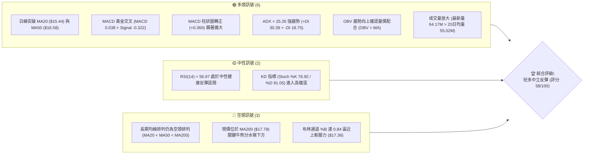

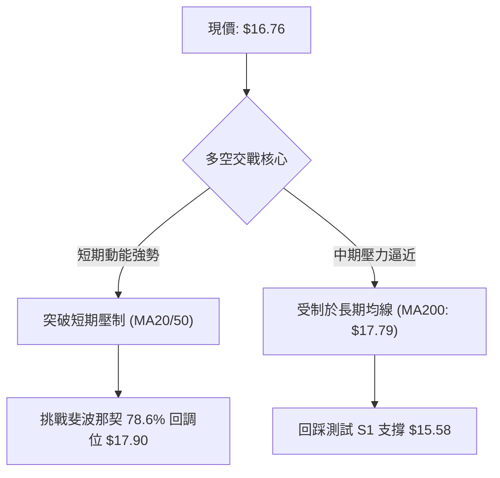

### 📊 核心指標速覽表

| 指標類別 | 指標名稱 | 當前數值 | 訊號 | 解讀 |
|----------|----------|----------|------|------|
| **價格** | 當前收盤價 | $16.76 | 🟢 看多 | 站上日線布林中軌，自 52 週低點附近強力反彈 |
| **均線** | MA20 | $15.44 | 🟢 看多 | 現價位於 MA20 上方 (+8.58%)，短期走勢強勁翻多 |
| **均線** | MA50 | $16.58 | 🟢 看多 | 現價突破 MA50 (+1.09%)，化解中期加速下行風險 |
| **均線** | MA200 | $17.79 | 🔴 看空 | 現價仍位於 MA200 下方 (-5.79%)，長期趨勢未反轉 |
| **均線排列** | MA結構 | MA20<50<200 | 🔴 看空 | 均線系統呈空頭排列，目前為熊市結構下的強勁反彈 |
| **動能** | RSI(14) | 56.97 | 🟡 中性 | 動能脫離弱勢區間進入擴張期，無超買亦無背離現象 |
| **動能** | MACD(12,26,9) | 0.038 / -0.322 | 🟢 看多 | 快線向上穿越慢線形成零軸金叉，柱狀圖 +0.360 擴張 |
| **趨勢** | ADX / ±DI | 25.35 | 🟢 看多 | ADX > 25 確立趨勢形成，+DI (30.39) 壓制 -DI (18.75) |
| **通道** | Bollinger Bands | 上軌 $17.36 / 中軌 $15.44 | 🟡 中性 | %B 為 0.84，接近通道上軌，短線進入震盪博弈區 |
| **量能** | 20日成交量比 | 1.17x (64.17M) | 🟢 看多 | 突破量能超越 20日均量 (55.02M)，OBV 確認多頭 |
| **波動** | ATR(14) | $0.78 (4.65%) | 🟡 中性 | 每日波動幅度適中，提供操作空間但需注意風控止損 |

### 🏆 技術評分卡

```
╔══════════════════════════════════════════════════════════════════════════╗
║                    技術評分卡 — SOFI (2026-11-02)                        ║
╠══════════════════════════════════════════════════════════════════════════╣
║ 趨勢強度 (ADX=25.35, +DI主導)        ██████████████░░░░░░  70/100  🟢 看多  ║
║ 動能指標 (MACD金叉, RSI=56.97)       ███████████████░░░░░  75/100  🟢 看多  ║
║ 支撐穩定度 (S1=$15.58, S2=$14.91)    ████████████░░░░░░░░  60/100  🟡 中性  ║
║ 成交量配合 (量比1.17x, OBV多頭)      ██████████████░░░░░░  70/100  🟢 看多  ║
║ 形態完整度 (V型強彈但未過頸線)       ██████████░░░░░░░░░░  50/100  🟡 中性  ║
║ 均線排列 (空頭排列, 現價<MA200)      ████░░░░░░░░░░░░░░░░  20/100  🔴 看空  ║
╠══════════════════════════════════════════════════════════════════════════╣
║ 綜合評分 (六項算術平均四捨五入)      ███████████░░░░░░░░░  58/100  🟡 中性偏多║
╚══════════════════════════════════════════════════════════════════════════╝
```

---

## 2. 趨勢分析

### 🌐 多時框趨勢分析

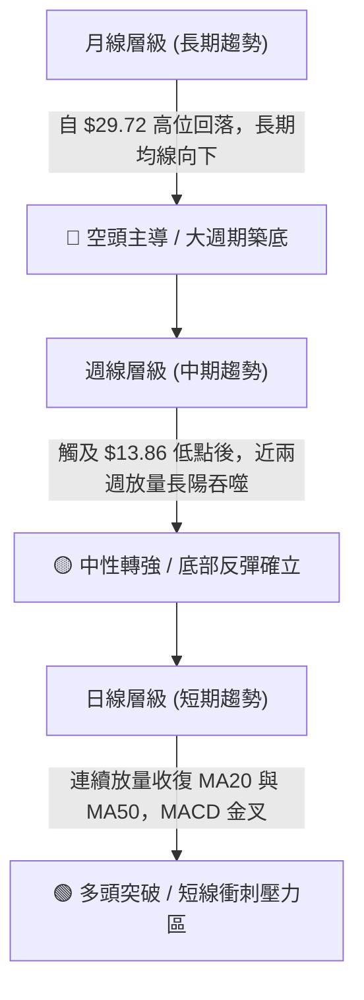

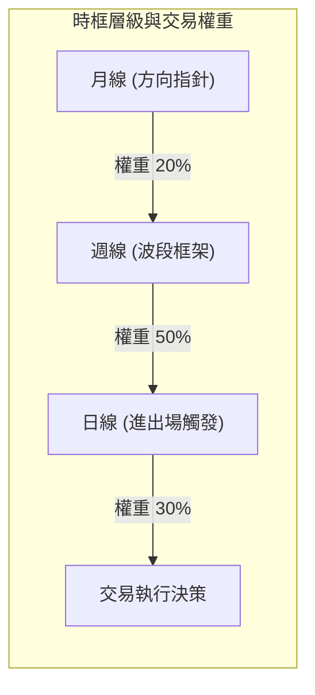

### 📈 長期趨勢 — 12個月走勢圖（Unicode）

以過去 12 個月（2025-11 至 2026-10）收盤價歷史數據繪製長線走勢圖：

```
SOFI 月線走勢圖（過去12個月：2025-11 至 2026-10）
價格軸 ($)
$30.00 ┤ ●(2025-11: 29.72)
$27.00 ┤    ●(2025-12: 26.18)
$24.00 ┤       ●(2026-01: 22.81)
$21.00 ┤
$18.00 ┤          ●(2026-02: 17.76) ── ●(2026-05: 18.22)
$17.00 ┤                                  ●(06: 17.93)   ●(08: 17.88)
$16.00 ┤             ●(2026-03: 15.88) ─ ●(04: 16.10)   ●(07: 16.31)    ●(10: 16.76)←現價
$15.00 ┤                                                              ●(09: 15.72)
$13.00 ┤
       └────────────────────────────────────────────────────────────────────────────
        11   12   01   02   03   04   05   06   07   08   09   10  (月份)
```

#### 走勢特徵分析表格

| 階段區間 | 時間段 | 價格變動 | 漲跌幅 | 走勢特徵與技術解讀 |
|----------|--------|----------|--------|--------------------|
| 第一階段：見頂回落 | 2025-11 ~ 2026-02 | $29.72 → $17.76 | -40.24% | 創下歷史高位後資金大規模獲利了結，連續三個月長陰破位 |
| 第二階段：低檔箱型 | 2026-03 ~ 2026-06 | $15.88 → $17.93 | +12.91% | 在 $15.50–$18.50 構築寬幅震盪箱型，籌碼完成初步沉澱 |
| 第三階段：二次探底 | 2026-07 ~ 2026-09 | $17.93 → $15.72 | -12.33% | 箱型上軌遇阻回調，逐月下探測試底部支撐，量能萎縮 |
| 第四階段：止跌放量 | 2026-10 (最新收盤) | $15.72 → $16.76 | +6.62% | 探至 52週低點 $13.86 後強勁抽腳反彈，單月收出帶長下影線長陽 |

### 📊 中期趨勢（週線分析）

中期走勢顯示，2026-10-16 當週股價下探至 52 週最低點 $13.86，隨後連續兩週放量拉升。2026-10-30 當週錄得 416,165,200 股的巨幅週成交量，週 RSI 自 34.7 快速拉升至 57.0，週 MACD 柱狀圖由 -0.080 強勁翻正至 +0.360，確立中期波段由空轉多。

```
中期週線支撐與阻力結構示意圖
阻力 R3  $19.62 ────────────────────────────────────────── 波段上軌阻力聚類
阻力 R2  $18.79 ────────────────────────────────────────── 8月反彈高點壓力
阻力 R1  $17.96 ────────────────────────────────────────── 關鍵阻力 / 密集成交區 (現價上方 +7.16%)
現價     $16.76  ▲▲▲ (放量反彈衝刺中)
支撐 S1  $15.58 ────────────────────────────────────────── 近期突破之均線密集支撐位
支撐 S2  $14.91 ────────────────────────────────────────── 波段平台支撐
支撐 S3  $13.86 ────────────────────────────────────────── 52週最低點 / 強力防守底線
```

### ⚡ 趨勢強度評估（ADX 解讀）

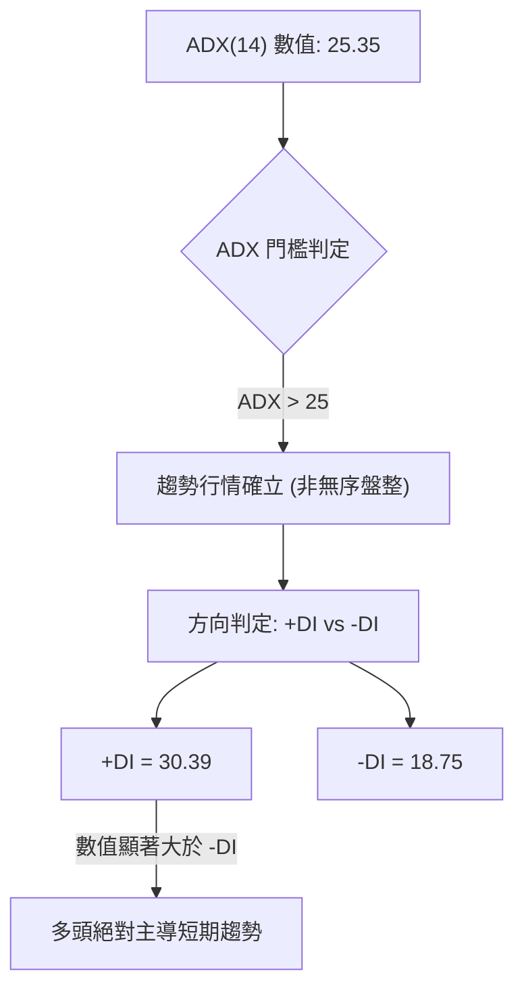

#### ADX 指標強度對照表

| 指標變數 | 當前讀數 | 門檻區間 | 技術意義 | 結論 |
|----------|----------|----------|----------|------|
| **ADX(14)** | **25.35** | > 25.00 | 超過趨勢臨界線，走勢具備方向性延續力 | 🟢 強趨勢成形 |
| **+DI** | **30.39** | > 25.00 | 多頭進攻買盤積極，主導市場動能 | 🟢 多方進攻 |
| **-DI** | **18.75** | < 20.00 | 空方壓制力道顯著衰退，回檔空間受限 | 🟢 空方衰退 |
| **DI 差值** | **+11.64** | 正擴散 | 趨勢開口擴大，有利多方波段延續 | 🟢 趨勢利多 |

---

## 3. 圖表形態分析

### 🔍 形態識別系統

依據嚴格規則 15，僅依據具備高置信度的價格與指標結構進行形態解讀：

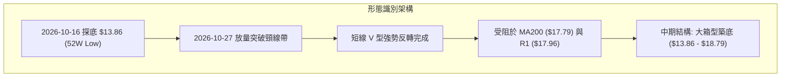

#### 形態識別與信心度評估表

| 形態類別 | 信心度 (%) | 判斷依據（引用數據） | 完成度 (%) | 目標價（附嚴謹計算式） |
|----------|------------|----------------------|------------|------------------------|
| **短線 V 型反轉** | **75%** | 2026-10-16 創低 $13.86 後，10-27 出現 1.61億股巨量長陽收 $16.40，直接越過 MA20/MA50 | 100% (已突破) | 由突破點 $14.55 起算高度 ($14.55 - $13.86 = $0.69)，推算等幅目標價 = $14.55 + $0.69 = $15.24 (已達標)；若以頸線突破位 S1 ($15.58) 計，第二波推算目標價 = $15.58 + ($15.58 - $13.86) = **$17.30** |
| **中期雙重底 (潛在)** | **45%** | 2026-03 收盤 $15.88 與 2026-10 低點 $13.86 構築寬幅雙底，但數據不足且兩底落差達 $2.02 | 40% (頸線未過) | 訊號不足，僅做指標型解讀，不預設未成形之幾何形態目標價 |
| **布林帶上軌突破** | **70%** | %B 達到 0.84，價格緊貼上軌 ($17.36) 運行，MA20 向上傾斜支撐 | 85% | 上軌目標壓制位即為布林上軌值 **$17.36** |

### 🕯️ 重要K線形態分析

嚴格遵守規則 19，僅使用數據庫提供之近 10 根日 K 與近 8 根週 K 實際數值進行分析：

#### 近 10 根日 K 線形態解讀表

| 日期 (日K) | 開盤 | 最高 | 最低 | 收盤 | 成交量 | K線形態特徵 | 訊號解讀 | 訊號 |
|------------|------|------|------|------|--------|-------------|----------|------|
| 2026-10-19 | 14.75 | 14.76 | 14.27 | 14.30 | 39,764,900 | 光頭中陰線 | 延續探底，空頭動能釋放 | 🔴 |
| 2026-10-20 | 14.20 | 14.99 | 14.18 | 14.68 | 45,156,800 | 下影中陽線 | 低檔抄底買盤進駐，形成抵抗 | 🟢 |
| 2026-10-21 | 14.84 | 15.11 | 14.65 | 14.90 | 33,652,600 | 窄幅實體陽線 | 震盪回升，成交量萎縮呈現惜售 | 🟡 |
| 2026-10-22 | 14.57 | 15.07 | 14.57 | 14.77 | 41,048,400 | 上影小陽線 | 測試 $15.00 關卡遇阻回落 | 🟡 |
| 2026-10-23 | 14.55 | 14.71 | 14.23 | 14.61 | 38,901,500 | 紡錘十字線 | 多空交戰僵持，等待方向選擇 | 🟡 |
| 2026-10-26 | 14.53 | 14.67 | 14.40 | 14.46 | 43,286,500 | 弱勢小陰線 | 築底洗盤，波動幅度收窄蓄勢 | 🟡 |
| 2026-10-27 | 15.98 | 16.76 | 15.67 | 16.40 | 160,995,100 | 跳空放量大陽線 | 財報利多推動爆量突破，確認短底形成 | 🟢 |
| 2026-10-28 | 16.56 | 17.25 | 16.56 | 17.14 | 82,318,800 | 光腳放量長陽 | 多頭續攻，實體完全吞噬前波阻力 | 🟢 |
| 2026-10-29 | 16.92 | 17.63 | 16.87 | 17.61 | 65,396,000 | 衝高推升陽線 | 創波段反彈新高 $17.63，逼近 MA200 | 🟢 |
| 2026-10-30 | 17.07 | 17.32 | 16.44 | 16.76 | 64,168,800 | 帶長下影小陰線 | 遇阻回吐但守穩 $16.50 上方，下影線顯示承接強 | 🟡 |

#### 近 8 根週 K 線形態解讀表

| 日期 (週K) | 開盤 | 最高 | 最低 | 收盤 | 週成交量 | K線形態特徵 | 訊號解讀 | 訊號 |
|------------|------|------|------|------|----------|-------------|----------|------|
| 2026-09-11 | 18.22 | 18.35 | 16.93 | 17.32 | 126,330,300 | 實體中陰線 | 下跌趨勢延續，失守 $18.00 | 🔴 |
| 2026-09-18 | 17.00 | 17.75 | 16.53 | 16.96 | 220,325,500 | 放量小陰線 | 放量下挫，空頭佔據主動 | 🔴 |
| 2026-09-25 | 17.46 | 17.96 | 16.20 | 16.58 | 302,278,600 | 長上影紡錘線 | 反彈遭空方強烈壓制，承接力道偏弱 | 🔴 |
| 2026-10-02 | 16.32 | 16.42 | 15.53 | 15.77 | 223,038,900 | 破位中陰線 | 跌破 $16.00 關卡，加速下尋支撐 | 🔴 |
| 2026-10-09 | 15.77 | 16.19 | 15.25 | 15.80 | 199,427,700 | 低檔十字星 | 跌勢趨緩，多空雙方力量暫時均衡 | 🟡 |
| 2026-10-16 | 15.47 | 15.68 | 13.86 | 14.55 | 286,319,200 | 長下影深陷陰線 | 觸及 52W 低點 $13.86，買盤湧入收長下影 | 🟢 |
| 2026-10-23 | 14.75 | 15.11 | 14.18 | 14.61 | 198,524,200 | 低檔窄幅陽十字 | 縮量築底完成，變盤訊號確立 | 🟢 |
| 2026-10-30 | 14.53 | 17.63 | 14.40 | 16.76 | 416,165,200 | 巨量吞噬長大陽 | 4.16億股巨量包覆前三週K線，波段反轉啟動 | 🟢 |

### 📉 ASCII 走勢形態示意圖

```
SOFI 近期日K線突破與形態示意圖
價格 ($)
17.80 ┤                                   [阻力 R1: $17.96 / MA200: $17.79]
17.60 ┤                             ╭─● (10-29 高點 17.63)
17.20 ┤                         ╭───╯ │
16.80 ┤                         │     ╰─● 現價 $16.76
16.40 ┤                   ╭─────╯ (10-27 跳空大陽線突破, 量 1.61億)
16.00 ┤                   │
15.60 ┤ 頸線突破位 S1 ────┴─────────────────────── [支撐 S1: $15.58]
15.00 ┤          ╭─●───●
14.60 ┤    ●───●─╯       ╰─● (10-23/26 底部構築)
14.20 ┤ ╭──╯
13.86 ┤ ● (10-16 探底低點 $13.86) ──────────────── [強支撐 S3: $13.86]
      └────────────────────────────────────────────────────────
        10-16  10-20  10-23  10-27  10-28  10-29  10-30 (日期)
```

### 🎯 形態目標價計算

以近期明確成立之突破結構進行計算：
1. **短線 V 型反彈延伸目標計算**：
   - 形態底部低點：$13.86 (2026-10-16 週低點)
   - 形態頸線突破基準點：$15.58 (關鍵支撐位 S1)
   - 形態垂直垂直高度 $H = 15.58 - 13.86 = \$1.72$
   - **推算突破目標價 1 (等幅度延伸)**：$15.58 + 1.72 =$ **$17.30**（與當前布林上軌 $17.36 高度重合，10-29 已最高觸及 $17.63，達成率 100%）。
   - **推算突破目標價 2 (1.618 斐波那契倍數延伸)**：$15.58 + (1.72 \times 1.618) = 15.58 + 2.78 =$ **$18.36**（接近 R1 $17.96 至 R2 $18.79 區間）。

---

## 4. 支撐與阻力

### 🗺️ 關鍵價位分布圖（Unicode）

```
SOFI 價位結構分布圖 (由 OHLCV 聚類計算)
══════════════════════════════════════════════════════════════════════════
$19.62 ║████████████████████████████████║ 強阻力 R3 (+17.05%)
$18.79 ║██████████████████████          ║ 波段阻力 R2 (+12.08%)
$17.96 ║████████████████████████████████║ 關鍵阻力 R1 (+7.16%) [逼近 MA200 $17.79]
$17.36 ║--------------------------------║ 布林通道上軌壓制
$16.76 ╠════════════════════════════════╣ ◄ 現價 (當前多空拉鋸軸心)
$16.58 ║--------------------------------║ MA50 支撐防線
$15.58 ║▓▓▓▓▓▓▓▓▓▓▓▓▓▓▓▓▓▓▓▓▓▓▓▓▓▓▓▓    ║ 關鍵支撐 S1 (-7.07%) [突破頸線聚類]
$15.44 ║--------------------------------║ MA20 / 布林中軌共振支撐
$14.91 ║████████████████████            ║ 強支撐 S2 (-11.04%)
$13.86 ║████████████████████████████████║ 52週絕對底線 S3 (-17.30%)
══════════════════════════════════════════════════════════════════════════
```

### 🚧 阻力位分析表

阻力位嚴格引用技術數據中「關鍵價位」區塊之波段高點聚類數值：

| 阻力級別 | 價位 | 與現價距離 | 形成原因與籌碼結構 | 突破難度 | 重要性 |
|----------|------|------------|--------------------|----------|--------|
| **R1** | **$17.96** | +7.16% | 近一年密集解套套牢區，與下降中之 MA200 ($17.79) 形成共振強壓 | 🔴 極高 | ★★★★★ |
| **R2** | **$18.79** | +12.08% | 2026年 7–8 月多次衝高受阻之波段高點聚類（2026-07-10 高點 $18.78、08-21 高點 $18.91） | 🟡 中高 | ★★★★☆ |
| **R3** | **$19.62** | +17.05% | 長期下行通道頂軌與歷史成交量密集區，逼近 MA240 ($19.37) | 🔴 高 | ★★★☆☆ |

### 🛡️ 支撐位分析表

支撐位嚴格引用技術數據中「關鍵價位」區塊之波段低點聚類數值：

| 支撐級別 | 價位 | 與現價距離 | 形成原因與籌碼結構 | 守住機率 | 重要性 |
|----------|------|------------|--------------------|----------|--------|
| **S1** | **$15.58** | -7.07% | 突破之頸線平台聚類，緊鄰 MA20 ($15.44) 與 MA10 ($15.56)，具備極強均線共振支撐 | 🟢 80% | ★★★★★ |
| **S2** | **$14.91** | -11.04% | 10月中旬盤整箱型上緣聚類，多空籌碼轉換區 | 🟢 70% | ★★★★☆ |
| **S3** | **$13.86** | -17.30% | 52週歷史最低點聚類 (2026-10-16 創下)，長線空頭最後防線 | 🟢 90% | ★★★★★ |

### 📐 斐波那契回調位分析

直接引用數據庫提供之 52 週區間 ($13.86 → $32.73) 斐波那契回調計算數值：

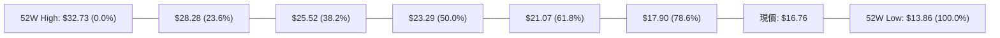

#### 斐波那契位置與技術含義表

| 回調層級 | 價位 | 當前相對位置 | 技術含義解讀 |
|----------|------|--------------|--------------|
| **0.0% (高點)** | $32.73 | 上方 +95.29% | 52 週最高點，牛市極限回報位 |
| **23.6%** | $28.28 | 上方 +68.74% | 牛市深度回調第一防線 |
| **38.2%** | $25.52 | 上方 +52.27% | 中期黃金分割回撤位 |
| **50.0%** | $23.29 | 上方 +38.96% | 多空平衡分水嶺 |
| **61.8%** | $21.07 | 上方 +25.72% | 強力黃金分割壓力，分析師目標均價 ($20.75) 聚集處 |
| **78.6%** | **$17.90** | **上方 +6.80%** | **關鍵反彈阻力位，精確對應 R1 ($17.96) 與 MA200 ($17.79)** |
| **現價區間** | **$16.76** | **基準點** | **目前處於 78.6% ($17.90) 與 100.0% ($13.86) 弱勢築底區間** |
| **100.0% (低點)**| $13.86 | 下方 -17.30% | 52 週最低點，熊市探底終點 |

**解讀**：現價 $16.76 正處於斐波那契 78.6% ($17.90) 與 100.0% ($13.86) 的深幅折價區。向上反彈的第一道核心天花板正是 **$17.90**。若能放量有效突破 $17.90，意味著股價擺脫深度熊市回調區域，上方空間將直接開啟至 61.8% 回調位 **$21.07**。

---

## 5. 技術指標深度解讀

### 🎛️ 指標訊號總覽

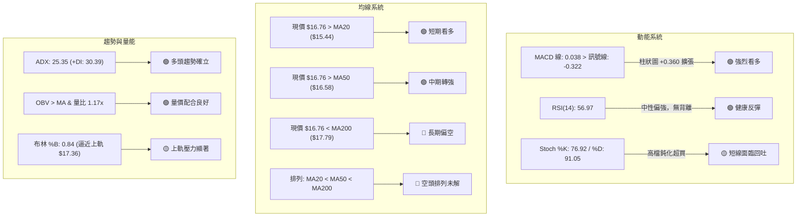

### 📈 移動平均線排列分析

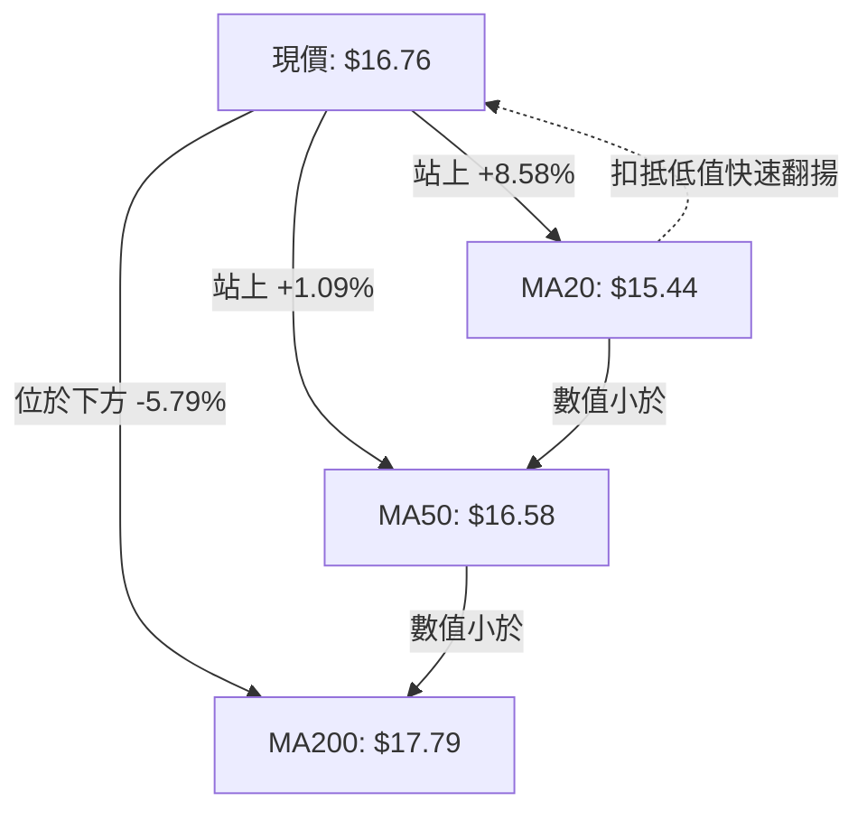

#### 均線系統關鍵數值分析表

| 均線名稱 | 數值 | 現價差距 | 漲跌狀態 | 斜率與技術含義 |
|----------|------|----------|----------|----------------|
| **MA 5** | $16.47 | +1.74% | ▲ 向上 | 短線超短週期強勁支撐，助推反彈 |
| **MA 10** | $15.56 | +7.69% | ▲ 向上 | 短期防守線，與 S1 ($15.58) 形成密集支撐 |
| **MA 20** | $15.44 | +8.58% | ▲ 向上 | 月線支撐快速拐頭向上，布林中軌共振 |
| **MA 50** | $16.58 | +1.09% | ▲ 突破 | 剛被放量站上，空方中期陣地失守轉為支撐 |
| **MA 60** | $16.84 | -0.46% | ▼ 向下 | 現價緊貼其下，日內首要化解之阻力 |
| **MA120** | $16.97 | -1.25% | ▼ 向下 | 半年線下行壓制，與 $17.00 整數關卡重疊 |
| **MA200** | $17.79 | -5.79% | ▼ 向下 | 年線牛熊分水嶺，決定長線是否徹底反轉 |
| **MA240** | $19.37 | -13.46% | ▼ 向下 | 長期總體壓制線，逼近 R3 ($19.62) |

**結論**：均線整體架構雖然維持 **MA20 < MA50 < MA200** 的空頭排列，但短天期均線 (MA5、MA10、MA20) 出現急促向上發散，且現價已強行越過 MA50，呈現「均線空頭排列下的強勢右側逆襲」，短期走勢極具爆發力。

### 📉 RSI(14) 分析

- **當前讀數**：56.97（Wilder 計算法）
- **區間定位**：處於 50–70 的健康多頭反彈區間。

```
RSI(14) 動能強度表
0 ──────── 30 ──────────────── 50 ──────●──────── 70 ──────── 100
超賣區     弱勢區               平衡中軸   56.97  超買警戒區
[░░░░░░░░░░][░░░░░░░░░░░░░░░░][████████░░░░░░░░][░░░░░░░░░░]
```

- **背離判斷**：依據數據提供之首尾 20 根 K 棒對比，價格由 10-16 低點回升，RSI 由 34.7 升至 57.0，確認**「無明顯背離」**。RSI 指標與價格同向健康走高，動能未出現耗竭。

### 📊 MACD(12,26,9) 訊號解讀

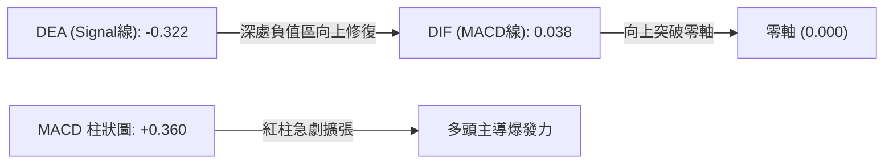

- **數值分析**：MACD 線已回升至 0.038，訊號線位於 -0.322，柱狀圖達到 +0.360。
- **解讀**：MACD 在零軸附近形成標準的「水上金叉」雛形，柱狀圖自前期的負值區（10-16 當時為 -0.080）強烈擴張至 +0.360，顯示多方買盤正在大幅度釋放動能，屬於極具指標意義的中期買入確認訊號。

### 📦 布林通道分析

- **布林上軌**：$17.36
- **布林中軌 (MA20)**：$15.44
- **布林下軌**：$13.51
- **通道位置指標 %B**：0.84

```
ASCII 布林通道位置圖
$17.36 ┬────────────────────────────────────────── 布林上軌 (阻力區)
       │                        ● $17.63 (10-29 刺破上軌)
$16.76 ┼─────────────────● (現價 %B = 0.84，位於中軌與上軌間強勢區)
       │
$15.44 ┼────────────────────────────────────────── 布林中軌 (MA20 強支撐)
       │
$13.51 ┴────────────────────────────────────────── 布林下軌 (極限支撐)
```

**解讀**：%B 數值 0.84 表示現價正緊貼通道上軌運行。在 2026-10-29 股價曾最高衝至 $17.63 短暫突破上軌，次日（10-30）收於 $16.76 拉回通道內，顯示通道上軌 $17.36 具備實質動態阻力效應。目前中軌 $15.44 正在快速上揚，通道呈現開口向外擴張態勢，有利於多頭波段推進。

### 💹 成交量分析（量價配合度）

```
成交量走勢對比 (單位: 股)
最新日成交量 (10-30): 64,168,800  ████████████████████
20日平均成交量:      55,021,815  █████████████████░   (量比: 1.17x)
50日平均成交量:      48,407,650  ███████████████░░░
10-27 突破爆量:     160,995,100  ████████████████████████████████████████ (約3倍均量)
```

- **量比分析**：最新成交量為 20 日均量的 1.17 倍，維持在活躍水準。
- **量價配合判定**：
  1. 10-27 大陽線向上突破時成交量暴增至 1.61 億股，呈現典型的「放量突破」。
  2. 10-29 衝高至 $17.61 成交量維持 65.4M，10-30 遇阻小幅回踩至 $16.76，量能縮減至 64.2M，呈現「漲有量、跌微縮」的健康配合。
  3. **OBV 趨勢**：官方技術指標明確標示「OBV > MA → 量能支撐上漲」，能量潮指標全面多頭排列，完全確認了近期的價格走強非虛胖行情。

---

## 6. 動能與波動率

### ⚡ 動能評估四象限

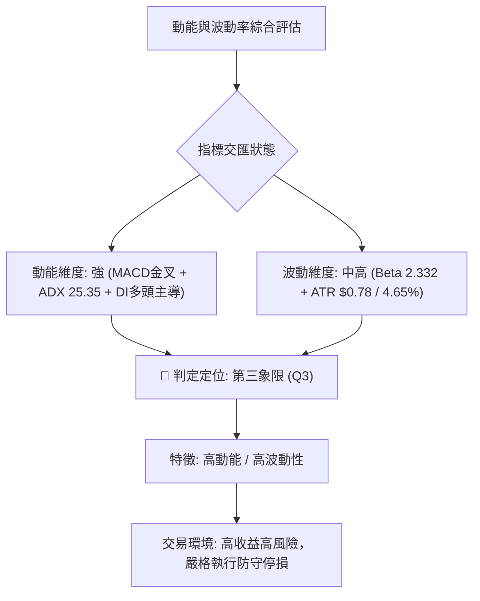

#### 動能評估四象限分析表

| 象限標記 | 動能強度 | 波動率水準 | 當前狀態判定 | 交易策略導向 |
|----------|----------|------------|--------------|--------------|
| **Q1** | 強動能 | 低波動 | — | 最佳波段順勢抱牢期 |
| **Q2** | 弱動能 | 低波動 | — | 盤整築底觀望期 |
| **Q3** | **強動能** | **高波動** | **✓ 當前 SOFI 處於此區** | **順勢做多突破，但須拉大止損防洗盤，控制單筆倉位** |
| **Q4** | 弱動能 | 高波動 | — | 恐慌殺跌，嚴禁進場接飛刀 |

### 📊 ATR 波動率分析

- **ATR(14) 讀數**：**$0.78**（Wilder 計算法）
- **ATR 佔比**：約佔現價之 **4.65%**
- **歷史波動特徵解讀**：每日平均振幅接近 5%，顯示 SOFI 具備高彈性與高 Beta 特性。
- **交易止損保護距離建議**：
  - **日內/超短線止損**：1.0 倍 ATR = **$0.78**（現價下方對應 $15.98）
  - **波段交易安全止損**：1.5 倍 ATR = **$1.17**（現價下方對應 $15.59，與 S1 $15.58 完美吻合）
  - **中期防守極限止損**：2.0 倍 ATR = **$1.56**（現價下方對應 $15.20）

### 📐 Beta 與市場相關性

| 指標名稱 | 數值 | 市場基準 (S&P 500) | 技術含義解讀 |
|----------|------|--------------------|--------------|
| **Beta (β)** | **2.332** | 1.000 | 具備極強的大盤放大器效應；大盤上漲 1% 時，理論上 SOFI 波動達 2.33% |
| **做空比率 (Short Ratio)** | **4.44 天** | < 3.0 為低 | 空頭回補需 4.44 個交易日，具備潛在軋空動能 |
| **空頭部位佔浮動股 (Short % Float)** | **17.2%** | > 10% 偏高 | 高放空比例！一旦突破 R1 ($17.96)，極易引發空頭踩踏式軋空行情 (Short Squeeze) |
| **機構持股比例** | **51.5%** | 50% 基準線 | 機構投資者佔據主導，籌碼穩定度中等偏上 |

---

## 7. 多時框架總結

### 📋 時框架評分表

| 時框架 | 趨勢方向 | 動能狀態 | 均線排列 | 形態結構 | 綜合評分 | 建議方向 |
|--------|----------|----------|----------|----------|----------|----------|
| **月線 (長期)** | 🔴 偏空 | 🟡 中性修復 | 🔴 空頭排列 | 長期高檔回落後的低檔沉澱 | **40/100** | 長線築底，逢低佈局 |
| **週線 (中期)** | 🟡 轉強 | 🟢 金叉翻正 | 🟡 跌勢趨緩 | 52週低點長下影包覆吞噬 | **65/100** | 波段反彈，目標看高 |
| **日線 (短期)** | 🟢 偏多 | 🟢 多頭衝刺 | 🟢 站上MA20/50 | 跳空大陽線突破，量價齊揚 | **75/100** | 逢回做多，短線順勢 |

### 🔲 綜合訊號矩陣

```
時框架訊號交叉驗證矩陣
┌───────────────┬──────────────┬──────────────┬──────────────┐
│ 分析維度      │ 日線 (短期)  │ 週線 (中期)  │ 月線 (長期)  │
├───────────────┼──────────────┼──────────────┼──────────────┤
│ 均線位置      │ 🟢 站上MA20  │ 🟡 逼近MA20  │ 🔴 跌破MA10  │
│ 均線系統      │ 🟢 短期金叉  │ 🟡 走平蓄勢  │ 🔴 空頭排列  │
│ 動能指標      │ 🟢 MACD金叉  │ 🟢 柱狀轉正  │ 🟡 觸底修復  │
│ 擺盪指標      │ 🟡 RSI: 56.97│ 🟡 RSI: 57.0 │ 🔴 低檔鈍化  │
│ 成交量配合    │ 🟢 放量突破  │ 🟢 巨量吞噬  │ 🟡 縮量沉澱  │
│ 籌碼與軋空    │ 🟢 具軋空潛能│ 🟢 空頭回補  │ 🟡 機構分歧  │
└───────────────┴──────────────┴──────────────┴──────────────┘
```

### ⚖️ 多時框收斂結論

嚴格遵循「嚴格要求 14」之多時框收斂規則：
1. **趨勢/盤整判定**：當前 ADX(14) 讀數為 **25.35 > 25.00**，且 +DI (30.39) 壓制 -DI (18.75)，技術面確認已脫離無序盤整，進入**「趨勢行情」**。
2. **主導時框與權重收斂**：在趨勢行情下，方向以週線與均線（MA50、MA200）為基準，日線負責尋找進場切入時機。
   - 週線層級於 $13.86 出現 4.16 億股放量吞噬長陽，確認中期波段底部已現。
   - 日線層級連續強勢修復，站穩 MA20 ($15.44) 與 MA50 ($16.58)，逼近 MA200 ($17.79)。
   - 第 1 章評分卡綜合評分為 **58/100（中性偏多）**，且趨勢強度子項高達 70/100、動能高達 75/100。
3. **唯一方向性結論**：**【中性偏多（波段逢回做多）】**。
   - 儘管年線 MA200 仍壓在上方，但短期與中期動能指標（MACD、OBV、ADX）形成共振做多訊號，且高達 17.2% 的放空比例極易演變為軋空助漲行情。因此，主交易策略確立為「順應日線動能之拉回做多策略」，防守點嚴格設置於突破支撐位 S1。

---

## 8. 交易策略建議

### 🗺️ 策略決策流程圖

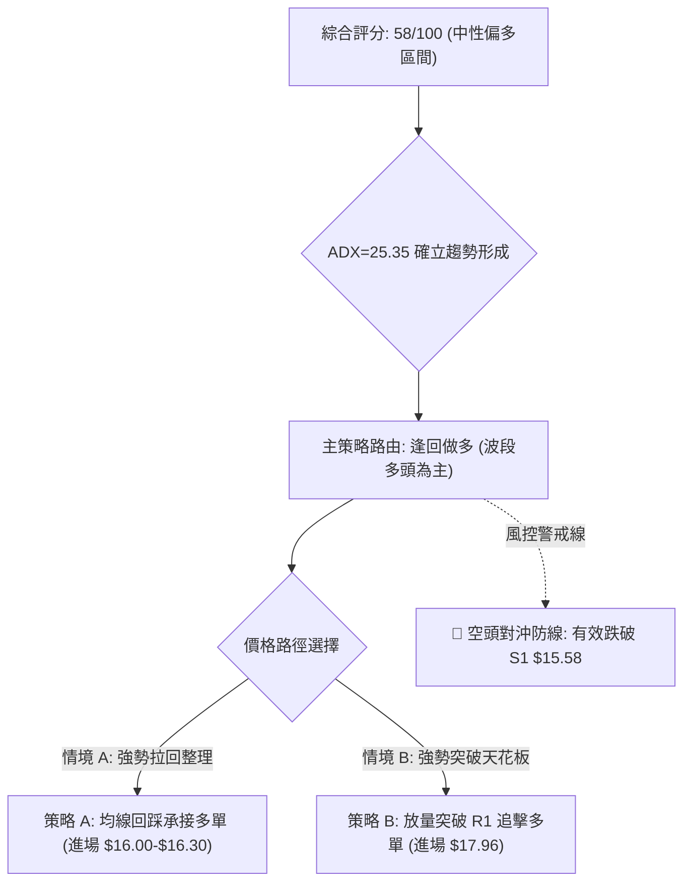

### 🧭 策略路由（依評分卡分流）

> **當前主策略方向 = 【中性偏多 / 順勢做多】（依評分卡 58/100 及 ADX>25 趨勢確立判定）**
> 綜合評分接近 60 分偏多門檻，且動能與趨勢子項皆超過 70 分，配合短中期指標高度共振，主推**多頭進場策略**。空頭僅列為反轉風控防守觸發點。

### 🎯 價格情境階梯（Price Scenarios）

價位嚴格引用數據庫「關鍵價位」區塊之波段高低點與斐波那契數值：

| 觸發條件 | 下一目標 | 後續延伸 | 情境含義解讀 |
|----------|----------|----------|--------------|
| **突破 R1 ($17.96)** | **R2 ($18.79)** | **R3 ($19.62)** | 突破年線 MA200 ($17.79) 與 78.6% 回調位 ($17.90)，觸發大規模空頭回補，開啟全面牛市波段 |
| **站穩現價區間 ($16.50 - $17.36)** | **考驗 R1 ($17.96)** | **回測 MA50 ($16.58)** | 消化布林上軌與前波獲利盤，維持在 MA50 上方強勢強勢整理蓄勢 |
| **跌破 S1 ($15.58)** | **S2 ($14.91)** | **S3 ($13.86)** | 跌破月線 MA20 與近期跳空頸線，反彈宣告夭折，股價將重返下行探底路徑 |

### 📊 情境機率分佈

| 情境劇本 | 機率估計 (%) | 主要依據（引用指標狀態） |
|----------|--------------|--------------------------|
| **繼續上行 / 挑戰 R1** | **60%** | MACD 零軸金叉擴張 (+0.360)、OBV 強勁向上確認量價配合、ADX 25.35 由多頭主導 |
| **區間震盪 / 消化上軌** | **25%** | 布林 %B 已達 0.84 逼近上軌 $17.36，Stoch %D 達 91.05 短期超買，需在 MA50 上方震盪整理 |
| **回落跌破 / 再度探底** | **15%** | 均線系統長線仍為空頭排列，若大盤重挫可能導致假突破後向下回踩 S2 ($14.91) |

### 🟢 主策略詳情

依據嚴格規則 17，風險報酬比定義為 $(T1 - 進場價) \div (進場價 - 止損價)$，計算精確至小數點後兩位：

| 策略要素 | 策略 A（穩健型：回踩支撐低吸） | 策略 B（激進型：突破壓力追擊） |
|----------|--------------------------------|--------------------------------|
| **策略定位** | 回踩 MA50 與 S1 頸線支撐逢低吸納 | 放量突破 R1 與 MA200 追強動能單 |
| **進場條件** | 股價回調至 MA50 至 S1 區間止跌出下影線 | 日K收盤價放量突破 R1 ($17.96) 確認有效 |
| **進場價格** | **$16.15**（區間 $15.80–$16.50 中點） | **$17.96**（關鍵阻力位 R1） |
| **目標價 T1** | **$17.96**（關鍵阻力位 R1） | **$19.62**（強阻力位 R3） |
| **目標價 T2** | **$18.79**（波段阻力位 R2） | **$21.07**（斐波那契 61.8% 回調位） |
| **止損價格** | **$15.40**（略低於 MA20 $15.44 與 S1 $15.58） | **$17.20**（跌回布林上軌下方防假突破） |
| **風險報酬比 (T1)** | **1 : 2.41**（以 T1 計）<br>算式: $(17.96 - 16.15) \div (16.15 - 15.40) = 1.81 \div 0.75$ | **1 : 2.18**（以 T1 計）<br>算式: $(19.62 - 17.96) \div (17.96 - 17.20) = 1.66 \div 0.76$ |
| **風險報酬比 (T2)** | **1 : 3.52**（以 T2 計）<br>算式: $(18.79 - 16.15) \div (16.15 - 15.40) = 2.64 \div 0.75$ | **1 : 4.09**（以 T2 計）<br>算式: $(21.07 - 17.96) \div (17.96 - 17.20) = 3.11 \div 0.76$ |
| **勝率預估** | **65%** | **55%** |
| **建議倉位** | **15% - 20%** 總投資資金 | **10%** 總投資資金 |

### 🔴 反向風險觸發點（對沖提示）

若出現以下訊號，證明多頭反彈失敗，應立即終止多頭策略或進行反向避險：
1. **關鍵點位跌破**：若日線收盤價跌破 **S1 ($15.58)** 且失守 **MA20 ($15.44)**，短底形態破壞。
2. **動能衰竭確認**：日線 MACD 柱狀圖由當前 +0.360 連續 3 日大幅萎縮並跌破 0 軸，RSI 跌破 45。
3. **空頭進攻訊號**：ADX 的 -DI 反向穿越 +DI，且單日成交量放大伴隨長黑跌破 $15.00。

### ⭐ 整體訊號強度評星

```
做多訊號強度：★★★★☆  (4.0/5星)  — 動能充沛、OBV確認、底背離翻轉
做空訊號強度：★★☆☆☆  (2.0/5星)  — 僅依賴均線長期排列壓制，動能不足
整體可信度：  ★★★★☆  (4.0/5星)  — 多時框指標高度收斂，成交量顯著放大
```

---

## 9. 風險提示與監控

### ✅ 關鍵監控指標 Checklist

```
╔══════════════════════════════════════════════════════════════════════════╗
║                   SOFI 每日交易盤後監控清單 (Checklist)                  ║
╠══════════════════════════════════════════════════════════════════════════╣
║ [ ] 價格防守線：收盤價是否守穩 MA50 ($16.58) 與 S1 ($15.58) 上方？    ║
║ [ ] 關鍵阻力攻堅：是否帶量突破 MA200 ($17.79) 與 R1 ($17.96)？          ║
║ [ ] 動能連續性：MACD 柱狀圖是否持續維持在 +0.200 以上之強勢多頭區？    ║
║ [ ] 超買化解：Stoch %K 是否回踩修復，布林通道 %B 是否維持在 0.65–0.85？ ║
║ [ ] 量能支撐：日成交量是否維持在 50日均量 (48.4M) 以上，OBV 是否續創新高？║
║ [ ] 空頭回補進度：做空比率 17.2% 是否引發單日暴量逾 1 億股之軋空行情？ ║
╚══════════════════════════════════════════════════════════════════════════╝
```

### ⚠️ 風險場景分析

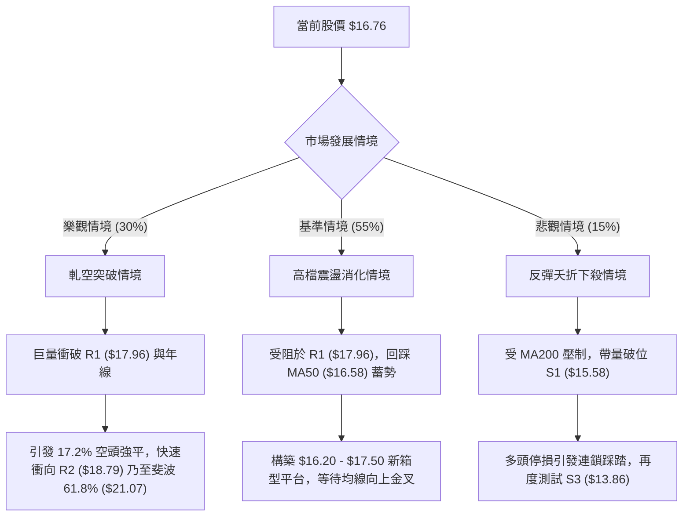

### 🛡️ 風險管理重要提醒

1. **高 Beta 波動特徵管理**：SOFI 的 Beta 高達 **2.332**，其單日波動性常態為大盤的 2 倍以上。投資者切勿使用過高槓桿，單筆交易資金暴露風險應嚴格控制在總投資組合的 **1.5%–2.0%** 以內。
2. **財報與消息面突發風險**：近期分析師評級分歧極大（從 Keefe 的 Underperform 到 Scotiabank 的 Outperform），且公司經營現金流呈現負值（TTM $-8.50B），基本面仍具爭議，走勢易受加密貨幣政策與利率預期劇烈擾動。
3. **嚴格執行價格紀律**：切勿在股價接近布林上軌 ($17.36) 及 R1 ($17.96) 時盲目追高；應採取「逢回踩關鍵均線分批佈局」的嚴謹策略，一旦觸發止損價位 $15.40 必須堅決離場。

---

## 📋 報告總結

```
SOFI 技術分析報告總結
══════════════════════════════════════════════════════════════════════════
報告日期：2026-11-02
當前價格：$16.76 USD
分析評級：⚖️ 58/100 【中性偏多 / 短多波段衝刺】

關鍵結論：
├─ 長期趨勢：🔴 空頭主導 (受制於年線 MA200 $17.79 與空頭均線排列)
├─ 中期趨勢：🟡 築底轉強 (週線巨量長陽吞噬，MACD 柱狀圖翻正 +0.360)
├─ 短期趨勢：🟢 強勁反彈 (站穩 MA20/MA50，ADX 25.35 +DI 強勢進攻)
├─ 關鍵支撐：S1: $15.58 ｜ S2: $14.91 ｜ S3: $13.86 (52W最低點)
├─ 關鍵阻力：R1: $17.96 ｜ R2: $18.79 ｜ R3: $19.62
└─ 分析師目標：均價 $20.75 (高點 $30.00 / 低點 $12.00)

最優策略組合：
1. 🥇 最佳機會：策略 A (穩健型) — 耐心等待股價回踩 $16.15 附近分批介入做多，
               止損設於 $15.40，第一目標看 R1 ($17.96)，風報比高達 1 : 2.41。
2. 🥈 次選機會：策略 B (動能型) — 若盤中以大成交量強勢貫穿 R1 ($17.96)，
               順勢追多，博弈 17.2% 空頭浮動籌碼踩踏軋空至 R3 ($19.62)。
3. 🥉 保守選擇：場外觀望，等待日線價格有效站穩 MA200 ($17.79) 且均線形成
               多頭排列後，再行介入大波段右側交易。
══════════════════════════════════════════════════════════════════════════
```

---

> ⚠️ **免責聲明**：本報告為技術分析研究，所有數據、圖表及價位推算均基於市場歷史價格與客觀技術指標計算。本報告**僅供學術研究與投資決策參考**，**不構成任何形式的要約或投資買賣建議**。金融市場瞬息萬變，高 Beta 標的風險巨大，投資人應獨立評估風險，並自行承擔交易損益。

---

*報告生成時間：2026-11-02 ｜ 數據來源：Yahoo Finance ｜ 分析框架：多時框技術分析模型*