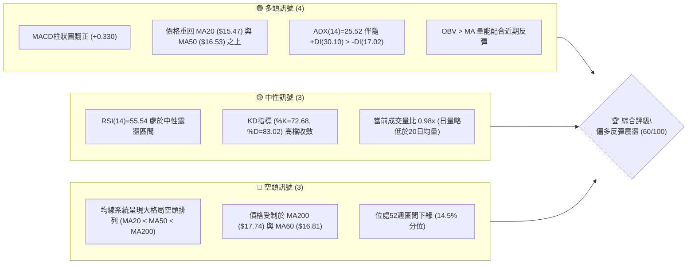
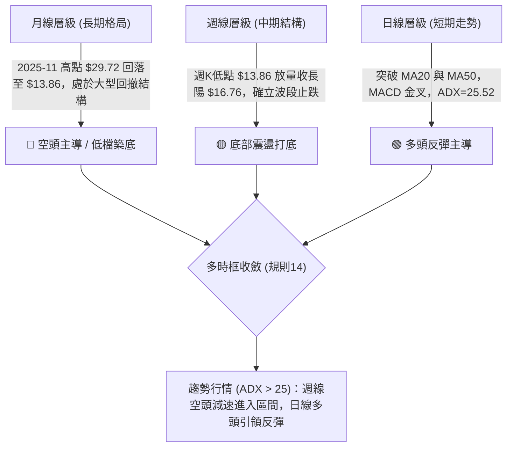
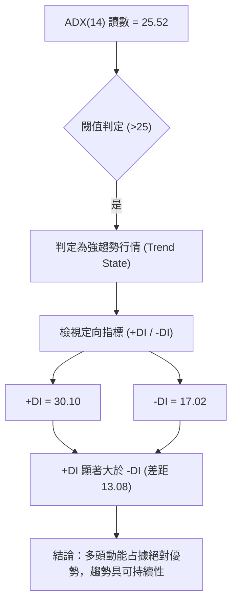
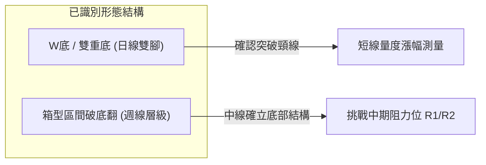
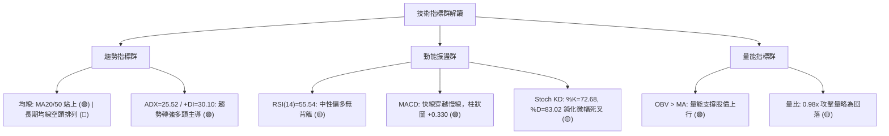
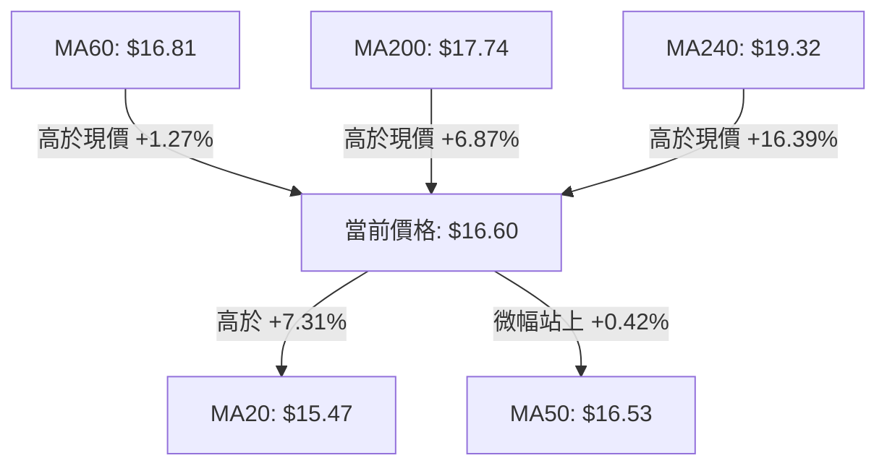
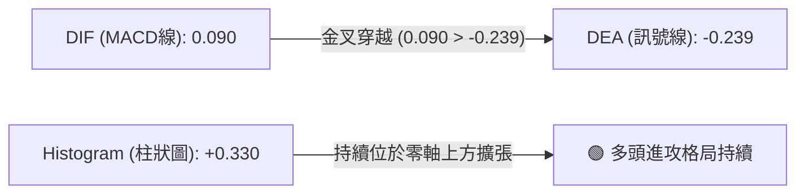
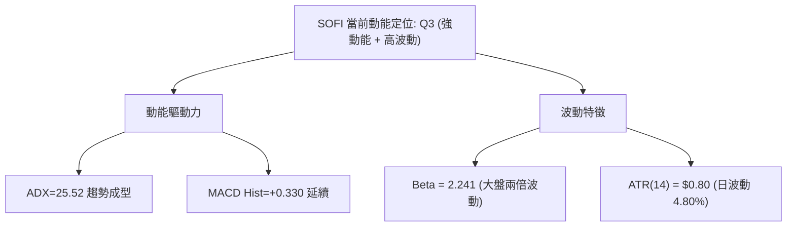
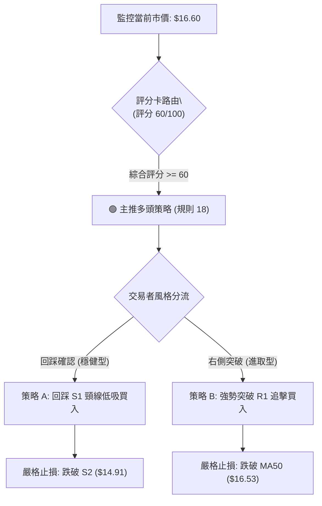
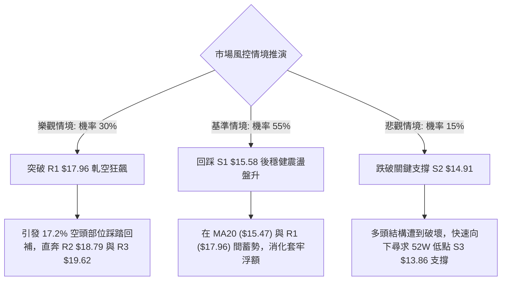

# SOFI 技術分析報告

> **報告日期**：2026-11-03 ｜ **語言**：繁體中文 ｜ **數據來源**：Yahoo Finance ｜ **當前價格**：$16.60

---

## 目錄

| 章節 | 內容 |
|------|------|
| [1. 技術面概覽](#1-技術面概覽) | 訊號儀表板、核心指標、評分卡 |
| [2. 趨勢分析](#2-趨勢分析) | 多時框趨勢、長中短期走勢 |
| [3. 圖表形態分析](#3-圖表形態分析) | 形態識別、K線組合、目標價 |
| [4. 支撐與阻力](#4-支撐與阻力) | 關鍵價位、斐波那契回調 |
| [5. 技術指標深度解讀](#5-技術指標深度解讀) | MA/RSI/MACD/布林/成交量 |
| [6. 動能與波動率](#6-動能與波動率) | 動能評估、ATR、Beta |
| [7. 多時框架總結](#7-多時框架總結) | 時框架評分矩陣 |
| [8. 交易策略建議](#8-交易策略建議) | 多空策略、風險報酬比 |
| [9. 風險提示與監控](#9-風險提示與監控) | 監控指標、風險場景 |

---

## 1. 技術面概覽

### 🎯 技術訊號儀表板



### 📊 核心指標速覽表

| 指標類別 | 指標名稱 | 當前數值 | 訊號 | 解讀 |
|:---|:---|:---:|:---:|:---|
| **價格** | 當前價格 | $16.60 | 🟢 | 自前波低點 $13.86 強勁反彈，目前站穩短期均線群 |
| **均線** | MA20 | $15.47 | 🟢 | 現價高於 MA20 達 +7.31%，短期月線具備動態支撐效力 |
| **均線** | MA50 | $16.53 | 🟢 | 現價微幅站上 MA50 (+0.42%)，多空爭奪轉化為短線偏多 |
| **均線** | MA200 | $17.74 | 🔴 | 現價低於 MA200 (-6.43%)，中長期長期牛熊分水嶺形成顯著反壓 |
| **動能** | RSI(14) | 55.54 | 🟡 | 位於 50–60 中性偏多區間，無超買超賣，短線動能平穩 |
| **動能** | MACD | 0.090 (Hist +0.330) | 🟢 | MACD 線高於訊號線 (-0.239)，柱狀圖持續擴張，日線金叉續航 |
| **波動** | ATR(14) | $0.80 | 🟡 | 波動率佔股價 4.80%，處於正常技術波動區間，提供合理止損空間 |

### 🏆 技術評分卡

```
╔══════════════════════════════════════════════════════════════╗
║              技術評分卡 — SOFI (2026-11-03)                  ║
╠══════════════════════════════════════════════════════════════╣
║ 趨勢強度      ██████████████░░░░░░  70/100  🟢 強趨勢初現   ║
║ 動能指標      █████████████░░░░░░░  65/100  🟢 短多延續     ║
║ 支撐穩定度    ██████████████░░░░░░  70/100  🟢 底部放量築底 ║
║ 成交量配合    ████████████░░░░░░░░  60/100  🟡 攻擊量稍歇   ║
║ 形態完整度    █████████████░░░░░░░  65/100  🟢 雙底雛形確認 ║
║ 均線排列      ██████░░░░░░░░░░░░░░  30/100  🔴 長期排列偏空 ║
╠══════════════════════════════════════════════════════════════╣
║ 綜合評分      ████████████░░░░░░░░  60/100  偏多反彈 (規則18)║
╚══════════════════════════════════════════════════════════════╝
```

---

## 2. 趨勢分析

### 🌐 多時框趨勢分析



### 📈 長期趨勢 — 12個月走勢圖（Unicode）

```
SOFI 月線走勢圖（過去12個月：2024-11 至 2026-11）
價格軸 ($)
$30.00 ┤              ●(2025-10: 29.68 / 11: 29.72 雙頂高點)
$27.00 ┤         ●    │
$24.00 ┤              │  ●
$21.00 ┤              │      ●
$18.00 ┤              │          ●   ●       ●   ●
$16.60 ┤●             │              │   ●   │   │   ●←現價 $16.60
$15.00 ┤  ●   ●       │              └───┼───┼───┼───┘
$13.86 ┤          ●   │                  │   ●(52W低點: 13.86)
$11.63 ┤    ●(歷史低) │                  │
       └─────────────────────────────────────────────────────
         11  12  01  02  03  06  08  10  11  01  03  06  08  10  11 (月份)
         24─────────────►│25────────────►│26────────────────►
```

#### 走勢特徵分析表格

| 時間階段 | 期間收盤區間 | 累積漲跌幅 | 成交與形態特徵 | 趨勢判定 |
|:---|:---:|:---:|:---|:---:|
| **2024-11 至 2025-03** | $16.41 → $11.63 | -29.13% | 探底尋支撐，量能萎縮，於 $11.63 形成波段底部 | 🔴 空頭沉淪 |
| **2025-04 至 2025-11** | $12.51 → $29.72 | +137.57% | 爆發性牛市主升段，伴隨基本面擴張，於 $29.72 形成歷史阻力 | 🟢 強烈牛市 |
| **2025-12 至 2026-03** | $26.18 → $15.88 | -39.34% | 獲利了結大拋補，連續破線，長期均線轉平下彎 | 🔴 主跌修正 |
| **2026-04 至 2026-08** | $16.10 → $17.88 | +11.05% | 於 $16.00–$18.50 進行寬幅矩形箱型震盪整理 | 🟡 箱型盤整 |
| **2026-09 至 2026-11** | $15.72 → $16.60 | +5.60% | 下挫測底至 52W 低點 $13.86 後強勁抽腳反彈，現報 $16.60 | 🟢 破底翻反彈 |

### 📊 中期趨勢（週線分析）

```
SOFI 週線近期波動與壓力支撐示意
阻力區  R1 $17.96 ────────────────────────────────────── (週K波段密集反壓)
                 ╭──╮
                 │  │      ╭──╮
                 │  │  ╭─╮ │  │
現價區  $16.60 ──┼──┼──┼─┼─┼──┼─────── ◄ 當前收盤價 ($16.60)
                 │  │  │ │ │  │  ╭──╮
                 │  │  │ │ │  ╰──╯  │  (2026-10-30 週放量 416M 長陽反轉)
支撐區  S1 $15.58 ────────────────────────────────────── (突破後頸線支撐位)
支撐區  S3 $13.86 ─────────────┴──────────────────────── (52週最低點強支撐)
```

中期走勢在經歷 2026 年 9 月與 10 月初的持續探底後，於 2026-10-16 當週下探 52 週最低點 $13.86 迅速被買盤吸收。隨後在 2026-10-30 當週走出從 $14.53 暴衝至 $17.63、收盤 $16.76 的週巨量實體陽線（成交量高達 4.16 億股），確立了週線級別的「V型破底翻」形態。目前雖然上方受到 78.6% 斐波那契回調位 $17.90 及 R1 $17.96 的壓制，但中期跌勢已實質阻斷，轉入築底擴底階段。

### ⚡ 趨勢強度評估（ADX 解讀）



#### ADX 指標強度對照分析

| 指標變數 | 當前讀數 | 基準界限 | 狀態說明 |
|:---|:---:|:---:|:---|
| **ADX(14)** | **25.52** | 25.00 | **正式跨入強趨勢區間**。表明脫離先前無序盤整，波段單邊趨勢開始發力 |
| **+DI** | **30.10** | > 25.00 | 買方力量主導盤面，資金連續流入推升價格 |
| **-DI** | **17.02** | < 20.00 | 賣方力量受到明顯遏制，空頭回補動能充沛 |
| **DI 差值 (+DI - -DI)**| **+13.08** | > 0 | 多頭優勢顯著，反彈行情受趨勢動能支撐 |

---

## 3. 圖表形態分析

### 🔍 形態識別系統



#### 形態信心度與目標價計算（規則 15）

| 形態名稱 | 信心度 | 判斷依據（引用數據） | 完成度 | 目標價（附嚴謹計算式） |
|:---|:---:|:---|:---:|:---|
| **雙重底 (W-Bottom)** | **70%** | 左腳 2026-10-16 測 $13.86，右腳 2026-10-23 回踩 $14.18，雙腳獲得強撐；頸線為 2026-10-21 高點 $15.11 | 90% (已突破頸線，現測量度漲幅) | 形態高度 = 頸線 $15.11 − 最低點 $13.86 = $1.25。<br>目標價 = 頸線 $15.11 + $1.25 = **$16.36** (已達成，向上推進至關鍵阻力 R1 **$17.96**) |
| **高檔下降通道突破** | **60%** | 突破 9月下旬以來的連續下行斜率，日K站穩 MA50 $16.53 | 80% (進行回踩確認) | 形態寬度推算目標價直指關鍵阻力 R2 **$18.79** |
| **頭肩底形態** | **30%** | 數據中左肩結構不明確，無法確認完整頭肩幾何輪廓 | 0% | **訊號不足，僅做指標型解讀**（規則 15） |

### 🕯️ 重要K線形態分析（嚴格遵循規則 19，僅使用給定數據）

#### 近 10 根日 K 線形態解讀

| 日期 | 開 | 高 | 低 | 收 | 成交量 | K線形態名稱 | 技術解讀 | 訊號 |
|:---|:---:|:---:|:---:|:---:|:---:|:---|:---|:---:|
| **2026-10-20** | 14.20 | 14.99 | 14.18 | 14.68 | 45,156,800 | 帶長下影中陽線 | 下探 14.18 後強烈拉升，下檔買盤湧現 | 🟢 |
| **2026-10-21** | 14.84 | 15.11 | 14.65 | 14.90 | 33,652,600 | 衝高小陽線 | 試探突破 15.10 壓力區，收盤穩於均線 | 🟢 |
| **2026-10-22** | 14.57 | 15.07 | 14.57 | 14.77 | 41,048,400 | 高檔十字星陽線 | 開盤回測 14.57 守穩，多空在 15 關卡分歧 | 🟡 |
| **2026-10-23** | 14.55 | 14.71 | 14.23 | 14.61 | 38,901,500 | 下影小陰線 | 右腳二次回踩 14.23 不破前低 13.86，形成底部結構 | 🟢 |
| **2026-10-26** | 14.53 | 14.67 | 14.40 | 14.46 | 43,286,500 | 窄幅壓縮實體陰線 | 極致窒息量整理，變盤前夕蓄勢 | 🟡 |
| **2026-10-27** | 15.98 | 16.76 | 15.67 | 16.40 | 160,995,100 | **爆量跳空突破長陽** | 跳空高開，巨量 1.6億股貫穿多條均線，主升啟動 | 🟢 |
| **2026-10-28** | 16.56 | 17.25 | 16.56 | 17.14 | 82,318,800 | 光腳強勢大陽線 | 開盤即為最低，強勢突破 17 關卡，多頭狂飆 | 🟢 |
| **2026-10-29** | 16.92 | 17.63 | 16.87 | 17.61 | 65,396,000 | 推進陽線 | 創反彈新高 17.63，連續三天收在實體高位 | 🟢 |
| **2026-10-30** | 17.07 | 17.32 | 16.44 | 16.76 | 64,306,100 | 長下影回吐陰線 | 盤中下探 16.44 獲得支撐，高檔出現獲利賣壓 | 🟡 |
| **2026-11-02** | 16.98 | 17.60 | 16.57 | 16.60 | 54,425,600 | **長上影小陰線 (流星線)** | 衝高 17.60 未果回落，顯示 17.50–18.00 阻力沉重 | 🔴 |

#### 近 8 根週 K 線形態解讀

| 日期 | 開 | 高 | 低 | 收 | 成交量 | K線形態名稱 | 技術解讀 | 訊號 |
|:---|:---:|:---:|:---:|:---:|:---:|:---|:---|:---:|
| **2026-09-18** | 17.00 | 17.75 | 16.53 | 16.96 | 220,325,500 | 陰性陀螺頂 | 多次上衝 17.75 受阻，動能開始鈍化 | 🔴 |
| **2026-09-25** | 17.46 | 17.96 | 16.20 | 16.58 | 302,278,600 | 帶長上影大陰線 | 衝高至 R1 17.96 遭遇重壓反轉下殺 | 🔴 |
| **2026-10-02** | 16.32 | 16.42 | 15.53 | 15.77 | 223,038,900 | 連續下跌中陰線 | 跌破 16 整数關卡，加速尋求下軌支撐 | 🔴 |
| **2026-10-09** | 15.77 | 16.19 | 15.25 | 15.80 | 199,427,700 | 低檔十字星 | 跌勢減緩，多空在 15.50 附近產生博弈 | 🟡 |
| **2026-10-16** | 15.47 | 15.68 | 13.86 | 14.55 | 286,319,200 | **長下影錘頭陰線** | 測試 52W 低點 13.86 後強勁抽腳，確認大底 | 🟢 |
| **2026-10-23** | 14.75 | 15.11 | 14.18 | 14.61 | 198,524,200 | 低檔孕線 (Harami) | 量縮收於前週實體內部，確認底部獲得支撐 | 🟢 |
| **2026-10-30** | 14.53 | 17.63 | 14.40 | 16.76 | 416,302,500 | **爆量破底翻特大陽線** | 週量激增至 4.16億股，包覆多週失土，反轉成型 | 🟢 |
| **2026-11-02** | 16.98 | 17.60 | 16.57 | 16.60 | 54,425,600 | 週初長上影小陰線 | 短線觸碰週線壓力區，面臨回踩消化浮額 | 🟡 |

### 📉 ASCII 走勢形態示意圖

```
SOFI 日線雙重底 (W-Bottom) 突破結構
價格 ($)
$17.96 ┤                                                    [阻力 R1]
$17.63 ┤                                      ╭●─●
$17.00 ┤                                    ╭─╯   ╰─● (現價 $16.60)
$16.00 ┤                                  ╭─╯
$15.11 ┤        ╭● (頸線位 $15.11) ───────┼─────────────────────────
$14.50 ┤        │ ╰─╮                   ╭─╯
$14.18 ┤        │   ╰─╮               ╭─╯ (右腳低點 $14.18)
$13.86 ┤        │     ╰─●             │   [52週低點 / 左腳 $13.86]
       └────────┴───────┴─────────────┴────────────────────────────
       日期   10-21    10-23         10-27 10-29 11-02
```

### 🎯 形態目標價計算

依據標準幾何形態理論：
1. **日線 W 底形態確認**：
   - 左腳最低點：$13.86（2026-10-16）
   - 形態頸線高點：$15.11（2026-10-21）
   - 右腳低點：$14.18（2026-10-23）
   - 形態垂直高度 $H = \text{頸線} - \text{左腳} = \$15.11 - \$13.86 = \$1.25$
   - **等距最小量度漲幅目標** $= \text{頸線} + H = \$15.11 + \$1.25 = \mathbf{\$16.36}$（*註：現價 $16.60，該目標已於 2026-10-27 突破達成*）。
2. **延伸目標價（依據形態高度延伸 2.0x 測算）**：
   - 延伸量度目標 $= \text{頸線} + (H \times 2.0) = \$15.11 + (\$1.25 \times 2) = \mathbf{\$17.61}$（*註：2026-10-29 收盤價剛好為 $17.61，精準滿足延伸目標後拉回*）。
3. **波段後續上行目標**：
   - 頸線回踩守穩後，上行空間將直指近一年波段高點聚類之阻力位 **R1 $17.96** 與 **R2 $18.79**。

---

## 4. 支撐與阻力

### 🗺️ 關鍵價位分布圖（Unicode）

```
SOFI 價位結構分布圖 (由 OHLCV 歷史數據聚類計算)
══════════════════════════════════════════════════════════════════
$19.62 ║████████████████████████████████║ 強阻力 R3 (+18.18%)
$19.32 ║────────────────────────────────║ MA240 年線反壓
$18.79 ║████████████████████            ║ 次級阻力 R2 (+13.16%)
$17.96 ║████████████████████████        ║ 關鍵密集阻力 R1 (+8.19%) / 78.6% Fib $17.90
$17.74 ║--------------------------------║ MA200 牛熊分界線 (-6.43% from price)
$17.45 ║┄┄┄┄┄┄┄┄┄┄┄┄┄┄┄┄┄┄┄┄┄┄┄┄┄┄┄┄║ 布林通道上軌
$16.60 ╠════════════════════════════════╣ ◄ 當前市價 ($16.60)
$16.53 ║--------------------------------║ MA50 均線位置
$15.58 ║▓▓▓▓▓▓▓▓▓▓▓▓▓▓▓▓▓▓▓▓            ║ 近期第一支撐 S1 (-6.17%) / MA20 $15.47
$14.91 ║▓▓▓▓▓▓▓▓▓▓▓▓▓▓▓▓▓▓▓▓▓▓▓▓        ║ 中期波段防守 S2 (-10.18%)
$13.86 ║████████████████████████████████║ 52週極限鐵底 S3 (-16.51%) / 100% Fib
══════════════════════════════════════════════════════════════════
```

### 🚧 阻力位分析表（嚴格引用數據關鍵價位）

| 阻力級別 | 價位 | 距現價幅動 | 形成原因與籌碼解讀 | 突破難度 | 重要性 |
|:---:|:---:|:---:|:---|:---:|:---:|
| **R1** | **$17.96** | +8.19% | 近一年波段高點聚類區，疊加 78.6% 斐波那契回調位 ($17.90) 與 MA200 ($17.74)，大量套牢盤駐紮 | 🔴 高難度 | ★★★★★ |
| **R2** | **$18.79** | +13.16% | 2026年5月、7月多次反彈高點聚類密集成交區，中期形態頭部頸線反壓 | 🟡 中偏高 | ★★★★☆ |
| **R3** | **$19.62** | +18.18% | 2026上半年波段震盪頂部區間，接近 MA240 ($19.32) 牛熊重構區 | 🔴 極高難度 | ★★★☆☆ |

### 🛡️ 支撐位分析表（嚴格引用數據關鍵價位）

| 支撐級別 | 價位 | 距現價幅動 | 形成原因與籌碼解讀 | 守住機率 | 重要性 |
|:---:|:---:|:---:|:---|:---:|:---:|
| **S1** | **$15.58** | -6.17% | 近期波段低點聚類，共振布林中軌/MA20 ($15.47) 及 MA50 ($16.53) 下方防禦線，短多生命線 | 75% | ★★★★☆ |
| **S2** | **$14.91** | -10.18% | 2026年10月下旬起漲前之頸線結構聚類，多頭突破後的回踩回測底限 | 85% | ★★★★★ |
| **S3** | **$13.86** | -16.51% | **52週最低點**，斐波那契 100.0% 極限回調位，強烈機構資金進駐之政策鐵底 | 95% | ★★★★★ |

### 📐 斐波那契回調位分析（區間 $13.86 → $32.73）

直接引用自數據中嚴格計算之 52 週回調階梯：

```
0.0%  (52W High) ----------------------- $32.73
23.6% ---------------------------------- $28.28
38.2% ---------------------------------- $25.52
50.0% (中位分水嶺) ---------------------- $23.29
61.8% (黃金分割) ------------------------ $21.07
78.6% (深度回撤回調位) ------------------ $17.90
[現價位置] ============================= $16.60 (落在 78.6% 與 100.0% 之間)
100.0% (52W Low) ----------------------- $13.86
```

- **位置解讀**：現價 $16.60 處於 78.6% 回調位 ($17.90) 與 100.0% 回調位 ($13.86) 之間的「築底超跌修復帶」。
- **技術意義**：
  1. 股票自高點 $32.73 崩跌至 $13.86，跌幅達 -57.65%，已完整釋放空頭拋壓。
  2. 78.6% 回調位 **$17.90** 與阻力位 **R1 $17.96** 高度重疊（差距僅 6 美分），形成結構上極強的「雙重天花板」。只有實體日 K 帶量攻克 $17.90–$17.96，斐波那契反彈級別才能進一步向 61.8% ($21.07) 擴展。

---

## 5. 技術指標深度解讀

### 🎛️ 指標訊號總覽



### 📈 移動平均線排列分析



#### 各期均線狀態表

| 均線名稱 | 數值 | 與現價關係 | 走勢特徵 | 訊號意涵 |
|:---|:---:|:---:|:---|:---:|
| **MA 5** | $16.90 | 現價在下方 (-1.79%) | 近期衝高後下彎 | 短線獲利回吐回調壓力 |
| **MA 10** | $15.79 | 現價在上方 (+5.11%) | 強勁陡峭上行 | 超短線第一動態防守支撐 |
| **MA 20** | $15.47 | 現價在上方 (+7.31%) | 由跌轉升，上拐有力 | 月線級別支撐確立，多頭基石 |
| **MA 50** | $16.53 | 現價在上方 (+0.42%) | 走平略微上翹 | 季線剛被突破，處於反覆確認期 |
| **MA 60** | $16.81 | 現價在下方 (-1.24%) | 持續向下緩跌 | 季末反壓，形成短阻力 |
| **MA 120**| $16.98 | 現價在下方 (-2.23%) | 呈下行斜率 | 半年線壓制 |
| **MA 200**| $17.74 | 現價在下方 (-6.43%) | 空頭排列核心 | 牛熊分界線，未突破前中期仍為反彈性質 |
| **MA 240**| $19.32 | 現價在下方 (-14.10%)| 長期下行 | 年線空頭壓制 |

### 📉 RSI(14) 分析

- **當前數值**：**55.54**（Wilder 計算方法）
- **指標進度條**：
  ```
  超賣 [0] ░░░░░░░░░░ [30] ▓▓▓▓▓▓▓▓ [55.54] ░░░░░░ [70] ░░░░░░░░░░ [100] 超買
  數值強度：███████████░░░░░░░░░ 55.54% (健康中性偏強)
  ```
- **背離判斷**：
  - **日線級別**：數據明確標示「**無明顯背離**」。近 20 根 K 棒中，價格自 $14.18 低檔反彈至 $17.63，RSI 從 30 附近同步回升至 55.54，指標完全確認價格的反彈步伐。
  - **週線級別**：2026-10-16 當週低點 $14.55 時週 RSI 為 34.7，隨後 10-23 當週微漲收 $14.61 時週 RSI 升至 38.3；10-30 大陽線收 $16.76 時 RSI 躍升至 57.0，呈現量價同步走揚之底背離確認後的發散上漲走勢。

### 📊 MACD(12/26/9) 訊號解讀



- **狀態特徵**：MACD 線已由負翻正至 **0.090**，與訊號線 **-0.239** 拉開顯著金叉間距，柱狀圖讀數為 **+0.330**。
- **交叉確認**：柱狀圖在近兩週內快速翻紅擴大（週線 MACD 柱狀圖亦從 10-16 的 -0.080 暴衝至 10-30 的 +0.360，最新日報維持在 +0.330），確認此輪自 $13.86 啟動之反彈為日/週線共振的金叉推進。

### 📦 布林通道分析

```
SOFI 日線布林通道 (20, 2) 結構圖
$17.45 ┤ -------------------------------------------- 上軌 (Upper Band)
$17.00 ┤                   ╭──● (10-29 高點 17.63 觸軌回落)
$16.60 ┤ ═══════════════════●════════════════════════ 現價 ($16.60, %B = 0.79)
$16.00 ┤                 ╭─╯
$15.47 ┤ ----------------●--------------------------- 中軌 (Middle Band / MA20)
$14.50 ┤             ╭──╯
$13.49 ┤ ────────────┴─────────────────────────────── 下軌 (Lower Band)
```

- **通道參數狀況**：
  - 上軌：**$17.45**
  - 中軌 (MA20)：**$15.47**
  - 下軌：**$13.49**
  - **通道帶寬**：$(\$17.45 - \$13.49) / \$15.47 = 25.60\%$
  - **%B 指標**：**0.79**（位於中軌 0.50 與上軌 1.00 之間的高檔偏多強勢區）
- **技術解讀**：
  股價在 2026-10-29 衝破上軌 ($17.63 > $17.45) 後遭遇技術性軌道壓制，目前拉回至上軌內部 $16.60 進行修正整理。%B 位於 0.79，顯示股價仍保留絕大部分上漲動能，尚未跌破中軌前，通道呈擴口向上走勢。

### 💹 成交量分析（量價配合度）

1. **量能指標現狀**：
   - 最新單日成交量：**54,425,600 股**
   - 20 日平均成交量：**55,341,550 股**
   - 量比 (Volume Ratio)：**0.98x**（量能與月均量基本持平，呈現高檔縮量休整）
   - 50 日平均成交量：**48,250,786 股**（最新量仍高於 50 日均量，中線量能充沛）
2. **OBV 能量潮解讀**：
   - 數據狀態：**OBV > MA**。
   - 走勢含義：能量潮突破並持續高於其移動平均線，這表明在 10 月 27 日單日湧入 1.6 億股的主力攻擊量後，籌碼並未在大跌中出逃，資金沉澱度高，**量能有效支撐價格上漲**。

---

## 6. 動能與波動率

### ⚡ 動能評估四象限

| 象限 | 動能維度 (ADX / MACD) | 波動維度 (ATR / Beta) | 當前狀態判定 | 交易策略意涵 |
|:---:|:---:|:---:|:---:|:---|
| **Q1 (最佳機會)** | **強動能 (ADX > 25)** | **中低波動 (ATR 穩定)** | — | 趨勢平穩推進，持股加碼 |
| **Q2 (震盪沉澱)** | 弱動能 (ADX < 20) | 低波動 (ATR 壓縮) | — | 盤整蓄勢，觀望等待 |
| **Q3 (強勢波動)** | **強動能 (+DI=30.1, MACD柱紅)** | **高波動 (Beta=2.24, ATR=4.8%)** | **✓ 當前 SOFI 定位** | **爆發力強、回撤劇烈，適合嚴設防守的波段順勢突破交易** |
| **Q4 (高危下挫)** | 弱動能 (-DI 主導) | 高波動 (恐慌拋售) | — | 破位崩跌，堅決離場 |



### 📊 ATR 波動率分析

- **ATR(14) 數值**：**$0.80**（佔股價 $16.60 的比例為 **4.80%**，採 Wilder 平滑算法）。
- **技術意義與止損設置指導**：
  - 日內預期正常震盪噪音區間為 $\pm \$0.80$。
  - **保守型防守止損距離 (2.0x ATR)**：$2.0 \times \$0.80 = \mathbf{\$1.60}$。若現價 $16.60 進場，理論底限防守位為 $\$16.60 - \$1.60 = \$15.00$（精準對齊關鍵支撐 S2 **$14.91** 附近）。
  - **進取型跟蹤止損距離 (1.25x ATR)**：$1.25 \times \$0.80 = \mathbf{\$1.00}$。防守點設在 $\$16.60 - \$1.00 = \$15.60$（精準契合近期關鍵支撐 S1 **$15.58** 與 MA20 **$15.47**）。

### 📐 Beta 與市場相關性

- **Beta 係數**：**2.241**
- **市場屬性解讀**：
  - SOFI 具備高彈性成長股／非銀行金融科技股的典型特徵。其價格波動幅度為標普 500 指數的 **2.24 倍**。
  - **做空比率 (Short % Float)** 高達 **17.2%**，Short Ratio 為 **4.44**。高空頭部位疊加高 Beta，使 SOFI 在短線突破關鍵阻力（如 R1 $17.96）時極易引發**軋空狂飆行情（Short Squeeze）**；但反之大盤回調時亦會放大跌幅。

---

## 7. 多時框架總結

### 📋 時框架評分表

| 時框架 | 趨勢方向 | 動能狀態 | 均線排列狀況 | 形態特徵 | 綜合評分 | 操作建議 |
|:---:|:---:|:---:|:---:|:---:|:---:|:---|
| **短期 (日線)** | 🟢 向上突破反彈 | 🟢 MACD柱+0.33, ADX>25 | 🟡 站上 MA20/MA50，受阻 MA200 | 雙底突破後測試頸線 | **70/100** | 逢低回踩佈局多單 |
| **中期 (週線)** | 🟡 止跌打底震盪 | 🟢 週MACD柱翻紅 (+0.36) | 🔴 長期均線下壓，MA50在上方 | 4.16億巨量 V型長下影反轉 | **60/100** | 區間低吸，波段操作 |
| **長期 (月線)** | 🔴 熊市修正末期 | 🟡 低檔鈍化回升 | 🔴 MA200遠高於市價，年線下壓 | 52W低位 $13.86 獲支撐 | **45/100** | 長線定期定額建底倉 |

### 🔲 綜合訊號矩陣

```
╔══════════════════════════════════════════════════════════════════════════╗
║                    多時框多空訊號收斂矩陣                                ║
╠══════════════════╦══════════════╦══════════════╦═════════════════════════╣
║ 分析維度         ║ 短期 (日線)  ║ 中期 (週線)  ║ 長期 (月線)             ║
╠══════════════════╬══════════════╬══════════════╬═════════════════════════╣
║ 趨勢方向         ║ 🟢 偏多      ║ 🟡 中性      ║ 🔴 偏空                 ║
║ 核心均線位置     ║ 🟢 突破MA50  ║ 🟡 測試10週線║ 🔴 遠低於MA200          ║
║ 動能指標 (MACD)  ║ 🟢 金叉發散  ║ 🟢 柱狀翻正  ║ 🔴 負值收斂             ║
║ 振盪指標 (RSI)   ║ 🟡 55.54中性 ║ 🟡 55.50中性 ║ 🔴 歷史低檔             ║
║ 籌碼與量能       ║ 🟡 量比0.98x ║ 🟢 爆天量反轉║ 🟡 震盪換手             ║
╠══════════════════╬══════════════╬══════════════╬═════════════════════════╣
║ 權重判定 (規則14)║ 執行進場時機 ║ 主導波段區間 ║ 大週期背景              ║
╚══════════════════╩══════════════╩══════════════╩═════════════════════════╝
```

### ⚖️ 多時框收斂結論（嚴格執行規則 14）

1. **行情性質判定**：
   當前 **ADX(14) 為 25.52 > 25**，依規定屬於 **趨勢行情**。
2. **多時框收斂優先級**：
   - 趨勢行情下，交易方向應以中長期結構為指導背景，並以日線趨勢作為波段推進引擎。
   - 週線在 2026-10-30 走出單週 4.16 億股的破底大長陽，已終結前波連續下行空頭趨勢，正式轉入「中期波段反彈推升」格局。
   - 日線級別站穩 MA20 ($15.47) 與 MA50 ($16.53)，MACD 金叉伴隨 +DI (30.10) 絕對強勢，日線多頭正在引領週線走出低谷。
3. **唯一方向性結論**：
   **【偏多波段反彈】**（綜合評分 **60/100**）。
   日線回踩 MA50 ($16.53) 至 S1 ($15.58) 區間為高勝率低吸進場點，向上目標鎖定週線強阻力 R1 ($17.96) 與 R2 ($18.79)。

---

## 8. 交易策略建議

### 🗺️ 策略決策流程圖



### 🧭 策略路由（依評分卡分流）

> **當前主策略方向 = 偏多操作（依綜合評分 60/100，嚴格符合規則 18 門檻 ≥60 條件）**
> 
> *註：空頭僅列為反轉風險觸發點與風控對沖提醒，不進行主策略對衝推薦。*

### 🎯 價格情境階梯（Price Scenarios，嚴格引用第 4 章數值）

| 觸發條件 | 下一目標 | 後續延伸 | 情境含義 |
|:---|:---:|:---:|:---|
| **帶量突破 R1 $17.96** | **R2 $18.79** | **R3 $19.62** | 攻克 78.6% Fib 與 MA200，大級別反轉啟動，觸發軋空行情 |
| **站穩現價區間 $16.53–$16.60** | **R1 $17.96** | **R2 $18.79** | 消化短期上影線浮額後，順應 MACD 金叉再度挑戰反彈高點 |
| **失守 S1 $15.58** | **S2 $14.91** | **S3 $13.86** | 跌破 MA20 支撐，雙底宣告失敗，回測前波極限低點尋求防禦 |

### 📊 情境機率分佈

| 情境 | 機率 | 主要技術依據 |
|:---|:---:|:---|
| **情境一：強勢向上推進 / 挑戰 R1** | **55%** | MACD 柱狀圖 (+0.330) 持續擴張；ADX(14)=25.52 確立多頭主導；OBV 高於均線顯示主力資金鎖碼良好。 |
| **情境二：在 S1 與 R1 間區間震盪** | **30%** | RSI(14)=55.54 處於平穩中性區；短期遭遇布林上軌 ($17.45) 壓制且量比微降至 0.98x，需消化獲利盤。 |
| **情境三：跌破 S1 深幅回落** | **15%** | 均線系統長期仍處空頭排列 (MA20 < MA50 < MA200)，若大盤突發利空導致高 Beta (2.24) 股票承壓。 |

### 🟢 主策略詳情（方向：做多）

所有價位均取自第 4 章「關鍵價位」與形態推算，風險報酬比嚴格按規則 17 演算：
$$\text{風險報酬比 (以 T1 計)} = \frac{\text{目標價 T1} - \text{進場價}}{\text{進場價} - \text{止損價}}$$

| 策略要素 | 策略 A（穩健型：回踩支撐低吸） | 策略 B（進取型：突破追擊做多） |
|:---|:---:|:---:|
| **操作邏輯** | 消化近兩日流星線賣壓，回踩 S1 與 MA20 雙重支撐進場 | 帶量長陽實體強勢突破 R1 及 MA200 壓力後順勢追擊 |
| **進場價格** | **$15.80** (介於現價 $16.60 與 S1 $15.58 之間的回踩掛單) | **$18.00** (確認突破關鍵阻力 R1 $17.96 後進場) |
| **目標價 T1** | **$17.96** (近一年阻力位 R1) | **$18.79** (次級阻力位 R2) |
| **目標價 T2** | **$18.79** (次級阻力位 R2) | **$19.62** (強阻力位 R3) |
| **止損價格** | **$14.91** (嚴格設於關鍵支撐 S2) | **$16.53** (跌回 MA50 均線下方止損) |
| **風險報酬比 (T1)** | **1 : 2.43**（以 T1 計）<br>$\frac{17.96 - 15.80}{15.80 - 14.91} = \frac{2.16}{0.89} = 2.43$ | **1 : 0.54**（以 T1 計）<br>$\frac{18.79 - 18.00}{18.00 - 16.53} = \frac{0.79}{1.47} = 0.54$ |
| **風險報酬比 (T2)** | **1 : 3.36**（以 T2 計）<br>$\frac{18.79 - 15.80}{15.80 - 14.91} = \frac{2.99}{0.89} = 3.36$ | **1 : 1.10**（以 T2 計）<br>$\frac{19.62 - 18.00}{18.00 - 16.53} = \frac{1.62}{1.47} = 1.10$ |
| **成功機率** | **65%** | **55%** |
| **建議倉位** | **15% - 20%** (資金配置) | **10%** (突破試倉配置) |

### 🔴 反向風險觸發點（對沖提示）

若出現以下訊號，多頭邏輯全數推翻，應立即執行止損或建立反向對沖：
1. **日 K 收盤價跌破 $15.58 (S1)** 且伴隨成交量放大，代表 MA20 支撐瓦解。
2. **日線 MACD 柱狀圖由正轉負（跌破零軸）**，表明短期動能枯竭。
3. **極限風控點**：跌破 **$14.91 (S2)** 時必須無條件停損出場，防範股價再次下探 52 週最低點 **$13.86 (S3)**。

### ⭐ 整體訊號強度評星

```
做多訊號強度：★★★★☆  (4/5星 — 短中期共振反彈，量能有效支撐)
做空訊號強度：★☆☆☆☆  (1/5星 — 趨勢動能指標不支持主動做空)
整體可信度：  ★★★★☆  (4/5星 — 底部放量真實，指標互相確認)
```

---

## 9. 風險提示與監控

### ✅ 關鍵監控指標 Checklist

```
╔══════════════════════════════════════════════════════════════════╗
║               SOFI 每日交易風控監控清單 (Checklist)              ║
╠══════════════════════════════════════════════════════════════════╣
║ [ ] 價格是否維持在 MA50 ($16.53) 之上？                          ║
║     └─ 是：多頭掌握主控權 ； 否：短線轉弱進入整理                ║
║ [ ] RSI(14) 是否跌破 50 中性格局？                               ║
║     └─ 當前 55.54，跌破 50 視為動能減弱預警                      ║
║ [ ] ADX(14) 是否持續維持在 25 以上且 +DI > -DI？                 ║
║     └─ 當前 25.52，若 ADX 轉折下彎跌破 20 則趨勢終結轉為盤整     ║
║ [ ] MACD 柱狀圖數值是否縮減？                                    ║
║     └─ 當前 +0.330，若連續兩日縮窄需提防高檔死叉                 ║
║ [ ] 單日成交量是否異常放大超過 1.5 億股？                        ║
║     └─ 高檔爆量不漲視為主力出貨，低檔爆量視為承接買盤            ║
║ [ ] 關鍵阻力 R1 $17.96 突破時是否有至少 8,000萬股配合？          ║
║     └─ 無量突破視為假突破陷阱                                    ║
╚══════════════════════════════════════════════════════════════════╝
```

### ⚠️ 風險場景分析



### 🛡️ 風險管理重要提醒

1. **極高 Beta 係數 (2.241) 倉位控制**：
   SOFI 具有大盤 2.24 倍的波動特性，單一帳戶在 SOFI 上的**風險暴露不得超過總資產的 15%**。對於保證金交易者，強烈建議降低槓桿倍數，避免日內 4.80% (ATR $0.80) 的正常波動造成保證金維持率不足。
2. **防範空頭回補陷阱與高開低走**：
   Short Float 高達 17.2%，容易在開盤因軋空消息而跳空大漲（如 2026-11-02 衝高 $17.60 卻以 $16.60 長上影收盤）。切忌在開盤前 30 分鐘情緒化盲目追高，所有買單應盡可能依據策略 A 在回踩支撐位（如 $15.80）附近掛單吸納。
3. **嚴守結構止損線**：
   止損點位需嚴格基於歷史籌碼密集區 **S2 $14.91** 執行，不可因心存僥倖而一路向下攤平，唯有保住本金方能在高波動個股中獲取超額波段回報。

---

## 📋 報告總結

```
╔══════════════════════════════════════════════════════════════════╗
║                    SOFI 技術分析報告總結                         ║
╠══════════════════════════════════════════════════════════════════╣
║ 報告日期：2026-11-03                                             ║
║ 當前價格：$16.60                                                 ║
║ 分析評級：⚖️ 偏多反彈波段操作 (綜合技術評分: 60/100)             ║
╠══════════════════════════════════════════════════════════════════╣
║ 關鍵結論：                                                       ║
║ ├─ 長期趨勢：🔴 熊市回撤末期，年線 MA240 ($19.32) 壓制           ║
║ ├─ 中期趨勢：🟡 週巨量長陽確立 52W 低位 $13.86 築底完成         ║
║ ├─ 短期趨勢：🟢 突破 MA20 ($15.47) 與 MA50 ($16.53)，動能走強     ║
║ ├─ 關鍵支撐：S1: $15.58  /  S2: $14.91  /  S3: $13.86           ║
║ ├─ 關鍵阻力：R1: $17.96  /  R2: $18.79  /  R3: $19.62           ║
║ └─ 分析師目標：平均 $20.80 (最高 $30.00 / 最低 $12.00)           ║
╠══════════════════════════════════════════════════════════════════╣
║ 最優策略組合：                                                   ║
║ 1. 🥇 最佳機會：策略 A (穩健低吸)                                ║
║    回踩 $15.80 進場，止損 $14.91 (S2)，目標 $17.96 (R1)，風報比 1:2.43 ║
║ 2. 🥈 次選機會：策略 B (強勢追擊)                                ║
║    放量突破 $18.00 追進，止損 $16.53 (MA50)，目標 $18.79 (R2)   ║
║ 3. 🥉 保守選擇：場外觀望                                         ║
║    等待日線回踩 MA20 ($15.47) 且 MACD 柱狀圖不翻負時再行介入    ║
╚══════════════════════════════════════════════════════════════════╝
```

---

> ⚠️ **免責聲明**：本報告為 AI 自動生成之技術分析，所有數據及估算均基於提供的歷史價格資訊。本報告**僅供研究與學術參考**，**不構成任何投資建議**。投資有風險，入市需謹慎。

---

*報告生成時間：2026-11-03 ｜ 數據來源：Yahoo Finance ｜ 分析框架：多時框技術分析*