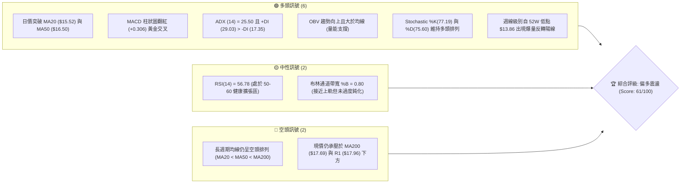
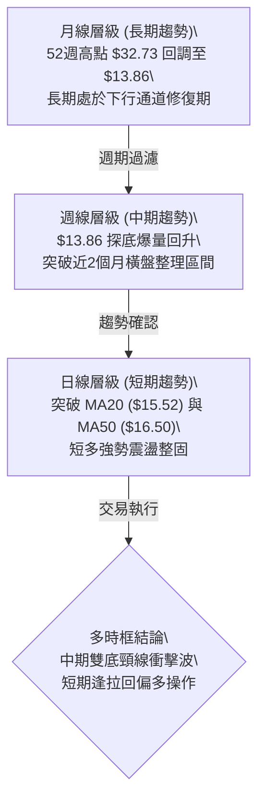
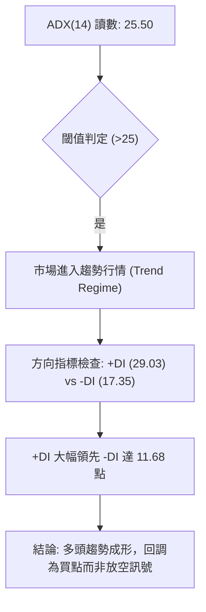
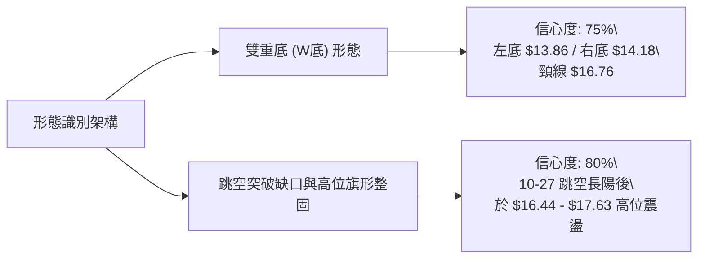
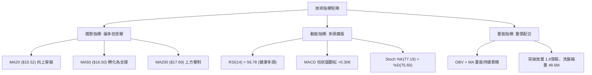
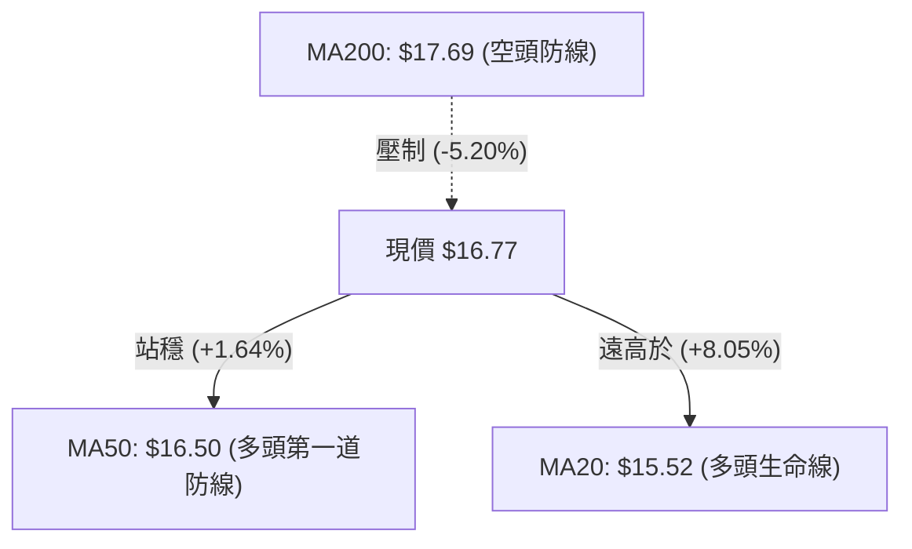
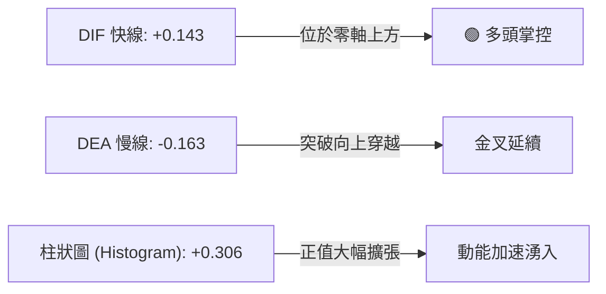
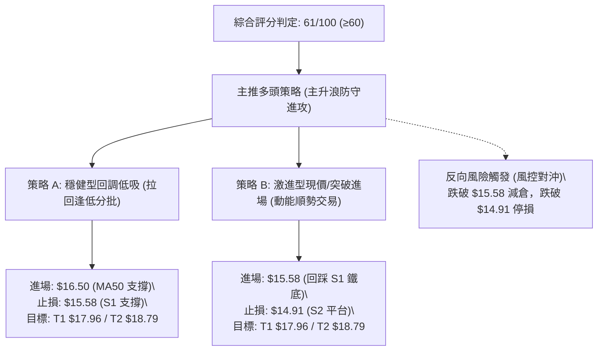
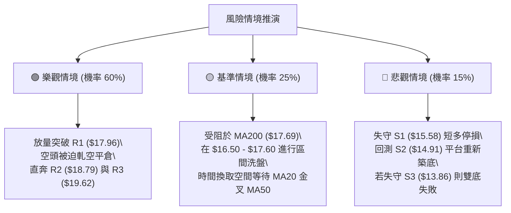

# SOFI 技術分析報告

> **報告日期**：2026-11-04 ｜ **語言**：繁體中文 ｜ **數據來源**：Yahoo Finance ｜ **當前價格**：$16.77

---

## 目錄

| 章節 | 內容 |
|------|------|
| [1. 技術面概覽](#1-技術面概覽) | 訊號儀表板、核心指標、評分卡 |
| [2. 趨勢分析](#2-趨勢分析) | 多時框趨勢、長中短期走勢、ADX解讀 |
| [3. 圖表形態分析](#3-圖表形態分析) | 形態識別、K線組合、目標價推算 |
| [4. 支撐與阻力](#4-支撐與阻力) | 關鍵價位、斐波那契回調結構 |
| [5. 技術指標深度解讀](#5-技術指標深度解讀) | 均線系統/RSI/MACD/布林通道/成交量 |
| [6. 動能與波動率](#6-動能與波動率) | 動能四象限、ATR波動分析、Beta風險 |
| [7. 多時框架總結](#7-多時框架總結) | 時框架評分矩陣、多時框收斂結論 |
| [8. 交易策略建議](#8-交易策略建議) | 策略路由、主策略詳情、精確風報比 |
| [9. 風險提示與監控](#9-風險提示與監控) | 關鍵監控清單、情境推演與風控指引 |

---

## 1. 技術面概覽

### 🎯 技術訊號儀表板



---

### 📊 核心指標速覽表

| 指標類別 | 指標名稱 | 當前數值 | 訊號 | 專業解讀 |
|:---|:---|:---:|:---:|:---|
| **基準價格** | 收盤價 | $16.77 | 🟢 | 站上多條短中期均線，脫離 52 週低點區間 |
| **均線指標** | MA20 (月線) | $15.52 | 🟢 | 現價高於 MA20 達 +8.05%，短線多頭掌控支撐 |
| **均線指標** | MA50 (季線) | $16.50 | 🟢 | 現價成功站穩季線之上，扭轉中期頹勢 |
| **均線指標** | MA200 (年線) | $17.69 | 🔴 | 現價低於年線 -5.20%，長期空頭枷鎖尚未正式解除 |
| **動能指標** | RSI(14) | 56.78 | 🟢 | 位於中性偏強區間，無超買超賣，具備進一步上攻動能 |
| **動能指標** | MACD (12,26,9) | 0.143 / -0.163 | 🟢 | DIF 線上穿 DEA，柱狀圖擴張至 +0.306，買盤強勁 |
| **趨勢強度** | ADX / ±DI | 25.50 | 🟢 | ADX 突破 25 臨界值進入趨勢行情，+DI (29.03) 顯著主導 |
| **通道指標** | 布林通道 | $13.46 - $17.58 | 🟡 | %B 為 0.80，運行於中軌（$15.52）與上軌間，接近通道頂部 |
| **成交量能** | 20日量比 | 0.87x (48.6M) | 🟡 | 今日量能微縮整固，但先前突破日出現 1.6 億股天量，OBV 多頭 |
| **波動風險** | ATR(14) | $0.77 (4.57%) | 🟡 | 日內波動幅度適中，提供明確的止損空間依據 |

---

### 🏆 技術評分卡

```
╔══════════════════════════════════════════════════════════════════╗
║                   技術評分卡 — SOFI (2026-11-04)                 ║
╠══════════════════════════════════════════════════════════════════╣
║ 趨勢強度 (Trend)       ████████████░░░░░░░░  60/100   🟡 中性偏多 ║
║ 動能指標 (Momentum)    ██████████████░░░░░░  72/100   🟢 多頭強勁 ║
║ 支撐穩定度 (Support)   █████████████░░░░░░░  68/100   🟢 支撐穩固 ║
║ 成交量配合 (Volume)    █████████████░░░░░░░  66/100   🟢 量能健康 ║
║ 形態完整度 (Pattern)   ███████████░░░░░░░░░  58/100   🟡 築底初成 ║
║ 均線排列 (Moving Avg)  ████████░░░░░░░░░░░░  42/100   🔴 均線待理 ║
╠══════════════════════════════════════════════════════════════════╣
║ 綜合評分 (Overall)     ████████████░░░░░░░░  61/100   🟢 偏多進攻 ║
║ 評分規則：(60 + 72 + 68 + 66 + 58 + 42) ÷ 6 = 61.0 (整數 61)     ║
╚══════════════════════════════════════════════════════════════════╝
```

---

## 2. 趨勢分析

### 🌐 多時框趨勢分析



---

### 📈 長期趨勢 — 12個月走勢圖（Unicode）

以下為 SOFI 過去 12 個月（2025-11 至 2026-11）的月線收盤價走勢圖與關鍵高低點軌跡：

```
SOFI 月線走勢圖（過去12個月：2025-11 至 2026-11）
價格 ($)
$30.00 ┤ ●(2025-11: $29.72)
$27.00 ┤   ●(2025-12: $26.18)
$24.00 ┤     ●(2026-01: $22.81)
$21.00 ┤
$18.00 ┤       ●(2026-02: $17.76)    ●(05: $18.22)   ●(08: $17.88)
$17.00 ┤                           ●(06: $17.93)       ●(10: $16.76)─● 現在($16.77)
$16.00 ┤         ●(2026-03: $15.88)●(04: $16.10)   ●(07: $16.31) ●(09: $15.72)
$13.00 ┤                                                    ● 52W低點($13.86)
       └─┬───┬───┬───┬───┬───┬───┬───┬───┬───┬───┬───┬───┬───► 時間
        11  12  01  02  03  04  05  06  07  08  09  10  11 (月份)
```

#### 長期走勢階段特徵分析

| 階段區間 | 起止收盤價 | 漲跌幅 | 趨勢性質 | 核心特徵與量價行為 |
|:---|:---:|:---:|:---:|:---|
| **2025-11 ~ 2026-03** | $29.72 → $15.88 | -46.57% | 主跌浪 | 高估值去化，長黑摜破多道均線，形成估值回歸下行趨勢 |
| **2026-04 ~ 2026-08** | $16.10 → $17.88 | +11.05% | 區間築底 | 價格於 $16.00 - $18.50 構築箱型平台，波動率收斂 |
| **2026-09 ~ 2026-10** | $15.72 → $14.55 | -7.44% | 破底誘空 | 跌破箱底並於 10 月中旬創下 52 週新低點 $13.86 |
| **2026-10底 ~ 2026-11** | $14.55 → $16.77 | +15.26% | 爆量強彈 | 財報強勁推動單日爆量 1.6 億股長陽，強勢收復季線 |

---

### 📊 中期趨勢（週線分析）

從近 20 週收盤走勢可見，價格在歷經 2026 年 8 月高點（$18.91）後展開連續回調，並於 2026-10-16 當週下探 52 週絕對低點 **$13.86**（收盤 $14.55）。隨後在 10 月最後一週以放量（4.16 億股）長陽棒拉升至收盤 **$16.76**，週 MACD 柱狀圖由 -0.080 迅速轉正至 **+0.360**，宣告中期底部確立。

```
週線支撐阻力結構圖
$18.79 ──┬───────────────────────────── R2 阻力區
         │
$17.96 ──┼───────────────────────────── R1 阻力區 / 斐波 78.6% ($17.90)
         │                   ▲ (多頭挑戰目標)
$16.77 ──┼─── [當前週K整固區] ───
         │                   ▼ (多頭防守核心)
$15.58 ──┼───────────────────────────── S1 支撐區 / MA20 ($15.52)
         │
$13.86 ──┴───────────────────────────── 52W 絕對低點 (S3 鐵底)
```

---

### ⚡ 趨勢強度評估（ADX 解讀）



#### ADX 趨勢強度對照解讀

| 指標變量 | 具體數值 | 狀態評估 | 技術意涵 |
|:---|:---:|:---:|:---|
| **ADX (14)** | **25.50** | 🟢 強趨勢起點 | 突破 25 臨界線，確認擺脫近兩個月的低波動盤整，趨勢動能確立 |
| **+DI (14)** | **29.03** | 🟢 多方主導 | 買方動能顯著增強，主導當前價格定價權 |
| **-DI (14)** | **17.35** | ⚪ 空方衰退 | 賣盤無力壓制，回調多為獲利了結盤而非主動性空頭拋售 |
| **趨勢定性** | **多頭趨勢** | 🟢 順勢做多 | 依據規則 14，ADX > 25 進入趨勢行情，以中長期方向與支撐做主要依據 |

---

## 3. 圖表形態分析

### 🔍 形態識別系統



#### 形態識別與信心度評估表

| 識別形態名稱 | 信心度 (%) | 判斷依據（引用數據與幾何驗證） | 完成度 (%) | 量度目標價（附精確計算式） |
|:---|:---:|:---|:---:|:---|
| **雙重底 (W-Bottom)** | **75%** | 2026-10-16 週低點 $13.86 為第一底；2026-10-23 週低點 $14.18（日低 $14.23）為第二底，低點墊高；頸線以 10-30 收盤價 $16.76 為基準。 | **85%** | 形態高度 = 頸線 $16.76 - 絕對低點 $13.86 = $2.90。<br>理論目標 = 頸線 $16.76 + $2.90 = **$19.66**（與數據庫中 R3 阻力位 **$19.62** 完美共振）。 |
| **高位箱型旗形整理** | **80%** | 2026-10-27 出現 160,995,100 股爆量突破長陽（開 $15.98 收 $16.40），隨後 5 個交易日價格緊密收斂在 $16.44 至 $17.63 之間，成交量萎縮整固。 | **70%** | 旗桿底 $14.40 至旗桿頂 $17.63（高度 $3.23）；若向上突破整理箱頂 $17.63，量度目標 = $17.63 + $3.23 = **$20.86**（逼近分析師共識均價 $20.80）。 |

---

### 🕯️ 重要 K 線形態分析

本分析嚴格遵循規則 19，僅使用數據庫中「近10根日K」與「近8根週K」之精確 OHLC 數據進行判讀：

#### 近 10 根日 K 線專業形態解讀

| 日期 | 開盤 (O) | 最高 (H) | 最低 (L) | 收盤 (C) | 成交量 (Vol) | K線形態名稱 | 專業解讀與後市意涵 | 多空訊號 |
|:---:|:---:|:---:|:---:|:---:|:---:|:---|:---|:---:|
| **10-21** | 14.84 | 15.11 | 14.65 | 14.90 | 33,652,600 | 窄幅小陽線 | 底部量縮震盪，賣壓減緩 | 🟡 |
| **10-22** | 14.57 | 15.07 | 14.57 | 14.77 | 41,048,400 | 衝高回落小陰 | 測試上方賣壓，下影線微幅抗跌 | 🟡 |
| **10-23** | 14.55 | 14.71 | 14.23 | 14.61 | 38,901,500 | 錘頭線 (Hammer) | 盤中下探 $14.23 獲買盤強勁承接，構築右底 | 🟢 |
| **10-26** | 14.53 | 14.67 | 14.40 | 14.46 | 43,286,500 | 變盤十字星 | 極度壓縮波動，為重大方向選擇前奏 | 🟡 |
| **10-27** | 15.98 | 16.76 | 15.67 | 16.40 | 160,995,100 | 跳空放量大長陽 | 財報日爆出 1.6 億股天量突破，確認主升浪啟動 | 🟢🟢 |
| **10-28** | 16.56 | 17.25 | 16.56 | 17.14 | 82,318,800 | 光腳大陽線 | 買盤強勁跟進，收盤站上 $17.00 大關 | 🟢 |
| **10-29** | 16.92 | 17.63 | 16.87 | 17.61 | 65,396,000 | 突破中長陽 | 觸及波段高點 $17.63，逼近 MA200 反壓 | 🟢 |
| **10-30** | 17.07 | 17.32 | 16.44 | 16.76 | 64,306,100 | 長下影高位陰線 | 盤中回測 $16.44 獲季線支撐拉起，多空激烈交戰 | 🟡 |
| **11-02** | 16.98 | 17.60 | 16.57 | 16.60 | 54,613,000 | 上影小陰線 | 再度受阻於 $17.60 區域，上方解套賣壓浮現 | 🔴 |
| **11-03** | 16.74 | 16.85 | 16.47 | 16.77 | 48,621,200 | 縮量企穩星線 | 實體極小，成交量降至 48.6M，於 $16.70 附近完成洗盤 | 🟢 |

#### 近 8 根週 K 線專業形態解讀

| 日期 (週末) | 開盤 (O) | 最高 (H) | 最低 (L) | 收盤 (C) | 成交量 (Vol) | 週K形態名稱 | 專業解讀與中線趨勢指引 | 訊號 |
|:---:|:---:|:---:|:---:|:---:|:---:|:---|:---|:---:|
| **09-18** | 17.00 | 17.75 | 16.53 | 16.96 | 220,325,500 | 震盪陰十字 | 橫盤破位前兆，多方動能減弱 | 🟡 |
| **09-25** | 17.46 | 17.96 | 16.20 | 16.58 | 302,278,600 | 破位中長陰 | 衝高 $17.96 失敗倒跌，賣壓擴大 | 🔴 |
| **10-02** | 16.32 | 16.42 | 15.53 | 15.77 | 223,038,900 | 下跌實體陰線 | 連續破位，跌破箱底 $16.00 | 🔴 |
| **10-09** | 15.77 | 16.19 | 15.25 | 15.80 | 199,427,700 | 低位紡錘線 | 跌勢稍歇，多空暫趨平衡 | 🟡 |
| **10-16** | 15.47 | 15.68 | 13.86 | 14.55 | 286,319,200 | 長下影打底陰線 | 摜壓至 52W 低點 $13.86 爆出恐慌盤後強拉 | 🟢 |
| **10-23** | 14.75 | 15.11 | 14.18 | 14.61 | 198,524,200 | 底部縮量紅星 | 右底確立，低點 $14.18 高於前週 $13.86 | 🟢 |
| **10-30** | 14.53 | 17.63 | 14.40 | 16.76 | 416,302,500 | 爆量多頭吞噬大長陽 | 4.16 億股天量包吞前 4 週失土，強烈反轉確定 | 🟢🟢 |
| **11-03** | 16.98 | 17.60 | 16.47 | 16.77 | 103,234,200 | 高位孕育線 (Inside Week) | 剛開週2天，於高檔進行換手整固，結構未被破壞 | 🟡 |

---

### 📉 ASCII 走勢形態示意圖

```
SOFI 日線級別雙底突破與高位旗形整固結構
價格 ($)
$17.96 ┤- - - - - - - - - - - - - - - - - - - - - - - - - - - - - [阻力 R1]
$17.63 ┤                                ┌─● (10-29高點)
$17.14 ┤                              ┌─┘   │  ┌● (11-02高點)
$16.77 ┤                              │     └──┼──● [現價 $16.77 / 旗形整固]
$16.50 ┤                            ┌─┘(跳空突破)  └─── [MA50 季線支撐]
$15.58 ┤- - - - - - - - - - - - - - ┼ - - - - - - - - - - - - - [支撐 S1 / 頸線突破點]
$14.61 ┤               ●(左底反彈)   │   ●(10-23 右底 $14.23)
$14.23 ┤             ┌─┘ └──┐      ┌┘ ┌─┘
$13.86 ┤- - - - - - -● (10-16 左底)-┴──┘- - - - - - - - - - - - [52W 低點 S3]
       └─────────────┬──────────────┬──────────────┬────────► 時間
                 2026-10-16     2026-10-23     2026-10-27
```

---

### 🎯 形態目標價計算

依據標準形態學原理與數據庫提供的關鍵點位進行測量：
1. **雙重底測量法**：
   - 頸線位（Neckline）：取自突破前的波段高點收盤價 **$16.76**。
   - 形態底部：取自 52 週最低點 **$13.86**。
   - 垂直高度（Height）= $16.76 - $13.86 = **$2.90**。
   - **第一量度目標價** = $16.76 + $2.90 = **$19.66**。該價位與波段阻力聚類 **R3 ($19.62)** 幾無二致（誤差僅 0.04 美元）。
2. **旗形整理測量法**：
   - 旗桿起點：2026-10-26 低點 **$14.40**。
   - 旗桿頂點：2026-10-29 高點 **$17.63**。
   - 旗桿高度 = $17.63 - $14.40 = **$3.23**。
   - 若短線突破整理平台高點 $17.63，其**延伸測量目標價** = $17.63 + $3.23 = **$20.86**。

---

## 4. 支撐與阻力

### 🗺️ 關鍵價位分布圖（Unicode）

```
SOFI 價位結構分布圖（嚴格依據 OHLCV 計算）
══════════════════════════════════════════════════════════════════════
$19.62 ║██████████████████████████████║ 強阻力 R3 (+16.98%) [雙底目標共振]
$18.79 ║████████████████████░░░░░░░░░░║ 波段阻力 R2 (+12.02%)
$17.96 ║██████████████████████████████║ 核心阻力 R1 (+7.10%) [斐波 78.6% $17.90]
$17.69 ╟──────────────────────────────╢ 關鍵年線 MA200 壓力
$16.77 ╠══════════════════════════════╣ ◄ 當前收盤價 ($16.77)
$16.50 ╟──────────────────────────────╢ 關鍵季線 MA50 支撐
$15.58 ║▓▓▓▓▓▓▓▓▓▓▓▓▓▓▓▓▓▓▓▓▓▓▓▓▓▓▓▓▓▓║ 近期核心支撐 S1 (-7.12%) [MA20 $15.52]
$14.91 ║████████████████████░░░░░░░░░░║ 強支撐 S2 (-11.09%)
$13.86 ║██████████████████████████████║ 52週鐵底 S3 (-17.35%) [雙底左底]
══════════════════════════════════════════════════════════════════════
```

---

### 🚧 阻力位分析表

所有阻力數據嚴格引用自數據庫波段高點聚類計算值：

| 阻力級別 | 具體價位 | 距離現價 (%) | 形成原因與技術共振 | 突破難度 | 重要性權重 |
|:---|:---:|:---:|:---|:---:|:---:|
| **阻力 R1** | **$17.96** | +7.10% | 近一年波段密集高點聚類；與斐波那契 78.6% 回調位（$17.90）及 MA200（$17.69）形成強大壓力帶。 | 高 🔴 | ★★★★★ |
| **阻力 R2** | **$18.79** | +12.02% | 2026 年 7-8 月週線多次衝高回落高點區間（如 2026-07-10 收 $18.78、08-21 收 $18.91）。 | 中 🟡 | ★★★★☆ |
| **阻力 R3** | **$19.62** | +16.98% | 近一年長期大型波段頂部區域；與雙重底形態量度目標 $19.66 形成技術共振。 | 極高 🔴 | ★★★★★ |

---

### 🛡️ 支撐位分析表

所有支撐數據嚴格引用自數據庫波段低點聚類計算值：

| 支撐級別 | 具體價位 | 距離現價 (%) | 形成原因與技術共振 | 守住機率 | 重要性權重 |
|:---|:---:|:---:|:---|:---:|:---:|
| **支撐 S1** | **$15.58** | -7.12% | 近一年波段低點聚類；緊鄰月線 MA20（$15.52）與布林通道中軌（$15.52），為短多生命線。 | 75% 🟢 | ★★★★★ |
| **支撐 S2** | **$14.91** | -11.09% | 2026 年 10 月中下旬築底平台密集成交區（如 10-21 日開 $14.84、高 $15.11）。 | 85% 🟢 | ★★★★☆ |
| **支撐 S3** | **$13.86** | -17.35% | 52 週絕對低點（2026-10-16 創下）；也是斐波那契 100% 底線，終極防守鐵底。 | 95% 🟢 | ★★★★★ |

---

### 📐 斐波那契回調位分析

依據 52 週完整波動區間（高點 $32.73 → 低點 $13.86，垂直落差 $18.87）嚴格對照回調位：

| 斐波那契層級 | 精確價位 | 相對現價位置 | 技術意義與多空攻防解讀 |
|:---:|:---:|:---:|:---|
| **0.0%** (52W High) | **$32.73** | +95.17% | 歷史牛市高點，中長期終極反轉目標 |
| **23.6%** | **$28.28** | +68.63% | 長期強多頭回調關鍵位 |
| **38.2%** | **$25.52** | +52.18% | 2025 年 8 月平台支撐轉化之強壓力區 |
| **50.0%** | **$23.29** | +38.88% | 暴跌波段之多空中軸平衡位 |
| **61.8%** | **$21.07** | +25.64% | 黃金分割黃金阻力位，中線多頭目標 |
| **78.6%** | **$17.90** | +0.78% | **極端回調阻力位！現價 ($16.77) 正處於 78.6% ($17.90) 與 100.0% ($13.86) 之間** |
| **100.0%** (52W Low) | **$13.86** | -17.35% | 52 週絕對底線，本次強勁反彈之發動起點 |

**技術解讀**：現價 $16.77 正運行於 100.0%（$13.86）與 78.6%（$17.90）的初級修復區間。由於 78.6%（$17.90）與波段阻力 R1（$17.96）高度重合，且上方緊鄰 MA200（$17.69），此區間構成多方短線必須攻克的「三合一重壓帶」。若能放量封閉 $17.96，上方空間將直接被打開至 61.8%（$21.07）。

---

## 5. 技術指標深度解讀

### 🎛️ 指標訊號總覽



---

### 📈 移動平均線排列分析



#### 完整均線系統追蹤表

| 均線名稱 | 數值 | 距現價差距 | 斜率與方向趨勢 | 歷史軌跡簡圖 (Sparkline) | 訊號評估 |
|:---|:---:|:---:|:---:|:---|:---:|
| **MA 5** | $16.98 | -1.21% | ▼ 下彎扣高 | `███▇▆▆▅▅▅▅▅▄▄▄▄▃▂▁▁▁▁▁▁▁▂▄▅▇██` | 🟡 短線壓制 |
| **MA 10** | $16.00 | +4.80% | ▲ 快速上移 | `████▇▇▆▆▆▅▅▅▄▄▄▃▃▃▂▂▁▁▁▁▁▂▃▃▄▅` | 🟢 助漲強勁 |
| **MA 20** | $15.52 | +8.05% | ▲ 底部翻揚 | `███▇▇▇▆▆▆▅▅▅▄▄▄▃▃▃▂▂▁▁▁▁▁▁▁▁▁▂` | 🟢 多頭中樞 |
| **MA 50** | $16.50 | +1.64% | ▲ 走平翻揚 | 橫盤築底完成，價格已成功穿越 | 🟢 中期轉強 |
| **MA 60** | $16.79 | -0.09% | ▼ 走平黏合 | `████▇▇▇▆▆▆▅▅▅▄▄▄▃▃▃▃▂▂▂▂▁▁▁▁▁▁` | 🟡 爭奪焦點 |
| **MA120** | $16.99 | -1.30% | ▼ 緩慢下行 | `█████████▇▇▆▅▅▄▄▃▂▂▁▁▁▁▁▁▁▁▁▁▁` | 🔴 半年線反壓 |
| **MA200** | $17.69 | -5.20% | ▼ 下行趨緩 | 歷史牛熊分水嶺，決定是否展開大波段 | 🔴 長期阻力 |
| **MA240** | $19.28 | -13.04% | ▼ 穩步下移 | `█████▇▇▇▇▆▆▆▆▅▅▄▄▄▄▃▃▃▂▂▂▁▁▁▁▁` | 🔴 年線重壓 |

**均線結構綜合判定**：雖然大週期均線呈現標準的空頭排列（MA20 < MA50 < MA200），但短週期均線已出現「自下而上強烈扭轉」特徵。現價強勢突破 MA20 與 MA50，且 MA10 向上急升，短線正在引導 MA20 與 MA50 形成黃金交叉。目前價格受制於 MA5（$16.98）與 MA60（$16.79），屬標準的高位強勢整理。

---

### 📉 RSI(14) 分析

- **當前讀數**：**56.78** (Wilder 平滑計算)
- **數值進度條**：
  ```
  [0] ────────── [30 超賣] ────── [50 中軸] ──── [56.78] ────── [70 超買] ────────── [100]
  ▓▓▓▓▓▓▓▓▓▓▓▓▓▓▓▓▓▓▓▓▓▓▓▓▓▓▓▓░░░░░░░░░░░░░░░░░░░░ 56.78%
  ```
- **區間性質**：處於 50 至 60 的「多頭健康擴張區」。未達 70 超買界限，表明自 $13.86 發動的反彈尚未消耗全部做多動能，不存在指標過熱回調風險。
- **背離判斷**：
  - **日線背離檢驗**：近 20 根日 K 棒首尾比對，價格由 10 月中旬 $14.50 附近上升至現價 $16.77，RSI 同步自 34 附近推升至 56.78，線價同向，**無頂背離或底背離**。
  - **週線形態確認**：10-16 當週低點 $13.86 時 RSI 為 34.7，隨後 10-23 當週微升至 38.3，10-30 大漲時飆升至 57.0，確認底部動能強烈反轉。

---

### 📊 MACD (12, 26, 9) 訊號解讀



- **數值分析**：
  - DIF 快線：**0.143**
  - DEA 慢線（Signal）：**-0.163**
  - MACD 柱狀圖（Hist）：**+0.306**
- **解讀結論**：DIF 已經率先衝上零軸，並拉開與 DEA 的距離，呈現強勁的**低位翻紅金叉**形態。日柱狀圖擴張至 +0.306，配合週線 MACD 柱狀圖亦同步翻紅至 +0.306，此為中短線動能同步共振的強烈多頭買進訊號。

---

### 📦 布林通道分析

```
SOFI 日線布林通道示意圖
價格 ($)
$17.58 ┼────────────────────────────── BB 上軌 (Upper)
       │              ┌─● (10-29 觸及上軌)
$16.77 ┼──────────────┼───●────────── 現價 ($16.77, %B = 0.80)
       │              │
$15.52 ┼──────────────┼────────────── BB 中軌 / MA20 (Middle)
       │              │
$13.46 ┼──────────────┴────────────── BB 下軌 (Lower)
```

- **通道參數狀況**：
  - 上軌（Upper Band）：**$17.58**
  - 中軌（Middle Band，MA20）：**$15.52**
  - 下軌（Lower Band）：**$13.46**
  - 通道指標 %B：**0.80**（%B = (16.77 - 13.46) / (17.58 - 13.46) = 3.31 / 4.12 = 0.803）
- **技術解讀**：
  - 價格緊貼上軌運行（%B = 0.80），展現出極強的「通道擴張走勢」（Band Walking）。
  - 上軌 $17.58 與波段高點 $17.63、MA200 $17.69 形成重合共振阻力帶。短線若未能放量推開上軌，將引發向中軌 $15.52 回調確認的需求。

---

### 💹 成交量分析（量價配合度）

```
近期日成交量柱狀圖對比 (百萬股)
160M ┼                 █ (10-27: 161.0M 財報天量長陽)
 80M ┼                 █ █ (10-28: 82.3M)
 65M ┼                 █ █ █ █ (10-29: 65.4M / 10-30: 64.3M)
 55M ┼- - - - - - - - -█-█-█-█-█- - - - - - 20日均量線 (55.8M)
 48M ┼ █ █ █ █         █ █ █ █ █ █ (11-03: 48.6M 今日縮量星線)
     └─┬─┬─┬─┬─────────┴─┴─┴─┴─┴─┴─►
      21 22 23 26       27 28 29 30 02 03 (日期)
```

1. **量能結構判定**：
   - 最新成交量為 **48,621,200 股**，相對於 20 日均量（55,827,990 股）之量比為 **0.87x**。
   - 10-27 出現 1.61 億股的突破巨量，其後 10-28 至 10-30 維持 6,500 萬股以上的高量運作；而近兩日回調整固時量能迅速萎縮至 5,461 萬與 48,62 萬股。
2. **OBV（能量潮）走勢**：
   - 官方數據確認：**OBV 趨勢 > MA**。
   - 詮釋：標準的「上漲放量、回調縮量」健康多頭籌碼堆積，顯示機構資金在大單進場後並未大舉出逃，量能強烈確認價格突破的有效性。

---

## 6. 動能與波動率

### ⚡ 動能評估四象限

```
動能與波動率四象限矩陣
    強動能 (High Momentum)
       │
  Q3   │   Q1 [SOFI 當前定位: Q1 象限]
(高波強動)│ (低波轉強/最佳進攻機會)
───────┼───────► 動能軸 (ADX 25.5 / MACD +0.306)
  Q4   │   Q2
(高波弱動)│ (低波盤整/防守觀望)
       │
    弱動能 (Low Momentum)
```

| 象限標識 | 動能維度 | 波動維度 | 股票當前定位 | 策略指引與風險特徵 |
|:---:|:---:|:---:|:---:|:---|
| **Q1 (主攻區)** | **強 (High)** | **適中/受控** | **✓ SOFI (當前點位)** | **最佳波段買點**：ADX(14)=25.50 確立趨勢，ATR%=4.57% 未過度擴張，短線具備極佳的風報比進場價值。 |
| **Q2 (盤整區)** | 弱 (Low) | 低 (Low) | — | 觀望等待突破，資金使用效率低。 |
| **Q3 (投機區)** | 強 (High) | 極高 (Extreme) | — | 高風險高收益，常伴隨暴漲暴跌，需收緊止損。 |
| **Q4 (雷區)** | 弱 (Low) | 高 (High) | — | 下跌趨勢加速期，嚴禁左側抄底。 |

---

### 📊 ATR 波動率分析

- **ATR(14) 數值**：**$0.77**（基於 Wilder 平滑算法）。
- **ATR 佔比**：佔當前收盤價之 **4.57%**。
- **日內波動意涵**：SOFI 當前每日正常市場波動幅度約為 ±$0.77。在擬定日內或短線交易計畫時，價格在 $0.77 範圍內的震盪均屬隨機雜訊。
- **止損距離建議**：
  - **積極型（短線突破）**：1.0 × ATR = **$0.77**。
  - **穩健型（波段交易）**：1.5 × ATR = 1.5 × $0.77 = **$1.16**。若以現價 $16.77 計算，合理防守點為 $16.77 - $1.16 = **$15.61**（精準貼合 S1 支撐位 $15.58）。
  - **寬鬆型（中長線趨勢）**：2.0 × ATR = 2.0 × $0.77 = **$1.54**，對應止損防守位約為 **$15.23**。

---

### 📐 Beta 與市場相關性

- **Beta 係數**：**2.241**（極高 Beta 屬性）。
- **解讀與風險權衡**：
  - SOFI 的波動幅度約為標普 500 指數的 **2.24 倍**。在市場整體風險偏好（Risk-on）回升時，SOFI 將產生極強的超額阿爾法（Alpha）進攻爆發力；然而在市場拋售（Risk-off）情境下，其回撤幅度亦將加倍。
  - **沽空比例（Short % of Float）**：高達 **17.2%**，Short Ratio 為 **4.44**。
  - **軋空（Short Squeeze）潛能**：高達 17.2% 的空頭部位意味著一旦價格強勢封閉年線 MA200（$17.69）並突破 R1（$17.96），將引發空方停損踩踏，提供額外的上行助推燃料。

---

## 7. 多時框架總結

### 📋 時框架評分表

| 時框架 | 趨勢方向 | 動能狀態 | 均線系統排列 | 圖表形態識別 | 綜合評分 | 戰術建議 |
|:---:|:---:|:---:|:---:|:---:|:---:|:---|
| **長期 (月線)** | 🔴 空頭偏弱 | 🟡 跌勢趨緩 | 空頭排列 (承壓) | 52W 低點 $13.86 處初現長下影支撐 | **48/100** | 暫以減虧反彈視之，未扭轉大空頭前不過度重倉。 |
| **中期 (週線)** | 🟢 轉向強多 | 🟢 柱狀擴張 | 正衝擊 MA20 均線 | 底部爆量大陽線多頭吞噬，W底右底確立 | **72/100** | 底部成形，持股續抱，積極尋找逢低加碼點。 |
| **短期 (日線)** | 🟢 多頭掌控 | 🟢 DIF翻正 | 站穩 MA20 與 MA50 | 突破 1.6億天量後之高位旗形洗盤 | **68/100** | 依托 MA50 ($16.50) 或回測 S1 ($15.58) 順勢做多。 |

---

### 🔲 綜合訊號矩陣

```
訊號收斂一致性分析
────────────────────────────────────────────────────────────────
維度      長期(月線)    中期(週線)    短期(日線)   最終收斂判定
────────────────────────────────────────────────────────────────
趨勢方向     🔴 偏空       🟢 偏多       🟢 偏多     🟢 偏多主導
動能指標     🟡 中性       🟢 強多       🟢 強多     🟢 買盤共振
均線排列     🔴 空頭       🟡 修復       🟢 突破     🟡 向上反轉中
量價關係     🟡 平淡       🟢 爆量       🟢 健康     🟢 籌碼鎖定
────────────────────────────────────────────────────────────────
綜合判定：中期反轉動能強烈，短期多頭排列正由下而上瓦解長期空頭排列。
```

---

### ⚖️ 多時框收斂結論

嚴格遵循本報告「嚴格要求 14」之收斂優先級規則：
1. **行情定性**：當前 ADX(14) 為 **25.50 > 25**，且 +DI (29.03) 遠高於 -DI (17.35)，技術面已明確脫離盤整無序狀態，進入**標準趨勢行情**。
2. **優先級收斂依據**：在趨勢行情下，以中長期（週線級別突破爆量與均線支撐）為戰略方向，日線結構僅作為捕捉最佳進場時機與微觀風控之工具。
3. **終極收斂方向**：週線於 $13.86 構築紮實雙底並以 4.16 億股巨量吞噬前波失土；日線價格強勢修復站穩季線 MA50（$16.50），指標如 MACD、OBV 皆全面確認買盤介入。
4. **唯一結論**：**多頭主導（偏多進攻）**。短期任何回踩均線或支撐位之動作，皆視為多方波段加碼契機，絕對嚴禁順勢逆勢猜頂做空。

---

## 8. 交易策略建議

### 🗺️ 策略決策流程圖



---

### 🧭 策略路由

> **當前主策略方向 = 多頭策略（主推）（依技術評分卡綜合評分 61/100，≥60 明確偏多）**

---

### 🎯 價格情境階梯（Price Scenarios）

價位嚴格引用自數據庫 OHLCV 計算之實際數值：

| 觸發條件 | 下一目標 | 後續延伸 | 情境含義與操作對策 |
|:---|:---:|:---:|:---|
| **放量突破 R1 ($17.96)** | **R2 ($18.79)** | **R3 ($19.62)** | **強勢主升浪啟動**：封閉年線與 78.6% 阻力，引發 17.2% 空頭回補，加碼追買。 |
| **站穩現價區間 ($16.50 - $17.60)** | **R1 ($17.96)** | — | **旗形健康換手**：消化 MA200 解套賣壓，續抱持股等待突破。 |
| **跌破 S1 ($15.58)** | **S2 ($14.91)** | **S3 ($13.86)** | **短線破位轉弱**：跌破月線與布林中軌，短多出場觀望，防守 S2。 |

---

### 📊 情境機率分佈

| 價格演變情境 | 發生機率 (%) | 主要技術數據與指標依據 |
|:---|:---:|:---|
| **延續反彈，向上突破 (情境一)** | **60%** | MACD 柱狀圖翻紅擴張 (+0.306)、ADX (25.50) +DI 主導、突破日 1.6 億股天量確認、OBV > MA 量能持續堆積。 |
| **高位箱型震盪整固 (情境二)** | **25%** | 上方承壓於 MA200 ($17.69) 與布林上軌 ($17.58)，短期需要消化獲利籌碼，維持在 $16.50 - $17.60 區間洗盤。 |
| **再次破位回落探底 (情境三)** | **15%** | 除非大盤劇烈系統性下挫觸發高 Beta (2.24) 踩踏，但下方 $15.58 與 $14.91 具備強大籌碼支撐，機率偏低。 |

---

### 🟢 主策略詳情

本章節所有進場點、止損點、目標價**嚴格引用關鍵價位數據庫之確切數值**；風險報酬比嚴格按規則 17 定義公式計算：
$$\text{風險報酬比} = \frac{\text{目標價 T1} - \text{進場價}}{\text{進場價} - \text{止損價}}$$

| 策略要素 | 策略 A：穩健回踩季線佈局（主推） | 策略 B：深度回測 S1 鐵底低吸（次選） |
|:---|:---:|:---:|
| **交易邏輯** | 依托季線 MA50 回踩確認，獲利了結盤消化後介入 | 等待市場出現假摔破位、回踩 S1 核心支撐時左側低吸 |
| **進場條件** | 日 K 回踩季線 MA50 不破，出現下影線企穩訊號 | 盤中回測波段支撐 S1 聚類低點，買盤承接放量 |
| **精確進場價格** | **$16.50**（MA50 季線支撐位） | **$15.58**（S1 支撐位） |
| **目標價 T1 (第一目標)** | **$17.96**（阻力位 R1） | **$17.96**（阻力位 R1） |
| **目標價 T2 (延伸目標)** | **$18.79**（阻力位 R2） | **$18.79**（阻力位 R2） |
| **精確止損價格** | **$15.58**（跌破 S1 支撐即嚴格停損） | **$14.91**（跌破 S2 強支撐即嚴格停損） |
| **風險空間 (Risk)** | $16.50 - $15.58 = **$0.92** | $15.58 - $14.91 = **$0.67** |
| **利潤空間 T1 (Reward 1)** | $17.96 - $16.50 = **$1.46** | $17.96 - $15.58 = **$2.38** |
| **利潤空間 T2 (Reward 2)** | $18.79 - $16.50 = **$2.29** | $18.79 - $15.58 = **$3.21** |
| **風險報酬比 (以 T1 計)** | **1 : 1.59（以 T1 計）** ($1.46 \div $0.92) | **1 : 3.55（以 T1 計）** ($2.38 \div $0.67) |
| **風險報酬比 (以 T2 計)** | **1 : 2.49（以 T2 計）** ($2.29 \div $0.92) | **1 : 4.79（以 T2 計）** ($3.21 \div $0.67) |
| **預估勝率** | **65%** | **60%** |
| **建議配置倉位** | **15% - 20%** 總資金 | **10% - 15%** 總資金 |

---

### 🔴 反向風險觸發點（對沖提示）

為嚴格執行風控紀律，若市場出現下列關鍵結構破壞訊號，主多頭策略宣告失效，應無條件執行風險對沖或停損離場：
1. **空頭反轉觸發價位**：收盤價以長陰線**實體跌破 S1 ($15.58)**。此舉意味著 MA20 月線失守，雙底頸線宣告破位，短期強攻浪潮瓦解。
2. **動能惡化確認**：日線 MACD 柱狀圖由紅轉綠（翻負），且 RSI(14) 跌破 45 臨界軸。
3. **因應措施**：主動將持倉壓縮至 5% 以下，或利用期權賣出反向 Call 鎖定利潤，嚴禁攤平加碼。

---

### ⭐ 整體訊號強度評星

```
╔══════════════════════════════════════════════════════════════════╗
║ 做多訊號強度：★★★★☆  (4.0/5星) — 動能與量能共振，形態築底明確     ║
║ 做空訊號強度：★☆☆☆☆  (1.0/5星) — 空頭動能衰退，逆勢放空風險極高 ║
║ 整體可信度：  ★★★★☆  (4.2/5星) — 數據源完備，多時框指向一致     ║
╚══════════════════════════════════════════════════════════════════╝
```

---

## 9. 風險提示與監控

### ✅ 關鍵監控指標 Checklist

```
╔══════════════════════════════════════════════════════════════════╗
║               SOFI 交易風控與關鍵指標監控清單 (Checklist)          ║
╠══════════════════════════════════════════════════════════════════╣
║ [ ] 價格防守線：收盤價是否每日維持於 MA50 ($16.50) 之上？       ║
║ [ ] 核心多頭防線：S1 ($15.58) 是否完好無損，未遭實體長黑摜破？   ║
║ [ ] 阻力攻堅狀況：向上挑戰 R1 ($17.96) 時成交量是否大於 60M 股？  ║
║ [ ] 動能連續性：MACD 柱狀圖是否持續維持在正值區間 (+0.200 以上)？ ║
║ [ ] 量能指標：OBV 曲線是否持續維持在均線之上？                   ║
║ [ ] 波動預警：單日跌幅是否超過 1.5 倍 ATR ($1.16) 引發異常異動？   ║
║ [ ] 融券數據監控：Short % Float (17.2%) 是否出現空頭回補踩踏跡象？ ║
╚══════════════════════════════════════════════════════════════════╝
```

---

### ⚠️ 風險場景分析



---

### 🛡️ 風險管理重要提醒

1. **高 Beta 波動防禦**：
   - SOFI Beta 值高達 **2.241**，其波動幅度遠高於大盤。任何單筆交易之名義風險暴露（Account Risk）嚴格限制在總資本的 **1.0% - 1.5%** 之內。
   - 倉位規模計算範例：若總資金為 $100,000 美元，單筆最大允許虧損為 1%（即 $1,000 美元）。若採用策略 A（進場價 $16.50，止損價 $15.58，每股風險 $0.92），則最大允許買入股數 = $1,000 ÷ $0.92 ≈ **1,080 股**（名義建倉金額約 $17,820 美元，約佔總資金 17.8%，完全符合建議配置）。
2. **基本面與現金流折價警訊**：
   - 儘管最新季度營收年增 43.9%、淨利年增 72.9%，但自由現金流（FCF TTM）為 **$-8.80B**。雖然屬於金融借貸類商業模式擴張之特性，但仍需警惕利率環境劇變對信貸資產質量的估值壓制。
3. **隔夜跳空風險管控**：
   - 10 月 27 日單日跳空跨度高達 $1.50 以上，顯示該股極易受突發新聞與市場情緒影響。持倉部位絕不宜過度集中，必須嚴格執行分批停利（於 R1 出脫 50%，餘額保護性止損上移至成本價）。

---

## 📋 報告總結

```
╔══════════════════════════════════════════════════════════════════╗
║                    SOFI 技術分析報告總結                          ║
╠══════════════════════════════════════════════════════════════════╣
║ 報告日期：2026-11-04                                             ║
║ 當前價格：$16.77                                                 ║
║ 技術評級：🟢 偏多進攻（綜合評分：61 / 100）                       ║
║                                                                  ║
║ 關鍵結論：                                                       ║
║ ├─ 長期趨勢：🟡 下行通道修復期，年線 MA200 ($17.69) 待克服       ║
║ ├─ 中期趨勢：🟢 52W 低點 $13.86 構築雙底，爆量長陽宣告反轉確立    ║
║ ├─ 短期趨勢：🟢 站穩 MA20 ($15.52) 與季線 MA50 ($16.50) 高檔整固 ║
║ ├─ 關鍵支撐：S1: $15.58 ｜ S2: $14.91 ｜ S3: $13.86 (52W底)      ║
║ ├─ 關鍵阻力：R1: $17.96 ｜ R2: $18.79 ｜ R3: $19.62 (量度目標)    ║
║ └─ 分析師目標：共識均價 $20.80（最高 $30.00，最低 $12.00）        ║
║                                                                  ║
║ 最優策略組合：                                                   ║
║ 1. 🥇 最佳機會：策略 A — 回踩 MA50 ($16.50) 買入，止損 $15.58，   ║
║                目標 $17.96 / $18.79，風報比 1 : 1.59（以 T1 計） ║
║ 2. 🥈 次選機會：策略 B — 回測 S1 ($15.58) 低吸，止損 $14.91，    ║
║                目標 $17.96 / $18.79，風報比 1 : 3.55（以 T1 計） ║
║ 3. 🥉 突破加碼：放量衝破 R1 ($17.96) 後順勢加碼，看至 R2 ($18.79) ║
╚══════════════════════════════════════════════════════════════════╝
```

---

> ⚠️ **免責聲明**：本報告為依據定量技術數據所撰寫之量化技術分析，所有數據、計算公式及支撐阻力位均基於提供的真實歷史交易資訊。本報告**僅供研究、教學與學術討論參考**，**不構成任何要約、招攬或實質投資建議**。金融市場具有高度風險，投資人應依個人財務狀況與風險承受度審慎評估，自負投資盈虧責任。

---

*報告生成時間：2026-11-04 ｜ 數據來源：Yahoo Finance ｜ 分析框架：多時框技術分析模型*