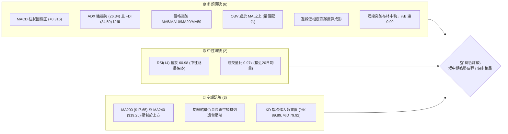
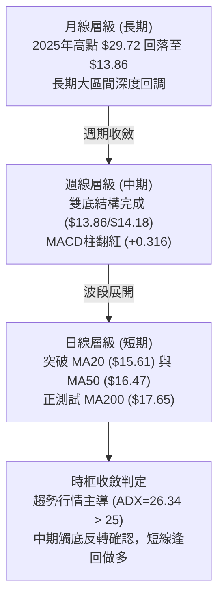
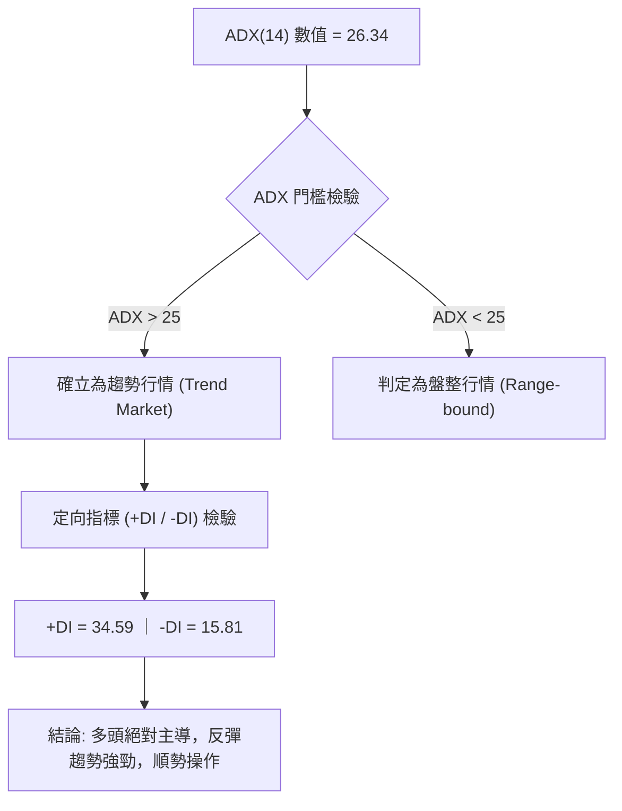
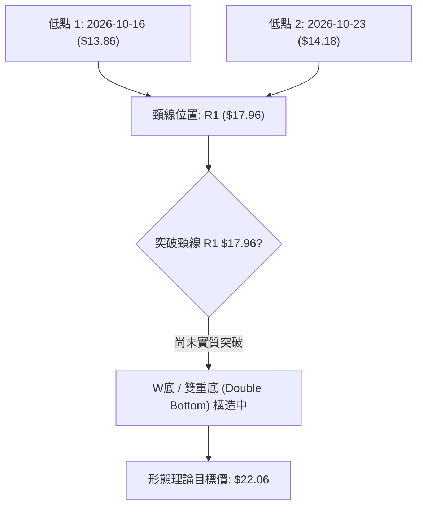
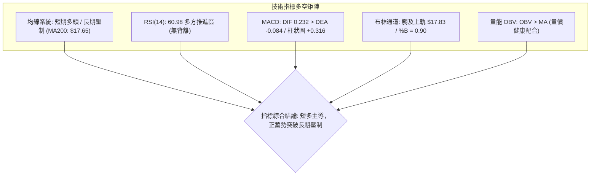
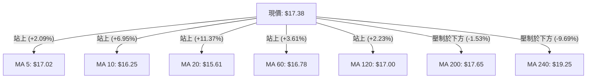
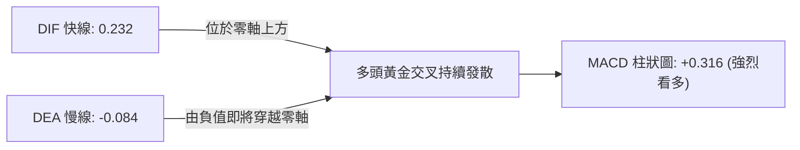
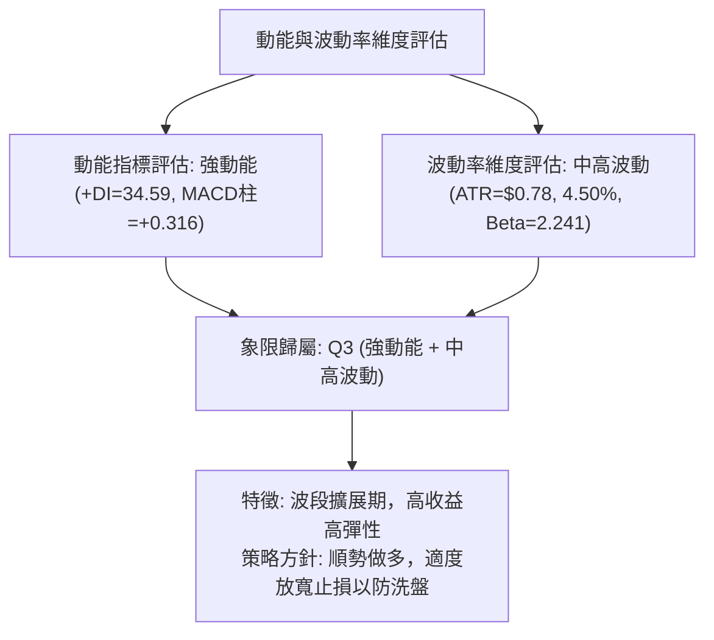
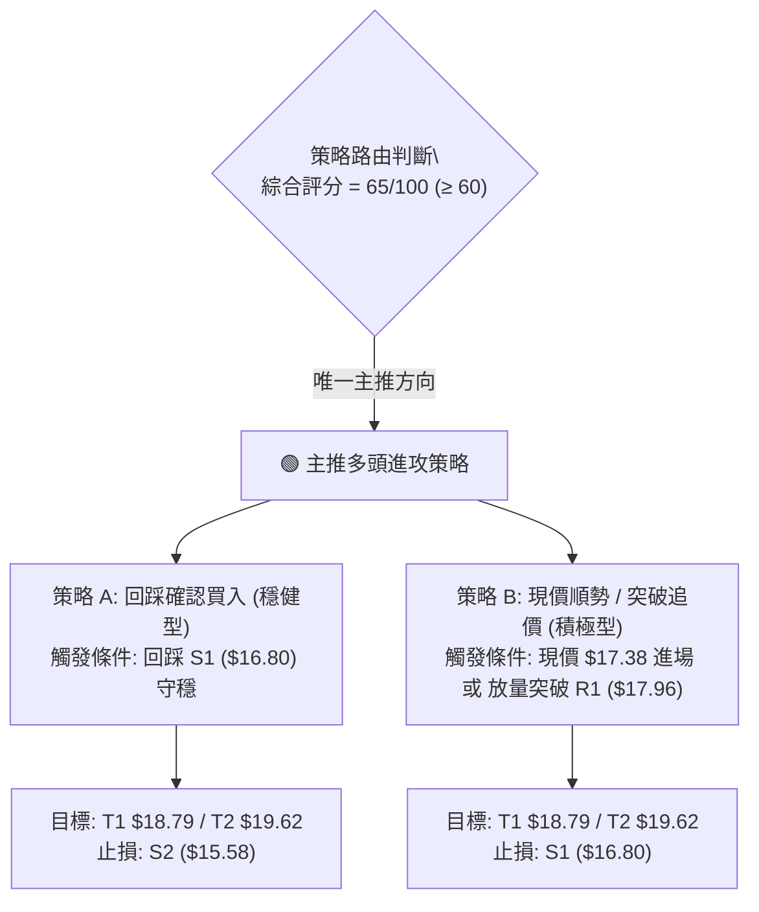
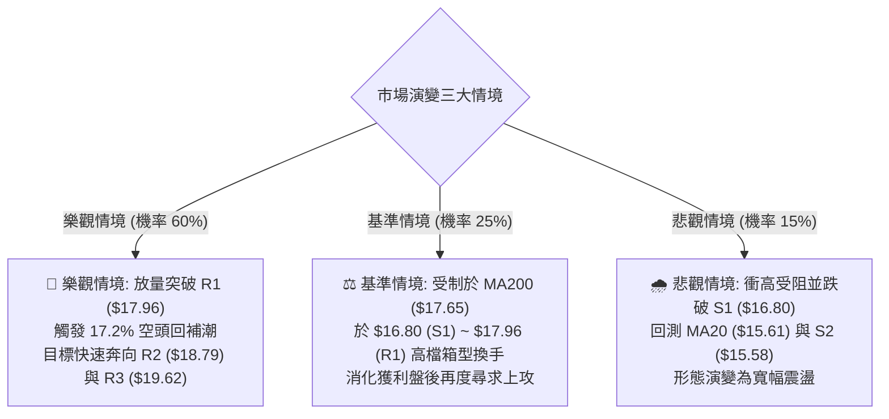

# SOFI 技術分析報告

> **報告日期**：2026-11-05 ｜ **語言**：繁體中文 ｜ **數據來源**：Yahoo Finance ｜ **當前價格**：$17.38

---

## 目錄

| 章節 | 內容 |
|------|------|
| [1. 技術面概覽](#1-技術面概覽) | 訊號儀表板、核心指標、評分卡 |
| [2. 趨勢分析](#2-趨勢分析) | 多時框趨勢、長中短期走勢 |
| [3. 圖表形態分析](#3-圖表形態分析) | 形態識別、K線組合、目標價 |
| [4. 支撐與阻力](#4-支撐與阻力) | 關鍵價位、斐波那契回調 |
| [5. 技術指標深度解讀](#5-技術指標深度解讀) | MA/RSI/MACD/布林/成交量 |
| [6. 動能與波動率](#6-動能與波動率) | 動能評估、ATR、Beta |
| [7. 多時框架總結](#7-多時框架總結) | 時框架評分矩陣 |
| [8. 交易策略建議](#8-交易策略建議) | 多空策略、風險報酬比 |
| [9. 風險提示與監控](#9-風險提示與監控) | 監控指標、風險場景 |

---

## 1. 技術面概覽

### 🎯 技術訊號儀表板



### 📊 核心指標速覽表

| 指標類別 | 指標名稱 | 當前數值 | 訊號 | 解讀 |
|----------|----------|----------|------|------|
| **價格** | 當前價格 | $17.38 | 🟢 | 站上多數短中期均線，逼近 52 週低點回升反彈區 |
| **均線** | MA20 | $15.61 | 🟢 | 現價高於 MA20 達 +11.37%，短期動能強勁向上 |
| **均線** | MA50 | $16.47 | 🟢 | 成功突破中期生命線，短多取得防守主控權 |
| **均線** | MA200 | $17.65 | 🔴 | 現價位於 MA200 下方 -1.53%，面臨牛熊分水嶺壓制 |
| **動能** | RSI(14) | 60.98 | 🟡 | 位於健康多頭推進區，未達 70 嚴重超買閥值 |
| **動能** | MACD(12,26,9) | DIF 0.232 / DEA -0.084 | 🟢 | 黃金交叉持續發散，Histogram +0.316 看多 |
| **動能** | Stoch %K / %D | 89.89 / 79.92 | 🔴 | 短線進入高檔超買鈍化區，警惕短線獲利回吐 |
| **趨勢** | ADX(14) | 26.34 | 🟢 | ADX > 25 確立趨勢行情，+DI 34.59 遠高於 -DI 15.81 |
| **波動** | ATR(14) | $0.78 (4.50%) | 🟡 | 每日平均波動幅度中等偏高，提供充裕波段獲利空間 |
| **量能** | 20日成交量比 | 0.97x | 🟡 | 今日量能 5,521 萬股，略低於20日均量 5,695 萬股 |
| **通道** | 布林通道 %B | 0.90 | 🟢 | 價格緊貼布林上軌 ($17.83) 運行，屬於強勢走法 |

### 🏆 技術評分卡

```
╔══════════════════════════════════════════════════════════════╗
║                技術評分卡 — SOFI (2026-11-05)                ║
╠══════════════════════════════════════════════════════════════╣
║ 趨勢強度 (ADX/DI)   ██████████████░░░░░░  70/100  🟢 看多     ║
║ 動能指標 (RSI/MACD) ██████████████░░░░░░  72/100  🟢 看多     ║
║ 支撐穩定度 (支撐分佈) █████████████░░░░░░░  65/100  🟢 偏多     ║
║ 成交量配合 (OBV/均量) █████████████░░░░░░░  64/100  🟡 中性偏多 ║
║ 形態完整度 (雙底反轉) █████████████░░░░░░░  65/100  🟢 偏多     ║
║ 均線排列 (多空結構)   ███████████░░░░░░░░░  54/100  🟡 整理待變 ║
╠══════════════════════════════════════════════════════════════╣
║ 綜合評分             █████████████░░░░░░░  65/100  🟢 偏多進攻 ║
╚══════════════════════════════════════════════════════════════╝
```
*註：綜合評分為六項子評分之算術平均值：(70 + 72 + 65 + 64 + 65 + 54) ÷ 6 = 65.0（四捨五入至整數 65/100）。*

---

## 2. 趨勢分析

### 🌐 多時框趨勢分析



### 📈 長期趨勢 — 12個月走勢圖（Unicode）

以下為 SOFI 過去 12 個月（2025-11 至 2026-11）之月線收盤走勢圖，標注高點、低點及當前價位：

```
SOFI 月線走勢圖（過去12個月：2025-11 至 2026-11）
價格 ($)
$30.00 ┤  ● $29.72 (歷史波段高點 2025-11)
$27.00 ┤     ● $26.18
$24.00 ┤        ● $22.81
$21.00 ┤
$18.00 ┤           ● $17.76              ● $18.22    ● $17.88        ● $17.38 (當前)
$15.00 ┤              ● $15.88  ● $16.10        ● $16.31     ● $15.72  ● $16.76
$12.00 ┤                                                               
       └─────────────────────────────────────────────────────────────
        11   12   01   02   03   04   05   06   07   08   09   10   11 (月份)
        2025 ---------------------> 2026 ------------------------->
```

#### 走勢特徵分析表格

| 階段區間 | 時間跨度 | 起訖收盤價 | 漲跌幅 | 走勢特徵解讀 |
|----------|----------|------------|--------|--------------|
| **高檔回挫期** | 2025-11 ~ 2026-03 | $29.72 → $15.88 | -46.57% | 多頭獲利了結伴隨估值下修，連續五個月長黑下挫 |
| **底部箱型震盪** | 2026-04 ~ 2026-08 | $16.10 → $17.88 | +11.06% | 於 $16.00 ~ $18.50 進行籌碼換手與長期築底箱型整理 |
| **二次探底與回升**| 2026-09 ~ 2026-11 | $15.72 → $17.38 | +10.56% | 9-10月測試52週低點後形成強勁雙底反彈，收復失地 |

### 📊 中期趨勢（週線分析）

```
SOFI 週線關鍵架構示意圖（近期8週走勢）
價格 ($)
$18.00 ┤                 ┌───┐
$17.50 ┤                 │   │ ◄ 本週最高 $17.74 / 當前收盤 $17.38
$17.00 ┤                 │   │
$16.50 ┤         ┌───┐   │   │
$16.00 ┤ ┌───┐   │   │   │   │
$15.50 ┤ │   │   │   │   │   │
$15.00 ┤ │   │   └───┘   └───┘
$14.50 ┤ └───┘     ▲ 10-30週 大陽線放量突破 ($16.76)
$14.00 ┤   ▲ 10-16週 測試 52W 低點 $13.86
```

週線層級自 2026-10-16 觸及 52 週最低點 $13.86 後，連續三週拉出強勁實體長紅棒，且 2026-10-30 當週爆出 416,302,500 股的巨量換手紅K，週線 MACD 柱狀圖由 -0.080 躍升至 +0.360，確立中期波段築底反轉完成。

### ⚡ 趨勢強度評估（ADX 解讀）



#### ADX 趨勢強度對照表

| 指標變數 | 當前讀數 | 標準門檻 | 狀態評估 | 實質意義 |
|----------|----------|----------|----------|----------|
| **ADX(14)** | 26.34 | > 25.0 | 🟢 強趨勢行情 | 擺脫過去數週低檔盤整震盪，短多單邊趨勢成形 |
| **+DI** | 34.59 | > 25.0 | 🟢 多頭動能極強 | 買方推升力道強勁，積極拉抬價格脫離成本區 |
| **-DI** | 15.81 | < 20.0 | 🟢 空頭動能萎縮 | 賣壓顯著減輕，空方回補意願高 |
| **方向差距 (+DI - -DI)**| +18.78 | > 0 | 🟢 多方顯著佔優 | 短中期趨勢全面轉向多頭掌控 |

---

## 3. 圖表形態分析

### 🔍 形態識別系統



#### 形態信心度評估表

| 形態類別 | 信心度 | 判斷依據（引用數據） | 完成度 | 目標價（附計算式） |
|----------|--------|----------------------|--------|--------------------|
| **W底 (雙底形態)** | 70% | 兩次低點分別為 2026-10-16 週低 $13.86 與 2026-10-23 週低 $14.18，伴隨量能回升 | 85% | 頸線阻力 R1 ($17.96) + 形態高度 ($17.96 − $13.86 = $4.10) = **$22.06** |
| **布林帶向上擠壓突破** | 80% | 現價 $17.38 緊貼上軌 $17.83，%B 達 0.90，MA20 向上拐頭 | 90% | 由形態突破推算第一目標為波段阻力 **R2 ($18.79)** |
| **均線黃金交叉形態** | 65% | MA5 ($17.02) 連續向上貫穿 MA10 ($16.25) 與 MA20 ($15.61) | 75% | 由均線支撐推進測幅推算目標至斐波那契 **78.6% 回調位 ($17.90)** |

### 🕯️ 重要K線形態分析

嚴格依據數據中「近 10 根日K」與「近 8 根週K」之開高低收進行精確解讀：

#### 近 10 根日K 形態分析表

| 日期 | 開 | 高 | 低 | 收 | 成交量 | K線形態 | 解讀與訊號 |
|------|----|----|----|----|--------|---------|------------|
| 2026-10-22 | 14.57 | 15.07 | 14.57 | 14.77 | 41,048,400 | 光腳中陽線 | 底部試探性買盤介入 🟢 |
| 2026-10-23 | 14.55 | 14.71 | 14.23 | 14.61 | 38,901,500 | 下影小陰線 | 二次下探 $14.23 獲利守穩 🟡 |
| 2026-10-26 | 14.53 | 14.67 | 14.40 | 14.46 | 43,286,500 | 窄幅整理小陰 | 縮量築底洗盤完成 🟡 |
| 2026-10-27 | 15.98 | 16.76 | 15.67 | 16.40 | 160,995,100 | 跳空放量長紅 | **突破關鍵K線**，量能暴增近4倍，多頭啟動 🟢 |
| 2026-10-28 | 16.56 | 17.25 | 16.56 | 17.14 | 82,318,800 | 延續性大陽線 | 買盤強勢推升，突破 50日線 🟢 |
| 2026-10-29 | 16.92 | 17.63 | 16.87 | 17.61 | 65,396,000 | 創高光頭陽線 | 多頭續攻，直逼 $17.65 長期均線 🟢 |
| 2026-10-30 | 17.07 | 17.32 | 16.44 | 16.76 | 64,306,100 | 長下影回吐陰線 | 高檔遭遇獲利調節，下影線展現承接力 🟡 |
| 2026-11-02 | 16.98 | 17.60 | 16.57 | 16.60 | 54,613,000 | 高檔長黑回踩 | 測試短期支撐 S1 ($16.80) 區域 🔴 |
| 2026-11-03 | 16.74 | 16.85 | 16.47 | 16.77 | 49,007,700 | 縮量十字星 | 空方力道衰竭，量縮止跌 🟡 |
| 2026-11-04 | 17.01 | 17.74 | 16.97 | 17.38 | 55,215,500 | 強勢反包中陽線 | 多方重奪優勢，收盤收於全天次高 🟢 |

#### 近 8 根週K 形態分析表

| 日期 (週末) | 開 | 高 | 低 | 收 | 週成交量 | K線形態 | 解讀與訊號 |
|-------------|----|----|----|----|----------|---------|------------|
| 2026-09-18 | 17.00 | 17.75 | 16.53 | 16.96 | 220,325,500 | 上影小陰線 | 高檔受壓震盪下行 🔴 |
| 2026-09-25 | 17.46 | 17.96 | 16.20 | 16.58 | 302,278,600 | 帶長上影中陰 | 衝擊 R1 ($17.96) 未果放量下挫 🔴 |
| 2026-10-02 | 16.32 | 16.42 | 15.53 | 15.77 | 223,038,900 | 實體中陰線 | 跌破 $16.00 整數關卡 🔴 |
| 2026-10-09 | 15.77 | 16.19 | 15.25 | 15.80 | 199,427,700 | 下影十字星 | 跌勢減緩，多空拉鋸 🟡 |
| 2026-10-16 | 15.47 | 15.68 | 13.86 | 14.55 | 286,319,200 | 長下影探底陰棒 | 探測 52週低點 $13.86，爆量恐慌盤湧現 🟢 |
| 2026-10-23 | 14.75 | 15.11 | 14.18 | 14.61 | 198,524,200 | 低檔孕線小陽 | 守穩低點 $14.18，築雙底第二腳 🟢 |
| 2026-10-30 | 14.53 | 17.63 | 14.40 | 16.76 | 416,302,500 | **爆量破底翻長紅** | 巨量吞噬突破，確認波段反轉成立 🟢 |
| 2026-11-04 | 16.98 | 17.74 | 16.47 | 17.38 | 158,836,200 | 續漲強勢實體陽 | 多頭續攻，站上所有短期均線 🟢 |

### 📉 ASCII 走勢形態示意圖

```
SOFI W底反轉與日線突破形態示意圖
價格 ($)
$18.00 ┤                                  頸線阻力 R1 $17.96 ────────────
$17.50 ┤                                        ▲ 現價 $17.38 (逼近頸線)
$17.00 ┤                             ┌──────────┘
$16.50 ┤                       ┌─────┘ 10-27 突破缺口
$16.00 ┤                       │
$15.50 ┤                       │
$15.00 ┤        ┌──┐           │
$14.50 ┤        │  └──┐        │
$14.00 ┤  ●─────┘     ●────────┘
$13.50 ┤  第一底       第二底
          $13.86      $14.18
       └──────────────────────────────────────────────────────────
         10-16週      10-23週        10-30週     11-04 (當前)
```

### 🎯 形態目標價計算

1. **雙底形態量度目標**：
   - 形態底部低點：$13.86（2026-10-16 低點）
   - 形態頸線位置：R1 = $17.96（近一年波段高點聚類）
   - 垂直形態高度：$17.96 − $13.86 = $4.10
   - **量度擴展目標價** = 頸線 $17.96 + 形態高度 $4.10 = **$22.06**（此價位接近 61.8% 斐波那契回調位 $21.07 上方）

2. **短線通道突破目標**：
   - 近期整理箱體下緣：S1 = $16.80
   - 近期箱體上緣：R1 = $17.96
   - 箱體高度：$17.96 − $16.80 = $1.16
   - **短線突破第一目標價** = $17.96 + $1.16 = **$19.12**（落於 R2 $18.79 與 R3 $19.62 之間）

---

## 4. 支撐與阻力

### 🗺️ 關鍵價位分布圖（Unicode）

```
SOFI 價位結構分布圖 (由 OHLCV 歷史數據聚類計算)
══════════════════════════════════════════════════════════════════
$19.62 ║██████████████████████████████║ 強阻力 R3 (+12.87%)
$18.79 ║████████████████████          ║ 阻力 R2 (+8.08%)
$17.96 ║██████████████████████████████║ 關鍵阻力 R1 / 頸線 (+3.34%)
$17.65 ╟──────────────────────────────╢ 關鍵分水嶺: MA200 (牛熊界限)
$17.38 ╠══════════════════════════════╣ ◄ 當前收盤價 ($17.38)
$16.80 ║▓▓▓▓▓▓▓▓▓▓▓▓▓▓▓▓▓▓▓▓          ║ 近期支撐 S1 (-3.34%)
$16.47 ╟──────────────────────────────╢ 生命線支撐: MA50
$15.58 ║██████████████████████████████║ 強支撐 S2 (-10.38%) / MA20 ($15.61)
$14.91 ║████████████████████          ║ 深度防守支撐 S3 (-14.21%)
$13.86 ╚══════════════════════════════╝ 52週極限低點 (100.0% 回調位)
══════════════════════════════════════════════════════════════════
```

### 🚧 阻力位分析表

價位嚴格引用關鍵價位數據，無任何臆測：

| 阻力級別 | 價位 | 距現價幅幅 | 形成原因與籌碼解讀 | 突破難度 | 重要性 |
|----------|------|------------|--------------------|----------|--------|
| **R1** | $17.96 | +3.34% | 近一年波段高點密集區、W底頸線所在、逼近布林上軌 ($17.83) | 🟡 中等 | ★★★★★ (突破即確立新一輪多頭) |
| **R2** | $18.79 | +8.08% | 2026年5月及8月反彈高點聚類區，套牢解套賣壓集中 | 🔴 較高 | ★★★★☆ (波段利潤延伸重要關卡) |
| **R3** | $19.62 | +12.87% | 近一年強阻力峰值，接近 MA240 ($19.25) 之長期下行均線壓制 | 🔴 極高 | ★★★★☆ (長期多空分水嶺) |

### 🛡️ 支撐位分析表

價位嚴格引用關鍵價位數據：

| 支撐級別 | 價位 | 距現價幅幅 | 形成原因與籌碼解讀 | 守住機率 | 重要性 |
|----------|------|------------|--------------------|----------|--------|
| **S1** | $16.80 | -3.34% | 10-30 與 11-03 日線下影線密集回踩確認區，短期籌碼換手成本 | 80% | ★★★★☆ (短線多單防守第一道關卡) |
| **S2** | $15.58 | -10.38% | 近一年波段低點聚類、重合日線 MA20 ($15.61) 支撐 | 90% | ★★★★★ (中期多頭防守底線) |
| **S3** | $14.91 | -14.21% | 2026年10月下旬跳空突破發動點前緣，跌破則反彈形態破壞 | 95% | ★★★☆☆ (極限防守區間) |

### 📐 斐波那契回調位分析

嚴格依據 52 週極值區間（低點 $13.86 至 高點 $32.73）進行標注解讀：

| 回調比例 | 斐波那契價位 | 當前相對位置與技術意義解讀 |
|----------|--------------|----------------------------|
| **0.0%** | $32.73 | 52週最高點，極長期宏觀壓力位 |
| **23.6%** | $28.28 | 長線強阻力位，2025年Q4主力出貨區 |
| **38.2%** | $25.52 | 長線多空平衡點，牛市第一回調目標 |
| **50.0%** | $23.29 | 斐波那契半數分割位，長期價值中樞 |
| **61.8%** | $21.07 | 黃金分割強壓位，雙底形態理論目標價 ($22.06) 所在區域 |
| **78.6%** | $17.90 | **關鍵斐波那契回調位**（現價 $17.38 正落於 78.6% 與 100.0% 之間） |
| **100.0%**| $13.86 | 52週最低點，強大歷史雙底支撐基準 |

**現價區間解讀**：
當前價格 **$17.38** 位於 **78.6% ($17.90)** 與 **100.0% ($13.86)** 回調區間內，且極為逼近 78.6% 回調位 ($17.90)。該價位與波段阻力 **R1 ($17.96)** 形成強大的共振阻力帶（$17.90 ~ $17.96）。一旦有效放量突破該共振區，上方空間將全面打開，朝向 61.8% ($21.07) 邁進。

---

## 5. 技術指標深度解讀

### 🎛️ 指標訊號總覽



### 📈 移動平均線排列分析



#### 均線數據與排列特徵表

| 均線名稱 | 當前價格 | 與現價差距 (%) | 排列特徵與走勢解讀 |
|----------|----------|----------------|--------------------|
| **MA 5** | $17.02 | +2.09% | 快速向上攀升，提供超短線動能支撐 🟢 |
| **MA 10** | $16.25 | +6.95% | 陡峭走高，與 MA20 形成黃金交叉發散 🟢 |
| **MA 20** | $15.61 | +11.37% | 短期生命線，已扭轉為向上發散 🟢 |
| **MA 50** | $16.47 | +5.53% | 突破中期防守線，空頭排列開始瓦解 🟢 |
| **MA 60** | $16.78 | +3.61% | 站上季線，短中期籌碼成本已全數獲利 🟢 |
| **MA 120** | $17.00 | +2.23% | 突破半年線，多方動能擴展至中期 🟢 |
| **MA 200** | $17.65 | -1.53% | 年線位置，當前最核心之多空分水嶺 🔴 |
| **MA 240** | $19.25 | -9.69% | 長期下行均線，構成波段反彈極限阻力 🔴 |

**解讀**：
日線均線呈現「短中期均線向上進攻，長期均線仍處壓制」的過渡結構。現價已突破 MA5 至 MA120 所有均線，顯示買盤力量極強；當前正直接對壘 MA200 ($17.65)，一旦完成實體K線收盤站上 MA200，將正式結束自 2025 年底以來的長期均線空頭排列（MA20 < MA50 < MA200）。

### 📉 RSI(14) 分析

```
RSI(14) 動能強度指針
0 ───────────── 30 ──────────────────── 60.98 ──────── 70 ────────── 100
[    超賣區     ] [      中性偏多       ▲     ] [   超買區   ]
進度條: ████████████████░░░░░░░░░░  60.98%
```

- **數值解讀**：RSI(14) 目前為 **60.98**，擺脫了 10 月中旬低檔超賣區（當時週線 RSI 僅 34.7），進入 50-70 的多頭推進區。該區間表明買盤積極，但尚未進入 >70 的極端過熱超買區，代表上方仍有進一步推升之動能空間。
- **背離判斷**：
  - **日線背離檢驗**：近 20 根日K首尾（10-16 當週價格 $14.55 至當前 $17.38），價格上漲，RSI 由 34.7 攀升至 60.98，兩者同步創高，**無頂背離現象**。
  - **週線背離檢驗**：2026-10-16 週低 $13.86 時週 RSI 為 34.7，隨後 10-23 週收盤 $14.61 時週 RSI 回升至 38.3，且 MACD 柱狀圖由 -0.080 轉正至 +0.010，形成標準的**週線低檔底背離**，隨後引發大漲。當前日線與週線均無頂背離，多頭走勢健康。

### 📊 MACD(12,26,9) 訊號解讀



- **MACD 數值結構**：DIF 快線為 **0.232**，DEA 慢線為 **-0.084**，兩者黃金交叉且 DIF 正快速脫離零軸向上。
- **柱狀圖 (Histogram)**：讀數為 **+0.316**，保持在近期最高水準，且紅柱高度持續維持在擴張階段，未見萎縮跡象。這表明短期加速度動能仍由多方牢牢掌控，尚未出現買盤動能衰退的頂背離訊號。

### 📦 布林通道分析

```
SOFI 日線布林通道結構 (20, 2)
價格 ($)
$17.83 ┤ -------------------------------------------- 上軌 (Upper Band)
       ┤                                  ● 現價 $17.38 (%B = 0.90)
$17.00 ┤                             ┌───┘
$16.00 ┤                        ┌────┘
$15.61 ┤ -----------------------│-------------------- 中軌 (MA20)
$15.00 ┤                   ┌────┘
$14.00 ┤             ┌─────┘
$13.38 ┤ -------------------------------------------- 下軌 (Lower Band)
```

- **通道帶寬與位置**：
  - 上軌：$17.83
  - 中軌 (MA20)：$15.61
  - 下軌：$13.38
  - 通道寬度：$17.83 − $13.38 = $4.45（相對現價寬度達 25.6%）
- **%B 指標解讀**：當前 %B 為 **0.90**，意味著現價已經運行於中軌（0.50）與上軌（1.00）之間的高檔區間，緊貼上軌運行。在 ADX > 25 的強趨勢背景下，%B 貼近上軌屬於典型的**「沿軌推進」（Band Walking）強勢多頭特徵**，而非單純的技術性超買。中軌 $15.61 與 S2 支撐 ($15.58) 形成重疊，構成未來回調的中期強大支撐。

### 💹 成交量分析（量價配合度）

1. **量能指標數據對比**：
   - 最新單日成交量：**55,215,500 股**
   - 20 日均量：**56,958,480 股**（量比為 0.97x，量能持平健康換手）
   - 50 日均量：**48,863,392 股**（今日量能高於50日均量達 1.13x）
2. **量價配合關係**：
   - 2026-10-27 發動突破時，爆出 **160,995,100 股**（近 3 倍均量）的巨量長紅；而在 10-30 至 11-03 回踩整理期間，成交量由 6,430 萬降至 4,900 萬股，呈現典型的「**漲時放量、跌時量縮**」之健康多頭量價結構。
3. **OBV (能量潮) 趨勢解讀**：
   - 數據明確顯示：「**OBV > MA → 量能支撐上漲**」。OBV 指標持續位於其均線上方，顯示資金處於實質淨流入狀態，機構投資人正在累積持股，確認了突破上漲行情的真實性，無量價背離疑慮。

---

## 6. 動能與波動率

### ⚡ 動能評估四象限



#### 四象限特徵定位表

| 象限 | 動能強度 | 波動率水平 | 當前標的狀態 | 交易策略啟示 |
|------|----------|------------|--------------|--------------|
| **Q1** | 強動能 | 低波動 | — | 趨勢穩健推進，適合重倉加碼 |
| **Q2** | 弱動能 | 低波動 | — | 箱型無趨勢，觀望為主 |
| **Q3** | **強動能** | **中高波動** | **✓ SOFI (當前狀態)** | **波段爆發力強，盈虧比佳，須以 ATR 設定嚴格風控** |
| **Q4** | 弱動能 | 高波動 | — | 恐慌破位或無序震盪，嚴格避免進場 |

### 📊 ATR 波動率分析

- **ATR(14) 數值**：**$0.78**（Wilder 平滑計算），佔當前股價之 **4.50%**。
- **每日波幅涵義**：表明 SOFI 在正常市場環境下，單日正常的震盪區間約為 ±$0.78。因此，任何小於 $0.78 的日內價格回調均屬於雜訊波幅。
- **止損距離建議**：
  - **短線交易止損距離**（1.5 × ATR）：1.5 × $0.78 = **$1.17**
  - **波段交易止損距離**（2.0 × ATR）：2.0 × $0.78 = **$1.56**
  - 當前現價 $17.38 若向下減去 1.5 倍 ATR 為 $16.21（高於 MA20 $15.61）；若減去 2.0 倍 ATR 則為 $15.82（逼近 S2 強支撐 $15.58）。這證明支撐位 S1 ($16.80) 與 S2 ($15.58) 的設定完全符合波動率保護邏輯。

### 📐 Beta 與市場相關性

- **Beta 係數**：**2.241**。
- **市場特徵解讀**：
  - SOFI 的 Beta 高達 2.241，屬於典型的**超高彈性進攻型資產**。當標普500指數或大盤金融板塊上漲 1% 時，SOFI 理論上將同向上漲約 2.24%；反之亦然。
  - 這種高 Beta 特質在市場處於多頭或情緒回暖時能創造顯著的超額報酬（Alpha），但在宏觀市場遭遇逆風時也會面臨放大倍數的回挫風險。
  - **空頭部位數據支持**：做空比例（Short % of Float）達 **17.2%**，Short Ratio 為 **4.44 天**。這意味著在強動能推升下，高額的放空籌碼將極易觸發**軋空行情（Short Squeeze）**，一旦股價突破關鍵頸線 R1 ($17.96)，空頭回補買盤將加速推升價格衝擊 R2 ($18.79)。

---

## 7. 多時框架總結

### 📋 時框架評分表

| 時框架 | 趨勢方向 | 動能狀態 | 均線排列特徵 | 核心形態結構 | 綜合評分 | 建議方向 |
|--------|----------|----------|--------------|--------------|----------|----------|
| **月線層級** (長線) | 🟡 中性築底 | 弱勢改善中 | 現價低於 MA240 ($19.25) | 52週低點回升區間 (18.7%) | 55/100 | 逢低布局 |
| **週線層級** (中線) | 🟢 轉多反彈 | MACD柱翻紅 | 實體陽線吞噬近期整理帶 | W底構造完成 ($13.86/$14.18) | 72/100 | 波段偏多 |
| **日線層級** (短線) | 🟢 強勢進攻 | RSI 60.98 / +DI 佔優 | 站上 MA5 至 MA120，逼近 MA200 | 突破跳空缺口，緊貼布林上軌 | 68/100 | 積極做多 |

### 🔲 綜合訊號矩陣

```
時框訊號收斂矩陣
══════════════════════════════════════════════════════════════════
指標 / 週期          日線 (Short-term)    週線 (Medium-term)   月線 (Long-term)
──────────────────────────────────────────────────────────────────
趨勢強度 (ADX)       🟢 強多 (26.34)      🟢 確立觸底          🟡 負斜率趨緩
均線狀態             🟢 突破均線叢        🟡 測試半年線        🔴 空頭排列壓制
動能指標 (MACD/RSI)  🟢 紅柱放大          🟢 柱狀圖翻正 (+0.36) 🟡 低檔收斂
量能配合 (Volume)    🟡 量能溫和 (0.97x)  🟢 巨量換手紅棒      🟡 縮量沉澱
形態識別             🟢 缺口突破走強      🟢 W底形態完成       🟡 大箱型下緣
══════════════════════════════════════════════════════════════════
一致性判定: 日線與週線高度共振看多，月線壓制轉化為波段上行空間。
```

### ⚖️ 多時框收斂結論

嚴格遵循多時框收斂規則（規則 14）：
1. **趨勢/盤整判定**：當前 ADX(14) 為 **26.34 > 25.0**，明確確立為**趨勢行情**而非無序盤整。
2. **主導時框優先級**：在趨勢行情下，以中長期（週線結構與 MA50/MA200）方向為主導。週線級別以 4.16 億股巨量拉出反轉長紅，確立了以 $13.86 為底部的波段反轉走勢；日線則呈現連貫的突破階梯，站穩 MA50 ($16.47)，直指 MA200 ($17.65)。
3. **矛盾取捨與收斂**：長線均線雖有 MA200 與 MA240 之反壓，但短中期動能無頂背離且 OBV 支持上漲，日線僅用作回踩進場時機的確認。
4. **唯一方向性結論**：**【偏多格局（Bullish）】**。此結論與第 1 章技術評分卡（65/100 偏多）及第 8 章主推做多策略嚴格保持一致。

---

## 8. 交易策略建議

### 🗺️ 策略決策流程圖



### 🧭 策略路由（依評分卡分流）

**當前主策略方向 = 【強烈主推多頭策略（偏多評級：65/100）】**
依評分分流規則，綜合評分達 65/100（≥ 60），全面主推多頭進場與加碼策略。空頭方向不進行任何主動推薦，僅於後文列出「反轉風險觸發點」，作為多單出場與避險風控依據。

### 🎯 價格情境階梯（Price Scenarios）

所有價位均嚴格引用第 4 章由 OHLCV 聚類計算之數值：

| 觸發條件 | 下一目標價位 | 後續延伸價位 | 情境技術含義與市場演繹 |
|----------|--------------|--------------|------------------------|
| **突破 R1 ($17.96)** | **R2 ($18.79)** | **R3 ($19.62)** | 突破 W底頸線與布林上軌，觸發 17.2% 空頭回補軋空行情 |
| **站穩現價區間 ($17.38)**| **R1 ($17.96)** | **R2 ($18.79)** | 消化 MA200 ($17.65) 解套賣壓，維持沿布林上軌推升之強多態勢 |
| **跌破 S1 ($16.80)** | **S2 ($15.58)** | **S3 ($14.91)** | 短線反彈動能衰退，價格拉回測試 MA20 支撐，多頭架構暫受考驗 |

### 📊 情境機率分佈

| 情境類別 | 機率預估 | 主要技術指標支撐依據 |
|----------|----------|----------------------|
| **突破上行（主升段）** | **60%** | ADX=26.34 且 +DI=34.59 主導，MACD 紅柱持續擴張 (+0.316)，OBV 持續在均線上方放量 |
| **區間震盪（高檔消化）** | **25%** | 現價緊逼 MA200 ($17.65) 與 R1 ($17.96)，KD 出現超買鈍化，可能在 $16.80 ~ $17.96 換手整理 |
| **深度回落（回測探底）** | **15%** | 僅在極端市場風險爆發時，跌破 S1 觸發止損賣壓，回撤測試 S2 ($15.58) |

### 🟢 主策略詳情

嚴格依據規則 17 定義：$R:R = (目標價 T1 − 進場價) ÷ (進場價 − 止損價)$ 進行計算。

| 策略要素 | 策略 A（穩健型：回踩支撐買入） | 策略 B（積極型：現價順勢進場） |
|----------|---------------------------------|---------------------------------|
| **策略名稱** | 回踩 S1 支撐低吸策略 | 現價順勢直取 R2 突破策略 |
| **進場條件** | 盤中回踩 S1 獲支撐且縮量不破 | 現價 $17.38 直接建倉，或放量站上 MA200 |
| **進場價格** | **$16.80** | **$17.38**（當前最新收盤價） |
| **止損價格** | **$15.58**（S2 強支撐 / MA20 下緣） | **$16.80**（S1 支撐下緣） |
| **目標價 T1** | **$18.79**（阻力位 R2） | **$18.79**（阻力位 R2） |
| **目標價 T2** | **$19.62**（阻力位 R3 / 形態目標） | **$19.62**（阻力位 R3） |
| **風險報酬比** | **1 : 1.63（以 T1 計）**<br>計算式：$(18.79 - 16.80) \div (16.80 - 15.58) = 1.99 \div 1.22 = 1.63$ | **1 : 2.43（以 T1 計）**<br>計算式：$(18.79 - 17.38) \div (17.38 - 16.80) = 1.41 \div 0.58 = 2.43$ |
| **延伸 R:R** | 1 : 2.31（以 T2 計，分子為 2.82） | 1 : 3.86（以 T2 計，分子為 2.24） |
| **預估成功率**| 65% | 60% |
| **建議倉位** | 15% 總資金 | 10% 總資金（若突破 R1 $17.96 可再加碼 5%） |

### 🔴 反向風險觸發點（對沖提示）

本小節非做空策略，僅供多頭持倉之風控停損與避險對沖觸發參考：
1. **破位減倉觸發價**：若日K線以收盤價跌破 **S1 ($16.80)**，短線多頭結構破壞，應主動削減 50% 多頭部位或買入認沽期權對沖。
2. **多單全面離場價**：若股價放量跌破 **S2 ($15.58)**，確認 W底反轉失敗，多單必須無條件全數停損出場觀望。
3. **指標翻空警告**：若日線 MACD 柱狀圖由正轉負（跌破 0 軸），且 RSI(14) 跌破 50 中軸，視為反彈結束警訊。

### ⭐ 整體訊號強度評星

```
做多訊號強度：★★★★☆  (4.0/5星 — 均線與動能指標強力共振，唯受阻於年線)
做空訊號強度：★☆☆☆☆  (1.0/5星 — 僅具超買與均線壓制雜訊，無實質空頭結構)
整體可信度：  ★★★★☆  (4.0/5星 — 週線爆量長紅確認反轉，技術指標互相印證)
```

---

## 9. 風險提示與監控

### ✅ 關鍵監控指標 Checklist

```
╔══════════════════════════════════════════════════════════════════╗
║               SOFI 交易風險即時監控清單 (Checklist)              ║
╠══════════════════════════════════════════════════════════════════╣
║ [ ] 監控項 1: 收盤價是否突破年線 MA200 ($17.65) 與阻力 R1 ($17.96)║
║ [ ] 監控項 2: 短線支撐 S1 ($16.80) 是否在回踩時提供有效支撐       ║
║ [ ] 監控項 3: 日成交量能否維持在 50日均量 (4,886萬股) 之上        ║
║ [ ] 監控項 4: RSI(14) 是否在進入 >70 後出現頂背離鈍化            ║
║ [ ] 監控項 5: MACD 柱狀圖是否維持在正值區間 (+0.300 以上)        ║
║ [ ] 監控項 6: 做空比例 (17.2%) 是否因逼空引發成交量異常放大     ║
╚══════════════════════════════════════════════════════════════════╝
```

### ⚠️ 風險場景分析



### 🛡️ 風險管理重要提醒

1. **高 Beta 波動風險控制**：SOFI 的 Beta 為 **2.241**，其波動劇烈度為市場平均的兩倍以上。任何單筆持倉建議將總資金最大虧損風險鎖定在 1.0% ~ 1.5% 以內，避免因單日劇烈震盪造成資產回撤過大。
2. **ATR 動態追蹤止損**：當股價順利衝過 R1 ($17.96) 後，應將止損點立即上移至進場保本點，並以 1.5 倍 ATR ($1.17) 作為移動追蹤止損（Trailing Stop），鎖定既有獲利。
3. **財報與基本面異動注意**：數據顯示該公司 Operating Cash Flow 為 $-8.50B，營業利潤率波動較大；雖然營收與 EPS 近期季度增長顯著，但財務槓桿偏高，須嚴密防範財經基本面突發利空對技術面型態的破壞。

---

## 📋 報告總結

```
╔══════════════════════════════════════════════════════════════════╗
║                    SOFI 技術分析報告總結                         ║
╠══════════════════════════════════════════════════════════════════╣
║ 報告日期：2026-11-05                                            ║
║ 當前收盤：$17.38                                                ║
║ 綜合技術評分：65/100 (算術平均值)                                ║
║ 分析評級：🟢 偏多進攻（短中期波段看多）                          ║
║                                                                  ║
║ 核心技術結論：                                                   ║
║ ├─ 長期趨勢：🟡 中性築底，跌幅收斂，等待有效突破年線 MA200       ║
║ ├─ 中期趨勢：🟢 週線 W底形成，爆量長紅確立自 $13.86 之反轉走勢   ║
║ ├─ 短期趨勢：🟢 日線沿布林上軌強勁進攻，MACD 柱狀圖維持 +0.316   ║
║ ├─ 關鍵支撐：S1: $16.80 ｜ S2: $15.58 ｜ S3: $14.91              ║
║ ├─ 關鍵阻力：R1: $17.96 ｜ R2: $18.79 ｜ R3: $19.62              ║
║ └─ 分析師目標共識：$20.84 (高點 $30.00 / 低點 $12.00)           ║
║                                                                  ║
║ 最優策略組合推薦：                                               ║
║ 1. 🥇 最佳機會（積極型）：現價 $17.38 直接介入，止損設 S1 $16.80，║
║      第一目標直指 R2 $18.79，風報酬比高達 1 : 2.43 (以 T1 計)。   ║
║ 2. 🥈 次選機會（穩健型）：掛單於 S1 $16.80 逢回低吸，止損 S2     ║
║      $15.58，目標看至 R2 $18.79，風報酬比為 1 : 1.63 (以 T1 計)。 ║
║ 3. 🥉 突破加碼機會：若日線實體陽線強勢突破頸線 R1 $17.96，順勢   ║
║      追擊軋空行情，目標上看形態量度目標 $22.06。                 ║
╚══════════════════════════════════════════════════════════════════╝
```

---

> ⚠️ **免責聲明**：本報告為基於歷史交易數據與計量技術模型生成之量化技術分析，所有數據、支撐阻力位、指標訊號與策略推算均嚴格基於提供之客觀市況資訊。本報告**僅供學術研究與投資邏輯探討參考**，**不構成任何實質性之買賣邀約或投資建議**。市場具有高度不確定性，金融資產價格波動劇烈，投資人應獨立審慎評估風險並自行承擔交易盈虧。

---

*報告生成時間：2026-11-05 ｜ 數據來源：Yahoo Finance ｜ 分析框架：多時框技術分析（Multi-Timeframe Technical Analysis）*