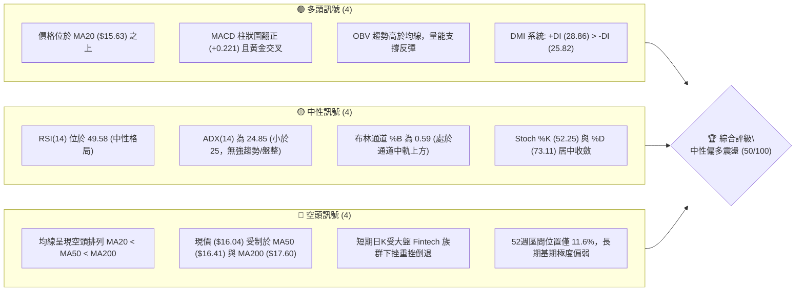
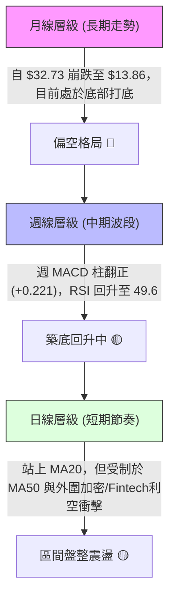
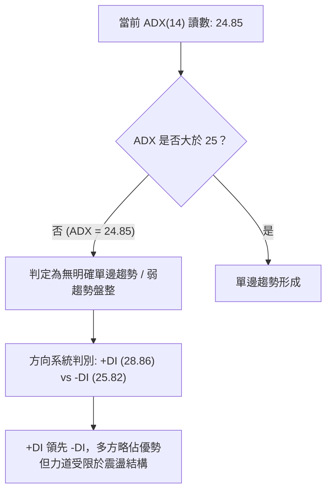
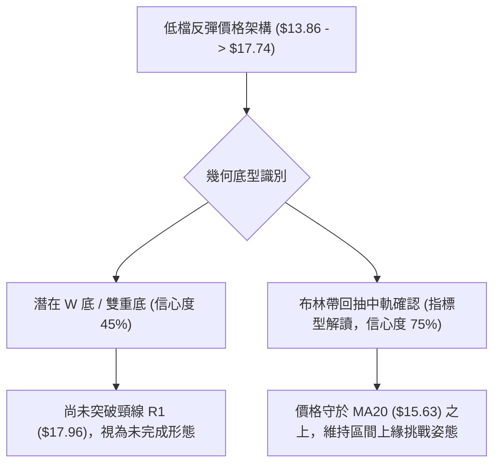
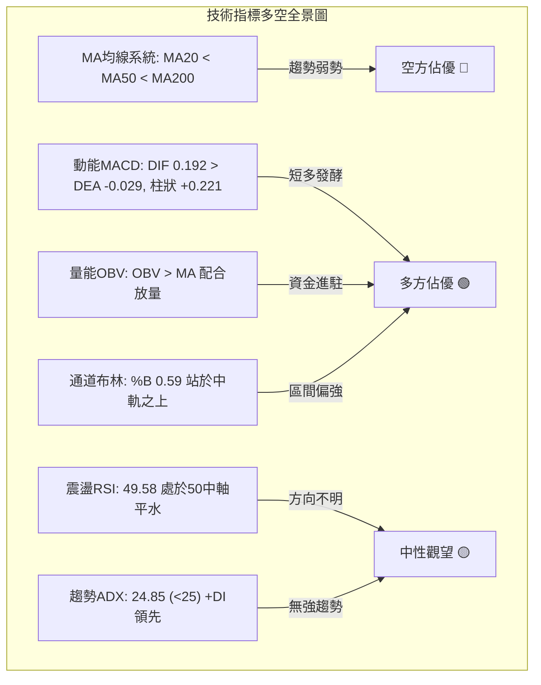
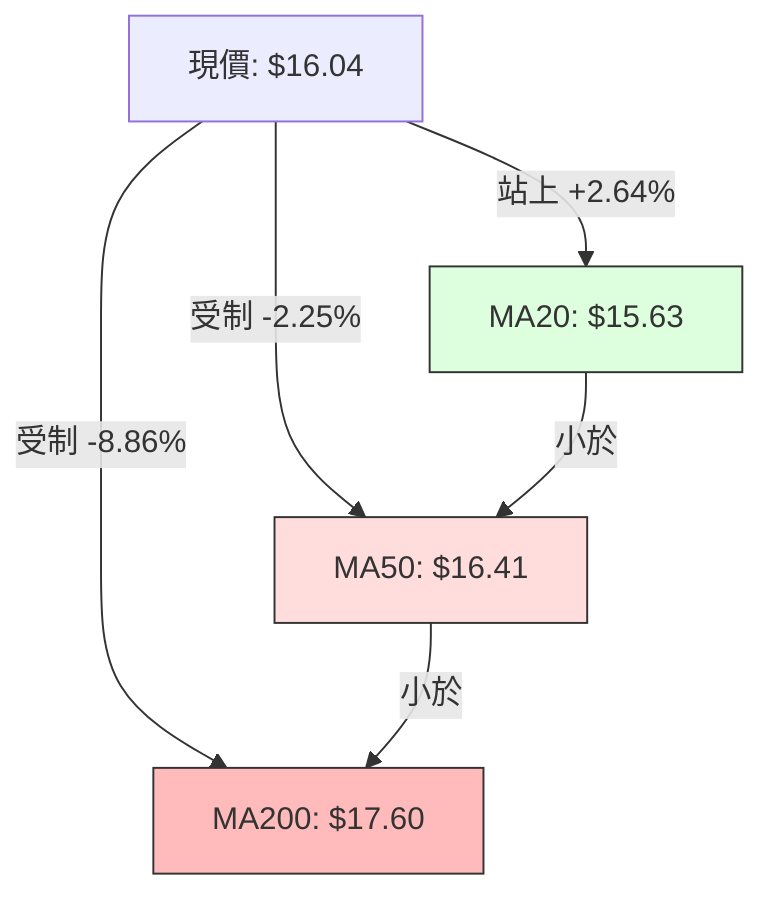
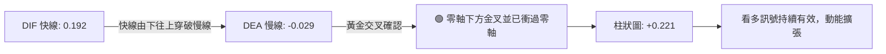
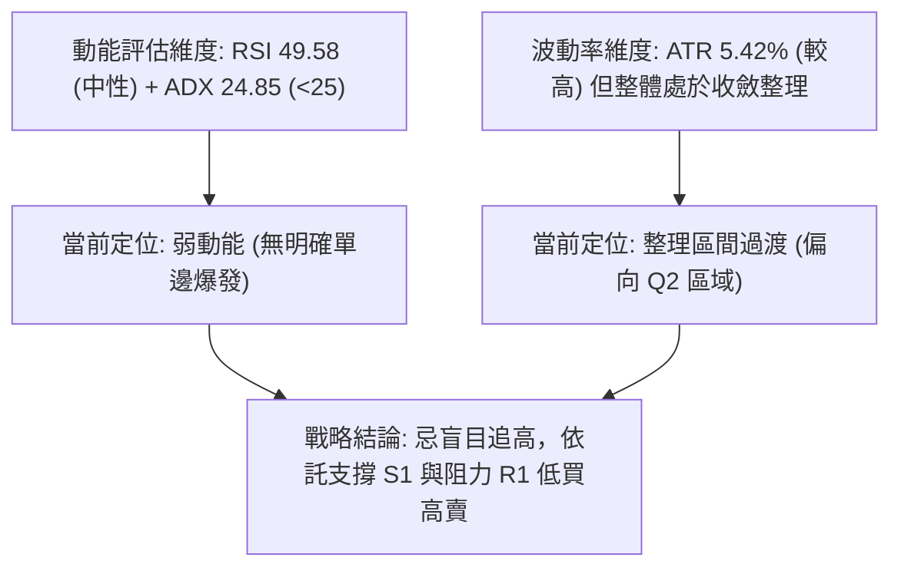
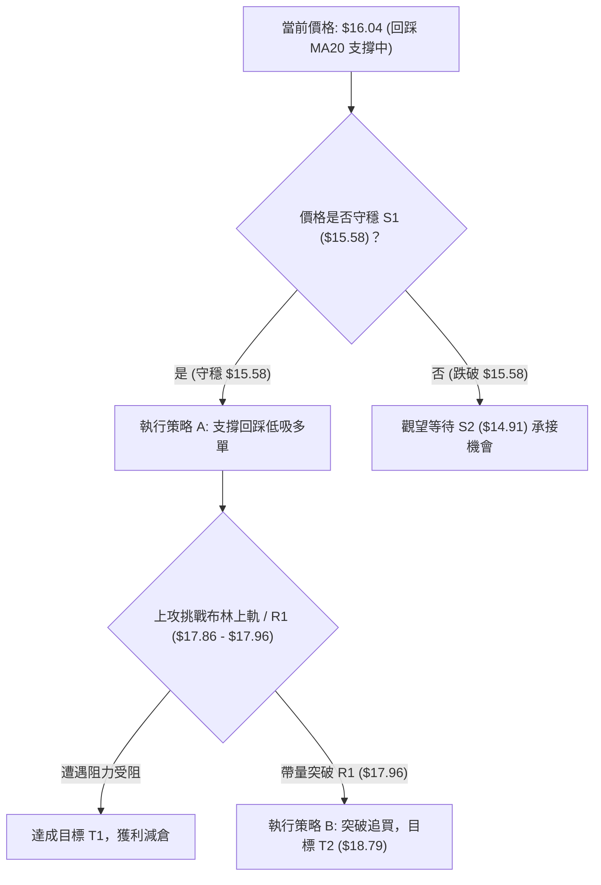
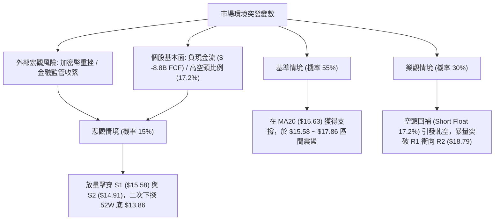

# SOFI 技術分析報告

> **報告日期**：2026-11-06 ｜ **語言**：繁體中文 ｜ **數據來源**：Yahoo Finance ｜ **當前價格**：$16.04

---

## 目錄

| 章節 | 內容 |
|------|------|
| [1. 技術面概覽](#1-技術面概覽) | 訊號儀表板、核心指標、評分卡 |
| [2. 趨勢分析](#2-趨勢分析) | 多時框趨勢、長中短期走勢 |
| [3. 圖表形態分析](#3-圖表形態分析) | 形態識別、K線組合、目標價 |
| [4. 支撐與阻力](#4-支撐與阻力) | 關鍵價位、斐波那契回調 |
| [5. 技術指標深度解讀](#5-技術指標深度解讀) | MA/RSI/MACD/布林/成交量 |
| [6. 動能與波動率](#6-動能與波動率) | 動能評估、ATR、Beta |
| [7. 多時框架總結](#7-多時框架總結) | 時框架評分矩陣 |
| [8. 交易策略建議](#8-交易策略建議) | 多空策略、風險報酬比 |
| [9. 風險提示與監控](#9-風險提示與監控) | 監控指標、風險場景 |

---

## 1. 技術面概覽

### 🎯 技術訊號儀表板



### 📊 核心指標速覽表

| 指標類別 | 指標名稱 | 當前數值 | 訊號 | 解讀 |
|:---|:---|:---|:---:|:---|
| **價格** | 當前收盤價 | $16.04 | 🟡 | 位於52週區間 11.6% 低檔，短線反彈後拉回 |
| **均線** | 短期 MA20 | $15.63 | 🟢 | 現價高於 MA20，短線維持在月線支撐上方運作 |
| **均線** | 中期 MA50 | $16.41 | 🔴 | 現價位於 MA50 下方，面臨中期波段下彎反壓 |
| **均線** | 長期 MA200 | $17.60 | 🔴 | 遠低於年線，且均線呈 MA20 < MA50 < MA200 弱勢排列 |
| **動能** | RSI(14) | 49.58 | 🟡 | 緊貼 50 中軸，動能中性，近20根無背離訊號 |
| **動能** | MACD (12,26,9) | 0.192 / -0.029 | 🟢 | 快線突破慢線，柱狀圖 +0.221，維持短多架構 |
| **擺動** | KD (Stoch) | 52.25 / 73.11 | 🟡 | %K 由高檔回落跌破 %D，進入高檔整理期 |
| **趨勢** | ADX(14) / DMI | 24.85 | 🟡 | ADX < 25 屬無趨勢盤整；+DI (28.86) > -DI (25.82) |
| **通道** | 布林通道 (20,2) | $13.40 ~ $17.86 | 🟡 | %B = 0.59，守穩中軌 $15.63，向上軌邁進受阻 |
| **成交量** | 最新成交量 / 量比 | 77,640,800 / 1.33x | 🟢 | 放量收黑但 OBV > MA，下檔接手量能依然存在 |
| **波動** | ATR(14) | $0.87 (5.42%) | 🔴 | 日內波動幅度較高，持倉需容忍較大洗盤空間 |

### 🏆 技術評分卡

```
技術評分卡 — SOFI (2026-11-06)
════════════════════════════════════════════════════
趨勢強度      ████████░░░░░░░░░░░░  40/100  🔴 弱勢 (ADX=24.85，均線空頭排列)
動能指標      ████████████░░░░░░░░  60/100  🟢 中多 (MACD翻正，RSI收復中軸)
支撐穩定度    ████████████░░░░░░░░  60/100  🟢 良好 (守穩 S1 $15.58 與 MA20)
成交量配合    ██████████████░░░░░░  70/100  🟢 偏多 (量比1.33x，OBV趨勢向上)
形態完整度    ████████░░░░░░░░░░░░  40/100  🔴 欠缺 (自低檔反彈，未確立大底)
均線排列      ██████░░░░░░░░░░░░░░  30/100  🔴 空頭 (MA20 < MA50 < MA200)
════════════════════════════════════════════════════
綜合評分      ██████████░░░░░░░░░░  50/100  🟡 中性震盪（六項子指標算術平均）
════════════════════════════════════════════════════
```

---

## 2. 趨勢分析

### 🌐 多時框趨勢分析



### 📈 長期趨勢 — 12個月走勢圖（Unicode）

SOFI 自 2025 年末的近兩年高點 $29.72 一路走低，歷經長達半年的腰斬式下挫，於 2026 年 10 月下探至 52 週最低點 $13.86，目前正處於長週期跌勢後的低檔修復期。

```
SOFI 月線收盤走勢圖（過去12個月：2025-12 至 2026-11）
價格軸 ($)
$30.00 ┤ 
$27.00 ┤ ● (2025-12: $26.18)
$24.00 ┤   ● (2026-01: $22.81)
$21.00 ┤     
$18.00 ┤       ● (02: $17.76)                    ● (05: $18.22)  ● (08: $17.88)
$15.00 ┤         ●━━━━━━━● (03-04: $15.88-$16.10)   ● (07: $16.31)  ●━━━━━━━● (10-11: $16.76-$16.04)
$12.00 ┤                                                               ● (09: $15.72, 10月低見 $13.86)
       └─────────────────────────────────────────────────────────────────────────────
         12月   01月   02月   03月   04月   05月   06月   07月   08月   09月   10月   11月
```

#### 走勢特徵分析表格

| 階段區間 | 起始/結束月收盤價 | 區間漲跌幅 | 主要走勢特徵與結構 |
|:---|:---|:---:|:---|
| **第一階段：高檔加速挫跌** | $26.18 → $17.76 | -32.16% | 2025年12月至2026年2月，高檔多殺多，失守 $20 整數關卡 |
| **第二階段：低檔區間構築** | $17.76 → $18.22 | +2.59% | 2026年3月至5月，在 $15.88~$18.22 構築箱型震盪，空方動能減弱 |
| **第三階段：中期反覆拉鋸** | $18.22 → $15.72 | -13.72% | 2026年6月至9月，多次衝擊 $18.91 均遭壓制，隨後下破平台 |
| **第四階段：觸底放量回升** | $15.72 → $16.04 | +2.04% | 2026年10月探底 $13.86 後強勁反彈至 $16.76，現回踩 $16.04 尋求支撐 |

### 📊 中期趨勢（週線分析）

中期走勢方面，近20週數據顯示行情經歷了「7-8月高檔橫盤 ($18.00~$18.91)」→「9-10月中旬單邊下行 (低點 $13.86)」→「10月下旬放量大陽線攻堅 ($14.61 暴拉至 $16.76)」的三部曲。

```
SOFI 週線支撐與壓力示意圖
$19.62 ┤                                    [R3 強波段阻力]
$18.79 ┤               ┌────────┐           [R2 波段密集套牢區]
$17.96 ┤      ┌────────┘        └─────┐     [R1 頸線/近半年壓力]
$16.04 ┼──────┼───────────────────────● (當前週收盤 $16.04)
$15.58 ┤      │                       │     [S1 近期第一道關鍵防線]
$14.91 ┤      │                       │     [S2 波段次低防線]
$13.86 ┤──────┴───────────────────────┴───── [S3 52週歷史大底]
       └───────────────────────────────────► 時間軸 (週K維度)
```

### ⚡ 趨勢強度評估（ADX 解讀）



#### ADX 強度對照表

| ADX 數值區間 | 趨勢狀態定義 | 當前 SOFI 讀數 | 交易指導方針 |
|:---|:---|:---:|:---|
| **0 ~ 20** | 極弱趨勢 / 死水盤整 | — | 避免趨勢突破策略，採取網格或觀望 |
| **20 ~ 25** | **轉折過渡 / 弱趨勢震盪** | **24.85 🟢/🟡** | **以區間震盪交易為主，防範假突破，嚴設停損** |
| **25 ~ 50** | 明確單邊趨勢形成 | — | 順應趨勢進行波段操作，回調加碼 |
| **50 ~ 100** | 極強單邊爆發 / 超買超賣竭盡 | — | 隨時提防動能耗竭與極端反轉 |

---

## 3. 圖表形態分析

### 🔍 形態識別系統



#### 形態識別與信心度評估表（依規則 15）

| 形態類別 | 信心度 (%) | 判斷依據（引用數據） | 完成度 (%) | 目標價（附計算式） |
|:---|:---:|:---|:---:|:---|
| **雙重底 (W底)** | **45%** | 兩次下探低點分別為 10-16 當週低點 $13.86 及 10-23 當週低點 $14.18，但尚未放量突破頸線 R1 $17.96。依規則15信心度低於50%，僅供觀察。 | 60% | 頸線 $17.96 + 形態高度 ($17.96 - $13.86 = $4.10) = **$22.06** |
| **布林通道中軌突破後回踩** | **75%** | 10-27 大陽線帶量 160,995,100 股站上中軌 ($15.63)，隨後於 11-05 最低回踩 $15.43 收盤 $16.04，守穩中軌。 | 90% | 沿通道中軌向通道上軌運行，目標為 **布林上軌 $17.86** |

### 🕯️ 重要K線形態分析（依規則 19）

嚴格依據數據中「近10根日K」與「近8根週K」的實際開高低收進行精準形態判定：

| 日期（週期） | 開盤價 | 最高價 | 最低價 | 收盤價 | K線形態名稱 | 解讀與量價涵義 | 訊號 |
|:---|:---:|:---:|:---:|:---:|:---|:---|:---:|
| **2026-10-27 (日K)** | 15.98 | 16.76 | 15.67 | 16.40 | **跳空放量大長陽** | 單日暴增至 1.6 億股巨量，強力突破月線阻力，奠定反彈主基調 | 🟢 |
| **2026-10-29 (日K)** | 16.92 | 17.63 | 16.87 | 17.61 | **光腳多頭大陽線** | 實體飽滿收於高點 $17.61，展現強勁推升力道 | 🟢 |
| **2026-10-30 (日K)** | 17.07 | 17.32 | 16.44 | 16.76 | **高檔震盪十字紡錘** | 於波段高檔出現多空拉鋸，成交量略微萎縮，短線滯漲 | 🟡 |
| **2026-11-04 (日K)** | 17.01 | 17.74 | 16.97 | 17.38 | **衝高長陽回馬槍** | 盤中衝高至 $17.74 逼近前期壓力區，展現二度上攻意圖 | 🟢 |
| **2026-11-05 (日K)** | 17.25 | 17.45 | 15.43 | 16.04 | **帶長下影大陰線** | 盤中下探 $15.43 跌破 MA20，但尾盤拉回 $16.04，放量 77.6M 承接 | 🟡 |
| **2026-10-16 (週K)** | 15.47 | 15.68 | 13.86 | 14.55 | **低檔探底錘頭線** | 創 52 週新低 $13.86 後留出長下影線，確立空頭力竭階段性底點 | 🟢 |
| **2026-10-30 (週K)** | 14.53 | 17.63 | 14.40 | 16.76 | **週線級穿頭破腳大陽線** | 週量暴增至 4.16 億股，週線實體高達 $2.23，反轉訊號明確 | 🟢 |
| **2026-11-05 (週K)** | 16.98 | 17.74 | 15.43 | 16.04 | **高檔長下影小黑K** | 測試週線 $15.43 低點獲得回升支撐，週 RSI 回檔至 49.6 中性位 | 🟡 |

### 📉 ASCII 走勢形態示意圖

```
SOFI 近期日K走勢形態示意圖（2026-10-23 至 2026-11-05）
$18.00 ┤                                ┌─┐ (11-04: $17.74)
$17.50 ┤                       ┌─┐      │ │ ┌─┐
$17.00 ┤                  ┌─┐  │ │ ┌─┐  │ │ │ │
$16.50 ┤             ┌─┐  │ │  │ │ │ │  │ │ │ │
$16.00 ┤        ┌─┐  │ │  │ │  └─┘ │ │  └─┘ │ │ ◄ 現價 $16.04
$15.50 ┤        │ │  │ │  │ │      │ │      │ │
$15.00 ┤        │ │  │ │  └─┘      └─┘      │ │ (11-05 長下影探 $15.43)
$14.50 ┤ ┌─┐ ┌─┘│ │  └─┘                    └─┘
$14.00 ┤ └─┘ └──┘─┘ (10-27 帶量跳空起漲點)
       └────────────────────────────────────────────────────────────
         10-23 10-26 10-27 10-28 10-29 10-30 11-02 11-03 11-04 11-05
```

### 🎯 形態目標價計算

根據雙重底幾何形態與通道波幅推算：
1. **頸線價位**：取自關鍵阻力聚類 **R1 = $17.96**。
2. **底部基準點**：取自 52 週最低點 **$13.86**。
3. **形態垂直高度**：$17.96 - $13.86 = **$4.10**。
4. **理論突破目標價**：頸線 $17.96 + 形態高度 $4.10 = **$22.06**（此價位亦貼近斐波那契 61.8% 之 $21.07 水準）。

---

## 4. 支撐與阻力

### 🗺️ 關鍵價位分布圖（Unicode）

```
SOFI 價位結構分布圖 (由 OHLCV 聚類計算)
═══════════════════════════════════════════════════════════════════
$19.62 ║████████████████████████████████████████║ 強阻力 R3 (波段高點聚類)
$18.79 ║████████████████████████                ║ 次級阻力 R2 (反彈高點聚類)
$17.96 ║████████████████████████████████        ║ 關鍵頸線阻力 R1 (Fib 78.6% $17.90)
$17.60 ╟┈┈┈┈┈┈┈┈┈┈┈┈┈┈┈┈┈┈┈┈┈┈┈┈┈┈┈┈┈┈┈┈┈┈┈┈┈┈┈┈╢ 動態均線反壓 MA200
$16.41 ╟┈┈┈┈┈┈┈┈┈┈┈┈┈┈┈┈┈┈┈┈┈┈┈┈┈┈┈┈┈┈┈┈┈┈┈┈┈┈┈┈╢ 動態均線反壓 MA50
$16.04 ╠════════════════════════════════════════╣ ◄ 當前收盤價 ($16.04)
$15.63 ╟┈┈┈┈┈┈┈┈┈┈┈┈┈┈┈┈┈┈┈┈┈┈┈┈┈┈┈┈┈┈┈┈┈┈┈┈┈┈┈┈╢ 動態中軌支撐 MA20 / BB中軌
$15.58 ║▓▓▓▓▓▓▓▓▓▓▓▓▓▓▓▓▓▓▓▓▓▓▓▓▓▓▓▓▓▓▓▓        ║ 第一關鍵支撐 S1 (近期下探防守點)
$14.91 ║████████████████████████                ║ 次級支撐 S2 (波段回檔次低點)
$13.86 ║████████████████████████████████████████║ 歷史強支撐 S3 (52W最低點 / Fib 100%)
═══════════════════════════════════════════════════════════════════
```

### 🚧 阻力位分析表

所有價位均嚴格引用數據中「關鍵價位」區塊之波段高點聚類數值：

| 阻力級別 | 官方精確價位 | 距現價空間 (%) | 形成原因與籌碼解讀 | 突破難度評估 | 重要性級別 |
|:---|:---:|:---:|:---|:---:|:---:|
| **阻力 R1** | **$17.96** | +11.97% | 近一年波段高點密集套牢區下沿，緊鄰斐波那契 78.6% 回調位 ($17.90) | 🟡 中等偏高 | ★★★★☆ |
| **阻力 R2** | **$18.79** | +17.11% | 2026年7月至8月多次反彈高點聚類（如 07-10 的 $18.78、08-21 的 $18.91） | 🔴 高 | ★★★☆☆ |
| **阻力 R3** | **$19.62** | +22.30% | 波段巨量起跌高點聚類，接近 $20.00 整數心理防線與 MA240 ($19.21) 反壓 | 🔴 極高 | ★★★★★ |

### 🛡️ 支撐位分析表

所有價位均嚴格引用數據中「關鍵價位」區塊之波段低點聚類數值：

| 支撐級別 | 官方精確價位 | 距現價空間 (%) | 形成原因與籌碼解讀 | 守住機率評估 | 重要性級別 |
|:---|:---:|:---:|:---|:---:|:---:|
| **支撐 S1** | **$15.58** | -2.90% | 近期波段回檔低點聚類，與當前 MA20 ($15.63) 形成重疊共振支撐區 | 🟢 70% | ★★★★☆ |
| **支撐 S2** | **$14.91** | -7.04% | 10月下旬起漲前築底次低點聚類，跌破則宣告反彈架構破位 | 🟡 55% | ★★★☆☆ |
| **支撐 S3** | **$13.86** | -13.59% | 52週歷史大底（2026-10-16觸及），長線資金停損防守的終極底線 | 🟢 85% | ★★★★★ |

### 📐 斐波那契回調位分析

依據 52 週高點 $32.73 至 52 週低點 $13.86 之絕對區間所計算的官方黃金分割結構：

| 回調比率 | 官方精確價位 | 當前價格相對位置與結構解讀 |
|:---|:---:|:---|
| **0.0% (52W High)** | **$32.73** | 週期歷史最高峰，長期極限壓力位 |
| **23.6%** | **$28.28** | 長週期強勢反轉目標區 |
| **38.2%** | **$25.52** | 長期多空分水嶺，前期跌破後加速下行 |
| **50.0%** | **$23.29** | 絕對中軸平衡區間 |
| **61.8%** | **$21.07** | 黃金分割重要回調位，亦為分析師均價 $20.84 之重疊帶 |
| **78.6%** | **$17.90** | 關鍵第一道大級別分水嶺（與阻力 R1 $17.96 形成強力共振帶） |
| **當前現價位置** | **$16.04** | **落於 78.6% ($17.90) 與 100.0% ($13.86) 之間**，屬於歷史極度超跌後的打底反彈初期 |
| **100.0% (52W Low)**| **$13.86** | 52週絕對底部，長線多頭不可棄守的生命線 |

---

## 5. 技術指標深度解讀

### 🎛️ 指標訊號總覽



### 📈 移動平均線排列分析



#### 移動平均線數據矩陣

| 均線週期 | 數值 | 現價與MA偏離度 | 斜率與走勢狀態 | 結論評級 |
|:---|:---:|:---:|:---|:---:|
| **MA 5** | $16.71 | -4.01% | 短線急速下彎，反映 11-05 單日重挫 | 🔴 空頭壓制 |
| **MA 10** | $16.38 | -2.06% | 短期扣抵高檔走平，現價跌破 | 🔴 形成反壓 |
| **MA 20** | $15.63 | +2.64% | 向上翻揚，現價守其上，發揮月線下檔支撐 | 🟢 多頭支撐 |
| **MA 50** | $16.41 | -2.25% | 持續走跌下行，與現價形成直接蓋頭反壓 | 🔴 中期空頭 |
| **MA 60** | $16.74 | -4.20% | 下行斜率未改，季線反壓顯著 | 🔴 空頭主導 |
| **MA 120**| $17.00 | -5.67% | 半年線持續壓制 | 🔴 空頭主導 |
| **MA 200**| $17.60 | -8.86% | 年線長空走勢，代表中長期套牢沉重 | 🔴 結構偏空 |
| **MA 240**| $19.21 | -16.50% | 超長期大均線遠在上方 | 🔴 結構偏空 |

**綜合均線研判**：當前整體架構呈標準「空頭排列 (MA20 < MA50 < MA200)」，但現價突破了短期 MA20，屬於空頭趨勢中的**超跌反彈並尋求築底**階段。

### 📉 RSI(14) 分析

* 當前 RSI(14) 讀數：**49.58**（Wilder 計算法）
* 指標狀態進度條：
```
0  [░░░░░░░░░░░░░░░░░░░░██████████░░░░░░░░░░░░░░░░░░░░] 100
                    ▲ 49.58 (中性分水嶺)
```
* **背離狀態結論**：系統明確偵測「**無明顯背離**」（比對近 20 根 K 棒價格由 $14.61 漲至 $16.04，RSI 同步自低位回升至 49.58，未出現頂背離或底背離跡象）。
* **多空意義**：RSI 自 10 月中旬低點（週 RSI 一度跌至 34.7）強勁回升，目前剛好運行至 50 多空中軸一線，說明先前的極端拋售壓力已徹底消除，目前處於動能平衡的中性震盪狀態。

### 📊 MACD(12/26/9) 訊號解讀



* **數據狀態**：快線 DIF 為 **0.192**，訊號線 DEA 為 **-0.029**，MACD 柱狀圖（Histogram）為 **+0.221**。
* **指標意義**：日線 MACD 已經完成由負轉正，在零軸附近形成多頭黃金交叉，且週線 MACD 柱狀圖亦連續兩週翻正（10-30 週為 +0.360，11-05 週為 +0.221），確認中期下跌動能中斷，多頭修復行情持續運作中。

### 📦 布林通道分析

```
SOFI 布林通道結構示意圖 (週期 20, 標準差 2)
$17.86 ┬───────────────────────────────── 布林上軌 ($17.86)
       │
       │
$16.04 ┼────────────────●──────────────── 現價 ($16.04, %B = 0.59)
       │
$15.63 ┼┈┈┈┈┈┈┈┈┈┈┈┈┈┈┈┈┈┈┈┈┈┈┈┈┈┈┈┈┈┈┈┈┈ 布林中軌 (MA20: $15.63)
       │
       │
$13.40 ┴───────────────────────────────── 布林下軌 ($13.40)
```

* **通道參數**：上軌 **$17.86**、中軌 (MA20) **$15.63**、下軌 **$13.40**。
* **指標定位**：現價 $16.04 位於中軌上方，**%B 指標為 0.59**（大於 0.5 表明處於通道強勢半區）。
* **技術涵義**：通道帶寬目前未出現劇烈單邊張口，而是呈現橫向收斂後的微幅向上發散，顯示價格在守住中軌 $15.63 的前提下，正蓄勢挑戰上軌 $17.86 與阻力位 R1 $17.96 的重疊共振帶。

### 💹 成交量分析（量價配合度）

```
成交量對比柱狀圖
最新成交量 (11-05): 77,640,800  █████████████████████ (1.33x 量比)
20日平均量:         58,351,230  ████████████████
50日平均量:         49,687,854  █████████████
```

* **成交量異動**：最新成交量達 7,764 萬股，高於 20 日均量（5,835 萬股）達 1.33 倍，更遠高於 50 日均量。
* **OBV 能量潮趨勢**：數據明確指出「**OBV > MA → 量能支撐上漲**」。
* **量價配合度解讀**：回顧 10-27 大漲日創下 1.6 億股天量，以及 10-30 當週創下 4.16 億股的驚人週量，顯示機構大資金在低檔具備強烈的換手承接意願。儘管 11-05 受外部加密與金融科技板塊下跌衝擊放量回落，但長下影線（最低 $15.43 收 $16.04）說明在月線下方的逢低買盤極為活躍，整體量價未出現背離，維持良性多頭換手。

---

## 6. 動能與波動率

### ⚡ 動能評估四象限

| 象限 | 動能狀態 | 波動狀態 | 當前定位 | 評估與策略導向 |
|:---|:---:|:---:|:---:|:---|
| **象限 I (Q1)** | 強動能 | 低波動 | — | 最穩定單邊趨勢，最佳順勢加碼區間 |
| **象限 II (Q2)** | **弱動能** | **低波動** | **✓ (SOFI 目前定位)** | **處於區間震盪整理，指標互相牽制，宜以區間高拋低吸為主** |
| **象限 III (Q3)** | 強動能 | 高波動 | — | 極度投機主升段，伴隨跳空突破與高勝率 |
| **象限 IV (Q4)** | 弱動能 | 高波動 | — | 恐慌拋售或大盤下殺引發洗盤，持倉風險最高 |



### 📊 ATR 波動率分析

* **ATR(14) 數值**：**$0.87**（佔當前股價比例為 **5.42%**，Wilder 計算法）。
* **波動特徵**：單日平均震盪空間接近 $0.90，說明 SOFI 具有典型的中小盤高貝塔金融科技股特質，日內價格彈性極大。
* **止損風控指引**：
  * **保守型保護止損**：以 2.0 倍 ATR 計算 = $1.74。若以進場位防守，距離過寬；
  * **短線精確技術止損**：採用 1.0 倍 ATR ($0.87)，結合關鍵支撐位進行設定。當前價格 $16.04 減去 1.0 ATR 約為 $15.17，略高於關鍵支撐 S2 ($14.91)，故設定止損時必須與固定支撐位相互校驗。

### 📐 Beta 與市場相關性

* **Beta 係數**：**2.241**（極高波動屬性）。
* **市場聯動性解讀**：
  * Beta > 2 代表該股對大盤（S&P 500 / 納斯達克）及板塊波動具備放大兩倍以上的槓桿效應。
  * 近期新聞明確顯示，當比特幣暴跌與 Fintech 族群（如 Robinhood 大跌 10-12%、Affirm 下挫 8%）受挫時，SOFI 單日亦隨之重挫 8-9%，凸顯其與整體加密貨幣行情及金融監管情緒具備高度相關性。操作時必須緊盯大盤風險偏好變化。

---

## 7. 多時框架總結

### 📋 時框架評分表

| 時框架 | 趨勢方向 | 動能指標 | 均線排列 | 形態結構 | 綜合評分 | 戰術建議 |
|:---|:---:|:---:|:---:|:---:|:---:|:---|
| **長期 (月線)** | 🔴 偏空 | 🟡 中性 (跌深企穩) | 🔴 空頭排列 (遠離MA240) | 🔴 長期下跌後的低檔基期 | **35/100** | 長線資金僅宜分批打底，不宜重倉 |
| **中期 (週線)** | 🟡 中性築底 | 🟢 轉強 (MACD柱翻正) | 🔴 MA50之下 | 🟡 潛在雙底反彈中 | **55/100** | 波段操作者關注回踩頸線或低吸機會 |
| **短期 (日線)** | 🟢 區間震盪偏多| 🟢 偏多 (MACD金叉) | 🟡 站上MA20/受制MA50 | 🟡 突破中軌後回踩確認 | **60/100** | 依托 MA20 與 S1 逢低布局區間反彈 |

### 🔲 綜合訊號矩陣

| 分析維度 | 短期 (日線) 訊號 | 中期 (週線) 訊號 | 長期 (月線) 訊號 | 多時框一致性研判 |
|:---|:---:|:---:|:---:|:---|
| **趨勢方向** | 🟢 反彈震盪向上 | 🟡 橫盤構築箱體 | 🔴 長期空頭承壓 | 衝突：短多長空，定義為「跌深反彈」非反轉 |
| **動能表現** | 🟢 MACD柱擴張 | 🟢 MACD柱翻正 | 🔴 RSI 偏低 | 改善中：動能正由短週期向中週期擴散傳導 |
| **均線位置** | 🟢 站上 MA20 | 🔴 位於週 MA20 之下 | 🔴 位於月 MA20 之下 | 短線均線支撐確立，但面臨上方中長均線重壓 |
| **量價結構** | 🟢 OBV > MA | 🟢 週換手巨量支持 | 🟡 月成交量中規中矩 | 量能支持反彈，非無量虛漲 |

### ⚖️ 多時框收斂結論

嚴格依據「嚴格要求 14」多時框收斂規則：
1. **趨勢/盤整行情判定**：當前日線 ADX(14) 讀數為 **24.85**（嚴格小於 25），確立當前市場本質為「**無單邊強趨勢的盤整震盪行情**」。
2. **主導維度收斂**：在盤整行情中，嚴禁採用單邊順勢突破思維，而必須以「**日線布林通道上下軌 ($13.40 ~ $17.86) 與水平關鍵支撐阻力**」作為核心交易區間。
3. **唯一收斂結論**：**中性偏多區間震盪（區間波段操作）**。日線雖受到外圍利空擾動下挫，但收盤守穩 MA20 ($15.63) 與關鍵支撐 S1 ($15.58) 之上；週線 MACD 翻正亦支持底部反彈，因此主策略定調為：**回踩支撐不破做多，逼近布林上軌與 R1 停利**。

---

## 8. 交易策略建議

### 🗺️ 策略決策流程圖



### 🧭 策略路由（依評分卡分流）

依據第 1 章技術評分卡：**綜合評分為 50/100**。
依規則分流定義，綜合評分落在 40–60 之間，故定調為：
**當前主策略方向 = 區間震盪操作（以布林通道中軌到上軌之反彈波段為主，等待阻力位突破確認）**。

### 🎯 價格情境階梯（Price Scenarios）

價位嚴格引用第 4 章由 OHLCV 聚類計算的關鍵數值：

| 觸發條件 | 下一目標 | 後續延伸 | 情境技術涵義 |
|:---|:---:|:---:|:---|
| **強勢突破 R1 ($17.96)** | **R2 ($18.79)** | **R3 ($19.62)** | 突破週線級頸線，W底確立，展開長週期補漲行情 |
| **站穩現價與 S1 ($15.58)** | **布林上軌 ($17.86)** | **R1 ($17.96)** | 短期多頭在 MA20 獲得支撐，維持通道內上行震盪 |
| **有效跌破 S1 ($15.58)** | **S2 ($14.91)** | **S3 ($13.86)** | 短線反彈宣告破敗，重回底部箱體尋求二次築底 |

### 📊 情境機率分佈

| 情境劇本 | 發生機率 | 主要技術與數據依據 |
|:---|:---:|:---|
| **情境一：守穩震盪反彈** | **55%** | MACD 柱狀圖翻正 (+0.221)、OBV > MA 量能充沛、現價高於 MA20 ($15.63) |
| **情境二：箱型死水盤整** | **30%** | ADX 僅 24.85 (<25)、RSI 處於 49.58 中軸、均線整體呈空頭排列形成上方壓制 |
| **情境三：向下回落探底** | **15%** | Beta 高達 2.241，若外圍加密幣與金融科技族群持續遭拋售，引發連鎖停損 |

### 🟢 主策略詳情（區間波段低吸與突破）

嚴格遵守規則 17，風險報酬比公式為：$(目標價 T1 - 進場價) \div (進場價 - 止損價)$，計算基準明確。

| 策略要素 | 策略 A：區間支撐低吸（主推策略） | 策略 B：突破頸線順勢追價（右側策略） |
|:---|:---|:---|
| **進場邏輯** | 回踩 MA20 ($15.63) 與支撐 S1 獲支撐，低吸博弈反彈 | 放量突破關鍵阻力 R1，右側追進多頭趨勢確立段 |
| **精確進場價格** | **$15.70**（介於現價 $16.04 與 S1 $15.58 間之支撐回踩點） | **$18.05**（突破 R1 $17.96 阻力後的確認進場點） |
| **目標價 T1** | **$17.86**（精確對標布林通道上軌） | **$18.79**（精確對標阻力 R2） |
| **目標價 T2** | **$18.79**（精確對標阻力 R2） | **$19.62**（精確對標阻力 R3） |
| **精確止損價格** | **$14.80**（跌破關鍵支撐 S2 $14.91 之保護性止損） | **$17.30**（跌回前期突破平台下方止損） |
| **風險報酬比** | **1 : 2.40（以 T1 計）**<br>*(計算式: (17.86 - 15.70) / (15.70 - 14.80) = 2.16 / 0.90)*<br>另：1 : 3.43（以 T2 計，(18.79-15.70)/0.90） | **1 : 0.99（以 T1 計）**<br>*(計算式: (18.79 - 18.05) / (18.05 - 17.30) = 0.74 / 0.75)*<br>另：1 : 2.09（以 T2 計，(19.62-18.05)/0.75） |
| **成功機率預估** | **65%** | **50%** |
| **建議配置倉位** | **15% ~ 20%** | **10%**（待突破後方可加碼） |

### 🔴 反向風險觸發點（對沖與停損提示）

若出現以下訊號，宣告當前反彈行情夭折，應立即中斷多頭操作或啟動避險：
1. **關鍵價位跌破**：若日線收盤價跌破 **S1 ($15.58)**，多頭頭寸應主動減半；若進一步下破 **S2 ($14.91)**，必須無條件全部止損出場。
2. **指標轉空警訊**：日線 MACD 柱狀圖由正轉負（跌破 0 軸），且 RSI(14) 跌破 40，顯示空方動能重新主導。

### ⭐ 整體訊號強度評星

```
做多訊號強度：★★★☆☆  (3/5星 — 短線量價與MACD支持，但受制均線)
做空訊號強度：★★☆☆☆  (2/5星 — 52週低檔拋壓減輕，下探空間受限)
整體可信度：  ★★★☆☆  (3/5星 — 處於 ADX<25 震盪市，震盪策略勝率較高)
```

---

## 9. 風險提示與監控

### ✅ 關鍵監控指標 Checklist

```
╔══════════════════════════════════════════════════════════════════╗
║              SOFI 盤面日常關鍵技術監控 CHECKLIST                 ║
╠══════════════════════════════════════════════════════════════════╣
║ [ ] 價位監控：收盤價是否持續維持在 MA20 ($15.63) 之上？         ║
║ [ ] 支撐防守：盤中最低價是否跌破第一道防線 S1 ($15.58)？         ║
║ [ ] 阻力突破：反彈是否能帶量攻克阻力 R1 ($17.96) 與布林上軌？    ║
║ [ ] 動能跟蹤：MACD 柱狀圖是否維持在正值區間 (+0.221 之上)？      ║
║ [ ] 震盪指標：RSI(14) 是否突破 55 強弱分水嶺？                   ║
║ [ ] 成交量能：回檔時日成交量是否縮減至 5,000 萬股以內？          ║
║ [ ] 板塊連動：比特幣與 Fintech 族群 (HOOD/AFRM) 是否企穩止跌？   ║
╚══════════════════════════════════════════════════════════════════╝
```

### ⚠️ 風險場景分析



### 🛡️ 風險管理重要提醒

1. **高貝塔與板塊溢出效應**：SOFI 的 Beta 高達 **2.241**，且空頭佔流通盤比例達 **17.2%**（Short Ratio 4.44 天），這意味著該股具有「漲時極度暴烈、跌時流動性踩踏」的特徵。嚴格控制個股總倉位不得超過投資組合的 **15% ~ 20%**。
2. **波動率調適止損**：當前 ATR 高達 **$0.87**，日內震幅超過 5%。設定止損時必須拉開至少 1.0 ATR 的彈性空間，切忌將停損點設在密集的日內微型雜訊中，以免被頻繁洗出場。
3. **區間操作紀律**：當前 ADX 為 24.85，未見單邊大行情，操作的核心原則為「**阻力不追、支撐不殺**」，嚴格在布林通道下軌/中軌附近布局，在接近上軌與 R1 阻力位時堅決分批止盈。

---

## 📋 報告總結

```
SOFI 技術分析報告總結
════════════════════════════════════════════════════════
報告日期：2026-11-06
當前價格：$16.04
分析評級：⚖️ 中性偏多區間震盪 (技術評分: 50/100)

關鍵結論：
├─ 長期趨勢：🔴 空頭主導 (位居 52W 區間 11.6%，處於歷史大底打底期)
├─ 中期趨勢：🟡 築底反彈 (週 MACD 翻正，在 $13.86-$18.00 形成箱體)
├─ 短期趨勢：🟢 震盪偏多 (守穩 MA20 $15.63，日 MACD 黃金交叉，OBV支持)
├─ 關鍵支撐：S1: $15.58  |  S2: $14.91  |  S3: $13.86
├─ 關鍵阻力：R1: $17.96  |  R2: $18.79  |  R3: $19.62
└─ 分析師目標：平均 $20.84 (區間 $12.00 ~ $30.00，共 23 位分析師)

最優策略組合：
1. 🥇 最佳機會：策略 A — 回踩 $15.70 布局多單，停損設 $14.80，目標布林上軌 $17.86 (風報比 1 : 2.40)
2. 🥈 次選機會：策略 B — 帶量突破 R1 $17.96 後右側追買，目標 R2 $18.79 (風報比 1 : 0.99)
3. 🥉 保守選擇：場外觀望，等待日線 ADX 站上 25 且明確突破 R1 後再行介入
════════════════════════════════════════════════════════
```

---

> ⚠️ **免責聲明**：本報告為 AI 自動生成之技術分析，所有數據及估算均基於提供的歷史價格資訊。本報告**僅供研究與學術參考**，**不構成任何投資建議**。投資有風險，入市需謹慎。

---

*報告生成時間：2026-11-06 ｜ 數據來源：Yahoo Finance ｜ 分析框架：多時框技術分析*