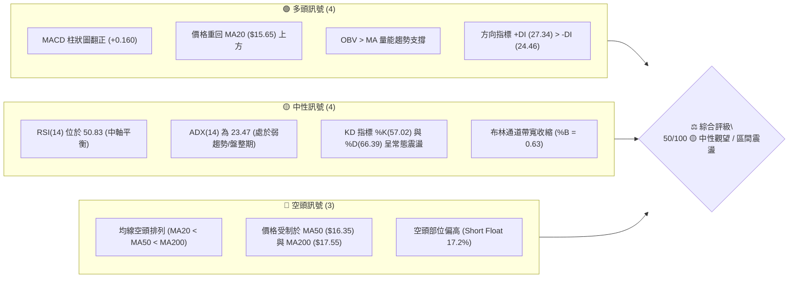
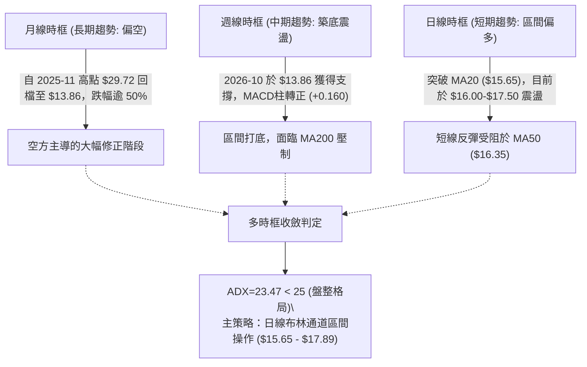
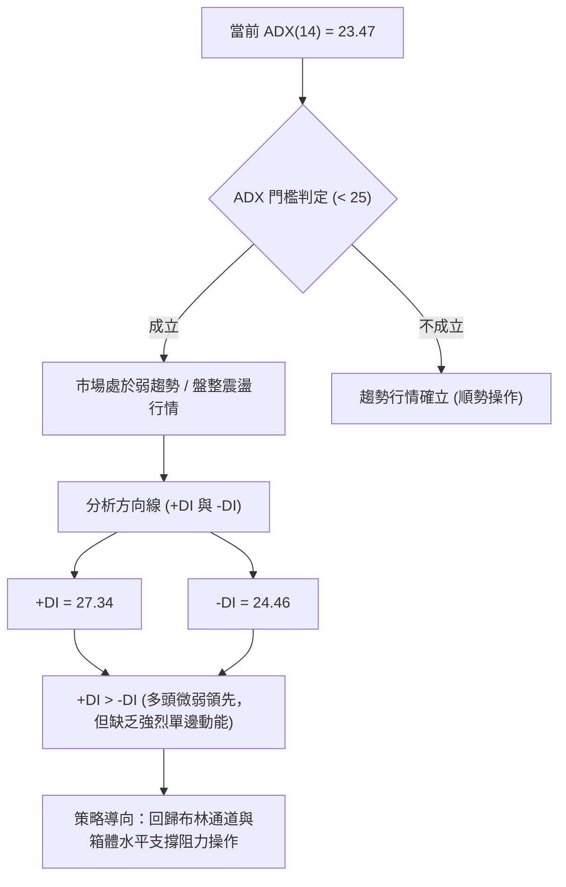
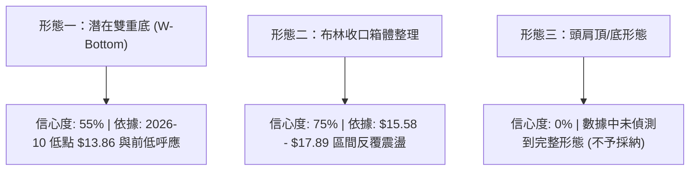
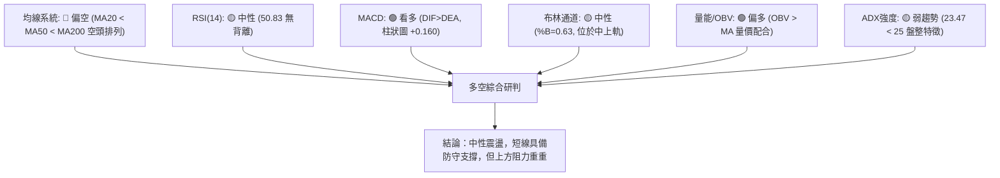
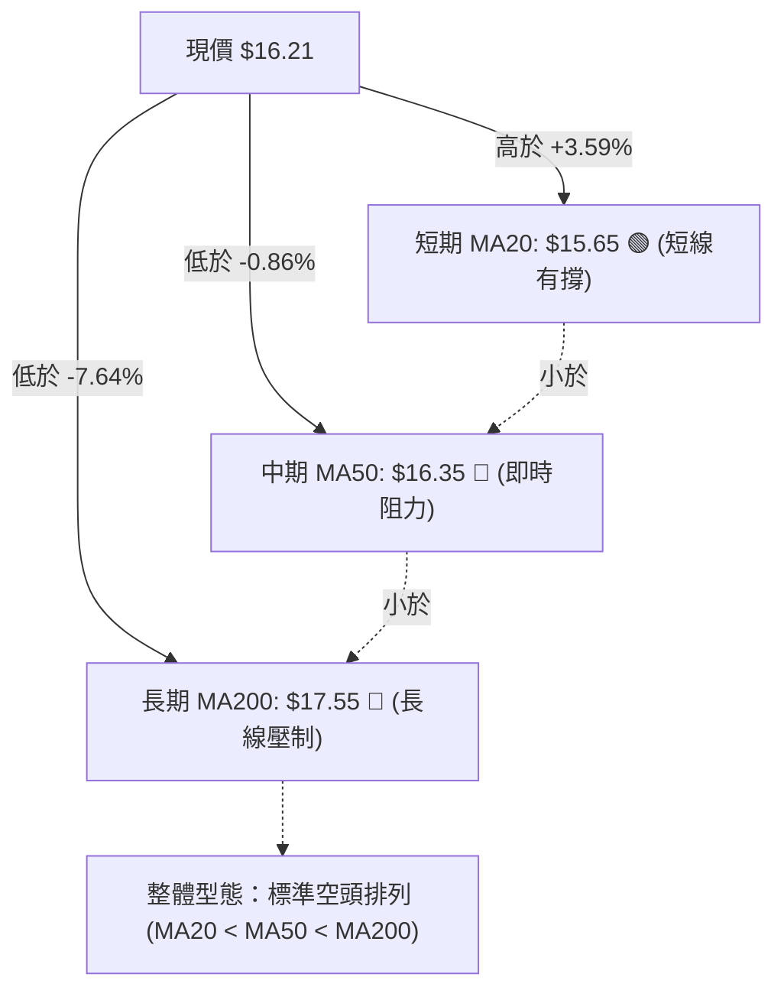
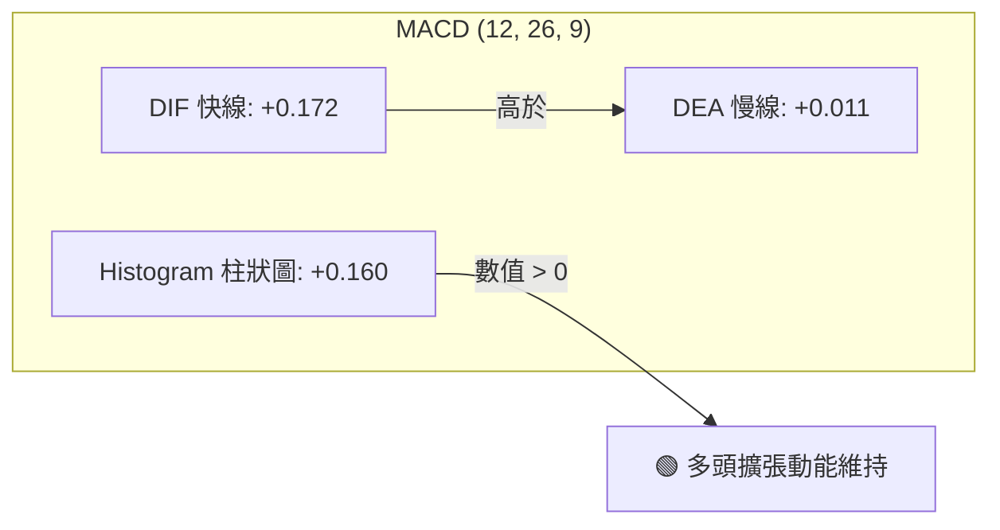
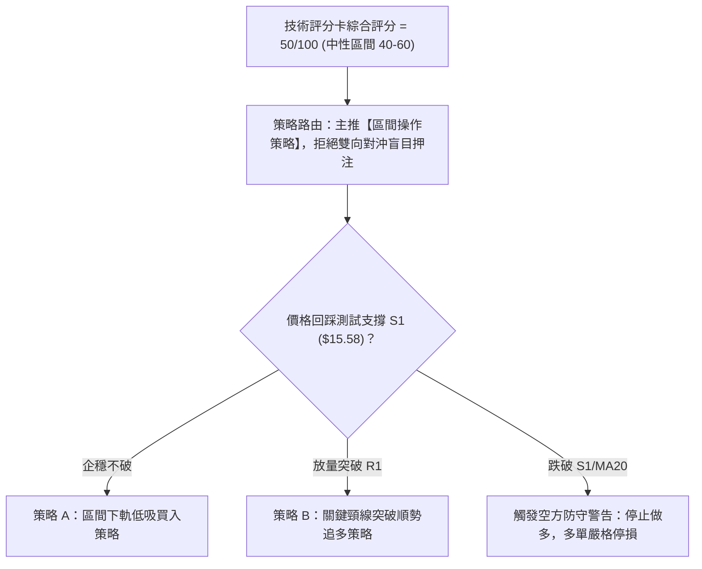
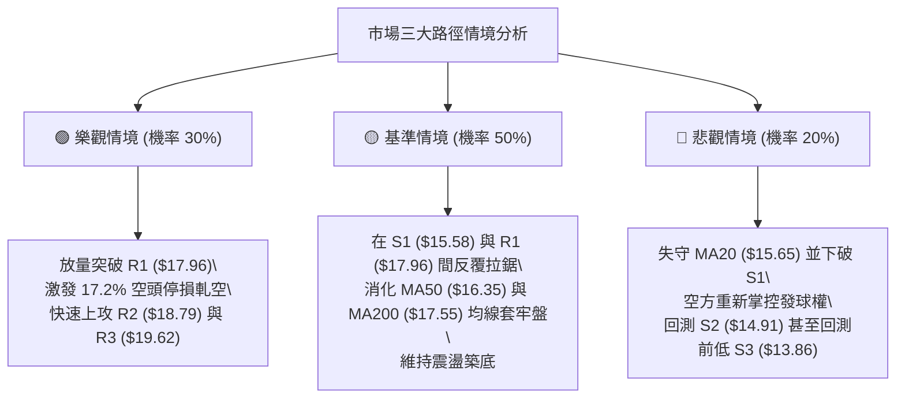

# SOFI 技術分析報告

> **報告日期**：2026-11-07 ｜ **語言**：繁體中文 ｜ **數據來源**：Yahoo Finance ｜ **當前價格**：$16.21

---

## 目錄

| 章節 | 內容 |
|------|------|
| [1. 技術面概覽](#1-技術面概覽) | 訊號儀表板、核心指標、評分卡 |
| [2. 趨勢分析](#2-趨勢分析) | 多時框趨勢、長中短期走勢 |
| [3. 圖表形態分析](#3-圖表形態分析) | 形態識別、K線組合、目標價 |
| [4. 支撐與阻力](#4-支撐與阻力) | 關鍵價位、斐波那契回調 |
| [5. 技術指標深度解讀](#5-技術指標深度解讀) | MA/RSI/MACD/布林/成交量 |
| [6. 動能與波動率](#6-動能與波動率) | 動能評估、ATR、Beta |
| [7. 多時框架總結](#7-多時框架總結) | 時框架評分矩陣 |
| [8. 交易策略建議](#8-交易策略建議) | 多空策略、風險報酬比 |
| [9. 風險提示與監控](#9-風險提示與監控) | 監控指標、風險場景 |

---

## 1. 技術面概覽

### 🎯 技術訊號儀表板



### 📊 核心指標速覽表

| 指標類別 | 指標名稱 | 當前數值 | 訊號 | 解讀 |
|----------|----------|----------|------|------|
| **價格** | 當前收盤價 | $16.21 | 🟡 | 位於52週區間12.5%低檔，短線從低點反彈後遇阻震盪 |
| **均線** | MA20 | $15.65 | 🟢 | 價格在MA20上方（+3.59%），短期生命線轉為動態支撐 |
| **均線** | MA50 | $16.35 | 🔴 | 價格在MA50下方（-0.86%），中期下降趨勢線尚未實質突破 |
| **均線** | MA200 | $17.55 | 🔴 | 價格在MA200下方（-7.64%），長期空頭壓制力道顯著 |
| **動能** | RSI(14) | 50.83 | 🟡 | 位於50中軸水準，無超買或超賣，多空勢力處於暫時平衡 |
| **動能** | MACD (12,26,9) | 0.172 / 0.011 | 🟢 | DIF高於MACD信號線，Hist為+0.160，動能維持黃金交叉偏多 |
| **趨勢** | ADX(14) | 23.47 | 🟡 | ADX < 25 表明處於無特定單向強趨勢的區間整理行情 |
| **通道** | Bollinger Bands | $13.40 / $15.65 / $17.89 | 🟡 | %B為0.63，價格位於中軌至上軌間，通道開口持平 |
| **波動** | ATR(14) | $0.85 (5.26%) | 🟡 | 每日平均震幅約$0.85，波動度適中，適合區間網格或波段保護 |
| **籌碼** | OBV 趨勢 | OBV > MA | 🟢 | 成交量能支撐價格反彈，資金有逐步回流跡象 |

### 🏆 技術評分卡

```
╔════════════════════════════════════════════════════════════════╗
║                   技術評分卡 — SOFI (2026-11-07)               ║
╠════════════════════════════════════════════════════════════════╣
║ 趨勢強度 (Trend)       █████████░░░░░░░░░░░  45/100  🟡 中性偏弱 ║
║ 動能指標 (Momentum)    ███████████░░░░░░░░░  55/100  🟡 中性偏多 ║
║ 支撐穩定度 (Support)   ████████████░░░░░░░░  60/100  🟢 支撐穩固 ║
║ 成交量配合 (Volume)    ██████████░░░░░░░░░░  52/100  🟡 量能持平 ║
║ 形態完整度 (Pattern)   ██████████░░░░░░░░░░  48/100  🟡 形態未決 ║
║ 均線排列 (MA System)   ████████░░░░░░░░░░░░  40/100  🔴 空頭排列 ║
╠════════════════════════════════════════════════════════════════╣
║ 綜合評分 (Overall)     ██████████░░░░░░░░░░  50/100  🟡 中性觀望 ║
║ 評級結論：算術平均整數 50/100，處於 40-60 區間震盪整理格局     ║
╚════════════════════════════════════════════════════════════════╝
```

---

## 2. 趨勢分析

### 🌐 多時框趨勢分析



### 📈 長期趨勢 — 12個月走勢圖（Unicode）

```
SOFI 月線走勢圖（過去12個月：2025-11 至 2026-11）
價格 ($)
$30.00 ┤ ● (2025-11: $29.72)
$28.00 ┤   ● (2025-12: $26.18)
$26.00 ┤
$24.00 ┤     ● (2026-01: $22.81)
$22.00 ┤
$20.00 ┤
$18.00 ┤       ● (2026-02: $17.76)       ● (05: $18.22)    ● (08: $17.88)
$16.00 ┤         ● (03: $15.88) ● (04: $16.10)   ● (06: $17.93)   ● (10: $16.76) ●←現價 $16.21
$14.00 ┤                                            ● (07: $16.31)  ● (09: $15.72)
$12.00 ┤
       └─┬────┬────┬────┬────┬────┬────┬────┬────┬────┬────┬────┬───
        11   12   01   02   03   04   05   06   07   08   09   10   11 (月份)
        (2025)   (------------------- 2026 ------------------)
```

#### 走勢特徵分析表格

| 階段區間 | 時間跨度 | 起訖價位 | 區間漲跌幅 | 主要技術特徵與成交量解讀 |
|----------|----------|----------|------------|--------------------------|
| **頂部回落** | 2025-11 ~ 2026-03 | $29.72 → $15.88 | -46.57% | 頂部快速殺跌，跌破多條長期均線，空頭加速釋放 |
| **中樞築底** | 2026-04 ~ 2026-08 | $16.10 → $17.88 | +11.06% | 價格在 $16.00-$18.50 構築密集籌碼換手箱體，月線收斂 |
| **二度下探** | 2026-09 ~ 2026-10 | $17.88 → $13.86 (週低) | -22.48% | 週線跌破前低形成洗盤，於 52W 低點 $13.86 爆量止跌反彈 |
| **當前修復** | 2026-10 ~ 2026-11 | $13.86 → $16.21 | +16.96% | 突破日線 MA20，但在 MA50 ($16.35) 處遭遇回調賣壓 |

### 📊 中期趨勢（週線分析）

```
SOFI 週線支撐與阻力結構示意圖
$19.62 ───────────────────────────────────── 強阻力 R3 (波段高點密集區)
$18.79 ───────────────────────────────────── 阻力 R2 (反彈高點聚類)
$17.96 ───────────────────────────────────── 關鍵阻力 R1 (頸線 / 布林上軌 $17.89)
         ▲      ▲
        ╱ ╲    ╱ ╲
$16.21 ─[現價]────────────────────────────── 中軸平衡位置 (MA20 $15.65 ~ MA50 $16.35)
              ▼
$15.58 ───────────────────────────────────── 近期支撐 S1 (週K密集成交區 / MA20)
$14.91 ───────────────────────────────────── 強支撐 S2 (日線跳空缺口下沿)
$13.86 ───────────────────────────────────── 52週低點 S3 (長期鐵底)
```

週線層面顯示，自 2026-10-16 該週下探 $13.86 後，連續兩週以大成交量拉出長陽線（2026-10-30 該週成交量達 416,302,500 股），確認 $13.86 為中長期具高度防禦性的技術低點。然而，反彈在觸及 2026-11-04 日高 $17.74（貼近 R1 $17.96）後，週線收出帶有長上影線的十字/倒錘形態，顯示上方解套盤與空頭抵抗力道強勁。

### ⚡ 趨勢強度評估（ADX 解讀）



#### ADX 數值強度對照表

| ADX 數值區間 | 當前數值 | 行情性質分類 | 操作策略指引 | 當前適用性 |
|--------------|----------|--------------|--------------|------------|
| 0 – 20 | — | 無趨勢 / 極度盤整 | 避免操作，觀望為主 | 否 |
| **20 – 25** | **23.47** | **弱趨勢 / 震盪築底** | **區間震盪低買高賣，嚴控停損** | **✅ 符合當前特徵** |
| 25 – 40 | — | 明確趨勢行情 | 均線順勢交易，回調加碼 | 否 |
| 40 – 60 | — | 強烈單邊趨勢 | 擴大止盈，緊抱波段部位 | 否 |

---

## 3. 圖表形態分析

### 🔍 形態識別系統



#### 形態識別與信心度評估表（依規則 15）

| 形態名稱 | 信心度 | 判斷依據（引用數據） | 完成度 | 目標價（附計算式） |
|----------|--------|----------------------|--------|--------------------|
| **潛在雙重底 (W底)** | 55% | 2026-10-16 探底低點 $13.86 獲支撐，反彈逼近 R1 $17.96 | 60% | 頸線 $17.96 + (頸線 $17.96 − 底點 $13.86 = $4.10) = **$22.06**（註：若依關鍵阻力，對應 R3 $19.62） |
| **矩形箱體震盪** | 75% | 價格受限於 S1 $15.58 與 R1 $17.96，布林中上軌間拉鋸 | 85% | 箱頂 $17.96，箱底 $15.58，突破後量測目標 = $17.96 + ($17.96 − $15.58) = **$20.34** |
| **頭肩底 / 頭肩頂** | 0% | 數據未偵測到三峰或三谷對稱結構 | 0% | 訊號不足，僅做指標型解讀 |

### 🕯️ 重要K線形態分析（依規則 19，嚴格引用數據開高低收）

#### 近10根日K形態精確解析

| 日期 | 開盤價 | 最高價 | 最低價 | 收盤價 | 成交量 | K線形態名稱 | 解讀與技術含義 | 訊號強度 |
|------|--------|--------|--------|--------|--------|-------------|----------------|----------|
| 2026-10-26 | $14.53 | $14.67 | $14.40 | $14.46 | 43,286,500 | 窄幅陰十字星 | 底部量縮極度觀望，賣壓衰竭臨界點 | 🟡 中性 |
| 2026-10-27 | $15.98 | $16.76 | $15.67 | $16.40 | 160,995,100 | 跳空放量大陽線 | 巨量跳空向上突破，單日成交量擴大近4倍，多頭強烈表態 | 🟢 強烈看多 |
| 2026-10-28 | $16.56 | $17.25 | $16.56 | $17.14 | 82,318,800 | 延續性中陽線 | 開盤即為最低價（光腳陽線），多方推升力道順暢 | 🟢 看多 |
| 2026-10-29 | $16.92 | $17.63 | $16.87 | $17.61 | 65,396,000 | 創高小實體陽線 | 逼近前高壓力區，量能微減但多頭仍握有控制權 | 🟢 看多 |
| 2026-10-30 | $17.07 | $17.32 | $16.44 | $16.76 | 64,306,100 | 高檔長下影陰線 | 盤中回測 $16.44 見買盤支撐收回，但實體收陰顯示短線分歧 | 🟡 中性偏空 |
| 2026-11-02 | $16.98 | $17.60 | $16.57 | $16.60 | 54,613,000 | 上影陰線 | 再次上攻 $17.60 未果，收盤逼近低點，短線動能減退 | 🔴 偏空 |
| 2026-11-03 | $16.74 | $16.85 | $16.47 | $16.77 | 49,007,700 | 縮量小陽十字 | 多空於 MA50 附近短暫拉鋸平衡，成交量縮至 4,900 萬股 | 🟡 中性 |
| 2026-11-04 | $17.01 | $17.74 | $16.97 | $17.38 | 55,323,400 | 衝高小陽線 | 盤中刺探近一月新高 $17.74，但尾盤略有回落 | 🟢 看多 |
| 2026-11-05 | $17.25 | $17.45 | $15.43 | $16.04 | 78,441,800 | 長下影放量長陰線 | 盤中暴跌下探 $15.43 擊穿 MA20 後拉回，空方強力反撲，洗盤劇烈 | 🔴 強烈偏空 |
| 2026-11-06 | $16.13 | $16.56 | $15.93 | $16.21 | 44,018,748 | 低開弱勢小陽星 | 縮量企穩於 $16.00 關卡上方，多空觀望，等待均線方向抉擇 | 🟡 中性觀望 |

#### 近8根週K形態精確解析

| 日期 (週末) | 開盤價 | 最高價 | 最低價 | 收盤價 | 週成交量 | 週K線形態 | 解讀與技術含義 | 訊號強度 |
|-------------|--------|--------|--------|--------|----------|-----------|----------------|----------|
| 2026-09-18 | $17.00 | $17.75 | $16.53 | $16.96 | 220,325,500 | 窄幅十字陰線 | 週線反彈無力，多空動能停滯 | 🟡 中性 |
| 2026-09-25 | $17.46 | $17.96 | $16.20 | $16.58 | 302,278,600 | 倒錘長上影陰線 | 衝擊 R1 $17.96 遇強大阻力回落，成交量放大 | 🔴 偏空 |
| 2026-10-02 | $16.32 | $16.42 | $15.53 | $15.77 | 223,038,900 | 下跌實體陰線 | 跌破 $16.00 心理關卡，空頭掌握週線主導權 | 🔴 偏空 |
| 2026-10-09 | $15.77 | $16.19 | $15.25 | $15.80 | 199,427,700 | 低檔紡錘線 | 跌勢減緩，成交量萎縮，買方嘗試抵抗 | 🟡 中性 |
| 2026-10-16 | $15.47 | $15.68 | $13.86 | $14.55 | 286,319,200 | 長下影破底陰線 | 創 52W 新低 $13.86 後引發恐慌盤，下影線長達 $0.69，見主力抄底 | 🟢🟡 轉折訊號 |
| 2026-10-23 | $14.75 | $15.11 | $14.18 | $14.61 | 198,524,200 | 築底十字小星線 | 在 $14.00 上方連續第二週止跌，量縮確認賣壓退潮 | 🟢 築底中 |
| 2026-10-30 | $14.53 | $17.63 | $14.40 | $16.76 | 416,302,500 | 爆量長陽吞噬線 | 成交量逾 4.16 億股，實體覆蓋前三週K棒，週線強勢反轉確立 | 🟢🟢 強烈看多 |
| 2026-11-06 | $16.98 | $17.74 | $15.43 | $16.21 | 281,404,648 | 高檔長影回洗陰線 | 上測 $17.74 阻力未過，回踩 $15.43 支撐收在 $16.21，週線整理態勢 | 🟡 中性整固 |

### 📉 ASCII 走勢形態示意圖

```
SOFI 近期日K走勢與箱體整理示意圖
 價格 ($)
$18.00 ┤              R1: $17.96 ════════════════════════════════════ (阻力上限)
$17.60 ┤               ▲           ▲ 
$17.20 ┤             ╭─●─╮       ╭─●─╮
$16.80 ┤            ╭╯   ╰╮     ╭╯   ╰● ($16.21 當前位置)
$16.40 ┤           ╭╯     ╰●───╯
$16.00 ┤        ╭──╯             │ (2026-11-05 盤中長下影探底 $15.43)
$15.60 ┤  ──────╯─────────────────┴──────────────────────────── S1: $15.58 (MA20支撐)
$15.20 ┤
$14.80 ┤
$14.40 ┤ ● (2026-10-26: $14.46)
$14.00 ┤
$13.86 ┤   S3: $13.86 ══════════════════════════════════════════════ (雙底低點)
```

### 🎯 形態目標價計算

依據形態學嚴格測量原理，若目前於 $13.86 至 $17.96 間構築之大型底部或矩形整理成功向上突破：
1. **雙重底型態測量目標價**：
   - 頸線位置：$17.96（引用關鍵阻力 R1）
   - 底層支撐：$13.86（引用 52 週低點 S3）
   - 形態垂直高度：$17.96 − $13.86 = $4.10
   - 理論推算目標價 = 頸線 $17.96 + 形態高度 $4.10 = **$22.06**
2. **短期箱體震盪突破目標價**：
   - 箱頂位置：$17.96（R1）
   - 箱底位置：$15.58（S1）
   - 箱體高度：$17.96 − $15.58 = $2.38
   - 突破目標價 = $17.96 + $2.38 = **$20.34**（高度接近分析師平均目標價 $20.84）

---

## 4. 支撐與阻力

### 🗺️ 關鍵價位分布圖（Unicode）

```
SOFI 價位結構分布圖 (由 OHLCV 歷史高低點聚類計算)
═══════════════════════════════════════════════════════════════════
$19.62 ║██████████████████████████████║ 強阻力 R3 (+21.02%)
$18.79 ║████████████████████░░░░░░░░░░║ 阻力 R2 (+15.89%)
$17.96 ║██████████████████████████████║ 關鍵阻力 R1 (+10.80%) ── 頸線/斐波78.6%
       ║                              ║
$16.21 ╠══════════════════════════════╣ ◄ 現價 ($16.21)
       ║                              ║
$15.58 ║▓▓▓▓▓▓▓▓▓▓▓▓▓▓▓▓▓▓▓▓░░░░░░░░░░║ 近期支撐 S1 (-3.91%) ── 日線MA20/箱底
$14.91 ║████████████████████░░░░░░░░░░║ 強支撐 S2 (-8.02%) ── 跳空缺口防線
$13.86 ║██████████████████████████████║ 長期鐵底 S3 (-14.50%) ── 52W最低點
═══════════════════════════════════════════════════════════════════
```

### 🚧 阻力位分析表

| 阻力級別 | 價位 | 形成原因與數據依據 | 突破難度 | 重要性評級 |
|----------|------|--------------------|----------|------------|
| **R1** | **$17.96** | 近一年波段高點聚類、布林上軌 ($17.89)、斐波那契 78.6% 回調位 ($17.90) 三重共振 | 🔴 難度極高 | ★★★★★ (多空生命線) |
| **R2** | **$18.79** | 2026年5-8月多次上攻受阻之波段高點密集套牢區 | 🟡 難度中高 | ★★★★☆ (波段延伸目標) |
| **R3** | **$19.62** | 240日均線 ($19.17) 上方籌碼密集區，波段頂部阻力峰值 | 🔴 難度極高 | ★★★☆☆ (長線轉折點) |

### 🛡️ 支撐位分析表

| 支撐級別 | 價位 | 形成原因與數據依據 | 守住機率 | 重要性評級 |
|----------|------|--------------------|----------|------------|
| **S1** | **$15.58** | 20日均線 MA20 ($15.65) 重疊處、近期回踩低點聚類 | 70% | ★★★★★ (短線多頭防線) |
| **S2** | **$14.91** | 2026-10-27 跳空起漲點缺口上沿支撐區 | 80% | ★★★★☆ (中期防守底線) |
| **S3** | **$13.86** | 52週歷史低點 (2026-10-16 探底爆量位置)，斐波那契 100% 水準 | 90% | ★★★★★ (終極強支撐) |

### 📐 斐波那契回調位分析

依據 52 週完整波動區間（高點 $32.73 至低點 $13.86，垂直落差 $18.87）計算之黃金分割水準如下：

| 回調比例 | 斐波那契價位 | 當前相對位置與技術意義解讀 |
|----------|--------------|----------------------------|
| 0.0% (52W High) | $32.73 | 牛市頂部極限壓力 |
| 23.6% | $28.28 | 長期深度套牢區 |
| 38.2% | $25.52 | 中長期牛熊分水嶺 |
| 50.0% | $23.29 | 均衡中軸位 |
| 61.8% | $21.07 | 黃金分割強阻力（反彈波段理論極限） |
| **78.6%** | **$17.90** | **關鍵阻力共振區（與 R1 $17.96 極度貼合）** |
| **當前現價** | **$16.21** | **落於 78.6% ($17.90) 與 100.0% ($13.86) 回調區間內** |
| 100.0% (52W Low) | $13.86 | 52週絕對底部，中長期技術起漲原點 |

**解讀**：現價 $16.21 處於 78.6% ($17.90) 至 100.0% ($13.86) 的深層築底區間。78.6% 回調位 $17.90 與關鍵阻力 R1 $17.96 形成極強的價格共振壁壘。在多頭有效突破 $17.90-$17.96 之前，技術面只能視為底部超跌反彈，尚未進入順勢反轉主升浪。

---

## 5. 技術指標深度解讀

### 🎛️ 指標訊號總覽



### 📈 移動平均線排列分析



#### 均線數據詳細解讀

| 均線名稱 | 數值 | 現價差距 | 趨勢方向 | 技術意涵 |
|----------|------|----------|----------|----------|
| **MA5** | $16.60 | -2.35% | ▼ 下行 | 極短線五日動能轉弱，短線回檔中 |
| **MA10** | $16.54 | -1.98% | ▼ 下行 | 短期壓制，現價未能站穩 10 日線 |
| **MA20** | $15.65 | +3.59% | ▲ 上行 | 短期月線翻揚，回踩 $15.65 為關鍵買盤介入點 |
| **MA50** | $16.35 | -0.86% | ▼ 下行 | 季線阻力近在咫尺，構成短線多頭難以逾越的第一道關卡 |
| **MA60** | $16.71 | -2.97% | ▼ 下行 | 中期空頭籌碼防線 |
| **MA120**| $17.01 | -4.70% | ▼ 下行 | 半年線持續下壓 |
| **MA200**| $17.55 | -7.64% | ▼ 下行 | 牛熊分界線，長期趨勢受制於空方 |
| **MA240**| $19.17 | -15.45%| ▼ 下行 | 年線處於高位，顯示長線套牢沉重 |

### 📉 RSI(14) 分析

- **當前數值**：50.83 (Wilder 平滑法)
- **數值進度條**：
  ```
  [超賣 0] ────────── [30] ───── [50.83] ───── [70] ────────── [100 超買]
  ▓▓▓▓▓▓▓▓▓▓▓▓▓▓▓▓▓▓▓▓▓▓▓▓▓▓▓▓▓▓░░░░░░░░░░░░░░░░░░░░  50.83%
  ```
- **區間評估**：RSI 位於 50 臨界點微幅上方，顯示自超跌反彈後，多空拉鋸重回平衡態，既無鈍化超買風險，亦無動能匱乏跡象。
- **背離檢測結論**：依數據庫比對近 20 根 K 棒之價格波峰與 RSI 走勢，**無明顯頂背離或底背離**。指標與價格波段同步，確認當前走勢為純粹的水平震盪修復。

### 📊 MACD (12, 26, 9) 訊號解讀



- **技術解讀**：DIF 數值為 0.172，顯著高於 Signal 線的 0.011，MACD Histogram 呈現正向柱狀體 (+0.160)。這反映了 10 月底自 $13.86 發動的強勁反彈動能尚未完全消退。不過柱狀圖數值自 10-30 該週高點 (+0.360) 略有收斂，提醒投資人追高動能正在衰退，容易進入高檔整理。

### 📦 布林通道分析

```
SOFI 布林通道結構 (20日，2倍標準差)
$17.89 ───────────────────────────────────── BB 上軌 (阻力壓制區)
          ╭───────╮
$16.21 ───│─[現價]─│──────────────────────── BB %B = 0.63 (位於中上軌強勢區)
          ╰───────╯
$15.65 ───────────────────────────────────── BB 中軌 / MA20 (動態支撐防線)

$13.40 ───────────────────────────────────── BB 下軌 (極端超賣區)
```

- **通道參數**：上軌 $17.89、中軌 $15.65、下軌 $13.40、帶寬 $4.49。
- **%B 指標解讀**：%B = (16.21 − 13.40) / (17.89 − 13.40) = 0.63。數值 > 0.50 顯示當前價格位於布林帶中軌上方，仍處於反彈相對優勢區間，但逼近 0.70-0.80 上軌壓制帶時容易引發獲利了結賣壓。

### 💹 成交量分析（量價配合度）

1. **量能對比**：
   - 最新單日成交量：44,018,748 股
   - 20日均量：59,127,527 股（成交量比：**0.74x**）
   - 50日均量：49,831,533 股
2. **量價關係**：
   - 當前成交量縮小至 20 日均量的 74%，顯示在經歷 10-27 爆量（1.61億股）突破後，近期價格於 $16.00-$17.00 整理時並未出現主力恐慌性拋售，縮量回檔屬於健康的技術洗盤。
3. **OBV (能量潮指標)**：
   - 官方數據確認：`OBV > MA → 量能支撐上漲`。量能整體向上趨勢保持完好，驗證低檔有實質籌碼逢低承接，非單純虛胖反彈。

---

## 6. 動能與波動率

### ⚡ 動能評估四象限

| 象限分區 | 動能特性 | 波動率特性 | SOFI 當前歸屬狀態 | 操作指導含義 |
|----------|----------|------------|-------------------|--------------|
| **第一象限 (Q1)** | 動能強 (MACD>0, RSI>60) | 波動率低 (ATR下降) | — | 最佳順勢加碼區間 |
| **第二象限 (Q2)** | **動能溫和 (MACD>0, RSI~50)** | **波動率中偏低 (ADX<25, 縮量)** | **✅ SOFI 目前位置** | **區間低吸高拋，謹慎等待突破** |
| **第三象限 (Q3)** | 動能弱 (MACD轉負) | 波動率高 (ATR暴增) | — | 空頭主跌段，全面避險 |
| **第四象限 (Q4)** | 動能分歧 | 波動率極高 (Beta>2) | ⚠️ 潛在邊界特徵 | 容易引發假突破與劇烈洗盤 |

### 📊 ATR 波動率分析

- **ATR(14) 數值**：**$0.85**（佔當前股價比例為 **5.26%**，Wilder 計算標準）。
- **日內真實波動**：$0.85 的 ATR 意味著 SOFI 在單個交易日內的正常正常波動範圍即可達 ±5% 以上。
- **止損與風控設置依據**：
  - **保守型止損距離 (1.5 × ATR)**：1.5 × $0.85 = **$1.28**。以現價 $16.21 計，防守點應設在 $14.93（與強支撐 S2 $14.91 完美吻合）。
  - **寬鬆型波段止損 (2.0 × ATR)**：2.0 × $0.85 = **$1.70**。以現價 $16.21 計，防守點應設在 $14.51（貼近 2026-10-16 破底反彈之實體底部）。

### 📐 Beta 與市場相關性

- **Beta 係數**：**2.241**。
  - SOFI 屬於極高 Beta 資產，其波動幅度為標普500大盤指數的 2.24 倍。當大盤微幅回檔時，該股容易出現雙倍放大震盪。
- **做空比率 (Short Interest)**：
  - 空頭部位佔流通股比率：**17.2%**
  - 回補天數 (Short Ratio)：**4.44 天**
  - **技術影響**：高達 17.2% 的做空比例表示市場存在龐大避險或做空部位。若價格一旦放量有效突破頸線阻力 R1 ($17.96)，將極易觸發空頭停損回補潮，形成軋空 (Short Squeeze) 爆發性行情。

---

## 7. 多時框架總結

### 📋 時框架評分表

| 時框架 | 趨勢方向 | 動能指標 | 均線排列 | 形態特徵 | 綜合評分 | 戰術建議 |
|--------|----------|----------|----------|----------|----------|----------|
| **短期 (日線)** | 🟡 區間震盪 | 🟢 MACD翻正/RSI=50.8 | 🟡 站上MA20，承壓MA50 | 短期回踩 MA20 測試支撐 | 55/100 | $15.65 附近尋求短多 |
| **中期 (週線)** | 🟡 底部修復 | 🟢 週MACD柱+0.160 | 🔴 空頭排列 (承壓MA200) | $13.86 爆量大陽打底 | 52/100 | 區間震盪佈局 |
| **長期 (月線)** | 🔴 長期下行 | 🔴 長期均線下壓壓制 | 🔴 遠低於 MA240 ($19.17) | 自高點腰斬後超跌整理 | 43/100 | 嚴控部位，不宜盲目長抱 |

### 🔲 綜合訊號矩陣

```
時框維度與技術要素一致性對比：
維度           日線 (短期)       週線 (中期)       月線 (長期)
趨勢狀態       [ 震盪反彈 ]      [ 築底防守 ]      [ 空頭主導 ]
均線狀態       [ 價格>MA20 ]     [ 價格<MA50 ]     [ 價格<MA200 ]
量能配合       [ 縮量整理 ]      [ 爆量回升 ]      [ 處於均值下 ]
多空優勢       [ 多方微幅領先 ]  [ 勢均力敵 ]      [ 空方具優勢 ]
訊號收斂       整體呈現短期反彈受制於長期趨勢壓制之格局
```

### ⚖️ 多時框收斂結論（依規則 14）

1. **行情性質判定**：當前 ADX(14) 為 23.47（**ADX < 25**），明確確立當前盤面**非趨勢行情，而是典型的盤整震盪行情**。
2. **多時框衝突收斂優先級**：
   - 依據規則，在 ADX < 25 條件下，日線布林通道區間（中軌 $15.65 至上軌 $17.89）為最核心之操作參考邊界。
   - 儘管長期月線仍處於空頭下行結構，但日線與週線已於 $13.86 築出堅實底部並站上 MA20，空頭向下殺跌動能已鈍化。
3. **方向性最終唯一結論**：**🟡 中性觀望 / 區間操作（評分 50/100）**。
   - 策略必須以「區間高拋低吸、等待突破確認」為主導，杜絕盲目追高或無底線做空。

---

## 8. 交易策略建議

### 🗺️ 策略決策流程圖



### 🧭 策略路由（依評分卡分流，規則 18）

**當前主策略方向 = 🟡 區間操作 / 等待突破確認（依技術評分卡 50/100）**
- 由於綜合評分剛好落在 40–60 區間，ADX < 25 且均線處於空頭排列與短線 MA20 支撐的拉鋸中，當前主推「區間網格操作與突破確認買入」，不建議單邊激進追價。

### 🎯 價格情境階梯（Price Scenarios）

價位完全嚴格引用數據庫「關鍵價位」與指標計算：

| 觸發條件 | 下一目標 | 後續延伸 | 情境技術含義 |
|----------|----------|----------|--------------|
| **強勢放量突破 R1 ($17.96)** | **R2 ($18.79)** | **R3 ($19.62)** | 突破雙底頸線與布林上軌，引發空頭回補軋空主升浪 |
| **守穩 S1 ($15.58) ~ 現價 ($16.21)** | **布林上軌 ($17.89)** | **R1 ($17.96)** | 在日線 MA20 支撐上方進行良性換手，維持箱體震盪 |
| **有效跌破 S1 ($15.58)** | **S2 ($14.91)** | **S3 ($13.86)** | 跌破短期均線防線，回補 10-27 跳空缺口，重回尋底探底結構 |

### 📊 情境機率分佈

| 情境劃分 | 機率預估 | 主要技術依據與指標支撐 |
|----------|----------|------------------------|
| **區間震盪整理** | **50%** | **ADX=23.47 處於無趨勢狀態，布林中軌 ($15.65) 與上軌 ($17.89) 形成天然收斂箱體** |
| **向上反彈 / 突破** | **30%** | **MACD 柱維持多頭 (+0.160)，OBV > MA 量能配合，高做空比率 (17.2%) 潛在軋空** |
| **回落再探底** | **20%** | **均線呈現 MA20<MA50<MA200 空頭壓制，且日線遭遇 MA50 ($16.35) 逢高賣壓** |

### 🟢 主策略詳情（區間操作與突破買入）

依據規則 17，風險報酬比嚴格定義為：**風險報酬比 = (目標價 T1 − 進場價) ÷ (進場價 − 止損價)**，並以「1 : X.XX（以 T1 計）」格式呈現。

| 策略要素 | 策略 A：區間下軌低吸買入策略 | 策略 B：放量突破頸線順勢追多策略 |
|----------|------------------------------|----------------------------------|
| **進場條件** | 價格回踩 S1 ($15.58) ~ MA20 ($15.65) 企穩出現止跌K線 | 實體日K線收盤突破 R1 ($17.96) 且成交量超越 50日均量 |
| **進場價格** | **$15.65**（MA20 與 S1 密集成交中點） | **$17.96**（精確突破 R1 買進） |
| **目標價 T1** | **$17.96**（關鍵阻力 R1 / 箱頂頸線） | **$18.79**（關鍵阻力 R2） |
| **目標價 T2** | **$18.79**（關鍵阻力 R2 / 延伸獲利點） | **$19.62**（關鍵阻力 R3） |
| **止損價格** | **$14.91**（強支撐 S2，避開跳空缺口破位） | **$17.01**（MA120 半年線防守位置） |
| **風險報酬比** | **1 : 3.12（以 T1 計）**<br>*(17.96−15.65) ÷ (15.65−14.91) = 2.31 ÷ 0.74 = 3.12* | **1 : 0.87（以 T1 計）**<br>*(18.79−17.96) ÷ (17.96−17.01) = 0.83 ÷ 0.95 = 0.87*<br>*(以 T2 $19.62 計則為 1 : 1.75)* |
| **成功機率** | **60%** | **45%**（突破策略假突破風險較高） |
| **建議倉位** | **15% - 20%**（底倉分批介入） | **10%**（突破確認後右側加碼） |

### 🔴 反向風險觸發點（對沖與風控提示）

- **全面停損警戒線**：若日線收盤價**實體跌破 S1 ($15.58)**，表明反彈格局遭到破壞，多頭應立即將總倉位降至 5% 以下或暫時離場觀望。
- **波段做空防守觸發點**：若價格反彈至 R1 ($17.96) 附近出現帶長上影線的假突破K線（如 2026-09-25 週K形態），反手避險空單進場點設為 $17.96，止損設為 $18.40，第一回調目標直指 $15.65。

### ⭐ 整體訊號強度評星

```
做多訊號強度：★★★☆☆  (3.0/5 星 — 支撐強固但上方均線壓制，適合低吸)
做空訊號強度：★★☆☆☆  (2.0/5 星 — 底部爆量反彈且MACD翻多，追空風險高)
整體可信度：  ★★★★☆  (4.0/5 星 — 價位完全收斂於明確的水平支撐與阻力軌道)
```

---

## 9. 風險提示與監控

### ✅ 關鍵監控指標 Checklist

```
╔══════════════════════════════════════════════════════════════════╗
║               SOFI 交易監控核心指標清單 (每日覆盤)               ║
╠══════════════════════════════════════════════════════════════════╣
║ [ ] 價格是否維持在 MA20 ($15.65) 之上？（短線生命線）             ║
║ [ ] 日成交量能否突破 20日均量 5,912 萬股？（突破動能檢驗）         ║
║ [ ] RSI(14) 能否站穩 50 以上並向 60 發起衝擊？（多空動能切換）     ║
║ [ ] MACD Histogram 柱狀圖是否持續擴張高於 +0.160？（動能持續性）   ║
║ [ ] 空頭做空比例 (Short Float 17.2%) 是否出現顯著回補下降？      ║
║ [ ] 是否跌破 S2 ($14.91) 形成破位下跌？（波段全面停損點）         ║
╚══════════════════════════════════════════════════════════════════╝
```

### ⚠️ 風險場景分析



### 🛡️ 風險管理重要提醒

1. **高 Beta 波動防範**：
   - SOFI 的 Beta 值高達 **2.241**，波動幅度遠高於整體金融板塊。任何大盤指數的劇烈波動都會在個股上產生放大效應。每筆交易的實際資金虧損風險不宜超過總資金的 1.5% - 2.0%。
2. **ATR 浮動停損保護**：
   - 每日 ATR 達 **$0.85 (5.26%)**，嚴禁使用過於狹窄的固定點數止損（例如 10-20 美分），否則極易在正常的盤中雜訊震盪中被洗出場。策略 A 預留之 $0.74 止損空間相當於 0.87 × ATR，為最緊密之保護極限。
3. **重大空頭擠壓 (Short Squeeze) 雙刃劍**：
   - 儘管 17.2% 的做空比例帶來了潛在軋空爆發力，但在未突破 R1 ($17.96) 之前，亦代表著龐大機構對其基本面（包括 TTM 自由現金流為 -$8.80B、高額負債等結構性問題）抱持懷疑態度，切勿在阻力位盲目追高。

---

## 📋 報告總結

```
╔══════════════════════════════════════════════════════════════════╗
║                    SOFI 技術分析報告總結                         ║
╠══════════════════════════════════════════════════════════════════╣
║ 報告日期：2026-11-07                                             ║
║ 當前價格：$16.21                                                 ║
║ 分析評級：⚖️ 50/100 🟡 中性觀望 (區間震盪整理)                  ║
╠══════════════════════════════════════════════════════════════════╣
║ 關鍵結論：                                                       ║
║ ├─ 長期趨勢：🔴 偏空 (受制於月線級別下行與 MA200 $17.55 壓制)     ║
║ ├─ 中期趨勢：🟡 築底 (52W 低點 $13.86 爆量止跌，構築 W底雛形)    ║
║ ├─ 短期趨勢：🟢 震盪反彈 (站上日線 MA20 $15.65，蓄勢挑戰 MA50)    ║
║ ├─ 關鍵支撐：S1: $15.58 ｜ S2: $14.91 ｜ S3: $13.86               ║
║ ├─ 關鍵阻力：R1: $17.96 ｜ R2: $18.79 ｜ R3: $19.62               ║
║ └─ 分析師共識：Hold (23位分析師平均目標價 $20.84)                ║
╠══════════════════════════════════════════════════════════════════╣
║ 最優策略組合：                                                   ║
║ 1. 🥇 最佳機會：策略 A (回踩 S1 $15.58 ~ MA20 $15.65 企穩低吸，   ║
║                止損設於 S2 $14.91，目標看 R1 $17.96，風報比 1:3.12)║
║ 2. 🥈 次選機會：策略 B (強勢放量突破頸線 R1 $17.96 右側順勢追進，  ║
║                止損設於 MA120 $17.01，目標看 R2 $18.79)          ║
║ 3. 🥉 保守選擇：場外完全觀望，等待 ADX > 25 且明確突破            ║
║                $15.58 - $17.96 箱體區間後再行順勢進場            ║
╚══════════════════════════════════════════════════════════════════╝
```

---

> ⚠️ **免責聲明**：本報告為 AI 自動生成之技術分析，所有數據及估算均嚴格基於所提供之歷史價格與市場技術資訊。本報告**僅供研究與學術參考**，**不構成任何形式之投資建議或買賣邀約**。金融市場投資具有高風險性，投資人入市前應獨立評估自身財務能力與風險承受度，並自行承擔交易損益。

---

*報告生成時間：2026-11-07 ｜ 數據來源：Yahoo Finance ｜ 分析框架：多時框技術分析模型*