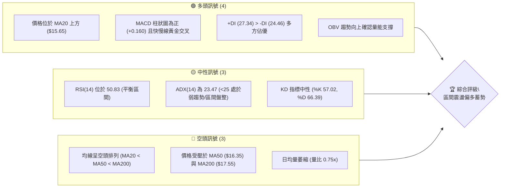
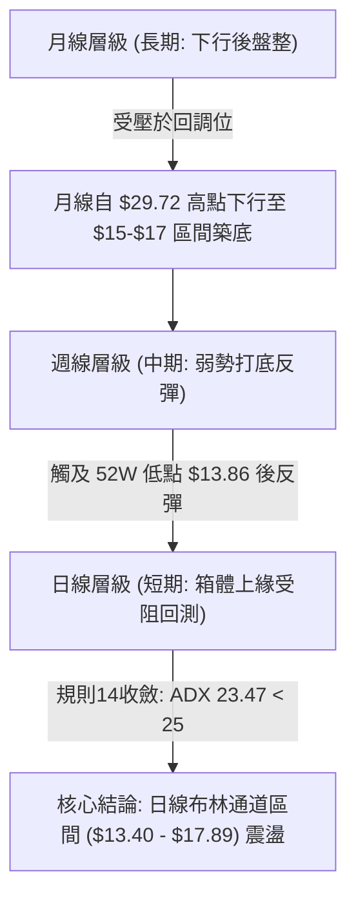
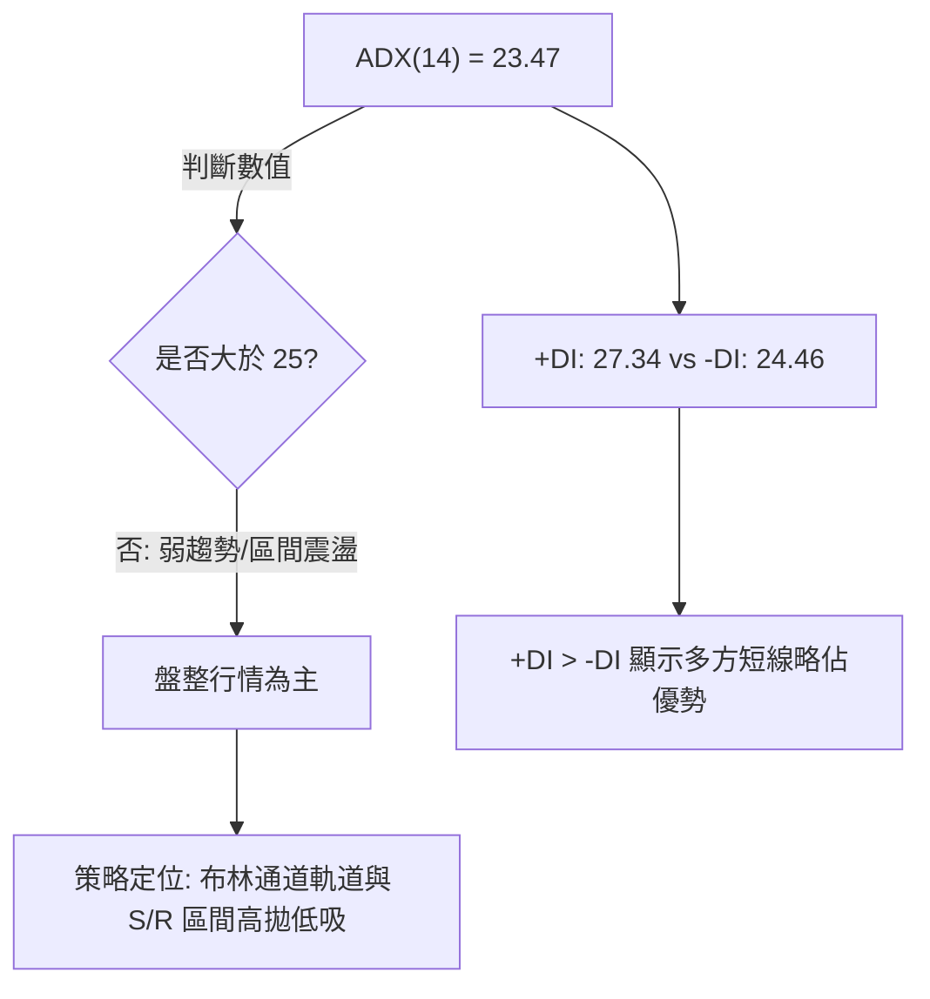
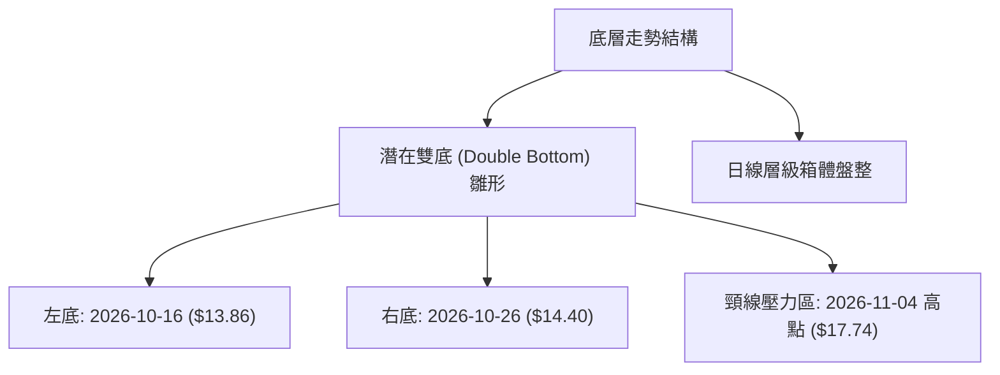
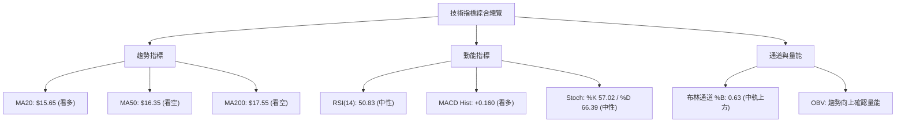
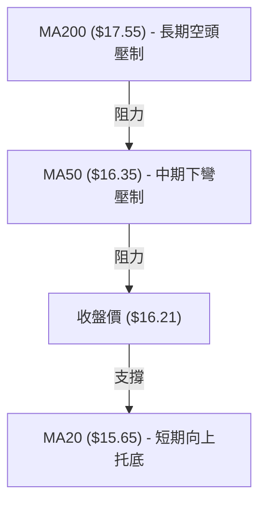
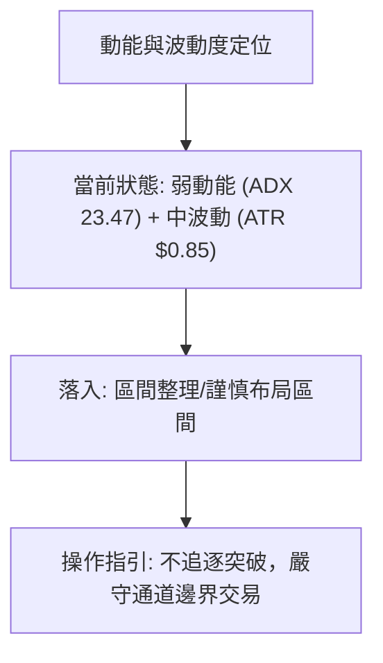
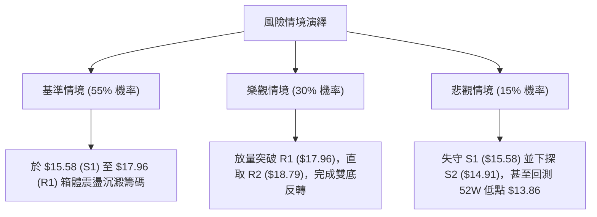

# SOFI 技術分析報告

> **報告日期**：2026-11-08 ｜ **語言**：繁體中文 ｜ **數據來源**：Yahoo Finance ｜ **當前價格**：$16.21

---

## 目錄

| 章節 | 內容 |
|------|------|
| [1. 技術面概覽](#1-技術面概覽) | 訊號儀表板、核心指標、評分卡 |
| [2. 趨勢分析](#2-趨勢分析) | 多時框趨勢、長中短期走勢 |
| [3. 圖表形態分析](#3-圖表形態分析) | 形態識別、K線組合、目標價 |
| [4. 支撐與阻力](#4-支撐與阻力) | 關鍵價位、斐波那契回調 |
| [5. 技術指標深度解讀](#5-技術指標深度解讀) | MA/RSI/MACD/布林/成交量 |
| [6. 動能與波動率](#6-動能與波動率) | 動能評估、ATR、Beta |
| [7. 多時框架總結](#7-多時框架總結) | 時框架評分矩陣 |
| [8. 交易策略建議](#8-交易策略建議) | 多空策略、風險報酬比 |
| [9. 風險提示與監控](#9-風險提示與監控) | 監控指標、風險場景 |

---

## 1. 技術面概覽

### 🎯 技術訊號儀表板



### 📊 核心指標速覽表

| 指標類別 | 指標名稱 | 當前數值 | 訊號 | 解讀 |
|----------|----------|----------|:----:|------|
| **價格** | 當前價格 | $16.21 | 🟡 | 位於52週區間底部12.5%分位，近期自低檔強烈反彈 |
| **均線** | MA20 | $15.65 | 🟢 | 現價高於 MA20（+3.59%），短線轉強支撐有效 |
| **均線** | MA50 | $16.35 | 🔴 | 現價低於 MA50（-0.86%），短線面臨中期均線壓制 |
| **均線** | MA200 | $17.55 | 🔴 | 現價低於 MA200（-7.64%），長期趨勢仍處空方壓制 |
| **動能** | RSI(14) | 50.83 | 🟡 | 位於中性多空分水嶺，無明顯背離，多空平衡 |
| **動能** | MACD | 0.172 / 0.011 | 🟢 | 快線高於慢線，Hist 柱為 +0.160，動能看多修復 |
| **趨勢** | ADX(14) | 23.47 | 🟡 | ADX < 25，顯示當前為箱體震盪而非單邊單向趨勢 |
| **波動** | ATR(14) | $0.85 | 🟡 | 波動率佔股價 5.26%，單日振幅適中，具備交易空間 |
| **通道** | 布林 %B | 0.63 | 🟢 | 站上中軌 ($15.65)，向上軌 ($17.89) 靠攏 |
| **量能** | 20日成交量比 | 0.75x | 🔴 | 量能降至 44.07M，低於20日均量 59.13M，追高謹慎 |

### 🏆 技術評分卡

```
╔══════════════════════════════════════════════════════════════╗
║               技術評分卡 — SOFI (2026-11-08)                 ║
╠══════════════════════════════════════════════════════════════╣
║ 趨勢強度 (ADX<25 弱趨勢)   ████████░░░░░░░░░░░░  40/100 🟡   ║
║ 動能指標 (MACD偏多+RSI中性) ████████████░░░░░░░░  60/100 🟢   ║
║ 支撐穩定度 (S1 $15.58強固) ██████████████░░░░░░  70/100 🟢   ║
║ 成交量配合 (OBV佳但量比弱) ██████████░░░░░░░░░░  50/100 🟡   ║
║ 形態完整度 (雙底雛形構築)   ████████████░░░░░░░░  60/100 🟢   ║
║ 均線排列 (空頭排列承壓)     ████████░░░░░░░░░░░░  40/100 🔴   ║
╠══════════════════════════════════════════════════════════════╣
║ 綜合評分 (六項算術平均)     ███████████░░░░░░░░░  53/100 🟡   ║
║ 評級結論：中性震盪 (Neutral Consolidation)                   ║
╚══════════════════════════════════════════════════════════════╝
```

*註：綜合評分 = (40 + 60 + 70 + 50 + 60 + 40) ÷ 6 = 53.33，四捨五入為 53 分。*

---

## 2. 趨勢分析

### 🌐 多時框趨勢分析



### 📈 長期趨勢 — 12個月走勢圖（Unicode）

以下為 SOFI 過去 12 個月（2025-12 至 2026-11）之月線收盤走勢：

```
SOFI 月線走勢圖（過去12個月收盤價）
價格軸 ($)
$26.18 ┤● (2025-12 歷史波段次高)
$24.00 ┤ ＼
$22.81 ┤   ● (2026-01)
$20.00 ┤     ＼
$18.22 ┤       ＼        ● (2026-05)  ● (2026-08)
$17.76 ┤         ●(02)  / ＼         / ＼
$16.21 ┤───────────────●───●───────●───●───● (現價 $16.21)
$15.72 ┤               (03)(04)    (07)(09)
$14.00 ┤
       └──────────────────────────────────────────────
         12   01  02   03  04  05  06  07  08  09  10  11 (月份)
```

**走勢特徵分析表格**：

| 階段時間 | 價格區間 | 累積漲跌幅 | 趨勢性質 | 核心驅動特徵 |
|----------|----------|:----------:|----------|--------------|
| **2025-12 ～ 2026-03** | $26.18 → $15.88 | -39.34% | 主跌浪 | 跌破 200 日線，多頭獲利了結與估值收縮 |
| **2026-04 ～ 2026-06** | $16.10 → $17.93 | +11.37% | 弱勢反彈 | 於 $16 關卡初次築底，反彈測試 MA60 阻力 |
| **2026-07 ～ 2026-09** | $16.31 → $15.72 | -3.62%  | 寬幅震盪 | 於 $15.72 - $18.91 區間反覆拉鋸整理 |
| **2026-10 ～ 2026-11** | $16.76 → $16.21 | -3.28%  | 探底回升 | 月中探低 $13.86 後強勁抽升，目前收斂於 $16.21 |

### 📊 中期趨勢（週線分析）

週線級別展示近 8 週行情自低點 $13.86 展開技術性修復。近兩週成交量大幅放大（416M 與 281M），顯示低檔有強烈買盤承接。

```
週線關鍵壓力與支撐示意圖
$18.79 ─── 阻力 R2 (聚類高點) ═════════════════════════════════
$17.96 ─── 阻力 R1 / 78.6% 回調位 ($17.90) ═════════════════════
$17.20 ─── 近期日K密集受阻帶
$16.21 ───【目前收盤價】─────────────────────────
$15.58 ─── 支撐 S1 (MA20 $15.65 重合區) ──────────────────────
$14.91 ─── 支撐 S2 (波段回調防守點) ──────────────────────────
$13.86 ─── 52W 低點 / 支撐 S3 ═════════════════════════════════
```

### ⚡ 趨勢強度評估（ADX 解讀）



| 指標名稱 | 數值 | 臨界標準 | 趨勢判定 | 交易指引 |
|----------|:----:|:--------:|:--------:|----------|
| **ADX(14)** | 23.47 | 25.00 | 弱趨勢 / 盤整 | 避免追高殺跌，以水平支撐阻力為主 |
| **+DI** | 27.34 | -DI (24.46) | 多頭主導微弱 | 偏多震盪，多方具備控盤初階優勢 |
| **-DI** | 24.46 | - | 空方回調受阻 | 空方動能自高點衰竭回落 |

---

## 3. 圖表形態分析

### 🔍 形態識別系統



**形態識別與信心度評估表（依規則 15、17 規範）：**

| 形態名稱 | 信心度 | 判斷依據（引用數據） | 完成度 | 目標價（附計算式） |
|----------|:------:|----------------------|:------:|--------------------|
| **潛在雙底雛形** | 62% | 第一次波段低點 $13.86 (10-16 週K)，第二次波段低點 $14.40 (10-26 日K)，低點逐步抬高，符合次低點不破前低法則。 | 70% | 頸線阻力取波段反彈高點 $17.74。形態高度 = $17.74 − $13.86 = $3.88。向上突破目標價 = $17.74 + $3.88 = **$21.62**（註：未突破前僅供推算）。 |
| **布林帶區間收斂** | 78% | ADX 23.47 < 25，現價 ($16.21) 位於中軌 ($15.65) 與上軌 ($17.89) 之間，受阻於 R1 ($17.96)。 | 85% | 區間目標為布林上軌 **$17.89**。若跌破中軌則回測下軌 **$13.40**。 |

### 🕯️ 重要K線形態分析

嚴格依據數據中「近10根日K」與「近8根週K」之實際 OHLC 數據分析：

| 日期（週期） | 開盤價 | 最高價 | 最低價 | 收盤價 | K線形態 | 技術解讀 | 訊號 |
|:------------:|:------:|:------:|:------:|:------:|---------|----------|:----:|
| **10-16 (週K)** | 15.47 | 15.68 | 13.86 | 14.55 | 長下影陰線 | 創 52 週新低 $13.86 後強勁抽腳，下影線達 $0.69，顯示極限賣壓被承接 | 🟢 |
| **10-27 (日K)** | 15.98 | 16.76 | 15.67 | 16.40 | 跳空大陽線 | 跳空開高，量能激增至 160.99M，一舉奠定反彈基調 | 🟢 |
| **10-30 (週K)** | 14.53 | 17.63 | 14.40 | 16.76 | 週線長紅實體 | 週漲幅巨大，週成交量暴增至 416.30M，量價齊揚突破短均 | 🟢 |
| **11-04 (日K)** | 17.01 | 17.74 | 16.97 | 17.38 | 衝高小陽線 | 盤中攻抵 $17.74，但未能挑戰 R1 ($17.96)，留下上影線 | 🟡 |
| **11-05 (日K)** | 17.25 | 17.45 | 15.43 | 16.04 | 長黑回吐實體 | 帶量 (78.44M) 下殺回測 MA20 支撐，單日振幅高達 $2.02 | 🔴 |
| **11-06 (日K)** | 16.13 | 16.56 | 15.93 | 16.21 | 低檔十字小紅 | 量縮至 44.07M，收盤力守 $16.00 之上，止跌回穩訊號初顯 | 🟢 |

### 📉 ASCII 走勢形態示意圖

```
日線潛在雙底反彈與短線壓制結構
價格 ($)
$17.96 ── 阻力 R1 / 上軌 $17.89 ──┬─────────────────────────────────
$17.74 ┤                          ● (11-04 頸線高點)
$17.38 ┤                         / ＼
$16.50 ┤        (跳空高開)      /     ＼ (11-05 回調)
$16.21 ┤─────────● (10-27)─────/───────● (11-06 收盤: $16.21)
$15.65 ┤        /             /          ▲ [MA20 / 中軌支撐區]
$14.40 ┤       ● (10-26 右底)
$13.86 ┤● (10-16 左底: 52W Low)
       └──────────────────────────────────────────────────────────
        10-16   10-26         11-04    11-06
```

---

## 4. 支撐與阻力

### 🗺️ 關鍵價位分布圖（Unicode）

```
SOFI 價位結構分布圖
═══════════════════════════════════════════════════
$19.62 ║████████████████████████║ 強阻力 R3 (波段高點聚類)
$18.79 ║████████████████        ║ 阻力 R2 (波段高點聚類)
$17.96 ║████████████████████    ║ 關鍵阻力 R1 (布林上軌/斐波78.6%重合)
$16.35 ║────────────────────────╢ 均線阻力 MA50
$16.21 ╠════════════════════════╣ ◄ 當前收盤價 ($16.21)
$15.65 ║┄┄┄┄┄┄┄┄┄┄┄┄┄┄┄┄┄┄┄┄┄┄╢ 均線支撐 MA20 / 布林中軌
$15.58 ║▓▓▓▓▓▓▓▓▓▓▓▓▓▓▓▓        ║ 近期核心支撐 S1 (波段低點聚類)
$14.91 ║████████████████        ║ 次級強支撐 S2 (波段低點聚類)
$13.86 ║████████████████████████║ 極限強支撐 S3 (52週最低點)
═══════════════════════════════════════════════════
```

### 🚧 阻力位分析表

*嚴格引用數據中「關鍵價位」區塊之波段高點聚類數值：*

| 阻力級別 | 價位 | 形成原因 | 突破難度 | 重要性 |
|:--------:|:----:|----------|:--------:|:------:|
| **R1** | **$17.96** | 數據計算波段高點聚類，逼近斐波那契 78.6% 回調位 ($17.90) 及布林上軌 ($17.89) | ★★★★☆ | 極高（多頭反轉分水嶺） |
| **R2** | **$18.79** | 數據計算波段高點聚類，對應 2026-07 密集套牢換手區間高位 | ★★★★☆ | 高（波段目標） |
| **R3** | **$19.62** | 數據計算波段高點聚類，接近 MA240 ($19.17) 長期牛熊分界區 | ★★★★★ | 極強（強牛轉折線） |

### 🛡️ 支撐位分析表

*嚴格引用數據中「關鍵價位」區塊之波段低點聚類數值：*

| 支撐級別 | 價位 | 形成原因 | 守住機率 | 重要性 |
|:--------:|:----:|----------|:--------:|:------:|
| **S1** | **$15.58** | 數據計算波段低點聚類，與 MA20 ($15.65) 極度靠攏，形成雙重共振防線 | 75% | 高（短線生命線） |
| **S2** | **$14.91** | 數據計算波段低點聚類，為 10-23 當週震盪平台的起漲換手底界 | 85% | 中高（波段最後防守） |
| **S3** | **$13.86** | 數據計算波段低點聚類，為 52 週最低點 (100.0% 斐波那契回調位) | 95% | 極強（年度多頭堡壘） |

### 📐 斐波那契回調位分析

*直接引用 52 週區間（$13.86 → $32.73）回調位：*

```
斐波那契回調層級位階
  0.0% (52W High) ─── $32.73
 23.6%            ─── $28.28
 38.2%            ─── $25.52
 50.0%            ─── $23.29
 61.8%            ─── $21.07
 78.6%            ─── $17.90 ──┬── [現價上方主要壓力層，與 R1 $17.96 共振]
                               │
【現價區間】      ─── $16.21 ──┴── (落於 78.6% 與 100.0% 之間)
                               │
100.0% (52W Low)  ─── $13.86 ──┴── [絕對底部 S3]
```

**深層解讀**：
當前價格 ($16.21) 位於 78.6% ($17.90) 與 100.0% ($13.86) 回調位之間。這代表股票經歷了一整輪極深度回撤（回吐了過去漲幅的近八成以上）。
78.6% 回調位 ($17.90) 與阻力位 R1 ($17.96) 形成強烈的共振強壓區。若價格後續能以實體 K 線帶量封閉 $17.90 - $17.96 區間，將確認脫離極端超跌壓制區，邁向 61.8% ($21.07) 的修復空間。

---

## 5. 技術指標深度解讀

### 🎛️ 指標訊號總覽



### 📈 移動平均線排列分析



| 均線名稱 | 當前價格 | 乖離率 (現價 vs MA) | 趨勢斜率 | 技術意涵 |
|:--------:|:--------:|:-------------------:|:--------:|----------|
| **MA5** | $16.60 | -2.35% | 下彎 | 短線自高點 $17.74 回落壓制 |
| **MA10** | $16.54 | -1.98% | 下彎 | 短期反彈暫歇 |
| **MA20** | $15.65 | +3.59% | 上彎 | 向上金叉，提供堅實短線回檔支撐 |
| **MA50** | $16.35 | -0.86% | 平緩下彎 | 密集套牢阻力，等待實體 K 線放量突破 |
| **MA200** | $17.55 | -7.64% | 下行 | 長期熊市分界線，未收復前均為反彈格局 |

當前排列狀態為 `MA20 ($15.65) < MA50 ($16.35) < MA200 ($17.55)`，大格局仍屬空頭排列。然而，價格已站上 MA20 並推動 MA20 拐頭向上，短期呈現「短多中空」之糾纏修復狀態。

### 📉 RSI(14) 分析

```
RSI(14) 強度儀表 (當前: 50.83)
[0] ────────── 超賣區(30) ─────●───── 超買區(70) ────────── [100]
進度條: ██████████░░░░░░░░░░ 50.83% (平衡區間)
```

- **區間評估**：當前 RSI 為 50.83，精準落在 50 榮枯線上，既無超買風險（未達 70），亦無流動性衰竭超賣（高於 30）。
- **背離判斷**：依據數據快照「RSI 背離：無明顯背離（比較近 20 根 K 棒首尾之價格與 RSI 方向）」，確認價格與 RSI 維持同步，並未出現頂背離或底背離徵兆，價格走勢反映真實市場供需。

### 📊 MACD(12/26/9) 訊號解讀


MACD 快線 (0.172) 明確運行於信號線 (0.011) 之上，柱狀圖維持為正值 (+0.160)。這顯示儘管近兩日價格出現回調，中短期動能仍處於多頭控盤主場，回調屬於良性洗盤回測支撐，尚未發出死叉轉空訊號。

### 📦 布林通道分析

```
布林通道結構示意圖 (帶寬: $4.49)
$17.89 ── 布林上軌 (Upper Band) ══════════════════════════════
         │
$16.21 ──┼──【收盤價】(%B = 0.63，位於中軌與上軌間)
         │
$15.65 ── 布林中軌 (MA20) ──────────────────────────────────
         │
$13.40 ── 布林下軌 (Lower Band) ══════════════════════════════
```

- **通道位置**：%B 值為 0.63，說明股價位處強勢半區（高於中軌 0.5）。
- **帶寬動態**：上軌 ($17.89) 與下軌 ($13.40) 形成寬約 $4.49 的震盪通道。股價於 11-04 觸碰 $17.74 逼近上軌後拉回，中軌 $15.65 構成短期極關鍵的回測防線。

### 💹 成交量分析（量價配合度）

- **量比現狀**：最新單日成交量為 44,066,500 股，相較於 20 日均量 59,129,915 股，量比僅為 0.75x，呈現縮量拉回整理格局。
- **量價配合**：在 10-27 與 10-28 突破期間，成交量曾分別暴增至 160.99M 與 82.32M；而 11-06 回測 $15.93 期間量能縮至 44.07M，呈現經典的「上漲放量、回調縮量」健康量價結構。
- **OBV 解讀**：數據指出「OBV 趨勢：OBV > MA → 量能支撐上漲」，能量潮指標位於其移動平均線上方，證實累積買盤並未因短線回踩而潰散。

---

## 6. 動能與波動率

### ⚡ 動能評估四象限



| 象限 | 動能維度 | 波動維度 | 當前狀態判定 | 戰略應對方針 |
|:----:|:--------:|:--------:|:------------:|--------------|
| **Q1** | 強動能 (ADX>25) | 低波動 (ATR小) | — | 最佳趨勢波段加碼點 |
| **Q2** | 弱動能 (ADX<25) | 低/中波動 | **✓ 當前狀態 (ADX 23.47)** | **區間震盪佈局，耐心等待邊界訊號** |
| **Q3** | 強動能 (ADX>25) | 高波動 (ATR大) | — | 高風險進取型突破追蹤 |
| **Q4** | 弱動能 (ADX<25) | 高波動 (ATR大) | — | 頻繁洗盤，極易停損，應避免進場 |

### 📊 ATR 波動率分析

- **ATR(14)**：$0.85（佔目前股價之 5.26%）。
- **風控止損距離建議**：
  - *短線保守型交易者*：建議使用 1.0 倍 ATR（即距離進場點 $0.85 空間），以避開日常市場雜訊。
  - *波段操作者*：建議使用 1.5 倍 ATR（即 $0.85 × 1.5 = $1.28 空間），允許股價在回測 S1 ($15.58) 時有充分換手緩衝。

### 📐 Beta 與市場相關性

- **Beta 係數**：2.241。
- **特徵解讀**：SOFI 屬於高貝塔成長型金融科技標的，其價格敏感度為標普 500 指數的 2.24 倍。在大盤多頭推進或市場風險偏好 (Risk-on) 提升時，其上行彈性巨大；但在整體市場回檔時，下行回撤幅度亦會被放大，倉位配置上須採取適度槓桿限制。

---

## 7. 多時框架總結

### 📋 時框架評分表

| 時框架 | 趨勢方向 | 動能狀態 | 均線排列 | 形態結構 | 綜合評分 | 戰略建議 |
|:------:|:--------:|:--------:|:--------:|:--------:|:--------:|----------|
| **月線 (長期)** | 空頭壓制 | 弱勢築底 | 空頭 (破240MA) | 歷史低檔整理 | 42/100 🔴 | 觀望，僅適合作為超長線定期定額底倉 |
| **週線 (中期)** | 震盪反彈 | 修復轉強 | 糾結整理 | 次低點抬高 | 56/100 🟡 | 逢拉回支撐分批佈局，中線持股 |
| **日線 (短期)** | 箱體震盪 | MACD偏多 | 站上 MA20 | 觸碰上軌後回踩 | 60/100 🟢 | 於 S1 附近尋求低吸，目標看至 R1 |

### 🔲 綜合訊號矩陣

```
綜合訊號矩陣一覽
┌──────────────────┬──────────────┬──────────────┬──────────────┐
│ 分析維度         │ 短期 (日線)  │ 中期 (週線)  │ 長期 (月線)  │
├──────────────────┼──────────────┼──────────────┼──────────────┤
│ 價格 vs 均線     │ 偏多 (現>MA20)│ 偏多 (站上MA5)│ 偏空 (現<MA200)│
│ 動能指標 (MACD)  │ 🟢 柱狀擴大  │ 🟢 正值延續  │ 🔴 長期低檔  │
│ 擺盪指標 (RSI)   │ 🟡 中性 50.8 │ 🟡 中性 50.8 │ 🔴 弱勢區間  │
│ 成交量配合度     │ 🟡 縮量整理  │ 🟢 大幅增量  │ 🟡 均量平緩  │
└──────────────────┴──────────────┴──────────────┴──────────────┘
```

### ⚖️ 多時框收斂結論

> **依據嚴格要求第 14 條收斂法則**：
> 當前 **ADX(14) 數值為 23.47（小於 25 臨界值）**，明確判定當前市場處於**「盤整行情」**而非單邊趨勢行情。
>
> **收斂指引**：在盤整行情中，主導邏輯轉向**日線布林通道 ($13.40 - $17.89) 之區間交易**。日線雖在長週期均線下承受空頭排列壓力，但短線站穩 MA20 ($15.65)，且週線級別自 $13.86 構築次低點，量能獲 OBV 背書。
>
> **最終收斂結論**：**中性偏多區間操作（Neutral-Bullish Rangebound）**。以守住 S1 ($15.58) 為多頭底線，逢低尋求向上軌 R1 ($17.96) 靠攏之反彈機會。

---

## 8. 交易策略建議

### 🗺️ 策略決策流程圖

```mermaid
graph TD
    A["當前綜合評分: 53/100 🟡 (中性震盪)"] --> B{"ADX=23.47 處於盤整\\n路由: 區間操作策略"}
    B --> C["策略 A: 支撐位回踩低吸 (主推)"]
    B --> D["策略 B: 右側突破確認追擊"]
    
    C --> C1["進場點: $15.65 (MA20/S1區間)"]
    C1 --> C2["止損點: $14.91 (支撐 S2)"]
    C2 --> C3["目標 T1: $17.96 (阻力 R1)"]
    C3 --> C4["目標 T2: $18.79 (阻力 R2)"]
    
    D --> D1["進場點: 突破站穩 $17.96"]
    D1 --> D2["止損點: $16.35 (跌回 MA50)"]
    D2 --> D3["目標 T1: $18.79 (阻力 R2)"]
```



### 🧭 策略路由（依評分卡分流）

**當前主策略方向 = 中性震盪偏多區間操作（依綜合評分 53/100）**
依規則 18 與路由原則，綜合評分落於 40–60 區間，且 ADX < 25，定義為**區間操作**。策略以「布林通道中軌支撐低吸」為主，嚴禁盲目追高，等待測試上軌阻力。

### 🎯 價格情境階梯（Price Scenarios）

*價位嚴格引用第 4 章「關鍵價位」計算數據：*

| 觸發條件 | 下一目標 | 後續延伸 | 情境技術含義 |
|----------|:--------:|:--------:|--------------|
| **向上突破 R1 $17.96** | **R2 $18.79** | **R3 $19.62** | 封閉 78.6% 回調壓制，雙底形態完成，轉為波段多頭 |
| **維持於現價區間震盪** | **MA50 $16.35** | **MA20 $15.65** | 消化 11-05 長黑 K 棒解套籌碼，於布林帶內部拉鋸 |
| **向下跌破 S1 $15.58** | **S2 $14.91** | **S3 $13.86** | 跌破日線中軌，短多防線瓦解，重新回測 52W 低點探底 |

### 📊 情境機率分佈

| 情境劃分 | 機率估算 | 主要指標依據 |
|----------|:--------:|--------------|
| **區間震盪蓄勢 (盤整)** | **55%** | ADX 23.47 顯示無單邊動力，日成交量 (44.07M) 縮量，等待均線糾結 |
| **延續反彈突破 (偏多)** | **30%** | MACD Hist 維持正向 (+0.160)，OBV 呈多頭支撐，價格位於 MA20 上方 |
| **跌破破底回落 (偏空)** | **15%** | 均線系統仍呈空頭排列，若市場風險偏好轉向，高 Beta 屬性恐加速回測 |

### 🟢 主策略詳情

*所有價位嚴格引用關鍵價位數據，風險報酬比公式 = (目標價 T1 − 進場價) ÷ (進場價 − 止損價)：*

| 策略要素 | 策略 A（區間低吸主策略） | 策略 B（右側突破跟進策略） |
|----------|--------------------------|----------------------------|
| **進場條件** | 股價回踩 MA20 與支撐 S1 獲得確認企穩 | 實體日K帶量站穩阻力 R1 之上 |
| **進場價格** | **$15.65**（中軌/MA20 價位） | **$17.96**（阻力 R1 價位） |
| **目標價 T1** | **$17.96**（阻力位 R1） | **$18.79**（阻力位 R2） |
| **目標價 T2** | **$18.79**（阻力位 R2） | **$19.62**（阻力位 R3） |
| **止損價格** | **$14.91**（支撐位 S2） | **$16.35**（MA50 均線位） |
| **風險報酬比** | **1 : 3.12（以 T1 計）** <br> *(17.96−15.65)÷(15.65−14.91) = 2.31÷0.74* | **1 : 0.52（以 T1 計）** <br> *(18.79−17.96)÷(17.96−16.35) = 0.83÷1.61* <br> *(以 T2 計則為 1 : 1.03)* |
| **成功機率** | 60% | 45% |
| **建議倉位** | 10% - 15% 總資金（分批建倉） | 5% - 8% 總資金（突破加碼） |

### 🔴 反向風險觸發點（對沖提示）

- **多頭反轉停損警戒**：若日線收盤價帶量**有效跌破支撐 S1 ($15.58)**，且 MACD 柱狀圖翻負，宣告自 $13.86 以來的反彈節奏破裂，多頭應果斷止損離場或反手佈局做空對沖。
- **做空保護觸發點**：任何空方部位若見價格帶量升破 **MA200 ($17.55) 及 R1 ($17.96)**，必須無條件執行空頭回補。

### ⭐ 整體訊號強度評星

```
做多訊號強度：★★★☆☆  (3.0/5星 - 支撐穩固，動能轉向，但上方均線層層壓制)
做空訊號強度：★★☆☆☆  (2.0/5星 - 底部放量抽升，空方動能遭 MACD 金叉阻遏)
整體可信度：  ★★★☆☆  (3.5/5星 - 盤整特徵明顯，指標指示高度一致)
```

---

## 9. 風險提示與監控

### ✅ 關鍵監控指標 Checklist

```
╔══════════════════════════════════════════════════════════════╗
║                    每日技術監控清單                          ║
╠══════════════════════════════════════════════════════════════╣
║ [ ] 價格是否力守於短期生命線 MA20 ($15.65) 之上              ║
║ [ ] 日成交量是否回升至 20 日均量 (59.13M) 以上以支撐推升     ║
║ [ ] MACD 柱狀圖是否維持正擴張 (目前 +0.160)，避免頂背離死叉 ║
║ [ ] RSI(14) 能否穩守 50 水平，避免跌回 45 以下弱勢區         ║
║ [ ] 能否向上帶量封閉 MA50 ($16.35) 壓力                      ║
║ [ ] 跌破 S1 ($15.58) 時，是否觸發即時風控降倉訊號            ║
╚══════════════════════════════════════════════════════════════╝
```

### ⚠️ 風險場景分析



### 🛡️ 風險管理重要提醒

1. **高 Beta 波動性控管**：SOFI Beta 高達 2.241，波動劇烈。當前 ATR 達 $0.85，單日波動佔比超過 5%。單筆交易最大虧損額度應嚴格限制在總資產的 1%–1.5% 內，嚴禁重倉孤注一擲。
2. **財報與基本面現金流風險**：雖然最新季度營收與獲利成長亮眼（營收年增 43.9%），但自由現金流仍為負值（TTM FCF 為 $-8.80B），基本面存在現金消耗特徵。若總體流動性緊縮，極易誘發估值下修。
3. **空頭避險比例提示**：空頭未平倉比例 (Short % Float) 達 17.2%，空頭比例極高。這是一把雙面刃——一旦突破 R1 ($17.96) 易引發劇烈的軋空行情 (Short Squeeze)；但未突破前，亦反映機構主力存在持續借券放空之重壓，切勿在阻力位前盲目追多。

---

## 📋 報告總結

```
╔══════════════════════════════════════════════════════════════╗
║                  SOFI 技術分析報告總結                       ║
╠══════════════════════════════════════════════════════════════╣
║ 報告日期：2026-11-08                                         ║
║ 當前價格：$16.21                                             ║
║ 分析評級：⚖️ 中性偏多震盪 (綜合評分: 53/100 🟡)              ║
║                                                              ║
║ 關鍵結論：                                                   ║
║ ├─ 長期趨勢：🔴 空頭壓制中 (價格位於 MA200 $17.55 下方)     ║
║ ├─ 中期趨勢：🟡 築底反彈階段 (自 $13.86 走出雙底雛形)        ║
║ ├─ 短期趨勢：🟢 震盪偏強 (站穩 MA20 $15.65，MACD金叉正值)   ║
║ ├─ 關鍵支撐：S1: $15.58 ｜ S2: $14.91 ｜ S3: $13.86          ║
║ ├─ 關鍵阻力：R1: $17.96 ｜ R2: $18.79 ｜ R3: $19.62          ║
║ └─ 機構共識：Hold (23位分析師，平均目標價 $20.84)           ║
║                                                              ║
║ 最優策略組合：                                               ║
║ 1. 🥇 最佳機會：策略 A (回踩 MA20 $15.65 低吸，風報比 1:3.12)║
║ 2. 🥈 次選機會：策略 B (放量突破 R1 $17.96 右側跟進)         ║
║ 3. 🥉 保守選擇：場外觀望，待日線實體站穩 MA50 ($16.35) 再動  ║
╚══════════════════════════════════════════════════════════════╝
```

---

> ⚠️ **免責聲明**：本報告為技術分析研究，所有數據指標及價位均嚴格基於提供之歷史市場資訊計算產出。本報告**僅供學術研究與交易架構參考**，**不構成任何要約、推薦或投資顧問決策依據**。金融市場具有高度風險，投資人應獨立評估自身風險承受能力並自負盈虧。

---

*報告生成時間：2026-11-08 ｜ 數據來源：Yahoo Finance ｜ 分析框架：多時框技術分析體系*