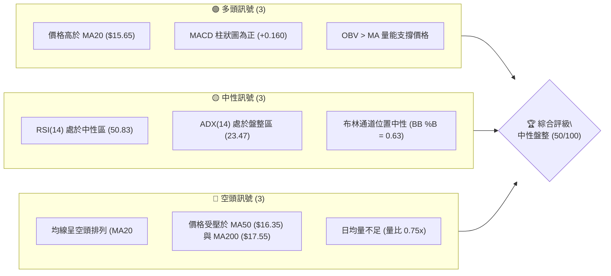
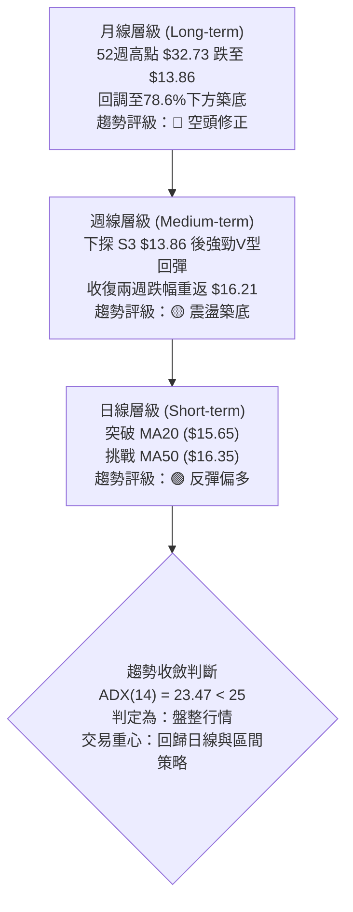
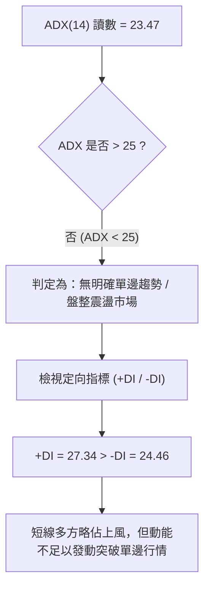
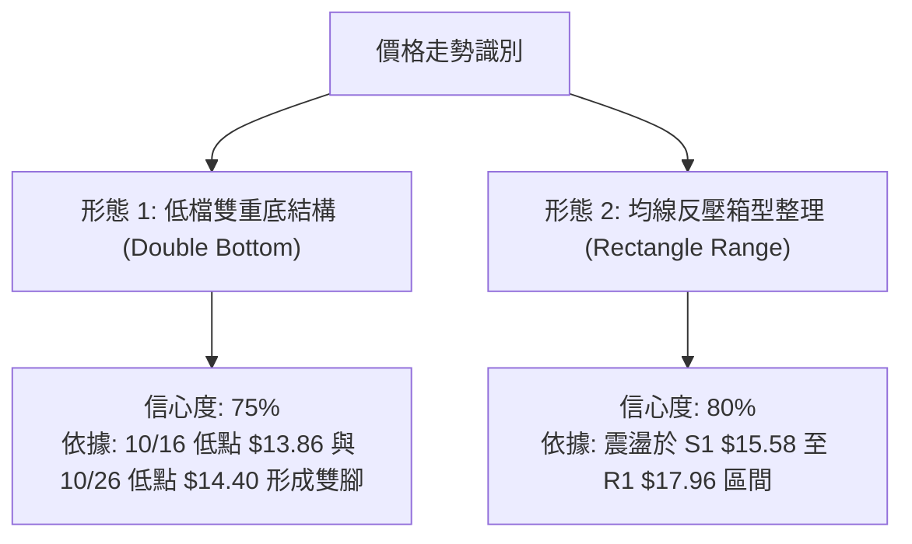
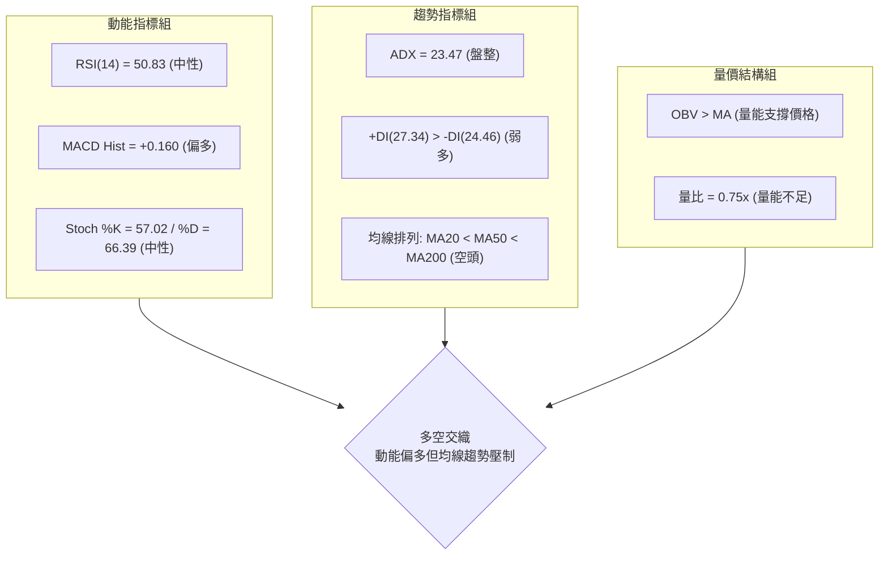
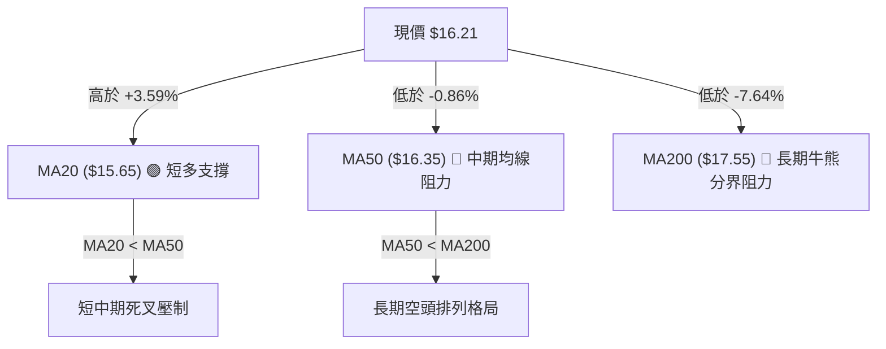
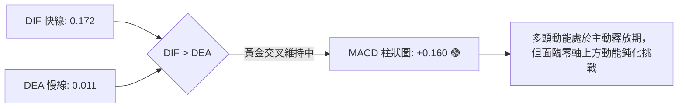
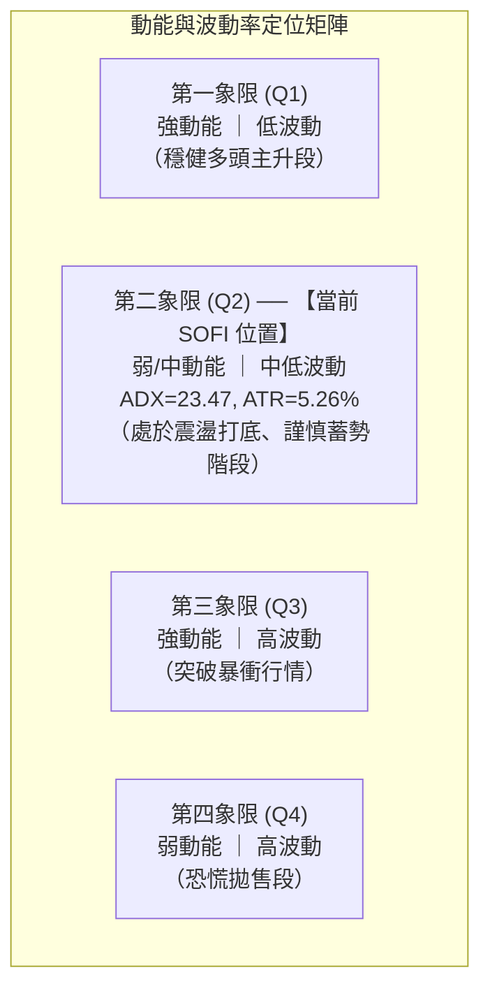
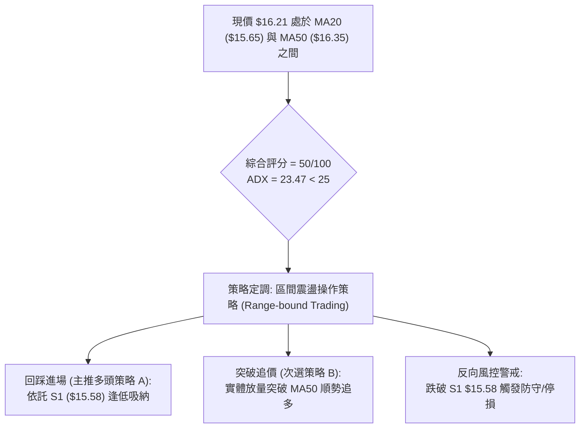
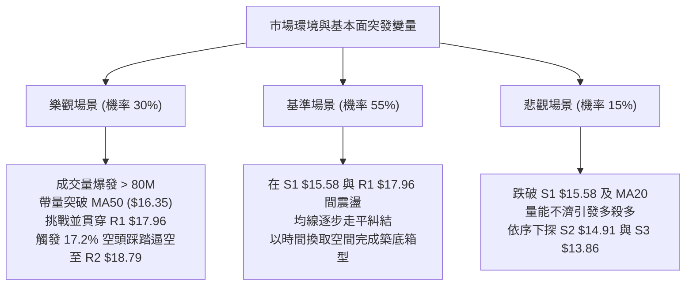

# SOFI 技術分析報告

> **報告日期**：2026-11-09 ｜ **語言**：繁體中文 ｜ **數據來源**：Yahoo Finance ｜ **當前價格**：$16.21 USD

---

## 目錄

| 章節 | 內容 |
|------|------|
| [1. 技術面概覽](#1-技術面概覽) | 訊號儀表板、核心指標、評分卡 |
| [2. 趨勢分析](#2-趨勢分析) | 多時框趨勢、長中短期走勢、12個月走勢圖 |
| [3. 圖表形態分析](#3-圖表形態分析) | 形態識別、K線組合、目標價推算 |
| [4. 支撐與阻力](#4-支撐與阻力) | 關鍵價位結構、斐波那契回調解讀 |
| [5. 技術指標深度解讀](#5-技術指標深度解讀) | MA/RSI/MACD/布林通道/成交量配合 |
| [6. 動能與波動率](#6-動能與波動率) | 動能四象限、ATR 波動率、Beta 市場敏感度 |
| [7. 多時框架總結](#7-多時框架總結) | 時框架矩陣、多時框收斂與權重判定 |
| [8. 交易策略建議](#8-交易策略建議) | 策略路由、主策略詳解、風險報酬比 |
| [9. 風險提示與監控](#9-風險提示與監控) | 關鍵監控清單、情境模擬與風控防線 |

---

## 1. 技術面概覽

### 🎯 技術訊號儀表板



### 📊 核心指標速覽表

| 指標類別 | 指標名稱 | 當前數值 | 訊號 | 解讀 |
|:---|:---|:---|:---:|:---|
| **價格** | 當前收盤價 | $16.21 | 🟡 | 位於52週區間底部12.5%處，處於低檔築底反彈階段 |
| **均線** | 短期 MA20 | $15.65 | 🟢 | 現價高於 MA20，短期底部結構有撐，短線偏多運行 |
| **均線** | 中期 MA50 | $16.35 | 🔴 | 現價低於 MA50，上方第一道動態均線阻力尚未有效跨越 |
| **均線** | 長期 MA200 | $17.55 | 🔴 | 現價低於 MA200，大格局仍屬弱勢修正範疇，空頭壓制明顯 |
| **動能** | RSI(14) | 50.83 | 🟡 | 位於 50 多空分水嶺附近，無超買或超賣現象，無明顯背離 |
| **動能** | MACD (12,26,9) | 0.172 / 0.011 / +0.160 | 🟢 | 快慢線位於零軸上方，柱狀圖正值維持擴張，短線反彈動能仍在 |
| **趨勢強度** | ADX (14) | 23.47 (+DI 27.34, -DI 24.46) | 🟡 | ADX < 25 表明處於弱趨勢/區間震盪，+DI 小幅主導多方反彈 |
| **波動** | ATR(14) | $0.85 (5.26%) | 🟡 | 每日平均波動幅度約 $0.85，波動性處於中等常態水準 |
| **成交量** | 20日成交量比 | 0.75x (44.07M vs 59.13M) | 🔴 | 反彈時日成交量萎縮，追價意願不足，需提防量價不濟 |

### 🏆 技術評分卡

```
╔════════════════════════════════════════════════════════════════╗
║                  技術評分卡 — SOFI (2026-11-09)                 ║
╠════════════════════════════════════════════════════════════════╣
║ 評估維度         強度進度條                      得分   訊號   ║
╟────────────────────────────────────────────────────────────────╢
║ 趨勢強度         █████████░░░░░░░░░░░           45/100   🟡    ║
║ 動能指標         ████████████░░░░░░░░           60/100   🟢    ║
║ 支撐穩定度       █████████████░░░░░░░           65/100   🟢    ║
║ 成交量配合       ████████░░░░░░░░░░░░           40/100   🔴    ║
║ 形態完整度       ████████████░░░░░░░░           60/100   🟡    ║
║ 均線排列         ██████░░░░░░░░░░░░░░           30/100   🔴    ║
╠════════════════════════════════════════════════════════════════╣
║ 綜合評分         ██████████░░░░░░░░░░           50/100   🟡    ║
║ 評級結論         中性盤整 / 區間震盪 (Neutral Range-bound)      ║
╚════════════════════════════════════════════════════════════════╝
```
*註：綜合評分由六項子指標算術平均計算：(45 + 60 + 65 + 40 + 60 + 30) ÷ 6 = 50.0分（四捨五入為 50/100）。*

---

## 2. 趨勢分析

### 🌐 多時框趨勢分析



### 📈 長期趨勢 — 12個月走勢圖（Unicode）

以下圖表展示 SOFI 過去 12 個月（2024-11 至 2026-11）的月線收盤價走勢軌跡：

```
SOFI 月線走勢圖（過去12個月：2024-11 至 2026-11）
價格 ($)
$29.72 ┤                                        ●(歷史高點區間)
$26.18 ┤                                            ●
$22.81 ┤                                                ●
$18.22 ┤                                                    ●
$17.88 ┤                                                        ●
$16.76 ┤                                                            ●
$16.41 ┤●(起點)                                                        ●←現價 $16.21
$15.72 ┤                                                          ●(波段次低)
$14.47 ┤    ●
$11.63 ┤        ●(52W前期低點)
       └────────────────────────────────────────────────────────────
        11   12   01   02   03   04   05   06   07   08   09   10   11
        2024      2025                                         2026
```

#### 走勢特徵分析表格

| 週期階段 | 起訖時間 | 起始價 → 終止價 | 漲跌幅 | 走勢特徵解讀 |
|:---|:---:|:---:|:---:|:---|
| **階段一：前期落底反彈** | 2024-11 至 2025-03 | $16.41 → $11.63 | -29.13% | 震盪探底至 $11.63 確立底部支撑後反轉。 |
| **階段二：強勢主升波段** | 2025-03 至 2025-11 | $11.63 → $29.72 | +155.55% | 資金大幅推升，突破所有均線，創下波段頂點。 |
| **階段三：主跌段退潮修正** | 2025-11 至 2026-03 | $29.72 → $15.88 | -46.57% | 均線高檔反轉，連續五個月長黑下挫回測腰斬。 |
| **階段四：低檔平台盤整** | 2026-03 至 2026-11 | $15.88 → $16.21 | +2.08% | 股價於 $13.86 至 $18.91 區間反覆震盪打底。 |

### 📊 中期趨勢（週線分析）

中期走勢呈現區間下沿反彈格局。近 8 週內，股價自 2026-09-25 高點 $17.96 連續下挫，至 2026-10-16 當週下探 52 週最低點 $13.86（收盤 $14.55）。隨後多方發動強勁反擊，於 2026-10-30 當週大漲以長陽線報收 $16.76，單週成交量放大至 4.16 億股。目前週線動能 MACD 柱狀圖翻正（+0.160），但上檔仍面臨斐波那契 78.6% 回調位 $17.90 以及阻力位 R1 $17.96 的沉重壓制。

```
週線區間壓力與支撐結構示意圖：
  $18.79 ── R2 強度阻力
  $17.96 ── R1 關鍵頸線阻力 / 斐波那契 78.6% ($17.90)
    ▲
  $16.21 ── 現價 (處於低檔反彈回測區)
    ▼
  $15.58 ── S1 近期動態支撐 (MA20 $15.65 附近)
  $13.86 ── S3 52週極限低點支撐
```

### ⚡ 趨勢強度評估（ADX 解讀）



#### ADX 趨勢強度對照表

| 指標變數 | 當前讀數 | 門檻區間 | 趨勢判定 | 操作指引 |
|:---|:---:|:---:|:---:|:---|
| **ADX(14)** | 23.47 | < 25.0 | 弱趨勢 / 盤整區間 | 避免追高殺跌，以邊界逆勢或區間高拋低吸為主 |
| **+DI** | 27.34 | - | 多方動能主導 | 短線反彈具備基本買盤推動 |
| **-DI** | 24.46 | - | 空方動能減弱 | 空方壓制趨緩，但差距不大（差值僅 2.88） |

---

## 3. 圖表形態分析

### 🔍 形態識別系統



#### 形態識別與信心度評估表

| 形態名稱 | 信心度 | 判斷依據（引用數據） | 完成度 | 目標價（附計算式） |
|:---|:---:|:---|:---:|:---|
| **雙重底結構 (Double Bottom)** | 75% | 第一腳於 10/16 觸及 $13.86，第二腳於 10/26 觸及 $14.40 獲利盤回補，頸線為 10/29 高點 $17.63。 | 70% | 頸線 $17.63 + 形態深度 ($17.63 − $13.86 = $3.77) = **$21.40**（若有效突破頸線） |
| **箱型整理形態 (Rectangle)** | 80% | 股價受困於阻力群 R1 $17.96 與支撐 S1 $15.58 之間，多次觸及邊界反彈/受阻。 | 85% | 突破箱頂目標 = $17.96 + ($17.96 − $15.58) = **$20.34** |

### 🕯️ 重要 K 線形態分析

嚴格依據提供的「近10根日K」與「近8根週K」四價數據進行專業解讀：

#### 近10根日K形態精解

| 日期 | 開盤 | 最高 | 最低 | 收盤 | K線形態 | 技術解讀 | 訊號 |
|:---:|:---:|:---:|:---:|:---:|:---|:---|:---:|
| **2026-10-26** | 14.53 | 14.67 | 14.40 | 14.46 | 短實體小陰線 | 築底次低點確認，量能萎縮至 43.28M，空方力道衰竭 | 🟡 |
| **2026-10-27** | 15.98 | 16.76 | 15.67 | 16.40 | 跳空大陽線 | 財報/利多刺激跳空暴漲，成交量暴增至 160.99M，多頭主力進場 | 🟢 |
| **2026-10-28** | 16.56 | 17.25 | 16.56 | 17.14 | 續漲光腳大陽線 | 多頭延續推升，實體突破 17.00，成交量維持 82.32M 放大 | 🟢 |
| **2026-10-29** | 16.92 | 17.63 | 16.87 | 17.61 | 多頭長陽線 | 盤中觸及波段高點 $17.63，尾盤收高，動能達到短線頂點 | 🟢 |
| **2026-10-30** | 17.07 | 17.32 | 16.44 | 16.76 | 下跌反轉陰線 | 高檔出現獲利了結賣壓，跌破前一日收盤價，短線動能放緩 | 🔴 |
| **2026-11-02** | 16.98 | 17.60 | 16.57 | 16.60 | 上影小陰線 | 再次上探 $17.60 未果，衝高回落顯示上方賣壓沉重 | 🔴 |
| **2026-11-03** | 16.74 | 16.85 | 16.47 | 16.77 | 窄幅十字小陽星 | 多空在 MA50 附近膠著，成交量萎縮至 49.00M | 🟡 |
| **2026-11-04** | 17.01 | 17.74 | 16.97 | 17.38 | 帶上影陽線 | 多頭再度挑戰波段高點 $17.74 遭空方反擊收斂 | 🟡 |
| **2026-11-05** | 17.25 | 17.45 | 15.43 | 16.04 | 長下影破位中陰線 | 盤中重挫下探至 $15.43（擊穿 MA20），隨後買盤拉升收回 $16.04 | 🔴 |
| **2026-11-06** | 16.13 | 16.56 | 15.93 | 16.21 | 縮量修復陽十字線 | 守住 $16.00 大關，成交量劇減至 44.06M，短線進入觀望盤整 | 🟡 |

#### 近8根週K關鍵特徵

| 週最後交易日 | 開盤 | 最高 | 最低 | 收盤 | K線形態 | 技術解讀 | 訊號 |
|:---:|:---:|:---:|:---:|:---:|:---|:---|:---:|
| **2026-10-16** | 15.47 | 15.68 | 13.86 | 14.55 | 長下影大陰線 | 觸及 52 週最低點 $13.86，爆出 2.86 億成交量，浮現恐慌盤出清訊號 | 🟢 |
| **2026-10-23** | 14.75 | 15.11 | 14.18 | 14.61 | 止跌小紅十字 | 守住前週下影線區域，二次確認底部支撐 | 🟢 |
| **2026-10-30** | 14.53 | 17.63 | 14.40 | 16.76 | 底部吞噬巨陽線 | 週線狂飆 14.7%，量能爆出 4.16 億股，確立週線級別底部成形 | 🟢 |
| **2026-11-06** | 16.98 | 17.74 | 15.43 | 16.21 | 寬幅震盪倒鎚陰線 | 衝高回落回測支撐，週量縮至 2.81 億股，進入多頭整理洗盤階段 | 🟡 |

### 📉 ASCII 走勢形態示意圖

```
SOFI 近期日K線形態結構圖（雙底成型與頸線反壓）
價格 ($)
$17.96 ┼──────────────────────────────────────────────── R1 強阻力位
$17.63 ┤           ● (10/29 頸線高點)     ● (11/04 上衝受阻 $17.74)
$17.14 ┤         ●   ●                 ●   
$16.76 ┤       ●       ●             ●       ● (10/30 收盤)
$16.21 ┼───────●───────────────────────●───────●──◄ 當前收盤價 $16.21
$15.65 ┤     ●           (MA20 動態支撐)       ● 
$15.43 ┤                                      ● (11/05 測試低點)
$14.40 ┤  ● (10/26 第二腳低點)
$13.86 ┴──● (10/16 第一腳低點) ────────────────────────── S3 52W 低點
```

### 🎯 形態目標價計算

依據傳統形態學原理，目標價計算式嚴格標註如下：
1. **短線雙重底形態**：
   - 形態底部：$13.86
   - 頸線位置：$17.63
   - 垂直高度：$17.63 − $13.86 = **$3.77**
   - 向上等距測幅目標價 = $17.63 + $3.77 = **$21.40**
2. **區間箱型假突破回踩**：
   - 阻力上限 R1：$17.96
   - 支撐下限 S1：$15.58
   - 箱體高度：$17.96 − $15.58 = **$2.38**
   - 箱型向上破位目標價 = $17.96 + $2.38 = **$20.34**
   - 箱型向下破位測幅價 = $15.58 − $2.38 = **$13.20**

---

## 4. 支撐與阻力

### 🗺️ 關鍵價位分布圖（Unicode）

```
╔════════════════════════════════════════════════════════════════╗
║                  SOFI 價位結構分布圖                           ║
╠════════════════════════════════════════════════════════════════╣
║ 價位      結構圖條                                  說明       ║
╟────────────────────────────────────────────────────────────────╢
║ $19.62 ║ ██████████████████████████████████████ ║ 強阻力 R3    ║
║ $18.79 ║ ████████████████████████████           ║ 波段阻力 R2  ║
║ $17.96 ║ ████████████████████████████████       ║ 關鍵頸線 R1  ║
║ $17.90 ║ ────────────────────────────────────── ║ 斐波 78.6%   ║
║ $17.55 ║ -------------------------------------- ║ 長期 MA200   ║
║ $16.35 ║ -------------------------------------- ║ 中期 MA50    ║
║ $16.21 ╠════════════════════════════════════════╣ ◄ 現價收盤   ║
║ $15.65 ║ -------------------------------------- ║ 短期 MA20    ║
║ $15.58 ║ ▓▓▓▓▓▓▓▓▓▓▓▓▓▓▓▓▓▓▓▓▓▓▓▓▓▓▓▓▓▓         ║ 近期支撐 S1  ║
║ $14.91 ║ ▓▓▓▓▓▓▓▓▓▓▓▓▓▓▓▓▓▓▓                    ║ 中繼支撐 S2  ║
║ $13.86 ║ ██████████████████████████████████████ ║ 年度強撐 S3  ║
╚════════════════════════════════════════════════════════════════╝
```

### 🚧 阻力位分析表

*以下阻力價位完全引用自數據「關鍵價位」區塊，未擅自增添虛假數值：*

| 阻力級別 | 價位 | 距現價幅動 | 形成原因 | 突破難度 | 重要性 |
|:---|:---:|:---:|:---|:---:|:---:|
| **R1** | **$17.96** | +10.80% | 近一年波段高點聚類；與斐波那契 78.6% ($17.90) 及 9/25 週高點形成重疊壓力帶。 | 🔴 高 | ★★★★★ |
| **R2** | **$18.79** | +15.89% | 2026-07-10 及 08-21 兩度衝高回落之密集套牢峰位。 | 🔴 極高 | ★★★★☆ |
| **R3** | **$19.62** | +21.02% | 歷史密集換手區上限；MA240 ($19.17) 上方之強大多頭停損/解套解壓區。 | 🔴 極高 | ★★★☆☆ |

### 🛡️ 支撐位分析表

*以下支撐價位完全引用自數據「關鍵價位」區塊：*

| 支撐級別 | 價位 | 距現價幅動 | 形成原因 | 守住機率 | 重要性 |
|:---|:---:|:---:|:---|:---:|:---:|
| **S1** | **$15.58** | -3.91% | 近一年波段低點聚類；與 MA20 ($15.65) 及布林通道中軌高度共振。 | 🟢 70% | ★★★★★ |
| **S2** | **$14.91** | -8.02% | 10月反彈前的箱型整理平台上限，具備頂底互換支撐效應。 | 🟡 60% | ★★★★☆ |
| **S3** | **$13.86** | -14.50% | 52 週最低點，年線級別極端悲觀拋售所形成的雙底第一腳底座。 | 🟢 85% | ★★★★★ |

### 📐 斐波那契回調位分析

依據數據提供的 52 週區間（波段低點 $13.86 → 波段高點 $32.73，落差 $18.87）回調數據解讀：

| 斐波那契回調層級 | 價位 | 當前相對位置與技術解讀 |
|:---:|:---:|:---|
| **0.0% (52W High)** | **$32.73** | 歷史峰值，短期無法企及。 |
| **23.6%** | **$28.28** | 多頭極限目標，需重大基本面拐點支持。 |
| **38.2%** | **$25.52** | 中長期牛熊平衡區。 |
| **50.0%** | **$23.29** | 大週期半數回調分水嶺。 |
| **61.8%** | **$21.07** | 黃金分割重要防線，若能收復方能確認長線反轉。 |
| **78.6%** | **$17.90** | **上檔首要強阻力**；現價 ($16.21) 處於 78.6% 至 100.0% 弱勢區間。 |
| **100.0% (52W Low)**| **$13.86** | **下檔終極硬支撐**；空頭波段的徹底釋放點。 |

**深入解讀**：現價 $16.21 處於 78.6% ($17.90) 與 100.0% ($13.86) 的深幅回撤區間。股價在此區間屬於「深度折價修復期」。上檔 $17.90 不僅是斐波那契回調位，更與波段阻力 R1 $17.96 形成雙重共振阻力，若無法以巨量突破 $17.90 - $17.96，SOFI 將長期在 $13.86 至 $17.90 之間維持低檔大箱型震盪。

---

## 5. 技術指標深度解讀

### 🎛️ 指標訊號總覽



### 📈 移動平均線排列分析



#### 均線系統數據明細

| 均線名稱 | 數值 | 偏離率 (現價 $16.21) | 趨勢方向 | 短期技術意涵 |
|:---|:---:|:---:|:---:|:---|
| **MA 5** | $16.60 | -2.35% | 下降 ▼ | 短線連續回檔，形成貼身反壓 |
| **MA 10** | $16.54 | -1.98% | 下降 ▼ | 短期均線壓制，尚未止跌扭轉 |
| **MA 20** | $15.65 | +3.59% | 上揚 ▲ | 築底成功之重要下檔生命線，不容跌破 |
| **MA 50** | $16.35 | -0.86% | 下降 ▼ | 當前直接反壓，近3日多空反覆爭奪 |
| **MA 60** | $16.71 | -2.97% | 下降 ▼ | 季線阻力，壓制反彈空間 |
| **MA 120** | $17.01 | -4.70% | 下降 ▼ | 半年線反壓，長期資金解套賣壓 |
| **MA 200** | $17.55 | -7.64% | 下降 ▼ | 年線壓制，決定多頭是否能開啟大級別反轉 |
| **MA 240** | $19.17 | -15.45% | 下降 ▼ | 歷史沉重反壓，長期空頭堡壘 |

### 📉 RSI(14) 分析

進度條展示：
```
超賣 (0)                       中性 (50)                       超買 (100)
├───────────────┼───────────────●───────────────┼───────────────┤
0               30            50.83             70             100
進度條：[██████████░░░░░░░░░░] 50.83%
```

- **讀數與區間解讀**：RSI(14) Wilder 計算讀數為 **50.83**，精準貼合於 50 軸線上。這代表多空力量在經歷了 10 月底的急拉（RSI 曾升至 57.0）與隨後的拉回後，重新回歸均衡。
- **背離分析判斷**：
  - *日線維度*：對比近 20 根 K 棒的首尾走勢，價格自低檔 $14.40 附近拉升至 $16.21，RSI 同步自低位回升至 50.83，**未出現頂背離或底背離**。
  - *週線維度*：10/16 當週低點 $14.55（RSI 34.7）與 10/23 當週低點 $14.61（RSI 38.3）呈現小幅底背離現象，確認了 $13.86 - $14.55 週線底部的有效性。

### 📊 MACD(12/26/9) 訊號解讀



- **數值結構**：MACD 線為 0.172，訊號線（Signal）為 0.011，MACD 柱狀圖（Histogram）為 **+0.160**。
- **技術意義**：雙線已雙雙由負值翻越至零軸上方，柱狀圖自 10 月底持續放大，為短期多頭反彈提供實質動能。然而近兩日柱狀圖擴張速度有放緩跡象（週線 MACD 柱由 +0.360 降至 +0.160），提示反彈進入阻力稠密區，追價買盤減弱。

### 📦 布林通道分析

```
SOFI 布林通道走勢示意圖（日線）
價格 ($)
$17.89 ┼──────────────────────────────── 上軌 (Upper Band)
       │              ● (11/04 上觸高點 $17.74)
$16.21 ┼──────────────●───────────────── 現價 (BB %B = 0.63)
$15.65 ┼──────────────────────────────── 中軌 (MA20)
       │        ● (11/05 下探測試 $15.43)
$13.40 ┴──────────────────────────────── 下軌 (Lower Band)
```

- **通道參數**：
  - 上軌：**$17.89**
  - 中軌 (MA20)：**$15.65**
  - 下軌：**$13.40**
  - 通道寬度 (Bandwidth)：($17.89 − $13.40) ÷ $15.65 = **28.69%**
  - **BB %B**：**0.63**
- **解讀**：%B 讀數為 0.63，說明股價運行在中軌與上軌之間（0.5 為中軌，1.0 為上軌），多頭佔據局部通道優勢。11/04 股價衝擊上軌 $17.74 未破，11/05 迅速回測中軌 $15.43 後獲得強力支撐，確認了布林通道中軌（MA20 $15.65）是當前多方最重要的結構性防線。

### 💹 成交量分析（量價配合度）

1. **量能萎縮**：最新成交量為 44,066,500 股，相較於 20 日均量（59,129,915 股），量比僅為 **0.75x**，低於 50 日均量（49,832,488 股）。顯示在反彈遇到 MA50 時，市場資金追價態度轉向謹慎。
2. **OBV 趨勢配合**：數據明確標示「OBV > MA → 量能支撐上漲」。在 10/27 暴量 1.61 億股長陽拉升後，OBV 快速越過均線，確認大資金在低檔有逢低建倉動作，儘管短線量能回調，但整體籌碼未見恐慌出逃。
3. **量價關係判定**：當前呈現「量縮回檔」特徵，只要回調不破 MA20 且成交量持續低於 50M，屬於良性洗盤；但若後續突破 R1 $17.96 仍無法放大至 80M 以上，則易形成量價背離誘多陷阱。

---

## 6. 動能與波動率

### ⚡ 動能評估四象限



#### 動能狀態對照解析

| 象限分區 | 動能維度 | 波動維度 | 當前判定 | 技術含義與策略應對 |
|:---:|:---:|:---:|:---:|:---|
| **Q1** | 強 | 低 | — | 趨勢穩健推進，適合順勢波段持股。 |
| **Q2** | **中/弱** | **中/低** | **✓ SOFI (精準落點)** | **股價自高波動回落，ADX 降至 23.47，ATR 回穩至 5.26%。市場進入籌碼沉澱期，應採取「高出低進」區間交易。** |
| **Q3** | 強 | 高 | — | 突破單邊暴漲，追突破需承受高滑價。 |
| **Q4** | 弱 | 高 | — | 恐慌崩跌（如 10/16 觸及 $13.86 階段），宜觀望禁止抄底。 |

### 📊 ATR 波動率分析

- **ATR(14) 讀數**：**$0.85**（Wilder 計算）
- **佔現價比率**：$0.85 ÷ $16.21 = **5.26%**
- **風控參數與止損設定指引**：
  - *短線當沖/隔夜止損 (1.0x ATR)*：$0.85 緩衝區間。
  - *波段交易止損 (1.5x ATR)*：1.5 × $0.85 = **$1.28**。若以現價 $16.21 建立多單，防守止損位可設於 $16.21 − $1.28 = $14.93（恰與 S2 $14.91 強烈重疊）。
  - *極限安全邊界 (2.0x ATR)*：2.0 × $0.85 = **$1.70**。

### 📐 Beta 與市場相關性

- **Beta 係數**：**2.241**
- **市場屬性解析**：
  - SOFI 的 Beta 高達 2.241，屬於標準的「高彈性超高貝塔金融科技標的」。當標普500或納斯達克波動 1% 時，SOFI 理論波動將達到 2.24%。
  - **空頭部位特徵**：融券賣空比例（Short % Float）高達 **17.2%**，Short Ratio 達 **4.44 天**。這意味著一旦技術面有效突破關鍵阻力（如 R1 $17.96），極易誘發空頭回補引發劇烈逼空行情（Short Squeeze）；反之，在大盤疲軟時，該股跌幅亦常倍數於大盤。

---

## 7. 多時框架總結

### 📋 時框架評分表

| 時框架 | 趨勢方向 | 動能指標 | 均線排列 | 圖表形態 | 綜合評分 | 操作指引 |
|:---:|:---:|:---:|:---:|:---:|:---:|:---|
| **長期 (月線)** | 🔴 偏空 | RSI 40-50 弱勢 | MA240 ($19.17) 陡峭下行 | 52W 高檔拉回腰斬修正 | 35/100 | 長期投資宜分批，逢高解套賣壓沉重 |
| **中期 (週線)** | 🟡 震盪 | MACD 翻正 (+0.160) | MA200 反壓於 $17.55 | $13.86 雙底打底中 | 50/100 | 箱型區間震盪看待，上下緣嚴格應對 |
| **短期 (日線)** | 🟢 偏多 | MACD 柱多頭擴張 | 站上 MA20，受壓 MA50 | 突破回踩 MA20 支撐 | 65/100 | 短線順勢回踩做多，快進快出 |

### 🔲 綜合訊號矩陣

```
時框架訊號收斂分析矩陣：
┌──────────────┬──────────────────┬──────────────────┬──────────────────┐
│ 指標系統     │ 短期（日線）     │ 中期（週線）     │ 長期（月線）     │
├──────────────┼──────────────────┼──────────────────┼──────────────────┤
│ 主控均線     │ 🟢 站上 MA20     │ 🔴 受阻 MA200    │ 🔴 遠低於 MA240  │
│ 動能強度     │ 🟢 MACD 紅柱     │ 🟡 RSI 中性 50.8 │ 🔴 修正未完成    │
│ 量能結構     │ 🔴 量縮 0.75x    │ 🟢 週量放量底吞噬│ 🟡 均量持平      │
│ 形態定位     │ 🟢 短線雙底成形  │ 🟡 大箱體下沿    │ 🔴 下跌旗形反彈  │
└──────────────┴──────────────────┴──────────────────┴──────────────────┘
```

### ⚖️ 多時框收斂結論

**嚴格依據多時框收斂規則（規則 14）收斂結論**：
1. **行情性質判定**：ADX(14) 讀數為 **23.47 (< 25)**，確認當前市場處於**標準的「盤整行情（Range-bound）」**，而非單邊趨勢行情。
2. **主導規則應用**：在盤整行情中，中長期單邊指標鈍化，**主導權交由日線與布林通道上下軌**。
3. **方向性唯一結論**：**【中性偏多區間震盪（Neutral to Mild Bullish Range-bound）】**。
   - 儘管中長期均線（MA50/MA200）呈空頭壓制，但在週線雙底及日線突破 MA20 的保護下，下檔在 S1 $15.58 具備強力支撐。
   - 本分析拒絕兩頭下注，給予**第 8 章以「依託 S1 支撐拉回做多、在 R1 阻力前獲利了結」的區間操作為主策略**。此結論與第 1 章評分卡（綜合評分 50/100）保持嚴格一致。

---

## 8. 交易策略建議

### 🗺️ 策略決策流程圖



### 🧭 策略路由（依評分卡分流）

> **當前主策略方向 = 【中性區間操作：低吸高拋，依託支撐偏多因應】（依綜合評分 50/100，處於 40–60 震盪分流區）**
> - **策略邏輯**：ADX < 25 且 BB %B 處於 0.63，禁止追高。多頭操作必須嚴格等待價格回踩關鍵支撐位或放量突破確認。空頭則作為結構跌破時的對沖與避險手段。

### 🎯 價格情境階梯（Price Scenarios）

*所有點位均嚴格引用第 4 章「關鍵價位」區塊的精確數值：*

| 觸發條件 | 下一目標 | 後續延伸 | 情境含義 |
|:---|:---:|:---:|:---|
| **向上突破 R1 $17.96** | **R2 $18.79** | **R3 $19.62** | 突破箱頂與斐波 78.6%，觸發高達 17.2% 的空頭軋空逼空主升浪。 |
| **突破 MA50 ($16.35)** | **R1 $17.96** | **R2 $18.79** | 短線阻力清除，反彈向區間上軌推進。 |
| **站穩現價區間 ($15.65-$16.35)**| **MA50 $16.35** | **R1 $17.96** | 消化短期浮額，以時間換取空間的均線糾結打底。 |
| **跌破 S1 $15.58** | **S2 $14.91** | **S3 $13.86** | 跌破 MA20 支撐，短期反彈夭折，重回探底測底結構。 |
| **失守 S2 $14.91** | **S3 $13.86** | 數據未提供 | 恐慌重啟，考驗 52 週極限雙底低點支撐。 |

### 📊 情境機率分佈

| 情境劇本 | 機率 | 主要技術依據 |
|:---|:---:|:---|
| **區間震盪蓄勢** | **55%** | ADX(14) 為 23.47 顯示無單邊趨勢；布林帶寬開展但未形成單邊擴張；RSI 為 50.83 維持平衡。 |
| **向上反彈測試 R1** | **30%** | MACD 柱維持正值 (+0.160)；OBV > MA 量能底層有主力資金進駐護盤；週線呈現大陽吞噬。 |
| **跌破 S1 回落尋底** | **15%** | 成交量連續兩日萎縮（量比 0.75x）；MA20/50/200 仍呈空頭排列，中期反壓沉重。 |

### 🟢 主策略詳情

*依據規則 17，風險報酬比嚴格定義為：(目標價 T1 − 進場價) ÷ (進場價 − 止損價)，計算精確至小數點後兩位。*

| 策略要素 | 策略 A（回踩支撐低吸策略） | 策略 B（突破追價順勢策略） |
|:---|:---|:---|
| **進場條件** | 股價回踩 S1 獲得確認，出現日K縮量守穩訊號 | 放量陽線實體突破 MA50 與前高壓力 |
| **進場價格** | **$15.60**（依託 S1 $15.58 與 MA20 $15.65 緩衝區） | **$16.40**（有效站上 MA50 $16.35 之突破點） |
| **目標價 T1** | **$17.96**（引用阻力位 R1） | **$17.96**（引用阻力位 R1） |
| **目標價 T2** | **$18.79**（引用阻力位 R2） | **$18.79**（引用阻力位 R2） |
| **止損價格** | **$14.91**（引用支撐位 S2，跌破確立破位） | **$15.58**（引用支撐位 S1，跌破 MA20 停損） |
| **風險報酬比** | **1 : 3.42**（以 T1 計）<br/>*計算式：($17.96 − $15.60) ÷ ($15.60 − $14.91) = $2.36 ÷ $0.69 = 3.42*<br/>*(以 T2 計則為 1 : 4.62)* | **1 : 1.90**（以 T1 計）<br/>*計算式：($17.96 − $16.40) ÷ ($16.40 − $15.58) = $1.56 ÷ $0.82 = 1.90*<br/>*(以 T2 計則為 1 : 2.91)* |
| **成功機率** | **65%** | **55%** |
| **建議倉位** | **15% 總資金** | **10% 總資金** |

### 🔴 反向風險觸發點（對沖提示）

- **多單全面離場/反手警戒線**：日線收盤價跌破 **$15.58 (S1)**。一旦收盤確認跌破此點位，意味著短線突破無效，MA20 失守，多頭架構徹底破壞，應立即平倉所有多頭部位，空手觀望或小幅買入 Put 避險，下檔防守目標直指 S2 $14.91 與 S3 $13.86。

### ⭐ 整體訊號強度評星

```
╔═══════════════════════════════════════════════════╗
║ 做多訊號強度：  ★★★☆☆  (3/5星 — 區間低吸具吸引力) ║
║ 做空訊號強度：  ★★☆☆☆  (2/5星 — 下檔支撐稠密)     ║
║ 整體可信度：    ★★★★☆  (4/5星 — 價位邊界明確)     ║
╚═══════════════════════════════════════════════════╝
```

---

## 9. 風險提示與監控

### ✅ 關鍵監控指標 Checklist

```
╔══════════════════════════════════════════════════════════════════╗
║                   SOFI 每日交易風控監控清單                      ║
╠══════════════════════════════════════════════════════════════════╣
║ [ ] 1. MA20 動態防線：收盤價是否維持在 $15.65 之上？             ║
║ [ ] 2. 突破動能驗證：上攻 $16.35 (MA50) 時日量是否突破 6,000 萬股？║
║ [ ] 3. ADX 趨勢強度：ADX(14) 是否由 23.47 拐頭突破 25？          ║
║ [ ] 4. MACD 零軸分界：柱狀圖 (+0.160) 是否出現收斂縮小徵兆？      ║
║ [ ] 5. 空頭回補動向：若突破 $17.96，觀察是否有巨量逼空軋空現象？ ║
║ [ ] 6. 避險警戒停損：盤中是否跌穿 S1 $15.58？                     ║
╚══════════════════════════════════════════════════════════════════╝
```

### ⚠️ 風險場景分析



### 🛡️ 風險管理重要提醒

1. **高 Beta 波動懲罰機制**：SOFI Beta 達 **2.241**，其單日波動率遠高於大盤。單筆交易嚴格限制最大本金虧損在 1.5% - 2.0% 之內。以 ATR = $0.85 估算，日常正常波幅即達 5.26%，部位規模不得過大。
2. **財報與事件驅動避險**：SOFI 當前自由現金流（FCF TTM = $-8.80B）與營運現金流依然為負，基本面成長雖高（營收成長 43.9%），但極易受利率環境與信貸違約率預期影響，嚴禁在關鍵經濟數據公布前重倉賭單邊。
3. **區間操作紀律**：當前 ADX 為 23.47，嚴格執行「不破支撐不急買、不遇阻力不急賣」原則，不可在箱體中軸（如 $16.80 附近）盲目追單。

---

## 📋 報告總結

```
╔══════════════════════════════════════════════════════════════════╗
║                    SOFI 技術分析報告總結                         ║
╠══════════════════════════════════════════════════════════════════╣
║ 報告日期：2026-11-09                                             ║
║ 當前價格：$16.21 USD                                             ║
║ 分析評級：⚖️ 中性觀望 / 區間操作 (綜合評分: 50/100)               ║
║                                                                  ║
║ 關鍵結論：                                                       ║
║ ├─ 長期趨勢：🔴 弱勢修正（52W自 $32.73 腰斬回撤，受壓於 MA200） ║
║ ├─ 中期趨勢：🟡 築底反彈（觸及 $13.86 週線雙底反轉，挑戰 $17.90）║
║ ├─ 短期趨勢：🟢 偏多震盪（站上 MA20 $15.65，短線動能偏多釋放）  ║
║ ├─ 關鍵支撐：S1 $15.58 ｜ S2 $14.91 ｜ S3 $13.86                 ║
║ ├─ 關鍵阻力：R1 $17.96 ｜ R2 $18.79 ｜ R3 $19.62                 ║
║ └─ 分析師目標：均價 $20.84 (最高 $30.00 / 最低 $12.00)           ║
║                                                                  ║
║ 最優策略組合：                                                   ║
║ 1. 🥇 最佳機會：回踩支撐低吸（進場 $15.60，止損 $14.91，          ║
║                 目標 $17.96，風報比 1 : 3.42）                   ║
║ 2. 🥈 次選機會：突破順勢追價（站穩 $16.40 進場，止損 $15.58，     ║
║                 目標 $17.96，風報比 1 : 1.90）                   ║
║ 3. 🥉 保守選擇：維持空手觀望，靜待日線量能突破 6,000 萬股再行介入 ║
╚══════════════════════════════════════════════════════════════════╝
```

---

> ⚠️ **免責聲明**：本報告為技術分析研究成果，所有數據、圖表及價位推算均嚴格基於所提供之歷史交易資訊（Yahoo Finance）。本報告**僅供學術研究與投資架構參考**，**不構成任何要約、招攬或具體投資建議**。金融市場具有高度風險，投資人應依個人財務狀況與風險承受度審慎決策，自負盈虧。

---

*報告生成時間：2026-11-09 ｜ 數據來源：Yahoo Finance ｜ 分析框架：多時框技術分析模型*