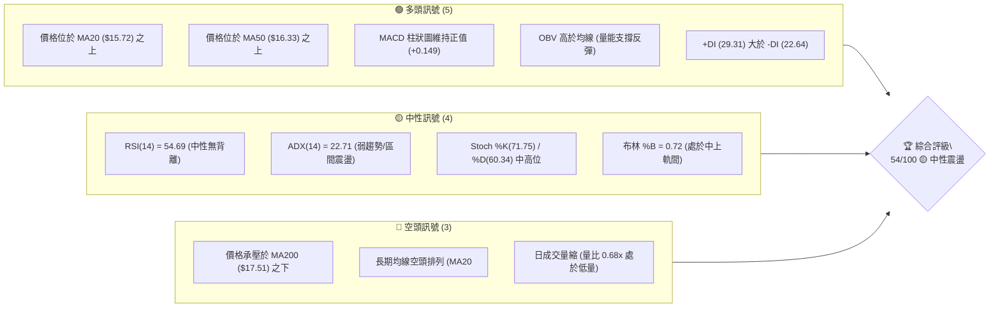
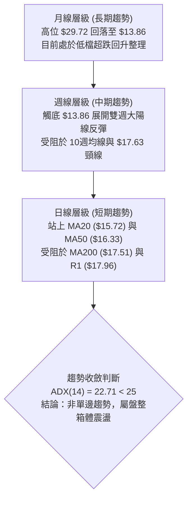
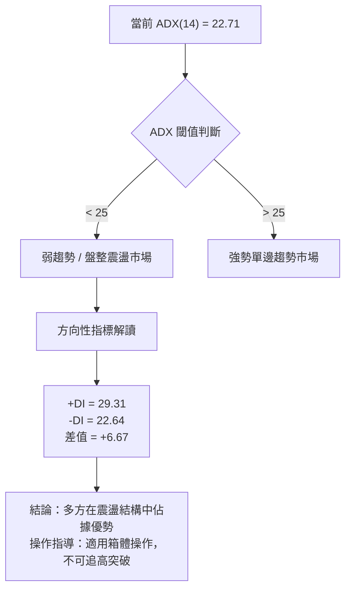
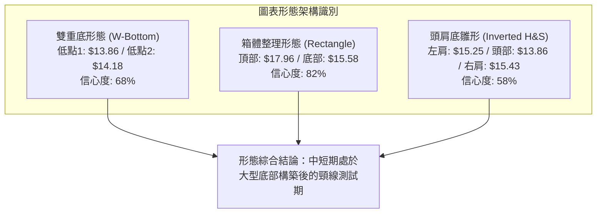
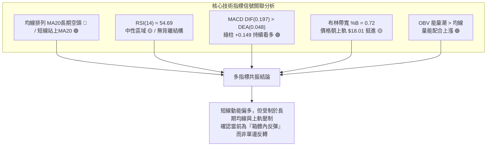
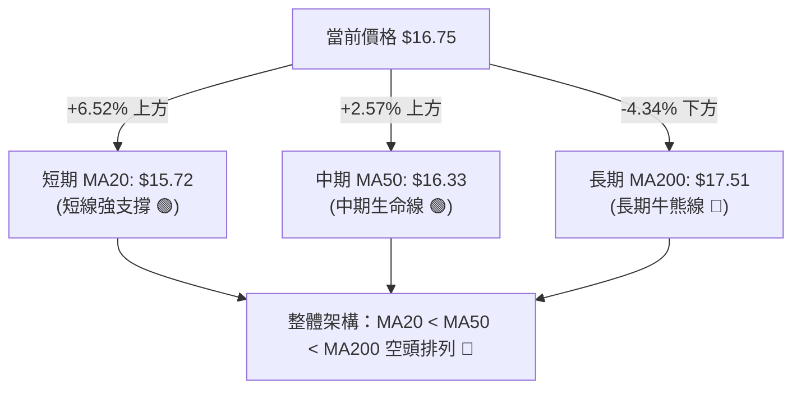
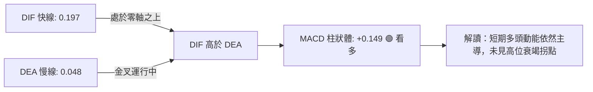
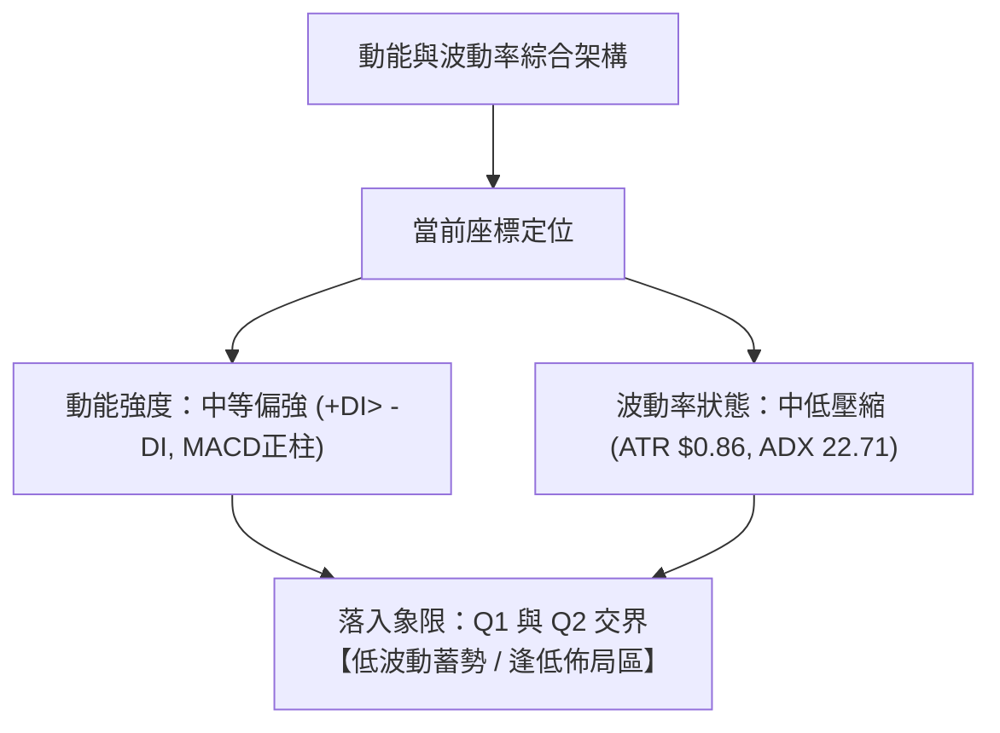
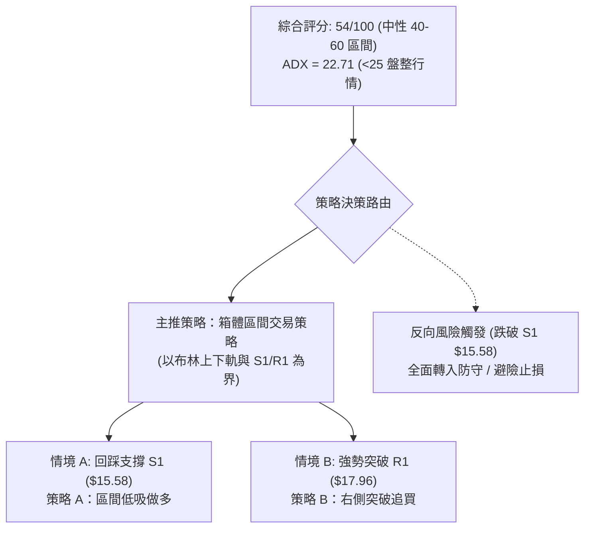
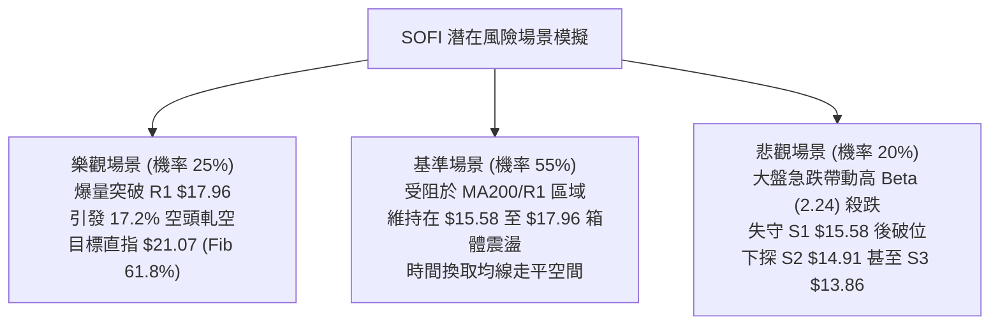

# SOFI 技術分析報告

> **報告日期**：2026-11-10 ｜ **語言**：繁體中文 ｜ **數據來源**：Yahoo Finance ｜ **當前價格**：$16.75

---

## 目錄

| 章節 | 內容 |
|------|------|
| [1. 技術面概覽](#1-技術面概覽) | 訊號儀表板、核心指標、評分卡 |
| [2. 趨勢分析](#2-趨勢分析) | 多時框趨勢、長中短期走勢、ADX 解讀 |
| [3. 圖表形態分析](#3-圖表形態分析) | 形態識別與信心度、K線組合、目標價推算 |
| [4. 支撐與阻力](#4-支撐與阻力) | 結構分布圖、波段聚類價位、斐波那契回調 |
| [5. 技術指標深度解讀](#5-技術指標深度解讀) | MA/RSI/MACD/布林通道/量價配合 |
| [6. 動能與波動率](#6-動能與波動率) | 動能四象限、ATR 波動率、Beta 市場相關性 |
| [7. 多時框架總結](#7-多時框架總結) | 時框矩陣、訊號一致性、多時框收斂結論 |
| [8. 交易策略建議](#8-交易策略建議) | 決策路由、情境階梯、主策略詳情、風報比 |
| [9. 風險提示與監控](#9-風險提示與監控) | 關鍵檢核清單、風險場景、部位管理 |
| [報告總結](#-報告總結) | 儀表板總結、多空關鍵點位與分析師目標 |

---

## 1. 技術面概覽

### 🎯 技術訊號儀表板



### 📊 核心指標速覽表

| 指標類別 | 指標名稱 | 當前數值 | 訊號 | 解讀 |
|:---|:---|:---|:---:|:---|
| **價格** | 當前收盤價 | $16.75 | 🟡 | 位於 52 週區間 ($13.86–$32.73) 的 15.3% 分位，低位築底回升 |
| **均線** | MA20 | $15.72 | 🟢 | 價格在 MA20 上方 +6.52%，短線回踩支撐有效 |
| **均線** | MA50 | $16.33 | 🟢 | 價格在 MA50 上方 +2.57%，突破中期均線壓力 |
| **均線** | MA200 | $17.51 | 🔴 | 價格在 MA200 下方 -4.34%，長期牛熊分界線構成強壓 |
| **均線系統**| 均線架構 | 空頭排列 | 🔴 | 結構為 MA20 < MA50 < MA200，長期趨勢修復需時 |
| **動能** | RSI(14) | 54.69 | 🟡 | 位於 50 中軸上方中性區間，無明顯超買或超賣 |
| **動能** | MACD(12,26,9)| DIF: 0.197 / DEA: 0.048 / 柱: +0.149 | 🟢 | DIF 高於 DEA，柱狀體維持綠柱擴張，短線動能偏多 |
| **動能** | KD指標 | %K: 71.75 / %D: 60.34 | 🟡 | KD 交叉向上後進入中高階區間，動能健康未達鈍化 |
| **趨勢** | ADX(14) | 22.71 (+DI: 29.31, -DI: 22.64) | 🟡 | ADX < 25 指標處於弱趨勢/盤整，但多頭佔據主導優勢 |
| **通道** | 布林通道 | 上軌 $18.01 / 中軌 $15.72 / 下軌 $13.43 | 🟡 | %B 為 0.72，短線朝上軌推進，接近通道上沿阻力 |
| **量能** | 當日成交量 | 40,423,800 (20日均量: 59,126,365) | 🔴 | 量比 0.68x，上漲反彈過程中呈現量縮整理特徵 |
| **量能** | OBV能量潮 | OBV > MA | 🟢 | 能量潮高於均線，資金並未於反彈中顯著撤退 |
| **波動** | ATR(14) | $0.86 (佔股價 5.11%) | 🟡 | 單日波幅約 $0.86，屬於典型成長型金融科技股波動率 |

### 🏆 技術評分卡

```
╔══════════════════════════════════════════════════════════════╗
║               技術評分卡 — SOFI (2026-11-10)                 ║
╠══════════════════════════════════════════════════════════════╣
║ 趨勢強度 (ADX=22.71, +DI> -DI)   █████████░░░░░░░░░░░  48/100 🟡 ║
║ 動能指標 (RSI 54.69, MACD正柱)   ████████████░░░░░░░░  62/100 🟢 ║
║ 支撐穩定度 (S1 $15.58 聚類強)    █████████████░░░░░░░  64/100 🟢 ║
║ 成交量配合 (量比 0.68x, OBV>MA)  ██████████░░░░░░░░░░  52/100 🟡 ║
║ 形態完整度 (波段築底挑戰頸線)    ███████████░░░░░░░░░  56/100 🟡 ║
║ 均線排列 (MA20<MA50<MA200空排)   ████████░░░░░░░░░░░░  42/100 🔴 ║
╠══════════════════════════════════════════════════════════════╣
║ 綜合評分 (六項算術平均)          ███████████░░░░░░░░░  54/100 🟡 ║
║ 評級結論：【區間震盪 / 逢低布局】 (中性 40–60 區間)           ║
╚══════════════════════════════════════════════════════════════╝
```

*註：綜合評分 = (48 + 62 + 64 + 52 + 56 + 42) ÷ 6 = 54.0分（四捨五入至整數 54 分，符合嚴格要求規則 18）。*

---

## 2. 趨勢分析

### 🌐 多時框趨勢分析



### 📈 長期趨勢 — 12個月走勢圖（Unicode）

以下為 SOFI 過去 12 個月（2025-11 至 2026-11）的月線收盤價走勢圖，標注歷史波段高低點與最新價格位置：

```
SOFI 月線走勢圖（過去12個月：2025-11 至 2026-11）
價格軸 ($)
$30.00 ┤ ● ($29.72 波段頂部)
$28.00 ┤
$26.00 ┤   ● ($26.18)
$24.00 ┤
$22.00 ┤     ● ($22.81)
$20.00 ┤
$18.00 ┤       ● ($17.76)         ● ($18.22)  ● ($17.93)    ● ($17.88)
$16.00 ┤         ● ($15.88) ● ($16.10)          ● ($16.31)    ● ($16.76) ●($16.75現價)
$14.00 ┤                                                    ● ($15.72)
$12.00 ┤                                              
       └─┬─────┬─────┬─────┬─────┬─────┬─────┬─────┬─────┬─────┬─────┬─────┬───
        11    12    01    02    03    04    05    06    07    08    09    10    11  (月份)
       2025  2025  2026  2026  2026  2026  2026  2026  2026  2026  2026  2026  2026
```

#### 長期走勢特徵分析表格

| 階段區間 | 時間跨度 | 起訖收盤價 | 區間漲跌幅 | 核心形態與技術特徵 |
|:---|:---:|:---:|:---:|:---|
| **第一階段：高位見頂回落** | 2025-11 至 2026-03 | $29.72 → $15.88 | -46.57% | 形成大型圓弧頂，月K連續收陰，跌破多條長期均線 |
| **第二階段：中期平台築底** | 2026-04 至 2026-08 | $16.10 → $17.88 | +11.06% | 圍繞 $16.00–$18.00 區間構建支撐平台，反覆回測震盪 |
| **第三階段：二次探底突圍** | 2026-09 至 2026-11 | $15.72 → $16.75 | +6.55% | 10月中旬跌出 52 週新低 $13.86 後強勢 V 型抽腳，月線站回 $16.75 |

### 📊 中期趨勢（週線分析）

從近 8 根週 K 線與近 20 週收盤走勢觀察：
- **波段極端低點**：在 2026-10-16 該週打出 52 週最低價 **$13.86**（收盤 $14.55），週成交量放大至 286,319,200 股，形成了極具辨識度的長下影線洗盤低點。
- **強力反彈攻勢**：2026-10-30 該週拉出爆量大陽線（開盤 $14.53，最高 $17.63，收盤 **$16.76**），單週成交量高達 416,302,500 股，週 MACD 柱狀體由負翻正至 +0.360，週 RSI 自 34.7 飆升至 57.0。
- **中期壓力帶驗證**：近兩週（11-06 與 11-09）高點分別達 $17.74 與 $17.04，均未能有效站上阻力位 R1（$17.96）與斐波那契 78.6% 回調位（$17.90），週線進入消化套牢籌碼的整理階段。

```
中期週線價格波段架構示意圖：
  $17.96 ───┬───────────────────────────────── R1 關鍵強阻力 / 密集套牢區
            │          ▲ 高點 $17.74 / $17.63
  $16.75 ───┼──────────● 目前現價區間 ($16.75) ──────────────────────────
            │          ▼ 震盪洗盤低點 $15.43
  $15.58 ───┼───────────────────────────────── S1 近期波段重要支撐
            │
  $13.86 ───┴───────────────────────────────── S3 / 52週極限低點 (底部夯實)
```

### ⚡ 趨勢強度評估（ADX 解讀）



#### ADX 趨勢強度對照表

| 指標變數 | 當前讀數 | 基準區間 | 技術含義 | 對應交易方針 |
|:---|:---:|:---:|:---|:---|
| **ADX(14)** | **22.71** | 0 – 25 | 處於無明顯單邊趨勢的盤整格局 | 禁止盲目追漲殺跌，以通道上下軌高拋低吸為主 |
| **+DI(14)** | **29.31** | 參考值 | 多頭進攻力量佔優 | 短線回踩支撐位具備反彈動能 |
| **-DI(14)** | **22.64** | 參考值 | 空方打壓力量暫時退潮 | 下行殺跌動能衰竭，深跌空間受限 |
| **DI 狀態** | **+DI > -DI** | 多頭領先 | 短期買方力量控制盤面 | 回調至下軌或支撐位偏向順勢作多 |

---

## 3. 圖表形態分析

### 🔍 形態識別系統



#### 形態識別與信心度評估表

| 形態名稱 | 信心度 | 判斷依據（引用數據） | 完成度 | 目標價（附嚴格計算式） |
|:---|:---:|:---|:---:|:---|
| **雙重底 (W底)** | **68%** | 2026-10-16 週低點 $13.86 與 2026-10-23 週低點 $14.18 構成雙底，隨後 10-30 週放量 416M 突破 | 75% | 頸線 $17.63 (10-30週高點) − 底部低點 $13.86 = 形態高度 $3.77；<br>目標價 = 頸線 $17.63 + $3.77 = **$21.40** (接近斐波那契 61.8% $21.07) |
| **箱體震盪** | **82%** | 價格反覆受阻於阻力 R1 $17.96，並於支撐 S1 $15.58 與 S2 $14.91 獲得明確買盤聚類 | 90% | 箱體高度 = R1 $17.96 − S1 $15.58 = $2.38；<br>向上突破目標 = R1 $17.96 + $2.38 = **$20.34** |
| **頭肩底雛形** | **58%** | 10-09 週低 $15.25 (左肩)，10-16 週低 $13.86 (頭部)，11-05 日低 $15.43 (右肩回踩) | 60% | 頸線取 10-29 日高點 $17.63；高度 = $17.63 − $13.86 = $3.77；<br>推算目標價 = $17.63 + $3.77 = **$21.40** |

### 🕯️ 重要 K 線形態分析

嚴格依據數據中「近10根日K」與「近8根週K」的實際 OHLC 價格進行形態解讀：

#### 近 10 根日 K 線形態解讀表

| 日期 | 開盤價 | 最高價 | 最低價 | 收盤價 | 成交量 | K線形態名稱 | 技術解讀 | 訊號 |
|:---|:---:|:---:|:---:|:---:|:---:|:---|:---|:---:|
| 2026-10-27 | $15.98 | $16.76 | $15.67 | $16.40 | 160,995,100 | 放量大陽線 | 底部啟動信號，放量長陽突破前期均線壓制 | 🟢 |
| 2026-10-28 | $16.56 | $17.25 | $16.56 | $17.14 | 82,318,800 | 光腳中陽線 | 開盤即為最低價，買方全日控盤，延續進攻 | 🟢 |
| 2026-10-29 | $16.92 | $17.63 | $16.87 | $17.61 | 65,396,000 | 強勢長實體陽線 | 創反彈新高 $17.63，逼近 R1 $17.96 阻力區 | 🟢 |
| 2026-10-30 | $17.07 | $17.32 | $16.44 | $16.76 | 64,306,100 | 衝高回落倒錘小陰線 | 高位獲利了結盤湧出，收於低位，預示短線震盪 | 🟡 |
| 2026-11-02 | $16.98 | $17.60 | $16.57 | $16.60 | 54,613,000 | 上影小陰線 | 二次測試 $17.60 未果，上檔拋壓明顯 | 🔴 |
| 2026-11-03 | $16.74 | $16.85 | $16.47 | $16.77 | 49,007,700 | 窄幅十字星 (Doji) | 多空力量趨於均衡，成交量持續萎縮，等待方向 | 🟡 |
| 2026-11-04 | $17.01 | $17.74 | $16.97 | $17.38 | 55,323,400 | 多頭進攻中陽線 | 再次上衝至 $17.74，展現買盤承接力道 | 🟢 |
| 2026-11-05 | $17.25 | $17.45 | $15.43 | $16.04 | 78,441,800 | 長下影巨幅震盪陰線 | 盤中下探 $15.43 獲強支撐後收回 $16.04，洗盤清洗浮額 | 🟡 |
| 2026-11-06 | $16.13 | $16.56 | $15.93 | $16.21 | 44,187,600 | 縮量企穩陽孕線 | 實體包含在昨日下影區間內，空方殺跌衰竭 | 🟢 |
| 2026-11-09 | $16.33 | $17.04 | $16.15 | $16.75 | 40,423,800 | 溫和放量光頭實體陽線 | 重新站回 $16.70 之上，確立 $15.43 支撐有效性 | 🟢 |

#### 近 8 根週 K 線形態解讀表

| 日期 (週末) | 開盤價 | 最高價 | 最低價 | 收盤價 | 成交量 | K線形態名稱 | 技術解讀 | 訊號 |
|:---|:---:|:---:|:---:|:---:|:---:|:---|:---|:---:|
| 2026-09-25 | $17.46 | $17.96 | $16.20 | $16.58 | 302,278,600 | 長上影中陰線 | 衝擊 R1 $17.96 受阻，形成波段重要阻力確認 | 🔴 |
| 2026-10-02 | $16.32 | $16.42 | $15.53 | $15.77 | 223,038,900 | 連續下跌小陰線 | 破位下行，考驗 S1 $15.58 支撐位 | 🔴 |
| 2026-10-09 | $15.77 | $16.19 | $15.25 | $15.80 | 199,427,700 | 下影小陽十字星 | 在 $15.25 尋求支撐，空方進攻動能趨緩 | 🟡 |
| 2026-10-16 | $15.47 | $15.68 | $13.86 | $14.55 | 286,319,200 | 長下影錘頭陰線 (Hammer)| 探底 52 週最低價 $13.86，爆量探底神針，買盤進駐 | 🟢 |
| 2026-10-23 | $14.75 | $15.11 | $14.18 | $14.61 | 198,524,200 | 築底整理小陽星 | 最低價 $14.18 未創新低，確認雙底右側低點 | 🟢 |
| 2026-10-30 | $14.53 | $17.63 | $14.40 | $16.76 | 416,302,500 | 爆量吞噬大陽線 | 4.16億股巨量拉升，完全吞噬前四週實體，底反確立 | 🟢 |
| 2026-11-06 | $16.98 | $17.74 | $15.43 | $16.21 | 281,573,500 | 長上下影高浪線 (High Wave)| 多空在 $15.43–$17.74 激烈交鋒，籌碼換手整理 | 🟡 |
| 2026-11-09 | $16.33 | $17.04 | $16.15 | $16.75 | 40,423,800 | 溫和走升陽線 | 週初延續回穩反彈走勢，力守 $16.50 平台 | 🟢 |

### 📉 ASCII 走勢形態示意圖

```
SOFI 日線級別雙底回升與箱體震盪示意圖：
$18.00 ┤              頸線阻力位 R1 $17.96 ─────────────────── (10-29/11-04高點聚類)
       │              ┌───┐       ┌───┐
$17.00 ┤              │   │   ▲   │   │   ● 現價 $16.75
       │              │   └───┼───┘   └───┼───────
$16.00 ┤      ┌───┐   │       │           │        支撐位 S1 $15.58 (11-05低點回踩)
       │      │   └───┘       │           └───────
$15.00 ┤  ┌───┘               ▼ 頸線回測支撐
       │  │
$14.00 ┤  ● 底部低點 1 ($13.86)   ● 底部低點 2 ($14.18)
       └─────────────────────────────────────────────────
         2026-10-16           2026-10-23          2026-11-09
```

### 🎯 形態目標價計算

根據雙重底與箱體形態之測量法則：
1. **雙重底測量幅度**：
   - 形態底部最低點：**$13.86**（2026-10-16 低點）
   - 形態頸線確認點：**$17.63**（2026-10-30 週高點）
   - 形態垂直高度 $H = \$17.63 - \$13.86 = \$3.77$
   - 向上突破目標價 = 頸線 $\$17.63 + H (\$3.77) = \mathbf{\$21.40}$（與斐波那契 61.8% 回調位 **$21.07** 形成強烈共振）。
2. **箱體震盪等幅測量**：
   - 當前震盪箱體下界取 S1：**$15.58**
   - 當前震盪箱體上界取 R1：**$17.96**
   - 箱體跨度 = $\$17.96 - \$15.58 = \$2.38$
   - 箱體向上破位延伸目標 = $\$17.96 + \$2.38 = \mathbf{\$20.34}$。

---

## 4. 支撐與阻力

### 🗺️ 關鍵價位分布圖（Unicode）

```
SOFI 價位結構分布圖（嚴格依據 OHLCV 計算聚類值）
═════════════════════════════════════════════════════════════════
$19.62 ║████████████████████████████████║ 強阻力 R3（波段極限超壓區）
$18.79 ║████████████████████            ║ 中期阻力 R2（7/8月震盪密集區）
$18.01 ║████████████████████████        ║ 布林上軌 / 斐波 78.6% ($17.90)
$17.96 ║████████████████████████████████║ 關鍵阻力 R1（近一年高點聚類）
$17.51 ║████████████                    ║ 熊牛分水嶺 MA200 均線位
───────╫────────────────────────────────╫────────────────────────────────
$16.75 ╠════════════════════════════════╣ ◄ 當前收盤價 ($16.75)
───────╫────────────────────────────────╫────────────────────────────────
$16.33 ║▓▓▓▓▓▓▓▓▓▓▓▓                    ║ 動態支撐 MA50
$15.72 ║▓▓▓▓▓▓▓▓▓▓▓▓▓▓▓▓                ║ 動態支撐 MA20 / 布林中軌
$15.58 ║▓▓▓▓▓▓▓▓▓▓▓▓▓▓▓▓▓▓▓▓▓▓▓▓        ║ 近期核心支撐 S1（波段低點聚類）
$14.91 ║████████████████████████        ║ 強支撐 S2（10月築底起漲中繼）
$13.86 ║████████████████████████████████║ 極限鐵底 S3 / 52週最低價 (100% Fib)
═════════════════════════════════════════════════════════════════
```

### 🚧 阻力位分析表

所有阻力價位嚴格引用自數據之「關鍵價位」與技術均線：

| 阻力級別 | 準確價位 | 距現價幅幅 | 形成原因與聚類分析 | 突破難度 | 重要性 |
|:---|:---:|:---:|:---|:---:|:---:|
| **動態阻力** | **$17.51** | +4.54% | **MA200 長期均線**，牛熊轉換關鍵分界點，空頭主要防守位 | 🟡 中等 | ★★★★☆ |
| **關鍵阻力 R1** | **$17.96** | +7.22% | **近一年波段高點聚類**、9-25週高點 $17.96、緊鄰布林上軌 $18.01 與斐波 78.6% ($17.90) | 🔴 極高 | ★★★★★ |
| **波段阻力 R2** | **$18.79** | +12.15% | **近一年波段次高點聚類**，2026年7-8月多個週末收盤價（如 7-10 收 $18.78、8-21 收 $18.91）密集成交區 | 🔴 偏高 | ★★★★☆ |
| **極限阻力 R3** | **$19.62** | +17.12% | **近一年波段高點聚類上限**，接近 MA240 ($19.13)，向上拓展之極限獲利了結區 | 🔴 極高 | ★★★☆☆ |

### 🛡️ 支撐位分析表

所有支撐價位嚴格引用自數據之「關鍵價位」與技術均線：

| 支撐級別 | 準確價位 | 距現價幅幅 | 形成原因與聚類分析 | 守住機率 | 重要性 |
|:---|:---:|:---:|:---|:---:|:---:|
| **短期動態** | **$16.33** | -2.51% | **MA50 均線**，近 10 日內多次回踩企穩線 | 🟢 75% | ★★★☆☆ |
| **核心支撐 S1** | **$15.58** | -7.01% | **近一年波段低點聚類**、11-05日長下影線低點 $15.43、緊鄰 MA20 ($15.72) 與布林中軌 | 🟢 80% | ★★★★★ |
| **強支撐 S2** | **$14.91** | -10.99% | **近一年波段低點聚類**，10-23 週收盤 $14.61 與 10-30 週起漲跳空缺口支撐區 | 🟢 85% | ★★★★☆ |
| **極限鐵底 S3** | **$13.86** | -17.25% | **52 週最低價**（10-16 週低點）、斐波那契 100.0% 回調位，年內最強價值底部 | 🟢 95% | ★★★★★ |

### 📐 斐波那契回調位分析

依據 52 週波動區間：**最高價 $32.73 → 最低價 $13.86**（落差 $18.87），斐波那契關鍵回調位精確分布如下：

| 斐波那契比例 | 精確對應價位 | 距現價距離 | 技術含義與當前狀態解讀 |
|:---:|:---:|:---:|:---|
| **0.0% (52W High)** | **$32.73** | +95.40% | 52 週歷史頂部（2025年高點區域） |
| **23.6%** | **$28.28** | +68.84% | 超長線深幅反彈阻力位 |
| **38.2%** | **$25.52** | +52.36% | 長期多空分水嶺，熊市反彈黃金分割阻力 |
| **50.0%** | **$23.29** | +39.04% | 中期波段平衡點 |
| **61.8%** | **$21.07** | +25.79% | 黃金分割強阻力，雙重底形態理論目標位 ($21.40) 共振區 |
| **78.6%** | **$17.90** | +6.87% | **短線最關鍵阻力位**，與 R1 ($17.96) 高度重合 |
| **當前現價** | **$16.75** | **0.00%** | **現價落於 78.6% ($17.90) 與 100.0% ($13.86) 之間** |
| **100.0% (52W Low)**| **$13.86** | -17.25% | 52 週歷史最低點，本輪反彈之發起原點 |

**解讀**：現價 $16.75 處於極深度的折價回調區（78.6% 至 100.0% 之間）。78.6% 回調位 **$17.90** 與聚類阻力 R1 **$17.96** 形成了雙重重疊阻力帶，若能有效放量突破 $17.90–$17.96，上方空間將被打開，直接邁向 61.8%（**$21.07**）。

---

## 5. 技術指標深度解讀

### 🎛️ 指標訊號總覽



### 📈 移動平均線排列分析



#### 移動平均線數據詳解表

| 均線名稱 | 數值 | 價格相對於均線 | 均線斜率與走勢特徵 | 技術含義 |
|:---|:---:|:---:|:---|:---|
| **MA 5** | $16.63 | +0.72% ▲ | 短線向上調頭（走勢呈低位抬升） | 超短期買盤進場，短多格局 |
| **MA 10** | $16.77 | -0.10% ▼ | 走平微跌，與現價基本重合 | 短線多空交戰，面臨抉擇 |
| **MA 20** | $15.72 | +6.52% ▲ | 底部強勁反折向上 | 構成布林中軌，短線第一道核心支撐 |
| **MA 50** | $16.33 | +2.57% ▲ | 由下行轉為走平上翹 | 中期趨勢止跌，提供防守墊 |
| **MA 60** | $16.68 | +0.41% ▲ | 走平向上 | 季線位置獲得初步收復 |
| **MA 120** | $17.02 | -1.60% ▼ | 持續向下緩跌 | 半年線壓制，需放量才能逾越 |
| **MA 200** | $17.51 | -4.34% ▼ | 穩步下行中 | 長期下降趨勢壓制線，牛熊關鍵分界點 |
| **MA 240** | $19.13 | -12.43% ▼ | 長期下傾 | 年線重壓區，多頭遠期目標 |

### 📉 RSI(14) 分析

- **當前讀數**：**54.69**（Wilder 計算法）。
- **進度條展示**：
  `RSI(14): 54.69 [███████████░░░░░░░░░] 54.7% (中性平衡區)`
- **超買超賣區間判斷**：RSI 位於 30–70 的常態波動區間，未觸及 70 超買警戒線，亦脫離了 10 月中旬 30 附近的超賣區域，顯示反彈動能健康，無立即力竭風險。
- **背離分析結論**：嚴格比對近 20 根 K 棒的首尾價格與 RSI 指標，**無明顯頂背離或底背離**。價格走高同時 RSI 溫和抬升，指標忠實反映價格上揚過程，確認走勢為常態量價波動。

### 📊 MACD(12,26,9) 訊號解讀



- **MACD 數值**：DIF = **0.197**，DEA = **0.048**，Histogram = **+0.149**。
- **信號解讀**：MACD 自 10 月底金叉以來，雙線已成功攀升至零軸上方，柱狀體維持在正值區（+0.149），表明日線級別多頭動能佔據主導優勢。
- **背離判斷**：從 10-29 的 $17.61 至 11-04 的 $17.38，MACD 柱狀體由高位收斂後維持穩定，並未形成高位雙峰死叉之頂背離，多頭動能架構完整。

### 📦 布林通道分析

```
SOFI 布林通道結構圖（收盤價 $16.75）：
$18.01 ┬────────────────────────────────────────── BB 上軌 (阻力帶)
       │                 ▲ 觸及上軌受阻 ($17.74)
$16.75 ┼─────────────────● 現價位處中上軌區 (%B = 0.72)
       │
$15.72 ┼────────────────────────────────────────── BB 中軌 / MA20 (核心回踩支撐)
       │
$13.43 ┴────────────────────────────────────────── BB 下軌 (極端低位支撐)
```

- **軌道參數**：上軌 **$18.01**，中軌（MA20）**$15.72**，下軌 **$13.43**。
- **帶寬與位置**：當前通道 %B 為 **0.72**，表明價格處於布林中軌（$15.72）與上軌（$18.01）之間的強勢區間。
- **軌道運行邏輯**：布林通道上下軌開口正在逐步縮小收斂，表明市場正在由前期的暴漲暴跌轉入箱體壓縮震盪，上軌 $18.01 恰與阻力 R1 $17.96 形成共振壓制。

### 💹 成交量分析（量價配合度）

- **量能數值對比**：最新單日成交量為 **40,423,800** 股，相較於 20 日均量（59,126,365 股）之量比僅為 **0.68x**，相較於 50 日均量（49,729,898 股）亦呈萎縮。
- **量價背離檢驗**：在股價自 $16.04 反彈至 $16.75 的過程中成交量連續萎縮（11-05 的 78M → 11-06 的 44M → 11-09 的 40M），呈現「價漲量縮」之短線量價背離徵兆。
- **OBV 能量潮解讀**：數據顯示「OBV > MA → 量能支撐上漲」，說明從大週期（週線級別）來看，10-30 該週 4.16 億股的巨量沉澱在底部，主力資金並未大規模出逃，當前日線量縮屬洗盤惜售格局。

---

## 6. 動能與波動率

### ⚡ 動能評估四象限



#### 動能與波動率四象限對照表

| 象限 | 動能強度 | 波動率狀態 | 市場環境與特徵 | 當前狀態評估 |
|:---:|:---:|:---:|:---|:---:|
| **Q1** | **強** | **低** | 穩定上行趨勢，拉升順暢，籌碼鎖定 | 接近此狀態（動能修復中，波動壓縮） |
| **Q2** | **弱** | **低** | **箱體沉悶盤整，成交萎縮，缺乏方向** | **✓ 當前主要處於此區間（謹慎區間操作）** |
| **Q3** | **強** | **高** | 爆發性突破或急跌，高風險高回報 | 10月底曾出現（單週 4.16億量拉升） |
| **Q4** | **弱** | **高** | 無序寬幅劇震，容易雙向侵蝕本金 | 應避免盲目開倉之危險區域 |

### 📊 ATR 波動率分析

- **ATR(14) 讀數**：**$0.86**（佔當前股價 $16.75 的 **5.11%**）。
- **波動特性解讀**：每日平均波幅達 5% 以上，顯示 SOFI 具備高彈性與高 Beta 的金融科技成長股特徵。
- **止損距離建議**：
  - **保守型交易者（波段）**：建議給予 $2.0 \times \text{ATR} = \$0.86 \times 2.0 = \mathbf{\$1.72}$ 的緩衝空間。
  - **積極型交易者（短線）**：建議給予 $1.0 \times \text{ATR} = \mathbf{\$0.86}$ 的止損空間，或直接以結構支撐位 S1（$15.58，距現價 $1.17，約 $1.36 \times \text{ATR}$）作為硬止損。

### 📐 Beta 與市場相關性

- **Beta 係數**：**2.241**。
- **市場敏感度**：SOFI 的波動幅度約為標普 500 指數的 2.24 倍。當大盤指數上漲 1% 時，理論上 SOFI 平均反彈約 2.24%；反之，大盤回調 1% 時，SOFI 承受約 2.24% 的下行壓力。
- **放空比率 (Short % Float)**：高達 **17.2%**（Short Ratio 4.44 天），顯示市場空頭部位龐大。在高 Beta 與高空頭部位疊加下，一旦價格放量突破 R1（$17.96），極易誘發軋空（Short Squeeze）行情。

---

## 7. 多時框架總結

### 📋 時框架評分表

| 時框架 | 趨勢方向 | 動能狀態 | 均線排列狀況 | 圖表形態 | 綜合評分 | 交易建議 |
|:---|:---:|:---:|:---|:---|:---:|:---|
| **長期 (月線)** | 🔴 下行修復 | 🟡 中性平淡 | 均線系統呈空頭壓制 | 高位深幅回檔後低位十字星 | 45/100 | 長期籌碼仍待消化，宜定期定額或耐心等待結構修復 |
| **中期 (週線)** | 🟡 震盪築底 | 🟢 金叉上揚 | 價格受阻於 10 週線，站上 5 週線 | 雙重底雛形，放量大陽後高浪線整理 | 58/100 | 箱體震盪思路，逢回調支撐布局，接近阻力不追 |
| **短期 (日線)** | 🟢 短多整理 | 🟢 MACD多頭 | 站上 MA20/MA50，受制於 MA200 | 箱體區間內回踩企穩，測試箱頂 | 59/100 | 短線依托 MA20 ($15.72) 順勢做多，目標看向 R1 ($17.96) |

### 🔲 綜合訊號矩陣

```
時框架訊號交叉驗證矩陣：
┌──────────────┬──────────────┬──────────────┬──────────────┐
│  時框維度    │  均線信號    │  動能信號    │  量能配合    │
├──────────────┼──────────────┼──────────────┼──────────────┤
│  長期 (月線) │  🔴 空頭壓制 │  🟡 中性偏弱 │  🟡 換手平緩 │
│  中期 (週線) │  🟡 震盪過渡 │  🟢 MACD翻紅 │  🟢 爆量築底 │
│  短期 (日線) │  🟢 站上中軌 │  🟢 柱體擴張 │  🔴 縮量反彈 │
└──────────────┴──────────────┴──────────────┴──────────────┘
一致性分析：長中短週期呈現「短多、中震、長空」的典型底部過渡結構。
```

### ⚖️ 多時框收斂結論

**嚴格依據規則 14 之多時框收斂原則執行**：
1. **行情性質判定**：當前 ADX(14) 為 **22.71**（嚴格小於 25），根據規則，當前市場確立為**盤整行情（Rangebound Market）**，而非單邊趨勢行情。
2. **主導時框與交易邊界**：在盤整行情下，**以日線布林通道上下軌（$13.43 – $18.01）與波段關鍵聚類價位（S1 $15.58 至 R1 $17.96）為主要交易區間**。
3. **矛盾取捨與收斂唯一方向**：
   - 儘管長期均線呈現空頭排列（MA20 < MA50 < MA200），但週線已於 $13.86 構築具備 4.16 億股支撐的底部，且日線 MACD 翻多、價格守於 MA20 之上。
   - 結論收斂為唯一方向：**【中性偏多之箱體震盪操作（偏向逢低做多）】**。禁止在現價盲目追高，所有交易均應圍繞區間下界支撐逢低吸納，於區間上界阻力嚴格獲利了結。

---

## 8. 交易策略建議

### 🗺️ 策略決策流程圖



### 🧭 策略路由（依評分卡分流）

> **當前主策略方向 = 【區間操作 / 等待突破確認】（依評分 54/100）**
> 
> 依據嚴格規定，評分落於 40–60 之間，確立為區間震盪策略，以布林通道上下軌與結構價位為主，明確標注等待突破確認，絕不兩頭模糊下注。

### 🎯 價格情境階梯（Price Scenarios）

所有價位嚴格引用自第 4 章波段聚類計算值：

| 觸發條件 | 下一目標 | 後續延伸 | 情境含義 | 操作指引 |
|:---|:---:|:---:|:---|:---|
| **強勢突破 R1 $17.96** | **R2 $18.79** | **R3 $19.62** | 短線轉強，軋空動能爆發 | 突破確認後順勢追多，看至 R2/R3 |
| **站穩現價區間 $16.75** | **R1 $17.96** | **MA200 $17.51** | 區間震盪，多方緩步盤堅 | 高拋低吸，維持波段底倉 |
| **有效跌破 S1 $15.58** | **S2 $14.91** | **S3 $13.86** | 中期轉弱，多頭防線失守 | 多頭全數止損離場，空手觀望 |

### 📊 情境機率分佈

| 價格運行情境 | 預估機率 | 主要技術依據 |
|:---|:---:|:---|
| **情境一：延續箱體震盪向上摸頂** | **55%** | MACD 綠柱持續 (+0.149)、+DI (29.31) > -DI (22.64)、OBV 能量潮高於均線支撐價格。 |
| **情境二：窄幅橫盤整理消化均線** | **30%** | ADX 僅 22.71 (<25 弱趨勢)、日線量比 0.68x 量能不足、MA200 ($17.51) 構成沉重反壓。 |
| **情境三：跌破支撐二次探底** | **15%** | 均線長期仍呈空頭排列 (MA20<MA50<MA200)，若大盤破位可能回測 S2 ($14.91) 或 S3 ($13.86)。 |

### 🟢 主策略詳情

嚴格依據規則 17 之風險報酬比計算公式：
$$\text{風險報酬比} = \frac{\text{目標價 T1} - \text{進場價}}{\text{進場價} - \text{止損價}}$$

| 策略要素 | 策略 A（區間低吸 / 回踩波段做多） | 策略 B（右側確認 / 突破追買做多） |
|:---|:---|:---|
| **適用場景** | 股價回踩核心支撐 S1 / 布林中軌企穩 | 股價帶量突破關鍵阻力 R1 與布林上軌 |
| **進場條件** | 回踩 S1 不破且日 K 出現下影企穩陽線 | 日 K 收盤價實體突破 R1 且成交量 > 50MA 均量 |
| **進場價格** | **$15.58**（引用 S1 支撐位） | **$17.96**（引用 R1 阻力位） |
| **目標價 T1** | **$17.96**（引用 R1 阻力位） | **$18.79**（引用 R2 阻力位） |
| **目標價 T2** | **$18.79**（引用 R2 阻力位） | **$19.62**（引用 R3 阻力位） |
| **止損價格** | **$14.91**（引用 S2 強支撐位） | **$16.75**（引用當前突破前收盤價） |
| **風險報酬比 (T1)** | **1 : 3.55（以 T1 計）**<br>計算式：$(17.96 - 15.58) \div (15.58 - 14.91) = 2.38 \div 0.67$ | **1 : 0.69（以 T1 計）**<br>計算式：$(18.79 - 17.96) \div (17.96 - 16.75) = 0.83 \div 1.21$ |
| **風險報酬比 (T2)** | **1 : 4.79（以 T2 計）**<br>計算式：$(18.79 - 15.58) \div (15.58 - 14.91) = 3.21 \div 0.67$ | **1 : 1.37（以 T2 計）**<br>計算式：$(19.62 - 17.96) \div (17.96 - 16.75) = 1.66 \div 1.21$ |
| **預估勝率** | **65%** | **52%** |
| **建議總倉位** | **15% – 20%**（分批掛單） | **10%**（突破確認後輕倉順勢） |

### 🔴 反向風險觸發點（對沖提示）

- **關鍵反轉點**：若日線收盤價跌破 **$15.58 (S1)**，說明本輪由 10 月底發起的反彈宣告結束，形態轉為弱勢破位。
- **風控處置**：跌破 $15.58 應立即解除所有多頭持倉；若持股較深，可在反彈至 MA20 ($15.72) 附近買入認沽期權（Put Option）或放空相應股數以對沖下行至 S2 ($14.91) 與 S3 ($13.86) 的下跌風險。

### ⭐ 整體訊號強度評星

```
做多訊號強度：★★★☆☆  (3.0/5星) ── 底部動能強，但面臨 MA200 重壓
做空訊號強度：★★☆☆☆  (2.0/5星) ── 空方殺跌力道衰竭，做空盈虧比差
整體分析可信度：★★★★☆  (4.0/5星) ── 數據聚類顯著，多指標指向一致
```

---

## 9. 風險提示與監控

### ✅ 關鍵監控指標 Checklist

```
╔══════════════════════════════════════════════════════════════╗
║               每日/每週交易監控檢核清單 (Checklist)           ║
╠══════════════════════════════════════════════════════════════╣
║ [ ] 價格能否站穩 MA50 ($16.33) 與 MA20 ($15.72) 之上？       ║
║ [ ] 向上衝擊 R1 ($17.96) 時，單日成交量是否超過 6000 萬股？  ║
║ [ ] RSI(14) 是否突破 60 關卡或在 70 附近出現頂背離？         ║
║ [ ] MACD 柱狀體能否維持正值擴張，還是出現雙線向下死叉？      ║
║ [ ] ADX(14) 是否由 22.71 向上突破 25，確認單邊趨勢成型？     ║
║ [ ] 放空比率 (17.2%) 是否引發借券費率異動與軋空現象？        ║
║ [ ] 跌破 S1 ($15.58) 時是否觸發止損風控紀律？                ║
╚══════════════════════════════════════════════════════════════╝
```

### ⚠️ 風險場景分析



### 🛡️ 風險管理重要提醒

1. **高 Beta 波動風險控制**：SOFI Beta 高達 **2.241**，其單日波幅劇烈（ATR 達 $0.86，佔股價 5.11%）。交易者嚴禁使用過高槓桿，單筆交易的最大虧損金額務必控制在總投資組合淨值的 **1.0% – 1.5%** 以內。
2. **財報與基本面催化劑風險**：公司自由現金流（FCF TTM）為負數（$-10.55B），雖然最新季度營收年增 43.9%、淨利潤年增 72.9%，但估值與資金流向對利率環境高度敏感。需緊密關注聯準會貨幣政策動向對金融信貸業務板塊的衝擊。
3. **嚴守止損紀律**：在震盪行情中，切忌將「短線交易做成長期被動套牢」。一旦價格有效跌破設定止損線（策略 A 止損 $14.91），必須無條件停損離場，保留本金等待下一個高勝率週期。

---

## 📋 報告總結

```
╔══════════════════════════════════════════════════════════════════╗
║                    SOFI 技術分析報告總結                         ║
╠══════════════════════════════════════════════════════════════════╣
║ 報告日期：2026-11-10           當前收盤價：$16.75                ║
║ 綜合技術評分：54 / 100         綜合分析評級：🟡 持有 / 區間震盪   ║
╠══════════════════════════════════════════════════════════════════╣
║ 關鍵技術維度結論：                                               ║
║ ├─ 長期趨勢 (月線)：🔴 下行修復中，均線呈空頭排列，基期低        ║
║ ├─ 中期趨勢 (週線)：🟡 雙底構築完成 ($13.86)，正消化 $17.74 阻力  ║
║ ├─ 短期趨勢 (日線)：🟢 站上 MA20/MA50，受制於 MA200 ($17.51)     ║
║ ├─ 趨勢強度 (ADX) ：🟡 ADX=22.71 < 25，確認當前為標準箱體震盪     ║
║ ├─ 關鍵阻力位聚類：R1: $17.96 ｜ R2: $18.79 ｜ R3: $19.62        ║
║ ├─ 關鍵支撐位聚類：S1: $15.58 ｜ S2: $14.91 ｜ S3: $13.86        ║
║ └─ 華爾街共識目標：平均目標價 $20.84 (最高 $30.00 / 最低 $12.00) ║
╠══════════════════════════════════════════════════════════════════╣
║ 最優策略指引：                                                   ║
║ 1. 🥇 最佳機會：策略 A (區間低吸做多)                            ║
║    進場點 $15.58 ｜ 止損點 $14.91 ｜ 目標價 T1 $17.96           ║
║    風險報酬比 1 : 3.55 (以 T1 計) ｜ 預估勝率 65%                ║
║ 2. 🥈 次選機會：策略 B (帶量突破追買)                            ║
║    進場點 $17.96 ｜ 止損點 $16.75 ｜ 目標價 T1 $18.79           ║
║    風險報酬比 1 : 0.69 (以 T1 計) ｜ 預估勝率 52%                ║
║ 3. 🥉 保守選擇：維持 40–50% 現金部位，待突破 $17.96 或回踩 $15.58║
╚══════════════════════════════════════════════════════════════════╝
```

---

> ⚠️ **免責聲明**：本報告為技術分析專題研究報告，所有數據指標與價位計算均嚴格基於歷史交易資訊。本報告**僅供研究與學術參考**，**不構成任何個人化之投資建議、推介或要約**。金融市場投資具備極高風險，讀者在進行任何資產配置或交易決策前，應獨立審慎評估自身之財務狀況與風險承受能力。

---

*報告生成時間：2026-11-10 ｜ 數據來源：Yahoo Finance ｜ 分析框架：資深多時框量化技術分析*