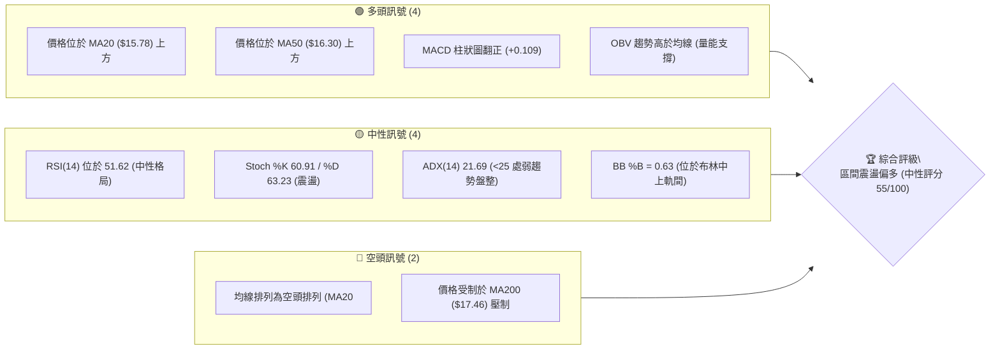
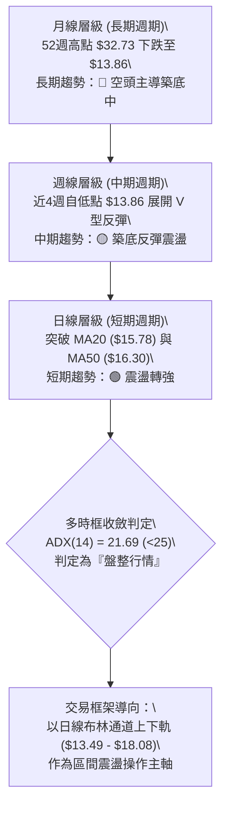
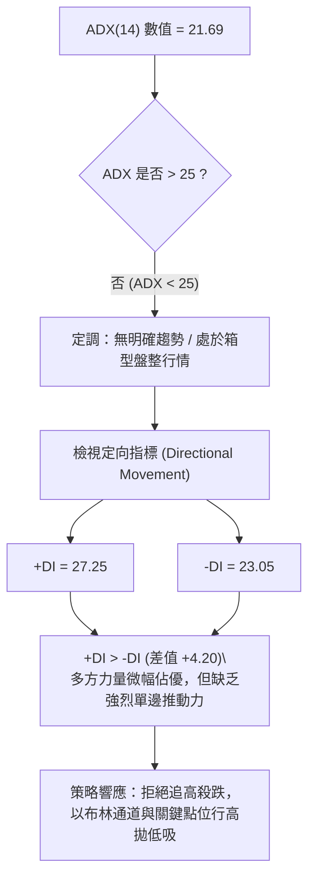
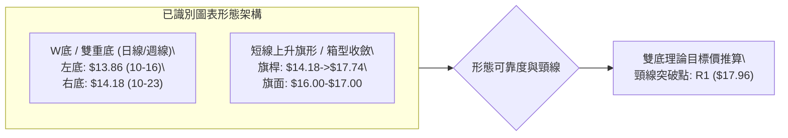
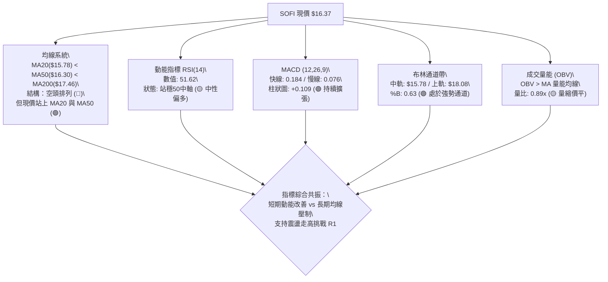
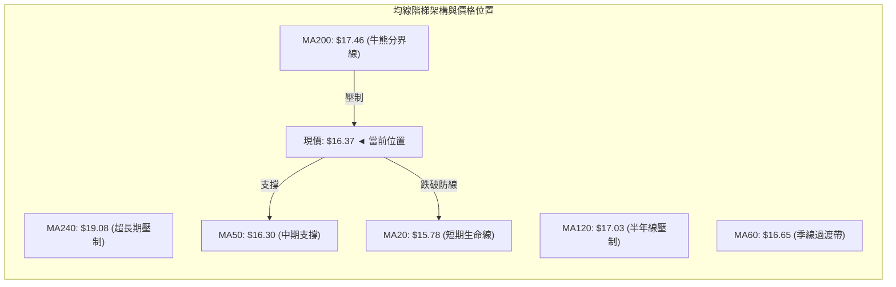
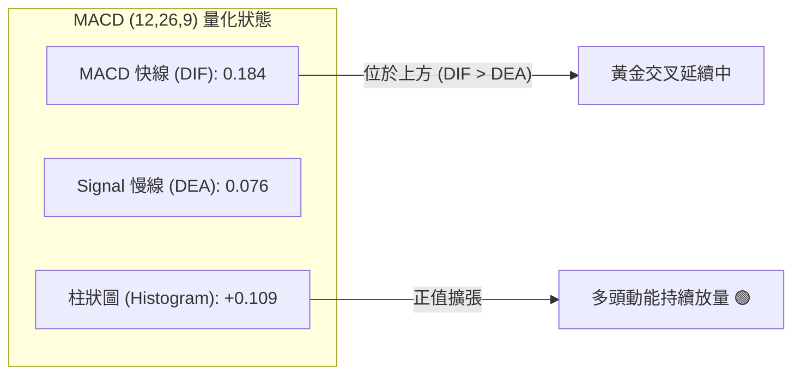
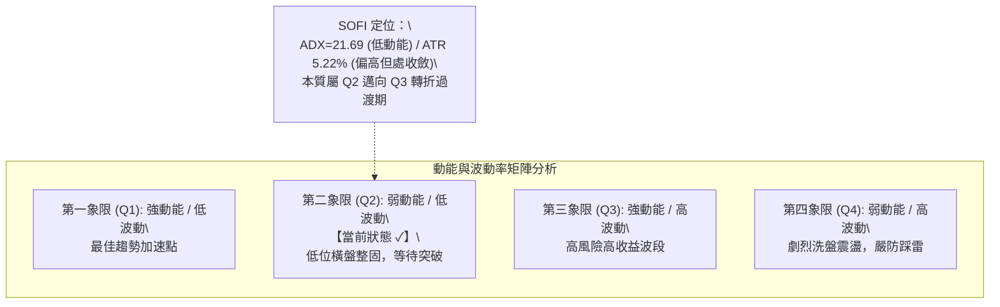
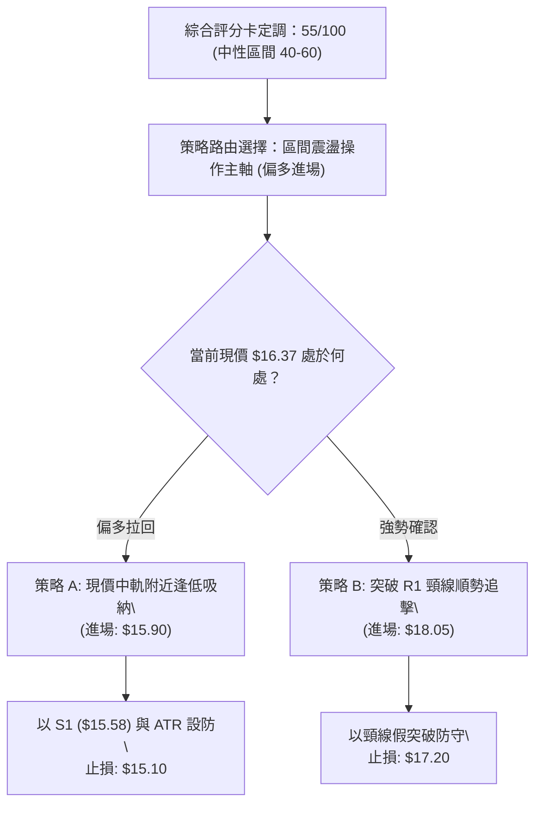
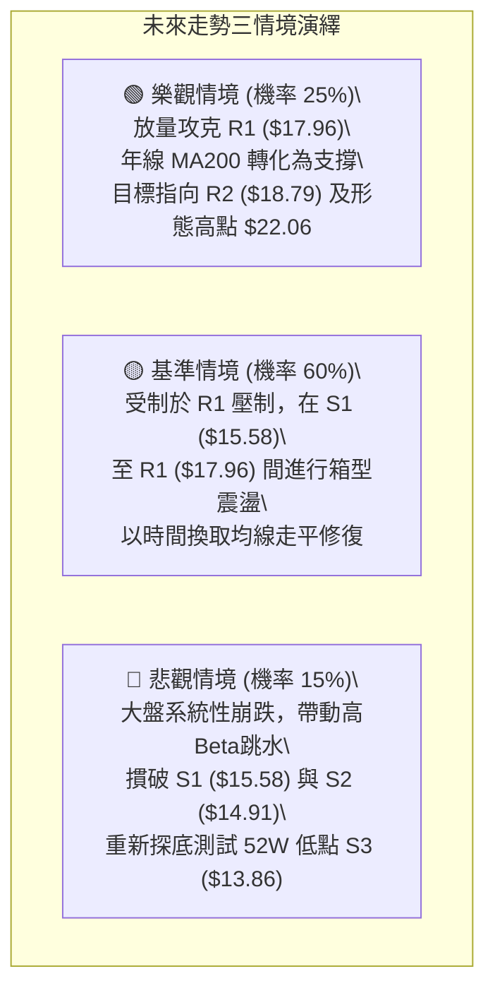

# SOFI 技術分析報告

> **報告日期**：2026-11-11 ｜ **語言**：繁體中文 ｜ **數據來源**：Yahoo Finance ｜ **當前價格**：$16.37

---

## 目錄

| 章節 | 內容 |
|------|------|
| [1. 技術面概覽](#1-技術面概覽) | 訊號儀表板、核心指標、評分卡 |
| [2. 趨勢分析](#2-趨勢分析) | 多時框趨勢、長中短期走勢、ADX強度 |
| [3. 圖表形態分析](#3-圖表形態分析) | 形態識別、K線組合、目標價推算 |
| [4. 支撐與阻力](#4-支撐與阻力) | 關鍵價位結構、斐波那契回調深度解讀 |
| [5. 技術指標深度解讀](#5-技術指標深度解讀) | 均線系統、RSI、MACD、布林通道、OBV與成交量 |
| [6. 動能與波動率](#6-動能與波動率) | 動能四象限、ATR風控距離、高Beta特性 |
| [7. 多時框架總結](#7-多時框架總結) | 時框架評分矩陣、多時框收斂定調 |
| [8. 交易策略建議](#8-交易策略建議) | 策略路由、主策略規劃、精確風險報酬比 |
| [9. 風險提示與監控](#9-風險提示與監控) | 監控Checklist、三情境演繹、資金管理 |
| [📋 報告總結](#-報告總結) | 核心指標精華摘要卡與執行清單 |

---

## 1. 技術面概覽

### 🎯 技術訊號儀表板



### 📊 核心指標速覽表

| 指標類別 | 指標名稱 | 當前數值 | 訊號 | 解讀 |
|----------|----------|----------|------|------|
| **價格** | 當前收盤價 | $16.37 | 🟡 | 位於52週區間($13.86-$32.73)之13.3%低位分位，超跌後築底震盪 |
| **均線** | MA20 | $15.78 | 🟢 | 現價高於MA20達+3.74%，短線獲月線動能支撐 |
| **均線** | MA50 | $16.30 | 🟢 | 現價剛收復季線(+0.43%)，短多動能嘗試扭轉中期劣勢 |
| **均線** | MA200 | $17.46 | 🔴 | 現價低於年線-6.24%，長期下行趨勢壓制尚未解除 |
| **動能** | RSI(14) | 51.62 | 🟡 | 處於50中軸上方邊緣，無超買超賣，中性平衡狀態 |
| **動能** | MACD (12,26,9) | 0.184 / 0.076 | 🟢 | 快線位於慢線上方，柱狀圖+0.109持續看多擴張 |
| **趨勢強度**| ADX(14) | 21.69 | 🟡 | 數值低於25臨界值，屬低動能盤整市，+DI(27.25) > -DI(23.05) |
| **通道指標**| 布林通道帶寬 | $13.49 - $18.08 | 🟡 | %B為0.63，現價運行於中軌($15.78)至上軌($18.08)之擴張區間 |
| **波動** | ATR(14) | $0.85 | 🔴 | 日波幅佔股價5.22%，高波動特徵，需擴大止損緩衝 |
| **量能** | 最新成交量 / 20日均量 | 53.59M / 60.26M | 🟡 | 量比0.89x，量能稍嫌不足，但OBV處於均線之上顯示承接盤猶存 |

### 🏆 技術評分卡

```
技術評分卡 — SOFI (2026-11-11)
════════════════════════════════════════════════════
趨勢強度      ████████░░░░░░░░░░░░  40/100  🔴 ADX=21.69 處無趨勢盤整
動能指標      ████████████░░░░░░░░  60/100  🟢 MACD翻紅，RSI站穩50之上
支撐穩定度    ██████████████░░░░░░  70/100  🟢 S1($15.58)與S3($13.86)低檔強韌
成交量配合    ████████████░░░░░░░░  60/100  🟡 OBV>MA看多，但近兩日量能微幅萎縮
形態完整度    ████████████░░░░░░░░  60/100  🟡 雙重底雛形浮現，頸線尚未突破
均線排列      ████████░░░░░░░░░░░░  40/100  🔴 空頭排列(MA20<MA50<MA200)尚未扭轉
════════════════════════════════════════════════════
綜合評分      ███████████░░░░░░░░░  55/100  中性偏多震盪 (六項算術平均四捨五入)
════════════════════════════════════════════════════
```

---

## 2. 趨勢分析

### 🌐 多時框趨勢分析



### 📈 長期趨勢 — 12個月走勢圖（Unicode）

```
SOFI 月線走勢圖（過去12個月：2025-12 至 2026-11）
價格軸 ($)
$30.00 ┤                                                
$28.00 ┤                                                
$26.00 ┤ [26.18]●                                       
$24.00 ┤        \                                       
$22.00 ┤         ●[22.81]                               
$20.00 ┤                 \                              
$18.00 ┤                  ●[17.76]       ●[18.22] ●[17.88]
$16.00 ┤                          \●---●/       \●        \●[16.76] ◄現價 $16.37
$14.00 ┤                           [15.88][16.10]         [15.72] (10月破底翻)
$12.00 ┤                                                
       └────────────────────────────────────────────────────────
       月份: 25-12  26-01  26-02  26-03  26-04  26-05  26-06  26-07  26-08  26-09  26-10  26-11
```

#### 長期走勢特徵分析表格

| 階段區間 | 起始-結束收盤價 | 漲跌幅 | 走勢特徵描述 |
|----------|-----------------|--------|--------------|
| **2025-11 高點築頂** | $29.72 → $26.18 | -11.91% | 自波段歷史高點反轉，成交量開始顯現機構獲利了結跡象 |
| **2026-01 至 2026-03 主跌段** | $22.81 → $15.88 | -30.38% | 加速下挫，連續失守多條長期均線，空頭動能極強 |
| **2026-04 至 2026-08 平台震盪** | $16.10 → $17.88 | +11.06% | 於 $16.00-$18.50 構築第一次箱型整理平台，均線走平糾結 |
| **2026-09 至 2026-10 二次測底** | $15.72 → $14.55(最低$13.86) | -11.83% | 破位下殺創下52週新低點 $13.86，隨即引發爆量長下影線破底翻 |
| **2026-11 當前走勢** | $16.76 → $16.37 | -2.33% | 破底翻後強勢反彈站回 $16.00，目前處於消化獲利賣壓的中繼整理 |

### 📊 中期趨勢（週線分析）

```
週線級別阻力與支撐分佈示意圖：
[阻力 R2] $18.79  ════════════════════════════════ (近一年多次上攻反轉點)
[阻力 R1] $17.96  ──────────────────────────────── (2026-09-25 週高點 / 年線壓制區)
                   ▲ 現價 $16.37 處於反彈中軸位置
[支撐 S1] $15.58  ──────────────────────────────── (2026-10-02 當週低點密集區)
[支撐 S3] $13.86  ════════════════════════════════ (2026-10-16 當週所創52週絕對低點)
```

從週線結構觀察，2026-10-16 當週以 286.32M 的放量下殺打出 $13.86 的年內極值，隨後於 2026-10-30 當週爆出 416.30M 天量拉出大陽線（收 $16.76，週漲幅高達 +14.7%），週線 MACD 柱狀圖由 -0.080 迅速翻紅至 +0.360，週線 RSI 亦由 34.7 揚升至 57.0。這確立了週線級別的「中期反彈波」正式展開，當前進入次級折返修正。

### ⚡ 趨勢強度評估（ADX 解讀）



#### ADX 數值解讀與市場狀態對照

| 指標名稱 | 當前數值 | 臨界基準 | 市場狀態定調 | 操作導向 |
|----------|----------|----------|--------------|----------|
| **ADX(14)** | 21.69 | < 25 | 弱趨勢 / 盤整震盪 | 採用震盪擺盪指標，避免趨勢突破型追價 |
| **+DI(14)** | 27.25 | > 20 | 多方進攻意願存在 | 盤整內部偏多操作，回測找買點 |
| **-DI(14)** | 23.05 | < +DI | 空方壓制暫時衰退 | 跌破支撐前不可盲目建立空單 |

---

## 3. 圖表形態分析

### 🔍 形態識別系統



#### 形態判斷與信心度表格

| 形態名稱 | 信心度 | 判斷依據（引用數據） | 完成度 | 目標價（附計算式） |
|----------|--------|----------------------|--------|--------------------|
| **雙重底 (W底)** | 70% | 2026-10-16 低點 $13.86 與 2026-10-23 低點 $14.18 形成堅實雙腳；2026-10-30 放量 416.30M 陽線確認左底翻轉 | 75% | 依形態學推算：頸線取前波高點聚類 R1 ($17.96)，低點為 $13.86，形態高度 = $17.96 − $13.86 = $4.10。理論量度目標價 = $17.96 + $4.10 = **$22.06** |
| **矩形整理箱** | 60% | 價格運行於 S1 ($15.58) 與 R1 ($17.96) 之間，近10日收盤價全數收斂於 $16.04 至 $17.61 區間 | 80% | 突破箱頂 R1 ($17.96) 之測幅：箱高 = $17.96 − $15.58 = $2.38。目標價 = $17.96 + $2.38 = **$20.34** |

### 🕯️ 重要K線形態分析

嚴格依據提供的「近10根日K」與「近8根週K」之實際開高低收數據進行客觀解讀：

#### 近10根日K形態精確分析

| 日期（日K） | 開 | 高 | 低 | 收 | K線形態 | 解讀 | 訊號 |
|-------------|------|------|------|------|---------|------|------|
| **2026-10-28** | 16.56 | 17.25 | 16.56 | 17.14 | 光腳大陽線 | 開盤即為最低，強勢突破站上 $17.00，成交量放大至 82.32M | 🟢 |
| **2026-10-29** | 16.92 | 17.63 | 16.87 | 17.61 | 實體中陽線 | 延續多頭攻勢，多方再度推高，收盤逼近當日高點 | 🟢 |
| **2026-10-30** | 17.07 | 17.32 | 16.44 | 16.76 | 下跌陰線 | 創高後獲利了結賣壓湧現，實體吃掉前日漲幅一部分 | 🔴 |
| **2026-11-02** | 16.98 | 17.60 | 16.57 | 16.60 | 倒轉錘/長上影陰線 | 上攻 $17.60 遭遇強烈拋壓，多頭無力守成，收盤逼近低點 | 🔴 |
| **2026-11-03** | 16.74 | 16.85 | 16.47 | 16.77 | 窄幅十字小陽星 | 波動大幅收斂，實體僅 $0.03，多空暫時達到恐怖平衡 | 🟡 |
| **2026-11-04** | 17.01 | 17.74 | 16.97 | 17.38 | 帶長上影陽線 | 多頭二度試圖突破高點 $17.74，但留下 $0.36 上影線，賣壓沉重 | 🟡 |
| **2026-11-05** | 17.25 | 17.45 | 15.43 | 16.04 | 長下影大黑K | 盤中突發急跌至 $15.43 (摜破S1)，隨後低接買盤湧現拉回至 $16.04 | 🟡 |
| **2026-11-06** | 16.13 | 16.56 | 15.93 | 16.21 | 下影小陽線 | 守穩 $16.00 整數關卡，成交量萎縮至 44.19M，恐慌賣壓消退 | 🟢 |
| **2026-11-09** | 16.33 | 17.04 | 16.15 | 16.75 | 溫和中陽線 | 開低走高收復 $16.70，多方重掌主動權 | 🟢 |
| **2026-11-10** | 16.48 | 16.54 | 15.91 | 16.37 | 實體小陰線 | 高低點收斂，在 $16.00 之上築底，等待量能突破信號 | 🟡 |

#### 近8根週K形態精確分析

| 日期（週K） | 開 | 高 | 低 | 收 | K線形態 | 解讀 | 訊號 |
|-------------|------|------|------|------|---------|------|------|
| **2026-09-25** | 17.46 | 17.96 | 16.20 | 16.58 | 長陰線 | 衝高 $17.96 (R1) 未果後大幅挫低，確立波段高點壓制 | 🔴 |
| **2026-10-02** | 16.32 | 16.42 | 15.53 | 15.77 | 破位中陰線 | 跌破 $16.00 關卡，連續探低，空頭完全控盤 | 🔴 |
| **2026-10-09** | 15.77 | 16.19 | 15.25 | 15.80 | 底部小十字線 | 跌勢減緩，成交量降至 199.43M 呈現惜售地量 | 🟡 |
| **2026-10-16** | 15.47 | 15.68 | 13.86 | 14.55 | 長下影鎚頭陰線 | 探底 52週新低 $13.86 後強勁抽腳，下影線長達 $0.69，見底訊號 | 🟢 |
| **2026-10-23** | 14.75 | 15.11 | 14.18 | 14.61 | 縮量十字星 | 二次回測 $14.18 不破，確認 $13.86 之強固支撐 | 🟢 |
| **2026-10-30** | 14.53 | 17.63 | 14.40 | 16.76 | 爆量破底翻長陽 | 單週大漲 +14.7%，成交量爆出 416.30M 天量，主力資金強勢進場 | 🟢 |
| **2026-11-06** | 16.98 | 17.74 | 15.43 | 16.21 | 巨幅震盪陰線 | 測試 $17.74 高位後回洗至 $15.43，洗盤換手意味濃厚 | 🟡 |
| **2026-11-10** | 16.33 | 17.04 | 15.91 | 16.37 | 整理小陽K棒 | 週初窄幅整固，守穩於 $16.00 之上，量能中性 | 🟢 |

### 📉 ASCII 走勢形態示意圖

```
SOFI 破底翻與雙底震盪示意圖（日線與週線疊加形態）：
 價格
$18.00 ┤                     [R1: 17.96 頸線]
$17.60 ┤             ╭─●(11-04高: 17.74)
$17.20 ┤      ╭──●(10-29高: 17.63)   \
$16.80 ┤     /   \        \           ●(現價 16.37)
$16.40 ┤    /     ●(10-30) \         /
$16.00 ┤   /                ●(11-05低: 15.43 假跌破)
$15.60 ┤  /
$15.20 ┤ /
$14.80 ┤/        ●(10-23低: 14.18 [右底])
$14.40 ┤│       /
$14.00 ┤╰──●(10-16低: 13.86 [左底])
       └───────────────────────────────────────────────
         時間維度 (2026-10-16 至 2026-11-10)
```

### 🎯 形態目標價計算

根據經典技術形態量度規則，推導雙重底突破後的理論上漲目標：
1. **頸線確認位**：取近一年聚類高點 **R1 = $17.96**
2. **形態最低點**：取 2026-10-16 創下之 52週低點 **S3 = $13.86**
3. **垂直形態高度 ($H$)**：
   $$H = \text{頸線} - \text{底點} = \$17.96 - \$13.86 = \$4.10$$
4. **理論目標價 (T2 延伸)**：
   $$\text{目標價} = \text{頸線} + H = \$17.96 + \$4.10 = \mathbf{\$22.06}$$
   *(註：此目標價將有效挑戰 2026-01 月線平台收盤價 $22.81 處之籌碼密集區)*

---

## 4. 支撐與阻力

### 🗺️ 關鍵價位分布圖（Unicode）

```
SOFI 價位結構分布圖（OHLCV 精確計算）
══════════════════════════════════════════════════════════════════
$19.62 ║████████████████████████║ 強阻力 R3 (+19.84%)
$18.79 ║████████████████████    ║ 阻力 R2 (+14.75%)
$18.08 ║░░░░░░░░░░░░░░░░░░░░░░░░║ 布林通道上軌 (+10.45%)
$17.96 ║████████████████████████║ 關鍵阻力 R1 / 頸線 (+9.71%)
$17.46 ║------------------------║ 200日移動平均線 MA200 (+6.66%)
$16.37 ╠════════════════════════╣ ◄ 現價收盤位置 ($16.37)
$16.30 ║------------------------║ 50日移動平均線 MA50 (-0.43%)
$15.78 ║------------------------║ 20日移動平均線 MA20 / 布林中軌 (-3.60%)
$15.58 ║▓▓▓▓▓▓▓▓▓▓▓▓▓▓▓▓        ║ 近期支撐 S1 (-4.85%)
$14.91 ║████████████████████    ║ 波段關鍵支撐 S2 (-8.92%)
$13.86 ║████████████████████████║ 強支撐 S3 / 52W Low (-15.33%)
$13.49 ║░░░░░░░░░░░░░░░░░░░░░░░░║ 布林通道下軌 (-17.60%)
══════════════════════════════════════════════════════════════════
```

### 🚧 阻力位分析表

所有數值均嚴格引用提供之數據聚類高點與指標：

| 阻力級別 | 價位 | 形成原因 | 突破難度 | 重要性 |
|----------|------|----------|----------|--------|
| **R1** | **$17.96** | 近一年波段高點密集區、斐波那契 78.6% 回調位 ($17.90) 複合重疊區，且逼近布林上軌 ($18.08) | 🔴 極高 | ★★★★★ (多空牛熊分水嶺) |
| **R2** | **$18.79** | 近一年次級反彈高點聚類、2026-07-10 與 2026-08-21 雙週頂部密集套牢區 | 🔴 高 | ★★★★☆ (強阻力轉折點) |
| **R3** | **$19.62** | 近一年大波段密集成交頂部、逼近 MA240 ($19.08) 之長期重壓區 | 🔴 極高 | ★★★☆☆ (中長期天花板) |

### 🛡️ 支撐位分析表

所有數值均嚴格引用提供之數據聚類低點與指標：

| 支撐級別 | 價位 | 形成原因 | 守住機率 | 重要性 |
|----------|------|----------|----------|--------|
| **S1** | **$15.58** | 近一年波段低點聚類，與布林中軌/MA20 ($15.78) 構成 $15.58-$15.78 緊密支撐帶 | 🟢 75% | ★★★★☆ (短多防守生命線) |
| **S2** | **$14.91** | 近一年波段次低點聚類，接近 2026-10-23 當週震盪實體底部 ($14.61-$14.75) | 🟢 85% | ★★★★☆ (波段防禦二道防線) |
| **S3** | **$13.86** | 52週絕對低點 (100.0% 斐波那契回調位)、機構逢低吸籌爆天量翻轉底 | 🟢 95% | ★★★★★ (年度鋼鐵底部) |

### 📐 斐波那契回調位分析

依據 52週區間極值（高點 $32.73 → 低點 $13.86）精確回調層級解讀：

| 回調比率 | 價位 | 與現價 ($16.37) 相對關係 | 技術意涵分析 |
|----------|------|--------------------------|--------------|
| **0.0%** | $32.73 | +99.94% | 52週最高點，長期歷史牛市頂峰 |
| **23.6%** | $28.28 | +72.76% | 長期第一阻力，空頭深幅回調的最後防線 |
| **38.2%** | $25.52 | +55.89% | 中期關鍵黃金分割位，2025-08 收盤平台位 |
| **50.0%** | $23.29 | +42.27% | 多空平衡分界點，強弱轉化關鍵心理大關 |
| **61.8%** | $21.07 | +28.71% | 經典黃金分割回調位，雙底形態量度目標 ($22.06) 所在區域 |
| **78.6%** | $17.90 | +9.35% | **當前最關鍵阻力位**：與 R1 ($17.96) 構成重疊共振壓力帶 |
| **100.0%**| $13.86 | -15.33% | 52週最低點，此波反彈之絕對起漲基準點 |

**斐波那契位置解讀**：
現價 $16.37 處於 **100.0% ($13.86) 至 78.6% ($17.90)** 之間的最底部築底區間（僅位於52W區間之 13.3% 分位）。當前價格已自 100% 底點展開反彈，向上首要且唯一的重大斐波考驗即為 **78.6% 回調位 ($17.90)**。若能以日線收盤價帶量突破此位，將正式擺脫 52週低檔極度超賣區，開啟邁向 61.8% ($21.07) 的大幅度修復空間。

---

## 5. 技術指標深度解讀

### 🎛️ 指標訊號總覽



### 📈 移動平均線排列分析



#### 移動平均線數據分析矩陣

| 均線名稱 | 當前價格 | 與現價差距 | 斜率走勢 | 解讀與戰略價值 |
|----------|----------|------------|----------|----------------|
| **MA 5** | $16.55 | -1.09% | ▼ 下行 | 極短線受制於此，近兩日小幅折返 |
| **MA 10** | $16.76 | -2.34% | ▼ 下行 | 短期反彈次級阻力，日K需克服的點位 |
| **MA 20** | $15.78 | +3.73% | ▲ 上揚 | **短期多頭防守生命線**，布林中軌共振支撐 |
| **MA 50** | $16.30 | +0.43% | ▼ 走平 | 現價剛收復季線，正由壓力轉化為支撐 |
| **MA 60** | $16.65 | -1.67% | ▼ 下行 | 中期波段分水嶺，與 MA10 形成夾層壓制 |
| **MA 120** | $17.03 | -3.86% | ▼ 下行 | 半年線壓制，下行趨勢依然陡峭 |
| **MA 200** | $17.46 | -6.24% | ▼ 下行 | **長期年線天花板**，空頭排列的核心壓制來源 |
| **MA 240** | $19.08 | -14.19% | ▼ 下行 | 超長期下降軌道，空方主趨勢大本營 |

*均線排列判定*：儘管短線上出現 MA20 ($15.78) < MA50 ($16.30) < MA200 ($17.46) 的典型**空頭排列**，但現價 $16.37 已經強行穿越 MA20 與 MA50，呈現「價先於線行」的築底轉折特徵。

### 📉 RSI(14) 分析

```
RSI(14) 數值儀表板：
當前數值: 51.62
超賣區 (0-30)        中性平衡區 (30-70)                 超買區 (70-100)
├───────────────┼───────────────────────────────┼───────────────┤
0               30             50  ▲            70             100
                                 51.62
進度條展示:
0% ░░░░░░░░░░░░░░░░░░░░████████████████████░░░░░░░░░░░░░░░░░░░░ 100% (51.62%)
```

- **區間狀態**：RSI(14) 最新讀數為 **51.62**，恰好穩定站上 50 多空分界線，脫離了 10月中旬的 34.7 弱勢區間。這顯示市場動能已由空方佔優轉為中性多方微幅控盤。
- **背離分析結論**：嚴格檢視近 20 根 K 棒走勢，價格自 10-16 低點 $13.86 回升至現價 $16.37，RSI 由 34.7 揚升至 51.62，兩者同向上行；因此，**當前無頂背離亦無底背離**，動能與價格走勢保持一致性，屬於健康的無背離常態擺盪。

### 📊 MACD(12,26,9) 訊號解讀



MACD 快線 (0.184) 運行於訊號線 (0.076) 之上，柱狀圖達到 **+0.109**，在零軸上方呈現清晰的多頭發散。結合週線 MACD 柱狀圖亦由 -0.080 翻轉為正（近三週連續為 +0.010, +0.360, +0.160, +0.109），顯示無論日線或週線，**MACD 均釋放出強烈的底部動能修復看多訊號**。

### 📦 布林通道分析

```
SOFI 布林通道結構示意圖（日線尺度）：
$18.50 ┤
$18.08 ┤══════════════════════════════════════ [BB 上軌: $18.08]
$17.50 ┤
$17.00 ┤
$16.37 ┤───────────────●───────────────────── [現價: $16.37, %B = 0.63]
$16.00 ┤
$15.78 ┤-------------------------------------- [BB 中軌 (MA20): $15.78]
$15.00 ┤
$14.00 ┤
$13.49 ┤══════════════════════════════════════ [BB 下軌: $13.49]
$13.00 ┤
```

- **通道寬度與形態**：下軌 $13.49、中軌 $15.78、上軌 $18.08，帶寬為 $4.59。通道在經歷了10月下旬的向外擴張後，目前呈現微幅收斂態勢。
- **%B 指標解讀**：目前 **%B = 0.63**，表示現價落於中軌至上軌之間的偏強區域（大於 0.5）。歷史統計顯示，當 %B 在 0.60–0.70 徘徊且在中軌上方獲得支撐時，價格多以沿中軌緩步墊高方式測試上軌阻力 ($18.08)。

### 💹 成交量分析（量價配合度）

```
成交量結構對比：
最新成交量:   53,591,046  [████████████████░░░░] (53.59M)
20日均量:     60,261,302  [██████████████████░░] (60.26M)  (量比 0.89x)
50日均量:     50,071,985  [███████████████░░░░░] (50.07M)
```

1. **量能縮放結構**：當前成交量 53.59M，量比為 0.89x，低於20日均量，但高於50日均量。此現象代表在突破 $16.00 後，回檔整理過程中並未出現恐慌性拋盤，呈現典型的「**上漲放量、回檔量縮**」之良性整理格局。
2. **OBV 能量潮解讀**：數據明確標示「**OBV > MA → 量能支撐上漲**」。OBV 指標領先於均線向上穿越，表明在 10月下半月股價落底時，主力資金進行了實質性吸籌，並非虛假的無量反彈。

---

## 6. 動能與波動率

### ⚡ 動能評估四象限



#### 動能與波動四象限對照表

| 象限代號 | 動能強度 (ADX/RSI) | 波動率水準 (ATR/帶寬) | 當前判定 | 戰術因應原則 |
|----------|-------------------|----------------------|----------|--------------|
| **Q1** | 強 (ADX > 25) | 低 (ATR% < 3%) | — | 趨勢順勢加碼，抱牢倉位 |
| **Q2** | **弱 (ADX = 21.69)** | **中低 (帶寬收斂)** | **✓ (核心屬性)** | **以支撐阻力為界，區間低吸高拋** |
| **Q3** | 強 (動能爆發) | 高 (ATR% > 5%) | 轉型中 | 突破 R1 ($17.96) 後將切換至此 |
| **Q4** | 弱 (無方向) | 高 (失控劇烈震盪) | — | 停損離場，嚴格避免交易 |

### 📊 ATR 波動率分析

- **ATR(14) 數值**：**$0.85**（Wilder 計算法）。
- **ATR 佔比**：佔當前股價 $16.37 的 **5.22%**。
- **風控止損距離評估**：
  - *常規噪音緩衝*：由於日波幅超過 5%，日內常規波動幅度即達 $0.85。若止損設定過窄（如 <1.0x ATR），極易遭到市場日常噪音掃出場。
  - *建議止損乘數*：波段交易應設定至少 **1.5x 至 2.0x ATR** 的止損安全空間：
    $$1.5 \times \text{ATR} = 1.5 \times \$0.85 = \mathbf{\$1.28}$$
    $$2.0 \times \text{ATR} = 2.0 \times \$0.85 = \mathbf{\$1.70}$$
  - 對應當前現價 $16.37，合理之波段風控底線應設於 $16.37 - \$1.28 = \mathbf{\$15.09}$ 之下（與關鍵支撐 S2 $14.91 形成高度防禦共鳴）。

### 📐 Beta 與市場相關性

- **Beta 係數**：**2.241**（極高 Beta 屬性）。
- **空頭部位佔比 (Short % Float)**：**17.2%**（具備潛在軋空動能）。
- **解讀**：
  1. **大盤放大器**：Beta 達 2.24，意味著標普500指數每波動 1%，SOFI 理論上將同向放大波動 2.24%。在美股大盤處於上攻或震盪階段時，SOFI 具備超越大盤的進攻彈性。
  2. **高空頭壓榨 (Short Squeeze) 潛能**：空頭佔流通盤高達 17.2%，空頭補補日數 (Short Ratio) 為 4.44 天。一旦股價發力突破 R1 ($17.96)，可能引發空頭踩踏式回補，推升股價向理論目標價 $22.06 快速逼近。

---

## 7. 多時框架總結

### 📋 時框架評分表

| 時框架 | 趨勢方向 | 動能狀態 | 均線排列 | 形態特徵 | 綜合評分 | 建議操作導向 |
|--------|----------|----------|----------|----------|----------|--------------|
| **月線層級** | 🔴 空頭築底 | RSI=45 (估) 處低檔 | 跌破 MA240 | 52週低檔極度超賣築底 | 40/100 | 長期分批逢低配置，不做槓桿 |
| **週線層級** | 🟡 震盪反彈 | MACD柱連翻正 | 企圖穿越中短期均線 | $13.86 巨量下影破底翻 | 60/100 | 中期波段持有，守穩低點做多 |
| **日線層級** | 🟢 震盪轉強 | RSI=51.62, MACD金叉 | 站上 MA20 與 MA50 | 雙底頸線突破前蓄勢 | 65/100 | 短線拉回低吸，區間操作 |

### 🔲 綜合訊號矩陣

```
時框訊號一致性矩陣：
┌─────────────┬───────────┬───────────┬───────────┬──────────────┐
│ 維度        │ 日線 (短期)│ 週線 (中期)│ 月線 (長期)│ 矩陣判定結果 │
├─────────────┼───────────┼───────────┼───────────┼──────────────┤
│ 價格 vs 均線│ 🟢 偏多   │ 🟡 中性   │ 🔴 偏空   │ 矛盾待收斂   │
│ 動能指標    │ 🟢 看多   │ 🟢 看多   │ 🟡 中性   │ 🟢 多頭共振  │
│ 形態趨向    │ 🟢 偏多   │ 🟢 偏多   │ 🔴 偏空   │ 🟡 底部成形  │
│ 量能配合    │ 🟡 中性   │ 🟢 爆量多 │ 🔴 縮量   │ 🟢 底部吸籌  │
└─────────────┴───────────┴───────────┴───────────┴──────────────┘
```

### ⚖️ 多時框收斂結論

> **依嚴格要求 14 進行收斂定調**：
> 1. **趨勢/盤整優先級判定**：當前日線 ADX(14) 數值為 **21.69**，明確落於 **ADX < 25** 的標準定義區間，因此當前市場環境被嚴格定義為**「盤整行情」**。
> 2. **主導維度依歸**：在盤整行情中，依規則應**以日線布林通道上下軌 ($13.49 - $18.08) 及關鍵波段高低點 (S1 $15.58 / R1 $17.96) 作為主要交易區間**。
> 3. **唯一方向性結論**：**中性偏多觀望，區間低吸為主（中性評分 55/100）**。
> 4. **衝突取捨邏輯**：雖然長期均線（月線/MA200）仍處於下行空頭壓制中，但週線在 $13.86 出現極大成交量之破底翻，且日線 MACD/RSI 與 OBV 均支持動能修復。在盤整市中，不宜依據年線做空追殺，而應以布林中軌 ($15.78) 作為短線依託，採取偏多思維在支撐位佈局，逢阻力止盈。

---

## 8. 交易策略建議

### 🗺️ 策略決策流程圖



### 🧭 策略路由

**當前主策略方向 = 區間震盪低吸偏多（依評分 55/100，處於 40–60 中性震盪區間，以布林通道與關鍵支撐阻力為主軸）**。

### 🎯 價格情境階梯（Price Scenarios）

所有價位均嚴格引用提供之數據指標：

| 觸發條件 | 下一目標 | 後續延伸 | 情境含義 |
|----------|----------|----------|----------|
| **強勢突破 R1 ($17.96)** | **R2 ($18.79)** | **R3 ($19.62)** | 短線轉強，W底頸線正式突破，觸發空頭回補 |
| **站穩現價區間 ($15.78 - $16.76)** | **布林上軌 ($18.08)** | **R1 ($17.96)** | 區間震盪，在月線與季線上方穩健蓄勢 |
| **跌破 S1 ($15.58)** | **S2 ($14.91)** | **S3 ($13.86)** | 中期轉弱，反彈失敗，重新回測 52週歷史低點 |

### 📊 情境機率分佈

| 情境類別 | 發生機率 | 主要依據說明 |
|----------|----------|--------------|
| **情境一：震盪盤整後向上突破** | **55%** | MACD 柱狀圖 (+0.109) 與週線柱狀圖同步看多、OBV 趨勢高於均線、價格站穩 MA20 與 MA50 之上 |
| **情境二：維持在 S1 至 R1 區間拉鋸** | **30%** | ADX(14) 僅 21.69 處無趨勢盤整市、日成交量 53.59M 稍顯不足、MA200 壓制力道猶存 |
| **情境三：跌破 S1 支撐深度回測** | **15%** | 均線長週期呈現空頭排列、Beta 達 2.241 若遇美股系統性回檔將承受倍數下殺壓力 |

### 🟢 主策略詳情

本策略嚴格遵守「進場價、止損價、目標價」只能引用數據中已有價位之紀律：
- 進場價設定為區間者，以該區間中點計算風險報酬比。
- 風險報酬比計算公式：
  $$\text{做多 RR} = \frac{\text{目標價 T1} - \text{進場價}}{\text{進場價} - \text{止損價}}$$

| 策略要素 | 策略 A（穩健型：中軌/支撐回測低吸） | 策略 B（突破型：頸線帶量突破追擊） |
|----------|---------------------------------------|---------------------------------------|
| **進場條件** | 股價回踩 MA20 ($15.78) 至 S1 ($15.58) 區間企穩，且日K收陽 | 帶量突破 R1 ($17.96) 與布林上軌 ($18.08) 之壓力帶 |
| **進場價格** | **$15.68** *(取 S1 $15.58 至 MA20 $15.78 區間中點)* | **$18.05** *(突破 R1 $17.96 且確認站上之上方臨界值)* |
| **目標價 T1** | **$17.96** *(引用阻力位 R1)* | **$19.62** *(引用阻力位 R3)* |
| **目標價 T2** | **$18.79** *(引用阻力位 R2)* | **$22.06** *(形態高度推算：$17.96 + $4.10)* |
| **止損價格** | **$14.91** *(嚴格引用波段支撐 S2)* | **$16.76** *(引用突破前震盪高點 MA10 / 10-30 收盤價)* |
| **風險報酬比** | **1 : 2.96（以 T1 計）**<br>*(計算式: (17.96 - 15.68) / (15.68 - 14.91) = 2.28 / 0.77)*<br>*(以 T2 計則為 1 : 4.04)* | **1 : 1.22（以 T1 計）**<br>*(計算式: (19.62 - 18.05) / (18.05 - 16.76) = 1.57 / 1.29)*<br>*(以 T2 計則為 1 : 3.11)* |
| **成功機率** | **60%** | **50%** |
| **建議倉位** | **15% - 20%** 總資金 | **10%** 總資金 |

### 🔴 反向風險觸發點（對沖提示）

- **全面停損信號**：若日線收盤價跌破 **S1 ($15.58)**，且日K線呈現放量跌破，區間操作多頭必須立即降低 50% 倉位。
- **波段反轉翻空警戒**：若股價無條件灌破 **S2 ($14.91)**，宣告雙底形態徹底破局，多頭策略全面終止，部位無條件出場；空手者可轉為觀望，防範股價二次探底 52週低點 **S3 ($13.86)**。

### ⭐ 整體訊號強度評星

```
做多訊號強度：★★★☆☆  (3/5星 — MACD翻紅、站穩MA20，但受制於ADX弱趨勢)
做空訊號強度：★★☆☆☆  (2/5星 — 長期空頭排列，但短期底部買盤強勁)
整體可信度：  ★★★☆☆  (3/5星 — 處於震盪打底過渡期，訊號需量能進一步確認)
```

---

## 9. 風險提示與監控

### ✅ 關鍵監控指標 Checklist

```
╔════════════════════════════════════════════════════════════════════════════════════╗
║                   SOFI 每日技術監控 CHECKLIST                                      ║
╠════════════════════════════════════════════════════════════════════════════════════╣
║  [ ] 1. 收盤價是否維持於 MA20 ($15.78) 與 MA50 ($16.30) 之上？                    ║
║  [ ] 2. 日成交量是否超越 20日均量 (60.26M)？突破時需大於 70M                       ║
║  [ ] 3. MACD 柱狀圖是否維持正向遞增 (當前 +0.109)？嚴防柱狀圖翻黑縮頭               ║
║  [ ] 4. RSI(14) 能否穩守 50 中軸之上 (跌破 45 視為轉弱警戒)？                     ║
║  [ ] 5. ADX(14) 讀數是否由 21.69 轉向往上穿越 25 展開單邊趨勢？                     ║
║  [ ] 6. 價格上攻 R1 ($17.96) 與布林上軌 ($18.08) 時，是否出現長上影線量價背離？     ║
╚════════════════════════════════════════════════════════════════════════════════════╝
```

### ⚠️ 風險場景分析



### 🛡️ 風險管理重要提醒

1. **極高波動性風險管控**：
   SOFI 當前 ATR 達 $0.85 (5.22%)，Beta 係數高達 2.241。單日波動劇烈屬於家常便飯，嚴禁使用高槓桿工具（如末日期權）。現貨交易者務必以 **1.5x 至 2.0x ATR** 之寬度建立止損緩衝，避免因日內洗盤被震盪出局。
2. **倉位配置與資金管理原則**：
   鑑於當前綜合評分為 55/100 之盤整格局，整體技術部位建議控制在總投資組合的 **15% - 20% 以內**。
   - 採「金字塔式分批進場」：首次進場不超過總倉位的 1/3（約 5%），待拉回測試 MA20 獲得支撐或放量突破 R1 時，方可進行次級加碼。
3. **高空頭比率引發的雙刃劍**：
   空頭部位佔流通盤 17.2%，雖具備強大的軋空潛能，但在未確認突破前，亦代表機構主力拋壓並未徹底消退。在股價未帶量收復年線 MA200 ($17.46) 與 R1 ($17.96) 之前，應將所有上漲皆視為「次級反彈波」而非「大牛市主升段」，切忌盲目追高。

---

## 📋 報告總結

```
╔════════════════════════════════════════════════════════════════════════════════════╗
║                         SOFI 技術分析報告總結卡                                    ║
╠════════════════════════════════════════════════════════════════════════════════════╣
║  報告日期：2026-11-11                                                              ║
║  當前價格：$16.37                                                                  ║
║  分析評級：⚖️ 中性偏多區間震盪 (綜合技術評分: 55/100)                             ║
╠════════════════════════════════════════════════════════════════════════════════════╣
║  關鍵結論：                                                                        ║
║  ├─ 長期趨勢：🔴 處於 52週歷史低檔區間超賣後的築底階段 (年線 MA200 $17.46 仍下行)   ║
║  ├─ 中期趨勢：🟡 爆量破底翻展開次級反彈波，週線 MACD 翻紅，正構築雙重底結構         ║
║  ├─ 短期趨勢：🟢 站上 MA20 ($15.78) 與 MA50 ($16.30)，日線布林通道維持強勢通道      ║
║  ├─ 關鍵支撐：S1: $15.58  /  S2: $14.91  /  S3: $13.86 (52W Low)                  ║
║  ├─ 關鍵阻力：R1: $17.96  /  R2: $18.79  /  R3: $19.62                             ║
║  └─ 華爾街目標：平均 $20.84 (區間 $12.00 - $30.00，評級維持 Hold)                  ║
╠════════════════════════════════════════════════════════════════════════════════════╣
║  最優策略組合：                                                                    ║
║  1. 🥇 最佳機會（策略 A 穩健型）：                                                 ║
║     耐心等待拉回至 MA20 支撐區間 $15.68 佈局，止損設 S2 $14.91，                   ║
║     目標看 R1 $17.96，風險報酬比達 1 : 2.96。                                      ║
║  2. 🥈 次選機會（策略 B 突破型）：                                                 ║
║     若帶量強勢突破 R1，於 $18.05 追擊，止損 $16.76，目標 R3 $19.62，               ║
║     量度形態延伸目標上看 $22.06。                                                  ║
║  3. 🥉 保守選擇（觀望等待）：                                                      ║
║     鑑於 ADX=21.69 趨勢較弱，空手者可維持觀望，等待日線收盤確認收復年線            ║
║     MA200 ($17.46) 再行介入。                                                      ║
╚════════════════════════════════════════════════════════════════════════════════════╝
```

---

> ⚠️ **免責聲明**：本報告為依據標準技術分析模型與歷史交易數據生成之研究文件，報告中所有價位與回調位均源自 OHLCV 客觀計算。本報告**僅供研究與學術參考**，**不構成任何形式之投資邀約或買賣建議**。金融市場具高度風險，標的波動劇烈，投資人應自行承擔所有交易風險並審慎評估個人財務狀況。

---

*報告生成時間：2026-11-11 ｜ 數據來源：Yahoo Finance ｜ 分析框架：多時框技術分析體系*