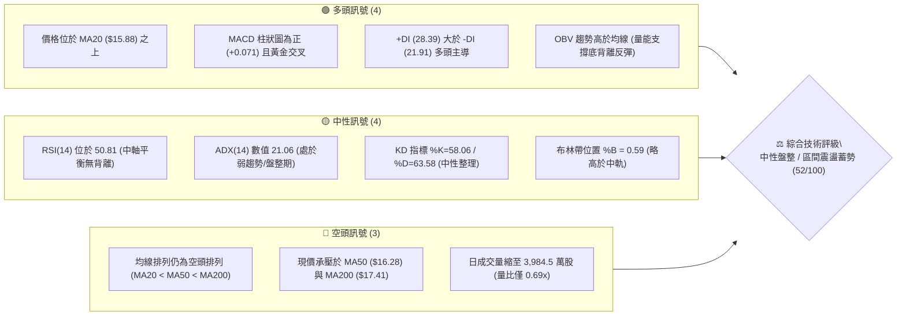
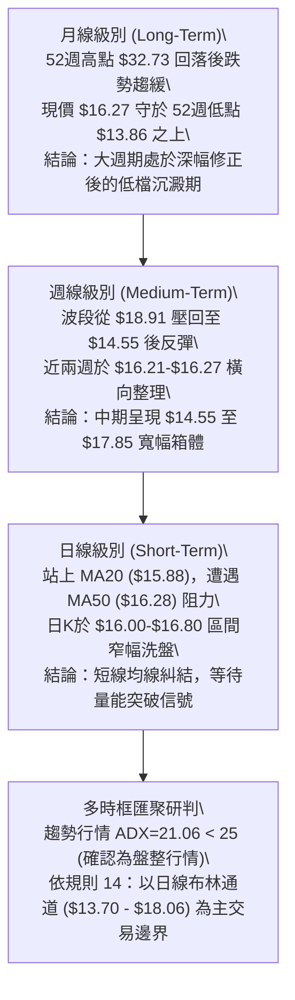
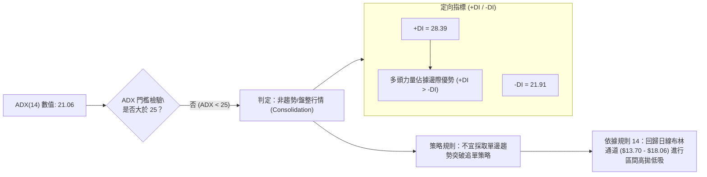
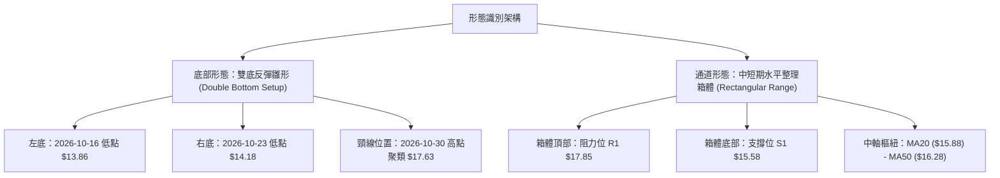
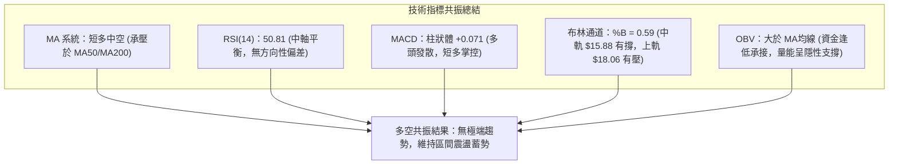
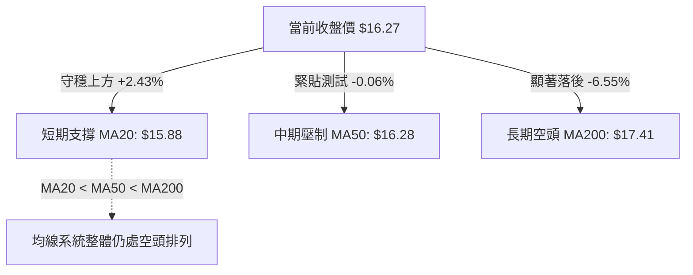
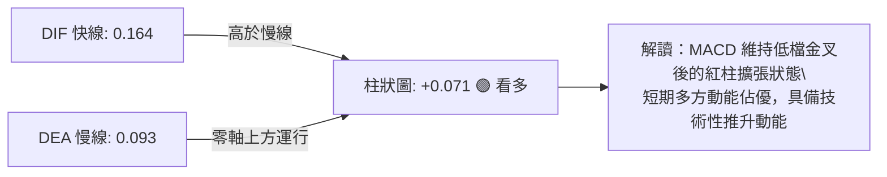
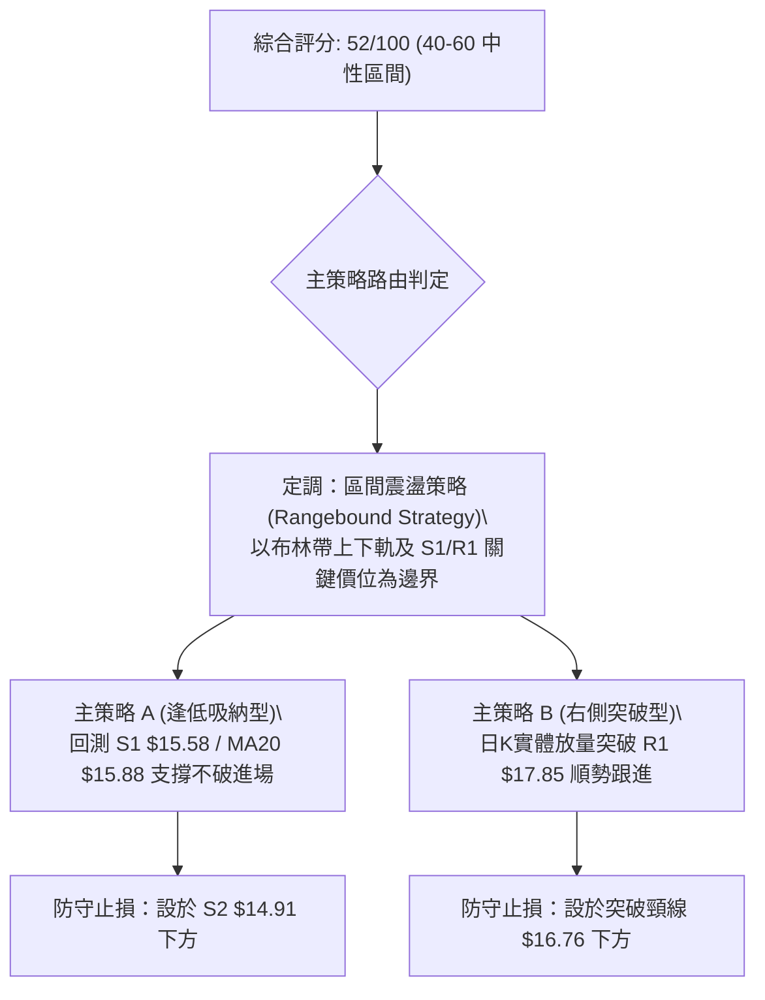
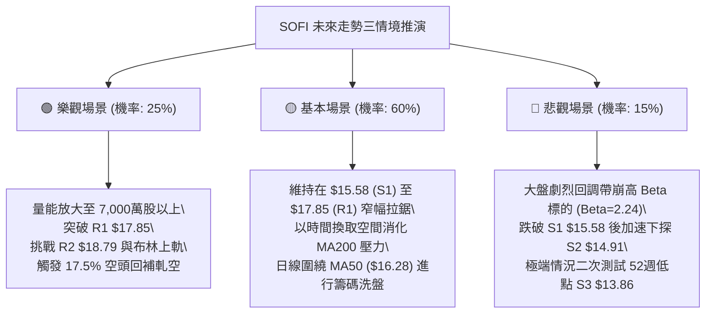

# SOFI 技術分析報告

> **報告日期**：2026-11-12 ｜ **語言**：繁體中文 ｜ **數據來源**：Yahoo Finance ｜ **當前價格**：$16.27

---

## 目錄

| 章節 | 內容 |
|------|------|
| [1. 技術面概覽](#1-技術面概覽) | 訊號儀表板、核心指標、評分卡 |
| [2. 趨勢分析](#2-趨勢分析) | 多時框趨勢、長中短期走勢、ADX 解讀 |
| [3. 圖表形態分析](#3-圖表形態分析) | 形態識別、K線組合、目標價推算 |
| [4. 支撐與阻力](#4-支撐與阻力) | 關鍵價位、斐波那契回調結構 |
| [5. 技術指標深度解讀](#5-技術指標深度解讀) | 均線系統、RSI、MACD、布林通道、OBV |
| [6. 動能與波動率](#6-動能與波動率) | 動能四象限、ATR 波動率、Beta 分析 |
| [7. 多時框架總結](#7-多時框架總結) | 時框架矩陣、多時框收斂結論 |
| [8. 交易策略建議](#8-交易策略建議) | 策略路由、區間操作、風險報酬比 |
| [9. 風險提示與監控](#9-風險提示與監控) | 監控 Checklist、情境推演、風控指引 |
| [10. 報告總結](#-報告總結) | 核心結論與策略全貌摘要 |

---

## 1. 技術面概覽

### 🎯 技術訊號儀表板



---

### 📊 核心指標速覽表

| 指標類別 | 指標名稱 | 當前數值 | 訊號 | 專業解讀 |
|:---|:---|:---|:---:|:---|
| **基準價格** | 收盤價 | $16.27 | 🟡 | 位於 52 週區間 ($13.86–$32.73) 的 12.8% 分位，低檔築底階段 |
| **短期均線** | MA20 | $15.88 | 🟢 | 現價高於 MA20 達 +2.43%，短期底部獲得支撐並翻揚向上 |
| **中期均線** | MA50 | $16.28 | 🔴 | 現價剛好受阻於 MA50（相差 -$0.01），多空於此關鍵均線交戰 |
| **長期均線** | MA200 | $17.41 | 🔴 | 現價位於牛熊分水嶺下方 -6.55%，長期趨勢仍處空方壓制區 |
| **動能震盪** | RSI(14) | 50.81 | 🟡 | Wilder 平滑指標穩守 50 中軸，動能中性，多空無明顯極端偏向 |
| **趨勢動能** | MACD(12,26,9) | DIF: 0.164 / DEA: 0.093 | 🟢 | 柱狀體 +0.071 維持正值擴張，雙線零軸上方運行，釋放短多訊號 |
| **趨勢強度** | ADX(14) | 21.06 | 🟡 | ADX < 25 表示單邊趨勢衰竭，市場進入典型箱體整理格局 |
| **定向指標** | +DI / -DI | 28.39 / 21.91 | 🟢 | 正定向線優於負定向線，短線買盤力量略勝賣盤力量 |
| **通道通道** | 布林帶 %B | 0.59 (寬度: 13.70-18.06) | 🟡 | 位於中軌 ($15.88) 與上軌 ($18.06) 之間，常態波動區間內 |
| **市場波動** | ATR(14) | $0.83 (5.13%) | 🟡 | 每日平均真實波動區間約 0.83 美元，波動率處於中等收斂狀態 |
| **量能狀態** | 成交量 / 20日均量 | 39.85M / 57.65M (0.69x) | 🔴 | 上攻量能不足，缺乏機構大買單推進，追價力道需觀察 |

---

### 🏆 技術評分卡

```
╔══════════════════════════════════════════════════════════════════╗
║                技術評分卡 — SOFI (2026-11-12)                   ║
╠══════════════════════════════════════════════════════════════════╣
║ 趨勢強度 (Trend)     █████████░░░░░░░░░░░   45/100   🟡 中性偏弱 ║
║ 動能指標 (Momentum)  ████████████░░░░░░░░   58/100   🟡 中性偏強 ║
║ 支撐穩定度 (Support) ████████████░░░░░░░░   62/100   🟢 支撐穩固 ║
║ 成交量配合 (Volume)  ██████████░░░░░░░░░░   52/100   🟡 量能中性 ║
║ 形態完整度 (Pattern) ███████████░░░░░░░░░   55/100   🟡 區間築底 ║
║ 均線排列 (MAs)       ████████░░░░░░░░░░░░   38/100   🔴 空頭壓制 ║
╠══════════════════════════════════════════════════════════════════╣
║ 綜合評分 (Overall)   ██████████░░░░░░░░░░   52/100   🟡 區間震盪 ║
║                                                                  ║
║ 評分公式驗證：(45 + 58 + 62 + 52 + 55 + 38) ÷ 6 = 51.67 → 52     ║
╚══════════════════════════════════════════════════════════════════╝
```

---

## 2. 趨勢分析

### 🌐 多時框趨勢分析



---

### 📈 長期趨勢 — 12個月走勢圖（Unicode）

以過去 12 個月（2025-12 至 2026-11）的月線收盤價為基礎，繪製月度價格軸演變：

```
SOFI 月線走勢圖（2025-12 至 2026-11）
價格軸 ($)
$30.00 ┤                                                    
$28.00 ┤                                                    
$26.00 ┤ ● (26.18)                                           
$24.00 ┤                                                    
$22.00 ┤       ● (22.81)                                    
$20.00 ┤                                                    
$18.00 ┤             ● (17.76)       ● (18.22) ● (17.93)       ● (17.88)
$16.00 ┤                   ● (15.88) ● (16.10)       ● (16.31)       ● (16.76) ● (16.27 ◄現價)
$14.00 ┤                                                             ● (15.72)
$12.00 ┤                                                    
       └─┬─────┬─────┬─────┬─────┬─────┬─────┬─────┬─────┬─────┬─────┬────
        12月  01月  02月  03月  04月  05月  06月  07月  08月  09月  10月  11月
        2025  2026  2026  2026  2026  2026  2026  2026  2026  2026  2026  2026
```

#### 走勢特徵分析表格

| 階段別 | 涵蓋月份 | 區間起訖點 | 漲跌幅 | 走勢結構與技術特徵 |
|:---|:---|:---:|:---:|:---|
| **第一階段：高檔加速回落** | 2025-12 ~ 2026-03 | $26.18 → $15.88 | **-39.34%** | 由歷史次高點連續大陰線下殺，跌破多條長期均線，空頭動能宣洩 |
| **第二階段：初次反彈築底** | 2026-04 ~ 2026-06 | $16.10 → $17.93 | **+11.37%** | 5月最高收在 $18.22，測試 MA200 壓力未果，轉為橫向區間蓄勢 |
| **第三階段：次級回踩確認** | 2026-07 ~ 2026-09 | $16.31 → $15.72 | **-3.62%** | 8月短暫上衝 $17.88 後快速回落，9月探低至 $15.72，量能逐步萎縮 |
| **第四階段：低檔震盪整固** | 2026-10 ~ 2026-11 | $16.76 → $16.27 | **-2.92%** | 10月週線一度下探 $13.86 後強勁抽腳收 $16.76，現於 $16.27 橫盤打底 |

---

### 📊 中期趨勢（週線分析）

從近 20 週收盤走勢可見，價格在 2026-08-21 觸及 $18.91 高點後展開回檔，並於 2026-10-16 當週下探 52 週最低點 $13.86，隨後在 2026-10-30 週拉出帶 4.16 億股大量的大陽線收在 $16.76，近期兩週回落至 $16.21 與 $16.27，量能急凍至 1.34 億股。

```
週線級別價格壓力與支撐通道示意：
$18.79 ── R2 強度阻力線（近一年波段高點聚類）
   │     ▲
$17.85 ── R1 關鍵壓力線（2026-07/08 反覆測試高點，斐波那契 78.6% 回調位 $17.90）
   │     │
$16.27 ── [現價位置]（週線 MA 糾結處，爭奪 $16.28 基準）
   │     │
$15.58 ── S1 近期支撐線（近一年波段低點聚類，回踩保護位）
   │     ▼
$14.91 ── S2 波段強支撐線（2026-10 起漲頸線區間）
$13.86 ── S3 終極防守線（52週最低點聚類，100.0% 斐波那契位）
```

---

### ⚡ 趨勢強度評估（ADX 解讀）



#### ADX 趨勢強度級別對照表

| ADX 數值區間 | 當前狀態 | 趨勢特徵 | 適用交易哲學與執行重點 |
|:---:|:---:|:---|:---|
| 0 – 20 | ░░░░░░░░░░ | 極弱/無方向性 | 徹底休眠，成交量匱乏，避免進場摩擦本金 |
| **20 – 25** | **████░░░░░░ (21.06)** | **弱趨勢 / 震盪整理期** | **當前 SOFI 狀態：價格在箱體內來回震盪，順勢突破易失敗，宜逢低買逢高賣** |
| 25 – 40 | ░░░░░░░░░░ | 中強趨勢展開 | 均線發散，指標共振，可採用動量追突破與回踩加碼策略 |
| 40 – 60 | ░░░░░░░░░░ | 強烈單邊趨勢 | 嚴禁逆勢摸頂抄底，緊抱核心波段部位 |
| 60 – 100 | ░░░░░░░░░░ | 極度過熱趨勢 | 行情末升段或恐慌崩跌，隨時面臨均值回歸與力竭反轉 |

---

## 3. 圖表形態分析

### 🔍 形態識別系統



#### 圖表形態信心度與目標價評估表

| 形態名稱 | 信心度 | 判斷依據（嚴格引用數據） | 完成度 | 形態目標價（推算公式與計算式） |
|:---|:---:|:---|:---:|:---|
| **雙底形態 (W底)** | **62%** | 週K線於 2026-10-16 測得低點 $13.86，隔週 2026-10-23 測得次低點 $14.18（未破前低），頸線位處 2026-10-30 週高點 $17.63。 | 68%（尚未有效放量突破頸線） | 若日K實體放量收破頸線 $17.63：<br>形態高度 = $17.63 - $13.86 = $3.77<br>理論目標 = $17.63 + $3.77 = **$21.40**<br>*(註：此為形態高度推算，上方最接近阻力見 R3 $19.62)* |
| **短期箱體整理** | **80%** | 日K線於近10日受限於高點聚類（11-04高 $17.74）與低點聚類（11-05低 $15.43），核心收盤價緊貼 S1 ($15.58) 與 R1 ($17.85)。 | 85%（正處於箱體內部壓縮） | 箱體突破目標：<br>箱頂 $17.85 - 箱底 $15.58 = 振幅 $2.27<br>向上破位目標 = $17.85 + $2.27 = **$20.12**<br>向下破位目標 = $15.58 - $2.27 = **$13.31** |

---

### 🕯️ 重要K線形態分析

嚴格依據數據中提供的「近10根日K」與「近8根週K」之真實開高低收進行客觀技術標注：

#### 近10根日K線解讀

| 日期 | 開盤價 | 最高價 | 最低價 | 收盤價 | 成交量 | K線形態特徵 | 專業解讀 | 訊號 |
|:---:|:---:|:---:|:---:|:---:|:---:|:---|:---|:---:|
| **2026-10-29** | 16.92 | 17.63 | 16.87 | 17.61 | 65.40M | 實體大陽棒 | 盤中放量突破，買方動能強烈，實體佔振幅 90% | 🟢 |
| **2026-10-30** | 17.07 | 17.32 | 16.44 | 16.76 | 64.31M | 帶下影長陰線 | 開高走低遭遇短線獲利回吐，但 $16.44 處有低接買盤 | 🔴 |
| **2026-11-02** | 16.98 | 17.60 | 16.57 | 16.60 | 54.61M | 衝高回落倒錘頭 | 上攻 $17.60 遭遇 R1 密集賣壓，空方尾盤主導壓回 | 🔴 |
| **2026-11-03** | 16.74 | 16.85 | 16.47 | 16.77 | 49.01M | 窄幅十字小陽星 | 振幅僅 $0.38，成交量萎縮，市場在 $16.70 附近陷入觀望 | 🟡 |
| **2026-11-04** | 17.01 | 17.74 | 16.97 | 17.38 | 55.32M | 強勢反彈實體中陽 | 再次向上挑戰 $17.74 波段阻力，多方動能復甦 | 🟢 |
| **2026-11-05** | 17.25 | 17.45 | 15.43 | 16.04 | 78.44M | 放量長下影大陰線 | 盤中劇烈下探 $15.43 擊穿 S1，但下影線拉回 $0.61，放量換手 | 🟡 |
| **2026-11-06** | 16.13 | 16.56 | 15.93 | 16.21 | 44.19M | 低檔孕線小陽線 | 波動急遽收窄，量能銳減，顯示前一日恐慌賣壓迅速沉澱 | 🟢 |
| **2026-11-09** | 16.33 | 17.04 | 16.15 | 16.75 | 40.54M | 溫和走高小陽線 | 站上 16.70 關口，維持在 MA20 上方運行 | 🟢 |
| **2026-11-10** | 16.48 | 16.53 | 15.91 | 16.37 | 53.69M | 帶長下影小陰棒 | 盤中下探 $15.91 剛好測試 MA20 ($15.88) 支撐，多頭展現防守 | 🟡 |
| **2026-11-11** | 16.58 | 16.83 | 16.25 | 16.27 | 39.85M | 縮量小實體陰線 | 振幅持續收縮，收在 $16.27，量比僅 0.69x，觀望氣氛濃厚 | 🟡 |

#### 近8根週K線解讀

| 週最後交易日 | 開盤價 | 最高價 | 最低價 | 收盤價 | 週成交量 | 週K線形態 | 趨勢涵義 | 訊號 |
|:---:|:---:|:---:|:---:|:---:|:---:|:---|:---|:---:|
| **2026-09-25** | 17.46 | 17.96 | 16.20 | 16.58 | 302.28M | 週線長陰回吐 | 確立跌破 $17.00 平台，波段向下修正啟動 | 🔴 |
| **2026-10-02** | 16.32 | 16.42 | 15.53 | 15.77 | 223.04M | 弱勢黑K續跌 | 測試 $15.58 支撐位，賣方控盤 | 🔴 |
| **2026-10-09** | 15.77 | 16.19 | 15.25 | 15.80 | 199.43M | 縮量十字星 | 賣壓放緩，多空於 $15.80 出現分歧 | 🟡 |
| **2026-10-16** | 15.47 | 15.68 | 13.86 | 14.55 | 286.32M | 破底長下影錘頭棒 | 摜破出 52週低點 $13.86 後強勁抽腳，形成恐慌出清底部 | 🟢 |
| **2026-10-23** | 14.75 | 15.11 | 14.18 | 14.61 | 198.52M | 低檔孕育小陽星 | 次低點 $14.18 高於前週 $13.86，形成底部抬升 (Higher Low) | 🟢 |
| **2026-10-30** | 14.53 | 17.63 | 14.40 | 16.76 | 416.30M | 帶巨量吞噬長陽線 | 4.16億股天量拉升 +14.72%，完成雙底確認轉折 | 🟢 |
| **2026-11-06** | 16.98 | 17.74 | 15.43 | 16.21 | 281.57M | 高檔震盪長下影黑K | 消化 $17.63-$17.85 密集解套賣壓，回踩確認突破有效性 | 🟡 |
| **2026-11-11** | 16.33 | 17.04 | 15.91 | 16.27 | 134.07M | 縮量整理小K棒 | 半週累計量能極低，窄幅洗盤沉澱籌碼 | 🟡 |

---

### 📉 ASCII 走勢形態示意圖

```
SOFI 雙底結構與頸線壓力示意圖
價格
$18.00 ┤                                [R1: $17.85] 阻力線
$17.63 ┤------------------ 頸線位 -----------------●--------● (11-04: 17.74)
$17.00 ┤                                        /   \      / \
$16.27 ┤......................................./.....\....●... ◄ 現價 $16.27
$15.58 ┤                     [S1: $15.58] 支撐線 /       \  /
$14.50 ┤        \           /                   /         ● (11-05: 15.43)
$14.00 ┤         \  底 1   /           底 2    /
$13.86 ┤          ●───────/             ●─────/
       └───────── 10-16 ─────────────── 10-23 ───────────────────────► 時間
                 ($13.86)              ($14.18)
```

---

## 4. 支撐與阻力

### 🗺️ 關鍵價位分布圖（Unicode）

```
╔═════════════════════════════════════════════════════════════════════════════╗
║                      SOFI 價位結構分布圖 (由 OHLCV 確定)                     ║
╠═════════════════════════════════════════════════════════════════════════════╣
║ $19.62 ║████████████████████████████████████║ 強烈阻力 R3 (+20.57%)         ║
║ $18.79 ║████████████████████████████        ║ 波段阻力 R2 (+15.46%)         ║
║ $18.06 ║▓▓▓▓▓▓▓▓▓▓▓▓▓▓▓▓▓▓▓▓▓▓▓▓▓▓          ║ 布林通道上軌 (+11.00%)        ║
║ $17.85 ║████████████████████████████████    ║ 關鍵阻力 R1 (+9.71%)          ║
║ $17.41 ║────────────────────────────────────║ 長期均線 MA200 (-6.55%)       ║
║ $16.28 ║------------------------------------║ 中期均線 MA50 (-0.06%)        ║
║ $16.27 ╠════════════════════════════════════╣ ◄ 當前收盤價 ($16.27)         ║
║ $15.88 ║────────────────────────────────────║ 短期均線 MA20 / 布林中軌      ║
║ $15.58 ║▓▓▓▓▓▓▓▓▓▓▓▓▓▓▓▓▓▓▓▓▓▓▓▓            ║ 近期支撐 S1 (-4.27%)          ║
║ $14.91 ║████████████████████████████████    ║ 波段強支撐 S2 (-8.36%)        ║
║ $13.86 ║████████████████████████████████████║ 52週極限底 S3 (-14.81%)       ║
║ $13.70 ║░░░░░░░░░░░░░░░░░░░░░░░░░░░░░░░░░░░░║ 布林通道下軌 (-15.80%)        ║
╚═════════════════════════════════════════════════════════════════════════════╝
```

---

### 🚧 阻力位分析表

所有價位嚴格引用自數據「阻力位 (Resistance)」波段高點聚類與均線指標：

| 阻力級別 | 準確價位 | 距現價幅標 | 形成原因與籌碼技術面背景 | 突破難度評估 | 技術重要性 |
|:---:|:---:|:---:|:---|:---:|:---:|
| **R1** | **$17.85** | **+9.71%** | 2026年7月與8月波段密集高點聚類區，同時與 52 週斐波那契 78.6% 回調位 ($17.90) 高度共振，解套盤壓巨大。 | 🔴 高度困難 | ★★★★★ |
| **R2** | **$18.79** | **+15.46%** | 2026年8月波段反彈最高收盤價聚類點（8-21週收 $18.91，7-10週收 $18.78），突破此處象徵扭轉中期空頭架構。 | 🔴 極度困難 | ★★★★☆ |
| **R3** | **$19.62** | **+20.57%** | 近一年波段起跌點之平台下沿聚類，上方接近 240日均線 ($19.03) 與 $20.00 整數心理防線。 | 🔴 極高障礙 | ★★★☆☆ |

---

### 🛡️ 支撐位分析表

所有價位嚴格引用自數據「支撐位 (Support)」波段低點聚類與均線指標：

| 支撐級別 | 準確價位 | 距現價幅標 | 形成原因與籌碼技術面背景 | 守住機率評估 | 技術重要性 |
|:---:|:---:|:---:|:---|:---:|:---:|
| **S1** | **$15.58** | **-4.27%** | 近一年波段低點聚類支撐，11月5日長下影線（最低 $15.43）下探後迅速拉起，MA20 ($15.88) 在其上方構成第一道緩衝。 | 🟢 70% | ★★★★☆ |
| **S2** | **$14.91** | **-8.36%** | 10月反彈結構之起漲換手平台（10-23 當週開盤價 $14.75 至收盤 $14.61 上沿），多方波段防守第二核心陣地。 | 🟢 85% | ★★★★★ |
| **S3** | **$13.86** | **-14.81%** | 52 週絕對最低點（2026-10-16 測得），斐波那契 100.0% 回調位，跌破將引發大規模停損賣壓與破底危機。 | 🟢 95% | ★★★★★ |

---

### 📐 斐波那契回調位分析

依據 52 週最高點 **$32.73** 至 52 週最低點 **$13.86** 所計算之斐波那契回調結構，數值嚴格引用數據包：

```
斐波那契回調階梯（區間：$13.86 → $32.73）：
0.0%  (52W High) ────────── $32.73 ── 歷史強壓區
23.6%            ────────── $28.28 ── 深幅多頭目標
38.2%            ────────── $25.52 ── 中期回撤中樞
50.0%            ────────── $23.29 ── 多空均衡半分位
61.8%            ────────── $21.07 ── 黃金分割關鍵反轉點
78.6%            ────────── $17.90 ── [強壓共振位] (與 R1 $17.85 重合)
─────── ▲ 現價 $16.27 落於 78.6% 與 100.0% 之間 ───────
100.0% (52W Low) ────────── $13.86 ── 絕對週期大底部
```

#### 斐波那契空間深度研判
當前收盤價 **$16.27** 處於 **78.6% 回調位 ($17.90)** 與 **100.0% 回調位 ($13.86)** 之間的超跌修復區間。
1. **壓制解讀**：上方的 78.6% 回調位位於 **$17.90**，與近一年波段高點聚類阻力 **R1 ($17.85)** 誤差僅 $0.05，二者形成雙重共振阻力帶（$17.85 - $17.90）。在未有單日放量逾 6,000 萬股突破 $17.90 之前，反彈空間將受嚴格壓制。
2. **支撐解讀**：100.0% 斐波那契位 **$13.86** 構成堅如磐石的週期大底。只要價格不再收破 $13.86，整體的技術結構即處於自低檔展開的深幅修復週期。

---

## 5. 技術指標深度解讀

### 🎛️ 指標訊號總覽



---

### 📈 移動平均線排列分析

#### 當前均線系統關鍵參數表

| 均線名稱 | 當前數值 | 距現價差距 | 現價相對位置 | 趨勢斜率特徵 | 技術涵義 |
|:---:|:---:|:---:|:---:|:---:|:---|
| **MA 5** | $16.33 | -0.06 (-0.36%) | 剛好跌破 | ▅▅▅▄▄▄ (走平微跌) | 超短期多空拉鋸，多方上攻動能稍有鈍化 |
| **MA 10** | $16.68 | -0.41 (-2.43%) | 下方承壓 | ▇▇▆▆▅▅ (向下壓制) | 短線回踩壓制線，短期反彈的第一道考驗 |
| **MA 20** | $15.88 | +0.39 (+2.43%) | **上方支撐** | ▂▂▂▃▃▃▄ (由平轉升) | 短期生命線，提供強勁低接支撐，跌破則轉弱 |
| **MA 50** | $16.28 | -0.01 (-0.06%) | 剛好受阻 | ▅▅▄▄▃▃ (緩降趨平) | 中期多空分水嶺，當前與現價 $16.27 重合 |
| **MA 60** | $16.63 | -0.36 (-2.14%) | 下方承壓 | ▄▄▃▃▂▂ (持續下彎) | 季線下行壓制，與 MA10 形成疊加壓力帶 |
| **MA 120** | $17.03 | -0.76 (-4.48%) | 下方承壓 | ▃▂▂▁▁▁ (下彎延續) | 半年線防線，中長期籌碼沉重區 |
| **MA 200** | $17.41 | -1.14 (-6.55%) | 下方承壓 | 下行趨勢 | 牛熊界線，未收復前不可盲目判斷長期反轉 |
| **MA 240** | $19.03 | -2.76 (-14.49%)| 下方承壓 | ▅▅▄▄▃▃ (大幅壓制) | 年線超長週期阻力，位於 R2 與 R3 之間 |



**均線綜合解讀**：
雖然整體大均線系統仍是標準的空頭排列（MA20 < MA50 < MA200），但短期走勢出現積極變化——價格已站上正在拐頭向上的 MA20 ($15.88)，且現價 $16.27 正緊貼 MA50 ($16.28) 進行突破測試。一旦日線實體站穩 MA50，將正式宣告進入「均線修復糾結期」，有機會向 MA200 ($17.41) 發起挑戰。

---

### 📉 RSI(14) 分析

#### RSI 數值強度展示
```
RSI(14) = 50.81 (Wilder)
超賣區 (0-30)          中性區 (30-70)                   超買區 (70-100)
├──────────────┼─────────────────────●───────────────┤
0             30                    50.81           70            100
[指標進度條]   ██████████░░░░░░░░░░  50.81%
```

#### 背離深度剖析
- **日線背離判定**：檢視近 20 根 K 棒的首尾價格與 RSI 數值，首尾動能變化平穩，系統確認**無明顯頂背離或底背離**。
- **週線動態觀察**：回顧週線級別，2026-10-16 價格破底創出 $13.86 時，週線 RSI 為 34.7；而在 2026-10-02 價格為 $15.77 時週線 RSI 為 36.2，二者並無顯著背離，但當前週線 RSI 迅速修復至 50.8，表明低檔動能修復健康，脫離了超賣下沉風險，目前處於完全中性的力量對抗態勢。

---

### 📊 MACD(12/26/9) 訊號解讀



**MACD 技術解讀**：
當前 MACD 數值為 0.164，信號線 Signal 為 0.093，MACD 柱狀體為 **+0.071**。
1. 雙線均已脫離零軸下方的極弱區間，DIF 成功越過 DEA 形成標準的「零軸附近金叉」，紅柱維持正向發散，顯示自 $13.86 起漲的短波段反彈動能尚未耗盡。
2. 然而，柱狀體 +0.071 相較於前波大漲週的 +0.360 已有顯著收斂，說明反彈第一波脈衝已過，動能轉為階梯式緩步推進。

---

### 📦 布林通道分析

```
SOFI 日線布林通道 (Bollinger Bands 20, 2) 結構圖
────────────────────────────────────────────────────
$18.06 ── BB 上軌 (Upper Band) ──── 壓力位 (+11.00%)
   │                                   
   │         現價位置: $16.27 (%B = 0.59)
$16.27 ── ●──────────────────────── 處於中軌上方強勢區
   │                                   
$15.88 ── BB 中軌 (MA20) ────────── 核心支撐 (-2.43%)
   │                                   
$13.70 ── BB 下軌 (Lower Band) ──── 終極極限位 (-15.80%)
────────────────────────────────────────────────────
通道頻寬 (Bandwidth) = ($18.06 - $13.70) / $15.88 = 27.45%
```

**布林通道解讀**：
- **位置係數 %B = 0.59**：價格穩健運行在布林中軌（$15.88）之上，高於 0.50 中軸，意味著短線結構屬於「通道內偏多運行」。
- **交易區間**：在 ADX = 21.06 確立的盤整行情中，布林通道的上軌 **$18.06** 與下軌 **$13.70** 提供了最天然的數學波動邊界。現價距上軌尚有約 $1.79 (+11.0%) 的反彈空間，而下軌則與 52 週最低點 $13.86 形成密集保護圈。

---

### 💹 成交量分析（量價配合度）

```
成交量指標對比儀表：
當日成交量： 39,845,100  ███████░░░ (0.69x 縮量)
20日均量：   57,649,680  ██████████
50日均量：   50,032,528  █████████░
```

**量價背離與 OBV 深度檢視**：
1. **量價狀態**：最新交易日成交量僅 39.85M 股，相較於 20 日均量（57.65M）萎縮約 31%，呈現標準的「量縮橫盤」。在多頭試圖向上衝擊 MA50 ($16.28) 的敏感位置，縮量代表追價意願謹慎，難以一蹴而就形成突破大陽線。
2. **OBV 趨勢**：系統檢測顯示「OBV > MA → 量能支撐上漲」。這是一個顯著的**積極信號**，說明主力資金在 10 月底巨量拉升（單週 4.16 億股）之後並未大規模出逃，近期的縮量壓回屬於籌碼沉澱與換手性質，OBV 線維持在均線之上，為後續反彈保留了量能底氣。

---

## 6. 動能與波動率

### ⚡ 動能評估四象限

```
動能與波動率定位象限圖：
       波動率 (Volatility - ATR)
         高 ▲
            │  [Q3: 突破爆發]     │  [Q4: 劇烈失控]
            │  強動能 / 高波動    │  弱動能 / 高波動
            │                    │
────────────┼────────────────────┼────────────────────► 動能強度 (Momentum)
            │  [Q1: 穩健蓄勢]     │  [Q2: 盤整沉澱]
            │  強動能 / 低波動    │  弱動能 / 低波動
            │                    │  ★ 當前 SOFI 定位 (Q2)
         低 ▼                    │  (ADX 21.06 / ATR 5.13%)
```

#### 動能四象限深度解析表

| 象限代號 | 動能狀態 | 波動率狀態 | 當前符合度 | 戰略特徵與機構行為解讀 |
|:---:|:---:|:---:|:---:|:---|
| **Q1** | 強 | 低 | ░░░░░░░░░░ | 最佳無摩擦上漲機會，均線多頭散開，適合重倉順勢跟隨。 |
| **Q2** | **弱 / 中性** | **低 / 中等** | **██████████ (符合)** | **當前 SOFI 狀態：ADX 數值 21.06 處弱動能區間，ATR 佔比 5.13% 自高檔大幅回落。機構進入區間吸籌與洗盤期，宜採取「耐心網格」與「區間邊緣低吸」策略。** |
| **Q3** | 強 | 高 | ░░░░░░░░░░ | 高風險高收益階段，往往伴隨突破跳空與巨量，需嚴格帶移動止損。 |
| **Q4** | 弱 | 高 | ░░░░░░░░░░ | 恐慌崩跌或失控屠殺階段，波動巨大且趨勢不明，應空倉規避。 |

---

### 📊 ATR 波動率分析

- **ATR(14) 絕對數值**：**$0.83**
- **ATR 佔價格百分比**：**5.13%**（基於收盤價 $16.27）
- **單日預期波幅範圍**：[$15.44, $17.10]
- **波動率特性解讀**：
  SOFI 每日平均真實波幅高達 $0.83，佔股價比重超過 5%，屬於典型的高彈性成長型個股。這意味著正常的日內洗盤便可能造成 ±5% 的震盪。因此，在設定技術防守時，絕對不能將止損點設在小於 1.0 倍 ATR（即小於 $0.83）之內，否則極易被日內噪聲假突破清洗出場。
- **風控參數轉換**：
  - 緊密波段止損 (1.0x ATR)：**$0.83**
  - 標準擺動止損 (1.5x ATR)：**$1.25**
  - 寬鬆趨勢防守 (2.0x ATR)：**$1.66**

---

### 📐 Beta 與市場相關性

- **Beta 係數**：**2.241**
- **市場屬性**：超高敏感度（Super-High Beta Asset）
- **技術解讀**：
  SOFI 的 Beta 高達 2.241，意味著標的對美股大盤（S&P 500 / Nasdaq）的系統性風險具有超過 2.2 倍的放大效果。當大盤指數上揚 1% 時，理論上 SOFI 傾向於上漲約 2.24%；反之，大盤回調 1% 時，SOFI 下跌壓力達 2.24%。在執行任何技術交易策略時，必須將總體宏觀環境與標普走勢列為先行濾網。

---

## 7. 多時框架總結

### 📋 時框架評分表

| 時框架 | 趨勢方向 | 動能狀態 | 均線排列 | 形態結構 | 綜合評分 | 建議操作維度 |
|:---|:---:|:---:|:---:|:---:|:---:|:---|
| **日線 (Daily)** | 🟡 橫盤整理 | 🟢 MACD 翻紅 | 🟡 站上 MA20 測 MA50 | 箱體區間壓縮 | **56 / 100** | 以布林中軌為支撐，箱底低吸，箱頂減碼 |
| **週線 (Weekly)** | 🟡 止跌築底 | 🟡 RSI 脫離超賣 | 🔴 MA 仍處空頭排列 | 雙底頸線回測 | **52 / 100** | 守穩 $14.91-$15.58 區間，等待頸線突破 |
| **月線 (Monthly)** | 🔴 弱勢修正 | 🔴 長期下行 | 🔴 遠低於 MA240 | 跌勢趨緩沉澱 | **45 / 100** | 長線資金分批建倉，不宜激進槓桿追高 |

---

### 🔲 綜合訊號矩陣

```
╔══════════════════════════════════════════════════════════════════╗
║                    SOFI 多時框訊號共振矩陣                       ║
╠══════════════════════════════════════════════════════════════════╣
║ 維度項目     │  短期 (日線)    │  中期 (週線)    │  長期 (月線)  ║
╠═════════════╪═════════════════╪═════════════════╪═══════════════╣
║ 趨勢方向     │  🟡 區間震盪    │  🟡 雙底構築    │  🔴 深幅回調  ║
║ 動能偏向     │  🟢 多頭微弱    │  🟡 中性修復    │  🔴 動能疲弱  ║
║ 均線結構     │  🟢 守穩 MA20   │  🔴 承壓 MA50   │  🔴 遠低於年線║
║ 成交量能     │  🔴 縮量觀望    │  🟢 放量後沉澱  │  🟡 均量水準  ║
║ 波動狀態     │  🟡 ATR 收斂    │  🟡 振幅收窄    │  🔴 歷史低位  ║
╠═════════════╧═════════════════╧═════════════════╧═══════════════╣
║ 矩陣收斂一致性：中度共振 ── 短中期出現築底訊號，但受制於長空壓制 ║
╚══════════════════════════════════════════════════════════════════╝
```

---

### ⚖️ 多時框收斂結論

**嚴格依據多時框收斂優先級規則（規則 14）**：
1. **行情性質判定**：當前 SOFI 的 ADX(14) 數值為 **21.06**，明確小於 25 的趨勢門檻，技術架構被嚴格定義為**盤整行情（Consolidation Market）**，而非單邊趨勢行情。
2. **主導時框與交易邊界**：依據規則 14，在盤整行情中，**以日線布林通道上下軌（$13.70 - $18.06）作為主要交易區間**。
3. **時框衝突取捨**：雖然長期月線與均線系統呈現空頭壓制（MA200 位於 $17.41），但日線級別在 $15.58（S1）與 MA20（$15.88）展現強烈支撐，且 MACD 柱狀體維持翻紅。因此，不宜在當前 $16.27 低檔盲目殺跌做空，亦不可盲信單邊大牛市追漲。
4. **唯一方向性結論**：**中性觀望 / 區間震盪蓄勢（Neutral-Rangebound）**。策略主軸定調為「依託布林通道與波段支撐位 S1/S2 進行低吸，並於阻力位 R1 前分批獲利了結」，等待實體放量突破再轉向順勢策略。

---

## 8. 交易策略建議

### 🗺️ 策略決策流程圖



---

### 🧭 策略路由（依評分卡分流）

> **當前主策略方向 = 中性區間操作 / 震盪區間高拋低吸，等待突破確認（依技術評分 52/100）**
> 
> *路由說明：綜合評分 52 分落於 40–60 分的中性震盪區間，依規則禁止單向孤注一擲強推激進單邊單。主策略以箱體支撐阻力為交易邊界，嚴格執行風控。*

---

### 🎯 價格情境階梯（Price Scenarios）

所有觸發價位與目標階梯完全引用「關鍵價位」區塊之真實數據：

| 階梯觸發條件 | 下一目標價位 | 後續延伸目標 | 情境技術涵義與執行動作 |
|:---|:---:|:---:|:---|
| **強勢突破 R1 ($17.85)** | **R2 ($18.79)** | **R3 ($19.62)** | 短線轉強，突破 52 週 78.6% 斐波那契回調位，空頭結構被瓦解，打開通往 $20 大關的上升空間。 |
| **站穩現價區間 ($16.27)** | **MA200 ($17.41)** | **R1 ($17.85)** | 區間震盪偏強，消化 MA50 賣壓，緩步向布林上軌 ($18.06) 與牛熊線靠攏。 |
| **有效跌破 S1 ($15.58)** | **S2 ($14.91)** | **S3 ($13.86)** | 中期轉弱，跌破 MA20 生命線，回測 10 月起漲平台，重回探底防守走勢。 |

---

### 📊 情境機率分佈

| 運行情境 | 評估機率 | 主要技術指標支撐依據 |
|:---|:---:|:---|
| **情境一：區間震盪整固** | **55%** | **ADX=21.06 確立弱趨勢；布林頻寬收斂，成交量比萎縮至 0.69x，資金處於觀望平衡期。** |
| **情境二：溫和反彈上攻** | **30%** | **MACD 柱狀體為正 (+0.071)，+DI (28.39) 壓制 -DI，OBV > MA 量能呈現低檔承接支撐。** |
| **情境三：回落再探前低** | **15%** | **均線系統仍呈空頭排列 (MA20<MA50<MA200)，現價剛好受阻於 MA50 ($16.28)。** |

---

### 🟢 主策略詳情（區間操作與突破應對）

依據規則 17 之風報比公式定義：`風險報酬比 = (目標價 T1 − 進場價) ÷ (進場價 − 止損價)`，進場價若為區間以中點計算：

| 策略要素 | 策略 A：區間回踩低吸策略（左側/箱底） | 策略 B：放量突破追隨策略（右側/順勢） |
|:---|:---|:---|
| **適用時機** | 價格回踩 MA20 與支撐位 S1 獲支撐時 | 日K線放量突破關鍵阻力位 R1 時 |
| **進場條件** | 跌至 $15.58-$15.88 區間企穩，收下影線 | 日K實體收盤價突破 $17.85 且成交量 > 6,000 萬股 |
| **進場價格** | **$15.73** *(取 S1 $15.58 至 MA20 $15.88 區間中點)* | **$17.85** *(突破 R1 確認點)* |
| **目標價 T1** | **$17.85** *(關鍵阻力 R1)* | **$18.79** *(阻力位 R2)* |
| **目標價 T2** | **$18.79** *(阻力位 R2)* | **$19.62** *(阻力位 R3)* |
| **止損價格** | **$14.91** *(波段強支撐 S2)* | **$16.76** *(2026-10-30 突破收盤支撐)* |
| **風險報酬比** | **1 : 2.59（以 T1 計）**<br>*(17.85-15.73) ÷ (15.73-14.91) = 2.12 ÷ 0.82*<br>*(以 T2 計為 1 : 3.73)* | **1 : 0.86（以 T1 計）**<br>*(18.79-17.85) ÷ (17.85-16.76) = 0.94 ÷ 1.09*<br>*(以 T2 計為 1 : 1.62)* |
| **成功機率** | **65%** | **45%**（受制於 ADX<25 突破易假突破） |
| **建議倉位** | **總資金 10% - 15%** | **總資金 5% - 8%**（輕倉試單） |

---

### 🔴 反向風險觸發點（對沖提示）

若發生下列技術破位事件，宣告主策略失效，應立即暫停低吸做多：
1. **日線收盤價跌破 S1 ($15.58)**：跌破將引發日內追殺，部位應減碼 50%。
2. **日線實體擊穿 S2 ($14.91)**：雙底頸線結構徹底破壞，應無條件執行清倉或啟動反向空頭避險。
3. **成交量異常放大（>8,000 萬股）且帶長上影線**：如在測試 R1 ($17.85) 時出現此形態，為主力假突破出貨信號，需立即獲利了結所有多頭部位。

---

### ⭐ 整體訊號強度評星

```
╔══════════════════════════════════════════════════════════════════╗
║                     技術訊號綜合評星儀表                         ║
╠══════════════════════════════════════════════════════════════════╣
║ 做多訊號強度：★★★☆☆  (3.0 / 5 星) — 底背離反彈，但受均線壓制   ║
║ 做空訊號強度：★★☆☆☆  (2.0 / 5 星) — 長期空頭但短線動能超賣修復 ║
║ 整體可信度：  ★★★☆☆  (3.5 / 5 星) — 盤整期數據共振度良好     ║
╚══════════════════════════════════════════════════════════════════╝
```

---

## 9. 風險提示與監控

### ✅ 關鍵監控指標 Checklist

```
╔═════════════════════════════════════════════════════════════════════════════╗
║                      SOFI 每日交易風控監控清單                              ║
╠═════════════════════════════════════════════════════════════════════════════╣
║ [ ] 均線動態：現價是否收盤站穩 MA50 ($16.28)？                              ║
║ [ ] 支撐守衛：MA20 ($15.88) 與波段支撐 S1 ($15.58) 是否完好無損？           ║
║ [ ] 動能連續性：MACD 柱狀圖是否持續維持在正值 (>0)？                         ║
║ [ ] 量能閥值：日成交量是否回升突破 20日均量 57,649,680 股？                ║
║ [ ] 趨勢變更：ADX(14) 是否越過 25 臨界點（由盤整轉為單邊趨勢）？             ║
║ [ ] 波動警報：日內最大振幅是否超過 ATR ($0.83) 的 1.5 倍（即波幅 > $1.25）？ ║
║ [ ] 籌碼面警訊：空頭比例 (Short Float) 高達 17.5%，防範突發性軋空或踩踏？   ║
╚═════════════════════════════════════════════════════════════════════════════╝
```

---

### ⚠️ 風險場景分析



---

### 🛡️ 風險管理重要提醒

1. **高 Beta 波動管理**：
   SOFI 具備高達 **2.241** 的 Beta 值，價格波動劇烈度為大盤的兩倍以上。在資產配置中，SOFI 倉位不宜超過個人投資組合總值的 **10%-15%**，避免單一標的波動對整體淨值造成不可逆的衝擊。
2. **做空比例高達 17.5% 的雙刃劍效應**：
   數據顯示 SOFI 的 Short % of Float 高達 **17.5%**，Short Ratio 達 **4.19 天**。在技術分析中，高空頭部位意味著：
   - **下行具備踩踏風險**：一旦破位 S1 ($15.58)，空頭趁勝追擊會放大跌幅。
   - **上行具備軋空潛力 (Short Squeeze)**：一旦價格帶量突破 R1 ($17.85)，空頭回補買盤可能在 4 天內引發報復性暴拉。
3. **ATR 嚴格停損紀律**：
   當前 ATR 為 **$0.83**。進場交易務必遵循「以波動率定止損」原則，任何短線多單止損位不得小於 $15.44（現價減 1.0x ATR），波段多單嚴格以 **S2 ($14.91)** 作為終極防線，跌破必須堅決止損離場。

---

## 📋 報告總結

```
╔═════════════════════════════════════════════════════════════════════════════╗
║                      SOFI 技術分析報告總結 (2026-11-12)                     ║
╠═════════════════════════════════════════════════════════════════════════════╣
║ 報告日期：2026-11-12           │ 當前收盤價：$16.27 USD                     ║
║ 技術評分：52 / 100 (中性評級)   │ 市場環境：盤整震盪行情 (ADX: 21.06)         ║
╠═════════════════════════════════════════════════════════════════════════════╣
║ 關鍵維度技術結論：                                                          ║
║ ├─ 長期趨勢：🔴 弱勢空頭格局 (處於 52週區間 12.8% 分位，承壓於 MA200 $17.41) ║
║ ├─ 中期趨勢：🟡 雙底反彈構築 (自 $13.86 抽腳反彈，頸線 $17.63 蓄勢待發)     ║
║ ├─ 短期趨勢：🟢 站穩 MA20 ($15.88)，正挑戰 MA50 ($16.28)，MACD 柱翻紅 (+0.071)║
║ ├─ 關鍵支撐：S1 $15.58 ｜ S2 $14.91 ｜ S3 $13.86 (52週極限底)               ║
║ ├─ 關鍵阻力：R1 $17.85 ｜ R2 $18.79 ｜ R3 $19.62                           ║
║ └─ 分析師共識目標：均價 $20.84 (區間 $12.00 - $30.00，評級: Hold)           ║
╠═════════════════════════════════════════════════════════════════════════════╣
║ 最優交易策略組合：                                                          ║
║ 1. 🥇 最佳機會（策略 A）：回踩支撐位 S1 與 MA20 區間 ($15.58-$15.88) 低吸，  ║
║    止損設於 S2 $14.91，第一目標看 R1 $17.85，風報比高達 1:2.59。            ║
║ 2. 🥈 次選機會（策略 B）：耐心等待帶量突破 R1 $17.85 進行右側順勢追擊，      ║
║    目標看 R2 $18.79，嚴格將止損設於突破平台 $16.76。                         ║
║ 3. 🥉 保守選擇：在 ADX < 25 且成交量萎縮背景下，暫時空倉觀望，               ║
║    靜待日K實體放量收復 MA50 ($16.28) 及均線糾結轉向後再行介入。            ║
╚═════════════════════════════════════════════════════════════════════════════╝
```

---

> ⚠️ **免責聲明**：本報告為技術分析研究成果，報告內所有數據、支撐阻力位、均線指標與圖表形態均嚴格依據 Yahoo Finance 歷史交易數據推算與客觀解讀。本報告**僅供研究與學術參考**，**不構成任何形式的投資建議、要約或承諾**。證券投資伴隨高度市場風險，投資人應獨立評估自身財務狀況與風險承受能力，入市需謹慎。

---

*報告生成時間：2026-11-12 ｜ 數據來源：Yahoo Finance ｜ 分析框架：多時框技術分析體系*