# SOFI 技術分析報告

> **報告日期**：2026-11-13 ｜ **語言**：繁體中文 ｜ **數據來源**：Yahoo Finance ｜ **當前價格**：$15.63 USD

---

## 目錄

| 章節 | 內容 |
|------|------|
| [1. 技術面概覽](#1-技術面概覽) | 訊號儀表板、核心指標、評分卡 |
| [2. 趨勢分析](#2-趨勢分析) | 多時框趨勢、長中短期走勢、12個月走勢圖 |
| [3. 圖表形態分析](#3-圖表形態分析) | 形態識別、K線組合、目標價計算 |
| [4. 支撐與阻力](#4-支撐與阻力) | 關鍵價位結構、斐波那契回調深度解讀 |
| [5. 技術指標深度解讀](#5-技術指標深度解讀) | 均線系統、RSI、MACD、布林通道、OBV |
| [6. 動能與波動率](#6-動能與波動率) | 動能四象限、ATR 波動率、Beta 市場相關性 |
| [7. 多時框架總結](#7-多時框架總結) | 時框架評分矩陣、多時框收斂結論 |
| [8. 交易策略建議](#8-交易策略建議) | 策略路由、主策略詳情、情境階梯、風報比 |
| [9. 風險提示與監控](#9-風險提示與監控) | 監控 Checklist、風險場景、部位管理 |
| [📋 報告總結](#-報告總結) | 核心結論與策略彙整儀表板 |

---

## 1. 技術面概覽

### 🎯 技術訊號儀表板

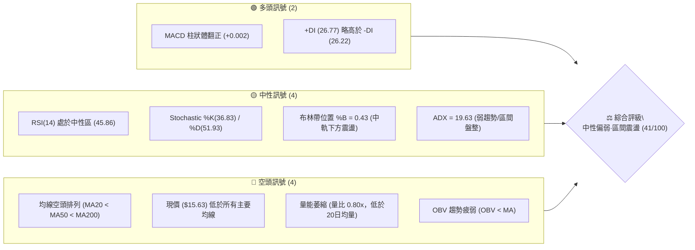

### 📊 核心指標速覽表

| 指標類別 | 指標名稱 | 當前數值 | 訊號 | 解讀 |
|:---|:---|:---:|:---:|:---|
| **價格** | 當前收盤價 | $15.63 | 🔴 | 位於 52 週區間 ($13.86 - $32.73) 的 9.4% 分位，深陷低檔 |
| **均線** | MA20 (月線) | $15.91 | 🔴 | 價格低於 MA20 (-1.76%)，短線承壓 |
| **均線** | MA50 (季線) | $16.24 | 🔴 | 價格低於 MA50 (-3.76%)，中期空頭掌控 |
| **均線** | MA200 (年線)| $17.37 | 🔴 | 價格低於 MA200 (-10.02%)，長期架構偏空 |
| **動能** | RSI(14) | 45.86 | 🟡 | 中性區間 (30-70)，未觸及超賣，動能平淡 |
| **動能** | MACD (12,26,9)| 0.096 / 0.094 | 🟢 | 快線微幅金叉慢線，柱狀體 +0.002，微弱偏多 |
| **動能** | KD(14,3) | %K:36.83 / %D:51.93 | 🟡 | 位於中低位盤整，無顯著金叉向上突破 |
| **趨勢強度**| ADX(14) | 19.63 | 🟡 | 數值 < 25，顯示缺乏單邊趨勢，行情轉入區間震盪 |
| **通道** | 布林通道帶寬 | $13.76 - $18.06 | 🟡 | %B 為 0.43，價格運行於中軌 ($15.91) 與下軌之間 |
| **波動** | ATR(14) | $0.82 (5.26%) | 🟡 | 日內平均波幅 5.26%，波動率中等，具區間操作空間 |
| **成交量** | 最新成交量 / 20MA | 45.40M / 56.79M | 🔴 | 量比 0.80x，量能衰退，OBV 疲軟，追價意願不足 |

### 🏆 技術評分卡

```
╔══════════════════════════════════════════════════════════════════╗
║                   技術評分卡 — SOFI (2026-11-13)                ║
╠══════════════════════════════════════════════════════════════════╣
║ 趨勢強度 (Trend Strength)   ███████░░░░░░░░░░░░░  35/100   🔴    ║
║ 動能指標 (Momentum)         ██████████░░░░░░░░░░  48/100   🟡    ║
║ 支撐穩定度 (Support)        ███████████░░░░░░░░░  55/100   🟡    ║
║ 成交量配合 (Volume Sync)    ████████░░░░░░░░░░░░  38/100   🔴    ║
║ 形態完整度 (Chart Pattern)  █████████░░░░░░░░░░░  45/100   🟡    ║
║ 均線排列 (MA Alignment)     █████░░░░░░░░░░░░░░░  25/100   🔴    ║
╠══════════════════════════════════════════════════════════════════╣
║ 綜合評分 (Composite Score)  ████████░░░░░░░░░░░░  41/100   🟡    ║
║ 評級結論：中性偏弱 (Neutral-Bearish) ｜ 操作方針：箱型區間應對   ║
╚══════════════════════════════════════════════════════════════════╝
```
*(註：綜合評分由六項指標算術平均計算：(35 + 48 + 55 + 38 + 45 + 25) ÷ 6 = 41 分)*

---

## 2. 趨勢分析

### 🌐 多時框趨勢分析

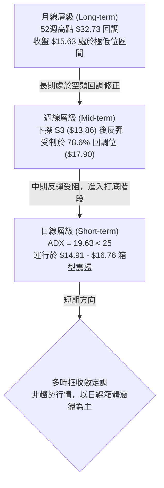

### 📈 長期趨勢 — 12 個月走勢圖

```
SOFI 月線走勢圖（過去 12 個月：2025-12 至 2026-11）
價格軸 ($)
$30.00 ┤ 
$27.00 ┤ ●(2025-12: $26.18)
$24.00 ┤       ●(2026-01: $22.81)
$21.00 ┤ 
$18.00 ┤             ●(02: $17.76)         ●(05: $18.22) ●(08: $17.88)
$15.00 ┤                   ●(03: $15.88) ●(04: $16.10) ●(06: $17.93) ●(07: $16.31) ●(09: $15.72) ●(10: $16.76)
$12.00 ┤                                                                                     ●(11: $15.63 現價)
       └─────────────────────────────────────────────────────────────────────────────
         12月   1月   2月   3月   4月   5月   6月   7月   8月   9月   10月  11月
```

#### 走勢特徵分析表格

| 階段區間 | 時間跨度 | 起訖價位 | 區間漲跌幅 | 走勢特徵與結構分析 |
|:---|:---:|:---:|:---:|:---|
| **單邊下行段** | 2025-12 ~ 2026-03 | $26.18 → $15.88 | -39.34% | 自高位快速崩跌，月線呈現連續實體陰線，市場流動性多殺多 |
| **箱型構建段** | 2026-04 ~ 2026-08 | $16.10 → $17.88 | +11.06% | 價格在 $16.00 - $18.22 構築第一層整理箱體，多空反覆拉鋸 |
| **二次探底段** | 2026-09 ~ 2026-10 | $15.72 → $14.55(週低$13.86) | -11.83% | 跌破前低，創出 52 週最低點 $13.86 (2026-10-16)，釋放恐慌盤 |
| **破底翻反彈** | 2026-10 ~ 2026-11 | $13.86 → $16.76 → $15.63 | +12.77% | 強勁長紅回抽至 $16.76 後遇阻回落，目前於 $15.63 尋求支撐 |

### 📊 中期趨勢（週線分析）

```
SOFI 週線關鍵架構與壓力支撐示意圖
════════════════════════════════════════════════════════════════════
$18.79 ── R2 波段高點阻力 ─────────────────────────────────────────
$17.85 ── R1 關鍵頸線阻力 / 斐波 78.6% ($17.90) ────────────────────
$16.76 ── 10-30 週線反彈高點（近期上檔密集套牢賣壓）───────────────
$15.63 ── 當前價格位置（弱勢徘徊中軌下方）◄◄ [目前位置]
$15.53 ── S1 近期波段支撐（第一道防禦線）───────────────────────────
$14.91 ── S2 箱底強支撐（多頭關鍵防線）─────────────────────────────
$13.86 ── S3 52週歷史低點 / 斐波 100% ─────────────────────────────
════════════════════════════════════════════════════════════════════
```

週線層面顯示，SOFI 在 2026-10-16 探底 $13.86 後，於 2026-10-30 當週出現放量大陽線（成交量高達 416,302,500 股，週漲至 $16.76），但隨後兩週（11-06、11-12）動能快速消退，成交量依序萎縮至 281.57M 與 179.74M，收盤回落至 $15.63，顯示反彈未能演變成持續性中級上升行情。

### ⚡ 趨勢強度評估（ADX 解讀）

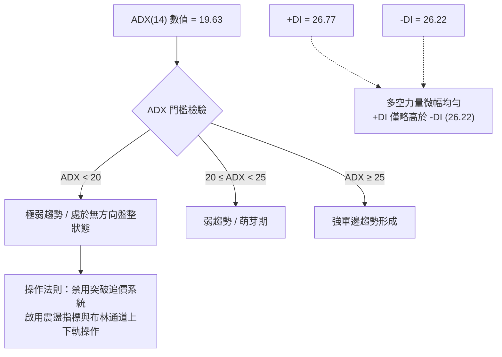

#### ADX 趨勢強度對照解讀

| 指標項目 | 數值 | 門檻區間 | 當前技術定性 | 交易指導意義 |
|:---|:---:|:---:|:---:|:---|
| **ADX(14)** | 19.63 | < 25 (弱趨勢) | 處於盤整震盪市場 | 嚴禁使用順勢追價策略，趨勢突破高機率為假突破 |
| **+DI(14)** | 26.77 | 多方力道 | 買方具備反彈動能 | 買盤力道並未大幅佔優，僅具防守反擊能力 |
| **-DI(14)** | 26.22 | 空方力道 | 賣方壓制力尚存 | 差值僅 0.55，顯示多空雙方處於膠著僵局 |

---

## 3. 圖表形態分析

### 🔍 形態識別系統

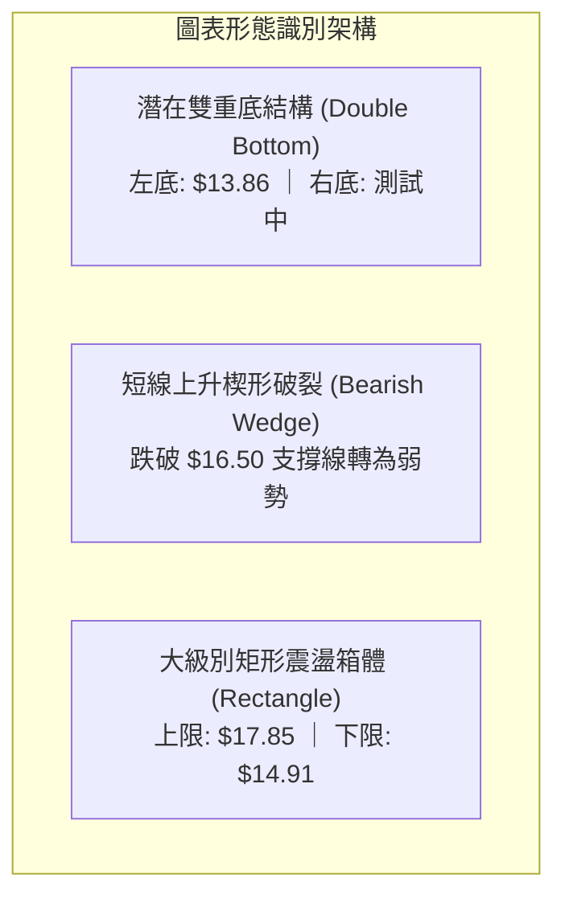

#### 形態識別與信心度評估表

| 識別形態名稱 | 信心度 (%) | 判斷依據（嚴格引用 OHLCV 數據） | 形態完成度 | 目標價計算方式與數值 |
|:---|:---:|:---|:---:|:---|
| **大級別底部箱體震盪** | **75%** | 價格多次在 $14.91 (S2) 獲得支撐，並在 $17.85 (R1) 面臨壓制 | 80% | 箱體震盪，上軌目標：$17.85，下軌目標：$14.91 |
| **潛在雙底反轉形態** | **55%** | 左底於 2026-10-16 創出 $13.86，頸線為 2026-11-04 日高 $17.74 | 45% (尚未突破) | 頸線突破目標：$17.74 + ($17.74 - $13.86) = **$21.62** (需有效突破頸線) |
| **日線反彈旗形回落** | **65%** | 10-30 放量衝高後，日K線呈現重心向下推移，跌破 MA20 ($15.91) | 85% | 測量下行目標：下探測試 S1 **$15.53** 及 S2 **$14.91** |

### 🕯️ 重要 K 線形態分析

依據數據庫中提供的「近 10 根日 K」與「近 8 根週 K」，嚴格依其開高低收進行形態判讀：

#### 近 10 根日 K 線形態解讀

| 日期 | 開盤價 | 最高價 | 最低價 | 收盤價 | 成交量 | K 線形態特徵 | 技術解讀 | 訊號強度 |
|:---:|:---:|:---:|:---:|:---:|:---:|:---|:---|:---:|
| **2026-10-30** | 17.07 | 17.32 | 16.44 | 16.76 | 64.31M | 帶長下影假陰線 | 盤中洗盤後回升，確立反彈格局 | 🟢 強多 |
| **2026-11-02** | 16.98 | 17.60 | 16.57 | 16.60 | 54.61M | 帶上影倒鎚陰線 | 衝高 $17.60 遇阻，高檔獲利了結賣壓湧現 | 🔴 轉弱 |
| **2026-11-03** | 16.74 | 16.85 | 16.47 | 16.77 | 49.01M | 縮量小陽十字星 | 多空拉鋸，等待方向選擇 | 🟡 中性 |
| **2026-11-04** | 17.01 | 17.74 | 16.97 | 17.38 | 55.32M | 光腳實體中陽線 | 向上突破，多頭試圖挑戰 R1 阻力 | 🟢 看多 |
| **2026-11-05** | 17.25 | 17.45 | 15.43 | 16.04 | 78.44M | **放量長陰穿頭破腳** | 高位開出跳水跌破多日支撐，爆量空頭吞噬 | 🔴 強空 |
| **2026-11-06** | 16.13 | 16.56 | 15.93 | 16.21 | 44.19M | 低檔縮量小紅棒 | 暴跌後弱勢喘息，量能大幅萎縮 | 🟡 觀望 |
| **2026-11-09** | 16.33 | 17.04 | 16.15 | 16.75 | 40.54M | 縮量反抽陽線 | 測試 $17.00 整數關卡但無量配合，反彈無力 | 🟡 偏弱 |
| **2026-11-10** | 16.48 | 16.53 | 15.91 | 16.37 | 53.69M | 帶下影流星陰線 | 再次跌回 MA20 之下，反彈動能衰竭 | 🔴 看空 |
| **2026-11-11** | 16.58 | 16.83 | 16.25 | 16.27 | 40.11M | 縮量小實體陰線 | 走勢連續承壓，買盤退場 | 🔴 偏空 |
| **2026-11-12** | 15.83 | 16.19 | 15.61 | 15.63 | 45.40M | **低開低走光腳陰線** | 跌破所有短期均線，收在近低 $15.63，逼近 S1 | 🔴 看空 |

#### 近 8 根週 K 線形態解讀

| 週末日期 | 開盤價 | 最高價 | 最低價 | 收盤價 | 成交量 | 週 K 形態特徵 | 訊號解讀 |
|:---:|:---:|:---:|:---:|:---:|:---:|:---|:---:|
| **2026-09-25** | 17.46 | 17.96 | 16.20 | 16.58 | 302.28M | 長陰下挫 | 🔴 空頭延續 |
| **2026-10-02** | 16.32 | 16.42 | 15.53 | 15.77 | 223.04M | 弱勢黑K | 🔴 陰跌不止 |
| **2026-10-09** | 15.77 | 16.19 | 15.25 | 15.80 | 199.43M | 紡錘十字星 | 🟡 跌勢趨緩 |
| **2026-10-16** | 15.47 | 15.68 | 13.86 | 14.55 | 286.32M | **探底長下影陰線** | 🟢 破底爆量，出現低檔承接盤 |
| **2026-10-23** | 14.75 | 15.11 | 14.18 | 14.61 | 198.52M | 底部縮量紅十字星 | 🟡 二次確認底線 |
| **2026-10-30** | 14.53 | 17.63 | 14.40 | 16.76 | 416.30M | **長紅破底翻吞噬陽線** | 🟢 強烈看多反轉訊號 |
| **2026-11-06** | 16.98 | 17.74 | 15.43 | 16.21 | 281.57M | 衝高回落長上影陰線 | 🔴 上檔阻力沈重，反彈受挫 |
| **2026-11-12** | 16.33 | 17.04 | 15.61 | 15.63 | 179.74M | 連續回吐陰線 | 🔴 弱勢整理，下探尋求支撐 |

### 📉 ASCII 走勢形態示意圖

```
SOFI 近期日線形態結構示意圖
價格
$17.85 ───┤                    [R1 阻力位]
$17.74 ───┤           ▲ (11-04 高點: $17.74)
$17.38 ───┤          / \
$17.00 ───┤         /   \  ▲ (11-09 反抽高點: $17.04)
$16.50 ───┤   ▲    /     \/ \
$16.00 ───┤  / \  /       \  \
$15.63 ───┼─/───\/─────────\──● [現價: $15.63，回踩頸線/支撐帶]
$15.53 ───┤                 ▼ [S1 支撐位: $15.53]
$14.91 ───┤ [S2 支撐位: $14.91]
$13.86 ───┴───▼ (10-16 歷史低點: $13.86，潛在左底)
          ───────────────────────────────────────────► 時間
```

### 🎯 形態目標價計算

1. **若潛在雙底形態成立**：
   - 左底低點：$13.86 (2026-10-16)
   - 頸線位置：$17.74 (2026-11-04 波段高點)
   - 形態高度：$17.74 - $13.86 = $3.88
   - 突破量度目標價：$17.74 + $3.88 = **$21.62**（需日線收盤突破 $17.85 並帶量確認）
2. **當前箱型下行回踩目標**：
   - 11-05 跌破頸線短線反轉後，首要回撤目標為波段低點聚類 S1 **$15.53**。
   - 若失守 S1，則進一步下測箱體強支撐 S2 **$14.91**。

---

## 4. 支撐與阻力

### 🗺️ 關鍵價位分布圖

```
SOFI 價位結構分布圖 (OHLCV 嚴格計算)
══════════════════════════════════════════════════════════════════
$19.62 ║████████████████████████████████║ 強阻力 R3 (波段高點聚類)
$18.79 ║████████████████████            ║ 阻力 R2 (反彈延伸壓力)
$18.06 ║▓▓▓▓▓▓▓▓▓▓▓▓▓▓▓▓                ║ 布林通道上軌
$17.90 ║████████████████████████        ║ 斐波那契 78.6% 回調位
$17.85 ║████████████████████████████████║ 關鍵頸線阻力 R1
───────╫────────────────────────────────╫──────────────────────────
$15.91 ║────────────────────────────────║ 布林中軌 / MA20
$15.63 ╠════════════════════════════════╣ ◄ 現價 ($15.63)
───────╫────────────────────────────────╫──────────────────────────
$15.53 ║▓▓▓▓▓▓▓▓▓▓▓▓▓▓▓▓▓▓▓▓▓▓▓▓        ║ 近期關鍵支撐 S1 (-0.65%)
$14.91 ║████████████████████████████████║ 箱體強支撐 S2 (-4.61%)
$13.86 ║████████████████████████████████║ 52週歷史低點 S3 / 斐波 100%
══════════════════════════════════════════════════════════════════
```

### 🚧 阻力位分析表

| 阻力級別 | 準確價位 | 距現價幅標 | 形成原因依據 | 突破難度 | 重要性權重 |
|:---:|:---:|:---:|:---|:---:|:---:|
| **R1** | **$17.85** | +14.20% | 近一年波段高點密集聚類、11-04 反彈高點附近、斐波 78.6% ($17.90) | 🔴 極高 | ★★★★★ |
| **R2** | **$18.79** | +20.19% | 2026 年 8 月波段高點聚類、中期均線反壓位 | 🔴 高 | ★★★★☆ |
| **R3** | **$19.62** | +25.51% | 前期大型密集成交套牢區頂部 | 🔴 極高 | ★★★☆☆ |

### 🛡️ 支撐位分析表

| 支撐級別 | 準確價位 | 距現價幅標 | 形成原因依據 | 守住機率 | 重要性權重 |
|:---:|:---:|:---:|:---|:---:|:---:|
| **S1** | **$15.53** | -0.65% | 近期日線波段低點聚類 (10-02 低點、11-05/11-12 盤中低位防禦點) | 🟡 60% | ★★★★☆ |
| **S2** | **$14.91** | -4.61% | 10 月築底雙重次低點聚類區間、重要心理整數防線 | 🟢 75% | ★★★★★ |
| **S3** | **$13.86** | -11.32% | 52 週歷史最低點 (2026-10-16)、斐波那契 100% 絕對底部 | 🟢 90% | ★★★★★ |

### 📐 斐波那契回調位分析

依據 52 週完整波動區間（高點 **$32.73** → 低點 **$13.86**，波動幅度 **$18.87**），關鍵回調位精確解析如下：

```
斐波那契回調尺（52W High $32.73 → 52W Low $13.86）
0.0%  ── $32.73 (52W 最高點)
23.6% ── $28.28
38.2% ── $25.52
50.0% ── $23.29 (多空大分水嶺)
61.8% ── $21.07 (黃金分割關鍵阻力)
78.6% ── $17.90 (強阻力聚類帶，與 R1 $17.85 形成共振)
100.0%── $13.86 (52W 最低點)
```

#### 斐波那契位置深度解讀

- **當前位置**：SOFI 當前價格 **$15.63** 運行於 **78.6% ($17.90)** 與 **100.0% ($13.86)** 之間。
- **技術意義**：
  1. 價格深陷於斐波那契 78.6% 回調位下方，表明過去一年的長期牛市結構已完全遭到破壞，目前僅能視為極深度的熊市超跌修復。
  2. 78.6% 斐波那契位 **$17.90** 與波段阻力聚類 **R1 ($17.85)** 形成極強的**共振阻力帶**。在多頭有效放量突破 $17.90 之前，任何向上脈衝均屬於中長期熊市框架下的超跌反彈，不具備反轉特徵。
  3. 下方 **$13.86** 為 100% 基準點，若失守將開啟未知的破底空間。

---

## 5. 技術指標深度解讀

### 🎛️ 指標訊號總覽

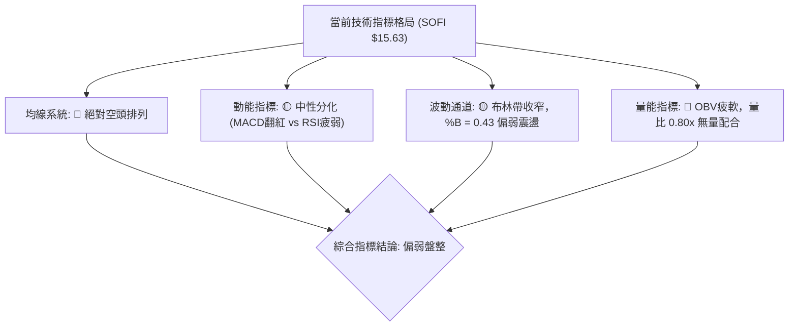

### 📈 移動平均線排列分析

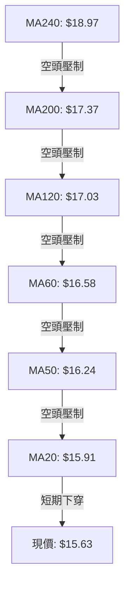

#### 均線數據與偏離度結構表

| 均線名稱 | 當前數值 | 價格相對於均線 | 偏離幅度 (%) | 均線斜率與狀態 | 技術意涵 |
|:---|:---:|:---:|:---:|:---|:---|
| **MA5** | $16.25 | 下方 | -3.79% | ▼ 下行加速 | 極短線空方主導，連續跌破 |
| **MA10** | $16.48 | 下方 | -5.15% | ▼ 拐頭向下 | 短線反彈遇阻回落 |
| **MA20** | $15.91 | 下方 | -1.76% | ▼ 走平下彎 | 月線失守，短線轉為弱勢震盪 |
| **MA50** | $16.24 | 下方 | -3.76% | ▼ 穩定向下 | 中期趨勢受壓，反彈主要壓力區 |
| **MA60** | $16.58 | 下方 | -5.72% | ▼ 向下發散 | 季線下行壓制顯著 |
| **MA120** | $17.03 | 下方 | -8.24% | ▼ 空頭排列 | 半年線持續向下 |
| **MA200** | $17.37 | 下方 | -10.02% | ▼ 走空 | 長期牛熊分水嶺，長期趨勢偏空 |
| **MA240** | $18.97 | 下方 | -17.59% | ▼ 下滑 | 年線重大壓力 |

**解讀結論**：目前均線系統呈現標準的**完全空頭排列**（MA20 < MA50 < MA60 < MA120 < MA200 < MA240），且所有均線均位於現價上方，形成層層沉重的動態壓制。現價偏離 MA200 達 -10.02%，中期在未收復 MA20 ($15.91) 之前，難有趨勢性反轉機會。

### 📉 RSI(14) 分析

- **當前數值**：**45.86** (Wilder 平滑計算)
- **進度條展示**：
  ```
  超賣 (0-30)           中性區間 (30-70)                 超買 (70-100)
  [░░░░░░░░░░░░░░░][████████░░░░░░░░░░░░░░░░░░░░][░░░░░░░░░░░░░░░]
  0              30          45.86               70             100
  ```
- **區間診斷**：RSI 位於 45.86，落於中性偏弱區域（40–50），表明多空動能處於均衡但多頭偏弱的狀態，既未陷入嚴重超賣（恐慌拋售），亦缺乏強勢買盤推升。
- **背離檢驗**：
  - 價格端：比較近 20 根 K 棒（2026-10-16 低點 $13.86 至 2026-11-12 收盤 $15.63），價格重心雖由破底回升，但近期高點自 11-04 之 $17.74 回落至 $15.63。
  - RSI 端：10-16 RSI 為 34.7，11-04 衝至 57.0 隨後回調至 45.86。
  - **結論**：首尾與近期高低點同向運動，**確認無頂背離亦無底背離**現象。

### 📊 MACD(12/26/9) 訊號解讀

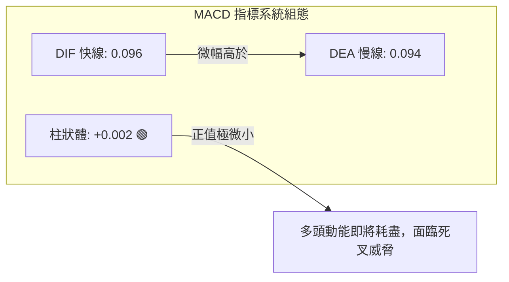

- **數值分析**：
  - DIF（快線）：0.096
  - DEA（慢線/訊號線）：0.094
  - MACD 柱狀體：**+0.002**
- **訊號解讀**：
  - 日線 MACD 目前雖維持微幅黃金交叉（柱狀體為正），但柱狀體僅有極微弱的 +0.002，相較於 10-30 的 +0.360 與 11-06 的 +0.160，呈現**斷崖式縮減**。
  - 此現象表明 10 月底啟動的破底反彈動能已幾乎消耗殆盡，快慢線隨時可能在零軸附近形成「高位/次高位死亡交叉」，發出新一輪賣出或盤整訊號。

### 📦 布林通道分析

```
SOFI 布林通道結構 (20, 2)
══════════════════════════════════════════════════════════════════
$18.06 ── BB 上軌 (Upper Band)
          │
          │
$15.91 ── BB 中軌 (Middle Band / MA20)
          │ 
$15.63 ── 現價位置 (● %B = 0.43，中軌下方弱勢徘徊)
          │
          │
$13.76 ── BB 下軌 (Lower Band)
══════════════════════════════════════════════════════════════════
```

- **通道參數**：
  - 上軌：$18.06
  - 中軌 (MA20)：$15.91
  - 下軌：$13.76
  - 通道寬度：$18.06 - $13.76 = $4.30 (帶寬 27.5%)
  - **%B 指標**：**0.43**
- **解讀與意涵**：
  - %B = 0.43 清楚指出價格已回落至中軌下方（中軌 = 0.50），代表短線多頭掌控權喪失，價格重新進入下半通道弱勢運行。
  - 布林通道開口未見劇烈放大，呈現水平收斂態勢，驗證了 ADX < 25 所指示的「區間盤整行情」。下軌 **$13.76** 與 52 週最低點 **$13.86** 構成極佳的通道下檔保護。

### 💹 成交量分析（量價配合度）

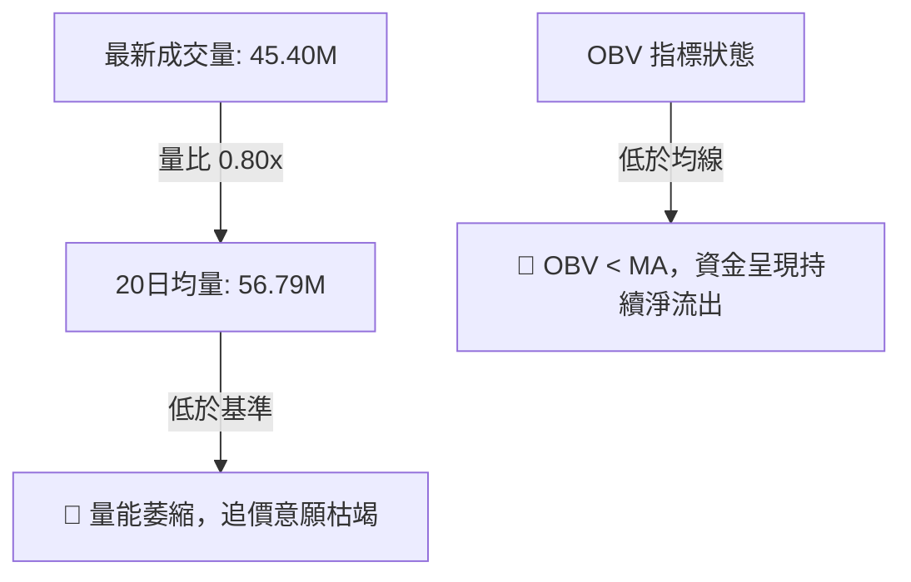

- **成交量數據解讀**：
  - 最新交易日（2026-11-12）成交量為 **45,398,200** 股。
  - 20 日均量為 **56,785,690** 股（量比僅 **0.80x**）；50 日均量為 **50,134,032** 股。
- **量價關係判斷**：
  - 11-04 向上衝高時成交量為 55.32M，11-05 暴跌陰線成交量急劇放大至 78.44M，顯示「**下跌放量、反彈縮量**」的典型空頭量價特徵。
  - OBV（能量潮）持續處於其自身移動平均線之下，表明大級別機構籌碼並未積極進場建倉，反彈僅由零星空頭平倉買盤驅動，缺乏實質資金支持。

---

## 6. 動能與波動率

### ⚡ 動能評估四象限

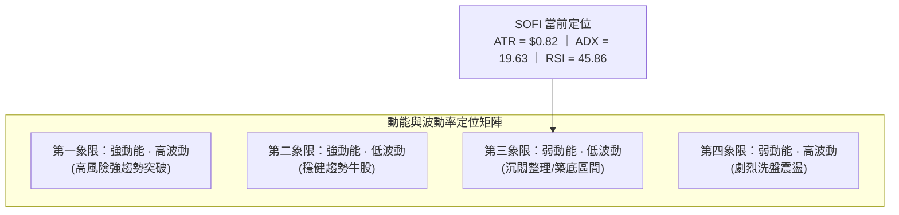

#### 四象限特徵與策略對照表

| 象限分區 | 動能維度 | 波動維度 | 當前狀態標註 | 操作意涵與指引 |
|:---:|:---:|:---:|:---:|:---|
| **Q1** | 強動能 | 高波動 | — | 突破追價，放大停利空間 |
| **Q2** | 強動能 | 低波動 | — | 趨勢穩健持有，拉回逢低承接 |
| **Q3** | **弱動能** | **中低波動** | **✓ (SOFI 當前定位)** | **耐心觀望，禁用趨勢突破策略，僅限關鍵支撐低吸高拋** |
| **Q4** | 弱動能 | 高波動 | — | 假突破洗盤頻繁，宜空倉避開 |

### 📊 ATR 波動率分析

- **ATR(14) 數值**：**$0.82** (Wilder 平滑計算)
- **ATR 佔比 (波動強度)**：**5.26%**（相對於收盤價 $15.63）
- **風控參數具體建議**：
  - **極短線動態止損距離 (1.0 × ATR)**：**$0.82**（對應價位：$15.63 - $0.82 = **$14.81**，恰好覆蓋 S2 $14.91 關鍵防線）。
  - **波段操作止損距離 (1.5 × ATR)**：**$1.23**（對應保護空間至 **$14.40**）。
  - **常態日內預期波幅**：每日合理運行區間約在 **$14.81 ~ $16.45** 之間。

### 📐 Beta 與市場相關性

- **Beta 係數**：**2.241**
- **市場特徵解讀**：
  - SOFI 屬於**超高 Beta 成長型/金融科技標的**。其波動率為標普 500 指數的 **2.24 倍**。
  - 當大盤（美股整體市場）出現 1% 的修正時，SOFI 平均將承受約 2.24% 的跌幅；反之大盤強勢反彈時其彈性亦極佳。
  - **空頭部位警示**：高達 **17.5%** 的空單流通比（Short % Float）與 **4.19** 的空頭回補天數（Short Ratio），意味著在低位容易因微小利多或支撐確立而引發短線「軋空爆發（Short Squeeze）」，這也是 10-30 能單週暴漲拉出長紅的主要動力來源。

---

## 7. 多時框架總結

### 📋 時框架評分表

| 時框架 | 趨勢方向 | 動能狀態 | 均線排列 | 形態特徵 | 綜合評分 | 戰略建議 |
|:---:|:---:|:---:|:---:|:---:|:---:|:---|
| **月線 (長期)** | 🔴 偏空 | 弱 (RSI 40附近) | 空頭排列 (低於MA200) | 自高位深幅回調修復 | **30/100** | 長期未見反轉，嚴控底倉 |
| **週線 (中期)** | 🟡 震盪 | 中性 (MACD正值收斂)| MA20 走平反壓 | 探底 $13.86 後箱型築底 | **45/100** | 箱型區間震盪，以防守為主 |
| **日線 (短期)** | 🔴 偏弱 | 轉弱 (日K連跌破MA20)| MA20/50 壓制於上方 | 衝高回踩 S1 測試防線 | **40/100** | 等待回踩 S1/S2 止跌訊號 |

### 🔲 綜合訊號矩陣

```
時框訊號一致性矩陣
══════════════════════════════════════════════════════════════════
維度            長期 (月線)      中期 (週線)      短期 (日線)
──────────────────────────────────────────────────────────────────
趨勢方向        🔴 空頭          🟡 震盪築底      🔴 弱勢回調
均線架構        🔴 空頭發散      🔴 空頭壓制      🔴 跌破短期MA
動能指標        🔴 負向沉澱      🟡 柱狀體收斂    🟢 MACD金叉微存
波動定位        🟡 歷史低檔      🟡 振幅收斂      🟡 布林中下軌
量能結構        🔴 資金流出      🟢 底部放量承接  🔴 近日持續縮量
──────────────────────────────────────────────────────────────────
最終權重研判：短期與長期偏空，中期提供箱體支撐。空方佔優，但下檔空間受限。
══════════════════════════════════════════════════════════════════
```

### ⚖️ 多時框收斂結論

依據多時框收斂規則：
1. **當前趨勢定性**：ADX(14) = **19.63 < 25**，市場確認為**標準盤整行情（Non-trending / Range-bound Market）**。
2. **主導維度判定**：在盤整市況下，趨勢追蹤系統失效，必須以**日線布林通道上下軌 ($13.76 ~ $18.06)** 與 **關鍵支撐阻力 ($14.91 ~ $17.85)** 作為主要交易參照體系。
3. **唯一方向性結論**：
   - **中性偏弱·區間防守（Neutral-Bearish Range Consolidation）**。
   - 儘管日線層級連續下挫破壞了短期反彈節奏，但下方逼近波段密集支撐區 S1 ($15.53) 與 S2 ($14.91)，不宜在當前 $15.63 低位盲目殺跌做空；同時均線空頭排列未變，亦不可冒進追多。主策略鎖定「**回踩強支撐後的低吸高拋區間交易**」。

---

## 8. 交易策略建議

### 🗺️ 策略決策流程圖

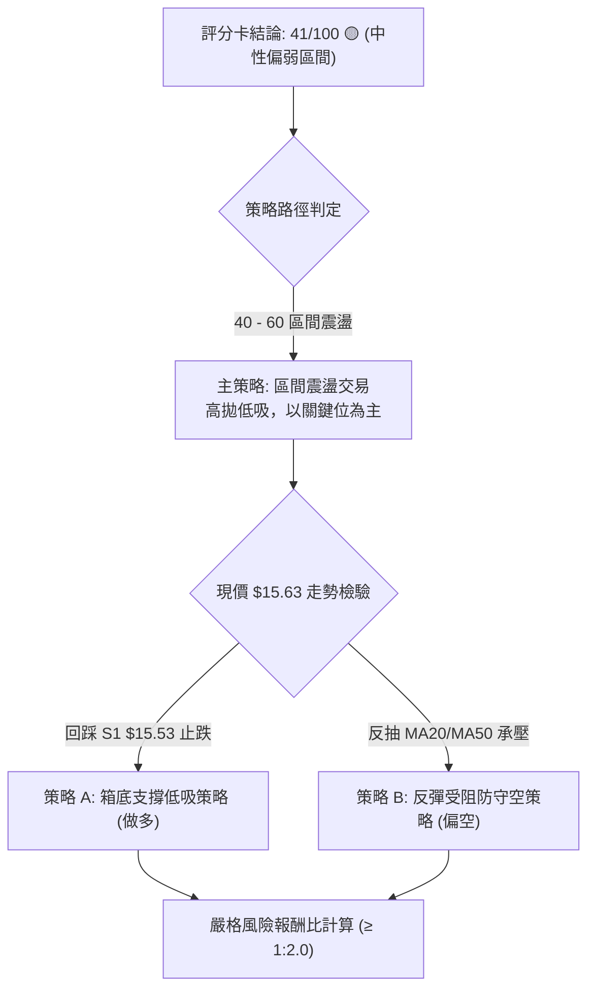

### 🧭 策略路由

> **當前主策略方向 = 中性區間操作，以箱底支撐低吸為核心策略（依技術評分卡 41/100 定調）**

由於綜合評分處於 **40–60** 的中性震盪區間，且 ADX < 25 明確定義為非趨勢行情，交易方針以**布林下軌及波段支撐點位為進場邊界**，拒絕追漲殺跌，等待邊界訊號確認。

### 🎯 價格情境階梯 (Price Scenarios)

| 觸發條件 | 下一目標 | 後續延伸 | 情境含義與操作對策 |
|:---|:---:|:---:|:---|
| **放量突破 R1 ($17.85)** | **R2 ($18.79)** | **R3 ($19.62)** | 底部頸線正式突破，牛熊反轉確立，全面轉為波段做多 |
| **站穩現價區間 ($15.53 - $16.24)** | **MA20 ($15.91)** | **R1 ($17.85)** | 維持 $15.00 - $17.85 箱型拉鋸，執行高拋低吸 |
| **跌破 S1 ($15.53)** | **S2 ($14.91)** | **S3 ($13.86)** | 短線回調加深，向下尋求 52 週雙底支撐確認 |

### 📊 情境機率分佈

| 運行情境 | 發生機率 | 主要技術依據 |
|:---|:---:|:---|
| **區間震盪整理 (主情境)** | **55%** | ADX = 19.63 確立無趨勢；布林帶收斂；成交量衰退至 0.80x，不具備破局動能 |
| **回落測試 S2/S3 (次情境)**| **30%** | 均線系統完全空頭排列；MACD 柱狀體快速衰竭至 +0.002；日K線連續走低 |
| **強勢突破 R1 (小機率)** | **15%** | 上方套牢賣壓沉重，OBV < MA 顯示缺乏機構增量資金介入，突破需重大利多刺激 |

### 🟢 主策略詳情

本報告依據技術數據中的精確點位，提供兩套符合嚴格風控標準的操作策略：

| 策略要素 | 策略 A（箱底支撐低吸 — 做多） | 策略 B（反彈均線受阻 — 逢高空） |
|:---|:---|:---|
| **操作方向** | **做多 (Long)** | **做空 (Short)** |
| **進場條件** | 價格回踩 S1 ($15.53) 出現下影線止跌確認 | 價格弱勢反抽至 MA50 ($16.24) 遇阻收上影線 |
| **進場價格** | **$15.53** (支撐位 S1) | **$16.24** (均線 MA50 反壓) |
| **止損價格** | **$14.80** (跌破 S2 $14.91 離場保護) | **$16.85** (突破 11-11 高點 $16.83 離場) |
| **目標價 T1** | **$17.85** (阻力位 R1 / 頸線) | **$15.53** (支撐位 S1) |
| **目標價 T2** | **$18.79** (阻力位 R2) | **$14.91** (支撐位 S2) |
| **風險報酬比** | **1 : 3.18（以 T1 計）** <br/>*(計算式：(17.85 - 15.53) ÷ (15.53 - 14.80) = 2.32 ÷ 0.73)* | **1 : 1.16（以 T1 計）** <br/>*(計算式：(16.24 - 15.53) ÷ (16.85 - 16.24) = 0.71 ÷ 0.61)* <br/>*(以 T2 計則為 1 : 2.18)* |
| **成功機率** | **55%** | **50%** |
| **建議倉位** | **10% ~ 15%** (輕倉參與) | **5% ~ 8%** (短線避險) |

### 🔴 反向風險觸發點（對沖與停損提示）

- **做多策略失效條件**：若日線收盤價**實體跌破 $14.91 (S2)**，代表雙底構築失敗，可能直接滑向 $13.86 甚至破底，多頭必須立即無條件停損，並可反手配置空單避險。
- **做空策略失效條件**：若日線帶量（成交量 > 60M）**長紅突破 $17.85 (R1)**，代表底部形態成立，軋空行情啟動，空頭部位必須立即止損平倉。

### ⭐ 整體訊號強度評星

```
╔══════════════════════════════════════════════════════════════════╗
║ 做多訊號強度：  ★★☆☆☆  (2.5/5 星 — 僅具備支撐低吸博反彈價值)    ║
║ 做空訊號強度：  ★★★☆☆  (3.0/5 星 — 順應大級別均線壓制)          ║
║ 整體訊號可信度：★★★☆☆  (3.0/5 星 — 盤整市震盪，需嚴控停損)      ║
╚══════════════════════════════════════════════════════════════════╝
```

---

## 9. 風險提示與監控

### ✅ 關鍵監控指標 Checklist

```
╔══════════════════════════════════════════════════════════════════╗
║               SOFI 交易風控即時監控 Checklist                    ║
╠══════════════════════════════════════════════════════════════════╣
║ [ ] 價格是否跌破 S1 ($15.53)？若跌破，次日需防範下探 S2 ($14.91) ║
║ [ ] 日成交量是否萎縮至 40M 以下？(代表流動性枯竭，震盪加劇)     ║
║ [ ] 日線 MACD 柱狀體是否翻負（由 +0.002 轉負）？確認空頭再起    ║
║ [ ] RSI(14) 是否跌破 40？(跌破 40 意味著轉入加速下行區間)        ║
║ [ ] 借券賣出比例 (Short % Float = 17.5%) 是否出現異常回補潮？    ║
║ [ ] 大盤波動率 (VIX) 與金融股板塊指數是否出現系統性共振下跌？    ║
╚══════════════════════════════════════════════════════════════════╝
```

### ⚠️ 風險場景分析

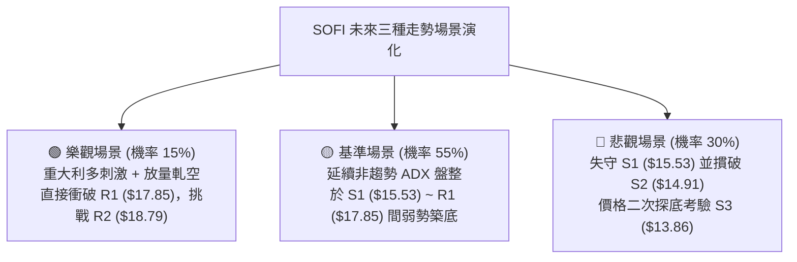

### 🛡️ 風險管理重要提醒

1. **Beta 放大效應控管**：SOFI 的 Beta 高達 **2.241**，其波動劇烈程度為大盤兩倍以上。對於偏好穩健的投資者，單一標的倉位上限**強烈建議不得超過總投資組合的 10%**。
2. **ATR 動態部位調整**：當前 ATR 為 $0.82，每日波動佔比 5.26%。部位規模計算應以單筆最大可承擔損失（例如總資產的 1%）除以止損距離（$0.73），嚴格執行紀律，杜絕憑感覺加倉攤平。
3. **空頭回補陷阱（軋空與誘多）**：空單流通比達 17.5%，在低檔極易出現無預警的單日暴漲（如 10-30 日盤中急拉），做空者切勿於低位盲目追空，必須嚴格依據阻力位設防。

---

## 📋 報告總結

```
╔════════════════════════════════════════════════════════════════════╗
║                   SOFI 技術分析報告總結儀表板                      ║
╠════════════════════════════════════════════════════════════════════╣
║ 報告日期：2026-11-13               當前收盤價：$15.63              ║
║ 分析評級：⚖️ 中性偏弱 (41/100)      市場狀態：無趨勢·箱型震盪 (ADX=19.63)║
╠════════════════════════════════════════════════════════════════════╣
║ 趨勢維度結論：                                                     ║
║ ├─ 長期趨勢 (月線)：🔴 空頭回調深度修復 (偏離 MA200 達 -10.02%)    ║
║ ├─ 中期趨勢 (週線)：🟡 探底 $13.86 後箱型築底，等待頸線確認        ║
║ ├─ 短期趨勢 (日線)：🔴 反彈動能衰減，跌破 MA20 ($15.91) 尋求 S1 支撐║
║                                                                    ║
║ 核心關鍵價位矩陣：                                                 ║
║ ├─ 極限阻力 R3：$19.62 (+25.51%)                                   ║
║ ├─ 中期阻力 R2：$18.79 (+20.19%)                                   ║
║ ├─ 關鍵頸線 R1：$17.85 (+14.20%) ｜ 斐波 78.6% 回調位 ($17.90)     ║
║ ├─ 當前價格位 ：$15.63 (布林中下軌徘徊區間)                         ║
║ ├─ 近期支撐 S1：$15.53 (-0.65%)  ｜ 短線第一防線                    ║
║ ├─ 強力支撐 S2：$14.91 (-4.61%)  ｜ 箱體防守樞紐                    ║
║ └─ 歷史底部 S3：$13.86 (-11.32%) ｜ 52週最低點 / 斐波 100%          ║
║                                                                    ║
║ 華爾街共識參考：                                                   ║
║ └─ 分析師目標價：均值 $20.84 ｜ 低標 $12.00 ｜ 高標 $30.00 (評級: Hold)║
╠════════════════════════════════════════════════════════════════════╣
║ 最優交易策略推薦：                                                 ║
║ 1. 🥇 首選策略 (低吸反彈)：等待回踩 S1 ($15.53) 不破進場做多，      ║
║      止損設於 $14.80，目標 R1 ($17.85)，風險報酬比 1 : 3.18        ║
║ 2. 🥈 次選策略 (區間防守)：若反抽承壓於 MA50 ($16.24) 可輕倉試空， ║
║      止損設於 $16.85，目標 S1 ($15.53)，風險報酬比 1 : 1.16        ║
║ 3. 🥉 保守策略 (破局跟隨)：空倉觀望，耐心等待價格帶量突破 $17.85   ║
║      或跌破 $14.91 後，再順勢進場參與單邊行情                      ║
╚════════════════════════════════════════════════════════════════════╝
```

---

> ⚠️ **免責聲明**：本報告為依據客觀量化技術指標與歷史走勢數據產出之技術分析研究報告，所有價位、圖表與策略推演**僅供學術研究與投資決策參考**，**不構成任何要約、招攬或具體投資建議**。金融市場瞬息萬變，高 Beta 股票波動劇烈，投資人應獨立思考、審慎評估風險並自負盈虧。

---
*報告生成時間：2026-11-13 ｜ 數據來源：Yahoo Finance ｜ 分析框架：多時框技術分析體系*