# SOFI 技術分析報告

> **報告日期**：2026-11-14 ｜ **語言**：繁體中文 ｜ **數據來源**：使用者提供之 Yahoo Finance 技術數據 ｜ **當前價格**：**$15.42**（2026-11-13 收盤）

> **數據紀律**：本報告的支撐、阻力及斐波那契價位均引用資料包列出的數值。除非明確標示為依公式推算，否則不另行創造精確價位。週線及日線 K 棒判讀僅使用資料包提供的近 8 根週 K 與近 10 根日 K。

---

## 目錄

| 章節 | 內容 |
|------|------|
| [1. 技術面概覽](#1-技術面概覽) | 訊號儀表板、核心指標、評分卡 |
| [2. 趨勢分析](#2-趨勢分析) | 多時框趨勢、長中短期走勢 |
| [3. 圖表形態分析](#3-圖表形態分析) | 形態識別、K 線組合、目標價 |
| [4. 支撐與阻力](#4-支撐與阻力) | 關鍵價位、斐波那契回調 |
| [5. 技術指標深度解讀](#5-技術指標深度解讀) | MA、RSI、MACD、布林通道、成交量 |
| [6. 動能與波動率](#6-動能與波動率) | 動能評估、ATR、Beta |
| [7. 多時框架總結](#7-多時框架總結) | 時框架評分矩陣 |
| [8. 交易策略建議](#8-交易策略建議) | 空方主策略、風險報酬比 |
| [9. 風險提示與監控](#9-風險提示與監控) | 監控指標、風險場景 |

---

## 1. 技術面概覽

### 🎯 技術訊號儀表板

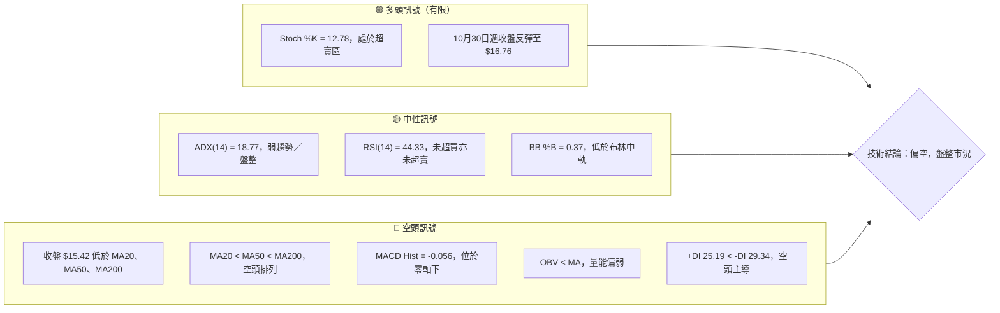

**概覽判讀：** 股價位於 52 週區間下緣附近，且低於 MA20、MA50、MA200；均線與 MACD、DI、OBV 大致偏空。然而 ADX 僅 18.77，未達趨勢行情門檻，RSI 也仍在中性區。故整體不是「強趨勢空頭」判斷，而是**弱勢盤整中的偏空結構**：較大的方向風險偏向下方，但交易上仍須留意區間反彈及超賣回升。

### 📊 核心指標速覽表

| 指標類別 | 指標名稱 | 當前數值 | 訊號 | 解讀 |
|----------|----------|----------:|------|------|
| **價格** | 收盤價 | **$15.42** | 🔴 | 僅作為資料包所列當前價格；位於 52 週區間 8.7% 位置 |
| **均線** | MA20 | $15.95 | 🔴 | 收盤低於 MA20，短線尚未收復趨勢參考線 |
| **均線** | MA50 | $16.17 | 🔴 | 收盤低於 MA50，中短期趨勢偏弱 |
| **均線** | MA200 | $17.32 | 🔴 | 收盤低於 MA200，長期趨勢仍受壓 |
| **均線** | 排列 | MA20 < MA50 < MA200 | 🔴 | 空頭排列，反彈可能遇到均線供給壓力 |
| **動能** | RSI(14) | 44.33 | 🟡 | 中性偏弱，未處於傳統超賣區 |
| **動能** | MACD / Signal | 0.024 / 0.080 | 🔴 | MACD 低於 Signal，MACD 柱為 -0.056 |
| **動能** | Stoch %K / %D | 12.78 / 35.89 | 🟡 | %K 落入超賣區；需要轉折確認，不代表必然反彈 |
| **趨勢強度** | ADX(14) | 18.77 | 🟡 | 弱趨勢／盤整；依規則以日線布林通道作區間參考 |
| **波動** | ATR(14) | $0.81 | 🟡 | 約為股價 5.26%，單日波動幅度偏大 |
| **波動** | Beta | 2.241 | 🔴 | 對市場波動敏感度高；不等同於相關係數 |
| **成交量** | 最新量／20 日均量 | 38.169M／55.735M | 🔴 | 量比 0.68 倍，低於 20 日均量 |
| **成交量** | OBV | OBV < MA | 🔴 | 量能趨勢疲弱，未確認價格反彈 |

### 🏆 技術評分卡

評分採 1–10 分制；綜合評分依六項子評分的**算術平均**，四捨五入至整數。以下同時標示對應百分制分數。

```text
╔══════════════════════════════════════════════════════════╗
║              技術評分卡 — SOFI（2026-11-14）             ║
╠══════════════════════════════════════════════════════════╣
║ 趨勢強度      ██████░░░░░░░░░░░░░░  3/10  30/100  🔴   ║
║ 動能指標      ████████░░░░░░░░░░░░  4/10  40/100  🔴   ║
║ 支撐穩定度    ██████████░░░░░░░░░░  5/10  50/100  🟡   ║
║ 成交量配合    ██████░░░░░░░░░░░░░░  3/10  30/100  🔴   ║
║ 形態完整度    ██████░░░░░░░░░░░░░░  3/10  30/100  🔴   ║
║ 均線排列      ████░░░░░░░░░░░░░░░░  2/10  20/100  🔴   ║
╠══════════════════════════════════════════════════════════╣
║ 六項平均      (3+4+5+3+3+2) ÷ 6 = 3.33，四捨五入為 3/10 ║
║ 綜合評分      ██████░░░░░░░░░░░░░░  3/10  30/100  🔴   ║
╚══════════════════════════════════════════════════════════╝
```

**評分理由：**

- **趨勢強度 3/10：** 股價低於 MA20、MA50、MA200，週線近期亦較 7 月收盤走低；但 ADX 18.77 表示趨勢本身不強，故不是最低分。
- **動能指標 4/10：** MACD 柱為負、DI 偏空；RSI 44.33 尚未超賣，Stochastic 超賣提供反彈可能，因此保留部分分數。
- **支撐穩定度 5/10：** S1 為 $14.91、S2 為 $13.86，現價與 S1 的列示距離為 -3.31%；支撐尚未被確認失守，但沒有足夠訊號評定為強支撐。
- **成交量配合 3/10：** 最新成交量低於 20 日均量，且 OBV 低於其均線。
- **形態完整度 3/10：** 提供的 K 線與收盤走勢不足以確認高信心度的反轉幾何形態。
- **均線排列 2/10：** MA20 < MA50 < MA200，收盤價也低於三條主要均線。

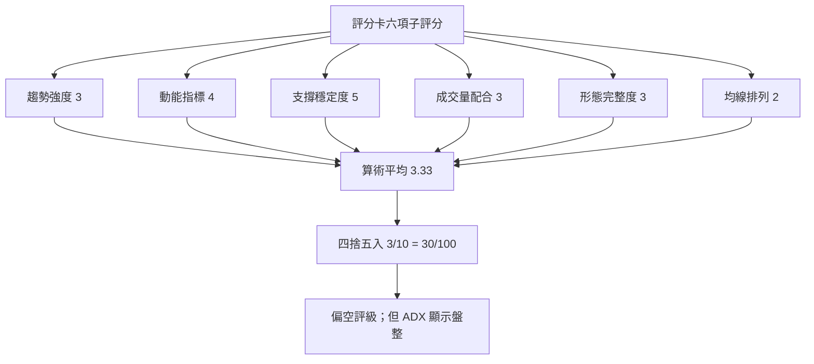

---

## 2. 趨勢分析

### 🌐 多時框趨勢分析

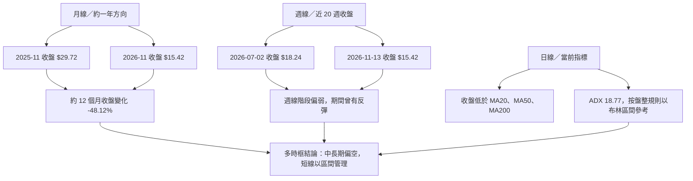

### 📈 長期趨勢 — 12 個月走勢圖（Unicode）

以下展示 2025 年 11 月至 2026 年 11 月的月收盤價。資料包含 13 個月度觀測點，即 12 個月間隔。圖中每個 `●` 對應右側標註的月收盤；價格路徑為視覺化近似，並非逐日行情。

```text
SOFI 月線收盤走勢（2025-11 至 2026-11；每點為月收盤）
價格軸（USD）

$30 ┤ ● 29.72
$28 ┤
$26 ┤     ● 26.18
$24 ┤
$22 ┤         ● 22.81
$20 ┤
$18 ┤             ● 17.76 ─────── ● 18.22 ─ ● 17.93
$16 ┤                         ● 15.88 ●16.10              ●16.31    ●15.72  ●16.76
$14 ┤                                                           ●17.88?*        ●15.42
$12 ┤
     └──────────────────────────────────────────────────────────────────────────
       25-11 25-12 26-01 26-02 26-03 26-04 26-05 26-06 26-07 26-08 26-09 26-10 26-11
```

> **圖表校正說明：** 為避免圖形位置造成誤讀，月度數值的精確來源如下表；其中 2026-08 為 $17.88、2026-09 為 $15.72、2026-10 為 $16.76、2026-11 為 $15.42。ASCII 圖僅表達階段方向，應以表中精確數值為準。此資料未提供逐月最高價／最低價，圖中的關鍵高低是**月收盤**，不代表盤中高低點。

| 月份 | 月收盤 | 相鄰月收盤變化 | 趨勢觀察 |
|------|-------:|----------------:|----------|
| 2025-11 | $29.72 | — | 觀察區間起始值 |
| 2025-12 | $26.18 | -11.94% | 月收盤回落 |
| 2026-01 | $22.81 | -12.87% | 延續下行 |
| 2026-02 | $17.76 | -22.23% | 跌幅擴大 |
| 2026-03 | $15.88 | -10.59% | 下行延續 |
| 2026-04 | $16.10 | +1.39% | 小幅回升 |
| 2026-05 | $18.22 | +13.17% | 月收盤反彈 |
| 2026-06 | $17.93 | -1.59% | 高位整理／微幅回落 |
| 2026-07 | $16.31 | -9.03% | 再度走弱 |
| 2026-08 | $17.88 | +9.63% | 反彈但未恢復長期升勢 |
| 2026-09 | $15.72 | -12.08% | 回落 |
| 2026-10 | $16.76 | +6.62% | 月收盤反彈 |
| 2026-11 | $15.42 | -7.99% | 截至 11 月 13 日的月內收盤 |

由 2025 年 11 月收盤 $29.72 至 2026 年 11 月收盤 $15.42，變化為：

\[
(15.42 \div 29.72 - 1)\times 100\% = -48.12\%
\]

此計算使用月收盤價，不應與 52 週最高價 $31.75 至當前價的跌幅混為一談。以資料包的 52 週高點 $31.75 計，現價低於該高點約 **51.43%**；以 52 週區間位置計，資料包已標示現價位於區間 **8.7%** 位置。

**長期趨勢判讀：**

1. 月度收盤序列從 $29.72 降至 $15.42，整體呈現明顯下降。
2. 期間有 2026 年 5 月及 8 月的月收盤反彈，但其後仍回落，尚不足以改變中長期方向判斷。
3. 月度收盤不提供每月盤中高低點；因此不以這組資料另行宣稱月線雙底、頭肩頂或精確波段結構。
4. 價格位置接近 52 週區間下端，表示下方支撐區的重要性升高，但不等同支撐已確認有效。

### 📊 中期趨勢（週線分析）

近 20 週收盤從 2026-07-02 的 $18.24 到 2026-11-13 的 $15.42，變動為：

\[
(15.42 \div 18.24 - 1)\times 100\% = -15.46\%
\]

近 8 根週 K 顯示，10 月 16 日收盤 $14.55 後，10 月 30 日回升至 $16.76，隨後於 11 月 6 日和 11 月 13 日分別收於 $16.21、$15.42。週線反彈未能延續，最新收盤仍低於近端週線高位。

```text
SOFI 週線關鍵價位示意（按提供的週收盤與價位層級）

$18.79 ───────────────────── R2 阻力
$17.85 ───────────────────── R1 阻力
$17.74 ───── 11/06 週高
$16.76 ───── 10/30 週收盤
$16.21 ───── 11/06 週收盤
$15.42 ───── 11/13 週收盤／當前價格
$14.91 ───────────────────── S1 支撐
$14.55 ───── 10/16 週收盤
$13.86 ───── S2 支撐／52 週低點
```

週線價格、MACD 柱與 RSI 的變化並非全程同向：10 月底週線 MACD 柱轉正，RSI 升至 57.0；但到 11 月 13 日 MACD 柱回到 -0.056、RSI 降至 44.3。此組合表示反彈動能已減弱，與目前空頭均線排列一致，但週線 ADX 數值未提供，不能據此判定週線趨勢強度。

### ⚡ 趨勢強度評估（ADX 解讀）

| ADX(14) 區間 | 常用解讀 | SOFI 現況 |
|-------------:|----------|-----------|
| `< 20` | 趨勢弱、常見盤整 | **18.77，落在此區** |
| `20–25` | 趨勢形成中的過渡區 | 未達 |
| `> 25` | 趨勢較明確，方向需搭配 DI 判斷 | 未達 |
| `> 40` | 強趨勢區，仍須留意趨勢反轉 | 未達 |

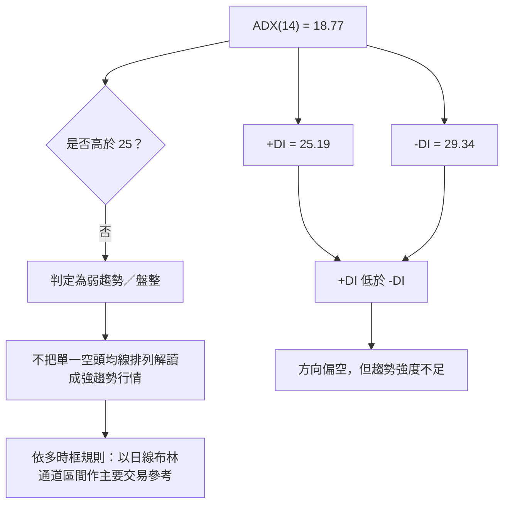

**ADX 與 DI 整合：**

- ADX 衡量趨勢強度，不直接決定多空方向；18.77 表示趨勢強度偏弱。
- `-DI 29.34 > +DI 25.19`，方向上空方略占優勢。
- 兩者合看：**空方方向訊號存在，但趨勢強度有限**。
- 因 ADX < 25，依指定收斂規則，不能將週線／月線偏空直接推導為日線追空；日線交易需優先關注布林通道及已列支撐阻力。

---

## 3. 圖表形態分析

### 🔍 形態識別系統

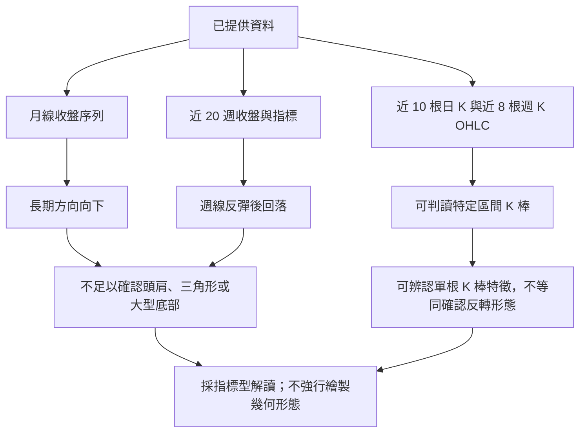

**形態識別原則：** 資料提供月度收盤與有限週期 OHLC，沒有完整日線歷史高低點序列，也沒有足夠的連續樞紐點資料。因此，不能以高信心度宣稱頭肩、雙頂／雙底、旗形或三角形等形態。以下形態評估以「是否有足夠證據確認」為核心，不為了產生價格目標而補造形態。

| 形態 | 信心度 | 判斷依據（引用資料） | 完成度 | 目標價（附計算式） |
|------|------:|----------------------|-------:|--------------------|
| 頭肩頂／底 | 15% | 僅有月收盤及有限週 K，未提供足以確認肩、頭、頸線的連續樞紐點 | 不適用 | N/A（數據未提供） |
| 雙頂／雙底 | 20% | 10 月 16 日週低 $13.86 與其他時段的低點是否形成第二個相近低點，資料不足以確認；不可只因接近支撐就判定雙底 | 不適用 | N/A（數據未提供） |
| 三角形／旗形 | 15% | 未提供足夠的連續高低點收斂或平行通道證據 | 不適用 | N/A（數據未提供） |
| 頭肩、雙底等反轉形態總結 | — | 幾何結構證據不足，僅採均線、布林、動能與量能解讀 | — | N/A（數據未提供） |
| 指標型訊號：MA 空頭排列 | 80% | MA20 $15.95 < MA50 $16.17 < MA200 $17.32 | 已成立 | 不適用；非幾何形態目標 |
| 指標型訊號：布林中軌下方 | 75% | 收盤 $15.42 低於中軌 $15.95，BB %B = 0.37 | 已成立 | 不適用；按區間管理 |

> 表中形態信心度是對「該形態能否由現有資料確認」的評估，不是股價走勢發生機率。

### 🕯️ 重要 K 線形態分析

以下僅採用資料包「近 10 根日 K」和「近 8 根週 K」中的 OHLC。單根 K 棒僅作局部形態描述，不獨立構成交易訊號。

| 日期（日 K／週 K） | 開 | 高 | 低 | 收 | K 線形態判讀 | 解讀 | 訊號 |
|------|------:|------:|------:|------:|---------|------|------|
| 2026-11-04（日 K） | $17.01 | $17.74 | $16.97 | $17.38 | 收漲 K，實體 $0.37；上下影線均較短 | 當日買方收於開盤上方，但後續 11 月 5 日轉弱，單根多方力量未能延續 | 🟡 |
| 2026-11-05（日 K） | $17.25 | $17.45 | $15.43 | $16.04 | 長陰 K；實體 $1.21，低點明顯低於開盤 | 當日賣壓較強；成交量 78.442M，高於當日序列中多數量值，但不以單日量推定反轉 | 🔴 |
| 2026-11-12（日 K） | $15.83 | $16.19 | $15.61 | $15.63 | 收跌 K；上影線 $0.36，下影線 $0.02 | 開盤後曾上探但收盤接近當日低位，顯示賣方控制收盤 | 🔴 |
| 2026-11-13（日 K） | $15.68 | $15.75 | $15.08 | $15.42 | 收跌 K；下影線 $0.34，實體 $0.26 | 出現一定低位承接，但非明確錘頭：收盤未接近最高價，且只有單根證據 | 🟡 |
| 2026-10-16（週 K） | $15.47 | $15.68 | $13.86 | $14.55 | 收跌週 K；週內低點 $13.86 | 該週收盤偏弱並觸及資料包 52 週低位，提供重要支撐測試資訊，但不能單憑此判定底部完成 | 🔴 |
| 2026-10-30（週 K） | $14.53 | $17.63 | $14.40 | $16.76 | 寬幅收漲週 K；實體 $2.23 | 週內買盤推升，成交量 416.303M；之後兩週回落，反彈尚未延續 | 🟡 |
| 2026-11-06（週 K） | $16.98 | $17.74 | $15.43 | $16.21 | 收跌週 K，波幅較大 | 收盤低於開盤，且上下影線皆存在；週線反彈後承壓 | 🔴 |
| 2026-11-13（週 K） | $16.33 | $17.04 | $15.08 | $15.42 | 收跌週 K，收盤低於開盤 | 週收盤再次走低，與週 MACD 柱回落至負值相符 | 🔴 |

### 📉 ASCII 走勢形態示意圖

這是「近期週收盤演變」示意，不是頭肩、雙底或其他未經資料確認的幾何形態。

```text
SOFI 近期週收盤示意（精確收盤價列於下方）
價格
$18.91 ┤          ● 08-21
$18.24 ┤● 07-02  ● 08-07
$17.32 ┤                              ● 09-11
$16.76 ┤                                      ● 10-30
$16.21 ┤                                           ● 11-06
$15.42 ┤                                                ● 11-13
$14.55 ┤                                     ● 10-16
$14.00 ┤
        └────────────────────────────────────────────────────
         07-02       08-21        09-25       10-16   11-13

結構觀察：
• 7 月至 8 月曾處於較高收盤區。
• 9 月至 10 月中旬逐步走低。
• 10 月底出現週線反彈，但至 11 月 13 日未能維持反彈高位。
• 目前沒有足夠連續高低點資料證實大型底部或反轉形態。
```

### 🎯 形態目標價計算

| 目標類型 | 計算方法 | 本次可否計算 | 結果 |
|----------|----------|--------------|------|
| 頭肩形態量度目標 | 頸線 ± 頭部至頸線高度 | 無可靠頭部與頸線資料 | N/A（數據未提供） |
| 雙底量度目標 | 頸線 + 底部至頸線高度 | 未確認雙底及頸線 | N/A（數據未提供） |
| 旗形／三角形量度目標 | 突破位置 ± 形態高度 | 缺少可驗證的幾何邊界 | N/A（數據未提供） |
| 支撐阻力情境 | 引用已列出的 R1–R3、S1–S2 | 可 | 用於第 4、8 章的情境分析，不代表形態量度目標 |

**結論：** 本章不提供未經形態確認的「形態目標價」。後續交易目標採用資料包已列出的支撐／阻力價位，並明確說明它們是價位情境，不是幾何形態推算值。

---

## 4. 支撐與阻力

### 🗺️ 關鍵價位分布圖（Unicode）

```text
SOFI 價位結構分布圖（所有水平價位取自資料包）
══════════════════════════════════════════════════════════════
$31.75 ║████████████████████████║ 52 週高點／斐波那契 0.0%
$27.53 ║████████████████        ║ 斐波那契 23.6%
$24.92 ║██████████████          ║ 斐波那契 38.2%
$22.80 ║████████████            ║ 斐波那契 50.0%
$20.69 ║██████████              ║ 斐波那契 61.8%
$19.62 ║██████████              ║ 阻力 R3（+27.22%）
$18.79 ║█████████               ║ 阻力 R2（+21.82%）
$18.03 ║████████                ║ 布林上軌（指標值）
$17.85 ║████████                ║ 阻力 R1（+15.76%）
$17.69 ║████████                ║ 斐波那契 78.6%
$17.32 ║███████                 ║ MA200
$16.17 ║██████                  ║ MA50
$15.95 ║██████                  ║ MA20／布林中軌
$15.42 ╠════════════════════════╣ ◄ 當前收盤價
$14.91 ║▓▓▓▓▓▓                  ║ 支撐 S1（-3.31%）
$13.88 ║▓▓▓▓▓                   ║ 布林下軌（指標值）
$13.86 ║██████                  ║ 支撐 S2／52 週低點
══════════════════════════════════════════════════════════════
註：垂直排列為便於閱讀的價位清單，並非等比例價格座標。
```

> 布林軌道、均線與斐波那契價位是不同類型的參考值，不能全部視為已確認支撐或阻力。本報告的正式支撐／阻力位只採資料包「關鍵價位」列出的 R1–R3、S1–S2；其他線位作交叉參照。

### 🚧 阻力位分析表

| 阻力級別 | 價位 | 形成原因 | 突破難度 | 重要性 |
|----------|------:|----------|----------|--------|
| R1 | **$17.85** | 近一年波段高點聚類；比現價高 15.76% | 中高 | 第一個正式波段阻力。上方亦有 MA200 $17.32 與布林上軌 $18.03 作為相鄰技術參考，但兩者不是 R1 的替代值 |
| R2 | **$18.79** | 近一年波段高點聚類；比現價高 21.82% | 高 | R1 有效突破後的下一個資料包阻力層級 |
| R3 | **$19.62** | 近一年波段高點聚類；比現價高 27.22% | 高 | 若價格回升至此，需評估上方供給與趨勢能否同步改善 |

**阻力判讀：**

- 現價 $15.42 至 R1 $17.85 的距離較大；短期反彈需先處理近端均線區及布林通道上半部壓力。
- $17.32 的 MA200 和 $18.03 的布林上軌是指標參考值，並非資料包列出的波段阻力 R1–R3。
- 若價格未能重新站回日線均線區，僅觸及單一阻力而沒有成交量擴張，不宜據此判定中期趨勢反轉。

### 🛡️ 支撐位分析表

資料包列出 S1、S2，**沒有列出 S3**，因此不推算第三級支撐。

| 支撐級別 | 價位 | 形成原因 | 守住機率評估 | 重要性 |
|----------|------:|----------|----------------|--------|
| S1 | **$14.91** | 近一年波段低點聚類；低於現價 3.31% | 中等偏低；尚無價格觸及後反彈確認 | 短線第一觀察位；若收盤有效跌破，注意是否測試 S2 |
| S2 | **$13.86** | 近一年波段低點聚類，亦為資料包的 52 週低點 | 中等；歷史低點有參考意義，但支撐可能失效 | 下方重要防線；跌破後資料中沒有下一個已列支撐價位 |
| S3 | **N/A（數據未提供）** | 關鍵價位區塊未列出 S3 | N/A（數據未提供） | 不以外推價格代替缺失數據 |

**支撐判讀：**

1. S1 距離收盤價較近，屬於第一個短線風險觀察點。
2. S2 同時是資料包的 52 週低點，若失守，會削弱「低位區間支撐仍有效」的判斷。
3. 布林下軌 $13.88 與 S2 $13.86 接近，但兩者分別是波動率指標線與波段低點聚類，不能混為同一數據來源。
4. 支撐位被觸及不等同支撐確認；確認仍需觀察收盤、成交量、動能與是否快速收復。

### 📐 斐波那契回調位分析

斐波那契價位直接引用資料包，沒有重新計算：

| 回調比例 | 價位 | 相對現價狀態 |
|---------:|------:|--------------|
| 0.0%（52W High） | $31.75 | 高於現價 |
| 23.6% | $27.53 | 高於現價 |
| 38.2% | $24.92 | 高於現價 |
| 50.0% | $22.80 | 高於現價 |
| 61.8% | $20.69 | 高於現價 |
| 78.6% | $17.69 | 高於現價 |
| 100.0%（52W Low） | $13.86 | 低於現價 |

**現價位置：** $15.42 位於斐波那契 **78.6% 回調位 $17.69** 與 **100.0% 回調位 $13.86** 之間，且靠近區間低端。這表示依資料包的 52 週高低範圍，股價已回吐大部分先前區間漲幅；但斐波那契位置本身不能證明即將反轉，也不能取代 S1、S2 的價格確認。

---

## 5. 技術指標深度解讀

### 🎛️ 指標訊號總覽

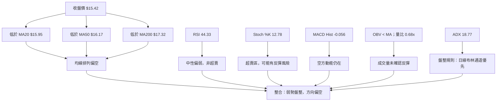

指標並非一致地指向單一方向：均線、MACD、DI、OBV 偏空；Stochastic 超賣提供反彈風險；ADX 顯示盤整而非強趨勢。結論應是**弱勢盤整、方向偏空、但不宜在支撐附近無條件追空**。

### 📈 移動平均線排列分析

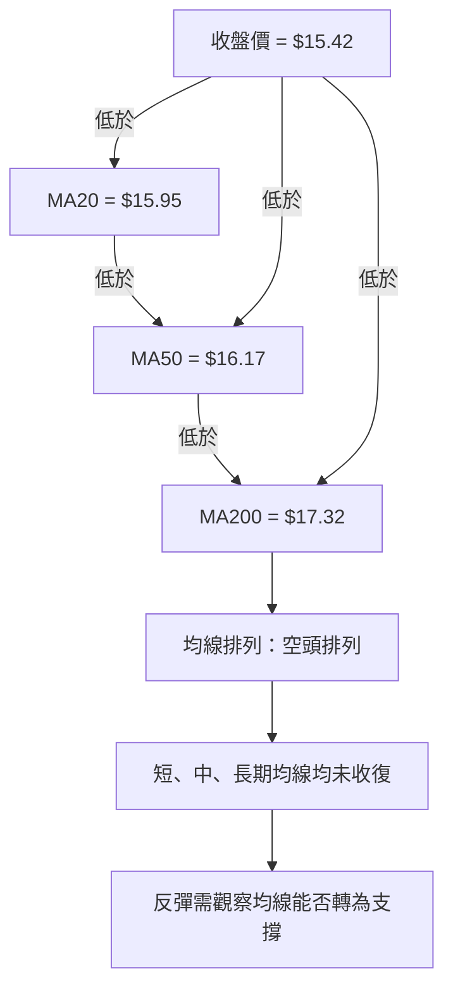

| 均線 | 數值 | 收盤相對位置 | 技術含義 |
|------|------:|--------------|----------|
| MA20 | $15.95 | 收盤低 $0.53 | 短線價格動能偏弱 |
| MA50 | $16.17 | 收盤低 $0.75 | 中短期趨勢仍受壓 |
| MA200 | $17.32 | 收盤低 $1.90 | 長期趨勢仍未轉正 |
| 排列 | MA20 < MA50 < MA200 | 空頭排列 | 均線方向偏空；盤整市中仍要配合價格反應確認 |

**整合解讀：**

- 收盤低於三條主要均線，均線層面沒有價格站回趨勢線的訊號。
- MA20、MA50、MA200 依次向上排列數值，形成空頭排列；不是「三條線距離一定正在擴大」的證據，資料並未提供完整均線逐日斜率數值。
- 移動平均線具有滯後性。當 ADX 低於 25 時，短線進出場仍以區間與布林通道為主，避免將均線排列單獨當作強趨勢追單依據。

### 📉 RSI(14) 分析

```text
RSI(14) = 44.33
超賣 0             30              50              70             100
    ├───────────────┼───────────────┼───────────────┼───────────────┤
    ██████████████████████░░░░░░░░░░░░░░░░░░░░░░░░░░░░░░░░░░░░░░░
                                      ▲ 44.33
強度視覺化：█████████░░░░░░░░░░░ 44%
```

| 判讀項目 | 結果 |
|----------|------|
| RSI 數值 | 44.33 |
| 傳統區間判讀 | 低於 50，偏弱；仍在 30–70 中性區 |
| 超買狀態 | 否 |
| 超賣狀態 | 否 |
| 背離判斷 | 資料包明列「無明顯背離」；僅比較近 20 根 K 棒首尾價格與 RSI 方向 |
| 訊號限制 | 沒有明顯背離不等於趨勢不會反轉；RSI 未到超賣亦不保證價格會反彈 |

**RSI 與其他指標的交叉確認：**

- RSI 44.33 與 MACD 負柱、收盤低於均線方向相符，顯示目前沒有強勢多方動能。
- Stochastic %K 為 12.78，與 RSI 的中性偏弱有所差異：Stochastic 更接近短期超賣，可能反映較短回看窗口內的低位狀態。
- 因而不把 Stochastic 超賣視為已確認底部；若 RSI 無法回到 50 以上且 OBV 持續低於均線，反彈的延續性仍存疑。

### 📊 MACD(12/26/9) 訊號解讀

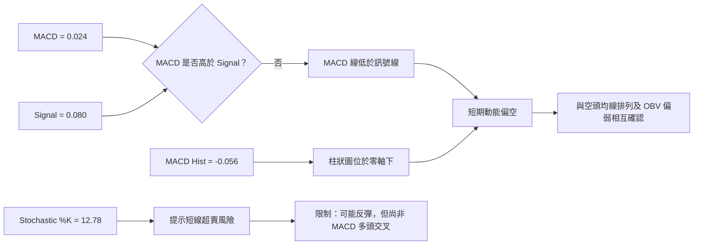

- MACD 為 0.024，Signal 為 0.080，MACD 低於 Signal。
- MACD Hist 為 -0.056，與資料包標示的看空訊號一致。
- MACD 數值為正、柱狀圖為負並不矛盾：MACD 線仍高於零軸，但已低於訊號線；短期動能向下，而中長期動能軸線尚未進入明顯負值區。
- 因只提供當前快照與有限週線 MACD 柱，不自行宣稱某日發生日線黃金交叉、死亡交叉，或推算 MACD 背離。

**MACD 背離結論：** 資料包對 RSI 背離明確標示「無明顯背離」，但沒有提供足以獨立核對完整近 20 根價格高低點與 MACD 逐根數據的表格。因此，**RSI：無明顯背離；MACD：無法由提供資料確認頂背離或底背離，沒有足夠證據宣稱存在背離**。

### 📦 布林通道分析

```text
SOFI 日線布林通道位置（依提供的 BB 數值；非等比例）

$18.03 ───────────── 上軌
                    │
$17.00              │
                    │
$15.95 ───────────── 中軌 = MA20
                    │
$15.42 ─────── ● 現價│  BB %B = 0.37
                    │
$13.88 ───────────── 下軌

通道寬度 = $18.03 - $13.88 = $4.15
價格相對中軌 = $15.42 - $15.95 = -$0.53
```

| 布林通道項目 | 數值 | 解讀 |
|--------------|------:|------|
| 上軌 | $18.03 | 區間上緣參考，不等同已確認阻力位 |
| 中軌／MA20 | $15.95 | 現價低於中軌 |
| 下軌 | $13.88 | 區間下緣參考，不等同資料包支撐 S2 |
| BB %B | 0.37 | 位於下軌至中軌之間，較中軌偏下 |
| 現價 | $15.42 | 未在上軌或下軌之外，不構成布林通道外側突破 |

**盤整市應用：** ADX 18.77 < 25，依指定規則，日線布林通道是主要交易區間參考。現價處於中軌下方，顯示區間內部偏弱；但價格尚未觸及下軌，不能把「接近支撐」等同已到區間極端。布林帶寬可由上下軌差值算得 $4.15；資料沒有提供歷史帶寬百分位，因此不宣稱布林帶正在收縮或擴張。

### 💹 成交量分析（量價配合度）

| 成交量項目 | 數值 | 解讀 |
|------------|------:|------|
| 最新成交量 | 38,169,000 | 低於 20 日均量 |
| 20 日均量 | 55,735,000 | 量比基準 |
| 量比 | 0.68× | 最新量約為 20 日均量的 68% |
| 50 日均量 | 50,030,838 | 最新量亦低於 50 日均量 |
| 最新週量 | 218,299,800 | 低於 10 月 30 日週量 416,302,500；不直接推論成交量必然持續下降 |
| OBV | OBV < MA | 量能趨勢偏弱 |

```text
量能比較（相對長條）
20 日均量  55.735M  ████████████████████ 100%
50 日均量  50.031M  ██████████████████   約 90%*
最新成交量 38.169M  ██████████████       68%

*50 日均量約為 20 日均量的 89.77%，百分比為兩個已提供均量的直接比值。
```

**量價配合判讀：**

- 最新成交量低於 20 日與 50 日均量，表示當日價格走弱時，沒有比均量更高的交易量擴張確認。
- OBV 低於其均線，顯示量能趨勢尚未支持多方反彈。
- 這不代表價格必然立即下跌；低成交量亦可能反映市場等待催化因素。
- 10 月 30 日週量 416.303M，配合週收盤升至 $16.76，顯示當週反彈有較大交易參與；但其後週收盤回落至 $16.21、$15.42，反彈未持續，量能配合仍需觀察。
- **量價背離判斷：** 可確認目前 OBV 對價格轉強沒有給出有效確認；但因沒有完整逐日 OBV 數列，不宣稱存在具體的頂背離或底背離形態。

---

## 6. 動能與波動率

### ⚡ 動能評估四象限

| 象限 | 動能 | 波動 | 典型狀態 | SOFI 是否符合 |
|------|------|------|----------|----------------|
| Q1 | 強 | 低 | 趨勢清晰且波動易控 | 否；MACD、均線偏弱，ATR 相對股價 5.26% |
| Q2 | 弱 | 低 | 低波動觀望 | 否；動能弱，但波動不低 |
| Q3 | 強 | 高 | 高風險趨勢機會 | 未確認；目前沒有強動能 |
| Q4 | 弱 | 高 | 弱勢且波動高，需防快速反向 | **較接近**；均線與 MACD 偏弱、ATR 比率偏高 |

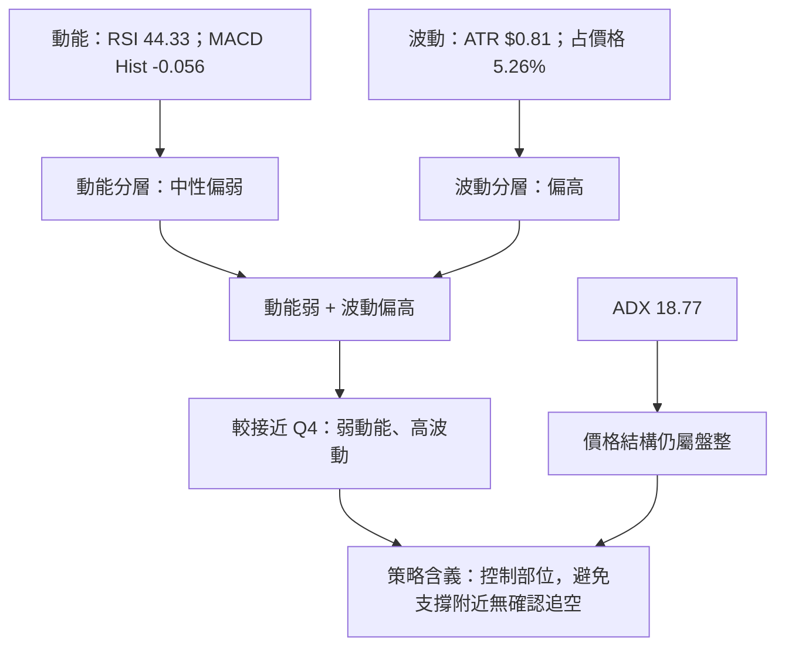

### 📊 ATR 波動率分析

- ATR(14) = **$0.81**，為當前收盤價 $15.42 的 **5.26%**。
- ATR 是近期平均真實波幅的指標，不是方向指標，也不等同最大可能損失。
- 以單一 ATR 作為風險距離的參考時，須知道 SOFI 單日正常波動幅度可相對股價占一定比例；若停損距離過窄，可能被一般波動觸發。
- 提供資料未給出 ATR 的歷史分位或日內波動分布，因此不把 5.26% 定義為歷史極端值，只能說相對股價比例不低。

| ATR 參考用法 | 計算／數據 | 風險管理提示 |
|--------------|-------------|--------------|
| ATR 絕對值 | $0.81 | 作為波動幅度參照，而非預測 |
| ATR／價格 | 5.26% | 相對股價的日常波動幅度較明顯 |
| 窄停損風險 | 停損距離若小於一般波動 | 有被短線雜訊掃出的風險 |
| 寬停損代價 | 停損距離增大 | 需相應降低倉位，保持固定風險額 |
| 本報告策略停損 | 引用 R2 $18.79 或現價 $15.42 作明確風控參考 | 不用 ATR 虛構支撐或目標價 |

### 📐 Beta 與市場相關性

Beta = **2.241**。在常見估計框架下，Beta 大於 1 通常表示股票歷史報酬對市場報酬變化的敏感度高於市場基準；但 Beta **不是相關係數**，也不表示大盤每上漲 1%，SOFI 必然上漲 2.241%。

| 風險項目 | 資料／解讀 |
|----------|------------|
| Beta | 2.241 |
| 市場敏感度 | 偏高；大盤波動可能放大個股風險 |
| Beta 方法限制 | 資料未提供估計期間、基準指數及頻率，不能判斷 Beta 的穩定性 |
| 與技術面的關係 | 高 Beta 與 ATR／價格 5.26% 一併看，代表倉位與停損管理應較謹慎 |
| 市場相關性 | 精確相關係數 N/A（數據未提供） |

**動能與波動總結：** SOFI 目前並非已確認強趨勢，而是**方向偏弱、趨勢強度較低、個股波動不小**。這種組合容易出現短線反彈與快速回落交替，不適合只憑單一指標擴大方向性部位。

---

## 7. 多時框架總結

### 📋 時框架評分表

以下評分是技術方向的定性摘要；第 1 章「綜合評分」仍唯一採六項子評分算術平均，結果為 **3/10 = 30/100**。

| 時框架 | 趨勢方向 | 動能 | 均線排列 | 形態 | 綜合評估 | 建議 |
|--------|----------|------|----------|------|----------|------|
| 月線／約 12 個月 | 🔴 偏空 | 🔴 月收盤由 $29.72 降至 $15.42 | 月均線數據 N/A（數據未提供） | 幾何形態不足 | 🔴 偏空 | 不以月收盤序列單獨建立反轉形態 |
| 週線 | 🔴 偏空 | 🔴 最新週 MACD 柱 -0.056、RSI 44.3 | 週均線數據 N/A（數據未提供） | 反彈未延續，未確認反轉 | 🔴 偏空 | 等待週線反彈能否站穩阻力／均線區 |
| 日線 | 🔴 價格低於 MA20／50／200 | 🟡 RSI 中性偏弱；Stoch 超賣 | 🔴 空頭排列 | ADX<25、按區間處理 | 🔴 偏空但盤整 | 依布林通道與 S1/S2 管理，不追逐支撐跌破前的空單 |

### 🔲 綜合訊號矩陣

| 訊號維度 | 日線 | 週線 | 月線／長期 | 一致性 |
|----------|------|------|------------|--------|
| 價格方向 | 偏空 | 偏空 | 月收盤整體下行 | 高度偏空 |
| 均線 | 空頭排列 | 週均線 N/A（數據未提供） | 月均線 N/A（數據未提供） | 日線有明確訊號，其他時框缺資料 |
| 動能 | MACD 柱負；RSI 44.33 | 最新週柱負；週 RSI 44.3 | 月度動能指標 N/A（數據未提供） | 週、日偏空 |
| 趨勢強度 | ADX 18.77 | 週 ADX N/A（數據未提供） | 月 ADX N/A（數據未提供） | 日線為盤整 |
| 成交量 | 量比 0.68×、OBV < MA | 週量相較 10 月底反彈週回落 | 月成交量 N/A（數據未提供） | 反彈量能尚未持續確認 |
| 超賣／反彈風險 | Stoch %K 12.78 | 未提供週 Stoch | N/A（數據未提供） | 短線反彈風險存在 |
| 收斂結論 | 盤整中偏空 | 偏空 | 長期偏空 | **方向偏空，但日線採區間規則** |

### ⚖️ 多時框收斂結論

1. **行情分類：盤整／弱趨勢。** 日線 ADX(14) = 18.77，低於 25。
2. **主導交易框架：日線布林通道區間。** 依規則 14，盤整行情以日線布林上下軌作主要交易參考。
3. **較大方向：偏空。** 月度收盤序列下行，週線反彈後回落，收盤低於日線 MA20、MA50、MA200，MACD 柱轉負，DI 由空方略占優勢。
4. **風險平衡：** Stochastic 超賣提示短線反彈可能，故偏空判斷不等於價格只能下跌。
5. **唯一方向性結論：`偏空`。** 這是綜合方向，不是強趨勢宣告；執行層面須遵守盤整市的布林／支撐阻力區間規則。
6. 第 1 章綜合評分 **30/100**，第 8 章因此依指定路由採用**空方主策略**；本章的方向結論與第 8 章一致。

---

## 8. 交易策略建議

### 🗺️ 策略決策流程圖

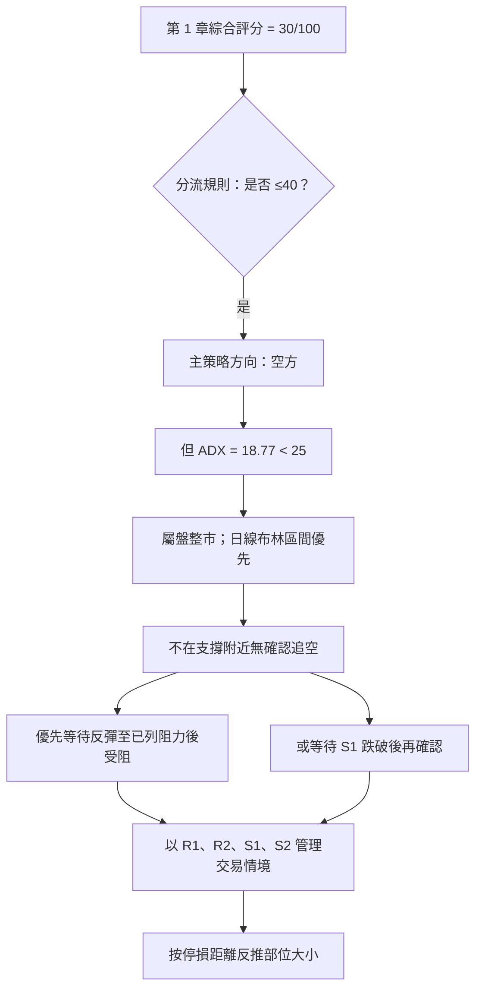

### 🧭 策略路由

**當前主策略方向 = 空方（依評分 30/100；屬弱勢盤整中的偏空策略）。**

評分 30/100 低於 40，依規則以空方策略為主；但 ADX < 25，故策略不採無條件追空，而採以下優先順序：

1. 優先觀察反彈是否在已列波段阻力 R1 $17.85 受阻，並以 R2 $18.79 作風險界線。
2. 若價格先跌破 S1 $14.91，須避免把支撐測試誤認為已確認下跌趨勢；確認後才評估 S2 $13.86。
3. 若反彈與成交量、OBV、MACD 同步轉強，空方策略需縮減或取消。
4. 價格沒有突破或跌破關鍵位前，避免依單一日 K 棒擴大倉位。

### 🎯 價格情境階梯（Price Scenarios）

所有正式支撐／阻力目標引用資料包列出的價位；布林線與均線只作參照，不取代關鍵價位。

| 觸發條件 | 下一目標 | 後續延伸 | 情境含義 |
|----------|----------:|----------:|----------|
| 突破 R1 **$17.85** | R2 **$18.79** | R3 **$19.62** | 反彈向上；需觀察收盤能否站穩，且是否有成交量與動能確認 |
| 在現價與 S1 之間波動 | — | — | 盤整；ADX<25，等待布林區間內的方向確認 |
| 跌破 S1 **$14.91** | S2 **$13.86** | S3：N/A（數據未提供） | 支撐失守風險上升；下方除 S2 外沒有資料包列出的下一個支撐價位 |
| 站回布林中軌 **$15.95** | 先觀察 MA50 **$16.17** | MA200 **$17.32** | 這兩者是均線參考而非正式波段阻力；需收盤與量能驗證 |

### 📊 情境機率分佈

以下為以當前技術訊號作出的情境估計，不是統計模型預測，也不保證未來結果；三項合計 100%。

| 情境 | 機率 | 主要依據 |
|------|-----:|----------|
| 繼續上行／反彈 | **25%** | Stochastic %K 12.78 處於超賣區；10 月 30 日週線曾反彈，但現價仍低於主要均線、MACD 柱轉負、OBV 偏弱，因此反彈情境機率較低 |
| 區間震盪 | **30%** | ADX 18.77 < 25；BB %B 0.37，價格位於布林下半部但尚未觸及下軌；盤整特徵支持區間情境 |
| 回落／再探底 | **45%** | 均線空頭排列、DI 空方主導、MACD Hist -0.056、量比 0.68×、OBV < MA；但 S1 尚未失守，且短線超賣限制其高於一半的估計 |

### 🔴 空方主策略詳情

**下列為條件式技術交易方案，不代表任何價位一定成交。** 進場、止損與目標均直接取自資料包列出的現價或關鍵價位。策略 A 的 R/R 以空單方向計算：

\[
\text{空單風險報酬比}
=
\frac{\text{進場價}-\text{目標價}}{\text{止損價}-\text{進場價}}
\]

| 策略要素 | 策略 A：反彈至 R1 受阻 | 策略 B：S1 跌破後確認 |
|----------|-------------------------|-------------------------|
| 進場條件 | 價格反彈至 R1，出現受阻跡象；不是觸及 R1 即自動做空 | 日線有效跌破 S1，且反彈無法收復 S1 後才考慮；避免只因盤中下探觸發 |
| 進場價格 | **$17.85**（R1） | **$14.91**（S1；僅作條件式參考進場位） |
| 止損價格 | **$18.79**（R2） | **$15.42**（當前收盤價；由於止損高於做空進場） |
| 目標價 T1 | **$14.91**（S1） | **$13.86**（S2） |
| 目標價 T2 | **$13.86**（S2） | **N/A（數據未提供）**；資料包沒有列出低於 S2 的下一級支撐 |
| 風險報酬比 | **1 : 3.13（以 T1 計）**；**1 : 4.24（以 T2 計）** | **1 : 2.06（以 T1 計）**；以 T2 計 N/A（數據未提供） |
| 成功機率估計 | **45%**；方向訊號偏空，但盤整行情使反彈失敗與區間震盪皆有可能 | **40%**；須先確認 S1 失守；若是假跌破，風險較高 |
| 建議倉位 | 低至中低；以個人風險預算計算，不因表面 R/R 高而加大倉位 | 低；S1 附近容易出現假跌破，確認不足時不執行 |
| 執行注意 | 若沒有受阻訊號，不在 R1 盲目掛空；若價格站上 R2，策略失效 | 若快速收復 S1 或動能轉強，取消追空；S2 是資料中最後一個已列支撐 |

**策略 A 風險報酬比核算：**

- 進場 $17.85；止損 $18.79；每股風險 = $18.79 − $17.85 = **$0.94**。
- T1 $14.91；每股潛在報酬 = $17.85 − $14.91 = **$2.94**。
- T1 比值 = $2.94 ÷ $0.94 = 3.1277，四捨五入為 **1 : 3.13**。
- T2 $13.86；每股潛在報酬 = $17.85 − $13.86 = **$3.99**。
- T2 比值 = $3.99 ÷ $0.94 = 4.2447，四捨五入為 **1 : 4.24**。

**策略 B 風險報酬比核算：**

- 進場 $14.91；止損 $15.42；每股風險 = $15.42 − $14.91 = **$0.51**。
- T1 $13.86；每股潛在報酬 = $14.91 − $13.86 = **$1.05**。
- T1 比值 = $1.05 ÷ $0.51 = 2.0588，四捨五入為 **1 : 2.06**。
- 由於資料包沒有低於 $13.86 的有效價位，T2 不另行推算。

### 🔴 反向風險觸發點（對沖提示）

下列訊號若出現，代表空方主策略需要減碼、取消或重新評估；這些是風控提示，不是完整多頭操作方案。

| 風險觸發點 | 觀察意義 |
|------------|----------|
| 收盤有效站上 R1 $17.85 | 代表近端波段阻力被挑戰；若量能改善，空方風險升高 |
| 進一步突破 R2 $18.79 | 策略 A 的止損位；空方交易假設失效 |
| RSI 回到 50 以上且 MACD Hist 轉正 | 多方動能改善；現有 MACD 負向確認減弱 |
| OBV 轉至其均線上方 | 量能開始確認價格反彈，空方優勢下降 |
| S1 $14.91 未跌破且價格回到布林中軌 $15.95 上方 | 支撐有效、區間下緣交易假設受損；追空須更保守 |
| ADX 後續升高並伴隨 +DI 超過 -DI | 可能由盤整轉為多方趨勢；目前資料尚未出現此訊號 |

### ⭐ 整體訊號強度評星

```text
做多訊號強度：★★☆☆☆  (2/5 星)
做空訊號強度：★★★☆☆  (3/5 星)
整體可信度：  ★★★☆☆  (3/5 星)
```

- 做多訊號偏弱：短線 Stochastic 超賣，但均線、MACD、OBV 尚未轉強。
- 做空訊號中等：多項方向指標偏空，惟 ADX 低於 25，且 S1 尚未確認跌破。
- 整體可信度中等：月／週／日的方向大致一致偏空，但盤整屬性與短線反彈風險，使方向訊號強度受限。

---

## 9. 風險提示與監控

### ✅ 關鍵監控指標 Checklist

```text
╔══════════════════════════════════════════════════════════════╗
║                   SOFI 技術監控清單                          ║
╠══════════════════════════════════════════════════════════════╣
║ □ 價格：是否守住 S1 $14.91？                                ║
║ □ 價格：若跌破 S1，是否進一步測試 S2 $13.86？                ║
║ □ 價格：是否重新站回布林中軌／MA20 $15.95？                  ║
║ □ 價格：是否突破 R1 $17.85；之後是否挑戰 R2 $18.79？          ║
║ □ 均線：收盤是否仍低於 MA20 $15.95、MA50 $16.17、MA200 $17.32？║
║ □ MACD：Hist -0.056 是否轉正；MACD 是否重新高於 Signal？      ║
║ □ RSI：是否回到 50 以上，或向 30 靠近？                      ║
║ □ Stochastic：%K 12.78 是否由超賣區向上交叉 %D 35.89？        ║
║ □ ADX：是否從 18.77 上升至 25 以上，盤整是否轉成趨勢？       ║
║ □ DI：-DI 29.34 是否仍高於 +DI 25.19？                       ║
║ □ 成交量：最新量是否高於 20 日均量 55.735M？                  ║
║ □ OBV：是否收復 OBV 均線，以確認反彈量能？                  ║
║ □ 波動：ATR $0.81 是否顯著變動，影響停損距離？               ║
╚══════════════════════════════════════════════════════════════╝
```

**監控優先順序：**

1. **先看價格相對 S1／S2：** S1 $14.91 是第一觀察支撐，S2 $13.86 是資料包最後一個明確列出的下方支撐。
2. **再看區間位置：** ADX 18.77 表示日線目前按盤整處理；布林下軌 $13.88、中軌 $15.95、上軌 $18.03 可作區間參考，但不是保證反轉的價位。
3. **確認均線與動能：** 股價若收復 MA20 $15.95，需進一步看 MA50 $16.17、RSI 與 MACD 是否同步改善。
4. **看成交量是否配合：** 價格上漲而 OBV 仍低於 MA、成交量仍低於均量，反彈確認度不足。
5. **依波動調整部位：** ATR 約 $0.81，停損距離和倉位應一併考慮；不要只因價格接近某個水平價位就忽略波動。

### ⚠️ 風險場景分析

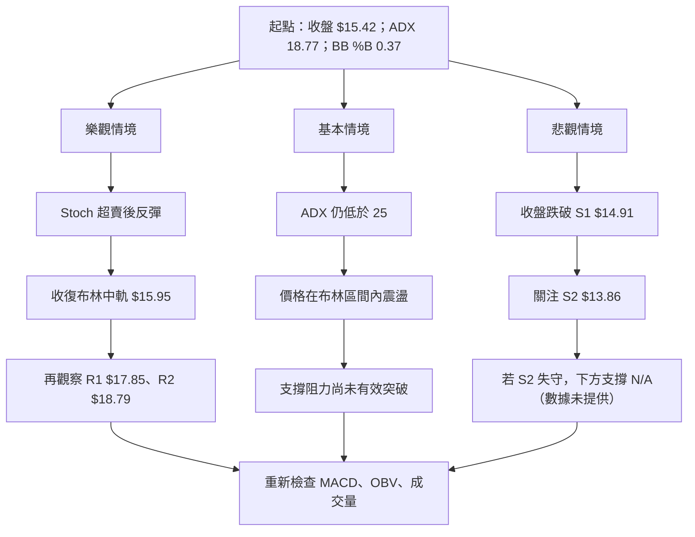

| 情境 | 觸發觀察 | 技術含義 | 風險管理回應 |
|------|----------|----------|--------------|
| 樂觀 | Stochastic 自超賣區回升；收盤重新站回布林中軌 $15.95；之後留意 R1 $17.85 | 短線反彈條件改善，但需 MACD、OBV 與成交量確認 | 空方倉位減少；若突破 R2 $18.79，依策略 A 停損規則處理 |
| 基本 | ADX 仍低於 25，價格未有效突破支撐阻力，BB %B 在區間中下部 | 盤整延續，方向訊號容易反覆 | 降低交易頻率；以區間規則管理，不在區間中部追價 |
| 悲觀 | 收盤跌破 S1 $14.91，後續測試 S2 $13.86 | 支撐結構轉弱，但市場是否形成更強下行趨勢仍要看 ADX、DI、成交量 | 不以缺少的 S3 外推目標；若 S2 失守，重新評估而非編造下一個價位 |

### 🛡️ 風險管理重要提醒

- **盤整行情的假突破風險：** ADX 18.77 低於 25，盤整區內可能出現短暫穿越阻力或支撐後又收回。應以收盤及後續確認為主，不只看盤中刺穿。
- **短線超賣反彈風險：** Stochastic %K 12.78 處於超賣區。即使較大方向偏空，股價仍可能反彈，因此不宜在支撐附近無確認地追空。
- **缺少 S3 的價位風險：** S2 $13.86 是資料包列出的最後一級支撐。若失守，下方 S3 為 N/A（數據未提供）；不能把任何自行選出的數字當作技術支撐。
- **高 Beta 與 ATR 風險：** Beta 2.241、ATR $0.81（約占價格 5.26%），均提示價格變動可能較大。停損距離加寬時，倉位應相應縮小。
- **成交量訊號風險：** 最新成交量只有 20 日均量的 0.68 倍，不能用低量下跌或低量反彈直接推導趨勢將延續；需要觀察後續量價。
- **分析師共識僅作背景：** 提供的分析師平均目標價為 $20.84、低點 $12.00、最高 $30.00，這些不是本報告的技術支撐／阻力或交易目標，不納入關鍵價位策略。
- **財務與新聞因素：** 本報告聚焦技術資料；財報、政策、利率與公司消息可能造成跳空，令技術停損無法按預期價格成交。
- **部位管理：** 以預先設定的可承受帳戶損失反推股數；不因策略的名義風險報酬比高而提高風險預算。
- **策略失效要明確：** 空方策略若遇到價格站上止損位，應依風控計畫處理，不以「再等等」任意延後停損。
- **資料限制：** 沒有完整歷史日線 OHLCV、週線均線與月線技術指標，故本報告不補算缺漏指標、不宣稱未提供的背離或形態。

---

## 📋 報告總結

```text
╔══════════════════════════════════════════════════════════════╗
║                   SOFI 技術分析報告總結                     ║
╠══════════════════════════════════════════════════════════════╣
║ 報告日期：2026-11-14                                        ║
║ 當前價格：$15.42（2026-11-13 收盤）                          ║
║ 技術評級：🔴 偏空；但屬弱趨勢／盤整行情                      ║
║ 綜合評分：3/10 = 30/100（六項子評分算術平均）                 ║
╠══════════════════════════════════════════════════════════════╣
║ 關鍵結論：                                                   ║
║ ├─ 長期趨勢：🔴 月收盤約 12 個月下跌 48.12%                  ║
║ ├─ 中期趨勢：🔴 週線反彈後回落，最新週收盤 $15.42             ║
║ ├─ 短期趨勢：🔴 收盤低於 MA20、MA50、MA200                   ║
║ ├─ 行情狀態：🟡 ADX 18.77，盤整規則優先於強趨勢追單            ║
║ ├─ 動能：🔴 MACD 柱 -0.056；🟡 Stoch %K 12.78 超賣            ║
║ ├─ 關鍵支撐：S1 $14.91；S2 $13.86                             ║
║ ├─ 關鍵阻力：R1 $17.85；R2 $18.79；R3 $19.62                  ║
║ └─ 分析師平均目標：$20.84（非技術阻力，僅作共識背景）          ║
╠══════════════════════════════════════════════════════════════╣
║ 最優策略組合：                                                ║
║ 1. 🥇 優先：反彈至 R1 $17.85 並出現受阻訊號後評估空方策略      ║
║ 2. 🥈 次選：收盤確認跌破 S1 $14.91 後，觀察 S2 $13.86         ║
║ 3. 🥉 保守：ADX<25 且方向未確認時降低部位、等待區間訊號        ║
╚══════════════════════════════════════════════════════════════╝
```

**最終判斷：** SOFI 的中長期價格結構與主要日線指標偏空，但 ADX 顯示趨勢強度不足，且 Stochastic 位於超賣區。依多時框收斂規則，方向性結論為**偏空**，執行上則按**盤整市區間管理**；主策略是等待反彈受阻或支撐確認失守，而不是在低位無條件追空。所有價位情境均以資料包明列的 R1–R3、S1–S2 為準；資料未提供的更低支撐不作外推。

---

> ⚠️ **免責聲明**：本報告為 AI 根據使用者提供資料生成的技術分析，僅供研究與學術參考，不構成投資建議或買賣邀約。技術指標與情境機率不保證未來走勢；市場價格可能跳空或快速波動，停損不一定能按指定價格成交。投資有風險，入市需謹慎。

*報告生成時間：2026-11-14 ｜ 數據來源：使用者提供之 Yahoo Finance 資料 ｜ 分析框架：多時框技術分析*