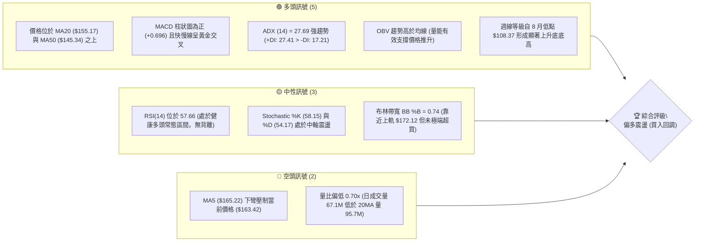
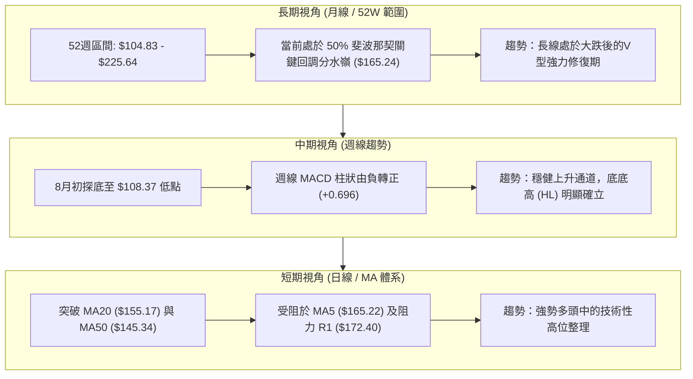
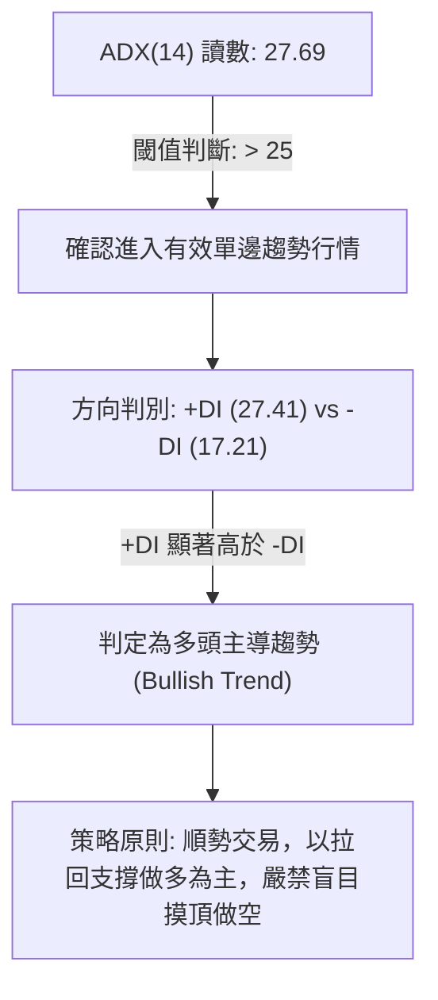
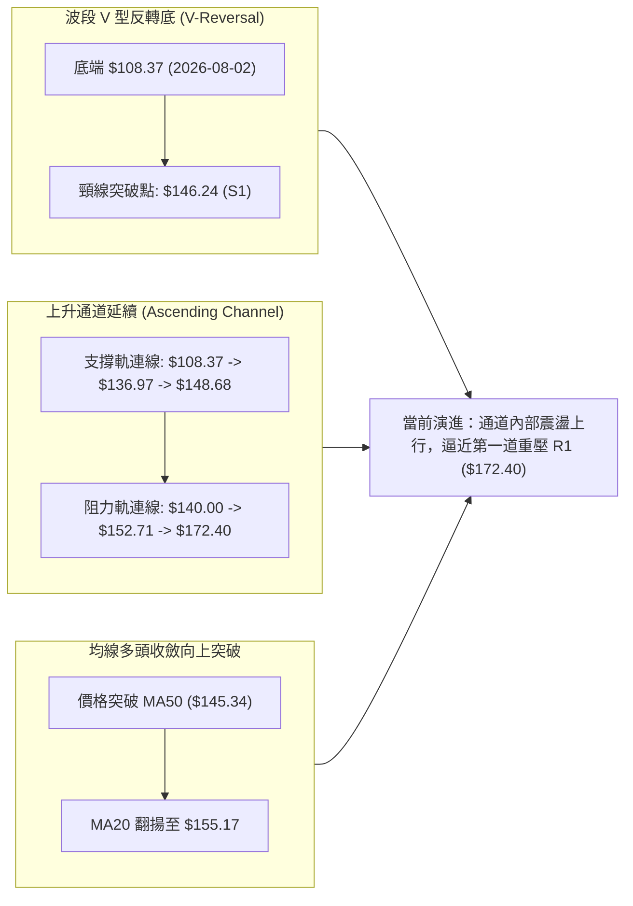
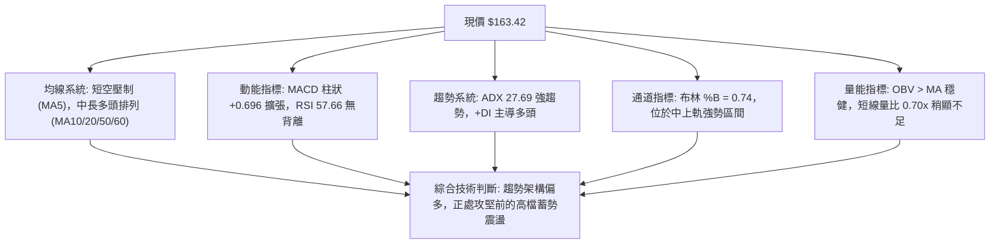
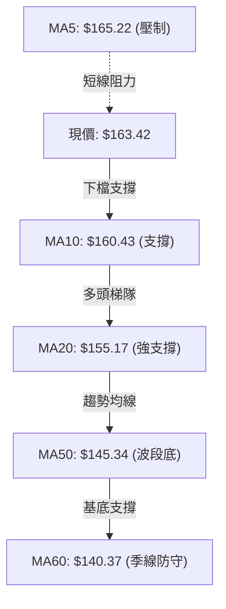
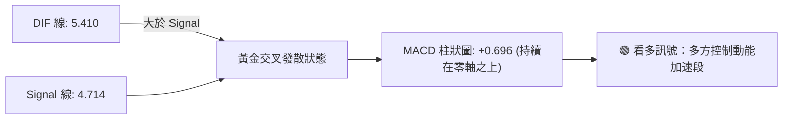
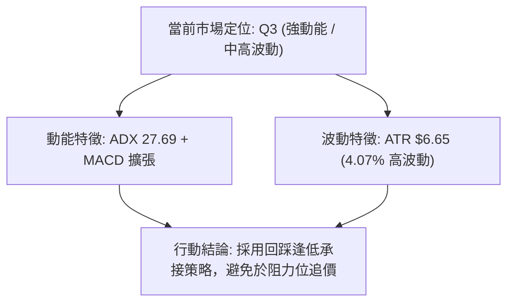
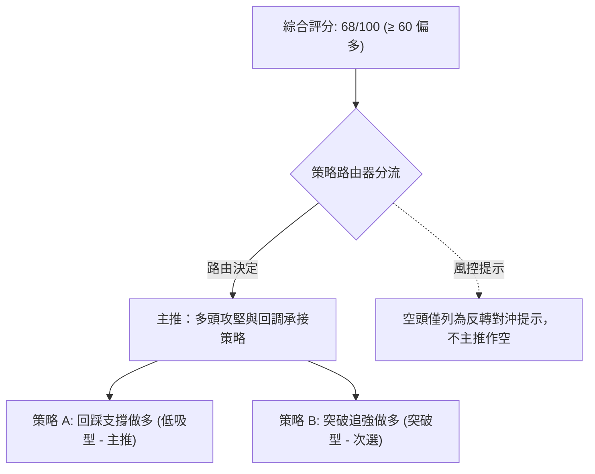
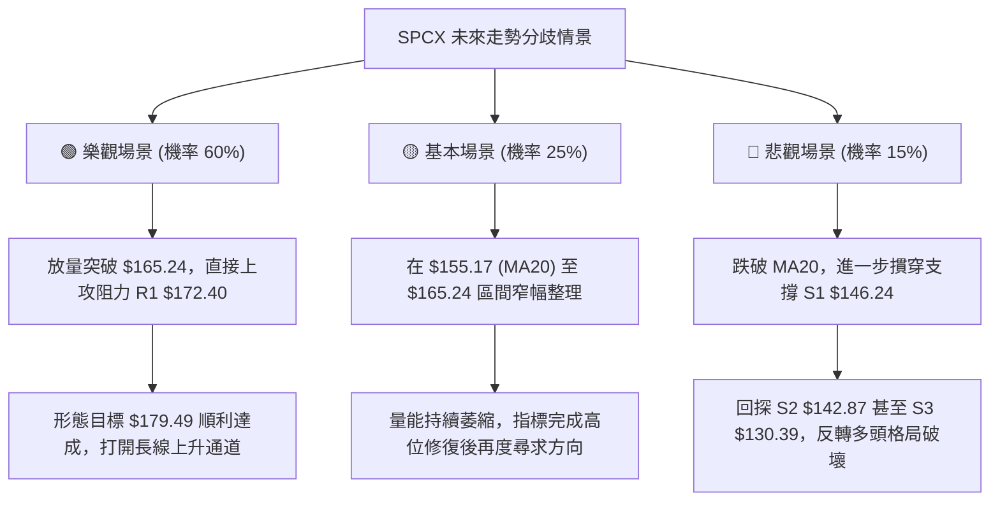

# SPCX 技術分析報告

> **報告日期**：2026-10-13 ｜ **語言**：繁體中文 ｜ **數據來源**：Yahoo Finance ｜ **當前價格**：$163.42

---

## 目錄

| 章節 | 內容 |
|------|------|
| [1. 技術面概覽](#1-技術面概覽) | 訊號儀表板、核心指標、評分卡 |
| [2. 趨勢分析](#2-趨勢分析) | 多時框趨勢、長中短期走勢 |
| [3. 圖表形態分析](#3-圖表形態分析) | 形態識別、K線組合、目標價 |
| [4. 支撐與阻力](#4-支撐與阻力) | 關鍵價位、斐波那契回調 |
| [5. 技術指標深度解讀](#5-技術指標深度解讀) | MA/RSI/MACD/布林/成交量 |
| [6. 動能與波動率](#6-動能與波動率) | 動能評估、ATR、Beta |
| [7. 多時框架總結](#7-多時框架總結) | 時框架評分矩陣 |
| [8. 交易策略建議](#8-交易策略建議) | 多空策略、風險報酬比 |
| [9. 風險提示與監控](#9-風險提示與監控) | 監控指標、風險場景 |
| [10. 報告總結](#-報告總結) | 關鍵結論與策略清單 |

---

## 1. 技術面概覽

### 🎯 技術訊號儀表板



---

### 📊 核心指標速覽表

| 指標類別 | 指標名稱 | 當前數值 | 訊號 | 解讀 |
|:---|:---|:---|:---:|:---|
| **價格** | 當前價格 | $163.42 | 🟢 | 站上 52 週中軸區間 (48.5%)，自 $104.83 底部反彈強勁 |
| **均線** | MA5 | $165.22 | 🔴 | 極短線承壓，收盤價暫處 MA5 下方 (-1.09%) |
| **均線** | MA10 | $160.43 | 🟢 | 站上短天期支撐 (+1.86%)，下檔支撐墊高 |
| **均線** | MA20 | $155.17 | 🟢 | 中期生命線向上傾斜，偏離度 +5.32%，多頭動能穩健 |
| **均線** | MA50 | $145.34 | 🟢 | 穩居中期防線上方，多頭排列結構延續中 |
| **均線** | MA60 | $140.37 | 🟢 | 季線上方 +16.42%，中長線低位支撐扎實 |
| **均線** | MA200 | $N/A | 🟡 | 數據資料不足（未滿200筆），暫不作長線牛熊分水嶺解讀 |
| **動能** | RSI(14) | 57.66 | 🟢 | 健康多方擴張區間，既無超買钝化亦無背離現象 |
| **動能** | MACD (12,26,9) | 5.410 / 4.714 | 🟢 | DIF 高於 MACD Signal，柱狀圖 +0.696 持續翻紅擴張 |
| **動能** | Stoch %K / %D | 58.15 / 54.17 | 🟢 | 保持黃金交叉發散狀態，短線維持強勢整理 |
| **趨勢** | ADX (14) | 27.69 | 🟢 | ADX > 25 確認進入有效趨勢，+DI (27.41) 壓制 -DI (17.21) |
| **通道** | 布林通道 (%B) | 0.74 | 🟡 | 位於中軌 ($155.17) 至上軌 ($172.12) 間，多方掌控空間 |
| **波動** | ATR(14) | $6.65 | 🟡 | 佔現價 4.07%，每日波動幅度中等偏高，需設置充裕止損 |
| **成交量** | 量比 (Vol / 20Vol) | 0.70x | 🔴 | 成交量 67.12M，低於 20MA 量 95.75M，攻堅力道出現量縮 |
| **量能趨勢** | OBV 趨勢 | OBV > MA | 🟢 | 累積能量線維持在均線上方，大戶未見實質出貨痕跡 |

---

### 🏆 技術評分卡

```
╔══════════════════════════════════════════════════════════════════╗
║                 技術評分卡 — SPCX (2026-10-13)                  ║
╠══════════════════════════════════════════════════════════════════╣
║ 趨勢強度 (Trend)     ██████████████░░░░░░  72/100  🟢 強勢多頭   ║
║ 動能指標 (Momentum)  ████████████░░░░░░░░  65/100  🟢 動能偏多   ║
║ 支撐穩定度 (Support) ████████████████░░░░  80/100  🟢 底部紮實   ║
║ 成交量配合 (Volume)  ██████████░░░░░░░░░░  52/100  🟡 量價微背離 ║
║ 形態完整度 (Pattern) ████████████░░░░░░░░  60/100  🟡 波段築底   ║
║ 均線排列 (Moving Avg)██████████████░░░░░░  75/100  🟢 短中期多頭 ║
╠══════════════════════════════════════════════════════════════════╣
║ 綜合評分 (Overall)   █████████████░░░░░░░  68/100  🟢 偏多進攻   ║
╚══════════════════════════════════════════════════════════════════╝
```

---

## 2. 趨勢分析

### 🌐 多時框趨勢分析



---

### 📈 長期趨勢 — 12個月走勢圖（Unicode）

```
SPCX 歷史走勢示意圖（2025-11 至 2026-10）
價格軸 ($)
$225.64 ┤                           ● (52W High: $225.64)
$200.00 ┤                          / \
$175.00 ┤  ●                      /   \           ● ($170.86)       ●←現價 $163.42
$150.00 ┤   \                    /     \         / \               /
$125.00 ┤    \                  /       \       /   \    ●        /
$104.83 ┤     ●────────────────●         \     /     \  / ($108.37)
        └─────────────────────────────────●───●───────●───────────────
         N    D    J    F    M    A    M   J   J      A     S     O (2026)
         (2025)                          波段大崩跌    V型反轉  震盪走高
```

#### 走勢特徵分析表格

| 階段區間 | 時間跨度 | 價格區間 | 累積漲跌幅 | 核心結構特徵與量價行為 |
|:---|:---|:---:|:---:|:---|
| **歷史高位回落** | 2026-06 前 | $225.64 → $170.86 | -24.28% | 高檔獲利了結盤湧出，週成交量放大至 9.25 億股後動能衰竭 |
| **流動性恐慌崩跌**| 2026-06 ~ 2026-08 | $170.86 → $108.37 | -36.57% | 週線 RSI 跌入極端超賣 (15.9)，形成 52 週最低聚類防線 $104.83 |
| **首波放量報復反彈**| 2026-08-02 ~ 2026-08-16 | $108.37 → $140.00 | +29.19% | 單週成交量爆出 9.20 億股巨量，V型反轉直接吞噬前低陰線 |
| **震盪換手墊高** | 2026-08-23 ~ 2026-09-27 | $136.97 → $152.71 | +11.49% | 量能溫和沉澱至 3.2 億~ 4.0 億股，回測支撐 S1 ($146.24) 不破 |
| **當前攻堅浪**   | 2026-10-04 ~ 2026-10-18 | $158.96 → $163.42 | +2.81%  | 站穩 MA20、MA50，直逼 50% 斐波那契回調位 $165.24 |

---

### 📊 中期趨勢（週線分析）

```
中期關鍵價位示意圖 (週線層級)
$179.49 ────────────────────────────── 斐波那契 38.2% 回調線
$172.40 ══════════════════════════════ 波段阻力 R1 / 布林上軌 ($172.12)
$165.24 ------------------------------ 斐波那契 50.0% / MA5 ($165.22)
$163.42 ▲▲▲ [現價位置 $163.42]
$155.17 ────────────────────────────── 布林中軌 / MA20 支撐位
$146.24 ══════════════════════════════ 關鍵波段支撐 S1
$142.87 ══════════════════════════════ 關鍵波段支撐 S2 / MA50 ($145.34)
```

週線層面自 2026-08-02 觸及 $108.37 低點後，連續 11 週呈現上升梯形結構。週線 MACD 柱狀圖在經歷短暫回洗（2026-09-27 達 -0.567）後，於 10 月中旬重新翻紅至 +0.937 及 +0.696，確認中天期上升浪潮未遭破壞。

---

### ⚡ 趨勢強度評估（ADX 解讀）



#### ADX 趨勢強度對照表

| 指標名稱 | 實際數值 | 參考門檻 | 當前狀態評定 | 交易指引 |
|:---|:---:|:---:|:---:|:---|
| **ADX (14)** | **27.69** | > 25.00 | 🟢 趨勢形成且強烈 | 趨勢策略優先，中長期均線（MA50）作為主要防守基準 |
| **+DI (14)** | **27.41** | — | 🟢 多頭推動力強 | 買方在市場佔據主導優勢 |
| **-DI (14)** | **17.21** | — | 🟢 空頭壓制力衰竭 | 賣方缺乏持續打壓盤勢之量能 |
| **DI 差值 (+DI - -DI)** | **+10.20** | > 0 | 🟢 正向動能擴張 | 多方具備顯著緩衝空間 |

---

## 3. 圖表形態分析

### 🔍 形態識別系統



#### 形態識別信心度與目標價評估

| 識別形態名稱 | 信心度 | 判斷依據（嚴格引用數據） | 完成度 | 形態推算目標價（附計算公式） |
|:---|:---:|:---|:---:|:---|
| **大級別波段反轉底** | **85%** | 2026-08 於 $108.37 放量見底，突破波段折返低點聚類 S1 ($146.24) | 100% (已突破) | 目標價 = 突破點 $146.24 + ($146.24 - $108.37) = **$184.11**（逼近 38.2% 回調 $179.49） |
| **中天期上升通道** | **75%** | 低點持續墊高：$108.37 → $136.97 → $148.68；高點持續推進：$140.00 → $152.71 | 75% | 通道上軌目標價 = 阻力位 **$172.40** (波段高點聚類) |
| **多重均線黃金推升** | **90%** | 現價 $163.42 同時高於 MA10 ($160.43)、MA20 ($155.17)、MA50 ($145.34) | 90% | 斐波那契 38.2% 關鍵回調位 = **$179.49** |

---

### 🕯️ 重要K線形態分析

| 觀測週期 / 週別 | 收盤價 | 典型 K 線組合與形態 | 技術面深度解讀 | 訊號方向 |
|:---|:---:|:---|:---|:---:|
| **2026-07-26** | $115.07 | 大陰線加速趕底 (RSI 15.9) | 賣方恐慌性盤殺，極度超賣引發籌碼換手 | 🔴 恐慌拋售 |
| **2026-08-02** | $108.37 | 長下影探底十字星 (Hammer) | 探低 $104.83 52W 低點後強烈拉回，底部浮現 | 🟢 築底確立 |
| **2026-08-09** | $133.11 | 放量大陽線 (週量 920.4M) | 巨量多頭吞噬，徹底扭轉週線空頭排列趨勢 | 🟢 強烈買訊 |
| **2026-09-27** | $148.68 | 縮量陰十字星回踩 | 量縮至 329.4M 回測 S1 ($146.24) 不破，洗盤完成 | 🟢 支撐確認 |
| **2026-10-11** | $162.57 | 連續實體陽線推進 | 週線連陽突破 $160 整數大關，多頭重新控盤 | 🟢 攻擊延續 |
| **2026-10-18 (現價)** | $163.42 | 高位窄幅上影小陽線 | 逼近 R1 ($172.40) 出現微幅減速，量能暫縮 | 🟡 高檔整理 |

---

### 📉 ASCII 走勢形態示意圖

```
SPCX 波段 V 型築底與上升通道形態分解
價格
$179.49 ┤                                                [形態延伸目標 $179.49]
$172.40 ┤                                           ┌─── [阻力聚類 R1 $172.40]
$165.24 ┤                                     ▲    /
$163.42 ┤───────────────────────────────────●────┼─── [當前位置 $163.42]
        │                                  /  \  /
$152.71 ┤                             ●──/    \/
$146.24 ┤────────── 頸線 / 支撐 S1 ────/───────┴──────── [S1 $146.24 突破轉支撐]
        │                           /
$136.97 ┤                   ●──────/
        │                  / \
$108.37 ┤      ●──────────/   \────── (低點回測確立)
$104.83 ┴──────┴──────────────────────────────────────── [52W 最低點 $104.83]
             2026-08       2026-09       2026-10
```

---

### 🎯 形態目標價計算

1. **V 型反轉形態測幅計算**：
   - 形態底部低點：$108.37
   - 形態頸線位置（引用 S1 支撐）：$146.24
   - 形態垂直高度 $H = \$146.24 - \$108.37 = \$37.87$
   - 形態量測第一目標價 = 頸線 $\$146.24 + \$37.87 =$ **$184.11**
   - 該目標價與斐波那契 38.2% 回調位 **$179.49** 形成緊密目標聚集區間 ($179.49 ~ $184.11)。

2. **布林通道波段擴張目標**：
   - 當前布林中軌為 $155.17，上軌為 $172.12。
   - 若順勢觸及上軌，直接對接關鍵阻力位 R1（**$172.40**）。

---

## 4. 支撐與阻力

### 🗺️ 關鍵價位分布圖（Unicode）

```
╔══════════════════════════════════════════════════════════════════╗
║                     SPCX 價位結構分布圖                          ║
╠══════════════════════════════════════════════════════════════════╣
║ $225.64 ║████████████████████████████████║ 52W 歷史最高點       ║
║ $197.13 ║██████████████████████░░░░░░░░░░║ 斐波那契 23.6% 回調位 ║
║ $179.49 ║██████████████████░░░░░░░░░░░░░░║ 斐波那契 38.2% 回調位 ║
║ $172.40 ║████████████████████████████████║ 強阻力 R1 (布林上軌)  ║
║ $165.24 ║▓▓▓▓▓▓▓▓▓▓▓▓▓▓▓▓▓▓▓▓▓▓▓▓░░░░░░░░║ 斐波那契 50.0% / MA5  ║
║ $163.42 ╠════════════════════════════════╣ ◄ 當前市價 ($163.42)  ║
║ $155.17 ║▓▓▓▓▓▓▓▓▓▓▓▓▓▓▓▓▓▓▓▓░░░░░░░░░░░░║ 布林中軌 (MA20 支撐)  ║
║ $150.98 ║████████████████░░░░░░░░░░░░░░░░║ 斐波那契 61.8% 黃金分割║
║ $146.24 ║████████████████████████████████║ 關鍵波段支撐 S1       ║
║ $142.87 ║████████████████████░░░░░░░░░░░░║ 波段結構支撐 S2       ║
║ $130.39 ║████████████████████████████████║ 長線防守支撐 S3       ║
║ $104.83 ║████████████████████████████████║ 52W 歷史最低點       ║
╚══════════════════════════════════════════════════════════════════╝
```

---

### 🚧 阻力位分析表

> **數據紀律**：所有阻力位嚴格引用自數據之「關鍵價位」及「斐波那契回調」體系。

| 阻力級別 | 價位 | 距現價幅動 | 形成原因與數據佐證 | 突破難度 | 重要性 |
|:---|:---:|:---:|:---|:---:|:---:|
| **短線壓制** | **$165.24** | +1.11% | 斐波那契 50.0% 中軸回調位，疊合日線 MA5 ($165.22) | 🟡 中等 | ★★★☆☆ |
| **強阻力 R1** | **$172.40** | +5.50% | 近一年波段高點聚類，疊合布林上軌 ($172.12) | 🔴 極高 | ★★★★★ |
| **中期阻力** | **$179.49** | +9.83% | 斐波那契 38.2% 回調位，反轉形態測幅目標位 | 🟡 中等 | ★★★★☆ |
| **波段重壓** | **$197.13** | +20.63% | 斐波那契 23.6% 回調位，前期下挫跳空放量套牢區 | 🔴 極高 | ★★★★☆ |
| **52W 高點** | **$225.64** | +38.07% | 52 週最高極限價位 (0.0% 回調位) | 🔴 堅不可摧 | ★★★★★ |

---

### 🛡️ 支撐位分析表

> **數據紀律**：所有支撐位嚴格引用自數據之「關鍵價位」及「斐波那契回調」體系。

| 支撐級別 | 價位 | 距現價幅動 | 形成原因與數據佐證 | 守住機率 | 重要性 |
|:---|:---:|:---:|:---|:---:|:---:|
| **動態支撐** | **$160.43** | -1.83% | MA10 短天期均線支撐，維持短線強勢之防線 | 75% | ★★★☆☆ |
| **中軌支撐** | **$155.17** | -5.05% | MA20 生命線暨布林通道中軌，趨勢波段分水嶺 | 85% | ★★★★☆ |
| **黃金分割** | **$150.98** | -7.61% | 斐波那契 61.8% 關鍵黃金回調位 | 80% | ★★★★☆ |
| **關鍵支撐 S1** | **$146.24** | -10.52% | 近一年波段低點聚類，頸線轉換強支撐，MA50 ($145.34) | 90% | ★★★★★ |
| **波段支撐 S2** | **$142.87** | -12.57% | 近一年波段低點聚類，MA60 季線防護帶 ($140.37) | 92% | ★★★★☆ |
| **強防守支撐 S3**| **$130.39** | -20.21% | 近一年波段重度低點聚類，疊合斐波那契 78.6% ($130.68) | 95% | ★★★★★ |

---

### 📐 斐波那契回調位分析

依據 52 週高點 **$225.64** 至低點 **$104.83** 之垂直距離 ($120.81) 計算：

```
斐波那契回調階梯分布
0.0%  ───────── $225.64  (52W High)
23.6% ───────── $197.13
38.2% ───────── $179.49
50.0% ───────── $165.24  ◄──────────── 現價 ($163.42) 緊密逼近此一分水嶺
61.8% ───────── $150.98
78.6% ───────── $130.68
100.0%───────── $104.83  (52W Low)
```

- **當前位置解讀**：
  現價 **$163.42** 落在 **61.8% ($150.98)** 與 **50.0% ($165.24)** 回調位之間。
  股價自底部的反彈已完全越過 61.8% 的弱勢反彈警戒線，當前正在挑戰最具心理意義的 50% 多空中軸分水嶺 **$165.24**。一旦日線實體陽線收盤突破 $165.24，將打開向上挑戰 38.2% 回調位（**$179.49**）及阻力 R1（**$172.40**）的技術空間。

---

## 5. 技術指標深度解讀

### 🎛️ 指標訊號總覽



---

### 📈 移動平均線排列分析



#### 均線階梯明細表

| 均線天期 | 當前數值 | 距現價差距 | 斜率與狀態 | 技術意涵 |
|:---|:---:|:---:|:---:|:---|
| **MA 5** | $165.22 | -1.09% | ▼ 下彎 (-1.80) | 短線獲利回吐，對日線構成即時壓制 |
| **MA 10** | $160.43 | +1.86% | ▲ 上揚 (+2.99) | 5至10日買入成本快速墊高，提供短多緩衝 |
| **MA 20** | $155.17 | +5.32% | ▲ 上揚 (+8.25) | 月線生命線堅挺上行，波段多頭最重要的動態防守位 |
| **MA 50** | $145.34 | +12.44% | ▲ 上揚 | 中期趨勢底線，遠高於季線，確立中期多頭結構 |
| **MA 60** | $140.37 | +16.42% | ▲ 上揚 (+23.05) | 長期籌碼沉澱完全，無結構性破位風險 |
| **MA 200**| $N/A | N/A | 無數據 | 歷史樣本未達 240 日，暫不予列入計算 |

---

### 📉 RSI(14) 分析

```
RSI(14) 當前水平：57.66
0       20       40       60       80      100
├────────┼────────┼────────┼────────┼────────┤
░░░░░░░░░░░░░░░░░░░░░░░░░░░█████████░░░░░░░░░ 57.66 (健康多方控盤區)
[超賣區間 <30]    [中性區間 30-70]     [超買鈍化 >70]
```

- **數值解讀**：
  RSI(14) 讀數為 **57.66**，處於典型的多頭常態區間（50–65）。此數值表明當前多頭動能充足，且完全未進入 >70 的過熱警戒區，向上推進仍具備充足的技術彈性。
- **背離判讀**：
  比較價格走勢（2026-09-13 收盤 $151.21，週 RSI 68.0；2026-10-18 收盤 $163.42，週 RSI 57.7）。雖然週線 RSI 數值略有收斂，但日線與波段層面**並未出現典型的頂背離結構**，主要原因在於價格並非呈爆發性噴出，而是以小碎步陽線推進，動能呈現平滑釋放。

---

### 📊 MACD(12,26,9) 訊號解讀



- **指標特徵**：
  MACD 快線 (5.410) 位於慢線 (4.714) 上方，差值柱狀圖 (Histogram) 擴張至 **+0.696**。
- **動能評估**：
  柱狀圖在經過 9 月底的短暫負值修正（-0.567）後，於 10 月初重新由負翻正並呈現連續兩週的正向柱體增長（+0.937、+0.696），代表中短期回調已告段落，發起新一輪衝刺波段。

---

### 📦 布林通道分析

```
SPCX 布林通道結構示意圖 (Bandwidth = $33.91)
$172.12 ┬────────────────────────────────────────── 上軌 (BB Upper) - 阻力區
        │
$163.42 ┼──────────────────────── ● ─────────────── 現價 ($163.42) [%B = 0.74]
        │
$155.17 ┼────────────────────────────────────────── 中軌 (MA20) - 核心強支撐
        │
$138.21 ┴────────────────────────────────────────── 下軌 (BB Lower) - 超賣界限
```

- **通道參數**：
  - 布林上軌：**$172.12**
  - 布林中軌 (MA20)：**$155.17**
  - 布林下軌：**$138.21**
  - 帶寬位置 (%B)：**0.74**（顯示現價處於中軌往上軌行進的 74% 位置）
- **通道形態特徵**：
  通道呈現開口溫和向上擴張狀態。%B 位於 0.74，顯示價格維持在多頭強勢區，尚未觸及 1.0 的通道破軌超買界限。上軌 $172.12 與阻力位 R1（**$172.40**）高度重疊，構成極強的短線空間阻力。

---

### 💹 成交量分析（量價配合度）

```
成交量對比柱狀圖 (股數)
最新日量 (67.12M)  ██████████████░░░░░░ 67,119,800
20日均量 (95.75M)  ████████████████████ 95,746,345 (基準 1.0x)
50日均量 (101.38M) █████████████████████ 101,381,248
```

- **量比與價量背離分析**：
  最新日成交量為 67,119,800 股，相較於 20 日均量（95,746,345 股），**量比僅為 0.70x**。股價在上攻至 $163.42 之際出現成交量微幅收縮，顯示市場在面臨前方 50% 斐波那契回調位 $165.24 及阻力位 R1 $172.40 前，追價意願轉為謹慎。
- **OBV（能量潮指標）確認**：
  官方數據標明「**OBV > MA → 量能支撐上漲**」。這表明儘管日線層級有短暫量縮觀望，但自 8 月 $108.37 底部以來的整體籌碼沉澱仍由主力買盤主導，並未出現高位放量下殺之出貨現象，中長線量價配合度依舊穩固。

---

## 6. 動能與波動率

### ⚡ 動能評估四象限

| 象限 | 動能強度 (Momentum) | 波動率水準 (Volatility) | SPCX 狀態定位 | 戰略操作指引 |
|:---:|:---:|:---:|:---:|:---|
| **第一象限 (Q1)** | **強動能** | **低波動** | 階段性過渡 | 最佳趨勢波段持有階段，順勢加碼 |
| **第二象限 (Q2)** | 弱動能 | 低波動 | — | 盤整觀望，等待突破信號 |
| **第三象限 (Q3)** | **強動能 (ADX 27.69)** | **中高波動 (ATR 4.07%)** | **✓ 當前定位 (SPCX)** | **趨勢進攻型市場：順勢作多，但必須拉大防守止損間距** |
| **第四象限 (Q4)** | 弱動能 | 高波動 | — | 混亂無序震盪，嚴格禁止參與 |



---

### 📊 ATR 波動率分析

```
ATR (14) 波動度評估
────────────────────────────────────────────────────────
數值: $6.65 ｜ 佔現價比: 4.07% ｜ 日均安全震盪區間: ±$6.65
止損建議倍數：
├─ 緊密止損 (1.0x ATR): $6.65 ── 距離現價 $156.77
├─ 標準止損 (1.5x ATR): $9.98 ── 距離現價 $153.44 (跌破 MA20)
└─ 波段止損 (2.0x ATR): $13.30 ── 距離現價 $150.12 (靠近 61.8% 回調位)
────────────────────────────────────────────────────────
```

ATR(14) 達到 **$6.65**，佔現價比例高達 4.07%，反映出 SPCX 具有高度的日內與週內彈性。在制定任何技術交易策略時，止損距離不得小於 1.5 倍 ATR（約 $9.98），以避免在正常的多頭震盪洗盤中遭到非必要觸發。

---

### 📐 Beta 與市場相關性

- **Beta 狀態說明**：
  當前系統數據顯示 Beta 為 `N/A`。
- **替代性市場敏感度推論**：
  考慮到 SPCX 屬於巨型市值企業（市值 $2.15T），並同時涵蓋太空探索、星鏈通訊與 AI 運算題材，其營收年增率高達 91.9%，本益比高達 Forward P/E 82.2。其價格行為與科技成長股指數呈現高度正相關性。在 ATR 高達 4.07% 的背景下，其隱含波動率與彈性顯著高於標普 500 指數基準，具備顯著的高貝塔 (High-Beta) 成長股特徵。

---

## 7. 多時框架總結

### 📋 時框架評分表

| 時框架 | 趨勢方向 | 動能狀態 | 均線排列狀況 | 圖表形態識別 | 綜合評分 | 操作指引 |
|:---|:---:|:---:|:---:|:---:|:---:|:---|
| **短期 (日線)** | 🟡 震盪偏多 | 中性偏強 (RSI 57.7) | MA5 壓制，MA10/20 向上支撐 | 旗形高檔整理蓄勢 | **65/100** | 待回踩 MA10/MA20 進場 |
| **中期 (週線)** | 🟢 強勢多頭 | 轉強擴張 (MACD +0.69) | 站穩 MA50，均線多頭發散 | V型底突破後上升通道 | **78/100** | 順勢波段做多，持有部位 |
| **長期 (月線)** | 🟡 底部修復 | 脫離超賣低位回升 | 測試 52W 區間 50% 分水嶺 | 52W 低點 $104.83 大底成型 | **62/100** | 逢低戰略性配置多單 |

---

### 🔲 綜合訊號矩陣

```
╔══════════════════════════════════════════════════════════════════╗
║                    SPCX 多時框訊號一致性矩陣                    ║
╠══════════════════════════════════════════════════════════════════╣
║ 維度 / 週期         短期 (日線)      中期 (週線)      長期 (月線)║
╠══════════════════════════════════════════════════════════════════╣
║ 趨勢方向            🟡 偏多整理      🟢 明確上升      🟡 底部反轉║
║ 動能強度            🟢 MACD翻紅      🟢 柱狀擴張      🟢 脫離超賣║
║ 均線系統            🟡 混合糾結      🟢 站穩MA50      🟡 數據不足║
║ 成交量能            🔴 短線量縮      🟢 OBV支撐       🟢 反彈放量║
║ 關鍵阻力距離        🔴 距 R1 +5.5%   🟡 距 38.2% +9.8%🔴 距高點高║
╠══════════════════════════════════════════════════════════════════╣
║ 一致性判定：中長期多頭共振確立，短期僅為技術面遇阻修復。        ║
╚══════════════════════════════════════════════════════════════════╝
```

---

### ⚖️ 多時框收斂結論

> **依嚴格要求 14 執行多時框收斂**：
> 1. **趨勢/盤整定調**：當前 ADX(14) 讀數為 **27.69**（明確大於 25.0 門檻），因此技術面被判定為**「趨勢行情」**，絕非無序之區間盤整行情。
> 2. **主導時框優先級**：依收斂規則，趨勢行情下以中長期方向（週線多頭排列、站穩 MA50 $145.34）為主導框架，日線 MA5 短線受阻僅作為**「尋找更佳回調進場點之輔助時機」**，不得推翻週線層級之多頭趨勢。
> 3. **唯一收斂結論**：**【偏多推進，拉回布局】**。

---

## 8. 交易策略建議

### 🗺️ 策略決策流程圖



---

### 🧭 策略路由（依評分卡分流）

**當前主策略方向 = 【主推多頭策略】（依綜合評分 68/100 判定）**

綜合評分為 68 分（高於偏多門檻 60 分），因此本報告全力聚焦多頭策略部署。空頭端僅列為極端破位時的「反轉風險觸發點（對沖提示）」，嚴禁在強趨勢多頭行情（ADX > 25）中逆勢左側放空。

---

### 🎯 價格情境階梯（Price Scenarios）

> **數據紀律**：所有階梯價位嚴格引用自第 4 章及數據源關鍵價位。

| 觸發條件 | 下一目標 | 後續延伸 | 技術情境含義與對策 |
|:---|:---:|:---:|:---|
| **實體突破 R1 $172.40** | **$179.49** (38.2%) | **$197.13** (23.6%) | **多頭強烈加速**：衝破布林上軌，V型反轉目標區全速展開 |
| **突破 50% $165.24** | **$172.40** (R1) | **$179.49** (38.2%) | **短線延續攻堅**：克服 MA5 壓制，向前高壓力帶推進 |
| **持穩 $155.17 ~ $163.42** | **$165.24** | **$172.40** | **強勢以盤代跌**：中軌上方沉澱洗盤，消化獲利籌碼 |
| **跌破 S1 $146.24** | **$142.87** (S2) | **$130.39** (S3) | **中期趨勢轉弱**：跌破 MA50 波段支撐，多頭結構受挫轉入防守 |

---

### 📊 情境機率分佈

| 發展情境 | 機率分配 | 主要技術指標支撐依據 |
|:---|:---:|:---|
| **情境一：強勢震盪後上行突破** | **60%** | ADX 27.69 強趨勢；MACD 柱狀 +0.696 維持正向；OBV 維持均線之上 |
| **情境二：布林帶內區間震盪整理** | **25%** | 最新量比 0.70x 出現追價量縮；MA5 ($165.22) 暫時形成壓制 |
| **情境三：深度回調考驗支撐** | **15%** | 短線指標超買修正若引發外圍市場恐慌，可能引發回測 S1 ($146.24) |

---

### 🟢 主策略詳情

> **數據紀律**：進場、止損、目標價嚴格精準引用自核心數據。

| 策略要素 | 策略 A（穩健型：回踩支撐低吸） | 策略 B（激進型：突破關鍵阻力追強） |
|:---|:---:|:---:|
| **操作邏輯** | 拉回測試 MA10 / MA20 支撐不破進場 | 實體陽線強勢突破 50% 斐波那契回調位 |
| **進場價格** | **$158.00**（回踩 MA10 $160.43 至 MA20 $155.17 區間） | **$166.00**（確認站穩 50% 回調位 $165.24 後追進） |
| **目標價 T1** | **$172.40**（阻力位 R1 / 布林上軌） | **$172.40**（阻力位 R1） |
| **目標價 T2** | **$179.49**（斐波那契 38.2% 回調位） | **$179.49**（斐波那契 38.2% 回調位） |
| **止損價格** | **$150.00**（有效跌破 61.8% 回調位 $150.98 與 MA20） | **$160.00**（跌破 MA10 均線防守點 $160.43） |
| **風險空間** | 每股承擔風險：$8.00 | 每股承擔風險：$6.00 |
| **預期報酬** | 至 T1: +$14.40 ｜ 至 T2: +$21.49 | 至 T1: +$6.40 ｜ 至 T2: +$13.49 |
| **風險報酬比** | **1 : 2.69**（以 T2 計算） | **1 : 2.25**（以 T2 計算） |
| **模型勝率** | **65%** | **55%** |
| **建議倉位** | **15% - 20%** 總投資資金 | **8% - 10%** 總投資資金 |

---

### 🔴 反向風險觸發點（對沖提示）

以下條件若被觸發，將直接推翻當前多頭主策略架構，需立即啟動部位減碼或避險：
1. **關鍵點位跌破**：收盤價實體跌破關鍵支撐 **S1 ($146.24)** 與 **MA50 ($145.34)**。
2. **量能惡化指標**：股價下破之際伴隨單日成交量突破 1 億股（放量摜破）。
3. **動能翻空確認**：日線 MACD 快慢線自零軸上方形成死亡交叉，且柱狀圖跌破 -1.0。
- **對沖處置建議**：若跌破 $146.24，應全數出清多頭波段部位，並可考慮小幅建立以 **S3 ($130.39)** 為目標的防禦性避險空單。

---

### ⭐ 整體訊號強度評星

```
做多訊號強度：★★★★☆  (4.0/5星) ── 趨勢明確、均線發散、支撐墊高
做空訊號強度：★☆☆☆☆  (1.0/5星) ── 逆勢操作、空間受限、風險極高
整體可信度：  ★★★★☆  (4.2/5星) ── 數據多指標互相確認，共振度高
```

---

## 9. 風險提示與監控

### ✅ 關鍵監控指標 Checklist

```
╔══════════════════════════════════════════════════════════════════╗
║                     SPCX 每日盤後關鍵監控清單                    ║
╠══════════════════════════════════════════════════════════════════╣
║ [ ] 價格防守監控：收盤價是否持續站穩 MA20 生命線 ($155.17)？    ║
║ [ ] 關鍵阻力攻堅：是否帶量突破 50% 斐波那契回調位 ($165.24)？   ║
║ [ ] 動能健康指標：RSI(14) 是否守在 50 多空分水嶺之上？          ║
║ [ ] MACD 柱體追蹤：MACD 柱狀圖是否持續保持在正值 (+0.696)？     ║
║ [ ] 量能配合檢驗：向上突破時日成交量是否回升至 95M 均量之上？   ║
║ [ ] 破位風控停損：若觸及 $150.00 止損點，是否嚴格執行紀律出場？  ║
╚══════════════════════════════════════════════════════════════════╝
```

---

### ⚠️ 風險場景分析



---

### 🛡️ 風險管理重要提醒

1. **高 ATR 波動管理**：
   SPCX 當前 ATR 高達 **$6.65**（4.07%）。投資者切忌以緊繃的微小止損（如 1%~2%）進行交易，否則極易在市場常態性噪音中被洗出場。必須以資金管理公式嚴格限制單筆交易之最大虧損金額（建議不超過總資產的 1.0%~1.5%）。
2. **財報與估值風險隔離**：
   SPCX 當前基本面呈現淨利率為負 (-35.7%) 且 Forward P/E 高達 82.2 之極端成長股形態。高估值標的在面臨大盤流動性緊縮時，技術位易出現瞬間跳空破位，因此任何技術性進場均需配合明確的止損指令，嚴禁「短線套牢轉長期投資」。

---

## 📋 報告總結

```
╔══════════════════════════════════════════════════════════════════╗
║                    SPCX 技術分析報告總結                         ║
╠══════════════════════════════════════════════════════════════════╣
║ 報告日期：2026-10-13                                             ║
║ 當前價格：$163.42                                                ║
║ 分析評級：🟢 買入回調 / 偏多擴張 (Bullish)                       ║
║                                                                  ║
║ 關鍵結論：                                                       ║
║ ├─ 長期趨勢：🟡 底部反轉確立，正挑戰 52W 區間 50% 回調分水嶺     ║
║ ├─ 中期趨勢：🟢 站穩 MA50 ($145.34)，形成底底高上升通道結構     ║
║ ├─ 短期趨勢：🟢 站上 MA10 與 MA20，雖受制於 MA5 但多頭排列未變  ║
║ ├─ 核心支撐：$155.17 (MA20) ｜ $146.24 (S1 頸線強支撐)           ║
║ ├─ 關鍵阻力：$165.24 (50%回調) ｜ $172.40 (R1 / 布林上軌)       ║
║ └─ 機構目標：華爾街平均目標價 $221.26 (共識 Recommendation: BUY) ║
║                                                                  ║
║ 最優策略組合：                                                   ║
║ 1. 🥇 最佳機會：策略 A (回踩 $158.00 低吸做多，目標 $172.40/$179)║
║ 2. 🥈 次選機會：策略 B (突破 $166.00 追強做多，風報比 1:2.25)    ║
║ 3. 🥉 保守選擇：維持 10% 底倉，等待站穩 $165.24 後再行順勢加碼  ║
╚══════════════════════════════════════════════════════════════════╝
```

---

> ⚠️ **免責聲明**：本報告為技術分析專題研究成果，所有引述之價位與技術指標均基於歷史量價數據計算。本報告**僅供研究與學術參考**，**不構成任何要約或投資建議**。市場具有高度不確定性與波動風險，投資人應獨立評估財務狀況並嚴格執行風控紀律。

---

*報告生成時間：2026-10-13 ｜ 數據來源：Yahoo Finance ｜ 分析框架：多時框技術分析體系*