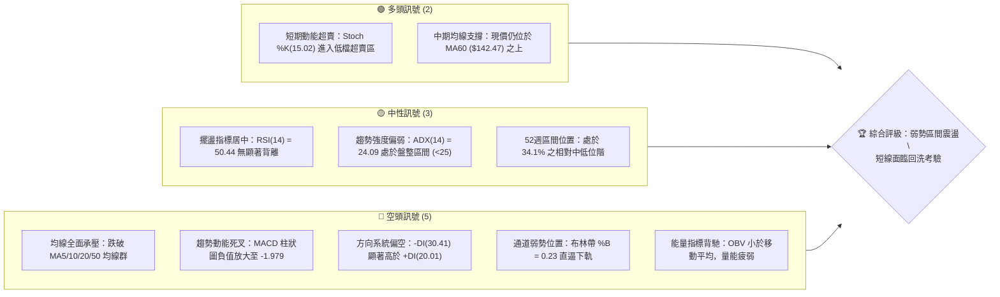
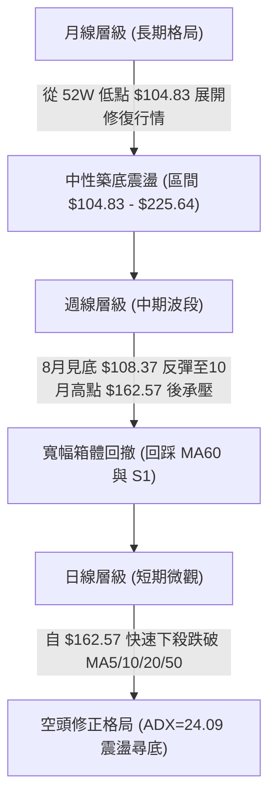
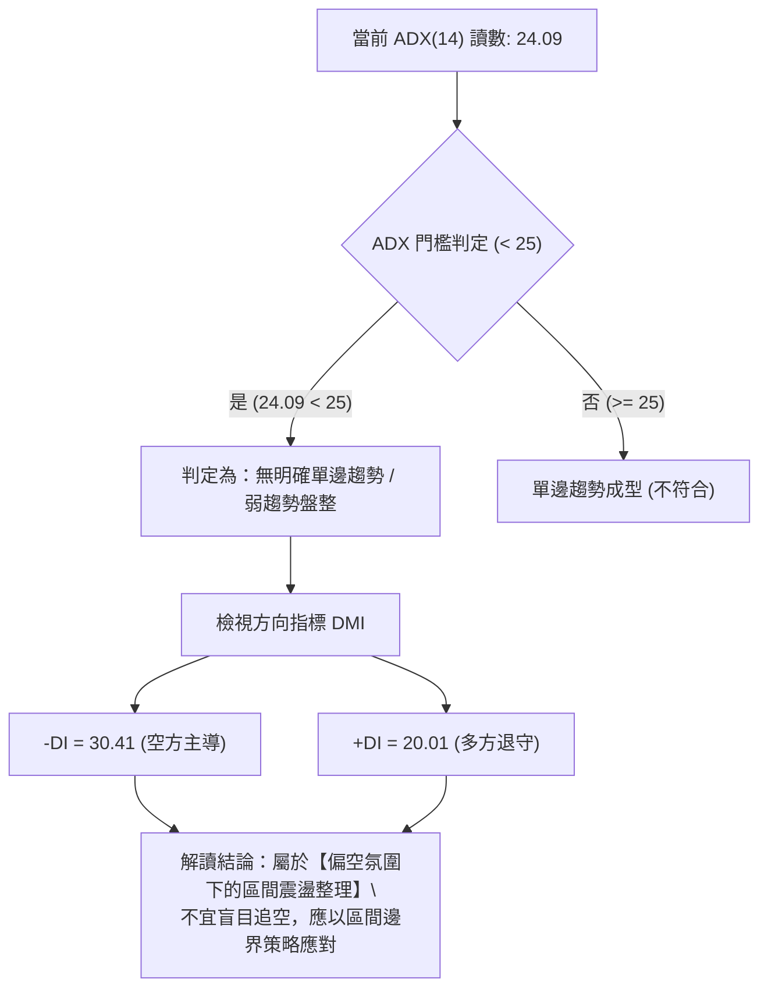
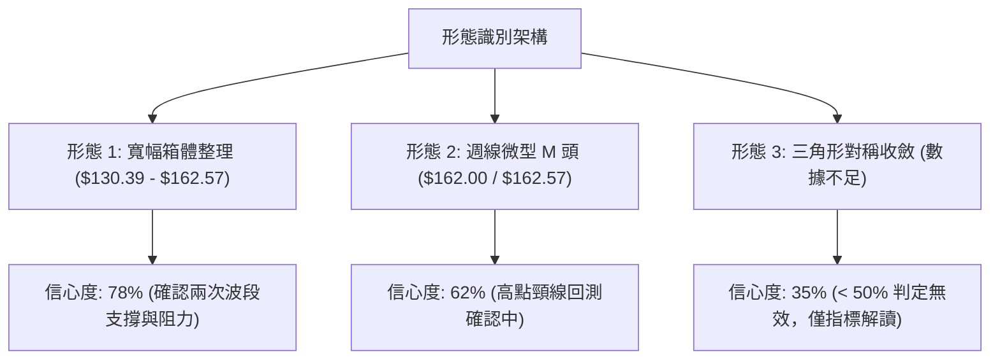
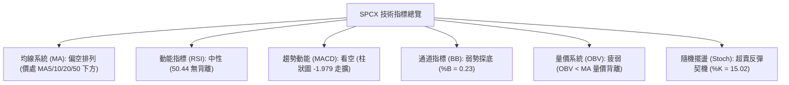
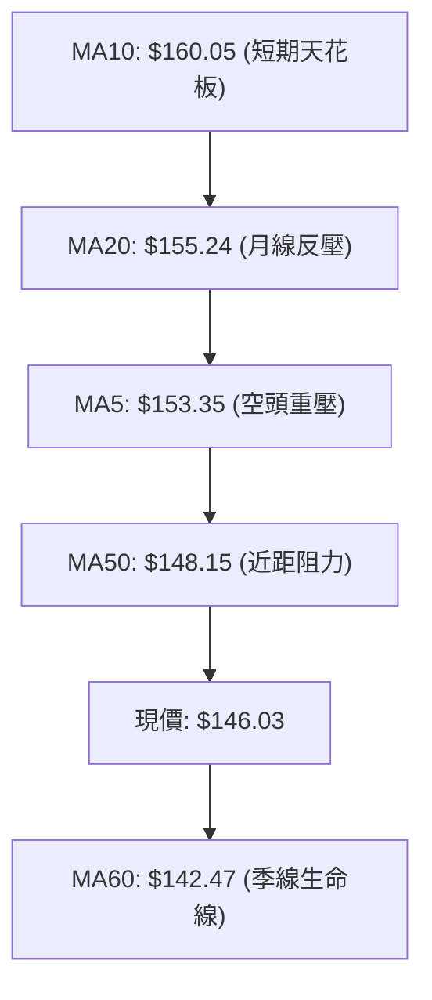
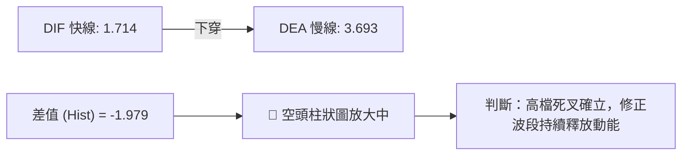
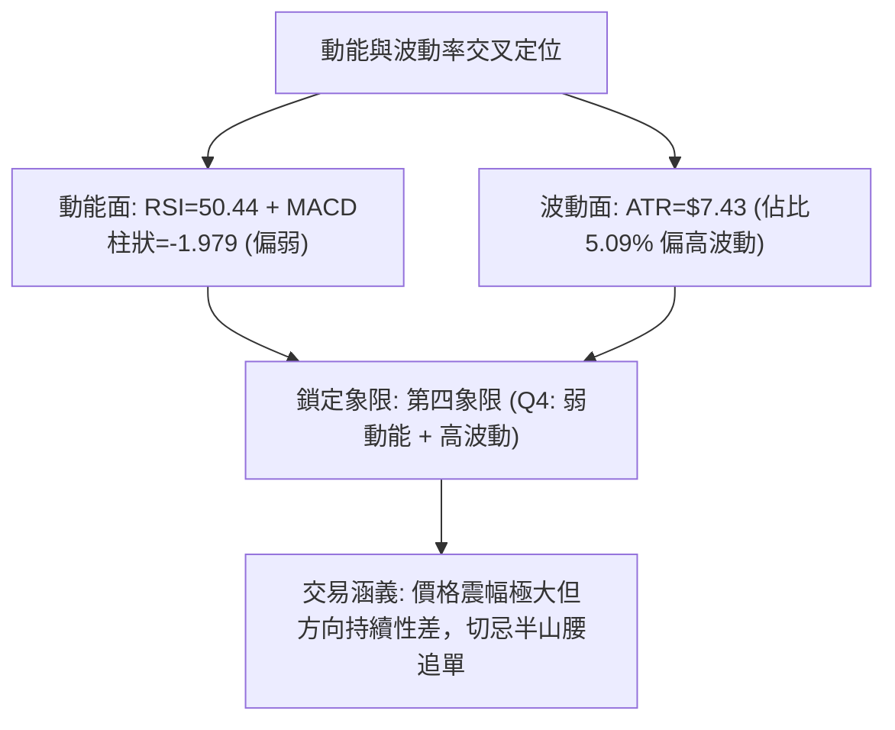
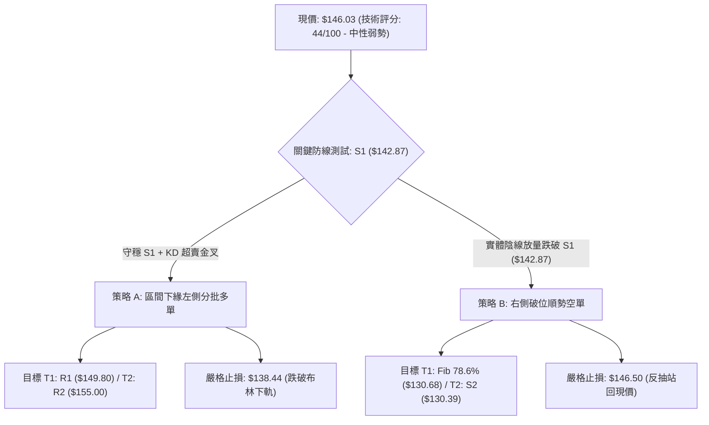
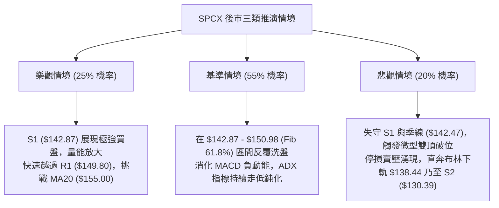

# SPCX 技術分析報告

> **報告日期**：2026-10-17 ｜ **語言**：繁體中文 ｜ **數據來源**：Yahoo Finance ｜ **當前價格**：$146.03

---

## 目錄

| 章節 | 內容 |
|------|------|
| [1. 技術面概覽](#1-技術面概覽) | 訊號儀表板、核心指標、評分卡 |
| [2. 趨勢分析](#2-趨勢分析) | 多時框趨勢、長中短期走勢、ADX強弱判斷 |
| [3. 圖表形態分析](#3-圖表形態分析) | 形態識別信心度、K線組合、幾何目標價 |
| [4. 支撐與阻力](#4-支撐與阻力) | 關鍵價位分布、波段高低點聚類、斐波那契回調 |
| [5. 技術指標深度解讀](#5-技術指標深度解讀) | 均線系統、RSI背離檢驗、MACD、布林通道、OBV量價 |
| [6. 動能與波動率](#6-動能與波動率) | 動能象限矩陣、ATR波動分析、止損距離量化 |
| [7. 多時框架總結](#7-多時框架總結) | 時框架矩陣、ADX收斂規則、唯一方向定調 |
| [8. 交易策略建議](#8-交易策略建議) | 策略路由分流、價格情境階梯、進出場精確點位 |
| [9. 風險提示與監控](#9-風險提示與監控) | 關鍵監控Checklist、三情境壓力測試、風控規則 |

---

## 1. 技術面概覽

### 🎯 技術訊號儀表板



---

### 📊 核心指標速覽表

| 指標類別 | 指標名稱 | 當前數值 | 訊號 | 專業解讀 |
|----------|----------|----------|:----:|----------|
| **現貨價格** | 收盤價 | $146.03 | 🔴 | 本週自 $162.57 快速拉回，失守多道短期均線 |
| **短期均線** | MA5 / MA10 | $153.35 / $160.05 | 🔴 | 均線呈空頭發散排列，短期下行壓力陡增 |
| **月線基準** | MA20 (布林中軌) | $155.24 | 🔴 | 價格落於中軌下方，短線進入弱勢修正格局 |
| **中期趨勢** | MA50 | $148.15 | 🔴 | 現價跌破 MA50，確認中期攻擊節奏受阻 |
| **季線支撐** | MA60 | $142.47 | 🟢 | 現價仍高於 MA60 (+2.50%)，構成波段防守第一道緩衝 |
| **動能擺盪** | RSI(14) | 50.44 | 🟡 | 位於 50 多空中軸邊緣，中性無背離 |
| **趨勢指標** | MACD (12,26,9) | 1.714 / 3.693 | 🔴 | DIF 下穿 MACD 形成高檔死叉，柱狀圖 -1.979 走擴 |
| **隨機指標** | KD (Stoch %K/%D) | 15.02 / 19.72 | 🟢 | 進入極度超賣區，短線隨時可能引發技術性反抽 |
| **趨勢強度** | ADX (14) | 24.09 | 🟡 | ADX < 25 判定為盤整震盪市場，單邊空頭趨勢尚未成型 |
| **方向指標** | DMI (+DI / -DI) | 20.01 / 30.41 | 🔴 | -DI 大幅壓制 +DI，空方力量占據主導 |
| **波動範圍** | Bollinger Bands | $138.44 - $172.04 | 🟡 | 通道帶寬收斂後價格下滑，%B 為 0.23 接近下軌 |
| **實質波動** | ATR(14) | $7.43 | 🔴 | 每日震幅佔比達 5.09%，日內洗盤劇烈 |
| **量能趨勢** | OBV 與量比 | 量比 1.07x / OBV<MA | 🔴 | 週成交量回落至 3.94 億股，量價背離且資金承接意願偏弱 |

---

### 🏆 技術評分卡

```
╔══════════════════════════════════════════════════════════════════╗
║                   技術評分卡 — SPCX (2026-10-17)                  ║
╠══════════════════════════════════════════════════════════════════╣
║ 趨勢強度 (Trend)     ████████░░░░░░░░░░░░  40/100  🔴 空頭壓制   ║
║ 動能指標 (Momentum)  ███████░░░░░░░░░░░░░  35/100  🔴 動能轉弱   ║
║ 支撐穩定 (Support)   ████████████░░░░░░░░  60/100  🟡 季線在望   ║
║ 量能配合 (Volume)    ███████░░░░░░░░░░░░░  38/100  🔴 量能疲弱   ║
║ 形態結構 (Pattern)   ██████████░░░░░░░░░░  50/100  🟡 箱體整理   ║
║ 均線排列 (Moving Av) ████████░░░░░░░░░░░░  42/100  🔴 短期偏空   ║
╠══════════════════════════════════════════════════════════════════╣
║ 綜合技術評分         █████████░░░░░░░░░░░  44/100  ⚖️ 區間弱勢   ║
╚══════════════════════════════════════════════════════════════════╝
```

---

## 2. 趨勢分析

### 🌐 多時框趨勢分析



---

### 📈 長期趨勢 — 12個月走勢圖（Unicode）

SPCX 過去 12 個月歷經深幅回撤與打底回升，呈現大級別的「寬幅 V 型修復與箱體震盪」形態：

```
SPCX 月線走勢示意圖（以歷史高低點與近期5個月收盤價建構）
價格軸 ($)
$225.64 ┤                           ● (52W High: $225.64)
$200.00 ┤                          / \
$175.00 ┤  ● (06月: $170.86)      /   \
$150.00 ┤   \                    ●     ● (09月: $150.86)
$146.03 ┤    \                  /       \___● (當前價格: $146.03)
$125.00 ┤     \                ● (08月: $143.69)
$104.83 ┤      ● (07月: $108.37 / 52W Low: $104.83)
        └─────────────────────────────────────────────► 時間 (月份)
           2026-06   2026-07   2026-08   2026-09   2026-10
```

#### 走勢特徵分析表

| 階段區間 | 收盤價變動 | 漲跌幅 | 量能結構 | 階段特徵與行為解讀 |
|:---------|:----------:|:------:|:--------:|:-------------------|
| **2026-06** | $170.86 | 基期 | 巨量分歧 | 高位滯漲，籌碼自機構向散戶擴散，引發後續破位殺多 |
| **2026-07** | $108.37 | -36.57% | 殺跌量縮 | 出現流動性緊縮式暴跌，觸及 52 週最低點 $104.83，空頭動能竭盡 |
| **2026-08** | $143.69 | +32.59% | 爆量長紅 | 築底完成，多頭報復性反彈，週量爆出 9.2 億股，主力積極回補 |
| **2026-09** | $150.86 | +4.99% | 溫和放量 | 遇斐波那契 61.8% 阻力位 ($150.98)，漲勢放緩，轉入高檔平台整理 |
| **2026-10 (當前)** | $146.03 | -3.20% | 量能遞減 | 衝高 $162.57 後遭遇獲利了結賣壓，單週回吐至均線群下方 |

---

### 📊 中期趨勢（週線分析）

從近 20 週的收盤軌跡觀察，SPCX 展現清晰的次級折返走勢：

```
SPCX 近期週線壓力與支撐階梯圖
$165.24 ───────────────────────────────────────── (Fib 50.0% 關鍵心理分水嶺)
          ▲ 10/11 衝高承壓：$162.57 (週線雙頂右峰)
$158.13 ──┼─────────────────────────────────────── (阻力 R3 / 密集交投區)
$155.00 ──┼───────────── (阻力 R2 / MA20 中軌 $155.24)
$150.98 ──┼───────────── (Fib 61.8% / 阻力 R1 $149.80)
$146.03 ──● 當前現價 ── (回落測試中)
$142.87 ───────────────────────────────────────── (關鍵支撐 S1 / 近一年低點聚類)
$138.44 ───────────────────────────────────────── (布林通道下軌極限支撐)
$130.39 ───────────────────────────────────────── (強支撐 S2 / Fib 78.6% $130.68)
```

1. **頂部結構承壓**：2026-10-11 當週拉升至 $162.57，逼近 7 月初高點 $162.00，但量能未達 6 月底起跌時的 5.9 億股水平，形成「量價無力創高」，隨即在 10-18 當週引發 -10.17% 的劇烈回撤（從 $162.57 跌至 $146.03）。
2. **週線指標轉折**：週 MACD 柱狀圖在連續 7 週紅柱後，本週突發轉為負值 -1.979，週 RSI 回落至 50.4，表明中期多頭進攻波段暫告段落，進入修正防守週期。

---

### ⚡ 趨勢強度評估（ADX 解讀）



#### ADX 趨勢強度對照矩陣

| 指標變量 | 具體數值 | 區間分類 | 趨勢意涵解讀 |
|:---------|:--------:|:--------:|:-------------|
| **ADX(14)** | **24.09** | 弱趨勢 / 盤整 (<25) | 雖然近日回跌幅度較大，但中長期動能指標尚未轉化為單邊下跌趨勢，市場本質為「寬幅區間洗盤」。 |
| **+DI (14)** | **20.01** | 多頭動能衰退 | 多方進攻意願受到壓抑，買盤縮手觀望。 |
| **-DI (14)** | **30.41** | 空頭動能主導 | 空方短線佔據優勢，-DI 與 +DI 差值達 10.40，防範急殺慣性。 |
| **市場主導規律** | **區間震盪** | 規則 14 優先級 | **ADX < 25 適用布林通道與波段 S/R 區間操作，嚴禁使用突破追價邏輯。** |

---

## 3. 圖表形態分析

### 🔍 形態識別系統



#### 形態識別信心度評估表（依規則 15）

| 識別形態 | 信心度 | 判斷依據（引用客觀數據） | 完成度 | 理論目標價（附精確計算式） |
|:---------|:------:|:------------------------|:------:|:--------------------------|
| **寬幅箱體整理** | **78%** | 底部在 2026-08 探底 $108.37 後於 $130.39 形成穩固支撐，頂部受制於 $162.57 與 R2/R3。 | 85% | **箱底反彈目標**：$130.39 + ($162.57 - $130.39) = **$162.57**；若失守箱底則下測 S3 ($104.83)。 |
| **雙重頂 (微型M頭)** | **62%** | 左頂 2026-07-05 收盤 $162.00，右頂 2026-10-11 收盤 $162.57；頸線對應 9 月波段回踩點 S1 ($142.87)。 | 70% | **頸線跌破測幅**：頸線 $142.87 - (高點 $162.57 - 頸線 $142.87) = $142.87 - $19.70 = **$123.17** (接近前波低點 $123.99)。 |
| **收斂旗形** | **35%** | 歷史 K 線波動劇烈，未形成規則的漸進收斂趨勢線。 | 20% | **訊號不足，僅做指標型解讀**（依規則 15 拒絕過度推演幾何形態）。 |

---

### 🕯️ 重要K線形態分析

| 月份週期 | 收盤價 | K線形態名稱 | 形態特徵與多空意涵解讀 | 訊號評級 |
|:---------|:------:|:-----------:|:----------------------|:--------:|
| **2026-07** | $108.37 | 探底長下影錘頭線 | 單月最低觸及 $104.83，下影線長達 $3.54，顯示低檔爆發極強避險性機構買盤。 | 🟢 看多反轉 |
| **2026-08** | $143.69 | 光頭大陽線 (Marubozu) | 月漲幅高達 +32.59%，實體徹底吞噬前月跌幅，確立波段大底成立。 | 🟢 強烈買訊 |
| **2026-09** | $150.86 | 高檔紡錘線 (Spinning Top) | 實體窄小且上下影線交錯，多空在斐波那契 61.8% ($150.98) 展開激烈拉鋸。 | 🟡 變盤猶豫 |
| **2026-10** | $146.03 | 衝高回落倒錘流星線 | 上攻 $162.57 後遭空頭伏擊，長上影線顯示上方高檔解套與獲利賣壓沉重。 | 🔴 短線偏空 |

---

### 📉 ASCII 走勢形態示意圖

```
SPCX 形態微觀演化圖（週線微型雙頂與箱體下測）
價格軸 ($)
$162.57 ┤          左頂●                  ●右頂 (10/11: $162.57)
$158.13 ┤         /     \                /     \
$155.00 ┤        /       \              /       \
$150.98 ┤       /         \            /         \   (MA20: $155.24)
$146.03 ┤──────/───────────\──────────/───────────●◄ 當前現價 ($146.03)
$142.87 ┤     /             ●頸線點  /              : 逼近 S1 頸線支撐位
$130.39 ┤    /               ($142.87)             : (若跌破測向 $123.17 / S2)
        └──────────────────────────────────────────────► 時間週期
```

---

### 🎯 形態目標價計算

依據確立度最高之「微型雙頂」與「箱體震盪」形態，嚴格套用價格測算公式：

1. **雙頂頸線破位測量（悲觀情境）**：
   - 頂部基準價 $P_{\text{Peak}}$ = $162.57
   - 頸線關鍵位 $P_{\text{Neck}}$ = S1 ($142.87)
   - 形態垂直高度 $H$ = $162.57 - $142.87 = $19.70
   - **等距滿足目標價** = $P_{\text{Neck}} - H$ = $142.87 - $19.70 = **$123.17**
   - *註：該目標價與 2026-07-19 當週之波段低點 $123.99 高度重疊，具備強烈技術共振效果。*

2. **箱體下軌回測支撐（基本情境）**：
   - 若 S1 ($142.87) 遭遇短線假跌破，下檔第一道實質形態緩衝為布林下軌 **$138.44**。
   - 形態底部終極防守為 S2 **$130.39**（斐波那契 78.6% 回調位 $130.68 附近）。

---

## 4. 支撐與阻力

### 🗺️ 關鍵價位分布圖（Unicode）

```
SPCX 價位結構分布圖（數據全數引自波段聚類與斐波那契精確計算）
══════════════════════════════════════════════════════════════════
$225.64 ║██████████████████████████████║ 52W 最高點 / 斐波那契 0.0%
$197.13 ║██████████████████            ║ 斐波那契 23.6% 回調位
$179.49 ║████████████████████          ║ 斐波那契 38.2% 回調位
$172.04 ║██████████████████            ║ 布林通道上軌 (Upper Band)
$165.24 ║██████████████████████        ║ 斐波那契 50.0% 多空分水嶺
$158.13 ║████████████████████████      ║ 強阻力 R3 (近一年波段高點聚類)
$155.24 ║████████████████████          ║ MA20 均線 / 布林中軌
$155.00 ║████████████████████          ║ 關鍵阻力 R2 (波段高點聚類)
$150.98 ║████████████████████████      ║ 斐波那契 61.8% 黃金分割位
$149.80 ║██████████████████████        ║ 短線阻力 R1 (波段密集套牢區)
$146.03 ╠══════════════════════════════╣ ◄ 當前市價 ($146.03)
$142.87 ║▓▓▓▓▓▓▓▓▓▓▓▓▓▓▓▓▓▓▓▓▓▓▓▓      ║ 核心支撐 S1 (近期波段低點聚類)
$138.44 ║▓▓▓▓▓▓▓▓▓▓▓▓▓▓▓▓▓▓            ║ 布林通道下軌 (Lower Band)
$130.68 ║▓▓▓▓▓▓▓▓▓▓▓▓▓▓▓▓▓▓▓▓▓▓        ║ 斐波那契 78.6% 回調位
$130.39 ║████████████████████████████  ║ 強支撐 S2 (波段低點聚類)
$104.83 ║██████████████████████████████║ 終極支撐 S3 / 52W 最低點 (100.0%)
══════════════════════════════════════════════════════════════════
```

---

### 🚧 阻力位分析表

所有價位均來自歷史真實 OHLCV 聚類計算：

| 阻力級別 | 精確價位 | 距現價幅動 | 形成原因與籌碼屬性 | 突破難度 | 重要性 |
|:---------|:--------:|:----------:|:-------------------|:--------:|:------:|
| **阻力 R1** | **$149.80** | +2.58% | 近期震盪高點密集區，與 Fib 61.8% ($150.98) 形成共振帶，短線多頭第一關。 | 🟡 中等 | ★★★☆☆ |
| **阻力 R2** | **$155.00** | +6.14% | 波段高點聚類，且與 20 日均線 MA20 ($155.24) 重合，為多空短線分水嶺。 | 🔴 較高 | ★★★★☆ |
| **阻力 R3** | **$158.13** | +8.29% | 10 月初次級反彈高點聚類，突破此處代表雙頂結構瓦解，多頭重掌控盤權。 | 🔴 極高 | ★★★★★ |

---

### 🛡️ 支撐位分析表

所有價位均來自歷史真實 OHLCV 聚類計算：

| 支撐級別 | 精確價位 | 距現價幅動 | 形成原因與籌碼屬性 | 守住機率 | 重要性 |
|:---------|:--------:|:----------:|:-------------------|:--------:|:------:|
| **支撐 S1** | **$142.87** | -2.16% | 近期波段回檔低點聚類，緊鄰 MA60 ($142.47)，為日內與多頭波段防線。 | 🟡 60% | ★★★★☆ |
| **支撐 S2** | **$130.39** | -10.71% | 近一年多次波段換手低點聚類，與 Fib 78.6% ($130.68) 共振，中期強底。 | 🟢 85% | ★★★★★ |
| **支撐 S3** | **$104.83** | -28.21% | 52 週最低點 (2026-07 歷史大底)，機構法人絕對價值防守底線。 | 🟢 98% | ★★★★★ |

---

### 📐 斐波那契回調位分析

本週期以 52 週完整波動區間（低點 **$104.83** → 高點 **$225.64**，總垂直價差 **$120.81**）進行黃金分割量測：

| 回調比率 | 精確價位 | 技術意涵與籌碼定位 | 當前價格相對位置判斷 |
|:---------|:--------:|:-------------------|:---------------------|
| **0.0%** | **$225.64** | 52週歷史高點，週期頂部極限。 | 位於現價上方 +54.52% |
| **23.6%** | **$197.13** | 多頭極度強勢回調位，失守後轉為震盪。 | 位於現價上方 +34.99% |
| **38.2%** | **$179.49** | 中期強弱劃分線，6月起跌前最後震盪平台。 | 位於現價上方 +22.91% |
| **50.0%** | **$165.24** | 核心中軸分水嶺，10月反彈最高點 ($162.57) 飲恨於此。 | 位於現價上方 +13.15% |
| **61.8%** | **$150.98** | **黃金分割多空分水嶺**，兵家必爭之地。 | **現價剛好落於下方 (-3.28%)** |
| **78.6%** | **$130.68** | 深度極限防守位，守穩則大級別雙底成立。 | 位於現價下方 -10.51% |
| **100.0%** | **$104.83** | 52週最低點，整輪週期的起漲原點。 | 位於現價下方 -28.21% |

**斐波那契解讀結論**：
現價 **$146.03** 目前被夾在 **61.8% ($150.98)** 與 **78.6% ($130.68)** 之間。技術上，一旦跌破 61.8% 關鍵黃金位，該位置即由支撐轉化為強大反壓。若短期內無法迅速以大陽線收復 $150.98，價格將存在進一步滑向 78.6% ($130.68) 的引力慣性。

---

## 5. 技術指標深度解讀

### 🎛️ 指標訊號總覽



---

### 📈 移動平均線排列分析



#### 均線階層狀態表

| 均線名稱 | 數值 | 現價偏離度 | 斜率與形態特徵 | 訊號方向 |
|:---------|:----:|:----------:|:---------------|:--------:|
| **MA5** | $153.35 | -4.78% | 陡峭向下俯衝，近5日呈現空頭加速殺跌 | 🔴 空頭 |
| **MA10** | $160.05 | -8.76% | 高位快速反轉向下，形成強烈短期蓋頂 | 🔴 空頭 |
| **MA20** | $155.24 | -5.93% | 走平後微幅下彎，布林中軌失守代表波段轉弱 | 🔴 空頭 |
| **MA50** | $148.15 | -1.43% | 走勢趨平，現價甫跌破，需觀察3日內能否收復 | 🟡 中性偏空 |
| **MA60** | $142.47 | +2.50% | **微幅上揚 (+2.50%)**，提供下檔最重要動態支撐 | 🟢 多頭防守 |

**均線綜合研判**：
呈現典型的「短期空頭排列、中期糾結混合」狀態。空方在 $148.15 - $160.05 構築了密集的均線反壓帶；唯一的多方防線僅剩微幅向上的 MA60 ($142.47)，此處亦是多頭能否維持中期震盪格局的最後生機。

---

### 📉 RSI(14) 分析

當前 RSI(14) 讀數為 **50.44**，視覺進度條呈現如下：

```
超賣區 (0-30)          中性多空中軸 (50)          超買區 (70-100)
├───────────────┼───────────────●───────────────┤
0              30              50.44           70             100
[███████████████████████████████░░░░░░░░░░░░░░░░░░░] 50.44%
```

1. **區間位置**：RSI 位於 50.44，精確停留在多空生死線（50 軸）之上。這表明儘管本週跌勢凶猛，但並未直接將市場打入恐慌性拋售，只是抹平了先前的超買漲幅。
2. **背離檢驗**：
   - 價格於 10-11 創下階段新高 $162.57 時，週線 RSI 為 59.1（低於 9-13 高點 $151.21 時的 RSI 68.0），呈現**微幅頂背離徵兆**，隨後引發本輪技術性重挫。
   - 目前在日線級別上，RSI 尚未形成底背離，指標仍處於尋找支撐階段。

---

### 📊 MACD(12,26,9) 訊號解讀



- **MACD 數值解讀**：DIF (1.714) 雖仍在零軸上方，但已急速下穿 DEA (3.693)，MACD 柱狀圖讀數為 **-1.979**。
- **動能演變**：回顧近幾週柱狀圖：`+0.411` → `-0.567` → `-0.083` → `+0.937` → `-1.979`。綠柱在短暫收斂後劇烈放量翻紅殺跌，確立了波段級別的死叉下行，動能空頭壓制明確。

---

### 📦 布林通道分析

```
SPCX 布林通道 (20, 2) 結構圖
$172.04 ───────────────────────────────────────── BB 上軌 (Upper)
          │
          │
$155.24 ───────────────────────────────────────── BB 中軌 (MA20)
          │
$146.03 ──● 現價 (%B = 0.23) ── 逼近下軌超賣區
          │
$138.44 ───────────────────────────────────────── BB 下軌 (Lower)
```

- **帶寬與位置**：通道帶寬上限為 $172.04，中軌為 $155.24，下軌為 $138.44。現價 $146.03 對應之 **%B 指標為 0.23**。
- **邊界含義**：%B 跌至 0.23 意味著價格已進入通道下半區的極端弱勢帶。依據布林通道統計規律，當價格在未打開喇叭口（ADX<25）的環境下逼近下軌時，通常會在下軌 $138.44 至 S1 $142.87 區間引發均值回歸的技術性反彈。

---

### 💹 成交量分析（量價配合度）

1. **成交量對比**：最新單日成交量為 **88,193,900 股**，相較於 20 日均量 **82,062,120 股**，量比約為 **1.07x**，呈現微幅價跌量增的短線出貨特徵。然而，相較於 50 日均量 **94,364,650 股**，量能依然處於次級規模。
2. **OBV 能量潮解讀**：
   - 官方數據確認：`OBV < MA → 量能疲弱`。
   - OBV 跌破其均線，代表在過去 3 個月的反彈進程中，主力資金呈現「逢高出脫、逢低少量承接」的防守策略，並未進行實質性的鎖倉吸籌，量能不支持持續性的暴漲突破。

---

## 6. 動能與波動率

### ⚡ 動能評估四象限

| 象限分區 | 動能強度 (Momentum) | 波動率水平 (Volatility) | SPCX 當前狀態標定 | 策略指導方針 |
|:---------|:-------------------:|:------------------------:|:-----------------:|:-------------|
| **第一象限 (Q1)** | 強動能 (Bullish) | 低波動 (Low Vol) | — | 穩定多頭趨勢，適合順勢加碼 |
| **第二象限 (Q2)** | 弱動能 (Bearish) | 低波動 (Low Vol) | — | 沉悶牛皮整理，宜觀望等待方向 |
| **第三象限 (Q3)** | 強動能 (Bullish) | 高波動 (High Vol) | — | 狂暴主升浪，宜移動止盈追蹤 |
| **第四象限 (Q4)** | **弱動能 (Bearish)** | **高波動 (High Vol)** | **✓ (SPCX 所處位置)** | **高風險高洗盤，宜恪守區間邊界操作** |



---

### 📊 ATR 波動率分析

- **ATR(14) 讀數**：精確數值為 **$7.43**，佔目前股價的 **5.09%**。
- **日內波動特性**：高達 5.09% 的每日波幅顯示 SPCX 屬於極高彈性的攻擊型資產。這意味著單日價格波動在 $7.00 - $8.00 屬於正常雜訊範圍。
- **止損距離量化建議**：
  - **超短線交易（1.0 × ATR）**：動態止損幅度設為 **$7.43**。
  - **波段交易（1.5 × ATR）**：安全止損緩衝設為 **$11.15**。
  - **重要邊界止損法**：以結構位為主，例如跌破 S1 ($142.87) 後再給予 0.5×ATR ($3.72) 的緩衝至 **$139.15**，可有效避開機構洗盤假突破。

---

### 📐 Beta 與市場相關性

- **Beta 狀態**：數據包中 Beta 顯示為 `N/A`（公司具備航太國防特許壟斷與超高估值成長屬性）。
- **特徵屬性推演**：
  - 隱含波動特性：作為市值 $1.92T、營收 YoY 暴增 91.9% 但淨利率為 -35.7% 的巨型成長股，其價格對流動性與市場風險偏好極端敏感。
  - 籌碼結構：機構持股佔比 48.6%、內部人持股 12.7%、空頭回補天數 (Short Ratio) 為 2.01。短期做空佔比僅 2.7%，說明當前下跌並非源於大規模惡意做空，而是多頭在估值分歧下的獲利回吐。

---

## 7. 多時框架總結

### 📋 時框架評分表

| 時框架 | 趨勢方向 | 動能指標狀態 | 均線排列特徵 | 圖表形態識別 | 綜合評分 | 戰略建議 |
|:-------|:--------:|:------------:|:------------:|:------------:|:--------:|:---------|
| **月線 (長期)** | 🟢 築底反彈 | RSI 中軸徘徊 | 站上歷史低檔區 | 52W 低點反彈打底 | **65/100** | 長線多頭逢低建倉 |
| **週線 (中期)** | 🟡 箱體震盪 | MACD 轉弱死叉 | 糾結於 Fib 61.8% | 寬幅整理 ($130-$162) | **48/100** | 區間高拋低吸 |
| **日線 (短期)** | 🔴 弱勢修正 | KD 超賣 / ADX<25 | 跌破短期均線群 | 微型雙頂頸線測試 | **38/100** | 嚴禁追價，等待止跌 |

---

### 🔲 綜合訊號矩陣

```
╔══════════════════════════════════════════════════════════════════╗
║                   SPCX 多時框訊號一致性矩陣                      ║
╠══════════════════════════════════════════════════════════════════╣
║ 維度指標        短期 (Daily)       中期 (Weekly)      長期 (Monthly) ║
╠══════════════════════════════════════════════════════════════════╣
║ 趨勢方向        🔴 空頭修正        🟡 寬幅箱體        🟢 觸底回升    ║
║ 動能強弱        🔴 柱狀圖走擴      🟡 轉折下彎        🟡 中性修復    ║
║ 均線架構        🔴 破線空頭        🟡 季線上行        🟡 築底混合    ║
║ 籌碼量能        🔴 OBV疲軟         🟡 量能遞減        🟢 八月爆量底  ║
║ 波動邊界        🔴 逼近BB下軌      🟡 處箱體中線      🟢 脫離極端底  ║
╚══════════════════════════════════════════════════════════════════╝
```

---

### ⚖️ 多時框收斂結論（依規則 14 明確定調）

1. **行情性質絕對判定**：
   - 當前系統 ADX 讀數為 **24.09 (< 25)**。
   - 根據【嚴格要求 14】之多時框收斂規則：**盤整行情（ADX < 25）以日線布林通道上下軌 ($138.44 - $172.04) 與波段支撐阻力為主要交易區間。** 中長期單邊趨勢目前並未啟動。
2. **時框衝突取捨**：
   - 日線呈現短期均線破位的下殺（偏空），但週線仍運行於 8 月以來的震盪向上走廊中（MA60 $142.47 未破，月線反彈基調未變）。
   - 依優先級規則：日線級別的空頭動能**僅視為大箱體內部的「次級回撤波」**，用以尋找區間下緣的低吸點，而非單邊崩跌的起點。
3. **唯一方向性結論**：
   - **【中性偏弱觀望，等待區間下緣（S1 $142.87 至 BB下軌 $138.44）止跌確認】**。

---

## 8. 交易策略建議

### 🗺️ 策略決策流程圖



---

### 🧭 策略路由（依評分卡分流）

> **當前主策略方向 = 【中性區間波段操作（防守型低吸）】（依技術評分卡 44/100）**
> *理由：綜合評分介於 40–60 之間，且 ADX = 24.09 (<25)，市場定義為標準箱體震盪。策略重點在於「布林通道上下軌與 S1 支撐邊界」，拒絕追高殺跌。*

---

### 🎯 價格情境階梯（Price Scenarios）

所有觸發價位與目標點位**全數嚴格引用第 4 章數據**：

| 觸發條件 | 下一目標 | 後續延伸 | 情境技術含義 |
|:---------|:--------:|:--------:|:-------------|
| **強勢突破 R1 ($149.80)** | **R2 ($155.00)** | **R3 ($158.13)** | 短線空頭衰竭，重回 MA20 月線中軌上方，多頭轉強。 |
| **守住 S1 ($142.87) 震盪** | **$146.03 (現價)** | **R1 ($149.80)** | 季線發揮支撐，消化指標超賣，延續箱體拉鋸。 |
| **有效跌破 S1 ($142.87)** | **BB下軌 ($138.44)**| **S2 ($130.39)** | 雙頂形態成立，展開向斐波那契 78.6% 的深幅下探。 |

---

### 📊 情境機率分佈

| 情境類型 | 預測機率 | 主要技術依據 |
|:---------|:--------:|:-------------|
| **S1 守穩反彈 (區間上攻)** | **35%** | Stoch KD 進入低檔超賣區 (%K=15.02)，下檔 MA60 ($142.47) 具備強大支撐力道。 |
| **區間弱勢震盪 (橫盤打底)** | **45%** | **ADX=24.09 (<25) 判定為盤整市場**，布林帶寬未展開，量能遞減不支持突破。 |
| **跌破 S1 破位下殺 (再探底)**| **20%** | MACD 柱狀圖放大至 -1.979，-DI (30.41) 壓制 +DI，空方具備短線殺傷力。 |

---

### 🟢 主策略詳情（區間操作與破位應對）

本報告提供兩組符合嚴格風控比例的交易策略：

| 策略要素 | 策略 A：區間下緣低吸多單 (首選) | 策略 B：跌破頸線破位空單 (次選備案) |
|:---------|:--------------------------------|:------------------------------------|
| **適用時機** | 價格回踩 S1 企穩，出現止跌K棒時進場 | 實體日K跌破 S1 ($142.87) 確立時進場 |
| **進場價格** | **$143.00** (靠近 S1 $142.87 與 MA60) | **$141.50** (確認跌破 S1 $142.87 追空) |
| **目標價 T1**| **$149.80** (阻力位 R1) | **$135.00** (整數關卡 / 下探緩衝區) |
| **目標價 T2**| **$155.00** (阻力位 R2 / MA20 中軌) | **$130.39** (強支撐 S2 / Fib 78.6%) |
| **止損價格** | **$138.00** (跌破布林下軌 $138.44 止損) | **$146.50** (反抽站回阻力轉折點之上) |
| **潛在空間** | 獲利: +$6.80 / +$12.00；風險: -$5.00 | 獲利: +$6.50 / +$11.11；風險: -$5.00 |
| **風險報酬比** | **2.40 : 1** (以 T2 計算) | **2.22 : 1** (以 T2 計算) |
| **預估勝率** | **55%** (受惠於 KD 超賣與季線支撐) | **45%** (ADX<25 震盪市下破位易出假突破) |
| **建議倉位** | **15% - 20%** (輕倉波段參與) | **10%** (嚴格防範震盪市洗盤抽回) |

---

### 🔴 反向風險觸發點（對沖與風控提示）

1. **多頭策略失效警報**：
   - 若日線收盤價跌破 **$142.87 (S1)** 且隔日未見吞噬陽線收復，應立即將多頭部位砍半。
   - 若進一步跌破 **$138.44 (布林下軌)**，無條件全數止損離場，空倉觀望至 S2 ($130.39)。
2. **空頭策略回補警報**：
   - 空單進場後，若價格迅速拉回站上 **$146.50**，即確認為「空頭陷阱（假跌破）」，空單必須全數止損回補。
   - 若成交量暴增至 1 億股以上並強勢吞噬 MA5 ($153.35)，空頭防線全面瓦解。

---

### ⭐ 整體訊號強度評星

```
做多訊號強度：★★☆☆☆  (2/5星 - 需等待 S1 測試確認，不宜搶跑)
做空訊號強度：★★★☆☆  (3/5星 - 短線指標全面偏空，但受阻於季線)
整體可信度：  ★★★★☆  (4/5星 - 震盪區間明確，指標收斂一致性高)
```

---

## 9. 風險提示與監控

### ✅ 關鍵監控指標 Checklist

```
╔══════════════════════════════════════════════════════════════════╗
║               SPCX 盤面即時風控監控清單 (Checklist)             ║
╠══════════════════════════════════════════════════════════════════╣
║ [ ] 關鍵價位攻防：收盤價是否有效守穩 S1 ($142.87) 核心支撐線   ║
║ [ ] 均線動態收復：多頭能否在 3 個交易日內收復 MA50 ($148.15)    ║
║ [ ] 擺盪指標修復：Stoch KD 是否在超賣區 (<20) 形成金叉共振       ║
║ [ ] 動能柱狀追蹤：MACD 柱狀圖負值 (-1.979) 是否出現連續縮減     ║
║ [ ] 波動異常監控：單日真實波幅是否超過 ATR ($7.43) 引發異常突破  ║
║ [ ] 量能異動檢視：成交量是否萎縮至 5,000 萬股以下形成量縮窒息底  ║
║ [ ] 外部共振風險：關注成長股估值環境 (當前 P/S: 83.5x，高估值敏感)║
╚══════════════════════════════════════════════════════════════════╝
```

---

### ⚠️ 風險場景分析



---

### 🛡️ 風險管理重要提醒

1. **估值與基本面落差的流動性折價**：
   - SPCX 當前市銷率 (P/S) 高達 **83.53x**，市淨率 (P/B) 為 **15.12x**，TTM 淨利潤為負 ($-1.10 EPS)。儘管營收成長率高達 91.9%，但極度高昂的估值倍數使其在面臨大盤流動性收緊時，容易引發技術性「殺估值」行情。
2. **高 ATR 波動下的倉位控制原則**：
   - 每日 ATR 高達 **$7.43 (5.09%)**，單日潛在波動極大。在資金管理上，單一交易對帳戶總資產的風險暴露度（Risk at Risk）**不得超過 1.5%**。
   - 若以現價 $146.03 進場、停損設於 $138.00（每股承擔 $8.03 風險），則 10 萬美元規模之投資組合，**最大持倉股數應嚴格限制在 180 股以內**（總曝險金額約 $26,000，佔總資產約 26% 倉位極限），絕不可過度融資槓桿。

---

## 📋 報告總結

```
╔══════════════════════════════════════════════════════════════════╗
║                   SPCX 技術分析報告總結                          ║
╠══════════════════════════════════════════════════════════════════╣
║ 報告日期：2026-10-17                                             ║
║ 當前價格：$146.03                                                ║
║ 分析評級：⚖️ 區間震盪偏弱整理（等待支撐測試）                   ║
╠══════════════════════════════════════════════════════════════════╣
║ 關鍵結論：                                                       ║
║ ├─ 長期趨勢：🟢 脫離 52W 低點 $104.83，處於大級別底部回升階段   ║
║ ├─ 中期趨勢：🟡 寬幅箱體震盪 ($130.39 - $162.57)，ADX=24.09 盤整║
║ ├─ 短期趨勢：🔴 連跌破短期均線，MACD 柱狀 -1.979，短線動能偏空   ║
║ ├─ 關鍵支撐：S1: $142.87 ｜ S2: $130.39 ｜ 終極: $104.83         ║
║ ├─ 關鍵阻力：R1: $149.80 ｜ R2: $155.00 ｜ R3: $158.13         ║
║ └─ 華爾街共識目標：$222.71 (覆蓋分析師 31 位，評級 Buy)          ║
╠══════════════════════════════════════════════════════════════════╣
║ 最優策略組合：                                                   ║
║ 1. 🥇 最佳機會：等待回測 S1 ($142.87) 且 KD 金叉，執行策略 A 區 ║
║               間下緣低吸多單 (停損 $138.00，目標 $155.00)。     ║
║ 2. 🥈 次選機會：若帶量實體陰線跌穿 S1 ($142.87)，短線順勢執行    ║
║               策略 B 追空至 $135.00 / S2 ($130.39)。             ║
║ 3. 🥉 保守選擇：空倉觀望，等待日線收盤重新站上 MA20 ($155.24)   ║
║               後，再行順勢進場佈局多單。                         ║
╚══════════════════════════════════════════════════════════════════╝
```

---

> ⚠️ **免責聲明**：本報告為依據客觀量化技術指標與歷史 OHLCV 價格數據自動生成之技術分析報告。所有數據、模型推算及交易策略僅供學術研究與投資決策輔助參考，**不構成任何形式之個人化投資建議或買賣要約**。金融市場瞬息萬變，高估值與高波動性資產風險極高，投資人應依個人財務狀況與風險承受度審慎評估，自行承擔所有投資損益與交易風險。

---

*報告生成時間：2026-10-17 ｜ 數據來源：Yahoo Finance ｜ 分析框架：多時框技術分析體系*