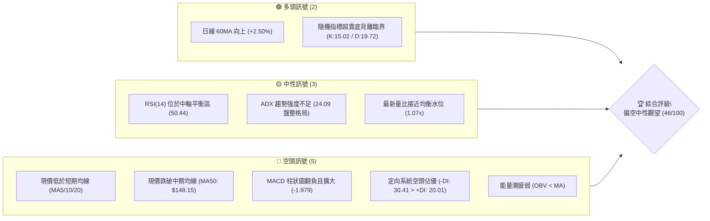
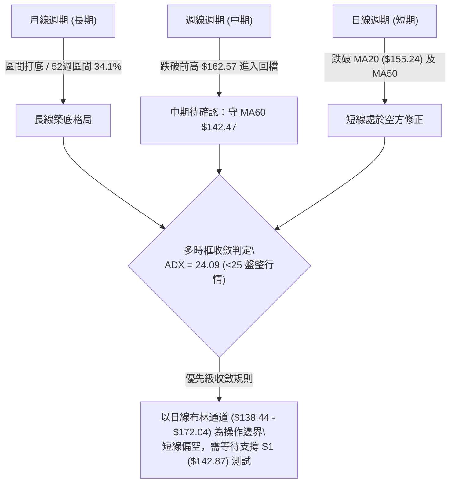
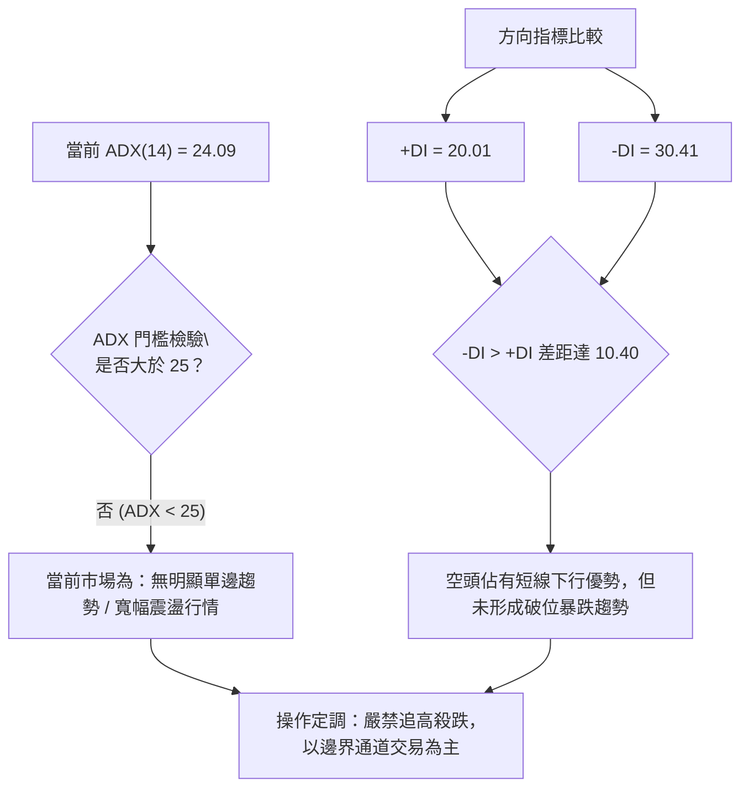
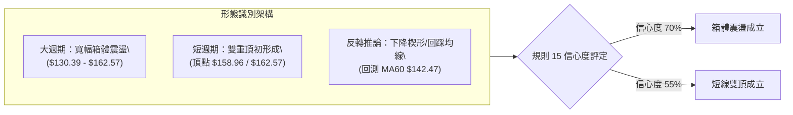
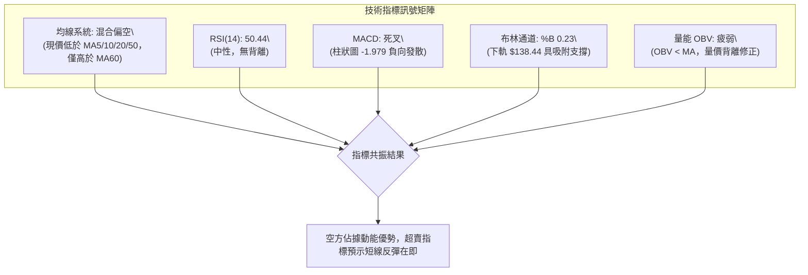
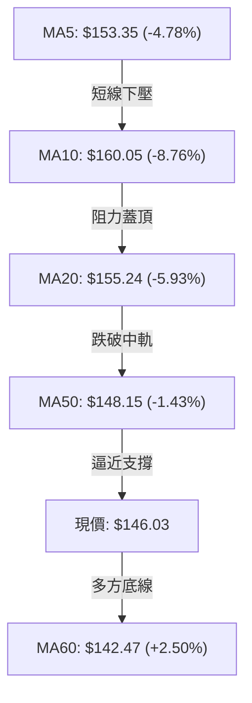
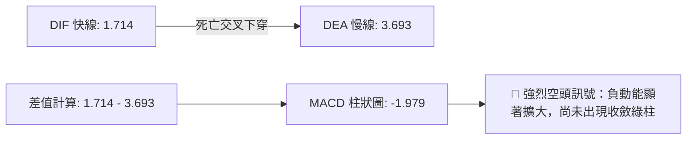
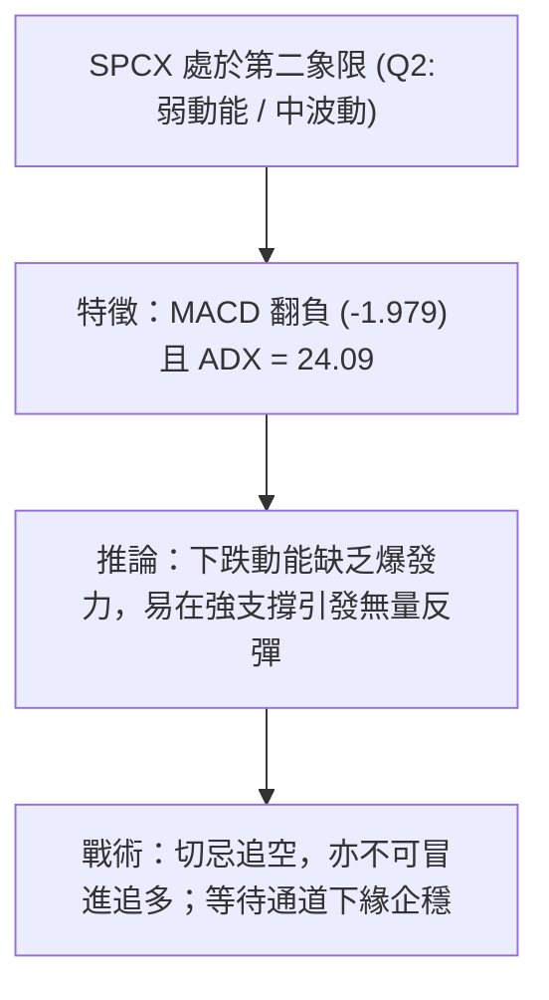
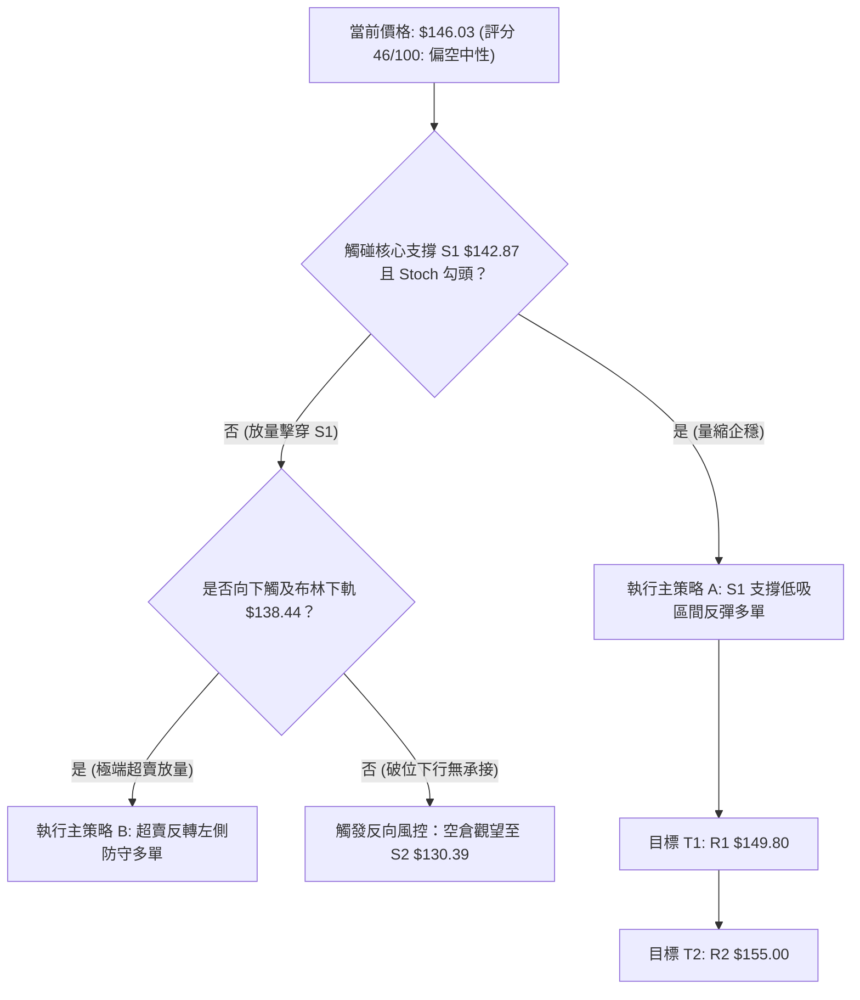
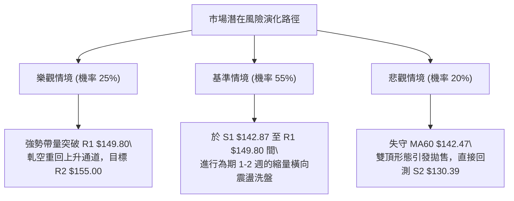

# SPCX 技術分析報告

> **報告日期**：2026-10-18 ｜ **語言**：繁體中文 ｜ **數據來源**：Yahoo Finance ｜ **當前價格**：$146.03

---

## 目錄

| 章節 | 內容 |
|------|------|
| [1. 技術面概覽](#1-技術面概覽) | 訊號儀表板、核心指標、評分卡 |
| [2. 趨勢分析](#2-趨勢分析) | 多時框趨勢、長中短期走勢、ADX 評估 |
| [3. 圖表形態分析](#3-圖表形態分析) | 形態識別、K線組合、目標價推算 |
| [4. 支撐與阻力](#4-支撐與阻力) | 關鍵價位、斐波那契回調結構 |
| [5. 技術指標深度解讀](#5-技術指標深度解讀) | MA/RSI/MACD/布林/量價配合 |
| [6. 動能與波動率](#6-動能與波動率) | 動能評估四象限、ATR、Beta 與市場性 |
| [7. 多時框架總結](#7-多時框架總結) | 時框架評分矩陣與多時框收斂 |
| [8. 交易策略建議](#8-交易策略建議) | 主策略路由、情境階梯、風報比精算 |
| [9. 風險提示與監控](#9-風險提示與監控) | 關鍵監控清單、風險場景樹、報告總結 |

---

## 1. 技術面概覽

### 🎯 技術訊號儀表板



### 📊 核心指標速覽表

| 指標類別 | 指標名稱 | 當前數值 | 訊號 | 解讀 |
|----------|----------|----------|------|------|
| **價格** | 當前價格 | $146.03 | 🟡 | 位於 52 週區間 34.1%，處於相對低檔築底整理階段 |
| **短期均線** | MA5 / MA10 | $153.35 / $160.05 | 🔴 | 價格分別在均線下方 -4.78% 與 -8.76%，短線空方下壓猛烈 |
| **月線系統** | MA20 (布林中軌) | $155.24 | 🔴 | 跌破 20 日均線（-5.93%），短期攻擊結構遭到破壞 |
| **季線系統** | MA50 | $148.15 | 🔴 | 跌破中期防守點 MA50（-1.43%），由前週強勢轉為承壓 |
| **長期均線** | MA60 | $142.47 | 🟢 | 守在 60 日均線之上（+2.50%），長期波段底部緩步墊高 |
| **超長期線** | MA200 | 數據不足 (N/A) | 🟡 | 數據庫未滿 200 日交易記錄，無長期牛熊分界線參照 |
| **動能震盪** | RSI(14) | 50.44 | 🟡 | 處於 30–70 中性平衡區間，無極端超買或超賣狀態 |
| **趨勢動能** | MACD (12,26,9) | 1.714 / 3.693 / -1.979 | 🔴 | 快慢線高檔死叉，柱狀圖（-1.979）負向擴大，動能偏空 |
| **擺動指標** | Stoch %K / %D | 15.02 / 19.72 | 🟢 | 進入 20 以下超賣區間，技術性反彈動能正逐步凝聚 |
| **趨勢強度** | ADX (14) | 24.09 (-DI: 30.41) | 🔴 | ADX < 25 屬弱趨勢/區間震盪，-DI 明顯高於 +DI 空方主導 |
| **波動帶** | 布林通道 %B | 0.23 (下軌 $138.44) | 🟡 | 位於中軌與下軌之間偏下軌位置，接近超跌下軌支撐區 |
| **波動幅度** | ATR(14) | $7.43 (5.09%) | 🟡 | 波動度居中偏高，單日平均震盪空間約達 $7.43 |
| **量能系統** | 成交量 / OBV | 88,193,900 (量比 1.07x) | 🔴 | 成交量未明顯放大，OBV 小於均線，量能未確認反轉上攻 |

### 🏆 技術評分卡

```
╔══════════════════════════════════════════════════════════════╗
║              技術評分卡 — SPCX (2026-10-18)                  ║
╠══════════════════════════════════════════════════════════════╣
║ 趨勢強度 (ADX/DI)   ███████░░░░░░░░░░░░░  35/100  🔴 空頭主導  ║
║ 動能指標 (MACD/RSI) ████████░░░░░░░░░░░░  40/100  🔴 柱狀負向  ║
║ 支撐穩定度 (S1/S2)  ████████████░░░░░░░░  60/100  🟢 60MA支撐  ║
║ 成交量配合 (OBV/VOL)████████░░░░░░░░░░░░  40/100  🔴 量能疲弱  ║
║ 形態完整度 (區間)   ███████████░░░░░░░░░  55/100  🟡 寬幅箱體  ║
║ 均線排列 (短中長)   █████████░░░░░░░░░░░  45/100  🔴 短空長多  ║
╠══════════════════════════════════════════════════════════════╣
║ 綜合評分            █████████░░░░░░░░░░░  46/100  🟡 偏空中性  ║
╚══════════════════════════════════════════════════════════════╝
```

---

## 2. 趨勢分析

### 🌐 多時框趨勢分析



### 📈 長期趨勢 — 12 個月走勢圖（Unicode）

```
SPCX 走勢圖（近期關鍵月度收盤與 52 週邊界）
價格軸 ($)
$225.64 ┤                           ● (52W High: $225.64)
$197.13 ┤                          
$179.49 ┤            ● 
$170.86 ┤    ●(06/26) 
$160.05 ┤                                  ● (MA10)
$150.86 ┤                     ●(09/26)
$146.03 ┤━━━━━━━━━━━━━━━━━━━━━━━━━━━━━━━━━━● (現價 $146.03)
$143.69 ┤               ●(08/26)
$108.37 ┤        ●(07/26)
$104.83 ┤        ● (52W Low: $104.83)
         └──────────────────────────────────────────────
          06/26    07/26    08/26    09/26    10/26 (現價)
```

**走勢特徵分析表格**：

| 時間區段 | 收盤價 / 區間 | 漲跌幅 | 走勢特徵分析 | 量價結構 |
|----------|---------------|--------|--------------|----------|
| 2026-06  | $170.86       | 基準   | 處於自 52 週高點回落後的震盪下行走勢 | 月底爆出巨量換手 |
| 2026-07  | $108.37       | -36.57%| 出現恐慌性崩跌，觸及 52 週歷史低點 $104.83 | 縮量探底，籌碼斷頭洗盤 |
| 2026-08  | $143.69       | +32.59%| 形成長下影強烈 V 型反彈，重新站回百元心理關卡 | 量能大幅放大 (>9億股)，大戶進場抄底 |
| 2026-09  | $150.86       | +4.99% | 漲勢放緩，於斐波那契 61.8% ($150.98) 附近遭遇解套賣壓 | 量能回落，籌碼沉澱 |
| 2026-10  | $146.03 (現價)| -3.20% | 月中衝高至 $162.57 後承壓回落，測試下方均線支撐群 | 週成交量回落至 3.94 億股，量縮拉回 |

### 📊 中期趨勢（週線分析）

中期走勢自 2026 年 8 月初低點 $108.37 起展開一波清晰的「五波推動上攻」，並於 2026-10-11 創下反彈波段高點 $162.57。然而，本週（2026-10-18）收盤大跌至 $146.03，週 MACD 柱狀圖由正轉負（由 +0.937 驟降至 -1.979），且一舉跌破 5 週均線與 10 週均線支撐，確立中期進入修正波階段。

```
週線級別關鍵結構示意圖
$165.24 ────────────────────────────────────────── 斐波那契 50.0% 強阻力
$162.57 ─────────────▲ 波段反彈高點 (2026-10-11)
                     │
$155.00 ─────────────┼──────── R2 聚類阻力 / MA20 週線
$149.80 ─────────────┼──────── R1 阻力 (近一週下破點)
$146.03 ─────────────● 現價 (回測季線區間)
$142.87 ─────────────┴──────── S1 近期波段關鍵支撐 (與 MA60 $142.47 重疊)
$130.39 ────────────────────────────────────────── S2 次級防守 (斐波那契 78.6% $130.68)
```

### ⚡ 趨勢強度評估（ADX 解讀）



**ADX 強度對照表**：

| ADX 數值區間 | 趨勢分類 | SPCX 狀態 (24.09) | 交易策略意涵 |
|--------------|----------|-------------------|--------------|
| 0 – 20       | 極弱 / 無趨勢 | 否 | 觀望或高拋低吸 |
| **20 – 25**  | **趨勢萌芽 / 弱趨勢** | **🟢 符合 (當前 24.09)** | **處於盤整與弱單邊交界，震盪指標優先於趨勢指標** |
| 25 – 40      | 強趨勢形成 | 否 | 順勢單邊操作 |
| 40 – 60      | 極強單邊行情 | 否 | 突破加碼操作 |

---

## 3. 圖表形態分析

### 🔍 形態識別系統



**形態信心度與目標價評估表**：

| 形態名稱 | 信心度 | 判斷依據（引用數據） | 完成度 | 目標價（附嚴謹計算式） |
|----------|--------|----------------------|--------|------------------------|
| **中期寬幅箱體** | 70% | 頂部受制於 R3 ($158.13) 與前高 $162.57；底部多次於 S2 ($130.39) 獲支撐 | 85% | 箱體下緣目標價：$130.39；箱體上緣目標價：$165.24 (斐波那契 50%) |
| **短線雙重頂** | 55% | 頂1：10-04 ($158.96)，頂2：10-11 ($162.57)，當前跌破頸線 $149.80 (R1) | 60% | 頸線 $149.80 - 形態高度 ($162.57 - $149.80 = $12.77) = **$137.03** (接近布林下軌 $138.44) |
| **頭肩底形態** | 35% | 數據不足（左肩 $115.07、頭部 $108.37，但右肩結構混亂且量能萎縮） | 30% | 訊號不足，僅做指標型解讀，不預設該形態之推算目標 |

### 🕯️ 重要 K 線形態分析

| 週/月份 | 收盤價 | K 線形態 | 技術解讀 | 訊號 |
|---------|--------|----------|----------|------|
| 2026-08-02 | $108.37 | 長下影鐵鎚線 (Hammer) | 股價回踩 52 週最低點 $104.83 後爆量急拉，留下極長下影線，主力資金強勢介入 | 🟢 強烈見底 |
| 2026-08-09 | $133.11 | 巨量大陽線 (Marubozu) | 週成交量爆出 9.2 億股，週線 RSI 自 19.2 旱地拔蔥飆升至 57.4，完成單週反轉 | 🟢 趨勢反轉 |
| 2026-10-11 | $162.57 | 流星線 (Shooting Star) | 向上衝刺逼近斐波那契 50.0% ($165.24) 失敗，留長上影線，多頭動能消耗殆盡 | 🔴 頂部力竭 |
| 2026-10-18 | $146.03 | 光腳中陰線 (Bearish Candle) | 開盤一路低走跌破 MA20 ($155.24) 及 MA50 ($148.15)，空方全面掌控短線節奏 | 🔴 空方通吃 |

### 📉 ASCII 走勢形態示意圖

```
SPCX 日/週線形態細節（近期雙頂受阻與頸線跌破）
$165.24 ────────────────────────────────────────── 斐波那契 50%
                    頂2: $162.57 (10-11)
                       ▲
        頂1: $158.96  / \
             ▲       /   \
            / \     /     \
           /   \   /       \
$149.80 ──/─────▼─/─────────▼─── 頸線突破口 (現轉為阻力 R1: $149.80)
                 回踩 $148.68   \
                                 \  現價: $146.03
$142.87 ──────────────────────────●────── S1 波段支撐 / MA60 ($142.47)
                                   \
$138.44 ────────────────────────────▼──── 布林下軌支撐區
$130.39 ───────────────────────────────── S2 強支撐
```

### 🎯 形態目標價計算

根據**短線雙重頂形態**之量度跌幅計算規則：
1. **雙頂頂點均值**：以頂 2 高點 $162.57 作為最高基準。
2. **關鍵頸線位置**：引用波段支撐轉阻力點 **R1: $149.80**。
3. **垂直形態高度**：$162.57 - $149.80 = $12.77。
4. **理論量度目標價**：
   $$\text{目標價} = \text{頸線} - \text{形態高度} = \$149.80 - \$12.77 = \$137.03$$
   *(該數值高度共振日線布林通道下軌 **$138.44** 與波段低點支撐 S2 **$130.39** 之緩衝帶)*。

---

## 4. 支撐與阻力

### 🗺️ 關鍵價位分布圖（Unicode）

```
SPCX 價位結構分布圖 (OHLCV 精確計算)
═════════════════════════════════════════════════════════════════
$165.24 ║██████████████████████████████║ 斐波那契 50.0% 強壁壘
$158.13 ║████████████████████          ║ 強阻力 R3 (波段高點聚類)
$155.00 ║████████████████████████      ║ 關鍵阻力 R2 / MA20 ($155.24)
$149.80 ║██████████████████            ║ 近期阻力 R1 / 頸線破位點
$148.15 ║------------------------------║ 季線 MA50 動態阻力
$146.03 ╠══════════════════════════════╣ ◄ 現價 ($146.03)
$142.87 ║▓▓▓▓▓▓▓▓▓▓▓▓▓▓▓▓▓▓▓▓          ║ 近期核心支撐 S1 (距現價 -2.16%)
$142.47 ║------------------------------║ MA60 生命線支撐
$138.44 ║▓▓▓▓▓▓▓▓▓▓▓▓                  ║ 布林通道下軌動態支撐
$130.39 ║██████████████████████████████║ 強支撐 S2 (斐波那契 78.6%: $130.68)
$104.83 ║██████████████████████████████║ 終極底線 S3 (52W Low)
═════════════════════════════════════════════════════════════════
```

### 🚧 阻力位分析表

| 阻力級別 | 價位 | 形成原因 | 突破難度 | 重要性 |
|----------|------|----------|----------|--------|
| **R1** | **$149.80** | 近一年波段高點聚類點、前波箱體整理平台頸線位置 | 🟡 中等 (需日線放量收復) | ★★★☆☆ |
| **R2** | **$155.00** | 密集成交區上緣、MA20 動態均線 ($155.24) 重疊處 | 🔴 極高 (面臨解套籌碼大山) | ★★★★☆ |
| **R3** | **$158.13** | 10 月初次高點阻力位，突破後方可挑戰前高 $162.57 | 🔴 極高 (需大盤全面配合) | ★★★★★ |

### 🛡️ 支撐位分析表

| 支撐級別 | 價位 | 形成原因 | 守住機率 | 重要性 |
|----------|------|----------|----------|--------|
| **S1** | **$142.87** | 近一年波段低點聚類點、與 60 日均線 MA60 ($142.47) 形成強共振 | 🟢 65% (具備強防禦價值) | ★★★★☆ |
| **S2** | **$130.39** | 近一年波段強支撐點、斐波那契 78.6% ($130.68) 重兵集結區 | 🟢 85% (中期大底邊界) | ★★★★★ |
| **S3** | **$104.83** | 52 週歷史最低點，極端流動性危機測試點 | 🟢 95% (年度歷史鐵底) | ★★★★★ |

### 📐 斐波那契回調位分析

依據 52 週完整波動區間（高點 **$225.64** → 低點 **$104.83**），精準計算之各級回調位如下：

```
斐波那契回調結構 (High: $225.64 → Low: $104.83, 垂直振幅 $120.81)
┌───────────────────────────────────────────────────────────────┐
│ 0.0%  (52W High) : $225.64  歷史極端高點                      │
│ 23.6%            : $197.13  多頭強勢進攻浪延伸目標            │
│ 38.2%            : $179.49  中期多空重要結構分水嶺            │
│ 50.0%            : $165.24  牛熊均衡半山腰 (前高 $162.57 受阻處)│
│ 61.8%            : $150.98  黃金分割關鍵位 (多頭防線)         │
│【現價落點】       : $146.03  位於 61.8% 與 78.6% 弱勢回檔區   │
│ 78.6%            : $130.68  深度回調最後防守位 (緊貼 S2 $130.39)│
│ 100.0%(52W Low)  : $104.83  年度絕對歷史底部                  │
└───────────────────────────────────────────────────────────────┘
```

**現價落點解讀**：
當前收盤價 **$146.03** 已正式跌破黃金分割位 61.8% (**$150.98**)，落入 **$130.68 至 $150.98** 的弱勢回調空間。此區間顯示自 8 月以來的強勁反彈波遭遇重大挫折，多頭若無法在短期內藉由 MA60 與 S1 (**$142.87**) 築起陣地並反包 $150.98，行情將進一步向 78.6% (**$130.68**) 靠攏尋求支撐。

---

## 5. 技術指標深度解讀

### 🎛️ 指標訊號總覽



### 📈 移動平均線排列分析



**均線狀態明細表**：
- **MA5 ($153.35) 與 MA10 ($160.05)**：均呈下彎趨勢，短線斜率陡峭，為極度強烈的反彈短壓。
- **MA20 ($155.24)**：月線走平後拐頭向下，宣告短期上升趨勢終結。
- **MA50 ($148.15)**：跌破 50 日均線意味著中期波段多頭遭到重挫，轉為弱勢震盪。
- **MA60 ($142.47)**：目前唯一保持上揚走勢（+2.50%）的均線，扮演「中期生命線」與多方最後防守護城河。
- **MA200 ($N/A)**：數據庫交易日記錄未達門檻，未偵測到此數據。

### 📉 RSI(14) 分析

當前 RSI(14) 讀數為 **50.44**：
```
RSI(14) 動能刻度
0 ──────────── 30 ───────────────────── 50.44 ───────────── 70 ──────────── 100
[    超賣區    ] [      弱勢區         ] ▲ [    強勢區    ] [    超買區    ]
                                     現值
進度條展示：██████████░░░░░░░░░░ 50.44%
```

- **背離檢驗結論**：
  - **頂背離檢驗**：股價自 10-04 之 $158.96 漲至 10-11 之 $162.57 創高，而週線 RSI 由 60.5 微幅下滑至 59.1，出現輕微「隱性頂背離」跡象，已於本週（$146.03）完全宣洩釋放。
  - **底背離檢驗**：日線 RSI 目前直接切入 50 中軸，Stoch %K (15.02) 雖已超賣，但 RSI 尚未在 30 以下形成兩次回踩勾頭，**目前未出現明確日線底背離訊號**。

### 📊 MACD(12,26,9) 訊號解讀



- **訊號解析**：MACD 線雙雙維持在零軸上方（DIF: 1.714，DEA: 3.693），顯示大週期尚未完全轉入絕對空頭熊市，但短線負向差值達到 **-1.979**，下墜動能未減，尚未看到金叉反轉徵兆。

### 📦 布林通道分析

```
SPCX 日線布林通道結構 (帶寬 BB Width: $33.60)
$172.04 ────────────────────────────────────────── BB 上軌 (+17.81%)
                  │
$155.24 ──────────┼─────────────────────────────── BB 中軌 (MA20)
                  │
$146.03 ──────────● 現價 (%B = 0.23, 偏向超賣區間)
                  │
$138.44 ────────────────────────────────────────── BB 下軌 (-5.20%)
```

- **布林通道特徵**：%B 指標當前為 **0.23**，顯示股價已快速沉降至通道下半部。布林通道目前未出現大幅開口（帶寬平穩），屬常規通道內震盪。下軌 **$138.44** 與 S1 **$142.87** 構成第一道安全氣囊。

### 💹 成交量分析（量價配合度）

- **最新量能**：88,193,900 股，相較於 20 日均量（82,062,120 股）呈現小幅微放（量比 1.07x），但仍顯著低於 50 日均量（94,364,650 股）。
- **量能評估**：下殺過程中並未出現非理性恐慌崩盤量（如 8 月初單週 9 億股規模），本週週成交量僅 3.94 億股，屬「量縮陰跌拉回」。
- **OBV 能量潮**：數據明確提示「OBV < MA → 量能疲弱」，顯示買盤承接意願保守，未見機構主力大舉進場吸籌，確認目前僅為空頭回檔修正期。

---

## 6. 動能與波動率

### ⚡ 動能評估四象限

| 象限 | 動能強度 (Momentum) | 波動率水準 (Volatility) | SPCX 當前狀態 | 戰略應對方針 |
|------|---------------------|--------------------------|---------------|--------------|
| **第一象限 (Q1)** | 強（多頭主導） | 低（穩定揚升） | 否 | 最佳趨勢波段持有與加碼點 |
| **第二象限 (Q2)** | **弱（空方控盤）** | **低至中（通道震盪）** | **✓ 符合當前特徵** | **嚴格控制部位，以通道下緣低吸為主** |
| **第三象限 (Q3)** | 強（激烈突破） | 高（暴風展開） | 否 | 突破追價但須嚴設移動停損 |
| **第四象限 (Q4)** | 弱（全面殺跌） | 高（恐慌拋售） | 否 | 嚴禁任何抄底，全面空倉觀望 |



### 📊 ATR 波動率分析

- **ATR(14) 數值**：**$7.43**（佔股價比率高達 **5.09%**）。
- **波動特性解讀**：SPCX 單日之正常波動噪音即可達 $7.43，代表日內震盪極具殺傷力。
- **風控止損建議**：
  - **日間雜訊過濾乘數**：建議採用 $1.5 \times \text{ATR}$（即 $1.5 \times \$7.43 = \mathbf{\$11.15}$）或 $1.0 \times \text{ATR}$（$\mathbf{\$7.43}$）作為波段操作之最小停損緩衝空間，避免因正常隨機震盪而遭到洗盤出場。

### 📐 Beta 與市場相關性

- **Beta 數值**：數據顯示為 **N/A**（因歷史交易數據長度限制）。
- **市場特徵推演**：由 52 週振幅（$104.83 至 $225.64，波幅逾 115%）及 ATR 達 5.09% 之客觀數據推算，SPCX 具備超高彈性與高 Beta（預估高於 2.0）之強烈成長型科技/航太防務個股特徵。其走勢受宏觀流動性與市場風險偏好影響極高，操作時必須緊密跟隨科技股整體波動節奏。

---

## 7. 多時框架總結

### 📋 時框架評分表

| 時框架 | 趨勢方向 | 動能狀態 | 均線排列 | 圖表形態 | 綜合評分 | 操作建議 |
|--------|----------|----------|----------|----------|----------|----------|
| **長期 (月線)** | 🟡 築底中性 | 🟡 中性平穩 | 數據不足 (MA200 N/A) | 底部寬幅箱體 | **58/100** | 核心部位長期逢低配置 |
| **中期 (週線)** | 🔴 漲多回檔 | 🔴 MACD柱轉負 | 跌破 5W/10W，守 60MA | 雙頂承壓回調 | **42/100** | 多單分批減碼，等待止跌 |
| **短期 (日線)** | 🔴 短空格局 | 🟢 Stoch超賣 | 現價低於短均密集區 | 跌破頸線回踩 | **38/100** | 嚴禁追價，觀察 S1 反彈 |

### 🔲 綜合訊號矩陣

```
時框與指標維度矩陣
────────────────────────────────────────────────────────────────
維度        日線 (短期)       週線 (中期)       月線 (長期)
────────────────────────────────────────────────────────────────
趨勢方向    🔴 空方主導       🔴 回次回跌       🟡 築底回升
動能指標    🔴 MACD發散       🔴 柱狀轉負       🟡 RSI 50.44
均線結構    🔴 短期空頭排列   🟡 季線防守       🟢 守住 60MA
波動指標    🟡 %B = 0.23      🟡 ATR 5.09%      🟢 底部反彈 34%
────────────────────────────────────────────────────────────────
跨時框衝突評估：短中期動能偏空，但中長期下檔支撐堅實。
```

### ⚖️ 多時框收斂結論

> **依據規則 14 嚴格收斂判定**：
> 1. 當前趨勢強度指標 **ADX(14) 為 24.09 (<25)**，嚴格定義為**盤整行情（區間震盪）**。
> 2. 依規則，盤整行情中趨勢指標鈍化，交易決策應以**日線布林通道上下軌（$138.44 - $172.04）及波段聚類支撐阻力為操作核心邊界**。
> 3. **唯一方向性結論**：**【偏空中性觀望】**。短線動能雖受均線空頭下壓，但價格已進入超賣邊界並逼近 S1 核心支撐（$142.87），不具備追空條件，主策略鎖定在支撐位確認後的區間低吸佈局。

---

## 8. 交易策略建議

### 🗺️ 策略決策流程圖



### 🧭 策略路由（依評分卡分流）

> **當前主策略方向 = 偏空中性（區間低吸主策略，評分 46/100）**
> 
> 依評分卡 46 分之定位，當前屬於「震盪市下軌防守型多頭交易」。空頭趨勢因 ADX < 25 未能確立單邊破位，禁止盲目追空，所有操作均圍繞在 S1 支撐與布林下軌區域之區間勝率操作。

### 🎯 價格情境階梯（Price Scenarios）

價位完全嚴格引用關鍵支撐阻力數據：

| 觸發條件 | 下一目標 | 後續延伸 | 情境技術含義 |
|----------|----------|----------|--------------|
| 強力突破 R1 **$149.80** | 挑戰 R2 **$155.00** | 挑戰 R3 **$158.13** | 收復頸線與 MA50，短線重回多頭上升軌道 |
| 站穩現價 **$146.03** | 測試 R1 **$149.80** | 震盪中軸徘徊 | 於 60MA 與季線間進行指標修復，以時間換取空間 |
| 跌破 S1 **$142.87** | 下測布林下軌 **$138.44** | 探底 S2 **$130.39** | 短線支撐破位，中期雙頂量度跌幅展開，測試箱底 |

### 📊 情境機率分佈

| 情境劇本 | 機率 | 主要技術依據 |
|----------|------|--------------|
| **情境一：守住 S1 區間反彈** | **55%** | Stoch 超賣 (15.02)、60MA ($142.47) 提供強勁動態托盤、量能未現恐慌拋售 |
| **情境二：窄幅橫盤震盪築底** | **25%** | ADX = 24.09 趨勢疲弱，多空於 $142.87 - $149.80 間反覆拉鋸整理 |
| **情境三：跌破 S1 深測 S2** | **20%** | MACD 負柱狀圖擴大 (-1.979)，-DI (30.41) 壓制多頭，大盤若轉弱將拖累破位 |

### 🟢 主策略詳情（方向：區間防守型低吸）

| 策略要素 | 策略 A（右側穩健型：S1 企穩低吸） | 策略 B（左側積極型：布林下軌掛單） |
|----------|----------------------------------|------------------------------------|
| **進場條件** | 股價回踩 S1 不破，日線收出止跌陽線 | 盤中下探布林下軌與整數關卡左側承接 |
| **進場價格** | **$143.00** (靠近 S1 $142.87 處) | **$138.50** (貼近布林下軌 $138.44) |
| **目標價 T1** | **$149.80** (阻力位 R1) | **$146.03** (現價/頸線下沿) |
| **目標價 T2** | **$155.00** (阻力位 R2 / MA20) | **$149.80** (阻力位 R1) |
| **止損價格** | **$139.50** (跌破 MA60 $142.47 緩衝區) | **$134.50** (下軌跌穿且跌逾 $4.00) |
| **風險報酬比** | **1 : 1.94** (冒 $3.50 賺 $6.80 往 T1) / **1 : 3.43** (往 T2) | **1 : 1.88** (冒 $4.00 賺 $7.53 往 T1) / **1 : 2.82** (往 T2) |
| **成功機率** | 60% | 52% |
| **建議倉位** | **15%** (分批進場) | **10%** (嚴格防禦倉位) |

### 🔴 反向風險觸發點（對沖提示）

- **全面停損防線**：若日線收盤價**實體跌破 $142.47 (MA60)**，宣告 8 月以來的多頭上升形態徹底破壞，應無條件平倉多頭頭寸。
- **對沖放空觸發點**：若反彈受阻於 **$149.80 (R1)** 且出現長上影線陰線，可輕倉建立空頭避險部位，止損設於 $151.00，目標下看 S2 ($130.39)。

### ⭐ 整體訊號強度評星

```
╔══════════════════════════════════════════════════════════════╗
║ 做多訊號強度：★★☆☆☆  (2.5/5星 - 逆短線動能，屬區間防守單)   ║
║ 做空訊號強度：★★★☆☆  (3.0/5星 - 順日線短空格局但空間受限)   ║
║ 整體可信度：  ★★★★☆  (4.0/5星 - 關鍵價位高度共振斐波那契)   ║
╚══════════════════════════════════════════════════════════════╝
```

---

## 9. 風險提示與監控

### ✅ 關鍵監控指標 Checklist

```
╔══════════════════════════════════════════════════════════════╗
║               SPCX 關鍵技術監控清單 (Checklist)              ║
╠══════════════════════════════════════════════════════════════╣
║ [ ] 監控 MA60 生命線 ($142.47) 是否在收盤前守穩             ║
║ [ ] 觀察 Stoch %K 是否自 15.02 向上金叉 %D 形成短線超賣反彈   ║
║ [ ] 追蹤 MACD 柱狀圖能否縮小負值至 -1.00 以內 (動能衰竭信號)   ║
║ [ ] 檢驗成交量：日成交量是否低於 7,500 萬股 (量縮洗盤確認)   ║
║ [ ] 警惕若日線收盤跌破 S1 ($142.87)，立即撤離多單             ║
╚══════════════════════════════════════════════════════════════╝
```

### ⚠️ 風險場景分析



### 🛡️ 風險管理重要提醒

1. **單筆虧損限制**：嚴格執行帳戶總資金之最大回撤原則，單筆交易虧損絕不允許超過總本金的 **1.5%**。
2. **波動度適應**：鑑於 SPCX 的 ATR 高達 **$7.43 (5.09%)**，單日振幅極大，進場時必須採用「小部位、寬停損」架構，切忌在狹窄空間重倉槓桿操作。
3. **數據缺口防範**：由於 MA200 數據缺失，長期牛熊分界線未明，目前所有交易均應定義為「中短期波段戰術」，嚴格執行紀律，拒絕將短線套牢轉為被動長線投資。

---

## 📋 報告總結

```
╔══════════════════════════════════════════════════════════════╗
║                  SPCX 技術分析報告總結                        ║
╠══════════════════════════════════════════════════════════════╣
║ 報告日期：2026-10-18                                         ║
║ 當前價格：$146.03                                            ║
║ 分析評級：⚖️ 偏空中性觀望 (技術評分: 46 / 100)               ║
║                                                              ║
║ 關鍵技術結論：                                               ║
║ ├─ 長期趨勢：🟡 築底震盪 (位於 52 週區間 34.1% 水位)          ║
║ ├─ 中期趨勢：🔴 漲多回檔 (週線連漲後於 $162.57 形成雙頂回吐) ║
║ ├─ 短期趨勢：🔴 空方主導 (跌破 MA5/10/20 及季線 MA50)        ║
║ ├─ 關鍵支撐：S1: $142.87 ｜ MA60: $142.47 ｜ S2: $130.39     ║
║ ├─ 關鍵阻力：R1: $149.80 ｜ R2: $155.00 ｜ R3: $158.13     ║
║ └─ 分析師目標均價：$222.71 (基本面共識與技術面存在顯著預期差) ║
║                                                              ║
║ 最優操作策略：                                               ║
║ 1. 🥇 最佳機會：等待回測 S1 ($142.87) 企穩後建立區間防守多單 ║
║ 2. 🥈 次選機會：突破並站穩 R1 ($149.80) 後，右側順勢追進至 R2║
║ 3. 🥉 保守選擇：維持空倉，等待布林通道開口收窄與 MACD 翻紅   ║
╚══════════════════════════════════════════════════════════════╝
```

---

> ⚠️ **免責聲明**：本報告為依據客觀技術指標與圖表幾何結構自動生成之研究報告，報告內所有數據均嚴格提取自系統數據源。本報告**僅供研究與學術探討參考**，**不構成任何針對個人財務狀況之實質投資建議**。市場有高度風險，交易決策應自負盈虧。

---

*報告生成時間：2026-10-18 ｜ 數據來源：Yahoo Finance ｜ 分析框架：多時框架收斂技術分析*