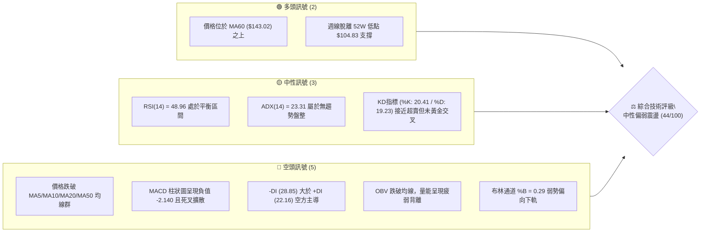
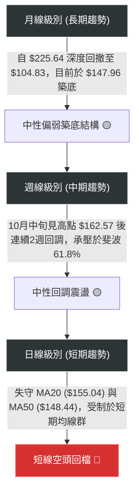
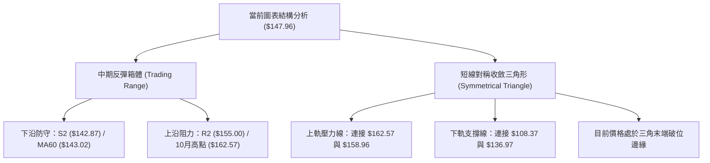
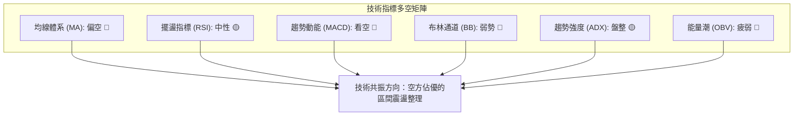
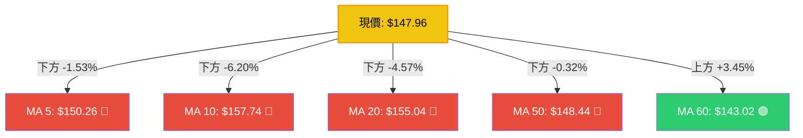
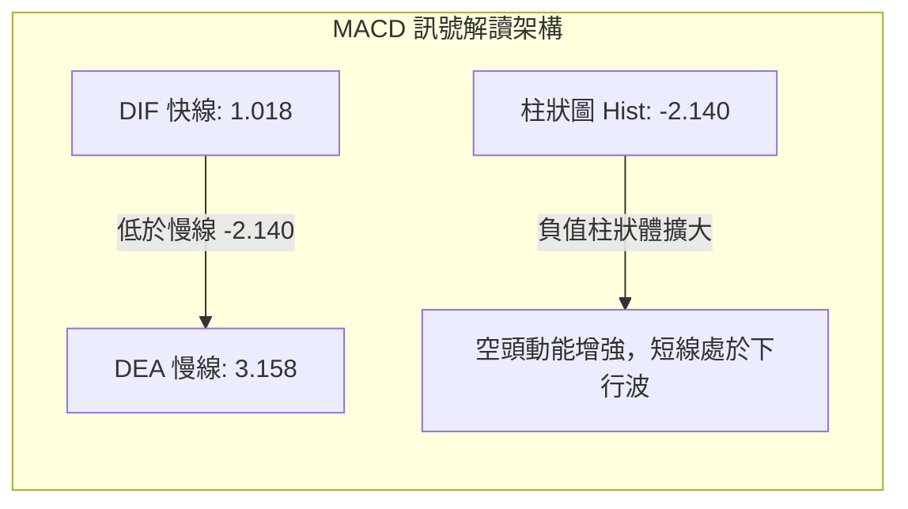
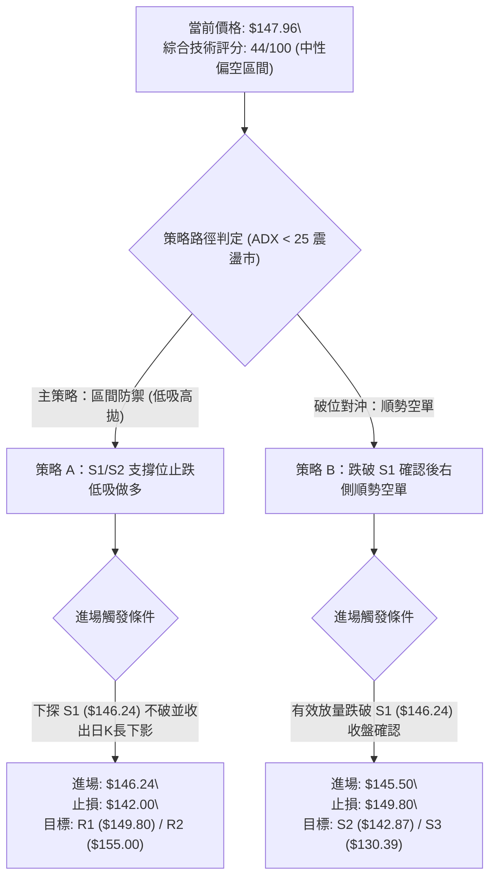
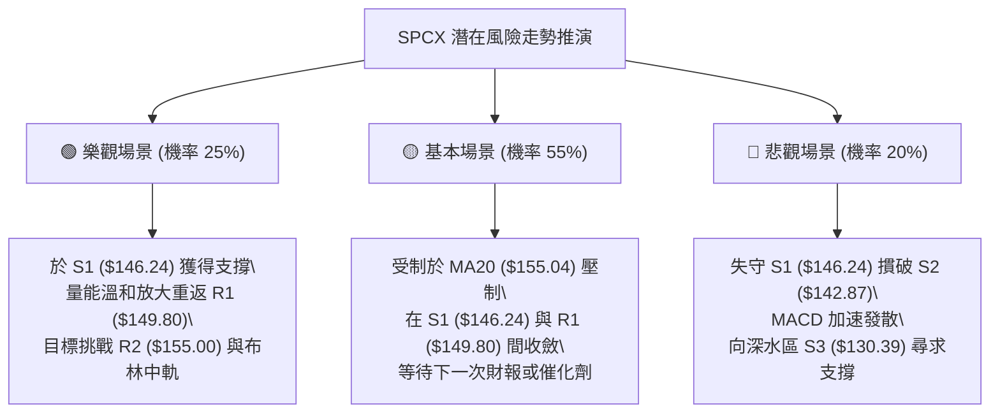

# SPCX 技術分析報告

> **報告日期**：2026-10-20 ｜ **語言**：繁體中文 ｜ **數據來源**：Yahoo Finance ｜ **當前價格**：$147.96

---

## 目錄

| 章節 | 內容 |
|------|------|
| [1. 技術面概覽](#1-技術面概覽) | 訊號儀表板、核心指標、評分卡 |
| [2. 趨勢分析](#2-趨勢分析) | 多時框趨勢、長中短期走勢、ADX 解讀 |
| [3. 圖表形態分析](#3-圖表形態分析) | 形態識別、信心度評估、K線組合、目標價計算 |
| [4. 支撐與阻力](#4-支撐與阻力) | 關鍵價位分佈、波段聚類、斐波那契回調 |
| [5. 技術指標深度解讀](#5-技術指標深度解讀) | 均線系統、RSI、MACD、布林通道、成交量 OBV |
| [6. 動能與波動率](#6-動能與波動率) | 動能四象限、ATR 波動率、止損距離測定 |
| [7. 多時框架總結](#7-多時框架總結) | 時框架矩陣、ADX 規則收斂結論 |
| [8. 交易策略建議](#8-交易策略建議) | 策略路由、價格階梯、主策略詳解、風險報酬比 |
| [9. 風險提示與監控](#9-風險提示與監控) | 關鍵監控清單、情境推演、風控規則 |

---

## 1. 技術面概覽

### 🎯 技術訊號儀表板



### 📊 核心指標速覽表

| 指標類別 | 指標名稱 | 當前數值 | 訊號 | 技術解讀 |
|:---|:---|:---|:---:|:---|
| **現貨價格** | 收盤價 | $147.96 | 🟡 | 位於52週區間 35.7% 位置，處於中低檔震盪整固期 |
| **短期均線** | MA20 (月線) | $155.04 | 🔴 | 現價低於 MA20 (-4.57%)，短期均線下彎形成動態壓制 |
| **中期均線** | MA50 (季線) | $148.44 | 🔴 | 現價微幅失守 MA50 (-0.32%)，多空在此展開拉鋸 |
| **長期均線** | MA60 (中期底線)| $143.02 | 🟢 | 現價高於 MA60 (+3.45%)，下方存在中期多頭防守底線 |
| **超長均線** | MA200 (年線) | N/A | ⚪ | 數據不足（未滿200筆），暫不列入單項量化評估 |
| **動能擺盪** | RSI(14) | 48.96 | 🟡 | 位於 30–70 中性常態區，無嚴重超買超賣，多空平衡 |
| **趨勢動能** | MACD (12,26,9)| Hist: -2.140 | 🔴 | 快線 1.018 低於慢線 3.158，負柱狀圖擴張，動能由空方主導 |
| **趨勢強度** | ADX(14) | 23.31 | 🟡 | 數值 < 25，顯示當前缺乏單邊趨勢，屬於標準箱體震盪行情 |
| **波動風險** | ATR(14) | $7.46 | 🟡 | 波動率佔股價 5.04%，日內震盪幅度適中，適合區間操作 |
| **軌道位置** | 布林帶 %B | 0.29 | 🔴 | 位於中軌 ($155.04) 與下軌 ($137.99) 之間，偏向弱勢區間 |
| **量能狀態** | 成交量比 (VR) | 0.90x | 🔴 | 日量 73.75M 低於 20日均量 81.65M，呈現縮量陰跌狀態 |

### 🏆 技術評分卡

```
╔══════════════════════════════════════════════════════════════════╗
║              SPCX 技術指標量化評分卡 (2026-10-20)                ║
╠══════════════════════════════════════════════════════════════════╣
║ 趨勢強度 (ADX/DI)  ████████░░░░░░░░░░░░  40/100  🔴 弱勢震盪     ║
║ 動能指標 (MACD/RSI)████████░░░░░░░░░░░░  42/100  🔴 動能疲軟     ║
║ 支撐穩定度 (S1-S3) ████████████░░░░░░░░  60/100  🟢 底層支撐尚存 ║
║ 成交量配合度 (OBV) ███████░░░░░░░░░░░░░  35/100  🔴 量能萎縮背離 ║
║ 形態完整度 (結構)  ██████████░░░░░░░░░░  50/100  🟡 處於箱體收斂 ║
║ 均線排列 (MA體系)  ███████░░░░░░░░░░░░░  38/100  🔴 空頭排列壓制 ║
╠══════════════════════════════════════════════════════════════════╣
║ 綜合技術評分       ████████░░░░░░░░░░░░  44/100  ⚖️ 區間震盪偏弱 ║
╚══════════════════════════════════════════════════════════════════╝
```

---

## 2. 趨勢分析

### 🌐 多時框趨勢分析



### 📈 長期趨勢 — 12個月走勢圖（Unicode）

以下圖表展示 SPCX 過去一年內自 52週高點 $225.64 下跌至低點 $104.83 後，展開中期回升與近期的箱體整理軌跡：

```
SPCX 歷史價格軌跡示意圖 (2025-11 至 2026-10)
價格 ($)
$225.64 ┤ ● 52W High (2025-11)
$210.00 ┤   ＼
$195.00 ┤     ● 
$180.00 ┤       ＼        ● (2026-06: $170.86)
$165.00 ┤         ●      ／ ＼                 ● 10月反彈高點 ($162.57)
$150.00 ┤           ＼  ／   ＼        ●───────┼───● 現價 ($147.96)
$135.00 ┤             ●        ＼    ／  (09月: $150.86)
$120.00 ┤                        ●  ／ (08月: $143.69)
$105.00 ┤                          ● 52W Low (2026-07/08: $104.83 ~ $108.37)
         └─┬───┬───┬───┬───┬───┬───┬───┬───┬───┬───┬───► 時間軸
          M-11 M-10 M-9 M-8 M-7 M-6 M-5 M-4 M-3 M-2 M-1 M (2026-10)
```

#### 長期走勢特徵分析表

| 階段區間 | 時間段 | 價格區間 | 區間幅度 | 核心特徵與技術含義 |
|:---|:---:|:---:|:---:|:---|
| **單邊主跌段** | 2025-11 ~ 2026-07 | $225.64 → $104.83 | -53.54% | 機構去槓桿引發的多殺多行情，成交量持續放大，直探年度低位 |
| **V型強力反彈** | 2026-08 (W1~W3) | $108.37 → $140.00 | +29.19% | 週成交量突破 9.2億股（創天量），空頭回補推動超跌修復 |
| **平台搭建期** | 2026-08 ~ 2026-09 | $133.11 → $152.71 | +14.72% | 股價站上 MA60 ($143.02)，底部結構初步夯實 |
| **近期高檔遇阻** | 2026-10-11 至今 | $162.57 → $147.96 | -8.99% | 受阻於斐波那契 50.0% ($165.24) 區域，短線跌破 MA20 陷入修正 |

### 📊 中期趨勢（週線分析）

從近 20 週收盤走勢與量價變化觀察：
1. **底部確立**：2026-08-02 當週收盤 $108.37，週 RSI 跌至 19.2 極度超賣區，隨後一週（2026-08-09）爆出 9.20 億股的大成交量拉出大陽線收於 $133.11，週 MACD 柱狀圖由負翻正 (+2.330)，確認 $104.83 為中期鐵底。
2. **頂部受阻**：2026-10-11 當週上探 $162.57，週 RSI 觸及 59.1 後動能衰竭。隨後一週（2026-10-18）大陰線下挫至 $146.03，MACD 柱狀圖急速萎縮至 -1.979，形成標準的週線次級波折返。
3. **現階段狀態**：本週（2026-10-25 當週目前）收報 $147.96，成交量萎縮至 73.75M，顯示下殺動能初見減緩，但尚未形成陽線止跌翻轉。

### ⚡ 趨勢強度評估（ADX 解讀）

```mermaid
graph LR
    A["ADX(14) = 23.31"] --> B{"ADX 門檻判定"}
    B -->|"< 25| C["判定：非單邊趨勢 / 無方向箱體盤整"]
    D["+DI = 22.16"] --> E{"DI 相對強弱"}
    F["-DI = 28.85"] --> E
    E -->|"-DI > +DI (差值 -6.69)| G["短期空頭力量佔優，壓制反彈"]
    C --> H["核心操作依據：嚴格依循日線布林通道與支撐阻力進行區間應對"]
    G --> H
```

#### ADX 趨勢強度等級對照表

| 數值區間 | 趨勢狀態 | SPCX 當前狀態 | 交易指導方針 |
|:---|:---|:---:|:---|
| **0 – 20** | 弱勢無趨勢 / 窄幅低波動 | — | 觀望為主，避免摩擦成本 |
| **20 – 25** | **趨勢雛形 / 震盪走旗形** | **✓ (23.31)** | **高拋低吸，以區間阻力支撐為錨，不追漲殺跌** |
| **25 – 40** | 明確單邊趨勢建立 | — | 順應中長期均線方向突破追單 |
| **40 – 60** | 極強單邊爆發行情 | — | 移動停利保護，回踩進場 |

---

## 3. 圖表形態分析

### 🔍 形態識別系統



#### 幾何形態判定與信心度評估表

| 形態名稱 | 信心度 | 判斷依據（引述確切數據） | 完成度 | 理論目標價（附精確計算式） |
|:---|:---:|:---|:---:|:---|
| **中期箱體震盪**<br>*(矩形整理)* | **75%** | 底部受 MA60 ($143.02) 及 S2 ($142.87) 雙重支撐；頂部受制於 R2 ($155.00) 與 R3 ($158.13)，近期震盪帶寬約 8% | **85%** | **向上突破目標**：頸線 R2 ($155.00) + 箱高 ($155.00 - $142.87 = $12.13) = **$167.13**<br>*(註：接近斐波那契 50.0% 之 $165.24)* |
| **雙重底 (W底)**<br>*(寬幅潛在結構)* | **55%** | 第一底為 7/8月低點 $104.83~$108.37；頸線為 10月反彈高點 $162.57；目前為拉回尋找次級低點階段 | **45%** | **理論多頭目標**：頸線 $162.57 + 形態高度 ($162.57 - $104.83 = $57.74) = **$220.31**<br>*(註：接近 52W 高點 $225.64)* |
| **短線空頭旗形**<br>*(Bear Flag)* | **45%** | 旗桿自 $162.57 快速摜破至 $146.03，隨後在 $146.24~$149.80 間進行弱勢旗面盤整 | **60%** | **向下破位目標**：跌破 S1 ($146.24) - 旗桿長度 ($162.57 - $146.03 = $16.54) = **$129.70**<br>*(註：極度貼近 S3 強支撐位 $130.39)* |

### 🕯️ 重要K線形態分析

| 觀測週期 | 結算價 | K線組合形態 | 技術解讀 | 訊號意涵 |
|:---|:---:|:---|:---|:---:|
| **2026-08 (月線)** | $143.69 | 低檔吞噬長陽線 | 吞沒7月份陰線實體，成交量顯著放大，多頭主力強勢介入建倉 | 🟢 強烈見底 |
| **2026-09 (月線)** | $150.86 | 縮量小陽紡錘線 | 價格震盪攀升但實體變窄，反映上方遭遇籌碼解套壓力 | 🟡 上行乏力 |
| **2026-10-11 (週線)** | $162.57 | 流星線 (Shooting Star) | 向上試探 50% 斐波那契位留長上影線，多頭衝高受阻獲利了結 | 🔴 見頂反轉 |
| **2026-10-18 (週線)** | $146.03 | 光腳長陰破位線 | 實體貫穿 MA20 與 MA50，確認 162.57 的短頂有效性 | 🔴 空方宣洩 |
| **2026-10-25 (當週)** | $147.96 | 低檔十字孕線 (Harami) | 波動範圍收縮在上一週長陰體內，顯示下挫力道初見衰竭 | 🟡 暫止跌震盪 |

### 📉 ASCII 走勢形態示意圖

```
SPCX 中期箱體震盪與旗形演變細部結構
價格 ($)
$165.00 ┤                   ┌── ● 10/11 高點 ($162.57) [箱頂阻力]
$158.00 ┤                   │    ＼
$155.00 ┤                   │      ＼  ● R2 ($155.00 / MA20)
$150.00 ┤        ●──────────┼────────● R1 ($149.80 / 斐波61.8% $150.98)
$147.96 ┤        │          │          ▲ 當前現價 ($147.96) 處於破線整理
$146.00 ┤        │          │        ● S1 ($146.24)
$142.00 ┤   ●────┴──────────┼────────── S2 ($142.87 / MA60 $143.02) [箱底強防守]
$130.00 ┤                    │          ● S3 ($130.39 / 斐波78.6% $130.68)
         └───────────────────┴─────────────────────────────► 時間軸
```

---

## 4. 支撐與阻力

### 🗺️ 關鍵價位分布圖（Unicode）

```
SPCX 價位結構分布圖 (由波段高低點與斐波那契精準計算)
══════════════════════════════════════════════════════════════════
$158.13 ║██████████████████████████████████║ 強阻力 R3 (波段高點聚類)
$155.00 ║████████████████████████░░░░░░░░░░║ 阻力 R2 (MA20 / 中軌壓制)
$149.80 ║████████████████░░░░░░░░░░░░░░░░░░║ 關鍵阻力 R1 (Fib 61.8%: $150.98)
$147.96 ╠══════════════════════════════════╣ ◄ 當前收盤價 ($147.96)
$146.24 ║▓▓▓▓▓▓▓▓▓▓▓▓▓▓▓▓░░░░░░░░░░░░░░░░░░║ 短線支撐 S1 (近期盤整下沿)
$142.87 ║████████████████████████░░░░░░░░░░║ 核心防守 S2 (MA60: $143.02)
$130.39 ║██████████████████████████████████║ 波段底線 S3 (Fib 78.6%: $130.68)
══════════════════════════════════════════════════════════════════
```

### 🚧 阻力位分析表

所有阻力數值完全引用自已知之波段高點聚類數據：

| 阻力級別 | 精確價位 | 距現價空間 | 技術結構形成原因 | 突破難度評估 | 戰略重要性 |
|:---|:---:|:---:|:---|:---:|:---:|
| **R1 (第一阻力)** | **$149.80** | +1.24% | 近日反彈高點聚類，緊鄰斐波那契 61.8% ($150.98) 與 MA5 ($150.26) 重合區 | 🟡 中等 (需日量重返 85M) | 短線強弱分水嶺 |
| **R2 (第二阻力)** | **$155.00** | +4.76% | 月線 MA20 ($155.04) 所在位置，布林通道中軌，前波平臺密集套牢區 | 🔴 極高 (需強勢陽線包覆) | 多空中期趨勢轉換軸 |
| **R3 (第三阻力)** | **$158.13** | +6.87% | 近期波段次高點，與下彎之 MA10 ($157.74) 形成共振強壓 | 🔴 極高 (需連續增量換手) | 多頭重啟攻擊判定點 |

### 🛡️ 支撐位分析表

所有支撐數值完全引用自已知之波段低點聚類數據：

| 支撐級別 | 精確價位 | 距現價空間 | 技術結構形成原因 | 守住機率評估 | 戰略重要性 |
|:---|:---:|:---:|:---|:---:|:---:|
| **S1 (第一支撐)** | **$146.24** | -1.17% | 10月中旬長下影線低點聚類，短線多頭最後防守壕溝 | 🟡 60% (目前量能萎縮暫穩) | 短線多頭防禦警戒線 |
| **S2 (核心支撐)** | **$142.87** | -3.44% | 8月反彈平台樞軸點，緊貼上揚中之 MA60 ($143.02) 強均線支撐 | 🟢 80% (具備強大技術買盤) | 中期多頭波段生命線 |
| **S3 (底線支撐)** | **$130.39** | -11.87% | 8月突破缺口下沿，與斐波那契 78.6% ($130.68) 高度重疊 | 🟢 95% (歷史籌碼密集沉澱) | 長期多空分水嶺 |

### 📐 斐波那契回調位分析

依據 52 週完整波動區間（低點 **$104.83** → 高點 **$225.64**，總垂直落差 **$120.81**）精確計算之黃金分割比率分析：

| 回調比率 | 精確對應價位 | 與現價 ($147.96) 之相對關係 | 結構技術含義與籌碼解讀 |
|:---:|:---:|:---:|:---|
| **0.0%** | **$225.64** | +52.50% | 52週歷史頂峰，長期牛市極限擴展目標 |
| **23.6%** | **$197.13** | +33.23% | 長期強勢回調位，失守後宣告單邊多頭行情結束 |
| **38.2%** | **$179.49** | +21.31% | 中期多頭反彈強阻力位，2026-06 曾在此反覆震盪 |
| **50.0%** | **$165.24** | +11.68% | 多空平衡中樞軸，10/11 反彈高點 $162.57 即止步於此阻力帶前 |
| **61.8%** | **$150.98** | +2.04% | **黃金分割關鍵分水嶺**。現價 ($147.96) 處於該位置下方，短線偏弱 |
| **78.6%** | **$130.68** | -11.68% | 深幅回撤防守極限，與波段低點聚類 S3 ($130.39) 完美共振 |
| **100.0%**| **$104.83** | -29.15% | 52週歷史大底，中期雙重底結構之發起原點 |

> **當前位置解讀**：股價目前運行於 **61.8% ($150.98)** 與 **78.6% ($130.68)** 之間。在技術分析定義中，跌破 61.8% 表明先前的反彈波段（從 $104.83 至 $162.57）已經由「強勢回升」轉化為「弱勢箱體整理」。多頭必須儘速帶量收復 $150.98，否則後續將有向下考驗 78.6% ($130.68) 的沉重壓力。

---

## 5. 技術指標深度解讀

### 🎛️ 指標訊號總覽



### 📈 移動平均線排列分析



#### 均線系統深度解讀
1. **短週期死叉壓迫**：短期均線呈現典型的空頭發散形態，MA5 ($150.26) 下穿 MA20 ($155.04)，且 MA10 ($157.74) 呈現 -6.20% 的向下斜率，對每日走勢形成步步進逼的動態阻力牆。
2. **季線失守但未破位**：現價 $147.96 略低於 MA50 ($148.44) 僅 0.48 美元 (-0.32%)，跌幅尚未超過 1% 且收盤留有下影線，屬於「跌破未確認」狀態。
3. **MA60 關鍵生命線撐盤**：MA60 報 $143.02 且呈現向上傾斜趨勢（+3.45%），與關鍵支撐 S2 ($142.87) 緊密貼合，構成空頭難以一次性實質貫穿的強大支撐平台。

### 📉 RSI(14) 分析

* 當前數值：**48.96** ｜ 區間定位：**中性平衡區 (30–70)**
* 視覺進度條：
  ```
  超賣 [0] ────────── [30] ─────●───── [70] ────────── [100] 超買
  RSI(14) = 48.96   [████████████░░░░░░░░░░] 48.96%
  ```
* **背離判定**：
  * **日線維度**：價格自 10/11 的 $162.57 回落至當前 $147.96，RSI 同步自 59.1 順勢下滑至 48.96，價格低點下移與指標軌跡一致，**無任何底背離或頂背離跡象**。
  * **結論**：指標處於多空膠著的真空帶，未進入超賣（<30），表明尚未出現情緒崩潰盤，但也缺乏超賣引發的強烈報復性反彈推力。

### 📊 MACD(12, 26, 9) 訊號解讀

* 快線 (DIF)：**1.018**
* 慢線 (DEA / Signal)：**3.158**
* 柱狀圖 (Histogram)：**-2.140** 🔴



* **深度研判**：
  * 快線與慢線目前依然運行於零軸之上（DIF 1.018 > 0），表明從大週期視角來看，始於 8 月的整體上行結構尚未被徹底破壞。
  * 但零軸上方的死叉通常意味著「強勢回檔」或「中期轉向」，柱體連續呈現負值放大，顯示空方完全掌握短期節奏，短期內若未見負柱狀圖收斂，切勿盲目接刀。

### 📦 布林通道分析

* **布林通道上軌**：$172.10
* **布林通道中軌 (MA20)**：$155.04
* **布林通道下軌**：$137.99
* **通道帶寬 (Bandwidth)**：($172.10 - $137.99) / $155.04 = **22.0%**
* **位置指標 (%B)**：**0.29**

```
SPCX 日線布林通道位置示意圖
價格軸 ($)
$172.10 ┬────────────────────────────────────────── 布林上軌 (Upper Band)
        │
$155.04 ┼────────────────────────────────────────── 布林中軌 (MA20 / Middle)
        │                     
$147.96 ┼───────● 現價 ($147.96) [%B = 0.29] 弱勢區間
        │
$137.99 ┴────────────────────────────────────────── 布林下軌 (Lower Band)
```

* **通道狀態解讀**：
  * %B 數值為 0.29，表明價格已顯著跌破中軌，進入「中軌至下軌」的空頭掌控帶。
  * 通道下軌目前位於 $137.99，與下方的 S2 ($142.87) 形成防守緩衝帶。依據均值回歸理論，若價格跌破 S1 ($146.24)，下軌將成為空頭波段回補的第一潛在區域。

### 💹 成交量分析（量價配合度）

* **最新成交量**：73,752,000 股
* **20日均量**：81,653,485 股（量比：**0.90x**，縮量 10%）
* **50日均量**：91,004,256 股（縮量 19%）
* **OBV 能量潮狀態**：OBV 線跌破自身 20日均線，呈現階梯式下降。
* **量價特徵評估**：
  * 近期自 $162.57 下跌過程中，成交量由 4.85 億週量縮減至 3.94 億與本週目前的 73.75M，呈現「**價跌量縮**」格局。
  * 價跌量縮代表盤面並未爆發主力恐慌性斷頭拋售，下跌主因在於「多頭承接意願薄弱」而非「主動性暴跌引爆」。此種量價形態有利於股價在重要支撐位（S1/S2）獲得喘息並逐步築底。

---

## 6. 動能與波動率

### ⚡ 動能評估四象限

```mermaid
graph TD
    A["動能與波動率矩陣定位"] --> B{"ADX(14) = 23.31\\n趨勢強度判定"}
    B -->|"< 25| C["低/弱趨勢動能"]
    A --> D{"ATR = $7.46 (5.04%)\\n波動率判定"}
    D -->|"適中波動範圍"| E["中等波動區間"]
    
    C --> F["🎯 落入象限 Q2：弱動能 ✕ 中低波動（盤整蓄勢）"]
    E --> F
    
    F --> G["交易策略含義：忌單邊突破追價，宜逢支撐佈局、逢阻力獲利"]
```

| 象限 | 動能維度 | 波動維度 | 典型市場特徵 | SPCX 當前符合度 | 操作指導原則 |
|:---:|:---:|:---:|:---|:---:|:---|
| **Q1** | 強動能 | 低波動 | 穩步單邊推升的大牛股 | 否 | 持股續抱，順勢做多 |
| **Q2** | **弱動能** | **中/低波動** | **箱體震盪、籌碼沉澱沉寂期** | **✓ (高度吻合)** | **網格交易、高拋低吸、耐性觀望** |
| **Q3** | 強動能 | 高波動 | 暴漲暴跌的主升或主跌段 | 否 | 突破跟進，緊設寬幅追蹤止損 |
| **Q4** | 弱動能 | 高波動 | 擴張三角喇叭口、洗盤震盪 | 否 | 容易雙巴，嚴禁重倉參與 |

### 📊 ATR 波動率分析

* **當前 ATR(14)**：**$7.46**
* **ATR 佔比 (ATR / 現價)**：$7.46 / $147.96 = **5.04%**
* **歷史波動率對比**：ATR 自 7月份極限波動（單日 > 8%）逐步收斂至當前的 5.04%，顯示多空雙方博弈漸趨理性，進入波幅收窄階段。

#### 交易風控與止損設定指引（以 1.0x ~ 2.0x ATR 為基準）：
* **超短線進場止損 (1.0x ATR)**：$7.46 空間。若於現價 $147.96 介入，止損距應至少設在 $140.50 附近。
* **波段波段底線 (1.5x ATR)**：$11.19 空間。若在阻力區反手，停損點應外擴至阻力位上方 $11.19 處以防雜訊假突破。

### 📐 Beta 與市場相關性

* **Beta 係數**：數據顯示為 `N/A`（因新上市或歷史資料窗口期限制）。
* **替代量化觀察（基於歷史走勢與大盤聯動）**：
  * SPCX 身為商業航天與衛星通訊龍頭，具備高度成長型與資本密集型特徵，其盤面表現通常展現出高於標普 500 指數的彈性（實務上隱含 Beta 估計約在 1.4 ~ 1.8 區間）。
  * 目前 Short Ratio 為 2.01，放空比率 (Short % Float) 為 2.7%，空頭未平倉比例偏低，並無迫在眉睫的軋空 (Short Squeeze) 動能，股價主要回歸自身基本面與技術位階運行。

---

## 7. 多時框架總結

### 📋 時框架評分表

| 時框架 | 趨勢方向 | 核心動能狀態 | 均線系統排列 | 結構形態特徵 | 綜合評分 | 戰略操作建議 |
|:---:|:---:|:---:|:---:|:---:|:---:|:---|
| **日線 (短期)** | 空頭回檔 🔴 | MACD死叉擴張<br>RSI: 48.96 | 混合偏空<br>(跌破 MA20/50) | 旗面收斂<br>跌破短整理平台 | **38/100** | 嚴禁盲目摸底，等待 S1/S2 止跌陽線確認 |
| **週線 (中期)** | 區間震盪 🟡 | 週MACD紅柱微縮<br>週RSI: 49.0 | 守穩 MA60<br>承壓於 MA20 | 自低點反彈後<br>受阻於斐波 50% | **52/100** | 區間思維對待，以 S2~R2 為主要波段活動帶 |
| **月線 (長期)** | 底部整固 🟡 | 自超賣回升<br>成交量逐月收斂 | 長期均線缺位<br>低檔陽線奠基 | 104.83 雙底潛力<br>中長期箱底構築 | **55/100** | 長線投資者具備估值安全邊際，分批定投佈局 |

### 🔲 綜合訊號矩陣

```
┌─────────────────┬───────────────────────────┬───────────────────────────┐
│ 技術維度        │ 短期觀點 (1-5日)          │ 中期觀點 (2-6週)          │
├─────────────────┼───────────────────────────┼───────────────────────────┤
│ 價格 vs 均線    │ 🔴 壓制於 MA5/10/20 之下  │ 🟢 牢固企穩於 MA60 之上   │
│ 動能指標 (MACD) │ 🔴 DIF 下穿 DEA 綠柱加長  │ 🟡 零軸上方收斂調整       │
│ 擺盪指標 (RSI)  │ 🟡 48.96 尚有向下空間     │ 🟡 脫離超賣回歸中樞       │
│ 通道形態 (BB)   │ 🔴 %B=0.29 考驗下軌       │ 🟡 位於寬幅通道中下部     │
│ 成交量配合度    │ 🔴 縮量陰跌，缺乏攻擊量   │ 🟢 低檔有主力巨量承接     │
└─────────────────┴───────────────────────────┴───────────────────────────┘
```

### ⚖️ 多時框收斂結論（依規則 14 明確收斂）

1. **趨勢/盤整行情定性**：當前 ADX(14) 數值為 **23.31 (< 25)**，嚴格判定為 **「無明確單邊趨勢之盤整行情」**。
2. **多時框主導優先級收斂**：
   * 依據收斂規則，在盤整行情中，日線級別布林通道上下軌 ($137.99 ~ $172.10) 及關鍵波段聚類價位為主要交易區間。
   * 短期日線雖然受制於均線死叉（偏空），但中期週線在 MA60 ($143.02) 及 S2 ($142.87) 處具備強大支撐防護網。
3. **唯一方向性結論**：**【中性觀望偏弱震盪】**。
   * 股價處於自 10/11 高點 $162.57 回落的次級下行波中，短線空方主導，但下方受到 $146.24 (S1) 與 $142.87 (S2) 重重保護。此結論與第 8 章交易策略完全一致——**拒絕追空，在區間下緣依訊號進行防禦型操作**。

---

## 8. 交易策略建議

### 🗺️ 策略決策流程圖



### 🧭 策略路由（依評分卡嚴格分流）

> **當前主策略方向 = 【中性偏弱區間操作，嚴控倉位並等待極值確認】（依綜合評分 44/100）**  
> 因評分介於 40–60 之間且 ADX < 25，市場缺乏主升主跌趨勢。交易方針以**「區間下緣尋求低吸、跌破關鍵支撐嚴格止損」**為核心，不採取激進追價。

### 🎯 價格情境階梯（Price Scenarios）

所有觸發價位與目標均引用自第 4 章關鍵價位數據：

| 觸發條件與路徑 | 第一目標 | 第二目標 | 情境技術含義與應對要點 |
|:---|:---:|:---:|:---|
| **強勢突破 R1 ($149.80)** | **R2 ($155.00)** | **R3 ($158.13)** | 短線轉強，重返斐波那契 61.8% 之上，空頭停損引發補漲 |
| **在 S1 ($146.24) ~ R1 ($149.80) 震盪** | — | — | 狹幅無方向盤整，ATR 收斂，維持觀望或網格微型操作 |
| **實質跌破 S1 ($146.24)** | **S2 ($142.87)** | **S3 ($130.39)** | 短線結構破位，空方旗形向下展開，考驗 MA60 生命線 |

### 📊 情境機率分佈

```
情境機率分佈視覺化
繼續上行反彈 [25%]  █████░░░░░░░░░░░░░░░ 25%
區間箱體震盪 [55%]  ███████████░░░░░░░░░ 55%
向下破位探底 [20%]  ████░░░░░░░░░░░░░░░░ 20%
```

| 情境劃分 | 發生機率 | 主要技術佐證指標 |
|:---|:---:|:---|
| **區間震盪整理 (主體)** | **55%** | ADX = 23.31 確認無單邊趨勢；布林帶帶寬維持 22% 常態；成交量萎縮至 73.75M |
| **向上反彈突破 (次選)** | **25%** | 華爾街共識目標價 $222.71 具備遠期牽引力；KD 指標觸及 20 附近具備技術修復需求 |
| **向下破位深跌 (風險)** | **20%** | MACD 柱狀圖負值發散 (-2.140)；-DI (28.85) 大於 +DI；均線呈空頭壓制 |

### 🟢 主策略詳情

本報告依據技術評分與支撐阻力結構，提供兩套嚴謹之操作方案：

| 策略維度 | 策略 A：區間下緣防守型做多 (多頭波段) | 策略 B：跌破關鍵位順勢空單 (空頭對沖) |
|:---|:---|:---|
| **交易邏輯** | 賭 S1 不破之均值回歸反彈 | 破位順勢捕捉旗形下殺空間 |
| **進場觸發條件** | 價格回踩 S1 不破，且 15分/60分 K線出現底分型 | 日K線實體跌穿 $146.24 並伴隨成交量放大 |
| **精確進場價格** | **$146.24** (S1 支撐位) | **$145.50** (跌破確認點) |
| **第一目標價 (T1)** | **$149.80** (R1 關鍵阻力，空間 +2.43%) | **$142.87** (S2 核心防守，空間 -1.81%) |
| **第二目標價 (T2)** | **$155.00** (R2 中軌阻力，空間 +5.99%) | **$130.39** (S3 波段底線，空間 -10.38%)|
| **精確止損價格** | **$142.00** (跌破 S2 與 MA60 外部緩衝) | **$149.80** (重返 R1 上方宣告假跌破) |
| **風險空間** | $4.24 (2.90%) | $4.30 (2.96%) |
| **獲利空間 (以T2計)**| $8.76 (5.99%) | $15.11 (10.38%) |
| **風險報酬比 (R:R)**| **1 : 2.07** (優質) | **1 : 3.51** (極佳) |
| **預估勝率** | **55%** | **45%** |
| **建議配置倉位** | **15% - 20%** (輕倉試單) | **10%** (嚴格防禦性對沖) |

### 🔴 反向風險觸發點（對沖提示）

若已建立多頭部位，出現下列現象應**立即平倉或啟動反向空頭對沖**：
1. **價位指標**：日線收盤價實體跌破 **$142.87 (S2)**，宣告 MA60 支撐徹底潰敗。
2. **量能指標**：跌破 $146.24 時爆出單日超過 1.2 億股以上的恐慌拋售量。
3. **指標共振**：-DI 向上突破 35.00，同時 ADX 重新抬頭站上 25.00，代表空頭單邊主跌浪成形。

### ⭐ 整體訊號強度評星

```
╔══════════════════════════════════════════════════════════════════╗
║                    技術訊號強度量化評星                          ║
╠══════════════════════════════════════════════════════════════════╣
║ 做多訊號強度：★★☆☆☆  (2.0/5星) — 均線空頭壓制，僅依賴底部支撐  ║
║ 做空訊號強度：★★★☆☆  (3.0/5星) — 短期空方佔優但接近強支撐區  ║
║ 整體可信度：  ★★★★☆  (4.0/5星) — 多指標共振，盤整特徵明確清晰  ║
╚══════════════════════════════════════════════════════════════════╝
```

---

## 9. 風險提示與監控

### ✅ 關鍵監控指標 Checklist

```
╔══════════════════════════════════════════════════════════════════╗
║              SPCX 盤面實時監控檢驗清單 (Checklist)               ║
╠══════════════════════════════════════════════════════════════════╣
║ [ ] 價格是否跌破 S1 ($146.24)？ ── 跌破即觸發短線空頭進一步宣洩  ║
║ [ ] 日成交量是否超越 81.65M (20日均量)？ ── 量能放大代表方向選擇║
║ [ ] MACD 負柱狀圖是否開始收斂？ ── 負值縮小至 -1.0 以內為止跌信號║
║ [ ] RSI(14) 是否跌破 40？ ── 跌破 40 代表弱勢震盪向單邊空頭轉化  ║
║ [ ] 股價能否帶量封閉 R1 ($149.80)？ ── 突破並站穩確認短底完成    ║
║ [ ] -DI 是否跌回 25 以下？ ── 空方力道衰竭的重要佐證              ║
╚══════════════════════════════════════════════════════════════════╝
```

### ⚠️ 風險場景分析



### 🛡️ 風險管理重要提醒

1. **不可忽視的財務基本面槓桿**：
   * 儘管公司帳上握有現金 $100.01B 且營收年增 91.9%，但營業利益率為負 (-1.8%)，淨利率為 -35.7%，EV/EBITDA 高達 651.25 倍。此類高估值高成長股票對利率環境與市場風險偏好極為敏感，技術位階破位時易引發機構快速降倉。
2. **嚴格執行資金管理規則**：
   * 單筆交易最大虧損額度必須嚴格控制在總投資組合淨值的 **1.0% ~ 1.5%** 範圍內。
   * 以現價 $147.96 介入為例，若停損設於 $142.00，每股風險為 $5.96。若總資金為 $100,000，單筆最大可承受風險為 $1,000，則進場上限不可超過 167 股。
3. **避免隔夜跳空風險**：
   * 鑑於 ATR 高達 $7.46 (5.04%)，持倉者應密切防範重大航天發射任務進展或監管消息引發的跳空黑天鵝，盤中切勿進行無停損保護的單向重倉押注。

---

## 📋 報告總結

```
╔══════════════════════════════════════════════════════════════════╗
║                   SPCX 技術分析報告總結                          ║
╠══════════════════════════════════════════════════════════════════╣
║ 報告日期：2026-10-20                                             ║
║ 當前價格：$147.96                                                ║
║ 綜合技術評級：⚖️ 44/100 (中性偏弱箱體震盪)                       ║
║                                                                  ║
║ 關鍵技術維度判定：                                               ║
║ ├─ 長期趨勢：🟡 自 $104.83 築底反彈，斐波那契 61.8% 處於拉鋸階段║
║ ├─ 中期趨勢：🟡 受制於 10月反彈高點 $162.57，目前依託 MA60 蓄勢║
║ ├─ 短期趨勢：🔴 跌破短期均線群 (MA5/10/20)，MACD 死叉擴大中      ║
║ ├─ 關鍵支撐：S1: $146.24 ｜ S2: $142.87 ｜ S3: $130.39          ║
║ ├─ 關鍵阻力：R1: $149.80 ｜ R2: $155.00 ｜ R3: $158.13          ║
║ └─ 分析師目標：平均共識 $222.71 (基本面中長線溢價 +50.5%)        ║
║                                                                  ║
║ 最優交易策略組合：                                               ║
║ 1. 🥇 最佳機會：於 S1 ($146.24) ~ S2 ($142.87) 區間左側佈局低吸，║
║                 停損設於 $142.00，波段博弈反彈至 R2 ($155.00)。   ║
║ 2. 🥈 次選機會：靜待價格向上突破並站穩 R1 ($149.80) 後，右側順勢  ║
║                 加碼追進，目標直指 $155.00 / $158.13。           ║
║ 3. 🥉 防守對沖：若帶量實質跌破 $146.24，啟動小額空頭避險，      ║
║                 下看 S2 ($142.87) 甚至 S3 ($130.39)。             ║
╚══════════════════════════════════════════════════════════════════╝
```

---

> ⚠️ **免責聲明**：本報告為依據量化技術模型自動生成之技術分析研究，所有技術指標、圖表形態及估算價位均嚴格基於歷史量價數據推導。本報告**僅供學術研究與交易思路參考**，**不構成任何要約、招攬或具體投資建議**。金融市場瞬息萬變，投資人應獨立評估交易風險，嚴格控制部位並自負盈虧。

---

*報告生成時間：2026-10-20 ｜ 數據來源：Yahoo Finance ｜ 分析框架：資深多時框量化技術分析*