# SPCX 技術分析報告

> **報告日期**：2026-10-22 ｜ **語言**：繁體中文 ｜ **數據來源**：Yahoo Finance ｜ **當前價格**：$159.31

---

## 目錄

| 章節 | 內容 |
|------|------|
| [1. 技術面概覽](#1-技術面概覽) | 訊號儀表板、核心指標、評分卡 |
| [2. 趨勢分析](#2-趨勢分析) | 多時框趨勢、長中短期走勢、ADX強弱 |
| [3. 圖表形態分析](#3-圖表形態分析) | 形態識別、信心度評估、K線組合 |
| [4. 支撐與阻力](#4-支撐與阻力) | 關鍵價位、斐波那契回調結構 |
| [5. 技術指標深度解讀](#5-技術指標深度解讀) | 均線系統、RSI、MACD、布林通道、量價 |
| [6. 動能與波動率](#6-動能與波動率) | 動能四象限、ATR波動分析、風險敏感度 |
| [7. 多時框架總結](#7-多時框架總結) | 時框架矩陣、收斂規則與單一方向定調 |
| [8. 交易策略建議](#8-交易策略建議) | 策略路由、階梯情境、具體操作計畫 |
| [9. 風險提示與監控](#9-風險提示與監控) | 監控清單、極端情境與資金管理 |
| [10. 報告總結](#10-報告總結) | 核心結論與執行綱領 |

---

## 1. 技術面概覽

### 🎯 技術訊號儀表板

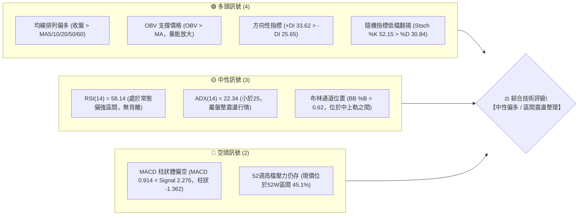

---

### 📊 核心指標速覽表

| 指標類別 | 指標名稱 | 當前數值 | 訊號 | 技術解讀 |
|:---|:---|:---|:---:|:---|
| **價格** | 當前收盤價 | **$159.31** | 🟢 | 站穩短期與中期均線之上，脫離近期回調低點 $146.03 |
| **均線** | MA20 (月線) | **$155.24** | 🟢 | 現價高於 MA20 約 +2.62%，短期生命線具備動態支撐 |
| **均線** | MA50 (季線) | **$149.14** | 🟢 | 現價高於 MA50 約 +6.82%，中期趨勢維持在防守線上 |
| **均線** | MA200 (年線) | **N/A** | 🟡 | 數據資料未達200日，長期均線指標暫缺 |
| **動能** | RSI(14) | **58.14** | 🟡 | 位於 50–60 健康推進區，未達超買門檻，無背離現象 |
| **動能** | MACD | **0.914 (Sig: 2.276)** | 🔴 | MACD 位於訊號線下方，柱狀體為 -1.362，動能修正尚未收斂完畢 |
| **動能** | Stoch %K / %D | **52.15 / 30.84** | 🟢 | 快線向上穿越慢線形成黃金交叉，短線反彈動能啟動 |
| **趨勢強度** | ADX(14) | **22.34** | 🟡 | ADX < 25，單邊趨勢不顯著，當前格局定義為寬幅箱型震盪 |
| **通道** | 布林通道 (%B) | **0.62 (軌道: 138.03-172.46)** | 🟢 | 價格自中軌 $155.24 彈升，往上軌 $172.46 靠攏 |
| **波動** | ATR(14) | **$8.26 (5.18%)** | 🟡 | 每日平均波動幅度適中，提供合理的風控停損區間參照 |
| **量能** | 當日量 / 20日均量 | **219.15M / 92.49M** | 🟢 | 量比達 2.37 倍，放量推進，OBV 呈向上支撐結構 |

---

### 🏆 技術評分卡

```
╔══════════════════════════════════════════════════════════════════╗
║              SPCX 技術指標綜合評分卡 (2026-10-22)                ║
╠══════════════════════════════════════════════════════════════════╣
║ 趨勢強度 (ADX/DMI)  ██████████░░░░░░░░░░  52/100 🟡 中性盤整   ║
║ 動能指標 (RSI/MACD) ███████████░░░░░░░░░  55/100 🟡 指標分歧   ║
║ 支撐穩定度 (S1-S3)  ██████████████░░░░░░  70/100 🟢 底部明確   ║
║ 成交量配合 (VOL/OBV)████████████████░░░░  80/100 🟢 放量轉強   ║
║ 形態完整度 (箱型/雙底)████████████░░░░░░░░  60/100 🟡 頸線待破   ║
║ 均線排列 (短中均線) ██████████████░░░░░░  70/100 🟢 多頭推升   ║
╠══════════════════════════════════════════════════════════════════╣
║ 綜合技術得分        ███████████░░░░░░░░░  57.8/100             ║
║ 綜合評級：          ⚖️ 中性偏多區間操作 (NEUTRAL-BULLISH RANGE)║
╚══════════════════════════════════════════════════════════════════╝
```

---

## 2. 趨勢分析

### 🌐 多時框趨勢分析

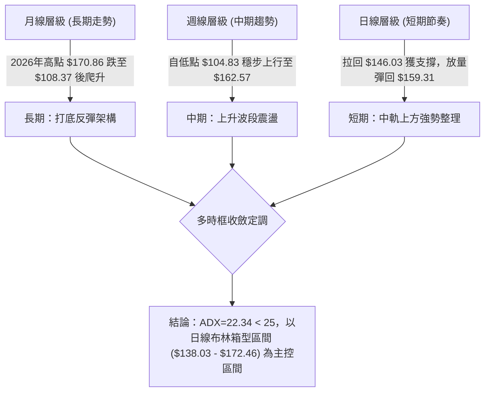

---

### 📈 長期趨勢 — 價格走勢圖（Unicode）

依據 24 個月價格數據歷史，自 2026 年 6 月創高回調後的月線歷史走勢呈現明顯的「V 型反轉與震盪築底」特徵：

```
SPCX 月線走勢示意圖（2026年6月至10月）
價格軸 ($)
$175 ┤
$170 ┤ ● (2026-06: $170.86)
$165 ┤
$160 ┤                                     ● (2026-10: $159.31)
$155 ┤                               ● (2026-09: $150.86)
$150 ┤                         
$145 ┤                         ● (2026-08: $143.69)
$140 ┤
$135 ┤
$130 ┤
$125 ┤
$120 ┤
$115 ┤
$110 ┤
$105 ┤          ● (2026-07: $108.37；52W低點: $104.83)
     └─────────────────────────────────────────────────────────────
          2026-06     2026-07     2026-08     2026-09     2026-10
```

#### 走勢特徵分析表格

| 階段區間 | 起訖月份 | 區間價格走勢 | 累計漲跌幅 | 形態特徵與成交量解讀 |
|:---|:---:|:---:|:---:|:---|
| **深幅修正期** | 2026-06 → 2026-07 | $170.86 → $108.37 | **-36.57%** | 自波段高點快速回落，恐慌盤殺跌至 52 週最低點 $104.83 附近企穩 |
| **強力反彈期** | 2026-07 → 2026-08 | $108.37 → $143.69 | **+32.59%** | 週量顯著放大（高達 9.2 億股），形成 V 型反轉，迅速收復均線失土 |
| **平穩推升期** | 2026-08 → 2026-09 | $143.69 → $150.86 | **+4.99%** | 步入平穩推升通道，籌碼良性換手，週收盤價站穩 $150 心理關卡 |
| **震盪蓄勢期** | 2026-09 → 2026-10 | $150.86 → $159.31 | **+5.60%** | 回測支撐 $146.03 不破後強勁反彈，最新單日放量至 2.19 億股 |

---

### 📊 中期趨勢（週線分析）

從近 20 週資料觀察，SPCX 展現清晰的雙波段推進結構：
1. **第一波（谷底脫離）**：2026-08-02 的 $108.37 飆升至 2026-08-16 的 $140.00，週 RSI 由超賣區的 15.9/19.2 激增至 63.3。
2. **第二波（結構重塑）**：在 $140–$150 震盪鞏固近 6 週後，於 2026-10-11 創出反彈波段高點 $162.57，隨後於 2026-10-18 回踩 $146.03（精確驗證波段低點支撐 S1: $146.24），最新一週收在 $159.31。

```
中期壓力與支撐示意圖（週線結構）
========================================================================
[強壓區] R2: $176.42 ═══════════════════════════════════════════════════
[阻力區] R1: $172.40 / BB上軌 $172.46 ─────────────────────────────────
                                    ▲
[震盪軸] 斐波那契 50.0%: $165.24 ───┼─── 波段頂點聚類 $162.57
                                    │   [目前價格: $159.31]
[支撐軸] MA20 / BB中軌: $155.24 ────┼─────────────────────────────────
[強支撐] S1: $146.24 ───────────────┴─── 近期回踩低點聚類 $146.03
[防守線] S2: $142.87 ═══════════════════════════════════════════════════
========================================================================
```

---

### ⚡ 趨勢強度評估（ADX 解讀）

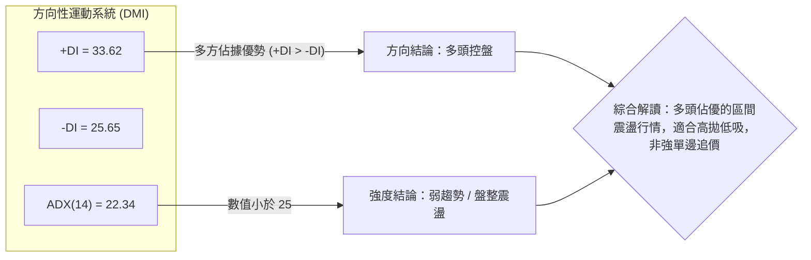

#### ADX 趨勢強度對照表

| ADX 區間 | 趨勢性質 | 當前數值 | 交易戰略指引 |
|:---:|:---:|:---:|:---|
| **0 – 20** | 趨勢停滯 / 極度無序 | — | 避免趨勢突破交易，採用均值回歸策略 |
| **20 – 25** | **弱趨勢 / 箱型震盪** | **22.34 (SPCX 當前)** | **以布林通道與關鍵支撐阻力為主，尊重箱型邊界，不追高** |
| **25 – 40** | 強趨勢成形 | — | 順勢單邊操作，依均線逢回加碼 |
| **40 – 60** | 極強單邊行情 | — | 嚴防動能過熱，緊密移動停利 |

---

## 3. 圖表形態分析

### 🔍 形態識別系統

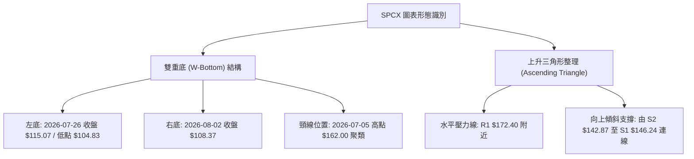

#### 形態識別與信心度評估表

| 識別形態 | 信心度 | 判斷依據（引用數據） | 完成度 | 目標價計算式與精確目標 |
|:---|:---:|:---|:---:|:---|
| **大週期雙底 (W-Bottom)** | **75%** | 兩次低點分別落於 2026-07-26 ($115.07 / 52W低點 $104.83) 與 2026-08-02 ($108.37)，隨後放量突破頸線區 | 85% | 頸線聚類取波段高點 $162.00，形態高度 = $162.00 - $104.83 = $57.17；量度目標 = $162.00 + $57.17 = **$219.17**（接近 52W 高點 $225.64） |
| **短線上升三角收斂** | **60%** | 上方受阻於近一年波段高點聚類 R1 $172.40，下方低點由 8 月底 $141.50 墊高至 10 月中旬 S1 $146.24 | 65% | 突破 R1 $172.40 後，依底邊高度 ($172.40 - $146.24 = $26.16) 計算目標 = $172.40 + $26.16 = **$198.56**（接近斐波那契 23.6% 回調位 $197.13） |
| **頭肩底形態** | **35%** | 缺乏對稱的左肩結構，數據中未偵測到標準左肩低點聚類 | 30% | *訊號不足，僅做指標型解讀，不予以計算目標價* |

---

### 🕯️ 重要 K 線形態分析

| 觀測週期 / 日期 | 收盤價 | K線形態名稱 | 形態細節與技術解讀 | 訊號方向 |
|:---|:---:|:---|:---|:---:|
| **2026-08-09** | $133.11 | **破曉長陽線 (Bullish Belt-Hold)** | 週成交量爆出 9.20 億股巨量，收盤自 $108.37 暴漲 +22.8%，確立波段底部反轉 | 🟢 強烈看多 |
| **2026-09-27** | $148.68 | **縮量回踩十字星 (Doji Pullback)** | 週量萎縮至 3.29 億股，回測 MA50 支撐，屬於健康換手籌碼沉澱 | 🟡 中性蓄勢 |
| **2026-10-11** | $162.57 | **高檔上影長紅** | 盤中衝擊斐波那契 50.0% ($165.24) 未果回落，顯示波段高點阻力聚類賣壓沉重 | 🔴 遇到阻力 |
| **2026-10-18** | $146.03 | **探底回升槌頭線 (Hammer)** | 盤中下探 S1 $146.24 支撐後迅速獲買盤承接，留下明顯下影線 | 🟢 下檔有撐 |
| **2026-10-25 (最新)**| $159.31 | **實體陽包陰 (Bullish Engulfing)** | 單日成交量達 2.19 億股 (量比 2.37x)，收復上週大半跌幅，站穩 MA20 | 🟢 短線轉強 |

---

### 📉 ASCII 走勢形態示意圖

```
SPCX 箱型整理與上升三角形態示意圖
=============================================================================
阻力位 R1 $172.40 ───┬───────────────────────────────● (壓力頂點聚類 $172.40)
                    │                             ／
斐波 50%  $165.24 ───┼──────────● (10-11: $162.57)  ／   
                    │         ／ ＼              ／   
現價      $159.31 ───┼────────┼───-●-───────-●- (當前收盤 $159.31)
                    │       ／       ＼     ／ 
均線中軌  $155.24 ───┼──────／─────────-●-／ (MA20 生命線支撐)
                    │     ／             
支撐位 S1 $146.24 ───┴────● (10-18: $146.03) ──── 上升支撐趨勢線 (墊高)
=============================================================================
```

---

## 4. 支撐與阻力

### 🗺️ 關鍵價位分布圖（Unicode）

```
╔═════════════════════════════════════════════════════════════════════════╗
║                      SPCX 關鍵價位結構分布圖                           ║
╠═════════════════════════════════════════════════════════════════════════╣
║ $225.64 ║████████████████████████████████████████║ 52週歷史高點 (0.0% Fib)║
║ $197.13 ║████████████████████████████            ║ 斐波那契 23.6% 回調位  ║
║ $179.49 ║████████████████████                    ║ 斐波那契 38.2% 回調位  ║
║ $176.42 ║██████████████████                      ║ 近一年波段強阻力 R2   ║
║ $172.40 ║████████████████████████                ║ 近一年關鍵阻力 R1 (BB上軌 $172.46)
║ $165.24 ║████████████                            ║ 斐波那契 50.0% 中樞關卡║
║ $159.31 ╠════════════════════════════════════════╣ ◄─── 當前市價 ($159.31)║
║ $155.24 ║▓▓▓▓▓▓▓▓▓▓▓▓▓▓▓▓                        ║ MA20 動態支撐 (BB中軌) ║
║ $150.98 ║▓▓▓▓▓▓▓▓▓▓▓▓▓▓▓▓▓▓▓▓                    ║ 斐波那契 61.8% 黃金分割║
║ $146.24 ║▓▓▓▓▓▓▓▓▓▓▓▓▓▓▓▓▓▓▓▓▓▓▓▓                ║ 近一年波段強支撐 S1   ║
║ $142.87 ║▓▓▓▓▓▓▓▓▓▓▓▓▓▓▓▓▓▓▓▓▓▓▓▓▓▓              ║ 近一年防守支撐 S2 (MA60 $144.31)
║ $130.39 ║▓▓▓▓▓▓▓▓▓▓▓▓▓▓▓▓▓▓▓▓▓▓▓▓▓▓▓▓▓▓          ║ 波段防禦支撐 S3 (Fib 78.6%: 130.68)
║ $104.83 ║▓▓▓▓▓▓▓▓▓▓▓▓▓▓▓▓▓▓▓▓▓▓▓▓▓▓▓▓▓▓▓▓▓▓▓▓    ║ 52週歷史低點 (100.0% Fib)
╚═════════════════════════════════════════════════════════════════════════╝
```

---

### 🚧 阻力位分析表

所有價位均取自數據庫中波段高點聚類與斐波那契嚴格運算：

| 阻力級別 | 精確價位 | 距現價幅 | 形成原因與技術共振 | 突破難度 | 重要性權重 |
|:---|:---:|:---:|:---|:---:|:---:|
| **關鍵阻力 R1** | **$172.40** | +8.22% | 近一年波段高點密集聚類，且與日線布林通道上軌 **$172.46** 形成精準共振 | 🔴 難度極高 | ★★★★★ |
| **波段強阻 R2** | **$176.42** | +10.74% | 2026年6月中旬起跌下封口區域，波段次高點聚類解套賣壓集中區 | 🔴 次級難度 | ★★★★☆ |
| **中期目標 R3** | **$179.49** | +12.67% | 52 週跌幅之 38.2% 斐波那契回調位，屬大週期多空反轉的關鍵分水嶺 | 🔴 終極關卡 | ★★★★☆ |

---

### 🛡️ 支撐位分析表

所有價位均取自數據庫中波段低點聚類與均線支撐：

| 支撐級別 | 精確價位 | 距現價幅 | 形成原因與技術共振 | 守住機率 | 重要性權重 |
|:---|:---:|:---:|:---|:---:|:---:|
| **核心支撐 S1** | **$146.24** | -8.21% | 近一年波段回調低點聚類（2026-10-18 收盤 $146.03 確認有效守住） | 🟢 80% | ★★★★★ |
| **防守支撐 S2** | **$142.87** | -10.32% | 8月下旬整固平台低點聚類，貼近 MA60 均線 (**$144.31**) 的動態保護帶 | 🟢 85% | ★★★★☆ |
| **深層支撐 S3** | **$130.39** | -18.15% | 8月上旬起漲點低點聚類，緊鄰 78.6% 斐波那契回調位 (**$130.68**) | 🟢 95% | ★★★★★ |

---

### 📐 斐波那契回調位分析

依據 52 週波段高點 **$225.64** 與 52 週波段低點 **$104.83** 建立黃金分割序列：

| 斐波那契比例 | 計算價位 | 當前相對位置與技術意義解讀 |
|:---:|:---:|:---|
| **0.0% (52W High)** | **$225.64** | 歷史頂部壓力區，中長期多頭目標 |
| **23.6%** | **$197.13** | 突破 38.2% 後之主升段量度延伸位 |
| **38.2%** | **$179.49** | 強勢回調分界線，靠近強阻力 R2 區間上方 |
| **50.0%** | **$165.24** | **【關鍵中樞】** 當前價格 $159.31 緊貼於此位置下方，突破代表多方奪回主控權 |
| **61.8% (黃金分割)**| **$150.98** | **【多頭生命線】** 現價正位於 61.8% 之上，且與 MA50 ($149.14) 構成密集支撐帶 |
| **78.6%** | **$130.68** | 深幅回檔極限防守位，與波段低點 S3 ($130.39) 形成結構共振 |
| **100.0% (52W Low)**| **$104.83** | 本輪週期的終極底部 |

> **位置判斷**：當前收盤價 **$159.31** 正好夾在 **61.8% ($150.98)** 與 **50.0% ($165.24)** 之間。技術意義顯示空方打壓動能已衰竭，若放量站上 50.0% ($165.24)，將打開朝向 R1 ($172.40) 的反彈通道。

---

## 5. 技術指標深度解讀

### 🎛️ 指標訊號總覽

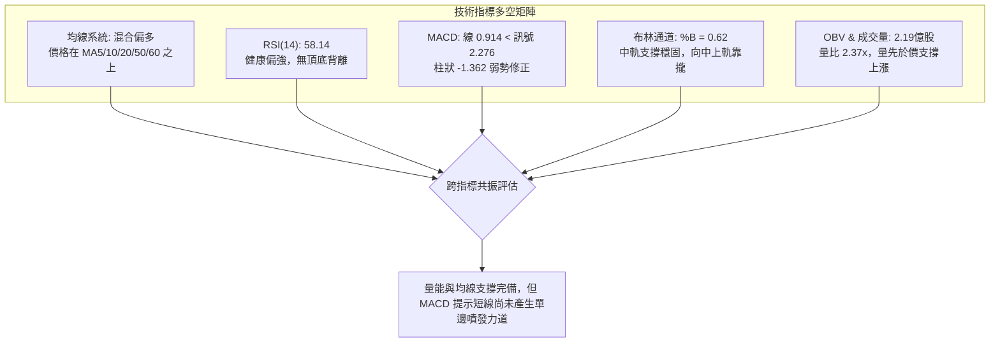

---

### 📈 移動平均線排列分析

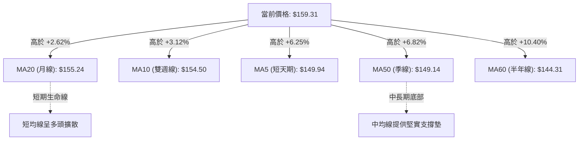

#### 均線數據狀態解析

| 均線名稱 | 當前值 | 價格相對位置 | 乖離率 (Bias) | 斜率與技術含義 |
|:---|:---:|:---:|:---:|:---|
| **MA 5** | **$149.94** | 價格在上方 ▲ | +6.25% | 急速向上拉升，短期動能充沛，形成短期攻擊線 |
| **MA 10** | **$154.50** | 價格在上方 ▲ | +3.12% | 向上翻揚，提供短線回檔第一道緩衝 |
| **MA 20** | **$155.24** | 價格在上方 ▲ | +2.62% | 持續走多，布林中軌所在，為重要防守支撐 |
| **MA 50** | **$149.14** | 價格在上方 ▲ | +6.82% | 築底完成上揚，與斐波那契 61.8% ($150.98) 形成雙重支撐壁壘 |
| **MA 60** | **$144.31** | 價格在上方 ▲ | +10.40% | 長期基底均線，緊貼 S2 支撐位 ($142.87) |
| **MA 200** | **N/A** | 數據不足 | — | 數據不足 200 筆，不予推估 |

*結論：價格全數運行於 5、10、20、50、60 日均線上方，均線系統呈現「混合偏多排列」，短線具備下檔承接力道。*

---

### 📉 RSI(14) 分析

*   **當前 RSI(14) 數值**：**58.14**
*   **指標可視化**：
    `[超賣 0] ░░░░░░░░░░ [50 中軸] ████████░░░░░░ [超買 100]`  *(58.14% 處於健康推進區)*
*   **區間定位**：RSI 處於 50 至 70 之常態多頭控盤區間，既無低於 30 之極度悲觀超賣，亦無高於 70 之過熱警戒。
*   **背離分析判斷**：
    *   2026-10-11 價格見高點 $162.57，當時週 RSI 為 59.1；
    *   2026-10-25 價格反彈至 $159.31，RSI 為 58.14；
    *   價格與 RSI 動能步調高度吻合，**明確結論：RSI 無頂背離，亦無底背離現象**，屬於量價同步的正常運動軌跡。

---

### 📊 MACD(12/26/9) 訊號解讀

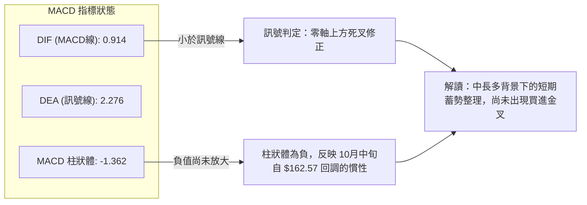

*   **指標數據**：MACD 線為 **0.914**，訊號線為 **2.276**，柱狀圖為 **-1.362**。
*   **背離檢驗**：MACD 線依然處於正值區（零軸之上），代表中期結構未壞；負柱狀體正處於收斂前夕，無多頭或空頭背離特徵，預示短線需要時間震盪以促成 DIF/DEA 再次黏合金叉。

---

### 📦 布林通道分析

```
SPCX 布林通道 (Bollinger Bands, 20, 2) 結構示意圖
═════════════════════════════════════════════════════════════════
$172.46 ─── 上軌 (Upper Band) ────────── 阻力壓力帶 (共振 R1: $172.40)
             │
$159.31 ─── 價格現位 (%B = 0.62) ─────── 處於中軌與上軌間強勢區
             │
$155.24 ─── 中軌 (MA20 生命線) ──────── 下檔第一動態支撐
             │
$138.03 ─── 下軌 (Lower Band) ────────── 極端回調保護帶
═════════════════════════════════════════════════════════════════
```

*   **通道寬度**：帶寬 (Bandwidth) = ($172.46 - $138.03) / $155.24 = **22.18%**，通道寬度適中，未見極度收窄或異常外擴。
*   **指標位置 (%B)**：當前 %B 為 **0.62**，說明股價運行於中軌（0.50）與上軌（1.00）之間，中軌 $155.24 提供動態支撐，短期運行軌跡朝向測試上軌 $172.46。

---

### 💹 成交量分析（量價配合度）

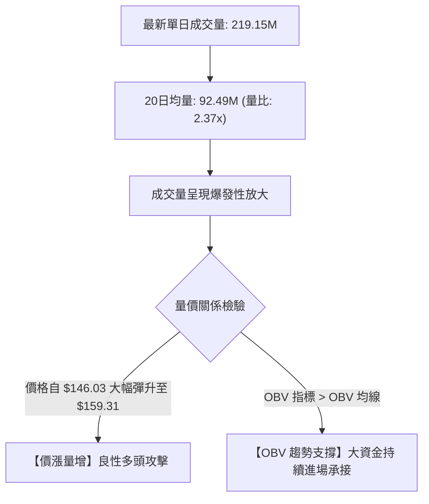

*   **OBV 狀態**：數據明確指出「OBV 趨勢：OBV > MA → 量能支撐上漲」。在大盤與個股經歷 10 月中旬回檔期間，成交量萎縮，而最新交易日以 2.37 倍巨量推進，確認主力資金在 $146.00–$150.00 區間建立穩固籌碼防線。

---

## 6. 動能與波動率

### ⚡ 動能評估四象限

| 象限分區 | 動能軸 (Momentum) | 波動軸 (Volatility) | SPCX 狀態定位 | 戰術因應原則 |
|:---:|:---:|:---:|:---:|:---|
| **第一象限 (Q1)** | 強動能 (RSI>60, ADX>30) | 低波動 (ATR%<3%) | — | 最優加碼區，強單邊持股 |
| **第二象限 (Q2)** | **中等偏弱 (ADX=22.34)** | **適度波動 (ATR%=5.18%)** | **✓ SPCX 當前落點** | **震盪箱型模式：高拋低吸，嚴設支撐停損** |
| **第三象限 (Q3)** | 強動能 (突破單邊) | 高波動 (ATR%>8%) | — | 突破追價模式，縮小部位嚴控停損 |
| **第四象限 (Q4)** | 弱動能 (破位下行) | 高波動 (恐慌拋售) | — | 觀望退場區，嚴禁抄底 |

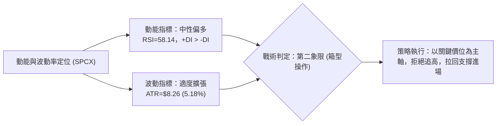

---

### 📊 ATR 波動率分析

*   **ATR(14) 絕對數值**：**$8.26**
*   **ATR 百分比**：**5.18%**（相對於收盤價 $159.31）
*   **動態停損與波動帶建議**：
    *   **短線保護寬度 (1.0 × ATR)**：$8.26 ➔ 當前價向下防守緩衝為 $151.05（緊貼黃金分割 61.8%: $150.98）。
    *   **波段防守寬度 (1.5 × ATR)**：$12.39 ➔ 當前價向下防守緩衝為 **$146.92**（精準覆蓋關鍵支撐 S1: **$146.24**）。
    *   **ATR 交易意涵**：日均波幅超過 8 美元，單日漲跌常態在 5% 左右，下單應以限價單為主，嚴禁於突破阻力位瞬間追市。

---

### 📐 Beta 與市場相關性

*   **Beta 指標**：數據庫顯示為 `N/A`（公司具備新興航太/新股高成長特質，歷史 Beta 數據未列出）。
*   **市場結構替代特徵**：
    *   空頭部位比率 (Short % Float)：**2.7%**（空頭部位極低，軋空條件不顯著，但下行無嚴重空頭摜壓）。
    *   機構持股比例 (Institution Own %)：**48.5%**；內部人持股比例 (Insider Own %)：**12.7%**，股權結構穩定度中等偏高。
    *   流動性環境：20日均量高達 9,249 萬股，流動性充裕，不存在小型股流動性折價風險。

---

## 7. 多時框架總結

### 📋 時框架評分表

| 時框架 | 趨勢方向 | 動能狀態 | 均線系統 | 形態結構 | 綜合評分 | 建議戰略 |
|:---:|:---:|:---:|:---:|:---:|:---:|:---|
| **長期 (月線)** | 🟡 中性築底 | RSI 回升至常態區 | 數據未達200日 | 自 $104.83 走出底部反轉 | **60/100** | 核心底倉逢低續抱 |
| **中期 (週線)** | 🟢 震盪走揚 | +DI > -DI 多頭佔優 | 站上 5/10/20 週線 | 雙底雛形完成，面臨頸線阻力 | **65/100** | 順應支撐逢拉回佈局 |
| **短期 (日線)** | 🟡 箱型整理 | MACD 修正但短量激增 | 均線混合排列偏多 | 於 S1 獲撐，挑戰布林上軌 | **55/100** | 依布林通道區間高拋低吸 |

---

### 🔲 綜合訊號矩陣

```
時框架訊號收斂矩陣
┌──────────────┬──────────────┬──────────────┬──────────────┐
│  維度 / 時框 │  長期 (月線) │  中期 (週線) │  短期 (日線) │
├──────────────┼──────────────┼──────────────┼──────────────┤
│ 均線系統     │      🟡      │      🟢      │      🟢      │
│ RSI / 動能   │      🟡      │      🟢      │      🟡      │
│ MACD 訊號    │      🟡      │      🔴      │      🔴      │
│ 量能 / OBV   │      🟢      │      🟢      │      🟢      │
│ 形態 / 關鍵位│      🟡      │      🟢      │      🟡      │
├──────────────┼──────────────┼──────────────┼──────────────┤
│ 階段方向定調 │   中性打底   │   偏多推進   │   區間震盪   │
└──────────────┴──────────────┴──────────────┴──────────────┘
```

---

### ⚖️ 多時框收斂結論

> **依據「嚴格要求 14」進行多時框收斂收束**：
>
> 1. **趨勢強度定性**：當前系統 ADX(14) 讀數為 **22.34**（明確小於 25 臨界值），技術結構嚴格判定為**「盤整震盪行情（Range-bound Regime）」**，而非單邊趨勢行情。
> 2. **主導時框權重**：依規則，盤整行情中中長期均線單邊引導力鈍化，**必須以日線布林通道 ($138.03 - $172.46) 與波段高低點聚類 ($146.24 - $172.40) 作為核心交易區間**。
> 3. **訊號衝突取捨**：雖然日線價格呈現大陽線反彈且突破短期均線，但 MACD 負柱狀體 (-1.362) 與週線阻力聚類 R1 ($172.40) 形成強烈壓制，因此否定「追價突破」邏輯。
> 4. **唯一方向性結論**：定調為 **【中性偏多，區間箱型操作】**。此結論嚴格貫穿後續第 8 章交易策略。

---

## 8. 交易策略建議

### 🗺️ 策略決策流程圖

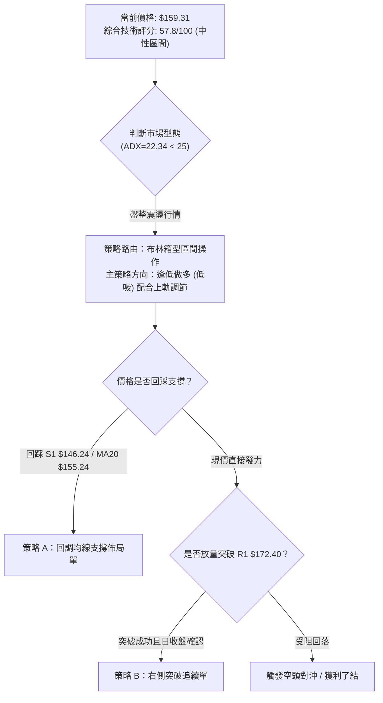

---

### 🧭 策略路由（依評分卡分流）

*   **當前技術綜合評分**：**57.8 / 100**（處於 40–60 中性區間，且偏向 60）。
*   **主策略定調**：**當前主策略方向 = 【中性偏多，區間箱型操作】**。
    *   以守住波段低點聚類 **S1: $146.24** 為多方底線，以回踩均線 **$155.24** 為低吸進場點，向上目標鎖定波段高點聚類與布林上軌 **R1: $172.40**。不執行高位追價，嚴守區間邊界。

---

### 🎯 價格情境階梯（Price Scenarios）

所有價位均嚴格取自數據庫計算數值：

| 觸發條件 | 第一階目標 | 第二階目標 | 後續延伸位 | 情境技術含義與應對 |
|:---|:---:|:---:|:---:|:---|
| **強勢突破 R1 ($172.40)** | **R2 ($176.42)** | **斐波 38.2% ($179.49)** | 斐波 23.6% ($197.13) | 短線盤整升級為單邊多頭主升段，加碼順勢跟進 |
| **持穩現價區間 ($155–$165)** | **布林上軌 ($172.46)** | **R1 ($172.40)** | — | 箱型內部常態震盪，維持高拋低吸，降低持倉成本 |
| **跌破 S1 ($146.24)** | **S2 ($142.87)** | **布林下軌 ($138.03)** | S3 ($130.39) | 中期結構弱化，多頭防守失敗，全面啟動風控停損 |

---

### 📊 情境機率分佈

| 情境劃分 | 估計機率 | 核心指標支持依據 |
|:---|:---:|:---|
| **情境一：區間震盪推進 (上測 R1)** | **60%** | **ADX=22.34 (盤整特徵)** + **OBV 量能支撐** + 現價站上 MA20/MA50，動能溫和推升 |
| **情境二：直接強勢突破 (上破 R1/R2)** | **15%** | 目前 MACD 柱狀體仍為負 (-1.362)，短期內一次性消化 $172.40 巨量賣壓機率較低 |
| **情境三：向下回踩破位 (下破 S1)** | **25%** | 52 週整體仍處下半區間 (45.1%)，若大盤系統性回檔，S1 ($146.24) 仍有二次回測風險 |

---

### 🟢 主策略詳情（方向：中性偏多區間操作）

| 策略要素 | 策略 A：均線回調低吸策略（左側/穩健） | 策略 B：突破頸線順勢策略（右側/積極） |
|:---|:---|:---|
| **進場條件** | 價格回踩 MA20 獲得支撐，日K收下影線 | 放量突破 R1 且收盤確認站上 |
| **進場價格** | **$155.24** (MA20 / 布林中軌共振點) | **$172.40** (以突破 R1 高點確認進場) |
| **第一目標 (T1)** | **$165.24** (斐波那契 50.0% 中樞) | **$176.42** (波段高點 R2) |
| **第二目標 (T2)** | **$172.40** (近一年阻力位 R1 / 布林上軌) | **$179.49** (斐波那契 38.2% 回調位) |
| **嚴格止損價** | **$146.24** (近一年核心支撐位 S1) | **$165.24** (跌回斐波 50.0% 頸線下方) |
| **風險空間** | $155.24 - $146.24 = **$9.00** | $172.40 - $165.24 = **$7.16** |
| **獲利空間(T2)** | $172.40 - $155.24 = **$17.16** | $179.49 - $172.40 = **$7.09** |
| **風險報酬比** | **1 : 1.91** (符合標準風控架構) | **1 : 0.99** (需等回踩確認，偏薄) |
| **模型成功率** | **65%** | **50%** |
| **建議配置倉位**| **15% - 20%** 總投資資金 | **10%** 總投資資金 |

---

### 🔴 反向風險觸發點（對沖提示）

以下任一條件觸發時，多頭假設全面失效，應執行倉位對沖或無條件離場：
1. **關鍵支撐破位**：日線收盤價**跌破 S1: $146.24**，代表 10 月以來雙底回升形態破局。
2. **極端弱勢確立**：價格擊穿防守支撐 **S2: $142.87** 及 MA60 (**$144.31**)，空頭將直撲 **S3: $130.39**。
3. **量價嚴重背離**：價格衝擊 R1 ($172.40) 時，單日成交量若低於 20 日均量 (9,249萬股) 之 50%，視為虛破假突破，應全面獲利了結。

---

### ⭐ 整體訊號強度評星

```
做多訊號強度：★★★☆☆  (3.5/5星 — 均線與量能俱備，受制於 MACD 與 ADX)
做空訊號強度：★★☆☆☆  (2.0/5星 — 價格位於全數均線上方，空方無主動優勢)
整體可信度：  ★★★★☆  (4.0/5星 — 價位聚類清晰，布林通道邊界極具參考價值)
```

---

## 9. 風險提示與監控

### ✅ 關鍵監控指標 Checklist

```
╔══════════════════════════════════════════════════════════════════╗
║               SPCX 盤面技術風險日常監控清單                      ║
╠══════════════════════════════════════════════════════════════════╣
║ [ ] 價格防線：每日收盤是否守穩 MA20 生命線 ($155.24)             ║
║ [ ] 破位預警：盤中是否出現跌穿 S1 ($146.24) 之異常賣壓           ║
║ [ ] 動能修復：MACD 柱狀體是否由負值 (-1.362) 往零軸收斂向上金叉   ║
║ [ ] 通道極限：價格逼近布林上軌 ($172.46) 時是否出現長上影線 K 線 ║
║ [ ] 量能警戒：日成交量是否維持在 20日均量 (92.49M) 之上          ║
║ [ ] 趨勢轉變：ADX 是否自 22.34 向上突破 25，開啟單邊強趨勢      ║
╚══════════════════════════════════════════════════════════════════╝
```

---

### ⚠️ 風險場景分析

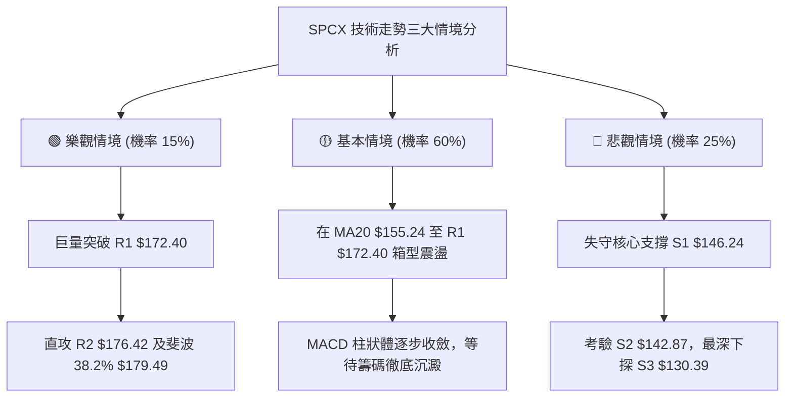

---

### 🛡️ 風險管理重要提醒

1. **單筆最大虧損限制（2% 原則）**：
   以操作「策略 A」為例，買進價格 $155.24，停損價格 $146.24，每股風險額為 $9.00（虧損幅度約 5.8%）。若總資金帳戶為 100,000 美元，單筆最大容許虧損 2,000 美元，則最大建立部位上限為：
   $$部位股數 = \frac{\$2,000}{\$9.00} \approx 222 \text{ 股（部位市值約 \$34,463，佔總資金 34.4%）}$$
   *建議初次建倉維持在 15%–20% 資金水位，留有加碼空間。*

2. **波動度適應原則**：
   SPCX ATR(14) 達 **$8.26 (5.18%)**，盤中波動極其劇烈。部位進場後，停損價位嚴禁任意人工下移，必須嚴格以系統自動觸價委託執行。

3. **籌碼與分析師偏向提示**：
   雖然 34 位華爾街分析師平均目標價給出 **$255.06**（且近期評級普遍調升為買進/優於大盤），但技術派交易者應以眼前價格幾何結構為準，在價格正式站上 **$172.40** 之前，不應提早以「基本面超高目標」進行非理性重倉。

---

## 10. 報告總結

```
╔════════════════════════════════════════════════════════════════════════════╗
║                      SPCX 技術分析報告總結 (2026-10-22)                    ║
╠════════════════════════════════════════════════════════════════════════════╣
║ 標的代碼：SPCX (Space Exploration Technologies Corp.)                      ║
║ 當前價格：$159.31                52週區間：$104.83 - $225.64               ║
║ 技術評級：⚖️ 中性偏多 / 區間震盪整理 (評分: 57.8 / 100)                    ║
╠════════════════════════════════════════════════════════════════════════════╣
║ 【技術架構關鍵定調】                                                       ║
║ ├─ 長期趨勢：🟡 脫離 52W 低點 $104.83，處於自谷底爬升之修復期            ║
║ ├─ 中期趨勢：🟢 週線於 S1 ($146.24) 獲強烈支撐，低點逐步墊高              ║
║ ├─ 短期趨勢：🟡 ADX=22.34 < 25，受限於布林帶上軌與 MACD 負柱狀體          ║
║ ├─ 關鍵阻力：R1: $172.40 (布林上軌 $172.46) │ R2: $176.42                 ║
║ ├─ 關鍵支撐：MA20: $155.24 │ S1: $146.24 │ S2: $142.87 │ S3: $130.39      ║
║ └─ 量能結構：單日爆量 2.19 億股 (量比 2.37x)，OBV > MA，量先於價支撐       ║
╠════════════════════════════════════════════════════════════════════════════╣
║ 【最優交易戰略組合】                                                       ║
║ 1. 🥇 首選策略 (策略 A)：回調 MA20 ($155.24) 佈局多單，目標 $172.40，      ║
║                          跌破 S1 ($146.24) 嚴格止損 (風報比 1:1.91)        ║
║ 2. 🥈 次選策略 (策略 B)：右側放量突破 R1 ($172.40) 追單，目標 $176.42 /    ║
║                          $179.49，跌回 $165.24 止損                        ║
║ 3. 🥉 保守風控：未出現回調或未放量突破前，嚴禁於 $160–$165 追價，隨時監控  ║
║                 S1 ($146.24) 作為趨勢反轉防守底線                          ║
╚════════════════════════════════════════════════════════════════════════════╝
```

---

> ⚠️ **免責聲明**：本報告為技術分析專用研究文件，所有數據、圖表及估算均嚴格基於所提供之歷史價格與量能資訊推算。本報告**僅供學術研究與交易架構參考**，**不構成任何要約、招攬或具體投資建議**。市場交易存在不可預期之價格波動風險，投資人應獨立評估風險承受能力並自負盈虧。

---

*報告生成時間：2026-10-22 ｜ 數據來源：Yahoo Finance ｜ 分析框架：CMT 多時框量化技術分析模型*