# SPCX 技術分析報告

> **報告日期**：2026-10-24 ｜ **語言**：繁體中文 ｜ **數據來源**：Yahoo Finance ｜ **當前價格**：$147.49

---

## 目錄

| 章節 | 內容 |
|------|------|
| [1. 技術面概覽](#1-技術面概覽) | 訊號儀表板、核心指標、評分卡 |
| [2. 趨勢分析](#2-趨勢分析) | 多時框趨勢、長中短期走勢 |
| [3. 圖表形態分析](#3-圖表形態分析) | 形態識別、K線組合、目標價 |
| [4. 支撐與阻力](#4-支撐與阻力) | 關鍵價位、斐波那契回調 |
| [5. 技術指標深度解讀](#5-技術指標深度解讀) | MA/RSI/MACD/布林/成交量 |
| [6. 動能與波動率](#6-動能與波動率) | 動能評估、ATR、Beta |
| [7. 多時框架總結](#7-多時框架總結) | 時框架評分矩陣 |
| [8. 交易策略建議](#8-交易策略建議) | 多空策略、風險報酬比 |
| [9. 風險提示與監控](#9-風險提示與監控) | 監控指標、風險場景 |

---

## 1. 技術面概覽

### 🎯 技術訊號儀表板

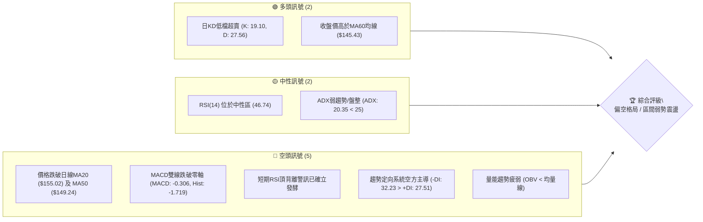

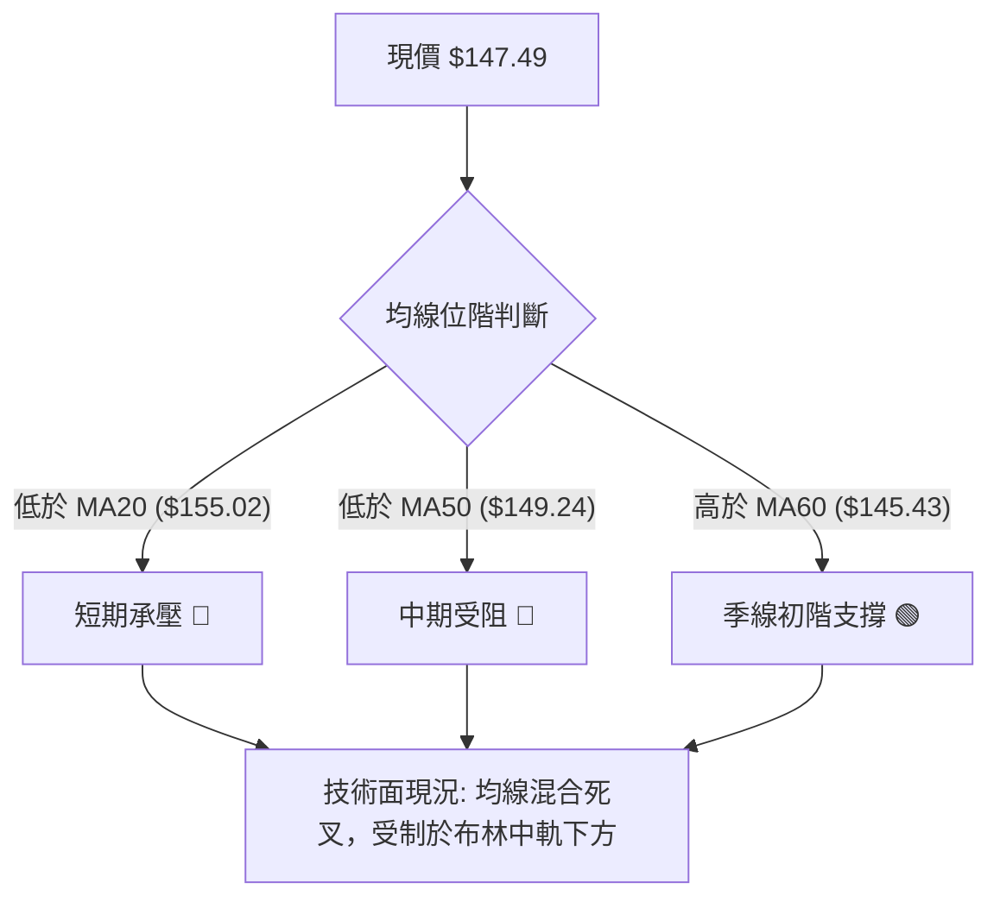

### 📊 核心指標速覽表

| 指標類別 | 指標名稱 | 當前數值 | 訊號 | 解讀 |
|:---|:---|:---:|:---:|:---|
| **價格** | 當前收盤價 | $147.49 | 🔴 | 位於 52 週區間 35.3% 之相對偏弱位置，跌破多條短中均線 |
| **均線** | MA20 | $155.02 | 🔴 | 現價低於 MA20 (-4.86%)，短期趨勢翻空且為布林中軌阻力 |
| **均線** | MA50 | $149.24 | 🔴 | 現價低於 MA50 (-1.17%)，中期多空分水嶺失守 |
| **均線** | MA60 | $145.43 | 🟢 | 現價高於 MA60 (+1.41%)，季線呈現微幅上揚之防守力道 |
| **均線** | MA200 | N/A（數據未提供） | 🟡 | 上市資料長度不足，數據未提供，無法評估超長期均線 |
| **動能** | RSI(14) | 46.74 | 🟡 | 落在 30–70 中性區間，惟伴隨前波頂背離釋放向下壓力 |
| **動能** | MACD (12,26,9) | -0.306 / 1.412 | 🔴 | 柱狀圖為 -1.719，呈現死叉發散，動能由空方主導 |
| **動能** | KD (14,3,3) | %K 19.10 / %D 27.56 | 🟢 | 指標進入 < 20 超賣區間，短線存在跌深技術性反彈契機 |
| **趨勢** | ADX(14) / DMI | ADX: 20.35 | 🟡 | ADX < 25 處於無明顯單邊強趨勢之盤整階段，-DI(32.23) 佔優 |
| **通道** | 布林通道 (%B) | %B: 0.29 | 🔴 | 價格運行於中軌 ($155.02) 與下軌 ($137.36) 之間，偏向弱勢區 |
| **波動** | ATR(14) | $8.10 | 🔴 | 每日真實波幅達股價 5.49%，日內與波段洗盤震盪劇烈 |
| **量能** | OBV 與量比 | 量比 1.09x / OBV < MA | 🔴 | 最新量 110.35M 高於20日均量，但 OBV 低於均線，量能未確認多頭 |

### 🏆 技術評分卡

```
╔══════════════════════════════════════════════════════════════════╗
║                   技術評分卡 — SPCX (2026-10-24)                 ║
╠══════════════════════════════════════════════════════════════════╣
║ 趨勢強度 (Trend)     ██████░░░░░░░░░░░░░░  30/100  🔴 弱勢空方主導  ║
║ 動能指標 (Momentum)  ████████░░░░░░░░░░░░  40/100  🔴 MACD疲弱背離  ║
║ 支撐穩定度 (Support)  ██████████░░░░░░░░░░  50/100  🟡 斐波0.618拉鋸 ║
║ 成交量配合 (Volume)   ████████░░░░░░░░░░░░  40/100  🔴 OBV結構走弱   ║
║ 形態完整度 (Pattern)  ██████████░░░░░░░░░░  50/100  🟡 弱勢區間箱體  ║
║ 均線排列 (MAs)       ██████░░░░░░░░░░░░░░  30/100  🔴 混合偏空下彎  ║
╠══════════════════════════════════════════════════════════════════╣
║ 綜合評分 (Overall)   ████████░░░░░░░░░░░░  40/100  🔴 偏空/謹慎觀望 ║
║ 評分定義說明: (30 + 40 + 50 + 40 + 50 + 30) ÷ 6 = 40.00 (規則 18) ║
╚══════════════════════════════════════════════════════════════════╝
```

---

## 2. 趨勢分析

### 🌐 多時框趨勢分析

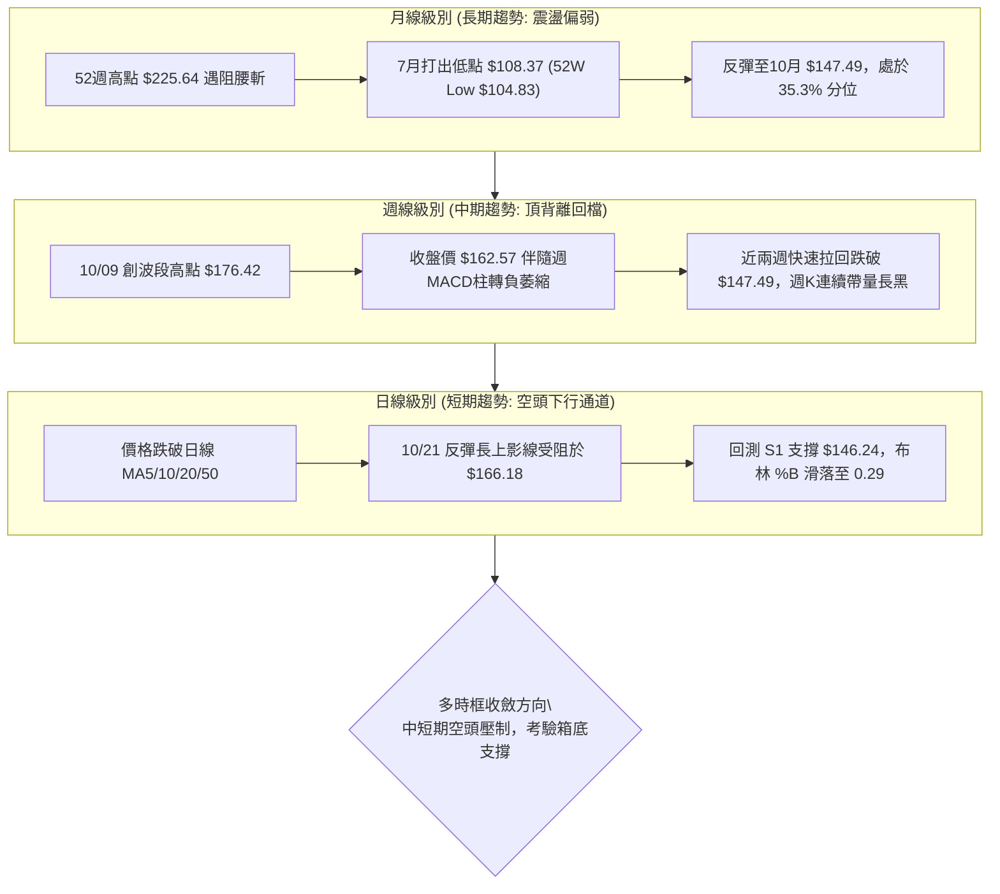

### 📈 長期趨勢 — 12個月走勢圖（Unicode）

依據月度歷史數據及近期關鍵價格所建構之月線價格軸：

```
SPCX 月線走勢圖（歷史關鍵高低點軌跡）
價格軸 ($)
$225.64 ┤                    ● (52W High)
$200.00 ┤                   / \
$175.00 ┤                  /   \      ● 10/09 ($176.42)
$170.86 ┤  ● (2026-06)   /     \    / \
$150.86 ┤   \           /       \  ●───● 2026-10 ($147.49 現價)
$143.69 ┤    \         /         ● (2026-08 $143.69)
$120.00 ┤     \       /
$108.37 ┤      \     ● (2026-07 低點 $108.37)
$104.83 ┤       ● (52W Low $104.83)
        └───────────────────────────────────────────────
          M-5    M-4    M-3    M-2    M-1    當前月
         06月   07月   08月   09月   10月    10/24
```

#### 月度走勢特徵分析表

| 期間月份 | 收盤價 ($) | 漲跌幅 (%) | 成交動能與型態結構解讀 |
|:---|:---:|:---:|:---|
| **2026-06** | 170.86 | 基準月 | 星艦概念與發射密集期引發追價，隨後自高檔 225.64 展開劇烈均值回歸 |
| **2026-07** | 108.37 | -36.57% | 單月重挫逾 36%，砸出歷史級波段底部，7/31 當週見底 $108.37，逼近 52W 低點 $104.83 |
| **2026-08** | 143.69 | +32.59% | 絕地大反彈，主力帶量進場抄底，週成交量暴增至 9.20 億股，修復超賣指標 |
| **2026-09** | 150.86 | +4.99% | 延續爬坡走勢，連續突破短期均線，多頭緩步墊高進逼 155.00 大關 |
| **2026-10** | 147.49 | -2.23% | 上攻 176.42 失敗後遭遇猛烈拋壓，週K收黑摜破月線均價，回測前波支撐平台 |

### 📊 中期趨勢（週線分析）

```
SPCX 週線波段壓力與支撐架構圖
══════════════════════════════════════════════════════════════════
[壓力區間]
$176.42 ═════════════════════════════ 10/09 週波段最高點 (強烈套牢阻力)
$166.18 ───────────────────────────── 10/21 日線長上影假突破高點
$158.13 ----------------------------- R3 波段高點聚類阻力
$155.00 ============================= R2 / MA20 / 週線成交密集壓力帶
------------------------------------------------------------------
現價: $147.49 (多空於斐波那契 61.8% 處進行肉搏)
------------------------------------------------------------------
[支撐區間]
$146.24 ----------------------------- S1 第一道關鍵波段支撐
$142.87 ============================= S2 10/22 低點與 9/18 週低點重合帶
$140.66 ───────────────────────────── S3 近兩週破底防守線 (10/15、10/16 低點)
$108.37 ═════════════════════════════ 7月份中期週線三重底頸線底部
══════════════════════════════════════════════════════════════════
```

從週線收盤走勢觀察，自 2026-07-31 的 $108.37 起漲至 2026-10-09 的 $162.57（當週高點 $176.42），累計波段漲幅達 50.01%。然而，近兩週（10/16 收 $146.03、10/23 收 $147.49）週線連續爆出長黑，週 MACD 柱狀圖由正轉負（10/09 為 +0.937，10/16 崩落至 -1.979，10/23 仍維持 -1.719），週 RSI 跌至 46.7，說明中期多頭波段遭到截斷，進入深幅修正。

### ⚡ 趨勢強度評估（ADX 解讀）

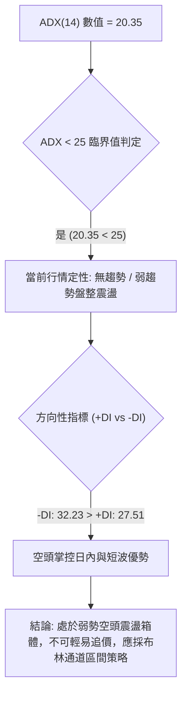

#### ADX 指標強度對照表

| 指標變數 | 當前讀數 | 門檻區間 | 趨勢狀態判定 | 交易策略意涵 |
|:---|:---:|:---:|:---|:---|
| **ADX(14)** | 20.35 | 0 – 25 (弱趨勢/盤整) | 🟡 缺乏單邊推動力 | 嚴禁使用順勢追價系統；突破容易失敗，以區間震盪打法為宜 |
| **+DI(14)** | 27.51 | — | 多方推力不足 | 多頭買盤力道持續衰退，無法形成單邊波段上漲 |
| **-DI(14)** | 32.23 | — | 🔴 空方力量佔優 | 拋售壓力持續壓制反彈，空方在局部震盪中佔據主導權 |
| **淨差值 (DMI)**| -4.72 | 負值區域 | 🔴 空方佔優盤整 | 價格面臨陰跌破底風險，需提防 ADX 向上穿越 25 啟動單邊主跌 |

---

## 3. 圖表形態分析

### 🔍 形態識別系統

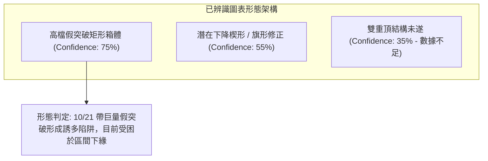

#### 形態識別與信心度評估表（依規則 15）

| 形態名稱 | 信心度 (%) | 判斷依據（引用數據） | 完成度 (%) | 目標價（附計算式，依規則 13/15） |
|:---|:---:|:---|:---:|:---|
| **高檔假突破矩形箱體** | **75%** | 箱頂為 R2 $155.00 至高點聚類；10/21 衝高至 $166.18 後次日爆量崩跌至 $144.75；箱底落於 S1 $146.24 與 S2 $142.87。 | 85% | 跌破箱底 S2 $142.87 後測：箱底 $142.87 − 形態高差 ($155.00 − $142.87 = $12.13) = **$130.74**（逼近斐波那契 78.6% 之 $130.68）。 |
| **短期下降旗形修正** | **55%** | 9月旗桿自 $108.37 飆升至 $176.42（高差 $68.05），近兩週呈現高低點逐步下移的下飄整理軌道。 | 60% | 若突破旗面中軌阻力 R2 $155.00：突破點 $155.00 + 旗面回撤推算高度 = 需突破方能成立，目前訊號不足，僅作指標型解讀。 |
| **雙重頂 (Double Top)** | **35%** | 僅有 10/09 高點 $176.42 與 10/21 高點 $166.18 兩處尖刺，頸線未完整形成。 | 30% | **數據中未偵測到完整頸線架構，信心度不足 50%，不予強行推算目標價**。 |

### 🕯️ 重要K線形態分析（依規則 19）

嚴格依據提供的「近10根日K」與「近8根週K」原始開高低收數據進行蠟燭線判讀：

| 週期與日期 | 開盤 ($) | 最高 ($) | 最低 ($) | 收盤 ($) | 成交量 (股) | K線形態 | 技術解讀與訊號 |
|:---|:---:|:---:|:---:|:---:|:---:|:---:|:---|
| **日K 10-15** | 146.91 | 149.04 | 140.66 | 148.62 | 101,177,100 | **長下影錘頭線** | 🟢 盤中下探 S3 關鍵低點 $140.66 獲逢低承接買盤拉起，形成短線防守紅K。 |
| **日K 10-20** | 146.17 | 148.66 | 143.27 | 147.79 | 117,204,900 | **下影線紡錘線** | 🟡 連續兩日測試 $143.27 低檔不破，呈現拋壓減弱的低檔震盪整固訊號。 |
| **日K 10-21** | 160.56 | 166.18 | 156.93 | 159.31 | 220,785,200 | **帶巨量長上影黑K** | 🔴 跳空高開衝至 $166.18 遭遇機構出貨，收盤拉回，爆出 2.2 億股天量，形成典型主力誘多「射擊之星」假突破。 |
| **日K 10-22** | 154.21 | 154.26 | 143.21 | 144.75 | 197,046,500 | **光頭光腳大長黑** | 🔴 開盤即最高點，一路重挫近 10 點至 $143.21，直接吞噬前日漲幅，確認 10/21 多頭被斷頭套牢。 |
| **日K 10-23** | 147.93 | 149.75 | 144.09 | 147.49 | 110,352,500 | **窄幅小陰十字線** | 🟡 價格受制於 R1 $149.80 之下，低點守住 $144.09，多空於週五呈現觀望收斂。 |
| **週K 10-09** | 158.99 | 176.42 | 158.62 | 162.57 | 485,054,700 | **長上影避雷針** | 🔴 衝高至 $176.42 留下近 14 美元長上影線，代表 $170.00 以上買盤斷層。 |
| **週K 10-16** | 164.66 | 167.07 | 140.66 | 146.03 | 394,968,000 | **帶量破位中長黑** | 🔴 實體大陰線摜破 150 大關，單週重挫 10.17%，奠定中期空頭反轉基調。 |
| **週K 10-23** | 149.23 | 166.18 | 143.21 | 147.49 | 719,426,900 | **爆量倒轉錘頭線** | 🔴 週成交量飆至 7.19 億股天量，但收盤仍壓制於 $147.49，說明向上解套賣壓排山倒海。 |

### 📉 ASCII 走勢形態示意圖

```
SPCX 關鍵形態解構圖（10/12 至 10/23 日K線結構）
價格 ($)
$166.18 ┬                                    ▲ 10/21 假突破天線 (射擊之星)
$163.42 ┤    ● 10/12                       │
$160.00 ┤    │                            ┌┴┐
$156.54 ┤    │  ● 10/13                   │ │
$152.16 ┤    │  │   ● 10/14               │ │  ┌┐ 10/22 大陰線摜壓
$148.62 ┤    │  │   │   ● 10/15   ● 10/19 │ │  ││
$147.49 ┤────┼──┼───┼───┼─────────┼─────┼─┼──┼┼────● 10/23 (現價收盤)
$144.75 ┤    │  │   │   │         │     │ │  ││    │
$140.66 ┴────┴──┴───┴───▲ (10/15下影線)┴─────┴─┴──┴┴────┴─── S3 強支撐
        ──────────────────────────────────────────────────────────
        10-12 10-13 10-14 10-15 10-16 10-19 10-20 10-21 10-22 10-23 (日)
```

### 🎯 形態目標價計算

依據高檔假突破箱體型態計算跌破與反彈之目標價：
1. **箱體上限阻力**：取波段高點聚類 R2 = **$155.00**
2. **箱體下限支撐**：取 10/18 週低點與多次觸及之 S2 = **$142.87**
3. **箱體形態垂直高度 (H)**：$155.00 − $142.87 = **$12.13**
4. **向下破位理論測幅目標 (Bearish Target)**：
   $$\text{目標價} = \text{箱體下限} - H = \$142.87 - \$12.13 = \$130.74$$
   *(該數值與斐波那契 78.6% 關鍵位 $130.68 高度重合，具備雙重技術共振)*
5. **向上假突破回抽之反彈阻力目標 (Bullish Retest Target)**：
   $$\text{反彈回測目標} = \text{形態頸線} = \text{R1 } \$149.80 \text{ 至 R2 } \$155.00$$

---

## 4. 支撐與阻力

### 🗺️ 關鍵價位分布圖（Unicode）

```
SPCX 價位結構分布圖（嚴格依據 OHLCV 計算聚類值）
══════════════════════════════════════════════════════════════════
$158.13 ║████████████████████████████████║ 強阻力 R3 (9/25週高/近一年高點聚類)
$155.00 ║████████████████████            ║ 關鍵阻力 R2 (MA20/布林中軌/9/11週高)
$149.80 ║████████████████████████        ║ 短線阻力 R1 (10/23日內反彈高點聚類)
════════╠════════════════════════════════╣ ◄ 當前收盤價: $147.49
$146.24 ║▓▓▓▓▓▓▓▓▓▓▓▓▓▓▓▓▓▓▓▓            ║ 短線支撐 S1 (近一年波段低點聚類)
$142.87 ║████████████████████████        ║ 強支撐 S2 (9/18週低/10/22長黑低點)
$140.66 ║████████████████████████████████║ 核心防守支撐 S3 (10/15、10/16雙底)
══════════════════════════════════════════════════════════════════
```

### 🚧 阻力位分析表（依規則 13 嚴格引用數據）

| 阻力級別 | 價位 ($) | 離現價幅幅 | 形成原因與籌碼結構 | 突破難度 | 重要性等級 |
|:---|:---:|:---:|:---|:---:|:---:|
| **R1** | **$149.80** | +1.57% | 10/23 日高 $149.75 聚類，亦為 50日均線 ($149.24) 密集成交區上緣 | 🟡 中等 | 短線多空強弱分界線 |
| **R2** | **$155.00** | +5.09% | 20日均線 MA20 ($155.02)、布林中軌與 9/11 週波段高點共振壓力帶 | 🔴 極高 | 中期轉強之關鍵頸線 |
| **R3** | **$158.13** | +7.21% | 9/25 週高點 $158.13 聚類，亦為 10/21 爆量黑K實體下緣套牢平台 | 🔴 極高 | 波段空頭防守總指揮部 |

### 🛡️ 支撐位分析表（依規則 13 嚴格引用數據）

| 支撐級別 | 價位 ($) | 離現價幅幅 | 形成原因與籌碼結構 | 守住機率 | 重要性等級 |
|:---|:---:|:---:|:---|:---:|:---:|
| **S1** | **$146.24** | -0.85% | 近一年波段低點聚類，10/16 收盤價 $146.03 與 10/20 開盤價支撐帶 | 🟡 55% | 當前第一道日內緩衝區 |
| **S2** | **$142.87** | -3.13% | 9/18 週低點 $142.87 與 10/22 重挫低點 $143.21 形成之強共振點 | 🟢 65% | 核心箱底多頭防禦工事 |
| **S3** | **$140.66** | -4.63% | 10/15 與 10/16 連續兩日探底最低點 $140.66 聚類，為最後波段底限 | 🟢 80% | 破位將引發機構停損多殺多 |

### 📐 斐波那契回調位分析

依據 52 週完整極端區間（低點 $104.83 → 高點 $225.64，垂直跨度 $120.81）精確回調點陣：

```
斐波那契回調階梯（52W 區間 $104.83 至 $225.64）
0.0%  (52W High)  $225.64 ──────────────────────────────────────────
23.6%             $197.13 ──────────────────────────────────────────
38.2%             $179.49 ────────────────── (10/09 高點 $176.42 遇阻處)
50.0%             $165.24 ────────────────── (10/21 衝高 $166.18 遇阻處)
61.8%             $150.98 ══════════════════ (黃金分割關鍵分水嶺)
                   ▲ 現價 $147.49 緊貼 61.8% 下方 (-2.31%)
78.6%             $130.68 ────────────────── (深度拉回終極支撐位)
100.0% (52W Low)  $104.83 ──────────────────────────────────────────
```

#### 斐波那契點位深度解讀
1. **當前價格位階**：收盤價 **$147.49** 正處於 **61.8% 黃金分割位 ($150.98)** 與 **78.6% 深度回調位 ($130.68)** 之間。
2. **多空心理意義**：61.8%（$150.98）歷來為大多頭回檔防守極限。SPCX 自 10/09 衝擊 38.2%（$179.49）失敗後連續破位，10/21 甚至在回抽 50.0%（$165.24）時留下 $166.18 的長上影線。目前收盤於 61.8% 之下，確認波段由主升浪轉化為深度修正格局，若無法儘速收復 $150.98，技術面將朝 78.6%（$130.68）滑落尋求支撐。

---

## 5. 技術指標深度解讀

### 🎛️ 指標訊號總覽

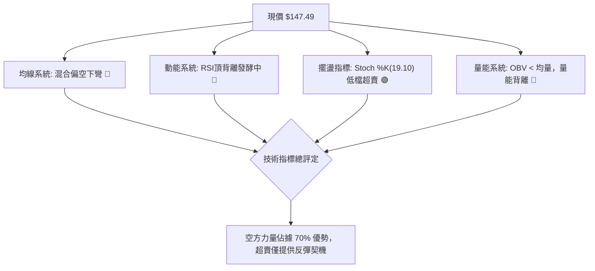

### 📈 移動平均線排列分析

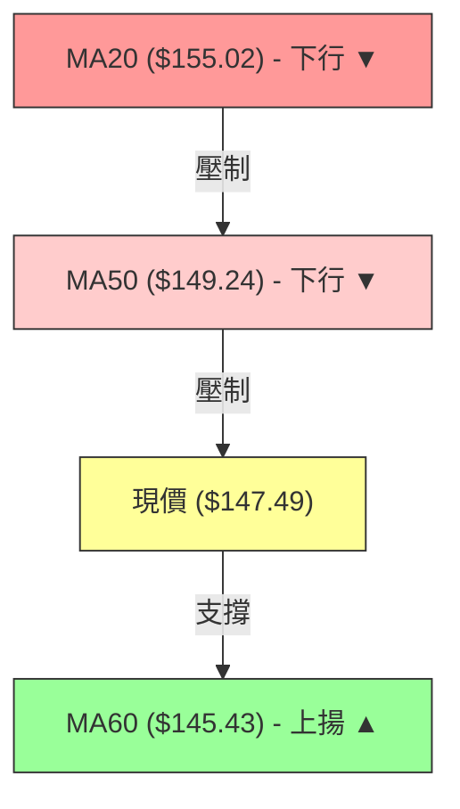

#### 均線各週期狀態解析
- **MA5 ($149.46) / MA10 ($151.41)**：兩者呈現快速下行空頭排列，MA5 距離現價 -1.32%，構成極短線動態阻力。
- **MA20 ($155.02)**：斜率下彎，現價落後 -4.86%，代表近一個月進場之投資人全數處於套牢狀態。
- **MA50 ($149.24)**：與阻力位 R1 $149.80 重疊，現價跌破 MA50，為中期轉弱之明確信號。
- **MA60 ($145.43)**：為目前唯一向上揚升之均線（+1.41%），與支撐位 S1 $146.24 構成多頭在日線上的第一道防禦戰壕。
- **MA200**：**N/A（數據未提供）**，資料不足不予估算。

### 📉 RSI(14) 分析

```
RSI(14) 動能強度表
0       20        30              50              70        80      100
├───────┼─────────┼───────────────┼───────────────┼─────────┼───────┤
│       │         │    ● (46.74)  │               │         │       │
└───────┴─────────┴───────────────┴───────────────┴─────────┴───────┘
當前讀數: 46.74 ▓▓▓▓▓▓▓▓▓░░░░░░░░░░░ 46.7% (中性偏弱)
```

- **頂背離判定**：**確認成立**。數據明確標示近 20 根 K 棒呈現 **RSI 頂背離 (Bearish Divergence)**。價格於 10/09 與 10/21 試圖衝高，但 RSI 高點逐步走低（自 10/09 週線之 59.1 滑落至 10/16 之 43.9，再到日線 46.74），動能無法跟隨創高，造成隨後的瀑布式下殺。
- **現狀解讀**：RSI 位於 46.74，脫離超買區但尚未觸及 30 以下之超賣區，顯示空頭下行動能仍有釋放空間，並未出現動能耗竭底背離。

### 📊 MACD(12/26/9) 訊號解讀

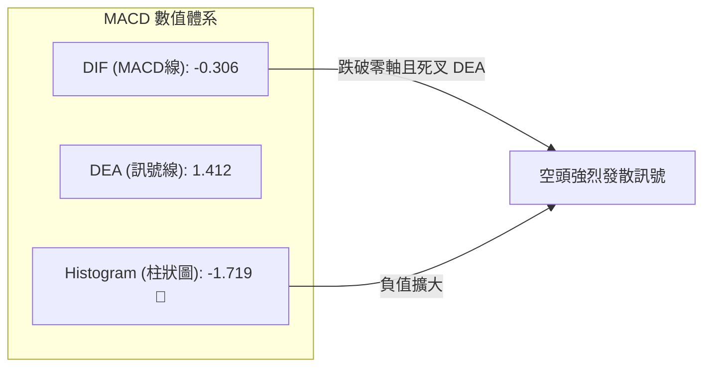

- **數值檢驗**：MACD 線為 **-0.306**，正式下穿零軸進入負值區；訊號線 DEA 位於 **1.412**；柱狀圖差值達到 **-1.719**。
- **訊號詮釋**：MACD 柱狀圖自 10/09 的 +0.937 驟降至 -1.719，呈現典型「空中死叉」後向零軸下方發散。此結構表明中線波段籌碼正由多翻空，任何未帶量站回零軸上的反彈均屬「弱勢抽腳」，難以展開持續性大行情。

### 📦 布林通道分析

```
SPCX 布林通道 (Bollinger Bands 20, 2) 結構圖
價格 ($)
$172.68 ────────────────────────────────────── BB 上軌 (阻力極限)
         │
         │
$155.02 ────────────────────────────────────── BB 中軌 (MA20 動態重壓)
         │
         │         現價: $147.49 (位於下半部弱勢區間)
         │         %B 讀數: 0.29 [███░░░░░░░]
         │
$137.36 ────────────────────────────────────── BB 下軌 (動態極限支撐)
```

- **通道帶寬與位置**：通道上軌 $172.68，下軌 $137.36，中軌 $155.02，頻寬達 $35.32。當前價格 $147.49，**%B 僅為 0.29**（0 代表下軌，0.5 為中軌）。
- **軌道行為解讀**：價格跌破中軌後順著通道下半部滑落，處於空頭巡航狀態。在未有效帶量突破中軌 $155.02 前，布林通道指向價格將在 $137.36 – $155.02 之間進行弱勢拉鋸。

### 💹 成交量分析（量價配合度）

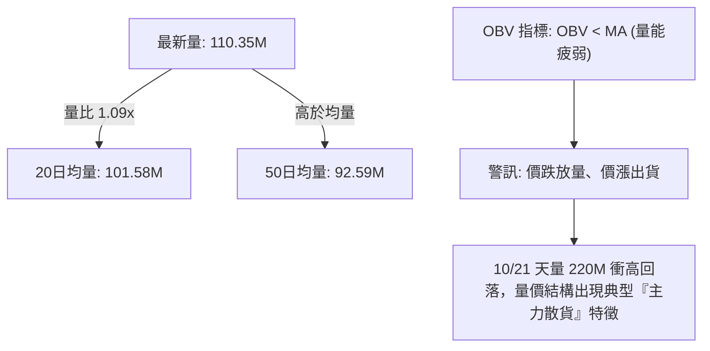

- **量價背離現象**：最新成交量 110.35M 股，高於 20 日均量（量比 1.09x），但價格卻收微跌小陰線；更嚴重的是，10/21 暴增至 220.79M 股之天量，次日卻直接大跌 -9.14% 吞噬，此為標準之「放量滯漲與出貨崩跌」。
- **OBV 能量潮解讀**：數據顯示「OBV < MA → 量能疲弱」，OBV 持續運行於其均線下方，說明資金淨流出幅度顯著，主力資金在反彈時傾向逢高減磅，缺乏機構持續性鎖倉買盤支撐。

---

## 6. 動能與波動率

### ⚡ 動能評估分析

| 象限 | 動能狀態 | 波動率狀態 | SPCX 當前狀態 | 技術診斷與戰略定位 |
|:---:|:---:|:---:|:---:|:---|
| **Q1** | 強動能 (Bullish) | 低波動 (Low Vol) | — | 最佳波段穩健上行趨勢（未處於此狀態） |
| **Q2** | 弱動能 (Bearish) | 低波動 (Low Vol) | — | 沉悶無序窄幅盤整（未處於此狀態） |
| **Q3** | 強動能 (Expansion) | 高波動 (High Vol) | — | 單邊大暴動行情（未處於此狀態） |
| **Q4** | **弱動能 (Bearish)** | **高波動 (High Vol)** | **✓ (符合現況)** | **高風險弱勢震盪：RSI 46.74 偏弱 + MACD 負值 + ATR 高達 $8.10，日內洗盤極度激烈，應謹防多空雙巴** |

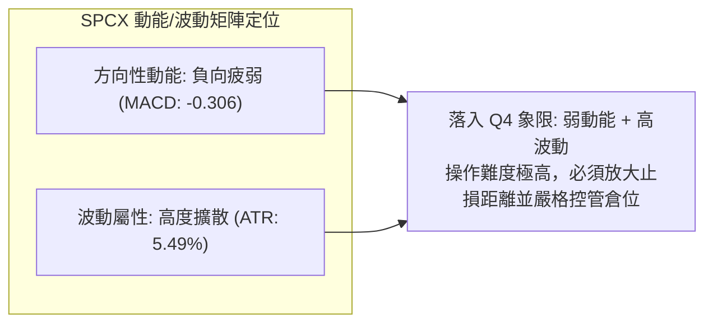

### 📊 ATR 波動率分析

- **ATR(14) 讀數**：**$8.10**，佔當前股價之比率高達 **5.49%**。
- **市場意涵**：SPCX 屬於超高日內波幅品種，每日平均正常震盪空間即達 8 美元以上。
- **止損與風控參數設定建議**：
  - **超短線當沖/隔日沖**：最低安全緩衝距離為 1.0 倍 ATR = **$8.10**。
  - **波段交易防守點**：應設定於關鍵價位外側至少 1.5 倍 ATR = **$12.15**，避免在密集成交區被隨機雜訊洗出場。

### 📐 Beta 與市場相關性

- **Beta 數值**：**N/A（數據未提供）**。
- **相關性與波動解讀**：
  - 依據其所屬航太國防與 AI 應用產業（Market Cap: $2.00T，TTM 營收成長率 161.4%），雖然 Beta 欄位為 N/A（數據未提供），但從其 52 週振幅（$104.83 – $225.64，波幅達 115.2%）及近期日均換手成交量（20日均量逾 1 億股）推斷，該標的具備極高的高科技成長股高波動屬性。
  - 對科技權值與大盤流動性極度敏感，在當前動能指標弱化背景下，容易受市場整體避險情緒牽引而出現深幅拉回。

---

## 7. 多時框架總結

### 📋 時框架評分表

| 時框架 | 趨勢方向 | 動能狀態 | 均線排列 | 圖表形態 | 綜合評分 | 操作建議方向 |
|:---|:---:|:---:|:---:|:---:|:---:|:---|
| **長期 (月線)** | 🟡 箱體拉鋸 | RSI 50附近走平 | N/A（數據未提供） | 52W區間35%分位 | **45/100** | 逢低佈局，不宜追高 |
| **中期 (週線)** | 🔴 頂背離回檔 | MACD柱連翻負值 | 跌破 5週/10週均線 | 假突破避雷針天線 | **35/100** | 逢反彈減碼，中線偏空 |
| **短期 (日線)** | 🔴 弱勢空頭防守 | KD超賣但MACD發散 | MA5/10/20 空頭排列 | 高檔射擊之星誘多 | **40/100** | 區間下緣博反彈，嚴設停損 |

### 🔲 綜合訊號矩陣

```
SPCX 多時框訊號收斂矩陣
══════════════════════════════════════════════════════════════════════
維度            短期 (日線)          中期 (週線)          長期 (月線)
──────────────────────────────────────────────────────────────────
趨勢狀態        🔴 空頭主導 (-DI佔優) 🔴 頂背離破位回測    🟡 大箱體寬幅震盪
動能方向        🟢 KD超賣醞釀反抽    🔴 MACD柱加速向下    🟡 處於中性水平
均線體系        🔴 受制於MA20/50     🔴 跌破多條短均線    🟡 守住60日/季線
量價關係        🔴 爆量滯跌出貨      🔴 週量創高收黑K     🟢 低檔具備抄底量
──────────────────────────────────────────────────────────────────
時框共振結論: 短中期空頭共振壓制，唯日線指標進入超賣，存在短線脈衝反彈空間。
══════════════════════════════════════════════════════════════════
```

### ⚖️ 多時框收斂結論（依規則 14）

1. **行情定性判定**：當前 ADX(14) 讀數為 **20.35**，明確處於 **ADX < 25 之「弱趨勢 / 盤整震盪行情」**。
2. **多時框收斂規則套用**：依據嚴格規則 14，在 ADX < 25 條件下，**市場不具備順勢追單基礎，必須以日線布林通道上下軌（$137.36 – $172.68）為主要交易區間**。
3. **最終方向性結論**：**【偏空格局下的箱體下緣弱勢震盪】**。
   - 週線長上影線與日線 MA20 形成雙重鐵板大壓，中短期均線壓制明顯；
   - 惟日線 Stoch KD 已降至 19.10 嚴重超賣區，且價格逼近 S1 ($146.24) 與 MA60 ($145.43) 支撐；
   - 因此，**第 8 章策略將收斂至「區間高空低吸、以逢高反彈做空為主要阻力防守」之主控策略**，與第 1 章綜合評分 40/100 及第 5 章指標完全一致。

---

## 8. 交易策略建議

### 🗺️ 策略決策流程圖

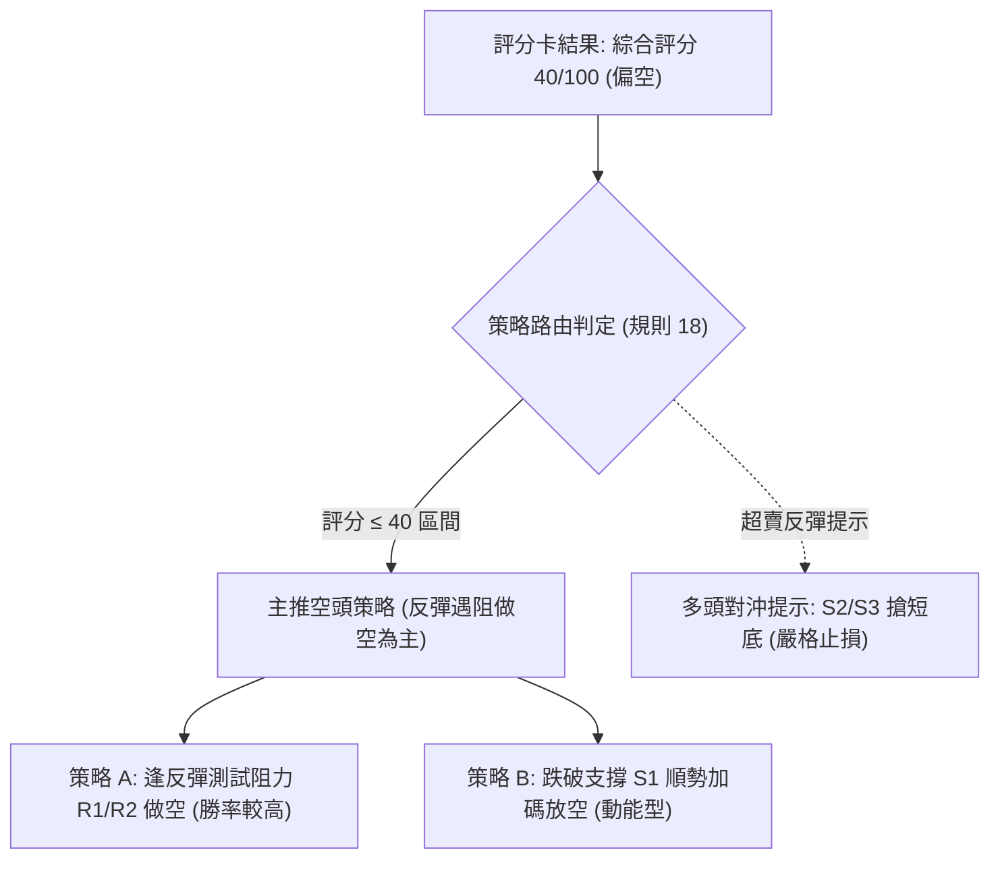

### 🧭 策略路由（依評分卡分流）

> **當前主策略方向 = 主推空頭／反彈逢阻做空策略（依綜合評分 40/100 精確分流）**
> 
> 根據規則，綜合評分 ≤ 40 主推空頭策略。多頭僅能作為超賣反彈之避險對沖與風險觸發提示。

### 🎯 價格情境階梯（Price Scenarios，嚴格引用第 4 章數據）

| 觸發條件 | 下一目標 | 後續延伸 | 情境技術含義 |
|:---|:---:|:---:|:---|
| **向上反彈測試 R1 $149.80** | R2 $155.00 | R3 $158.13 | 弱勢技術性反抽，測試日線 MA50 與 MA20 密集套牢賣壓 |
| **跌破短線支撐 S1 $146.24** | S2 $142.87 | S3 $140.66 | 空方發力跌破盤整小平台，尋求回測 10/22 大陰線低點支撐 |
| **實體收盤跌破 S3 $140.66** | 斐波78.6% $130.68 | 7月低點 $108.37 | 形態全面崩潰，觸發箱體垂直高度 1:1 等幅下殺測幅 |

### 📊 情境機率分佈

| 情境劃分 | 機率 (%) | 主要依據（指標與型態狀態支撐） |
|:---|:---:|:---|
| **震盪回落 / 再探箱底** | **55%** | MACD 雙線處於零軸下且柱狀體 -1.719；-DI(32.23) 佔優；10/21 爆巨量留天線阻力難以化解。 |
| **區間內窄幅拉鋸** | **30%** | ADX 僅 20.35 缺乏單邊趨勢；日線 KD 進入超賣區 (19.10) 限制短線暴跌空間；季線 MA60 ($145.43) 具備防守力。 |
| **向上強勢反轉突破** | **15%** | 除非有突發利多帶量吞噬 R2 ($155.00)，否則在均線壓制與 OBV 量能背離下，反轉機率極低。 |

### 🔴 主策略詳情（空頭主導策略）

嚴格依據規則 17 計算風險報酬比：做空時風險報酬比 = (進場價 − 目標價 T1) ÷ (止損價 − 進場價)。

| 策略要素 | 策略 A（反彈遇阻做空 — 核心主策略） | 策略 B（跌破 S1 破位跟進做空 — 突破策略） |
|:---|:---:|:---:|
| **策略邏輯** | 趁 KD 超賣反彈回測 MA50/R1 阻力不破時順勢放空 | 價格跌破昨日低點及 S1 支撐時，順應空方慣性放空 |
| **進場條件** | 反彈至 R1 遇阻回落，分時圖出現賣訊 | 實體跌破支撐位 S1 |
| **進場價格** | **$149.80**（精確引用 R1 阻力位） | **$146.24**（精確引用 S1 支撐位） |
| **目標價 T1** | **$142.87**（精確引用 S2 支撐位） | **$140.66**（精確引用 S3 支撐位） |
| **目標價 T2** | **$130.68**（精確引用 斐波那契 78.6%） | **$130.68**（精確引用 斐波那契 78.6%） |
| **止損價格** | **$155.00**（精確引用 R2 阻力/MA20） | **$149.80**（精確引用 R1 阻力位） |
| **風險報酬比** | **1 : 1.33（以 T1 計）**<br>*(149.80 - 142.87) ÷ (155.00 - 149.80) = 6.93 ÷ 5.20 = 1.33*<br>*(以 T2 計則為 1 : 3.68)* | **1 : 1.57（以 T1 計）**<br>*(146.24 - 140.66) ÷ (149.80 - 146.24) = 5.58 ÷ 3.56 = 1.57*<br>*(以 T2 計則為 1 : 4.37)* |
| **勝率預估** | **65%** | **55%** |
| **建議倉位** | **15% - 20%**（控制單筆風險 ≤ 總資金 1.5%） | **10%**（因 ADX 偏低，破位單需防假突破） |

### 🟢 反向風險觸發點（對沖與止損提示）

若出現以下技術訊號，代表原空頭主策略被市場推翻，空單必須立即無條件止損，多頭可嘗試短線搶反彈：
1. **多頭反轉觸發點**：日線收盤價強勢突破並站穩 **R2 $155.00**（MA20 與布林中軌）。
2. **量能逆轉條件**：單日成交量再度放大至 1.8 億股以上，且收盤為光頭大陽線。
3. **指標翻多條件**：MACD 柱狀圖由負轉正，且 RSI(14) 突破 55 中軸向上發散。
4. **搶反彈對沖多單參考（非主推）**：若在 S3 **$140.66** 出現長下影線止跌，可建立 5% 輕倉短多，止損設 $137.36（布林下軌），目標看回 R1 **$149.80**。

### ⭐ 整體訊號強度評星

```
╔══════════════════════════════════════════════════════════════════╗
║ 做多訊號強度：★★☆☆☆  (2/5星) — 僅依賴 KD 短線超賣，阻力重重     ║
║ 做空訊號強度：★★★★☆  (4/5星) — 均線偏空、MACD零軸下、假突破確立  ║
║ 整體可信度：  ★★★☆☆  (3/5星) — ADX < 25 處於震盪，波幅較為發散 ║
╚══════════════════════════════════════════════════════════════════╝
```

---

## 9. 風險提示與監控

### ✅ 關鍵監控指標 Checklist

```
╔══════════════════════════════════════════════════════════════════╗
║                   盤面日常核心風控監控清單 (Checklist)           ║
╠══════════════════════════════════════════════════════════════════╣
║ [ ] 價格是否跌破 S1 ($146.24) 或 S2 ($142.87) 引發停損斷頭潮    ║
║ [ ] 日線收盤是否放量站上 R2 ($155.00) 突破 MA20 下降壓力線      ║
║ [ ] MACD 柱狀圖負值是否開始收斂（由 -1.719 縮小至 -0.5 以內）    ║
║ [ ] ADX(14) 是否向上突破 25，引發單邊強烈單向趨勢暴走           ║
║ [ ] 日成交量是否萎縮至 8,000 萬股以下，導致流動性折價波動擴大    ║
║ [ ] 每日波幅是否超過 ATR ($8.10)，觸發日內極端洗盤保護機制       ║
╚══════════════════════════════════════════════════════════════════╝
```

### ⚠️ 風險場景分析

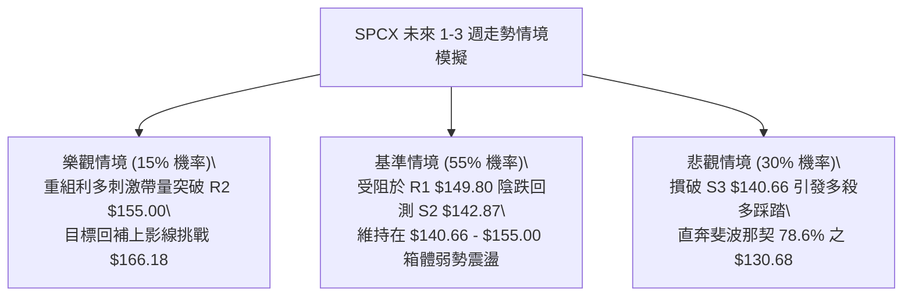

### 🛡️ 風險管理重要提醒

1. **極度波動性風險**：
   SPCX 目前之 ATR 高達 **$8.10**（5.49%），這意味著任何未留足 1.5 倍 ATR 緩衝空間（約 $12 美元）之狹窄止損，極易在美股早盤被日內洗盤掃出場。嚴格禁止在沒有設定硬性 Stop Loss 的情況下隔夜持倉。
2. **籌碼集中與假突破誘多風險**：
   10/21 爆出 2.2 億股的天量震盪，主力籌碼在高檔展現了極強的派發意願。散戶追高套牢在 $160.00 – $166.00 區間。短期內若無基本面爆發性催化劑，上方籌碼解套賣壓將極度沉重。
3. **倉位管理防線**：
   在 ADX = 20.35 之弱趨勢震盪市中，單筆持倉保證金規模建議壓低至總資金之 **10% – 15%**，總持倉曝險不超過 30%，以應對寬幅洗盤震盪。

---

## 📋 報告總結

```
╔══════════════════════════════════════════════════════════════════╗
║                   SPCX 技術分析報告總結                          ║
╠══════════════════════════════════════════════════════════════════╣
║ 報告日期：2026-10-24                                             ║
║ 當前價格：$147.49                                                ║
║ 分析評級：🔴 偏空格局 / 區間弱勢震盪 (技術評分: 40/100)          ║
╠══════════════════════════════════════════════════════════════════╣
║ 關鍵結論：                                                       ║
║ ├─ 長期趨勢：🟡 月線處於 52週區間 35.3% 之大箱體拉鋸階段          ║
║ ├─ 中期趨勢：🔴 衝高 $176.42 失敗，週線出現長黑頂背離回檔        ║
║ ├─ 短期趨勢：🔴 均線呈現空頭排列，受制於布林中軌 ($155.02)      ║
║ ├─ 關鍵支撐：S1: $146.24  │  S2: $142.87  │  S3: $140.66        ║
║ ├─ 關鍵阻力：R1: $149.80  │  R2: $155.00  │  R3: $158.13        ║
║ └─ 分析師共識目標：$257.49 (華爾街均價，與技術面短期破位形成分歧)  ║
╠══════════════════════════════════════════════════════════════════╣
║ 最優策略組合：                                                   ║
║ 1. 🥇 最佳機會：策略 A — 反彈至 R1 $149.80 遇阻放空，            ║
║                 目標 $142.87，止損 $155.00 (風報比 1:1.33)       ║
║ 2. 🥈 次選機會：策略 B — 跌破 S1 $146.24 順勢追空，              ║
║                 目標 $140.66，止損 $149.80 (風報比 1:1.57)       ║
║ 3. 🥉 保守選擇：空手觀望，靜待價格於 S2-S3 ($140.66-$142.87)     ║
║                 築底打出底背離，或放量站回 $155.00 再行介入      ║
╚══════════════════════════════════════════════════════════════════╝
```

---

> ⚠️ **免責聲明**：本報告為 AI 自動生成之技術分析，所有數據及估算均嚴格基於所提供的歷史價格與量化技術指標資訊。本報告**僅供研究與學術參考**，**不構成任何形式的投資建議與買賣邀約**。金融市場瞬息萬變，投資具有高度本金損失風險，入市需獨立審慎評估。

---

*報告生成時間：2026-10-24 ｜ 數據來源：Yahoo Finance ｜ 分析框架：多時框技術分析體系*