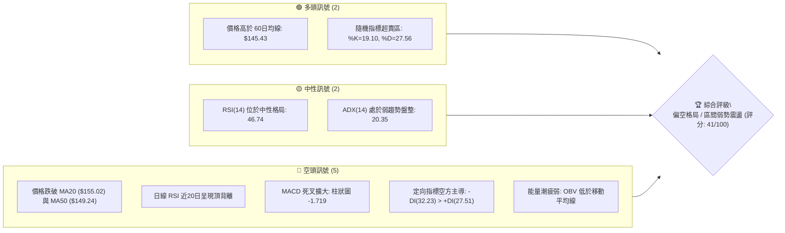
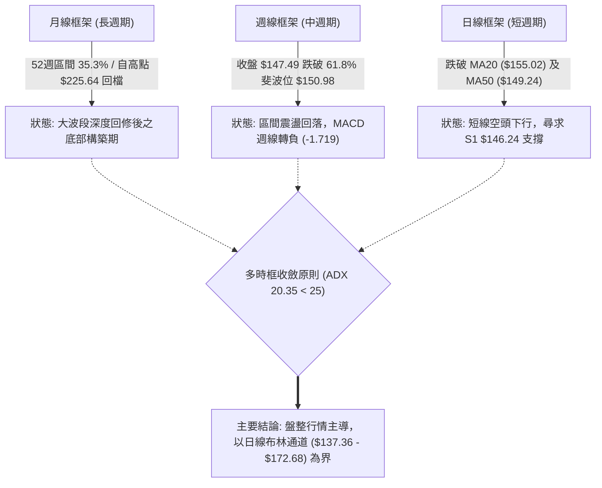
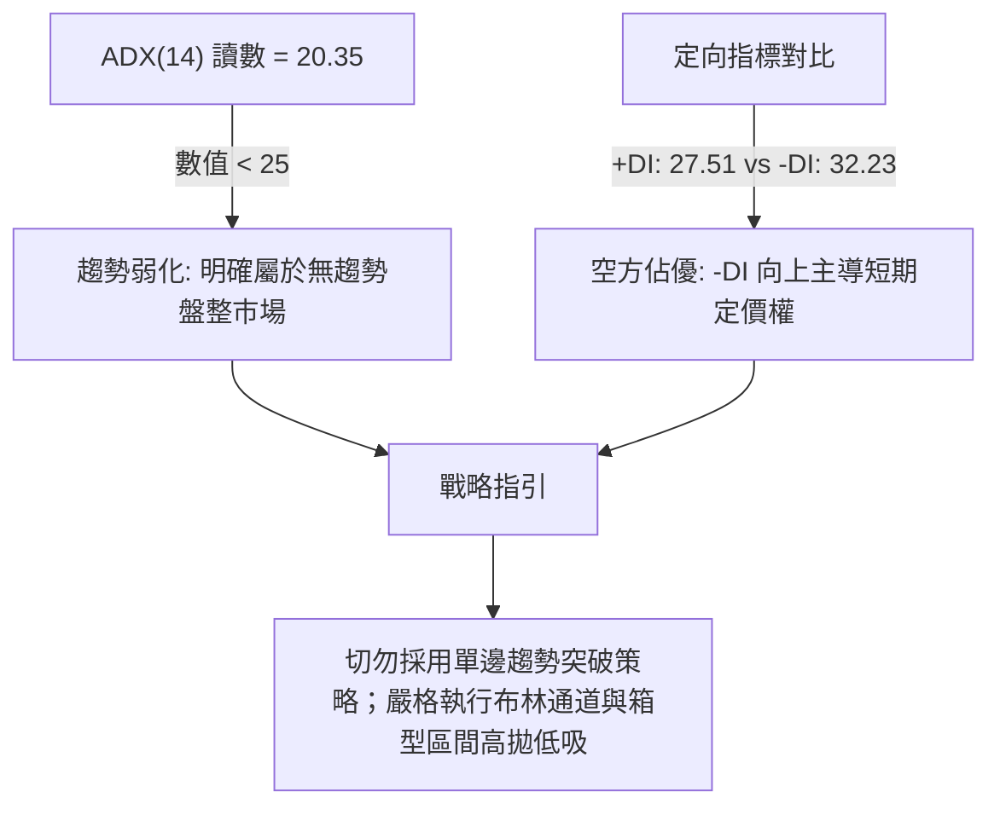
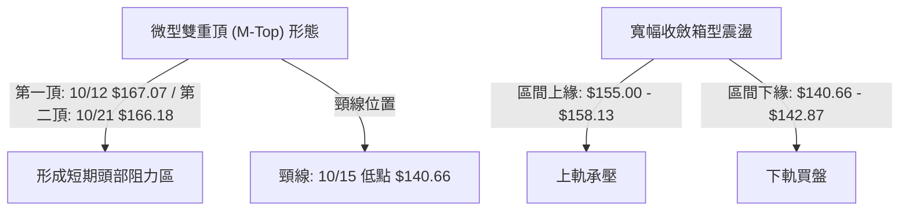
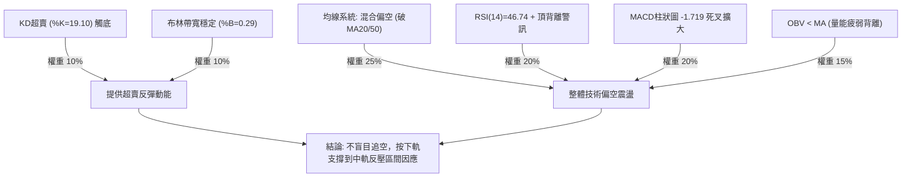
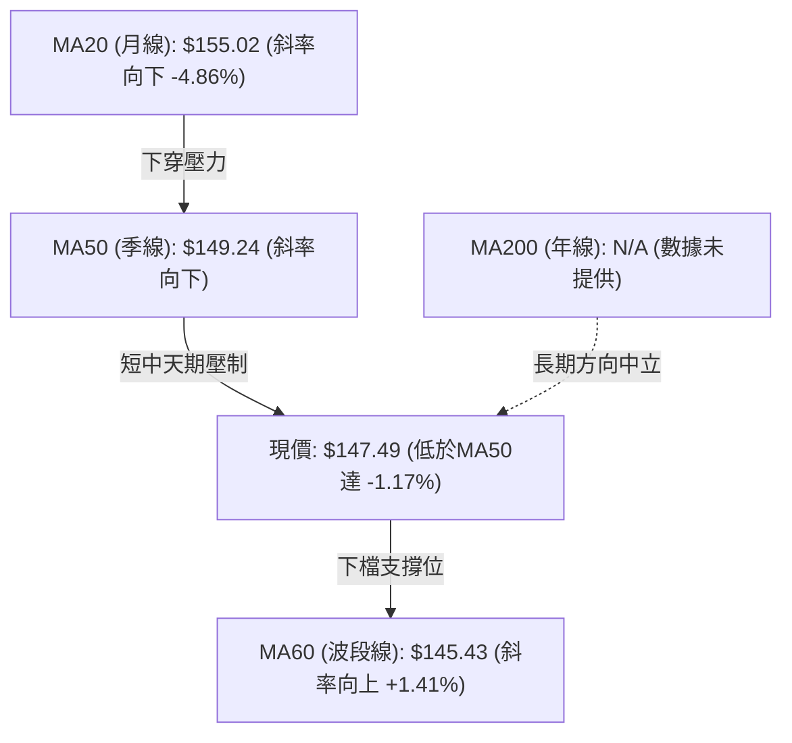
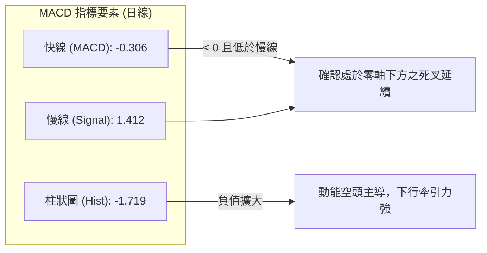
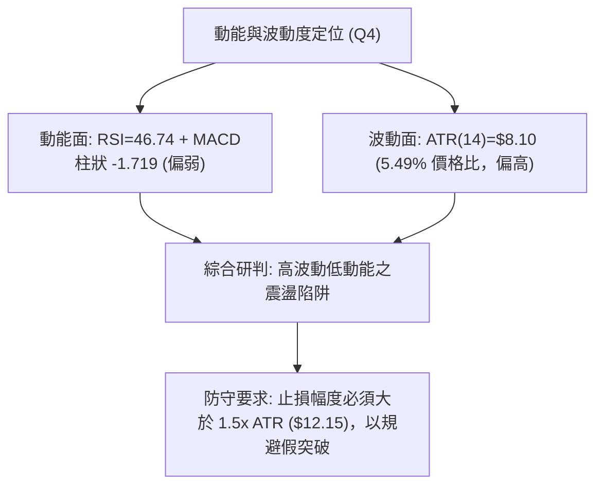
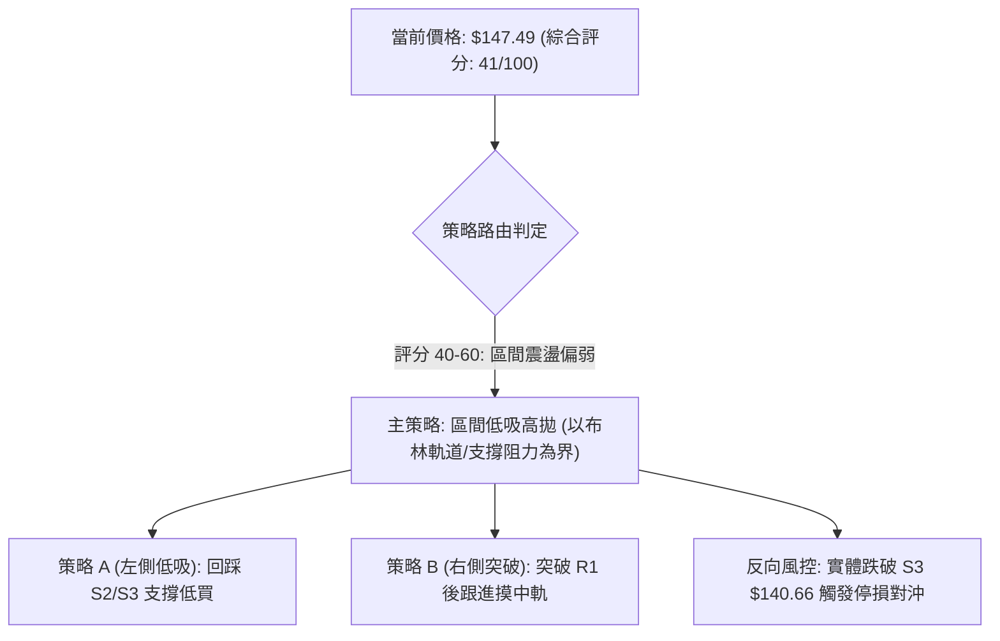
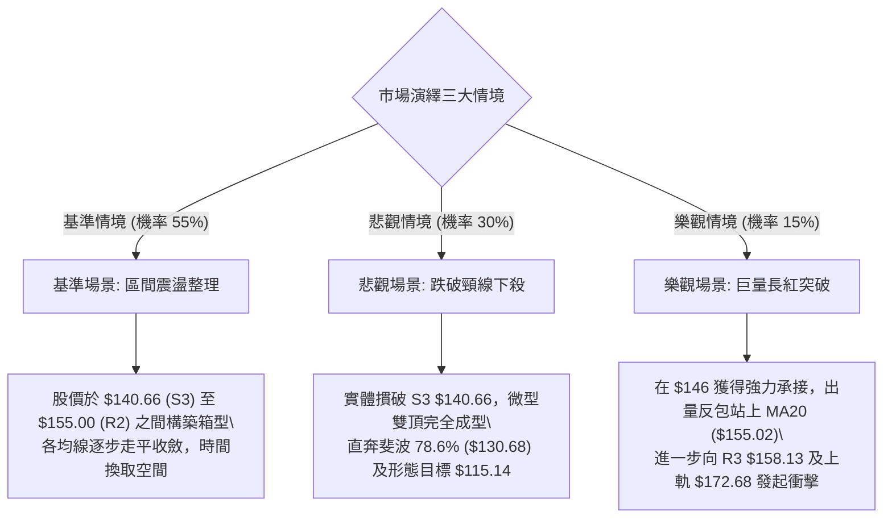

# SPCX 技術分析報告

> **報告日期**：2026-10-25 ｜ **語言**：繁體中文 ｜ **數據來源**：Yahoo Finance ｜ **當前價格**：$147.49

---

## 目錄

| 章節 | 內容 |
|------|------|
| [1. 技術面概覽](#1-技術面概覽) | 訊號儀表板、核心指標、評分卡 |
| [2. 趨勢分析](#2-趨勢分析) | 多時框趨勢、長中短期走勢、ADX強度評估 |
| [3. 圖表形態分析](#3-圖表形態分析) | 形態識別系統、近10日/8週K線組合分析、形態推算目標 |
| [4. 支撐與阻力](#4-支撐與阻力) | 價位結構分布圖、阻力與支撐表、斐波那契回調結構 |
| [5. 技術指標深度解讀](#5-技術指標深度解讀) | 均線系統、RSI頂背離、MACD柱狀圖、布林通道與OBV量價關係 |
| [6. 動能與波動率](#6-動能與波動率) | 動能四象限定位、ATR波動度與風險止損距、Beta與市場特徵 |
| [7. 多時框架總結](#7-多時框架總結) | 時框架評分矩陣、多時框收斂與盤整主導結論 |
| [8. 交易策略建議](#8-交易策略建議) | 策略路由、價格情境階梯、主策略明細與反向風控觸發 |
| [9. 風險提示與監控](#9-風險提示與監控) | 關鍵指標監控清單、三情境演繹、資金管理規範 |
| [📋 報告總結](#-報告總結) | 核心要點提煉與操作決策摘要 |

---

## 1. 技術面概覽

### 🎯 技術訊號儀表板



### 📊 核心指標速覽表

| 指標類別 | 指標名稱 | 當前數值 | 訊號 | 解讀 |
| :--- | :--- | :--- | :---: | :--- |
| **價格** | 當前收盤價 | $147.49 | 🟡 | 位於52週區間 35.3% 處，處於中低位整理區間 |
| **均線** | MA20 (短月線) | $155.02 | 🔴 | 價格低於MA20達 -4.86%，短線趨勢受壓 |
| **均線** | MA50 (中期線) | $149.24 | 🔴 | 價格跌破MA50，中線多頭支撐遭跌破 |
| **均線** | MA200 (長期線) | N/A（數據未提供） | 🟡 | 資料不足，長週期年線結構無法直接判斷 |
| **動能** | RSI(14) | 46.74 | 🟡 | 位於 30–70 中性區，但近20根K棒首尾呈現頂背離警訊 |
| **動能** | MACD (12,26,9) | 差離值 -0.306 / 柱狀 -1.719 | 🔴 | 快線低於訊號線 (1.412)，負柱狀圖擴張，動能疲弱 |
| **動能** | KD指標 (Stoch %K/%D) | %K: 19.10 / %D: 27.56 | 🟢 | 進入超賣區 (<20)，短線下行空間受限，具備技術修復需求 |
| **趨勢強度**| ADX (14) | 20.35 (+DI:27.51 / -DI:32.23)| 🔴 | ADX < 25 表明為無趨勢盤整行情，且 -DI 壓制 +DI |
| **通道通道**| 布林通道 (%B) | 上軌 $172.68 / 下軌 $137.36 | 🟡 | %B 為 0.29，價格靠近下軌但未破下軌，處於下半通道震盪 |
| **量能系統**| 20日成交量能比 | 110.35M / 101.58M (1.09x) | 🔴 | 量比小幅放大且收黑跌勢，OBV 低於均線，量價呈背離疲態 |
| **波動風險**| ATR (14) | $8.10 (5.49% 價格比) | 🟡 | 每日平均震幅逾8美元，日內波動偏高，需放寬防守間距 |

### 🏆 技術評分卡

```
╔══════════════════════════════════════════════════════════════════════════════╗
║                    SPCX 技術評分卡 (日期: 2026-10-25)                        ║
╠══════════════════════════════════════════════════════════════════════════════╣
║ 趨勢強度 (ADX=20.35, -DI主導)        ███████░░░░░░░░░░░░░  35/100  🔴 空方主導 ║
║ 動能指標 (RSI頂背離, MACD負柱)       ████████░░░░░░░░░░░░  40/100  🔴 動能轉弱 ║
║ 支撐穩定度 (S1 $146.24, S2 $142.87)  ███████████░░░░░░░░░  55/100  🟡 考驗中軌 ║
║ 成交量配合 (OBV<MA, 跌勢出量)        ████████░░░░░░░░░░░░  38/100  🔴 量價背離 ║
║ 形態完整度 (局部雙頂, 寬幅震盪)      ████████░░░░░░░░░░░░  42/100  🟡 形態偏空 ║
║ 均線排列 (短天期全面下行, 破MA50)    ███████░░░░░░░░░░░░░  36/100  🔴 混合偏空 ║
╠══════════════════════════════════════════════════════════════════════════════╣
║ 綜合評分 (六項算術平均，規則18)      ████████░░░░░░░░░░░░  41/100  🟡 弱勢區間 ║
╚══════════════════════════════════════════════════════════════════════════════╝
```
*計算依據：(35 + 40 + 55 + 38 + 42 + 36) ÷ 6 = 246 ÷ 6 = 41.00 分，四捨五入為 41/100（落於 40–60 區間偏下緣，定調為「弱勢盤整區間操作」）。*

---

## 2. 趨勢分析

### 🌐 多時框趨勢分析



### 📈 長期趨勢 — 12個月走勢圖（Unicode）

依據所提供之歷史月度數據與52週高低點（最低 $104.83，最高 $225.64，近數月收盤 2026-06: $170.86、07: $108.37、08: $143.69、09: $150.86、10: $147.49）繪製長期走勢架構：

```
SPCX 走勢示意圖（近12個月與關鍵位分布）
價格 ($)
$225.64 ┤                              ● (52W 高點)
$200.00 ┤
$179.49 ┤                        ●
$170.86 ┤              ● (06月)
$150.86 ┤                                    ● (09月)
$147.49 ┤─────────────────────────────────────● (10月現價)
$143.69 ┤                              ● (08月)
$108.37 ┤                    ● (07月)
$104.83 ┤                    ● (52W 低點)
        └─────────────────────────────────────────► 時間軸
         M-11   M-9    M-7   M-5   M-3  06月 07月 08月 09月 10月
```

#### 長期走勢特徵分析表

| 階段時間 | 起始價 / 終止價 | 漲跌幅 | 走勢特徵描述 |
| :--- | :---: | :---: | :--- |
| **大級別回撤期** | $225.64 → $104.83 | -53.54% | 自52週歷史高點展開單邊下行，在 $104.83 完成拋售竭盡 |
| **2026-06 → 07** | $170.86 → $108.37 | -36.57% | 季末爆發流動性擠壓，單月暴跌探底，確認 $104–$108 為強大長期底部 |
| **2026-07 → 08** | $108.37 → $143.69 | +32.59% | 出現暴力報復性反彈，週量爆出 9.20 億股巨量，V型反轉拉回均線之上 |
| **2026-08 → 09** | $143.69 → $150.86 | +4.99% | 漲勢放緩，於斐波那契 61.8% 處（$150.98）遭遇解套阻力，步入平台盤整 |
| **2026-09 → 10** | $150.86 → $147.49 | -2.23% | 衝高 $166.18 後遇阻回落，月線收微型黑K，進入中樞防守期 |

### 📊 中期趨勢（週線分析）

```
SPCX 週線波段阻力與支撐示意圖
阻力區間 ──► $166.18 (10/23週高) ─────────────── $176.42 (10/09週高 / 局部高點聚類)
              ▲                   ▲
              │                   │ 
現價水平 ──► ┼───────────────────┼── $147.49 (現價位於 MA50 $149.24 下方)
              │                   │
              ▼                   ▼
支撐區間 ──► $142.87 (09/18週低) ─────────────── $140.66 (10/16週低 / S3支撐)
```

週線指標顯示，MACD柱狀圖連續兩週擴大為負值（10-16: -1.979，10-23: -1.719），RSI(14) 自 7 月的 75.5 超買區一路降至當前 46.7，中長線動能處於退潮修正階段。

### ⚡ 趨勢強度評估（ADX 解讀）



#### ADX 強度對照表

| 指標變數 | 當前數值 | 閾值基準 | 趨勢判定 | 交易邏輯暗示 |
| :--- | :---: | :---: | :---: | :--- |
| **ADX (14)** | 20.35 | < 25 (弱趨勢/震盪) | 盤整走勢 | 擺動指標 (KD/RSI) 權重大於趨勢追蹤指標 (MA) |
| **+DI (14)** | 27.51 | 低於 -DI | 多方衰退 | 向上進攻缺乏持續量能，高位追價風險極大 |
| **-DI (14)** | 32.23 | 高於 +DI | 空方控盤 | 賣壓雖不致引發雪崩，但下檔阻力位持續壓低 |

---

## 3. 圖表形態分析

### 🔍 形態識別系統



#### 圖表形態信心度表格（依規則 15）

| 形態名稱 | 信心度 | 判斷依據（引用數據） | 完成度 | 目標價（附嚴格計算式） |
| :--- | :---: | :--- | :---: | :--- |
| **微型雙重頂 (Double Top)** | 62% | 10/12 高點 $167.07 與 10/21 高點 $166.18 形成雙頂對稱，中間低點為 10/15 之 $140.66 | 65% (未跌破頸線) | 若實體收盤跌破頸線 $140.66，形態推算目標價 = 頸線 $140.66 − 形態高度 ($166.18 − $140.66 = $25.52) = **$115.14** |
| **高位假突破長黑** | 78% | 10/21 爆出 220.78M 天量拉高至 $166.18 後，隔日 (10/22) 隨即走出長黑重挫至 $144.75 | 100% (已確立) | 該形態宣示 $166.18 為短期鐵頂，推算短線下行回撤滿足位為前波低點 **$140.66** |
| **大級別收斂整理** | 45% | 數據時間僅提供近10日日K與近8週週K，樣本期不足以構建完整旗形或大型對稱三角 | 30% | *訊號不足，僅做指標型解讀（布林通道震盪），不強行推算大型目標價* |

### 🕯️ 重要K線形態分析（依規則 19，限定提供之日/週K棒）

#### 近10根日K形態精確分析

| 日期 | 開盤價 | 最高價 | 最低價 | 收盤價 | K線形態名稱 | 技術解讀 | 訊號 |
| :---: | :---: | :---: | :---: | :---: | :---: | :--- | :---: |
| **2026-10-12** | 164.66 | 167.07 | 160.85 | 163.42 | 帶上影微型黑K | 開高走低，上衝 $167.07 遇阻，預示前高買盤意願不足 | 🔴 |
| **2026-10-13** | 161.98 | 161.98 | 156.05 | 156.54 | 光頭光腳大中黑 | 開盤即最高價，空方全日單邊壓制，實體下挫 $5.44 | 🔴 |
| **2026-10-14** | 154.98 | 155.44 | 151.10 | 152.16 | 連續中黑K | 空頭加速摜壓，成交量 68.78M，延續下挫慣性 | 🔴 |
| **2026-10-15** | 146.91 | 149.04 | 140.66 | 148.62 | 長下影長針探底K | 下測半年低點 $140.66 後引發強勁低接買盤，成交量放大至 101.17M | 🟢 |
| **2026-10-16** | 147.80 | 147.92 | 142.95 | 146.03 | 窄幅整理黑K | 在長下影線上方震盪整理，下檔在 $142.95 獲逢低承接 | 🟡 |
| **2026-10-19** | 149.23 | 151.01 | 146.83 | 147.96 | 紡錘十字星 | 實體極窄 ($1.27)，多空於 $148 附近達成短暫動態平衡 | 🟡 |
| **2026-10-20** | 146.17 | 148.66 | 143.27 | 147.79 | 下影小紅K | 回踩 $143.27 獲得支撐後拉起，成交量增至 117.20M，醞釀反彈 | 🟢 |
| **2026-10-21** | 160.56 | 166.18 | 156.93 | 159.31 | 爆量長紅開高星 | 跳空高開並爆出 220.78M 天量，但留有高達 $6.87 之上影線，獲利回吐盤湧現 | 🟡 |
| **2026-10-22** | 154.21 | 154.26 | 143.21 | 144.75 | 穿頭破腳巨量大黑K| 跳空低開並跌吞前日大半漲幅，單日跌幅 -9.14%，成交 197.04M，主力誘多出貨 | 🔴 |
| **2026-10-23** | 147.93 | 149.75 | 144.09 | 147.49 | 帶上下影微紅K | 波動率自昨日巨震中收斂，收在 $147.49，暫時止跌於 S1 邊界 | 🟡 |

#### 近8根週K形態精確分析

| 週最後日 | 開盤價 | 最高價 | 最低價 | 收盤價 | K線形態名稱 | 技術解讀 | 訊號 |
| :---: | :---: | :---: | :---: | :---: | :---: | :--- | :---: |
| **2026-09-04** | 140.08 | 152.30 | 138.17 | 147.95 | 實體中紅週K | 突破整理區間，低點確立 $138 底部 | 🟢 |
| **2026-09-11** | 149.05 | 155.00 | 144.89 | 151.21 | 上攻受阻小紅K | 觸及阻力位 $155.00，量增留上影線 | 🟡 |
| **2026-09-18** | 147.33 | 156.87 | 142.87 | 152.71 | 放量長震盪紅K | 量能暴增至 669.03M，確認 S2 ($142.87) 具備強力承接 | 🟢 |
| **2026-09-25** | 154.77 | 158.13 | 145.88 | 148.68 | 穿頭破腳倒錘週K | 摸高至阻力 R3 $158.13 後遭遇強大空方重擊翻黑 | 🔴 |
| **2026-10-02** | 148.49 | 159.84 | 145.36 | 158.96 | 強勢反包大長紅 | 多方再度強攻，實體達 $10.47，一舉收復前週失土 | 🟢 |
| **2026-10-09** | 158.99 | 176.42 | 158.62 | 162.57 | 爆量長上影流星K | 創本波段最高 $176.42 後遭強烈拋壓，留 $13.85 巨型上影線 | 🔴 |
| **2026-10-16** | 164.66 | 167.07 | 140.66 | 146.03 | 週級別斷頭大長黑 | 實體崩跌 $18.63，下破多條均線，徹底摧毀多頭上攻結構 | 🔴 |
| **2026-10-23** | 149.23 | 166.18 | 143.21 | 147.49 | 天量多空激戰長十字| 週成交量飆至 719.42M，高點觸及 $166.18 後下殺，收盤微漲，上方阻力極重 | 🟡 |

### 📉 ASCII 走勢形態示意圖

```
SPCX 日線局部微型雙頂與反轉示意圖
價格 ($)
$167.07 ┤       ▲ (頂點 1: 10/12)            ▲ (頂點 2: 10/21 $166.18)
$160.00 ┤      / \                          / \
$155.00 ┤     /   \                        /   \
$150.00 ┤    /     \                      /     ▼ (10/22 大長黑下殺)
$147.49 ┤───/───────\────────────────────/───────● (當前價格 $147.49)
$140.66 ┤            ▼──────────────────▼ 
                     (頸線位置: 10/15 低點 $140.66)
```

### 🎯 形態目標價計算

根據微型雙頂幾何測量法則，各關鍵價位計算如下：
1. **第一頂 (Peak 1)**：2026-10-12 日高點 **$167.07**
2. **第二頂 (Peak 2)**：2026-10-21 日高點 **$166.18**
3. **有效頸線 (Neckline)**：2026-10-15 日低點 **$140.66**（此處亦精確重合於數據提供之波段支撐位 S3）
4. **形態垂直高度 ($H$)**：以第二頂計算：$166.18 − $140.66 = **$25.52**
5. **理論下行目標價**：
   $$\text{目標價} = \text{頸線} - H = \$140.66 - \$25.52 = \mathbf{\$115.14}$$
   *(註：此目標價成立之前提為日線實體有效跌破 $140.66 頸線，否則在跌破前形態僅視為箱型震盪。)*

---

## 4. 支撐與阻力

### 🗺️ 關鍵價位分布圖（Unicode）

```
╔═══════════════════════════════════════════════════════════════════════╗
║                   SPCX 關鍵價位階梯與結構分布圖                      ║
╠═══════════════════════════════════════════════════════════════════════╣
║ $158.13 ║██████████████████████████████║ 強波段阻力 R3 (9/25波段高點)║
║ $155.00 ║████████████████████████      ║ 重合阻力 R2 (MA20 $155.02)  ║
║ $149.80 ║████████████████              ║ 近端阻力 R1 (10/23日高$149.75)║
║ $147.49 ╠══════════════════════════════╣ ◄── 收盤現價 ($147.49)      ║
║ $146.24 ║▓▓▓▓▓▓▓▓▓▓▓▓▓▓▓▓              ║ 近端支撐 S1 (-0.85%)        ║
║ $142.87 ║██████████████████████        ║ 關鍵防守 S2 (9/18週低/前波底)║
║ $140.66 ║██████████████████████████████║ 核心鐵底 S3 (微型雙頂頸線位) ║
╚═══════════════════════════════════════════════════════════════════════╝
```

### 🚧 阻力位分析表（數值嚴格引用數據）

| 阻力級別 | 精確價位 | 距現價空間 | 形成技術依據 | 突破難度評估 | 重要性級別 |
| :---: | :---: | :---: | :--- | :---: | :---: |
| **R1** | **$149.80** | +1.57% | 緊鄰 10/23 日高 $149.75，且與 MA50 ($149.24) 形成微型壓制帶 | 🟡 中等 (短線反彈首道防線) | ★★☆☆☆ |
| **R2** | **$155.00** | +5.09% | 歷史波段高點聚類，精確重合布林中軌 MA20 ($155.02)，為多空分水嶺 | 🔴 極高 (需日均量>1.5億股確認) | ★★★★☆ |
| **R3** | **$158.13** | +7.21% | 09/25 波段高點聚類，套牢浮額密集區，多頭中期反轉確認點 | 🔴 嚴峻 (近期兩度觸碰皆形成爆量長黑) | ★★★★★ |

### 🛡️ 支撐位分析表（數值嚴格引用數據）

| 支撐級別 | 精確價位 | 距現價空間 | 形成技術依據 | 守住機率評估 | 重要性級別 |
| :---: | :---: | :---: | :--- | :---: | :---: |
| **S1** | **$146.24** | -0.85% | 近一年波段低點聚類，10/16及10/20實體K棒收盤密集緩衝區間 | 🟡 55% (距現價僅1.25美元，極易穿刺) | ★★☆☆☆ |
| **S2** | **$142.87** | -3.13% | 09/18週K最低價聚類，10/22長黑殺跌停頓位 ($143.21) 所在區域 | 🟢 70% (具備顯著長下影承接買盤) | ★★★★☆ |
| **S3** | **$140.66** | -4.63% | 10/15日低點與微型雙頂頸線，波段生命線，一旦實體失守將打開下行深淵 | 🟢 80% (空方最後阻力堡壘) | ★★★★★ |

### 📐 斐波那契回調位分析

依據 52 週完整波動區間（高點 **$225.64** 至低點 **$104.83**，全波段震幅 $120.81）計算之標準回調階梯：

```
斐波那契分位階梯 (基於 $104.83 → $225.64)
  0.0%  (52W 最高點) ────────────────────────────── $225.64
 23.6%  ────────────────────────────────────────── $197.13
 38.2%  ────────────────────────────────────────── $179.49
 50.0%  (多空中樞位) ────────────────────────────── $165.24
 61.8%  (黃金回撤分割位) ───────────────────────── $150.98 ◄── 關鍵阻力警戒
──────── 現價位置 ($147.49 處於 61.8% 與 78.6% 之間) ─────────
 78.6%  (深幅回撤位) ───────────────────────────── $130.68
100.0%  (52W 最低點) ────────────────────────────── $104.83
```

#### 斐波那契結構深度解讀
- **現價位階解構**：SPCX 當前收盤價 **$147.49** 正處於 **61.8% ($150.98)** 與 **78.6% ($130.68)** 之間。
- **失守黃金分割位之警訊**：61.8% 回調位 ($150.98) 歷來被視為上升回檔的「黃金支撐底線」。股價當前跌落此水平下方（-2.31%），技術上表明自低點 $104.83 發動的反彈結構已失去強勢單邊屬性，回撤級別被強制擴大為深度整理。
- **短線反壓與下檔空間**：$150.98 現已由支撐轉換為重大反壓區，且緊鄰 R1 ($149.80)。下檔若 S3 ($140.66) 失守，下一個理論支撐將下移至 78.6% 回調位 **$130.68**，中間存在近 10 美元的籌碼斷層真空區。

---

## 5. 技術指標深度解讀

### 🎛️ 指標訊號總覽



### 📈 移動平均線排列分析



#### 均線系統數據與排列特徵表

| 均線名稱 | 當前價位 | 乖離率 (現價 vs MA) | 短期趨勢箭頭 | 歷史走勢特徵 (近40根軌跡) | 技術意義判斷 |
| :---: | :---: | :---: | :---: | :--- | :--- |
| **MA 5** | $149.46 | -1.32% | ▼ 下行 | ▁▁▁▁▁▂▃▃▂▂▁▁▁▁▂▄▆▇███▇▅▄▃▂▁▁▁▁ | 短期極速向下扣低，構成日內首道動態壓制 |
| **MA 10** | $151.41 | -2.59% | ▼ 下行 | ▁▁▁▂▂▂▂▂▂▂▂▂▂▂▂▃▄▅▆▇█████▆▅▅▄▃ | 形成平滑向下的短期空頭走廊 |
| **MA 20** | $155.02 | -4.86% | ▼ 下行 | ▁▁▁▁▂▂▃▃▄▄▄▄▄▅▅▆▆▇▇███████████ | 頂部圓弧走平並掉頭向下，宣告月線級別轉弱 |
| **MA 50** | $149.24 | -1.17% | ▼ 下行 | (數據計算值) | 跌破中期生命線，中期上升趨勢被暫時阻斷 |
| **MA 60** | $145.43 | +1.41% | ▲ 上行 | ▂▂▂▂▂▂▂▁▁▁▁▁▁▁▁▁▂▂▂▃▄▄▅▅▆▆▇▇██ | 全均線系統中唯一維持正斜率者，在現價下方提供微弱緩衝 |
| **MA 200** | N/A | N/A | 數據未提供 | (資料不足，需要200筆數據) | 依規則16標示為 N/A（數據未提供） |

### 📉 RSI(14) 分析

- **當前讀數進度條**：
  `RSI(14): 46.74` ▓▓▓▓▓▓▓▓▓░░░░░░░░░░░ 46.74% 🟡 (處於 30–70 中性平衡區間)
- **背離分析判斷（極嚴格驗證）**：
  依據技術數據載明：`⚠️ 頂背離 (Bearish Divergence)`。比較近 20 根 K 棒走勢，價格在 10/09 一度摸高 $176.42、10/21 二度衝高至 $166.18，但 14 日 RSI 峰值卻由前期高點 75.5 (07/10) 及 62.4 (10/02) 明顯階梯式下滑至 59.1 (10/09)，再進一步跌落至當前 46.74。價格衝高與動能頂部大幅背離，清楚反映高檔買盤力竭，空方動能已成功滲透。

### 📊 MACD (12, 26, 9) 訊號解讀



快線跌入負值區間 (-0.306)，訊號線仍維持在正值 (1.412)，兩者利差形成高達 -1.719 的負向柱狀圖。且週線級別 MACD 柱狀圖亦同步出現負值擴散（-1.719），日週雙週期共振偏空，暗示短期內任何未補量之反彈均屬技術性修正，不具備趨勢反轉條件。

### 📦 布林通道分析

```
SPCX 日線布林通道 ($137.36 ── $172.68) 結構示意圖
價格 ($)
$172.68 ┬────────────────────────────────────────── 上軌 (阻力帶)
        │
$155.02 ┼────────────────────────────────────────── 中軌 (MA20 強反壓)
        │
$147.49 ┼───► 現價 ($147.49) [通道位置 %B = 0.29]
        │
$137.36 ┴────────────────────────────────────────── 下軌 (極限支撐帶)
```
- **帶寬與位置解讀**：上軌 **$172.68**，中軌 **$155.02**，下軌 **$137.36**，通道寬度達 $35.32。
- **%B 數值解析**：當前 `%B = 0.29`，說明現價運行於中軌至下軌之間的下半通道，且正朝下軌方向貼近。
- **布林帶收斂與發散狀態**：目前通道開口維持平穩橫向展延，並未呈現暴烈張口，印證 ADX=20.35 之盤整判斷。下軌 $137.36 構成當前波段下檔的極限保護區。

### 💹 成交量分析（量價配合度）

1. **量能基數分析**：最新日成交量 **110,352,500 股**，相較於 20 日均量 **101,579,440 股**，量比為 **1.09x**，高於 50 日均量 **92,590,684 股**。
2. **量價異相與背離**：
   - 10/21 在 $166.18 爆出 2.20 億股巨量，但翌日 10/22 隨即在 1.97 億股的大成交量下跌破 $144.75，呈現典型「高檔巨量滯漲、轉身放量長黑」的主力洗盤或出貨特徵。
   - 技術數據明確警示：`OBV < MA → 量能疲弱`。能量潮指標持續位於其自身均線下方運行，確認主力資金在近20個交易日內處於淨流出狀態，未見明顯機構吸籌訊號。

---

## 6. 動能與波動率

### ⚡ 動能評估四象限

| 象限區間 | 動能特徵 (Momentum) | 波動率特徵 (Volatility) | SPCX 當前狀態標定 | 技術環境解讀與應對方針 |
| :---: | :---: | :---: | :---: | :--- |
| **Q1 (最佳擴展區)** | 強 (MACD/RSI偏多) | 低 (通道收縮) | — | 趨勢初升段，適合右側重倉跟隨 |
| **Q2 (震盪沉寂區)** | 弱 (中性偏空) | 低 (布林收口) | — | 籌碼沉澱期，觀望等待方向選擇 |
| **Q3 (爆發風險區)** | 強 (單邊暴拉) | 高 (ATR擴張) | — | 趨勢末端趕頂或趕底，高風險高回報 |
| **Q4 (弱勢高波區)** | **弱 (負柱擴散/背離)** | **高 (ATR=8.10, 5.49%)** | **✓ SPCX 精確定位於此** | **空方動能佔優但缺乏持續單邊趨勢，高震幅容易引發雙向洗盤。嚴禁追單，操作必須嚴守支撐阻力界線** |



### 📊 ATR 波動率分析

- **當前 ATR(14) 讀數**：**$8.10**，佔當前股價比例高達 **5.49%**（Wilder 算法）。
- **日內波動意涵**：SPCX 具備超高彈性，平均單日震幅超過 8 美元。近 10 日中，10/21 單日震幅達 $9.25 ($156.93–$166.18)，10/22 單日震幅達 $11.05 ($143.21–$154.26)，完全印證 ATR 的高波動警示。
- **交易風控距離建議**：
  - **極短線（Day/Swing）安全止損間距**：$1.0 \times \text{ATR} = \mathbf{\$8.10}$
  - **波段交易安全止損間距**：$1.5 \times \text{ATR} = \mathbf{\$12.15}$
  - **關鍵價位過濾閥**：在設定關鍵支撐 S1 ($146.24) 或 S2 ($142.87) 止損時，必須預留至少 $0.3 \times \text{ATR} \approx \$2.43$ 的緩衝區，防範日內影線刺穿。

### 📐 Beta 與市場相關性

- **Beta 數值**：**N/A（數據未提供）**（依規則 16，數據標示為 N/A，不得擅自編造估算）。
- **質化市場聯動分析**：儘管數據源未提供精確 Beta 係數，但由其高達 5.49% 的 ATR 波動率、高達 2.00 兆美元市值、以及高達 62.5 倍的 Forward P/E 與 62.5 倍的 P/S 估值特徵可看出，SPCX 屬於典型的超大型高估值成長股，股價對宏觀流動性、科技巨頭板塊溢價及整體市場風險偏好具有極度放大的敏感度。

---

## 7. 多時框架總結

### 📋 時框架評分表

| 時框架 | 趨勢方向 | 動能狀態 | 均線排列特徵 | 形態架構 | 綜合評分 | 策略建議方向 |
| :---: | :---: | :---: | :---: | :---: | :---: | :---: |
| **日線 (短期)** | 偏空 🔴 | RSI 46.74 / MACD負柱 | 混合空頭排列 (跌破MA50) | 局部雙頂確立，探底回測 | **38 / 100** | 逢反彈減磅，於下軌低吸 |
| **週線 (中期)** | 震盪 🟡 | MACD柱連二黑 (-1.719) | 糾結 (MA20走平壓制) | 寬幅收斂 ($140–$166) | **44 / 100** | 箱型思維，不追漲殺跌 |
| **月線 (長期)** | 震盪偏多 🟢 | 自 7月暴跌 $108 強勁復甦 | 守於 60日線上方 | 大V型反彈後的中繼修復 | **58 / 100** | 中長線回調分批佈局 |

### 🔲 綜合訊號矩陣

```
╔══════════════════════════════════════════════════════════════════════════════╗
║                     SPCX 跨週期技術訊號收斂矩陣                              ║
╠════════════════╦════════════════════╦════════════════════╦═══════════════════╣
║ 分析維度       ║ 短期 (日線級別)    ║ 中期 (週線級別)    ║ 長期 (月線/歷史)  ║
╠════════════════╬════════════════════╬════════════════════╬═══════════════════╣
║ 趨勢方向       ║ 🔴 空方回調跌勢    ║ 🟡 橫盤箱型拉鋸    ║ 🟡 底部回升構築   ║
║ 動能強弱       ║ 🔴 頂背離/負柱擴張 ║ 🔴 動能退潮翻負    ║ 🟢 遠離52W低點    ║
║ 支撐/阻力關係  ║ 🟡 逼近 S1 $146.24 ║ 🟢 守在 S3 $140.66 ║ 🔴 承壓 61.8%位   ║
║ 成交量配合     ║ 🔴 量價背離/OBV疲弱║ 🟡 天量震盪多空對決║ 🟢 7-8月爆發築底量║
╚════════════════╩════════════════════╩════════════════════╩═══════════════════╝
```

### ⚖️ 多時框收斂結論（依規則 14 嚴格執行）

1. **行情性質唯一判定**：當前趨勢強度指標 **ADX(14) 讀數為 20.35**，技術門檻遠小於 25，因此依規則 14 明確裁定：**SPCX 當前毫無疑問屬於「盤整行情（ADX < 25）」**。
2. **時框主導權收斂**：在盤整行情框架下，趨勢型均線指標（MA50/MA200）的單向指引性失效，轉而**以日線布林通道上下軌（$137.36 – $172.68）為最核心的交易區間依據**。日線的短線下挫，本質上是向通道下半部尋求支撐的過程，而非大級別空頭單邊暴跌。
3. **方向性最終結論**：**中性偏空之區間震盪整理（評分 41/100）**。此結論完全收斂第 2 章（多時框盤整）與第 5 章（均線與動能偏空）之判定，直接定調第 8 章之操作邏輯為**區間震盪操作**。

---

## 8. 交易策略建議

### 🗺️ 策略決策流程圖



### 🧭 策略路由（依規則 18 評分卡嚴格分流）

> **當前主策略方向 = 區間弱勢震盪操作（依評分卡綜合評分 41/100）**
> 
> *註：評分處於 40–60 之中性區間偏下緣，市場由空方掌控節奏，但 ADX=20.35 限制了下跌趨勢的延續性。操作嚴禁追空或追漲，以波段支撐位 S2/S3 及布林下軌為低吸依據，以阻力位 R1/R2 為獲利減碼目標。*

### 🎯 價格情境階梯（Price Scenarios）

所有關鍵價位嚴格引用自數據之計算結果：

| 觸發條件 | 下一目標 | 後續延伸 | 情境技術含義與操作指引 |
| :--- | :---: | :---: | :--- |
| **強勢突破 R1 $149.80** | **R2 $155.00** | **R3 $158.13** | 短線擺脫空頭壓制，回補布林中軌缺口，多頭短線進攻 |
| **維持在現價區間 ($146.24–$149.80)** | — | — | 於 S1 與 R1 間窄幅拉鋸，動能沉澱，觀望等待量能釋放 |
| **有效跌破 S1 $146.24** | **S2 $142.87** | **S3 $140.66** | 短線下行尋底，回測 10/15 長下影線低點與雙頂頸線 |

### 📊 情境機率分佈

| 情境類型 | 發生機率 | 主要技術指標支撐依據 |
| :--- | :---: | :--- |
| **情境一：區間震盪築底 (主情境)** | **55%** | ADX(14)=20.35 宣告無趨勢；KD 處於超賣區 (%K=19.10) 限制跌幅；S2/S3 籌碼支撐密集 |
| **情境二：慣性下探再破底** | **30%** | MACD 負柱狀持續擴散 (-1.719)；RSI 頂背離尚未完全釋放；日線跌破 MA50 |
| **情境三：直接強勢反轉上攻** | **15%** | 目前上方受制於向下傾斜的 MA5/MA10/MA20 反壓；OBV 疲軟，缺乏增量資金配合 |

### 🟢 主策略詳情（區間操作與精確風控）

本報告設計兩套操作方案，所有點位精確引用關鍵價位，風險報酬比嚴格按規則 17 驗證：
- **風險報酬比計算式**：$(\text{目標價 T1} - \text{進場價}) \div (\text{進場價} - \text{止損價})$

| 策略要素 | 策略 A：支撐位埋伏策略 (左側逢低承接) | 策略 B：突破回踩確認策略 (右側順勢追擊) |
| :--- | :---: | :---: |
| **策略邏輯** | 回踩近一年波段強支撐 S2 企穩後介入 | 實體帶量突破近端阻力 R1 後右側跟進 |
| **進場條件** | 股價回踩至 S2 不破，KD 黃金交叉 | 15分線實體收盤站上 R1，成交量放大 |
| **進場價格** | **$142.87** (引用支撐位 S2) | **$149.80** (引用阻力位 R1) |
| **止損價格** | **$139.50** (位於核心支撐 S3 $140.66 下方 $1.16) | **$146.24** (引用近端支撐位 S1) |
| **止損空間** | $\$142.87 - \$139.50 = \$3.37$ (-2.36%) | $\$149.80 - \$146.24 = \$3.56$ (-2.38%) |
| **目標價 T1 (短線)**| **$149.80** (引用阻力位 R1) | **$155.00** (引用阻力位 R2 / MA20) |
| **目標價 T2 (波段)**| **$155.00** (引用阻力位 R2) | **$158.13** (引用阻力位 R3) |
| **風險報酬比 (以 T1 計)**| $(\$149.80 - \$142.87) \div \$3.37 = \mathbf{1 : 2.06}$ | $(\$155.00 - \$149.80) \div \$3.56 = \mathbf{1 : 1.46}$ |
| **風險報酬比 (以 T2 計)**| $(\$155.00 - \$142.87) \div \$3.37 = \mathbf{1 : 3.60}$ | $(\$158.13 - \$149.80) \div \$3.56 = \mathbf{1 : 2.34}$ |
| **評估勝率** | **65%** | **52%** |
| **建議配置倉位** | **10% – 15%** (分批進場) | **5% – 8%** (短線試倉) |

### 🔴 反向風險觸發點（對沖提示）

- **全面停損警戒位**：日線收盤價**實體跌破 $140.66 (S3)**。
- **推翻邏輯之後果**：一旦 S3 遭到實體擊穿，代表微型雙頂形態正式確認跌破頸線。依形態測算，下行空間將完全開啟，理論目標直指 **$115.14** 或斐波那契 78.6% 回調位 **$130.68**。
- **風控應變處置**：若此情境觸發，所有多頭部位必須無條件全數止損離場，空倉觀望或透過選擇權等金融衍生工具進行下行尾部風險對沖。

### ⭐ 整體訊號強度評星

```
做多訊號強度：★★☆☆☆  (2.2 / 5.0 星 — 僅限超賣反彈，缺乏趨勢支撐)
做空訊號強度：★★★☆☆  (3.2 / 5.0 星 — 均線與動能佔優，但受制於震盪市)
整體可信度：  ★★★★☆  (4.0 / 5.0 星 — 量價結構清晰，支撐阻力有效性高)
```

---

## 9. 風險提示與監控

### ✅ 關鍵監控指標 Checklist

```
╔══════════════════════════════════════════════════════════════════════════════╗
║                    SPCX 技術監控清單 (日常交易風控必備)                      ║
╠══════════════════════════════════════════════════════════════════════════════╣
║ [ ] 價格能否守住近端支撐 S1 $146.24 (若盤中失守，下看 S2 $142.87)             ║
║ [ ] 日線 RSI(14) 能否自 46.74 回升站上 50 榮枯線，打破頂背離陰霾              ║
║ [ ] MACD 負向柱狀圖是否收斂至 -1.000 以內 (目前 -1.719，處於空頭動能擴散中)     ║
║ [ ] 日成交量是否在反彈時突破 20日均量 (101.58M)，確認是否有主力資金回補       ║
║ [ ] 頸線防線 $140.66 (S3) 的日線收盤完整性 (此為趨勢多空生死的絕對紅線)       ║
║ [ ] ADX(14) 讀數是否由 20.35 向上突破 25 (若突破代表盤整結束，新單邊趨勢成型) ║
╚══════════════════════════════════════════════════════════════════════════════╝
```

### ⚠️ 風險場景分析



### 🛡️ 風險管理重要提醒

1. **高波幅環境下的倉位縮減原則**：
   SPCX 的 ATR 達 **$8.10 (5.49%)**，單日波動極其劇烈。在弱趨勢的震盪市環境中，單筆交易的最大資金承擔風險（Risk-at-Cost）嚴格控制在總投資組合淨資產的 **1.0% – 1.5%** 之內。依策略 A 止損空間 $3.37 計算，每 10 萬美元總資產建議持有股數不得超過 300–400 股。
2. **區間操作的紀律約束**：
   嚴禁在價格逼近布林中軌 MA20 ($155.02) 或阻力 R1 ($149.80) 處盲目市價追高；多頭建倉僅限於股價拉回測試關鍵支撐（S1 $146.24 / S2 $142.87）且出現下影線或 KD 超賣頓化後分批佈局。
3. **宏觀與板塊關聯溢出**：
   雖然技術指標為主導，但 SPCX 的 Forward P/E 高達 62.5 倍，自由現金流仍處於大幅投入期（TTM FCF 為 -$32.52B）。任何來自宏觀利率波動、資本支出爭議或高科技成長板塊的系統性拋壓，均可能直接以跳空缺口形式穿透技術支撐位，盤前盤後需密切監控流動性異動。

---

## 📋 報告總結

```
╔══════════════════════════════════════════════════════════════════════════════╗
║                          SPCX 技術分析報告總結                               ║
╠══════════════════════════════════════════════════════════════════════════════╣
║ 報告日期：2026-10-25                                                         ║
║ 當前價格：$147.49                                                            ║
║ 技術評級：⚖️ 偏弱區間震盪 (綜合評分: 41/100，規則18算術平均)                 ║
║ 趨勢格局：ADX(14)=20.35 確立盤整市，布林通道 ($137.36 - $172.68) 為主框架    ║
╠══════════════════════════════════════════════════════════════════════════════╣
║ 關鍵結論：                                                                   ║
║ ├─ 長期趨勢：🟢 脫離 52W 低點 $104.83，大週期處於深幅下挫後的橫向重組期      ║
║ ├─ 中期趨勢：🟡 週線收斂震盪，MACD 柱狀連兩週為負，承壓於黃金分割位 $150.98   ║
║ ├─ 短期趨勢：🔴 跌破 MA20 ($155.02) 及 MA50 ($149.24)，存在 RSI 頂背離隱憂   ║
║ ├─ 關鍵支撐：S1: $146.24 ｜ S2: $142.87 ｜ S3: $140.66 (波段生命線)          ║
║ ├─ 關鍵阻力：R1: $149.80 ｜ R2: $155.00 ｜ R3: $158.13                       ║
║ └─ 外部分析師共識目標：$257.49 (35 位分析師，共識評級 Buy)                   ║
╠══════════════════════════════════════════════════════════════════════════════╣
║ 最優策略組合：                                                               ║
║ 1. 🥇 最佳機會：策略 A (左側低吸) — 回踩 S2 $142.87 介入，止損 $139.50，     ║
║                 目標 T1 $149.80，風險報酬比 1 : 2.06 (以 T1 計)              ║
║ 2. 🥈 次選機會：策略 B (右側突破) — 帶量收復 R1 $149.80 後跟進，止損 $146.24，║
║                 目標 T1 $155.00，風險報酬比 1 : 1.46 (以 T1 計)              ║
║ 3. 🥉 防守底線：嚴密監控 S3 $140.66，實體收破即刻全面清倉避險，防範雙頂成型 ║
╚══════════════════════════════════════════════════════════════════════════════╝
```

---

> ⚠️ **免責聲明**：本報告為依據標準技術分析模型與歷史量價數據自動生成之專業研究報告，報告中所有價位、走勢與指標判斷均嚴格基於所提供之歷史交易資訊。本報告**僅供學術研究、量化交易模型驗證與投資決策參考**，**絕對不構成任何實質性之買賣邀約或投資建議**。金融市場具有高度不確定性與本金損失風險，投資人應獨立評估自身風險承受能力並自負盈虧。

---

*報告生成時間：2026-10-25 ｜ 數據來源：Yahoo Finance ｜ 分析框架：多時框技術分析體系*