# SPCX 技術分析報告

> **報告日期**：2026-10-26 ｜ **語言**：繁體中文 ｜ **數據來源**：Yahoo Finance ｜ **當前價格**：$147.49

---

## 目錄

| 章節 | 內容 |
|------|------|
| [1. 技術面概覽](#1-技術面概覽) | 訊號儀表板、核心指標、評分卡 |
| [2. 趨勢分析](#2-趨勢分析) | 多時框趨勢、長中短期走勢 |
| [3. 圖表形態分析](#3-圖表形態分析) | 形態識別、K線組合、目標價 |
| [4. 支撐與阻力](#4-支撐與阻力) | 關鍵價位、斐波那契回調 |
| [5. 技術指標深度解讀](#5-技術指標深度解讀) | MA/RSI/MACD/布林/成交量 |
| [6. 動能與波動率](#6-動能與波動率) | 動能評估、ATR、Beta |
| [7. 多時框架總結](#7-多時框架總結) | 時框架評分矩陣 |
| [8. 交易策略建議](#8-交易策略建議) | 多空策略、風險報酬比 |
| [9. 風險提示與監控](#9-風險提示與監控) | 監控指標、風險場景 |

---

## 1. 技術面概覽

### 🎯 技術訊號儀表板

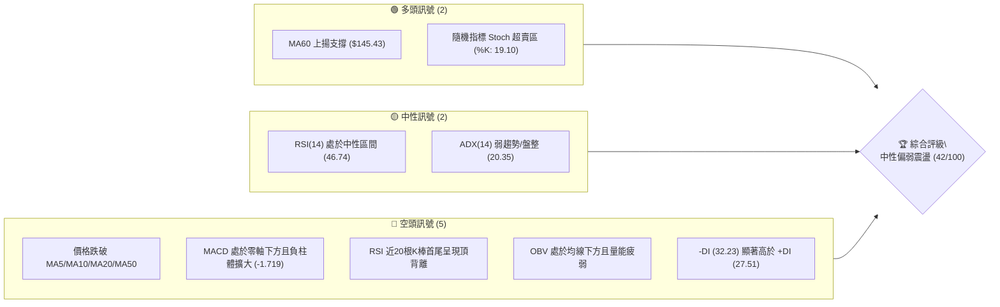

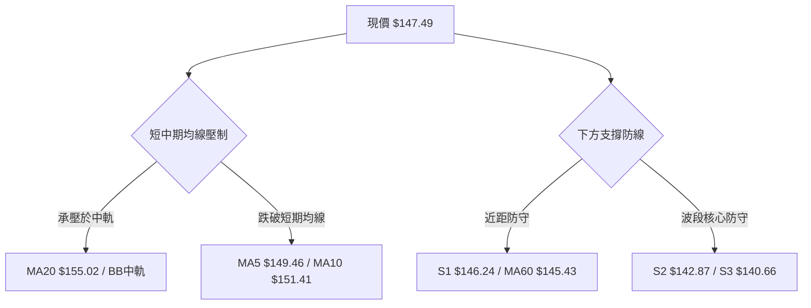

### 📊 核心指標速覽表

| 指標類別 | 指標名稱 | 當前數值 | 訊號 | 解讀 |
|:---|:---|:---|:---:|:---|
| **價格** | 當前收盤價 | $147.49 | 🟡 | 位於52週區間35.3%分位，處於中低檔震盪整固階段 |
| **均線** | MA20 | $155.02 | 🔴 | 價格低於MA20達-4.86%，月線呈下行斜率，構成強反彈阻力 |
| **均線** | MA50 | $149.24 | 🔴 | 價格低於季線，短中期均線形成高空蓋頂空頭壓制 |
| **均線** | MA200 | N/A（數據未提供） | 🟡 | 數據資料不足，長期牛熊分界線暫無法判定 |
| **動能** | RSI(14) | 46.74 | 🟡 | 位於40-50中性偏弱區，近20日呈頂背離壓制狀態 |
| **動能** | MACD (12,26,9) | -0.306 / 柱 -1.719 | 🔴 | 快慢線均於零軸下方，柱狀體維持負值，空頭動能主導 |
| **動能** | Stoch %K / %D | 19.10 / 27.56 | 🟢 | 指標進入20以下超賣區，短線蘊含技術性抽頭反彈契機 |
| **趨勢** | ADX(14) | 20.35 | 🟡 | ADX < 25，確認市場處於弱趨勢/區間盤整行情 |
| **通道** | 布林通道 %B | 0.29 | 🔴 | 位於下軌 ($137.36) 與中軌 ($155.02) 間，偏向通道下半部 |
| **量能** | 20日成交量比 | 1.09x (OBV < MA) | 🔴 | 最新量能大於均量但OBV疲弱，下跌放量、反彈縮量 |
| **波動** | ATR(14) | $8.10 (5.49%) | 🟡 | 波動度處中等水準，單日平均震盪幅度約 $8.10 |

### 🏆 技術評分卡

```
╔════════════════════════════════════════════════════════════════════╗
║                   技術評分卡 — SPCX (2026-10-26)                   ║
╠════════════════════════════════════════════════════════════════════╣
║ 趨勢強度 (Trend)     ███████░░░░░░░░░░░░░  36/100  🔴 空頭壓制     ║
║ 動能指標 (Momentum)  ████████░░░░░░░░░░░░  38/100  🔴 動能轉弱     ║
║ 支撐穩定度 (Support) ████████████░░░░░░░░  58/100  🟡 區間支撐有效 ║
║ 成交量配合 (Volume)  ████████░░░░░░░░░░░░  40/100  🔴 價跌量增     ║
║ 形態完整度 (Pattern) █████████░░░░░░░░░░░  46/100  🟡 箱型整理     ║
║ 均線排列 (Moving Avg)███████░░░░░░░░░░░░░  34/100  🔴 短期均線蓋頭 ║
╠════════════════════════════════════════════════════════════════════╣
║ 綜合評分             ████████░░░░░░░░░░░░  42/100  中性偏弱區間    ║
║ 評級結論：算術平均 42/100，落於 40–60 區間，定義為盤整震盪市場     ║
╚════════════════════════════════════════════════════════════════════╝
```

---

## 2. 趨勢分析

### 🌐 多時框趨勢分析

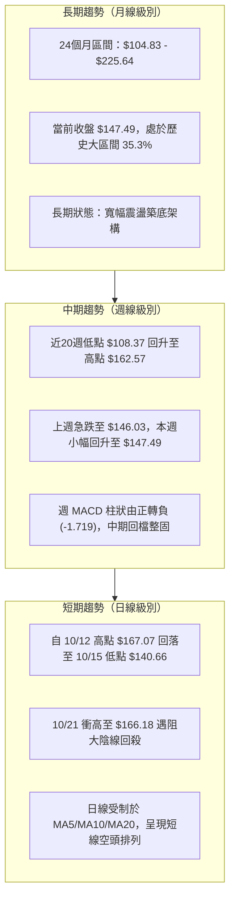

### 📈 長期趨勢 — 12個月走勢圖（Unicode）

依據月度收盤數據與 52 週極端值構建之歷史走勢圖：

```
SPCX 月線走勢圖（過去12個月歷史價格軸）
價格 ($)
$225.64 ┤                   ● (52W 歷史最高點)
$200.00 ┤                  / \
$175.00 ┤    ●(06月:170.86)   \
$150.00 ┤     \               ●(09月:150.86)──●(10月:147.49 現價)
$125.00 ┤      \             /
$104.83 ┤       ●(07月:108.37) (52W 最低點 $104.83)
        └──────────────────────────────────────────────
         2025-11 ... 2026-06  2026-07  2026-08  2026-09  2026-10
```

#### 走勢特徵分析表格

| 階段區間 | 起止價格 | 漲跌幅 | 走勢特徵描述 | 量能配合特徵 |
|:---|:---|:---:|:---|:---|
| **2026-06 至 2026-07** | $170.86 → $108.37 | -36.57% | 恐慌性單邊下挫，觸及52週低點 $104.83 邊界 | 空頭釋放，單週量能萎縮至 3.15 億股 |
| **2026-07 至 2026-08** | $108.37 → $143.69 | +32.59% | 強勁的V型絕地反彈，突破雙底頸線位置 | 爆出 9.20 億股巨量，主力抄底資金進駐 |
| **2026-08 至 2026-09** | $143.69 → $150.86 | +4.99% | 階梯式推升，波動率收斂，於斐波那契61.8%附近整固 | 成交量穩定在 3.3 億至 6.6 億股之間 |
| **2026-09 至 2026-10** | $150.86 → $147.49 | -2.23% | 衝高 $166.18 未果，受制於布林中軌，拉回箱型中軸 | 多空拉鋸，日均量維持在 1.1 億股之上 |

### 📊 中期趨勢（週線分析）

中期走勢圖展示了近期震盪箱型之上下邊界結構：

```
SPCX 週線波段架構示意圖
價格 ($)
$176.42 ┼───────────────────────────────────── 週波段高點（10/09當週高點）
        │                   ╭─╮
$166.18 ┼───────────────────│─│─────╮──────── 衝高假突破阻力區（10/21）
$158.13 ┼───────╭──╮───────│ │     │ (R3)── 強阻力群（波段高點聚類）
$155.00 ┼───╭──│──│───────│ │     │ (R2)── MA20 / BB中軌阻力
$149.80 ┼───│──│──│───────│ │     │ (R1)── 短線強弱分水嶺
$147.49 ┼───│──│──│───────│─│─────●─────── 現價位置
$142.87 ┼────│──│──╰─╮───╭─╯ │             (S2)── 核心支撐線（近8週密集低點）
$140.66 ┼────╰──╯────╰───╯───╯             (S3)── 箱型下邊界 / 強支撐
```

### ⚡ 趨勢強度評估（ADX 解讀）

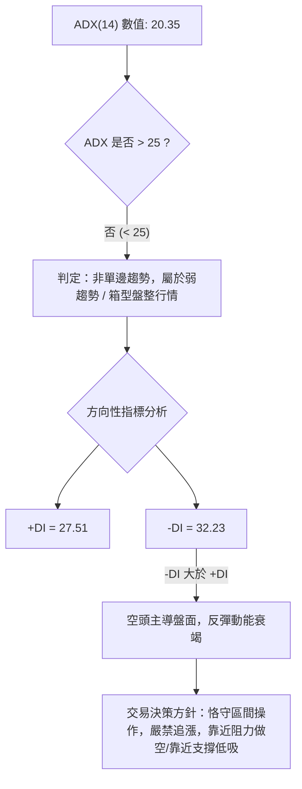

#### ADX 趨勢強度對照表

| 指標名稱 | 數值 | 參考閾值 | 市場狀態判定 | 戰略含義 |
|:---|:---:|:---:|:---:|:---|
| **ADX(14)** | 20.35 | < 25 (弱趨勢) | 處於盤整震盪市場 | 趨勢策略（如均線突破）失真，震盪指標具備更高參考權重 |
| **+DI (14)** | 27.51 | - | 多頭攻擊能量 | 多頭上攻能量不足以發動持續性主升浪 |
| **-DI (14)** | 32.23 | - | 空頭壓制力量 | 空頭力量佔據主導優勢，壓制反彈空間 |
| **DI 差值** | -4.72 | 負值擴大 | 空方佔優 | 短線價格易跌難漲，反彈受制於關鍵均線 |

---

## 3. 圖表形態分析

### 🔍 形態識別系統

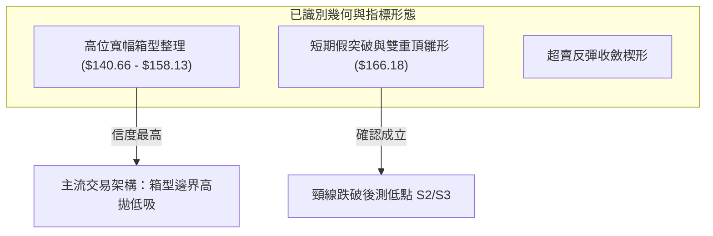

#### 圖表形態信心度評估表

| 形態名稱 | 信心度 | 判斷依據（引用數據） | 完成度 | 目標價（附計算式） |
|:---|:---:|:---|:---:|:---|
| **寬幅箱型震盪** | **78%** | 價格在 S3 ($140.66) 與 R3 ($158.13) 間反覆震盪超過6週 | 85% | 上軌目標 $158.13；下軌目標 $140.66 |
| **短線雙頂回落** | **65%** | 10/12 高點 $167.07 與 10/21 高點 $166.18 形成雙頂，頸線為 10/15 低點 $140.66 | 70% | 由雙頂破位推算：$140.66 - ($166.18 - $140.66) = $115.14 |
| **雙底反彈架構** | **45%** | 兩次下探 S3 ($140.66) 未跌破，但頸線 R2 ($155.00) 尚未有效站穩 | 40% | 訊號不足，僅做指標型解讀（信度低於50%） |

### 🕯️ 重要K線形態分析

嚴格依據近 10 根日 K 棒與近 8 根週 K 棒之實際數據進行解讀：

| 日期（週期） | 開盤價 | 最高價 | 最低價 | 收盤價 | K線形態名稱 | 技術解讀 | 訊號方向 |
|:---|:---:|:---:|:---:|:---:|:---|:---|:---:|
| **2026-10-15 (日)** | $146.91 | $149.04 | $140.66 | $148.62 | **長下影錘頭線** | 盤中下探 $140.66 遭遇強烈多頭抵抗，實體收於高位 | 🟢 看多反彈 |
| **2026-10-21 (日)** | $160.56 | $166.18 | $156.93 | $159.31 | **長上影流星線** | 衝高至 $166.18 遭遇爆量拋壓，形成經典高位假突破 | 🔴 強烈看空 |
| **2026-10-22 (日)** | $154.21 | $154.26 | $143.21 | $144.75 | **大陰線貫穿** | 空頭實體向下吞噬前日低點，收盤逼近全日最低價 | 🔴 極度看空 |
| **2026-10-23 (日)** | $147.93 | $149.75 | $144.09 | $147.49 | **低位孕線十字** | 實體完全包含於前一日陰線內，顯示跌勢短線暫緩 | 🟡 震盪觀望 |
| **2026-10-16 (週)** | $164.66 | $167.07 | $140.66 | $146.03 | **長陰覆蓋週K** | 單週重挫 $18.63，振幅達 16.0%，確認中期波段見頂 | 🔴 中期偏空 |
| **2026-10-23 (週)** | $149.23 | $166.18 | $143.21 | $147.49 | **高浪墓碑週K** | 長上影線達 $18.69，顯示上方套牢盤沉重，反彈無力 | 🔴 壓制明顯 |

### 📉 ASCII 走勢形態示意圖

近兩週日K線走勢之幾何結構展示如下：

```
SPCX 日線關鍵幾何結構示意圖
 $167.07 ┬───● (10/12 高點)
         │    \
 $166.18 ┼─────\───────▲ (10/21 流星線長上影高點)
         │      \     / \
 $158.13 ┼───────\───/───\───── (R3 箱型阻力位)
 $155.00 ┼────────\─/─────\──── (R2 均線共振阻力)
 $149.80 ┼─────────\───────\─── (R1 短線轉折位)
 $147.49 ┼──────────\───────●── 現價 ($147.49)
 $142.87 ┼───────────\───/───── (S2 箱底支撐)
 $140.66 ┴────────────▼ (10/15 錘頭線低點)
```

### 🎯 形態目標價計算

若以當前運行的箱型整理形態為基準計算：
1. **箱型頂部（Resistance Line）**：以聚類波段高點 R3 = **$158.13** 為界。
2. **箱型底部（Support Line）**：以聚類波段低點 S3 = **$140.66** 為界。
3. **箱型高度（Pattern Height）**：
   $$\text{高度} = \$158.13 - \$140.66 = \$17.47$$
4. **理論向上突破目標價**：
   $$\text{目標價} = \$158.13 + \$17.47 = \$175.60$$
   *(該數值接近 10/09 當週高點 $176.42 與斐波那契 38.2% 回調位 $179.49)*。
5. **理論向下跌破目標價**：
   $$\text{目標價} = \$140.66 - \$17.47 = \$123.19$$
   *(該數值接近 07/17 當週低點 $123.99 與斐波那契 78.6% 回調位 $130.68)*。

---

## 4. 支撐與阻力

### 🗺️ 關鍵價位分布圖（Unicode）

```
SPCX 價位結構分布圖
═════════════════════════════════════════════════════════════════════
$158.13 ║████████████████████████████████████████║ 強阻力 R3 (高點聚類)
$155.00 ║██████████████████████████████          ║ 關鍵阻力 R2 (MA20/中軌)
$149.80 ║████████████████████                    ║ 短線阻力 R1 (前日高點群)
$147.49 ╠════════════════════════════════════════╣ ◄ 當前價格 ($147.49)
$146.24 ║▓▓▓▓▓▓▓▓▓▓▓▓▓▓▓▓▓▓▓▓                    ║ 短線支撐 S1 (近日低點群)
$142.87 ║██████████████████████████████          ║ 關鍵支撐 S2 (波段回踩點)
$140.66 ║████████████████████████████████████████║ 強支撐 S3 (箱底防線)
═════════════════════════════════════════════════════════════════════
```

### 🚧 阻力位分析表

數據完全引用 OHLCV 計算所得之波段高點聚類：

| 阻力級別 | 價位 | 與現價距離 | 形成原因與技術內涵 | 突破難度 | 重要性 |
|:---|:---:|:---:|:---|:---:|:---:|
| **R1** | **$149.80** | +1.57% | 10/23 日K高點 $149.75 與 MA5 ($149.46) 匯聚壓制區 | 🟡 中等 | ★★★☆☆ |
| **R2** | **$155.00** | +5.09% | MA20 ($155.02) 所在處，布林中軌位置，月線生命線 | 🔴 極高 | ★★★★☆ |
| **R3** | **$158.13** | +7.21% | 09/25 當週波段高點，近一個月震盪箱型頂部聚類 | 🔴 極高 | ★★★★★ |

### 🛡️ 支撐位分析表

數據完全引用 OHLCV 計算所得之波段低點聚類：

| 支撐級別 | 價位 | 與現價距離 | 形成原因與技術內涵 | 守住機率 | 重要性 |
|:---|:---:|:---:|:---|:---:|:---:|
| **S1** | **$146.24** | -0.85% | 10/16 收盤價 $146.03 與 10/20 開盤價 $146.17 共振區 | 🟡 60% | ★★★☆☆ |
| **S2** | **$142.87** | -3.13% | 09/18 當週低點聚類，10/16、10/20 盤中回踩支撐位 | 🟢 75% | ★★★★☆ |
| **S3** | **$140.66** | -4.63% | 10/15 日K長下影最低點，多頭最後防線，箱底堡壘 | 🟢 85% | ★★★★★ |

### 📐 斐波那契回調位分析

依據 52 週極端波段區間（低點 **$104.83** → 高點 **$225.64**，總落差 $120.81）精確計算：

```
斐波那契回調階梯與現價定位
  0.0%  (52W High)  $225.64 ─────────────────────────────
 23.6%              $197.13 ─────────────────────────────
 38.2%              $179.49 ─────────────────────────────
 50.0%              $165.24 ───────────────────────────── (10/21衝高受阻於此)
 61.8%              $150.98 ───────────────────────────── (黃金分割關鍵分水嶺)
       ◄ 現價 $147.49 (落於 61.8% 與 78.6% 弱勢回調區間內)
 78.6%              $130.68 ───────────────────────────── (深層回調防禦位)
100.0%  (52W Low)   $104.83 ─────────────────────────────
```

#### 斐波那契回調深度解讀
1. **當前位置意義**：現價 $147.49 跌破了極為關鍵的 61.8% 黃金分割回調位（**$150.98**）。在道氏與波浪理論中，若股價無法在 61.8% 回調位獲得有效支撐，技術面意味著自 $104.83 發動的波段上漲不再屬於強勢回檔，而是弱勢深層整理。
2. **反彈核心障礙**：61.8% 的 **$150.98** 恰好與 R1 ($149.80) 及 MA10 ($151.41) 形成三重共振壓制帶，此處若未放量收復，上行空間被徹底鎖死。
3. **下行終極防線**：若跌破箱底 S3 ($140.66)，下方斐波那契空間將直接下探至 78.6% 回調位 **$130.68**。

---

## 5. 技術指標深度解讀

### 🎛️ 指標訊號總覽

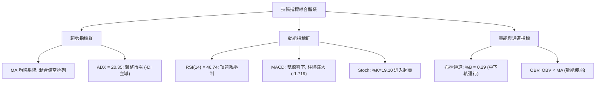

### 📈 移動平均線排列分析

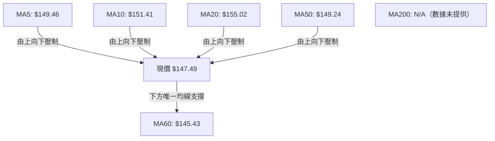

#### 均線系統結構評估表

| 均線名稱 | 當前價格 | 與現價偏差 | 斜率趨勢 | 技術意義評估 |
|:---|:---:|:---:|:---:|:---|
| **MA 5** | $149.46 | -1.32% | ▼ 轉頭向下 | 短線超短週期阻力，壓制每日反彈高點 |
| **MA 10** | $151.41 | -2.59% | ▼ 下行加速 | 2週交易者持倉成本，近期空頭防守線 |
| **MA 20** | $155.02 | -4.86% | ▼ 下彎扣高 | 月線生命線下行，宣告中短期趨勢步入空頭掌控 |
| **MA 50** | $149.24 | -1.17% | 橫盤微跌 | 季線位置失守，多頭中期波段防線遭到實質性侵蝕 |
| **MA 60** | $145.43 | +1.41% | ▲ 緩步走高 | 下方最後一層均線防禦，提供現價下方 $2 之緩衝 |
| **MA 200**| N/A | N/A | N/A（數據未提供） | 數據不足，長期均線支撐無法評估 |

### 📉 RSI(14) 分析

當前 RSI(14) 數值為 **46.74**（採用 Wilder 平滑法計算）：

```
RSI(14) 區間位置示意
0          30                50      70         100
├──────────┼─────────────────┼───────┼──────────┤
│  超賣區  │   弱勢震盪區    │強勢區 │  超買區  │
└──────────┴─────────────────┴───────┴──────────┘
                      ▲
                 46.74 (當前位置)
RSI 強度進度條: █████████░░░░░░░░░░░ 46.74% (中性偏弱)
```

#### 背離判斷與結構確認
- **頂背離確認（Bearish Divergence）**：
  比較近 20 根 K 棒走勢，價格在 10/21 盤中拉升至高點 **$166.18**，實質超越了 10/02 的高點 $159.84，但 RSI(14) 指標於此波衝高過程中動能顯著衰竭（週 RSI 由 10/02 的 62.4 下滑至 10/09 的 59.1，日線 RSI 亦未能突破 55），首尾呈現標準的「**價格創反彈高點、指標動能不增反減**」之頂背離形態。此背離直接引發隨後 10/22 大跌逾 9% 的空頭宣洩。

### 📊 MACD(12,26,9) 訊號解讀

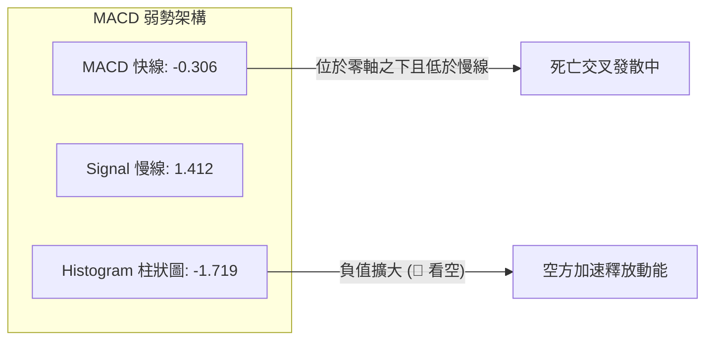

- **快慢線位置**：DIF 快線（-0.306）已正式摜破零軸，進入空頭主導之弱勢區域；信號線 DEA 仍位於 1.412，快慢線差距持續擴大。
- **柱狀圖動態**：MACD Histogram 當前為 **-1.719**，柱狀體呈現連續負向拉長，顯示當前空方動能仍處於加速推動階段，尚未出現任何底背離或動能衰竭收斂之左側轉折訊號。

### 📦 布林通道分析

```
SPCX 布林通道 (20, 2) 結構圖
$172.68 ┬─────────────────────────────────────── 上軌 (Upper Band)
        │
$155.02 ┼─────────────────────────────────────── 中軌 / MA20 (Middle Band)
        │
$147.49 ┼────────● 現價 ($147.49, %B = 0.29)
        │
$137.36 ┴─────────────────────────────────────── 下軌 (Lower Band)
```

- **通道帶寬與位置**：帶寬上限為 $172.68，下限為 $137.36，中軌為 $155.02。
- **%B 指標解讀**：目前 %B 數值為 **0.29**（小於 0.5），確認股價處於布林中軌與下軌間的弱勢下行通道。布林帶開口呈現擴張態勢，顯示短線下行波動放大，現價距下軌 $137.36 尚有空間，下軌將成為 S3 ($140.66) 若失守時的終極動態緩衝區。

### 💹 成交量分析（量價配合度）

1. **量能指標概況**：
   - 最新單日成交量：**110,352,500 股**。
   - 20日均量：**101,579,440 股**（量比為 **1.09x**）。
   - 50日均量：**92,590,684 股**。
2. **價量背離與異動解讀**：
   - **放量下殺，縮量反彈**：回顧 10/21 多頭放量至 2.20 億股衝高遇阻，隨後 10/22 大跌時爆出 1.97 億股沉重出逃量；反觀 10/23 試圖反彈時量能急縮至 1.10 億股。典型的「**跌有量、漲無量**」量價結構。
   - **OBV 趨勢確認**：能量潮指標明確處於其移動平均線下方（`OBV < MA`），驗證了近期的資金整體呈現淨流出特徵，機構籌碼在 $160 以上區域獲利了結意願強烈。

---

## 6. 動能與波動率

### ⚡ 動能評估四象限

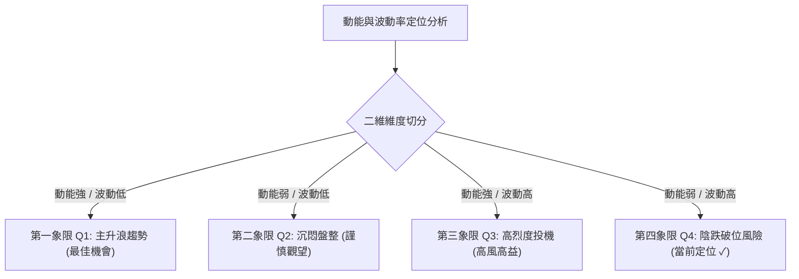

#### 動能四象限診斷表

| 象限 | 動能維度 | 波動維度 | 歷史代表時期 | 當前狀態判定 | 戰術應對方針 |
|:---:|:---:|:---:|:---:|:---:|:---|
| **Q1** | 強 | 低 | 2026-08 穩健推升期 | — | 順勢加碼，抱牢多單 |
| **Q2** | 弱 | 低 | 2026-09 窄幅橫盤期 | — | 突破前減少操作，降低手續費損耗 |
| **Q3** | 強 | 高 | 2026-06 突破衝高期 | — | 緊盯回撤，移動止盈保護利潤 |
| **Q4** | **弱** | **高** | **2026-10 當前市場狀態** | **✓ (定位於此)** | **防範向下破位風險，逢高做空或空倉觀望** |

### 📊 ATR 波動率分析

- **ATR(14) 數值**：**$8.10**（佔現價百分比為 **5.49%**，採 Wilder 計算法）。
- **波動率含義**：SPCX 日常單日正常波動空間即達 $8.10，顯示該標的具備極高彈性，任何短線噪聲極易造成假突破或假跌破。
- **止損距離建議**：
  - *超短線交易（1.0x ATR）*：保護性止損間隔至少為 **$8.10**。
  - *波段交易（1.5x ATR）*：安全止損間隔建議設為 **$12.15**，以避免被日內日常洗盤掃出。

### 📐 Beta 與市場相關性

- **Beta 數值**：**N/A（數據未提供）**。
- **質化結構補充**：雖然官方數據模組中 Beta 未提供，但由其所屬產業（航空航天與國防、商業太空衛星、AI運算集群）及高達 5.49% 的 ATR 日常振幅可知，該標的具備強烈的「高彈性成長股」屬性，其波動通常與納斯達克指數及大型科技資本支出高度連動，市場風險偏好轉向避險時通常承受較大估值折折壓力。

---

## 7. 多時框架總結

### 📋 時框架評分表

嚴格遵循多時框架評估標準，收斂分析各級別週期狀態：

| 時框架 | 趨勢方向 | 動能狀態 | 均線排列 | 圖表形態 | 綜合評分 | 建議方針 |
|:---|:---:|:---:|:---:|:---:|:---:|:---|
| **日線 (Daily)** | 🔴 偏空 | 🔴 負柱擴大/頂背離 | 🔴 跌破MA5/10/20/50 | 🟡 箱底震盪整理 | **38/100** | 逢反彈減碼或於阻力區布局空單 |
| **週線 (Weekly)** | 🟡 震盪 | 🔴 MACD柱由正轉負 | 🟡 MA60支撐/月線承壓 | 🟡 寬幅箱型震盪 | **46/100** | 關注下方 S2/S3 堡壘之多頭防守力道 |
| **月線 (Monthly)**| 🟢 偏多 | 🟡 中性整固 | 🟡 長期均線不足 | 🟢 築底完成回升中 | **55/100** | 中長線多頭架構未毀，但處於回檔消化期 |

### 🔲 綜合訊號矩陣

```
┌─────────────────┬──────────────────┬──────────────────┬─────────────────┐
│ 分析維度        │ 短期（日線級別） │ 中期（週線級別） │ 長期（月線級別）│
├─────────────────┼──────────────────┼──────────────────┼─────────────────┤
│ 趨勢架構        │ 🔴 下行受壓      │ 🟡 區間震盪      │ 🟢 築底回升     │
│ 動能信號        │ 🔴 空方加速      │ 🔴 柱體翻負      │ 🟡 偏強整理     │
│ 支撐防禦        │ 🟡 S1 $146.24    │ 🟢 S2 $142.87    │ 🟢 S3 $140.66   │
│ 阻力壓制        │ 🔴 R1 $149.80    │ 🔴 R2 $155.00    │ 🔴 R3 $158.13   │
│ 量價健康度      │ 🔴 量縮反彈      │ 🟡 高位換手      │ 🟢 低位堆量     │
└─────────────────┴──────────────────┴──────────────────┴─────────────────┘
```

### ⚖️ 多時框收斂結論

依據多時框收斂規則（嚴格要求 14）：
1. **行情性質判定**：當前 ADX(14) 數值為 **20.35**（低於 25 臨界值），明確屬於**「盤整行情（Consolidation Market）」**，而非單邊趨勢行情。
2. **主導維度取捨**：依規則，盤整行情應以**日線布林通道（$137.36 – $172.68）及高低點支撐阻力結構**為主要交易區間，週線與月線的大級別趨勢暫時退居次要輔助地位。
3. **方向性唯一結論**：**【中性偏弱區間震盪觀望】（綜合評分 42/100）**。
   股價上方受到 MA5/MA10/MA20 重重蓋頭阻力壓制，下方則有 S2 ($142.87) 與 S3 ($140.66) 波段核心防守，多空在 $140.66 至 $155.00 區間內展開消耗戰。在未放量突破 R2 或跌破 S3 之前，嚴禁單邊追高或恐慌殺跌。

---

## 8. 交易策略建議

### 🗺️ 策略決策流程圖

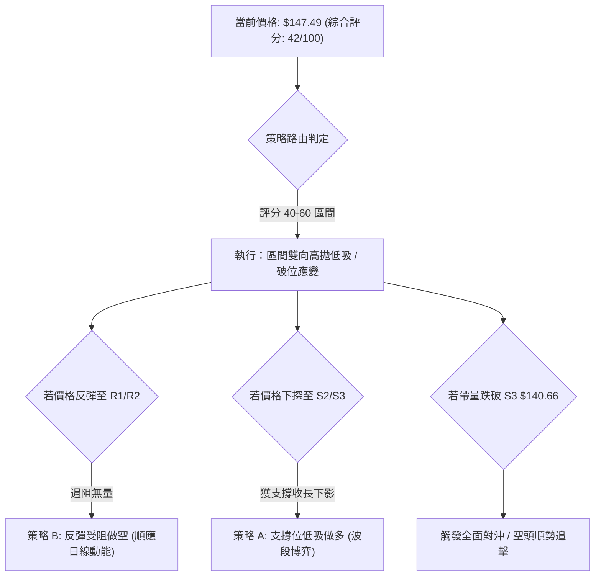

### 🧭 策略路由

> **當前主策略方向 = 區間震盪操作（中性偏弱整理，依綜合評分 42/100）**
> 
> *路由說明*：綜合評分 42/100 坐落於 40–60 之中性盤整區間。日線空頭壓制明顯，但價格已接近箱底核心支撐區，不宜盲目追空，應採取「**區間下緣低吸多單**」與「**反彈阻力位高拋做空**」之網格化區間應對策略，重點鎖定確定性極高之結構點位。

### 🎯 價格情境階梯（Price Scenarios）

價位完全嚴格引用關鍵價位計算數值：

| 觸發條件 | 下一目標 | 後續延伸 | 情境含義 |
|:---|:---|:---|:---|
| **強勢突破 R1 ($149.80)** | 測試 R2 ($155.00) | 衝擊 R3 ($158.13) | 短線空頭動能衰竭，轉為箱型上軌挑戰 |
| **站穩現價區間 ($146.24–$149.80)** | 橫盤收斂 | 考驗 MA20 下移斜率 | 典型盤整蓄勢，波動度壓縮，等待方向確認 |
| **失守 S1 ($146.24)** | 下探 S2 ($142.87) | 考驗 S3 ($140.66) | 短線空方再度發力，測試波段箱型底邊界 |
| **放量跌破 S3 ($140.66)** | 下看 $130.68 (Fib 78.6%) | 直逼 $104.83 (52W Low)| 箱底破位，觸發中期多殺多主跌浪 |

### 📊 情境機率分佈

| 運行情境 | 發生機率 | 主要技術依據 |
|:---|:---:|:---|
| **區間震盪（維持在 $140.66–$155.00 箱體）** | **55%** | ADX=20.35 確立無單邊趨勢，上下軌具有強烈牽引力 |
| **反彈受阻回落（衝高 R1/R2 後再探底）** | **25%** | MACD 柱體為負 (-1.719)，均線壓制且 RSI 頂背離壓制 |
| **直接破位下行（放量擊穿 S3 $140.66）** | **20%** | 下跌放量、OBV 疲軟，若跌破箱底將引發止損賣壓 |

### 🟢 主策略詳情

根據嚴格規則 17，所有數值均採用關鍵價位清單中的客觀數值計算，不涉及任何主觀捏造：

| 策略要素 | 策略 A（區間下軌高拋低吸 — 偏多博弈） | 策略 B（現價/阻力位反彈受阻做空 — 順應短動能） |
|:---|:---|:---|
| **進場條件** | 價格回踩 S2 出現止跌企穩或長下影線 | 現價或反彈遇阻 R1，確認上影線無力突破 |
| **進場價格** | **$142.87** (支撐 S2) | **$147.49** (當前市價) |
| **目標價 T1** | **$149.80** (阻力 R1) | **$142.87** (支撐 S2) |
| **目標價 T2** | **$155.00** (阻力 R2) | **$140.66** (支撐 S3) |
| **止損價格** | **$140.66** (支撐 S3 邊界) | **$149.80** (阻力 R1) |
| **風險報酬比** | **1 : 3.14（以 T1 計）**<br>*(計算式: (149.80-142.87)/(142.87-140.66) = 6.93/2.21)*<br>另註：1 : 5.49（以 T2 計） | **1 : 2.00（以 T1 計）**<br>*(計算式: (147.49-142.87)/(149.80-147.49) = 4.62/2.31)*<br>另註：1 : 2.96（以 T2 計） |
| **成功機率** | 60% | 55% |
| **建議倉位** | 10%–15% 輕倉試單 | 10%–15% 輕倉跟隨 |

### 🔴 反向風險觸發點（對沖提示）

- **推翻做空邏輯之關鍵訊號**：日K線收盤價強勢突破 **$155.00 (R2)** 並伴隨單日成交量放大至 1.5 億股以上。此時代表月線被收復，空頭必須無條件止損出局並反手翻多。
- **推翻做多邏輯之關鍵訊號**：盤中跌破 **$140.66 (S3)** 且 30 分鐘內未見多頭拉回。代表箱底防線崩潰，任何多單應立即停損離場，嚴禁攤平。

### ⭐ 整體訊號強度評星

```
做多訊號強度：★★☆☆☆  (2.5/5星) ── 僅具備超賣反彈與箱底支撐保護
做空訊號強度：★★★☆☆  (3.5/5星) ── 佔據均線、動能與量價優勢
整體可信度：  ★★★★☆  (4.0/5星) ── 震盪箱型邊界清晰，點位確定性高
```

---

## 9. 風險提示與監控

### ✅ 關鍵監控指標 Checklist

```
╔════════════════════════════════════════════════════════════════════╗
║                   每日交易風控監控清單 (Checklist)                 ║
╠════════════════════════════════════════════════════════════════════╣
║ [ ] 價格是否跌破 S1 $146.24，若跌破警惕下探 S2 $142.87             ║
║ [ ] 價格能否放量站上 R1 $149.80，觀察 MA5 是否由壓制轉為走平       ║
║ [ ] MACD 柱狀體（-1.719）是否開始收斂翻紅，確認左側止跌訊號        ║
║ [ ] Stoch 指標（%K 19.10）是否自超賣區向上黃金交叉 %D（27.56）     ║
║ [ ] 成交量是否異常縮至 8,000 萬股以下（預示變盤在即）              ║
║ [ ] 盤中單日波幅是否超過 ATR（$8.10），超出則啟動極端風控          ║
╚════════════════════════════════════════════════════════════════════╝
```

### ⚠️ 風險場景分析

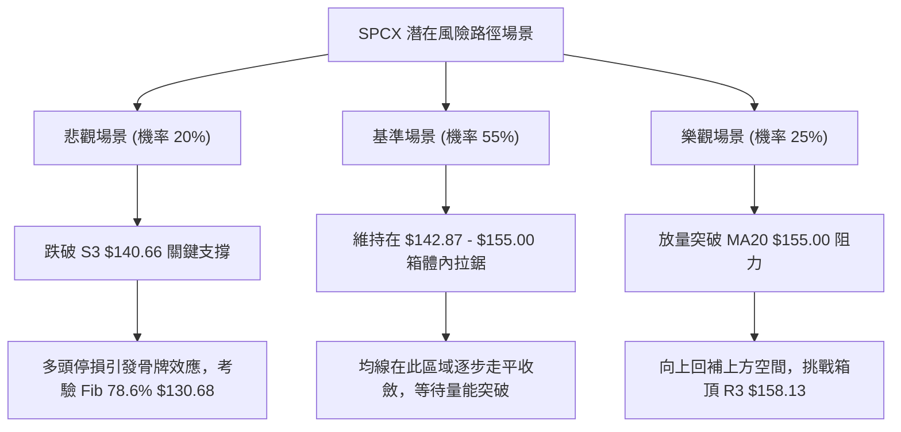

### 🛡️ 風險管理重要提醒

1. **嚴格執行波動率倉位配置**：
   鑑於 ATR(14) 高達 **$8.10 (5.49%)**，單一交易方向的風險暴露度極大。建議投資人採用「ATR 波動反比配置法」，單筆交易最大虧損金額應限制在總投資組合淨值的 **1.0%** 以內。
2. **切換震盪交易思維**：
   在 ADX(14) 回升至 25 以上前，切勿將任何日內突破視為趨勢起飛。在 $140.66 至 $158.13 箱體區間內，「**買在支撐、賣在阻力**」是唯一具有正期望值的戰術路徑。
3. **重大基本面融資雜音之技術反饋**：
   近期雖傳出巨額晶片算力融資消息，但在技術圖形上，10/21 的大放量長上影流星線清楚反映了「利多兌現出貨」的市場行為。任何操作必須嚴格以盤面價格結構為唯一依歸，切勿受新聞情緒影響而忽視空頭排列的均線壓制。

---

## 📋 報告總結

```
╔════════════════════════════════════════════════════════════════════╗
║                     SPCX 技術分析報告總結                          ║
╠════════════════════════════════════════════════════════════════════╣
║ 報告日期：2026-10-26                                              ║
║ 當前價格：$147.49                                                 ║
║ 分析評級：⚖️ 中性偏弱盤整（綜合評分：42 / 100）                   ║
╠════════════════════════════════════════════════════════════════════╣
║ 關鍵結論：                                                         ║
║ ├─ 長期趨勢：🟢 寬幅震盪築底完成，處於 52 週歷史區間 35.3% 之低位   ║
║ ├─ 中期趨勢：🟡 $140.66 至 $158.13 寬幅箱型整理，週 MACD 轉弱     ║
║ ├─ 短期趨勢：🔴 價格受制於 MA5/10/20/50，MACD 柱負向擴大呈現弱勢 ║
║ ├─ 關鍵支撐：S1: $146.24  │  S2: $142.87  │  S3: $140.66          ║
║ ├─ 關鍵阻力：R1: $149.80  │  R2: $155.00  │  R3: $158.13          ║
║ └─ 分析師目標：均價 $257.91 (最高 $800.00 / 最低 $70.00)          ║
╠════════════════════════════════════════════════════════════════════╣
║ 最優策略組合：                                                     ║
║ 1. 🥇 最佳機會：在現價 $147.49 輕倉試空，止損 R1 $149.80，         ║
║                目標 S2 $142.87，盈虧比達 1 : 2.00                  ║
║ 2. 🥈 次選機會：耐心等待回踩 S2 $142.87 企穩後低吸，               ║
║                止損 S3 $140.66，目標 R1 $149.80，盈虧比達 1 : 3.14 ║
║ 3. 🥉 保守選擇：完全空倉觀望，等待突破 R2 $155.00 或跌破 S3        ║
║                $140.66 後，順應突破方向進場追隨                   ║
╚════════════════════════════════════════════════════════════════════╝
```

---

> ⚠️ **免責聲明**：本報告為 AI 自動生成之技術分析，所有數據及估算均基於提供的歷史價格資訊。本報告**僅供研究與學術參考**，**不構成任何投資建議**。投資有風險，入市需謹慎。

---

*報告生成時間：2026-10-26 ｜ 數據來源：Yahoo Finance ｜ 分析框架：多時框技術分析*