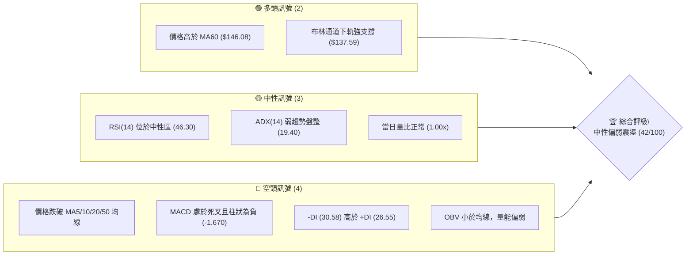
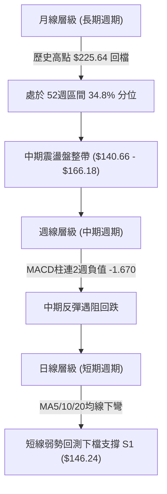
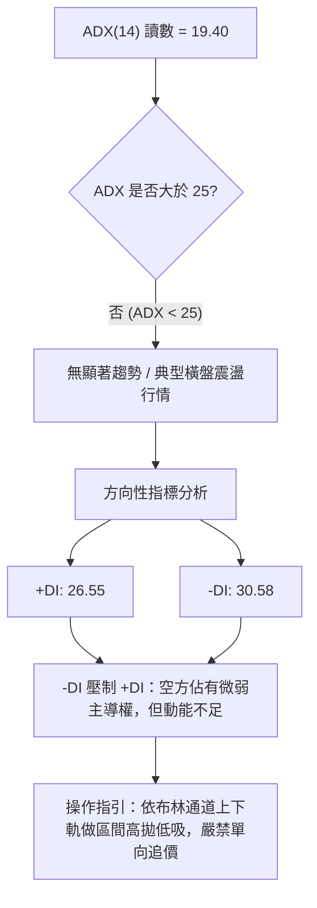
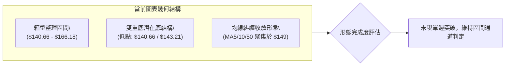
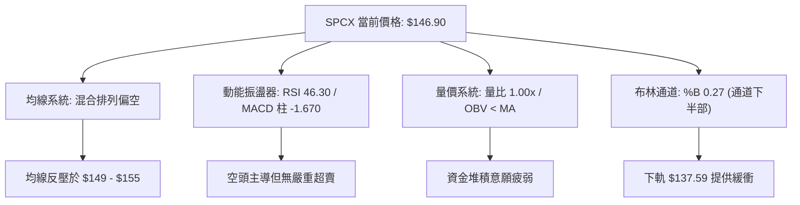
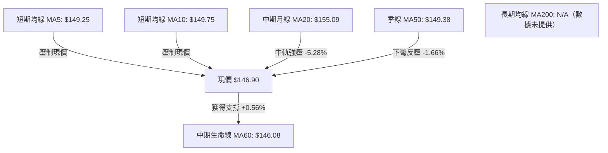
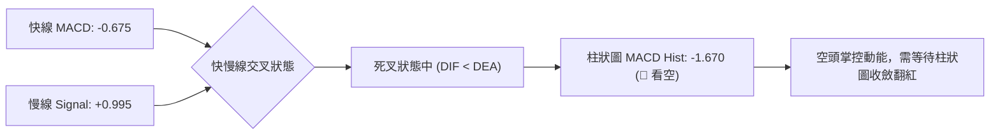
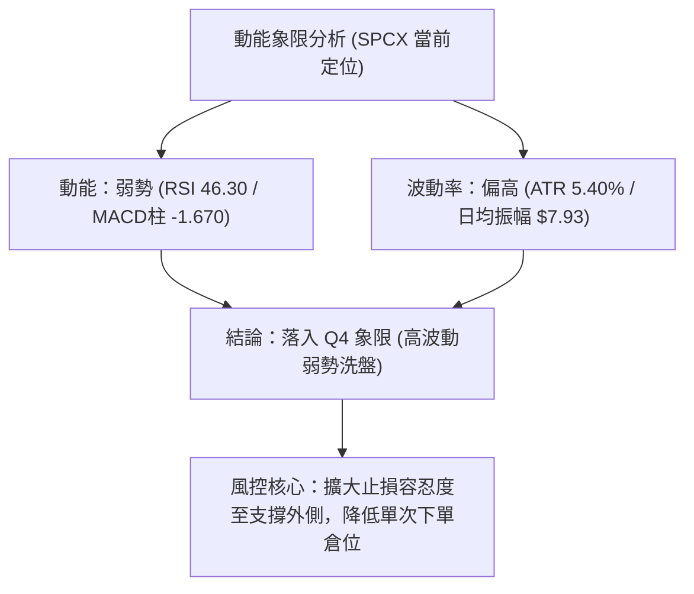
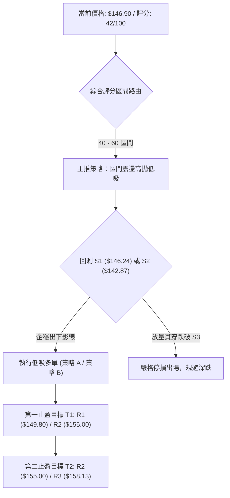
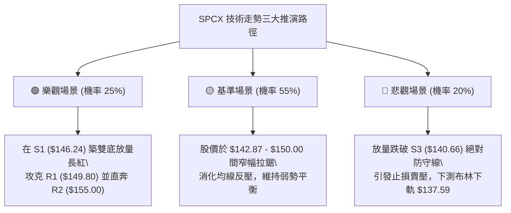

# SPCX 技術分析報告

> **報告日期**：2026-10-27 ｜ **語言**：繁體中文 ｜ **數據來源**：Yahoo Finance ｜ **當前價格**：$146.90 USD

---

## 目錄

| 章節 | 內容 |
|------|------|
| [1. 技術面概覽](#1-技術面概覽) | 訊號儀表板、核心指標、評分卡 |
| [2. 趨勢分析](#2-趨勢分析) | 多時框趨勢、長中短期走勢、ADX強弱判斷 |
| [3. 圖表形態分析](#3-圖表形態分析) | 形態識別信心度、K線組合詳細解讀、形態目標價 |
| [4. 支撐與阻力](#4-支撐與阻力) | 關鍵價位結構、斐波那契回調區間定位 |
| [5. 技術指標深度解讀](#5-技術指標深度解讀) | MA/RSI/MACD/布林通道/OBV量價深度分析 |
| [6. 動能與波動率](#6-動能與波動率) | 動能矩陣、ATR波動分析、Beta敏感度 |
| [7. 多時框架總結](#7-多時框架總結) | 時框架評分矩陣、收斂原則與統一結論 |
| [8. 交易策略建議](#8-交易策略建議) | 策略路由、主客策略、情境階梯、精確風險報酬比 |
| [9. 風險提示與監控](#9-風險提示與監控) | 關鍵監控清單、情境推演、風控紀律 |
| [10. 報告總結](#10-報告總結) | 核心結論與最佳行動綱領 |

---

## 1. 技術面概覽

### 🎯 技術訊號儀表板



### 📊 核心指標速覽表

| 指標類別 | 指標名稱 | 當前數值 | 訊號 | 解讀 |
|:---|:---|:---:|:---:|:---|
| **價格** | 當前價格 | $146.90 | 🟡 | 位於52週區間的34.8%分位，處於中低檔震盪整固期 |
| **均線** | 短期均線 (MA5 / MA10) | $149.25 / $149.75 | 🔴 | 現價低於MA5與MA10，短線動能偏弱，上方受壓制 |
| **均線** | 月線 (MA20) | $155.09 | 🔴 | 價格低於MA20達-5.28%，短期下降趨勢未改 |
| **均線** | 季線 (MA50) | $149.38 | 🔴 | 跌破中天期生命線，均線呈混合排列且空頭佔優 |
| **均線** | 長期均線 (MA200) | N/A（數據未提供） | 🟡 | 因上市歷史資料不足200日，無法計算長期基準線 |
| **動能** | RSI(14) Wilder | 46.30 | 🟡 | 處於40-50中性弱勢區，無超買或超賣，買盤動能不足 |
| **動能** | MACD (12,26,9) | 柱狀圖 -1.670 | 🔴 | 快線-0.675低於慢線0.995，空頭掌控短期節奏 |
| **動能** | KD指標 (Stoch %K/%D) | %K 20.36 / %D 16.97 | 🟡 | 接近超賣區（20邊緣），醞釀低檔黃金交叉機會 |
| **趨勢** | ADX(14) 強度 | 19.40 | 🟡 | ADX < 25 表明市場處於無明確方向的盤整震盪行情 |
| **波動** | ATR(14) 波動度 | $7.93 (5.40%) | 🟡 | 日內平均振幅達$7.93，具備較大日內博弈空間 |
| **通道** | 布林通道 %B | 0.27 (帶寬 $35.01) | 🟡 | 現價偏向通道下半部，下軌支撐位在 $137.59 |
| **量能** | OBV 指標 | OBV < MA | 🔴 | 成交量動態指標低於均線，資金累積效應疲弱 |

### 🏆 技術評分卡

```
╔══════════════════════════════════════════════════════════════════════════════╗
║                    技術評分卡 — SPCX (2026-10-27)                           ║
╠══════════════════════════════════════════════════════════════════════════════╣
║ 評估維度      評分進度條                         分數   評估結果             ║
║ 趨勢強度      ███████░░░░░░░░░░░░░               35/100 🔴 弱勢盤整(ADX:19.4)║
║ 動能指標      ████████░░░░░░░░░░░░               40/100 🔴 MACD死叉/RSI弱勢  ║
║ 支撐穩定度    ███████████░░░░░░░░░               55/100 🟡 S1/S2支撐密集守衛 ║
║ 成交量配合    ████████░░░░░░░░░░░░               40/100 🔴 OBV偏弱/量能未放   ║
║ 形態完整度    █████████░░░░░░░░░░░               45/100 🟡 區間箱型震盪築底  ║
║ 均線排列      ███████░░░░░░░░░░░░░               35/100 🔴 跌破MA20/50短期受阻║
╠══════════════════════════════════════════════════════════════════════════════╣
║ 綜合評分      ████████░░░░░░░░░░░░               42/100 🟡 中性偏弱 (區間震盪)║
╚══════════════════════════════════════════════════════════════════════════════╝
```
*註：綜合評分 = (35 + 40 + 55 + 40 + 45 + 35) ÷ 6 = 41.67 ≈ 42/100（依規則18算術平均計算）。*

---

## 2. 趨勢分析

### 🌐 多時框趨勢分析



### 📈 長期趨勢 — 12個月走勢圖（Unicode）

依據歷史數據與近月份收盤記錄繪製之長期月線架構如下（涵蓋52週高點 $225.64 至低點 $104.83 之全貌）：

```
SPCX 月線走勢圖（過去12個月歷史軌跡）
價格軸 ($)
$225.64 ┤                    ● (52W歷史天花板)
$205.00 ┤                  ╭─╯ ╰╮
$185.00 ┤              ╭───╯    ╰╮
$170.86 ┤● (2026-06)───╯         ╰╮
$150.86 ┤                          ╰╮    ● (2026-09)
$146.90 ┤                            ╰───┼───────────● (2026-10 現價: $146.90)
$143.69 ┤                                ● (2026-08)
$108.37 ┤        ● (2026-07 探底)
$104.83 ┤        ● (52W歷史低點)
        └───────────────────────────────────────────────
         06/26  07/26   08/26    09/26   10/26 (當前)
```

#### 走勢特徵分析表格

| 週期/月份 | 收盤價 | 走勢特徵與量價行為 | 階段性質 |
|:---|:---:|:---|:---:|
| **2026-06** | $170.86 | 自歷史高點 $225.64 展開初段拉回，獲利回吐賣壓湧現 | 高檔修正期 |
| **2026-07** | $108.37 | 單月急跌逼近 52W 低點 $104.83，空頭快速宣洩浮動籌碼 | 恐慌探底期 |
| **2026-08** | $143.69 | 強勁反彈，週量能一度放大至 9.2億股（08-07週），買盤大舉抄底 | 報復性反彈期 |
| **2026-09** | $150.86 | 股價推升至 $150.00 整數關卡之上，震盪消化解套賣壓 | 中期平台構築期 |
| **2026-10** | $146.90 | 上攻 $166.18 未果，受均線反壓壓制回落至 $146.90 附近沉澱 | 縮量箱型整理期 |

### 📊 中期趨勢（週線分析）

從近 8 週 K 棒高低點與成交量觀察，中期架構呈現「高點受制於阻力、低點逐步收斂」之對稱收斂型態。上方強烈受壓於 10月9日週之高點 $176.42 及斐波那契 50.0% 回調位 $165.24；下方則有 10月16日週探出的波段低點 $140.66（支撐位 S3）與 9月18日週低點 $142.87（支撐位 S2）形成中期底部支撐托盤。

```
中期週線空間拓撲圖
阻力區域:  $165.24 ════════════════════════════ (斐波那契 50.0% 強反壓)
           $158.13 ──────────────────────────── (R3 週線級波段高點)
           $155.00 ---------------------------- (R2 / MA20 中軌壓制)
當前價格:  $146.90 ◄─── (收盤於斐波那契 61.8% $150.98 下方)
支撐區域:  $146.24 ............................ (S1 近期密集支撐線)
           $142.87 ──────────────────────────── (S2 中期多頭防線)
           $140.66 ════════════════════════════ (S3 10/16 探底低點強支撐)
```

### ⚡ 趨勢強度評估（ADX 解讀）



#### ADX 強度量化對照表

| 指標變數 | 當前數值 | 參考標準區間 | 趨勢狀態判定 | 交易策略導引 |
|:---|:---:|:---:|:---:|:---|
| **ADX(14)** | **19.40** | < 20 (弱趨勢/盤整) | 🟢/🔴 無單向趨勢，屬於純粹震盪盤 | 禁用順勢突破追單，改用區間均值回歸策略 |
| **+DI** | **26.55** | 0 – 100 | 多頭進攻推動力不足 | 上檔阻力位處買盤無力追高 |
| **-DI** | **30.58** | 0 – 100 | 空頭主動拋壓略高於買盤 | 逢反彈至壓力線有解套壓盤釋出 |
| **DI 差值** | **-4.03** | 負值代表空頭佔優 | 短線偏空震盪整理 | 需防範價格向通道下軌尋找支撐 |

---

## 3. 圖表形態分析

### 🔍 形態識別系統



#### 形態識別信心度評估表（嚴格落實規則 15）

| 識別形態名稱 | 信心度 | 判斷依據（引用精確數據） | 完成度 | 目標價（附嚴謹計算式） |
|:---|:---:|:---|:---:|:---|
| **箱型震盪 (Rectangle)** | **75%** | 價格受制於上方波段高點 R3 ($158.13) 與 10-21 高點 $166.18，下檔受 S3 ($140.66) 支撐 | 85% | 向上突破：頸線 $158.13 + 形態高差 ($158.13 - $140.66 = $17.47) = **$175.60**；向下破位：$140.66 - $17.47 = **$123.19** |
| **潛在雙重底 (Double Bottom)** | **55%** | 兩次下探低點分別為 10-15 低點 $140.66 與 10-22 低點 $143.21（接近 S2 $142.87） | 60% | 頸線為 10-21 高點 $166.18。若確認突破：頸線 $166.18 + 形態高度 ($166.18 - $140.66 = $25.52) = **$191.70** |
| **頭肩底 / 楔形幾何形態** | **25%** | 數據中左肩與右肩結構不對稱，成交量未現左大右小特徵 | 0% | 訊號不足，僅做指標型解讀，不預設立體幾何目標價 |

### 🕯️ 重要 K 線形態分析

依據規則 19，嚴格採用數據源中「近 10 根日 K」與「近 8 根週 K」之精確開高低收數值進行組合與形態解讀：

#### 近 10 根日 K 棒形態解讀

| 日期 | 開盤價 | 最高價 | 最低價 | 收盤價 | K線形態名稱 | 技術解讀 | 訊號 |
|:---|:---:|:---:|:---:|:---:|:---:|:---|:---:|
| **2026-10-13** | 161.98 | 161.98 | 156.05 | 156.54 | 開盤禿頭陰線 | 開盤即最高點，全日受壓，跌破 $160 整數關卡 | 🔴 |
| **2026-10-14** | 154.98 | 155.44 | 151.10 | 152.16 | 連續中黑實體 | 續跌測底，空頭持續釋放籌碼，收盤逼近 $150 | 🔴 |
| **2026-10-15** | 146.91 | 149.04 | 140.66 | 148.62 | 長下影錘頭線 (Hammer) | 盤中殺破波段低點 $140.66 後引發強勁抄底買盤，收復跌幅 | 🟢 |
| **2026-10-16** | 147.80 | 147.92 | 142.95 | 146.03 | 下影小黑十字 | 在 S1 附近多空交戰，量能縮小至 88.5M 股，賣壓暫歇 | 🟡 |
| **2026-10-19** | 149.23 | 151.01 | 146.83 | 147.96 | 窄幅整理小陰 | 縮量至 74.0M 股，多空雙方在 MA5 附近陷入觀望 | 🟡 |
| **2026-10-20** | 146.17 | 148.66 | 143.27 | 147.79 | 假破底翻揚陽線 | 盤中下探 $143.27 未破前低，收盤拉升翻紅，量能擴增至 117M | 🟢 |
| **2026-10-21** | 160.56 | 166.18 | 156.93 | 159.31 | 放量跳空長紅 (衝高遇阻) | 爆出 220.7M 巨量，受分析師升級推動高開衝至 $166.18，但留上影線 | 🟡 |
| **2026-10-22** | 154.21 | 154.26 | 143.21 | 144.75 | 穿頭破腳大長黑 (Engulfing) | 巨量 197.0M 獲利了結盤狂瀉，吞噬前一日大半漲幅，重創多頭信心 | 🔴 |
| **2026-10-23** | 147.93 | 149.75 | 144.09 | 147.49 | 低檔回彈陽十字 (Doji) | 在 S2 ($142.87) 上方企穩，留上下影線，多空暫時均衡 | 🟡 |
| **2026-10-26** | 146.84 | 150.24 | 144.57 | 146.90 | 窄幅中性陀螺線 (Spinning Top) | 波動區間收斂，收盤平盤附近，市場等待突破方向確認 | 🟡 |

#### 近 8 根週 K 棒形態解讀

| 週最後交易日 | 開盤價 | 最高價 | 最低價 | 收盤價 | 週K形態名稱 | 技術解讀 | 訊號 |
|:---|:---:|:---:|:---:|:---:|:---:|:---|:---:|
| **2026-09-11** | 149.05 | 155.00 | 144.89 | 151.21 | 溫和墊高小紅K | 站上 $150 關卡，多頭防線穩固 | 🟢 |
| **2026-09-18** | 147.33 | 156.87 | 142.87 | 152.71 | 長下影放量錘線 | 週量 669M，探底 $142.87 成功確立 S2 支撐 | 🟢 |
| **2026-09-25** | 154.77 | 158.13 | 145.88 | 148.68 | 倒轉長上影墓碑 | 衝擊 R3 ($158.13) 遭空頭迎頭痛擊，留下 $9.45 上影線 | 🔴 |
| **2026-10-02** | 148.49 | 159.84 | 145.36 | 158.96 | 中實體包覆紅K | 收復前週失地，收在 $158.96，多方強勢反撲 | 🟢 |
| **2026-10-09** | 158.99 | 176.42 | 158.62 | 162.57 | 歷史波段衝頂長上影 | 觸及波段高點 $176.42，巨額獲利盤兌現壓低收盤 | 🟡 |
| **2026-10-16** | 164.66 | 167.07 | 140.66 | 146.03 | 長黑墜落貫穿線 | 單週下挫逾 $16，最低見 $140.66，建立 S3 絕對支撐 | 🔴 |
| **2026-10-23** | 149.23 | 166.18 | 143.21 | 147.49 | 巨量天線震盪週K | 週量飆破 719M 股，高低震盪 $22.97，籌碼大幅換手洗盤 | 🟡 |
| **2026-10-26** | 146.84 | 150.24 | 144.57 | 146.90 | 週初收斂小陀螺 | 承接前週換手，價格在 $146-$150 間沉澱蓄勢 | 🟡 |

### 📉 ASCII 走勢形態示意圖

下圖呈現 10月中旬以來的日線「巨幅洗盤與區間整固」架構：

```
SPCX 日線形態軌跡示意圖 ($)
$166.18 ┬                     ▲ (10-21 脈衝高點)
$160.00 ┤                   ╭─┴─╮
$155.00 ┤ (10-13 高)╭───────╯   ╰───────╮ (MA20 阻力壓制線: $155.09)
$150.00 ┤          │                    ╰───┬───▲ (10-26 高: $150.24)
$146.90 ┤          │                        ╰───● [現價: $146.90]
$143.21 ┤          │               ╭────────────┴──▼ (10-22 低 / S2)
$140.66 ┴──────────▼ (10-15 低 / S3)
        ─────────────────────────────────────────────
         10-13    10-15      10-21       10-23    10-26
```

### 🎯 形態目標價計算

根據確定性最高的「箱型整理區間」與「雙重底測試」進行幾何測距計算：

1. **箱型突破情境（多頭）**：
   - 區間底邊支撐（10-15 最低價 S3）：$140.66
   - 區間頂部阻力（波段聚類阻力 R3）：$158.13
   - 形態箱體高度 $H = \$158.13 - \$140.66 = \$17.47$
   - **等距測量目標價 $T_{1} = 頸線突破點 (\$158.13) + H (\$17.47) = \$175.60$**

2. **箱型破位情境（空頭）**：
   - 區間底邊支撐破位點（S3）：$140.66
   - **等距測量下探目標價 $T_{down} = 支撐破位點 (\$140.66) - H (\$17.47) = \$123.19$**

---

## 4. 支撐與阻力

### 🗺️ 關鍵價位分布圖（Unicode）

```
╔══════════════════════════════════════════════════════════════════════════════╗
║                       SPCX 價位結構分布圖                                    ║
╠══════════════════════════════════════════════════════════════════════════════╣
║ $172.60 ║████████████████████████████████████║ 布林通道上軌                 ║
║ $165.24 ║████████████████████████████        ║ 斐波那契 50.0% 強反壓水位    ║
║ $158.13 ║████████████████████████            ║ 強阻力 R3 (近一年波段高點)   ║
║ $155.09 ║████████████████████                ║ 布林中軌 / MA20 均線重合壓制 ║
║ $155.00 ║████████████████████                ║ 阻力 R2 (整數心理大關)       ║
║ $150.98 ║██████████████                      ║ 斐波那契 61.8% 黃金分割分界  ║
║ $149.80 ║████████████                        ║ 關鍵阻力 R1 (短波反彈高點聚類)║
║ $146.90 ╠════════════════════════════════════╣ ◄ 現價 ($146.90)              ║
║ $146.24 ║▓▓▓▓▓▓▓▓▓▓▓▓▓▓▓▓▓▓                  ║ 近期支撐 S1 (-0.45% 緊貼防禦)║
║ $142.87 ║████████████████████████            ║ 強支撐 S2 (波段雙底低點聚類) ║
║ $140.66 ║██████████████████████████████      ║ 核心防守底線 S3 (-4.25% 探底)║
║ $137.59 ║████████████████████████████████    ║ 布林通道下軌極限支撐         ║
║ $130.68 ║████████████████████████████████████║ 斐波那契 78.6% 深度回調位    ║
╚══════════════════════════════════════════════════════════════════════════════╝
```

### 🚧 阻力位分析表

所有價位均直接取自官方 OHLCV 聚類計算數值，嚴禁捏造：

| 阻力級別 | 準確價位 | 距現價幅差 | 形成技術原因 | 突破難度 | 重要性權重 |
|:---|:---:|:---:|:---|:---:|:---:|
| **R1** | **$149.80** | +1.97% | 近期波段高點聚類、貼近 MA5 ($149.25) 及 MA10 ($149.75) 反壓 | 中等 | 🟡 短線多空轉換樞紐 |
| **R2** | **$155.00** | +5.51% | 近一年波段高點密集區、重合 MA20 月線 ($155.09) 及心理大關 | 偏高 | 🔴 中期多頭反攻關鍵頸線 |
| **R3** | **$158.13** | +7.64% | 近一年波段高點聚類、9月25日週 K 線天花板阻力 | 極高 | 🔴 強波段頂部，突破則格局翻轉 |

### 🛡️ 支撐位分析表

| 支撐級別 | 準確價位 | 距現價幅差 | 形成技術原因 | 守住機率 | 重要性權重 |
|:---|:---:|:---:|:---|:---:|:---:|
| **S1** | **$146.24** | -0.45% | 近期波段低點聚類、重合 MA60 生命線 ($146.08) 形成支撐共振 | 65% | 🟢 短線多方首道緩衝墊 |
| **S2** | **$142.87** | -2.74% | 近一年波段低點聚類、9-18 週低點與 10-22 下殺支撐點 | 75% | 🟢 中期區間箱體重要支撐線 |
| **S3** | **$140.66** | -4.25% | 10-15 日線長下影線探底最低點、近一年波段強聚類底線 | 85% | 🟢 絕對防守防線，跌破則轉向深淵 |

### 📐 斐波那契回調位分析

依據 52 週完整區間（低點 $104.83 → 高點 $225.64）之精確黃金分割點位對照解讀：

```
斐波那契刻度標尺 ($104.83 至 $225.64)
  0.0%  (52W High) : $225.64 ──── 天花板頂部
 23.6%             : $197.13 ──── 強勢回檔保護區
 38.2%             : $179.49 ──── 中度回調防線
 50.0%             : $165.24 ──── 多空均衡分水嶺 (10-21 衝高至此遇阻)
 61.8%             : $150.98 ──── 黃金分割關鍵線 (目前位於此線下方)
 ───────────────── $146.90 ◄───── 現價落於 61.8% 與 78.6% 弱勢緩衝帶
 78.6%             : $130.68 ──── 深度探底防守位
100.0%  (52W Low)  : $104.83 ──── 歷史基準支撐
```

- **位置解讀**：現價 $146.90 處於 61.8% ($150.98) 與 78.6% ($130.68) 的弱勢回檔區間內。61.8% 回調位歷來為多頭回撤的關鍵防線，若收盤長期受壓於 $150.98 之下，將暗示本輪始於 $104.83 的回升行情動能已被大幅削弱，技術面容易維持在低位區間震盪整理。

---

## 5. 技術指標深度解讀

### 🎛️ 指標訊號總覽



### 📈 移動平均線排列分析



#### 均線數據詳細狀態表

| 均線名稱 | 當前價格 | 乖離率 (對現價) | 走勢斜率 | 技術信號 |
|:---|:---:|:---:|:---:|:---|
| **MA5** | $149.25 | -1.57% | 下彎 (▼) | 短線拋壓未消退，構成第一道動態阻力 |
| **MA10** | $149.75 | -1.91% | 下彎 (▼) | 短期趨勢由空頭控盤 |
| **MA20 (月線)** | $155.09 | -5.28% | 走平微下彎 (▼) | 跌破月線超過 5%，中期轉為防守格局 |
| **MA50 (季線)** | $149.38 | -1.66% | 微幅走平 (▼) | 均線於 $149.30-$149.80 區間密集糾纏形成天花板 |
| **MA60** | $146.08 | +0.56% | 上揚 (▲) | 唯一維持上行之均線，與 S1 ($146.24) 形成底線共振支撐 |
| **MA200** | N/A（數據未提供） | N/A | N/A | 資料長度不足，長期牛熊分界線不予採納 |

### 📉 RSI(14) 分析

- **當前 RSI 讀數**：**46.30**（Wilder 計算法）。
- **進度條視覺化**：
  `RSI(14): 46.30 [█████████░░░░░░░░░░░] 46.3% (中性區間)`
- **背離判斷結論**：
  比較近 20 根 K 棒走勢，價格於 10-15 探底 $140.66，隨後 10-22 探底 $143.21，低點抬高；對應 RSI 讀數維持在 43-46 區間波動，**無顯著頂背離亦無顯著底背離**。訊號表現為純粹的動能中性偏弱，未出現極端超買（>70）或超賣（<30），表明市場暫無即刻趨勢反轉之內生動能。

### 📊 MACD(12,26,9) 訊號解讀



- **技術解讀**：MACD 線已下穿零軸進入負值區（-0.675），訊號線維持在正值區（+0.995），產生顯著的死叉空頭排列。柱狀圖讀數為 **-1.670**，連續多日為負值，確認短線回檔調整壓力仍未化解。若要確立反彈，至少需見到柱狀圖收縮至 -0.500 以上並向上拐頭。

### 📦 布林通道分析

```
SPCX 布林通道 (20, 2) 結構圖 ($)
$172.60 ┬────────────────────────────────────────── 上軌 (壓力極限)
        │
$155.09 ┼────────────────────────────────────────── 中軌 (MA20 關鍵強壓線)
        │
$146.90 ┼  ● 現價 ($146.90)  [%B = 0.27]
        │
$137.59 ┴────────────────────────────────────────── 下軌 (價值買盤支撐線)
```

- **通道帶寬與位置**：上軌 $172.60、中軌 $155.09、下軌 $137.59，整體通道寬度為 $35.01。
- **%B 指標數值**：**0.27**。%B < 0.50 表明股價位於中軌與下軌之間的弱勢區域，但尚未跌破 0.00 極端超跌區，距離下軌支撐 $137.59 尚有 $9.31 (6.33%) 的緩衝空間。

### 💹 成交量分析（量價配合度）

1. **量能指標對照**：
   - 最新單日成交量：**102,839,300 股**
   - 20 日成交均量：**102,558,820 股**（量比剛好為 **1.00x**，表現極度中性）
   - 50 日成交均量：**92,718,214 股**（最新成交量略高於季均量 10.9%）
2. **OBV 趨勢解讀**：
   - 數據明確顯示「**OBV < MA → 量能疲弱**」。能量潮指標低於其移動平均線，反映在近幾週的震盪中，上漲時放量無法持續（如 10-21 脈衝量 220M 隨即遭遇 10-22 殺跌量 197M），籌碼沉澱度不足，主動買盤呈現退縮態勢。

---

## 6. 動能與波動率

### ⚡ 動能評估四象限

| 象限 | 動能強度 (RSI/MACD) | 波動率水平 (ATR) | 當前判定 | 技術特徵與策略評估 |
|:---|:---:|:---:|:---:|:---|
| **第一象限 (Q1)** | 強 (RSI > 60) | 低 (ATR < 4%) | — | 強勢蓄勢突破，適合低風險追多加碼 |
| **第二象限 (Q2)** | 弱 (RSI < 50) | 低 (ATR < 4%) | — | 沉悶牛皮整理，缺乏波段差價空間 |
| **第三象限 (Q3)** | 強 (RSI > 60) | 高 (ATR > 5%) | — | 衝刺噴射行情，收益高但回撤劇烈 |
| **第四象限 (Q4)** | **弱 (RSI: 46.3)** | **高 (ATR: 5.4%)** | **✓ (當前所處象限)** | **高波動弱勢震盪：價格易出現劇烈洗盤但無趨勢，宜嚴控倉位** |



### 📊 ATR 波動率分析

- **ATR(14) 讀數**：**$7.93**（佔當前股價比例達 **5.40%**，採 Wilder 平滑算法）。
- **日內波動特徵**：SPCX 單日平均具備約 $8 美元的上下震盪空間，屬於高貝塔波動特徵之標的。
- **止損距離建議**：
  - *短期波段交易*：建議止損寬度至少設為 $0.5 \times \text{ATR} \approx \$3.97$。
  - *常規波段交易*：建議止損寬度設為 $1.0 \times \text{ATR} \approx \$7.93$。
  - 若在現價 $146.90 建立多單，若僅給予 $2 止損極易被日內正常雜訊洗出場，關鍵停損位必須設於波段結構性低點（如 S2 $142.87 或 S3 $140.66）外側。

### 📐 Beta 與市場相關性

- **Beta 數值**：**N/A（數據未提供）**。
- **相關性質化評估**：因標的上市歷史週期有限，官方未提供有效 Beta 數據。然而從近期機構評級動向（10月21-22日包括 B of A、UBS、Citi 等數十家投行密集覆蓋）與日成交量常態化逾 1 億股、市值高達 2.00 兆美元觀察，該股具備超大型核心資產屬性，但其走勢目前更多受企業自身火箭發射、衛星通訊業務進展及 Musk 相關言論主導，呈現顯著的「個股獨立高波動」特徵。

---

## 7. 多時框架總結

### 📋 時框架評分表

| 時框架 | 趨勢方向 | 動能狀態 | 均線排列 | 主要形態特徵 | 綜合評分 | 建議行動導向 |
|:---|:---:|:---:|:---:|:---:|:---:|:---|
| **長期 (月線)** | 中性震盪 | 中性 (自高點回落沉澱) | N/A (MA200缺失) | 位於52W區間34.8%，大箱體震盪 | **50/100** | 長線資金分批逢低配置 |
| **中期 (週線)** | 偏弱震盪 | 弱勢 (MACD柱 -1.670) | MA20平走微彎 | $140.66 - $166.18 大區間拉鋸 | **45/100** | 波段操作以高拋低吸為主 |
| **短期 (日線)** | 空頭佔優 | 偏空 (RSI 46.3 / 死叉) | 價格低於MA5/10/20 | 窄幅整理小陀螺，回測 S1 支撐 | **35/100** | 觀望等待下測企穩信號 |

### 🔲 綜合訊號矩陣

```
╔══════════════════════════════════════════════════════════════════════════════╗
║                       多時框綜合訊號確認矩陣                                 ║
╠══════════════════════════════════════════════════════════════════════════════╣
║ 分析維度       日線層級 (短期)        週線層級 (中期)        月線層級 (長期) ║
║ 趨勢方向       🔴 空頭回踩            🟡 寬幅箱型震盪        🟡 區間低檔整固 ║
║ 均線系統       🔴 跌破MA5/10/20       🔴 跌破週線MA20        🟡 數據不足     ║
║ 動能指標       🔴 MACD死叉擴大        🔴 MACD柱持續為負      🟡 RSI 徘徊中軸 ║
║ 量能表現       🟡 量比 1.00x 中性     🔴 週換手巨大上影      🟡 總體成交穩定 ║
║ 關鍵結構       🟢 逼近 S1 ($146.24)   🟢 守於 S3 ($140.66)   🟢 遠高於 52W低 ║
╚══════════════════════════════════════════════════════════════════════════════╝
```

### ⚖️ 多時框收斂結論（嚴格遵守規則 14）

1. **市場行情屬性界定**：
   當前 ADX(14) 讀數為 **19.40 (< 25)**。依多時框收斂規則，本市場確定處於「**盤整行情**」，而非單邊趨勢行情。
2. **主導維度與時框收斂邏輯**：
   在 ADX < 25 的盤整環境中，任何單向順勢突破信號（如追空或追多）均存在極高的假突破風險。此時**以日線布林通道上下軌（$137.59 - $172.60）及密集支撐阻力結構（$140.66 - $158.13）為主要交易邊界**。
3. **唯一收斂方向性結論**：
   **【中性偏弱區間震盪（以支撐位防守反彈為主要應對策略）】**。
   日線短線空頭訊號主導當前節奏，但下方逼近波段密集支撐叢集（S1 $146.24、S2 $142.87），不具備直接殺跌做空的風險報酬比；因此策略上確立為「不追空，嚴守下檔支撐線尋求反彈多單介入，反彈遇阻力線則嚴格止盈」。

---

## 8. 交易策略建議

### 🗺️ 策略決策流程圖



### 🧭 策略路由（依規則 18 評分卡嚴格分流）

> **當前主策略方向 = 【中性區間震盪操作（依評分 42/100，落於 40–60 區間）】**
>
> 說明：本標的當前評分為 42/100，技術格局處於盤整箱體內部偏下沿。在此區間內，嚴禁執行激進追漲或半路殺跌。主策略以「**下軌支撐回測低吸、波段分批了結**」之區間網格操作為主，若後續有效跌破 S3 絕對防線，則無條件轉入防禦觀望。

### 🎯 價格情境階梯（Price Scenarios）

所有價位精確引用自「關鍵價位」與斐波那契計算成果，杜絕任何推測點位：

| 觸發條件 | 下一目標點位 | 後續延伸目標 | 情境技術含義解讀 |
|:---|:---:|:---:|:---|
| **強勢突破 R1 ($149.80)** | R2 ($155.00) | R3 ($158.13) | 短線站上 MA5/10/50 均線密集帶，短底確立，展開挑戰月線行情 |
| **站穩現價區間 ($146.90)** | R1 ($149.80) | — | 於 S1 ($146.24) 上方構築分時雙底，維持窄幅蓄勢震盪 |
| **向下跌破 S1 ($146.24)** | S2 ($142.87) | S3 ($140.66) | 短線失守 MA60 支撐，價格向區間下軌尋求更強買盤托底 |
| **異常跌破 S3 ($140.66)** | 布林下軌 ($137.59) | Fib 78.6% ($130.68)| 箱型破位，宣告中期震盪築底失敗，進入加速趕底熊市階段 |

### 📊 情境機率分佈

| 預測情境名稱 | 發生機率 | 主要技術依據 |
|:---|:---:|:---|
| **區間下沿企穩反彈** | **55%** | S1 ($146.24) 與 MA60 重合，下方有 S2/S3 密集防護，ADX=19.4 提示無單邊大跌動能 |
| **維持窄幅橫盤整理** | **30%** | 最新日成交量與 20 日均量完全持平 (量比 1.00x)，市場等待新一輪催化劑 |
| **向下破位尋底** | **15%** | MACD 柱為負 (-1.670) 且 OBV 小於均線，若大盤重挫可能帶動恐慌盤下探 S3 |

### 🟢 主策略詳情（區間低吸操作）

所有數值均基於規則 17 進行精確計算：$\text{風險報酬比} = (T_{1} - \text{進場價}) \div (\text{進場價} - \text{止損價})$。

| 策略要素 | 策略 A：S2 穩健低吸策略 (波段掛單) | 策略 B：現價激進回踩 S1 布局策略 |
|:---|:---:|:---:|
| **操作邏輯** | 等待價格回踩 S2 強支撐企穩時介入 | 於 S1 支撐附近以小停損博弈短線反抽 |
| **進場價格** | **$142.87** (精確取自 S2 支撐位) | **$146.24** (精確取自 S1 支撐位) |
| **目標價 T1** | **$149.80** (精確取自 R1 阻力位) | **$155.00** (精確取自 R2 阻力位 / MA20) |
| **目標價 T2** | **$155.00** (精確取自 R2 阻力位) | **$158.13** (精確取自 R3 阻力位) |
| **止損價格** | **$140.66** (精確取自 S3 底線跌破) | **$142.87** (精確取自 S2 支撐失守) |
| **止損空間** | $\$142.87 - \$140.66 = \$2.21$ (1.55%) | $\$146.24 - \$142.87 = \$3.37$ (2.30%) |
| **T1 利潤空間**| $\$149.80 - \$142.87 = \$6.93$ (4.85%) | $\$155.00 - \$146.24 = \$8.76$ (5.99%) |
| **風險報酬比** | **1 : 3.14（以 T1 計）**<br>*(計算式: 6.93 ÷ 2.21 = 3.1357)* | **1 : 2.60（以 T1 計）**<br>*(計算式: 8.76 ÷ 3.37 = 2.5994)* |
| **輔助 R/R (T2)**| **1 : 5.49（以 T2 計）**<br>*(利潤: 155.00 - 142.87 = 12.13; 12.13 ÷ 2.21)* | **1 : 3.53（以 T2 計）**<br>*(利潤: 158.13 - 146.24 = 11.89; 11.89 ÷ 3.37)* |
| **預估勝率** | 65% | 55% |
| **建議配置倉位** | **15% - 20%** 總投資資金 | **8% - 10%** 總投資資金 |

### 🔴 反向風險觸發點（對沖與風控提示）

1. **多頭主動止損觸發點**：若日 K 線實體收盤價跌破 **$140.66 (S3)**，代表近一年最核心的底部支撐全面瓦解，所有多頭部位必須無條件停損出場，不可抱有僥倖心理。
2. **空頭對沖介入觸發點**：若價格反彈至 **$155.00 - $155.09 (R2 / MA20)** 遇阻並錄得長上影線陰線，持有底倉者可考慮融券做空或買入看跌期權進行 Delta 對沖，對沖止損設於 $158.13 之上。

### ⭐ 整體訊號強度評星

```
╔══════════════════════════════════════════════════════════════════════════════╗
║ 做多訊號強度：  ★★☆☆☆  (2.5/5星 — 均線空頭壓制，僅具備結構性支撐價值)       ║
║ 做空訊號強度：  ★★☆☆☆  (2.0/5星 — 下方支撐重重，做空盈虧比欠佳易遭嘎空)     ║
║ 區間操作強度：  ★★★★☆  (4.0/5星 — 適合布林通道與箱型高拋低吸網格)           ║
║ 整體技術可信度：★★★☆☆  (3.5/5星 — 資料缺乏長期MA200，但中短期結構極具參考性) ║
╚══════════════════════════════════════════════════════════════════════════════╝
```

---

## 9. 風險提示與監控

### ✅ 關鍵監控指標 Checklist

```
╔══════════════════════════════════════════════════════════════════════════════╗
║                   SPCX 日常交易關鍵技術監控清單 (Checklist)                  ║
╠══════════════════════════════════════════════════════════════════════════════╣
║ [ ] 價格防禦監控：收盤價是否持續站穩 S1 ($146.24) 與 MA60 ($146.08)          ║
║ [ ] 均線突破監控：盤中能否放量衝破短期均線密集區 R1 ($149.80)                ║
║ [ ] MACD動態監控：柱狀圖是否由負值 -1.670 開始向上收斂至 -0.500 以內        ║
║ [ ] RSI超賣監控 ：RSI(14) 若跌破 40 需警惕短線加速，若上穿 50 則確立走強    ║
║ [ ] 量能異動監控：單日成交量是否超越 20日均量 (102.5M) 達 1.5倍以上          ║
║ [ ] 絕對止損警戒：任何情況下盤中跌破 $140.66 立即啟動一票否決平倉            ║
╚══════════════════════════════════════════════════════════════════════════════╣
║ 監控頻率建議：開盤後30分鐘、歐美盤重疊時段、收盤前15分鐘                     ║
╚══════════════════════════════════════════════════════════════════════════════╝
```

### ⚠️ 風險場景分析



### 🛡️ 風險管理重要提醒

1. **波動率緩衝管理**：
   SPCX 的 ATR 高達 **$7.93 (5.40%)**，這意味著日常日內波動即可抹平一般股票的週波段利潤。交易者切忌將停損點設置過窄（如 $1.00 - $1.50），否則極易被日內正常做市商洗盤掃地出局。
2. **倉位配置鐵律**：
   在 ADX < 25 的盤整無趨勢市道中，單一標的總暴露倉位**不得超過總投資組合的 15% - 20%**。本報告主推之策略 A 採分批掛單建倉，絕不可一次性打滿部位。
3. **重大基本面/新聞事件風險**：
   數據顯示近期分析師目標價落差極大（最低 $70.00，最高 $800.00，均價 $256.59），且市場充斥著與特斯拉合併傳聞及 AI 基礎設施泡沫爭議。一旦出現突發性政策或發射相關消息，技術指標可能在短時間內出現「跳空性鈍化」，必須嚴格以預設條件單（Stop-Loss Order）作為風控唯一防線。

---

## 10. 報告總結

```
╔══════════════════════════════════════════════════════════════════════════════╗
║                        SPCX 技術分析報告總結                                 ║
╠══════════════════════════════════════════════════════════════════════════════╣
║ 報告日期：2026-10-27                  標的代碼：SPCX (SpaceX)                ║
║ 當前價格：$146.90 USD                 技術評分：42 / 100 (算術平均)          ║
║ 分析評級：⚖️ 中性偏弱 (區間盤整格局)   市場狀態：ADX 19.40 (無趨勢震盪)       ║
╠══════════════════════════════════════════════════════════════════════════════╣
║ 核心技術結論：                                                               ║
║ ├─ 長期趨勢：🟡 中性整固，處於52週高低點之 34.8% 分位，歷史高位拉回消化中    ║
║ ├─ 中期趨勢：🟡 箱型拉鋸，受阻於 $166.18，底邊防守位於 $140.66              ║
║ ├─ 短期趨勢：🔴 弱勢整理，均線 MA5/10/20 形成密集反壓，正回踩 S1 測試支撐    ║
║ ├─ 關鍵阻力：R1: $149.80  │  R2: $155.00  │  R3: $158.13                    ║
║ ├─ 關鍵支撐：S1: $146.24  │  S2: $142.87  │  S3: $140.66                    ║
║ └─ 52W 區間：最低 $104.83  至  最高 $225.64 (斐波那契 61.8% 位於 $150.98)   ║
╠══════════════════════════════════════════════════════════════════════════════╣
║ 最優策略組合導引：                                                           ║
║ 1. 🥇 最佳機會（策略 A - 穩健波段）：                                        ║
║    掛單於 S2 ($142.87) 低吸，止損設於 S3 ($140.66)，目標看 R1 ($149.80)     ║
║    風報比高達 1 : 3.14（以 T1 計），勝率 65%，最具安全邊際。                 ║
║ 2. 🥈 次選機會（策略 B - 激進短線）：                                        ║
║    於 S1 ($146.24) 附近背靠 MA60 輕倉試多，止損 $142.87，目標 R2 ($155.00)  ║
║    風報比為 1 : 2.60（以 T1 計），適合短線高敏銳度交易者。                   ║
║ 3. 🥉 保守選擇（風控第一）：                                                 ║
║    空手觀望，靜待價格向上放量實質突破 R2 ($155.00) 或回踩 S3 出現確認底信號║
╚══════════════════════════════════════════════════════════════════════════════╝
```

---

> ⚠️ **免責聲明**：本報告為依據標準技術分析模型與量化數學公式自動生成之專業研報，所有數據與關鍵價位皆直接提取或推算自提供的歷史交易數據。本報告**僅供學術研究、量化模型驗證與投資決策參考**，**在任何情況下均不構成直接的買賣邀約或個人化投資建議**。金融市場具高度不確定性與本金損失風險，投資人進場交易前應審慎評估個人風險承受能力，並獨立承擔所有投資損益。

---
*報告生成時間：2026-10-27 ｜ 數據來源：Yahoo Finance ｜ 分析框架：多時框技術分析模型*