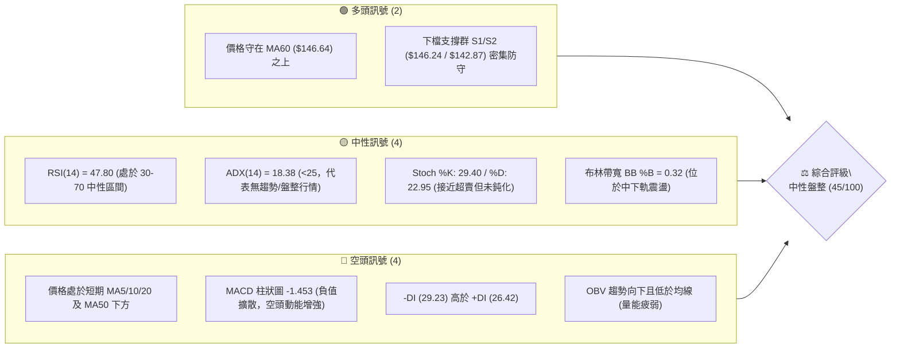
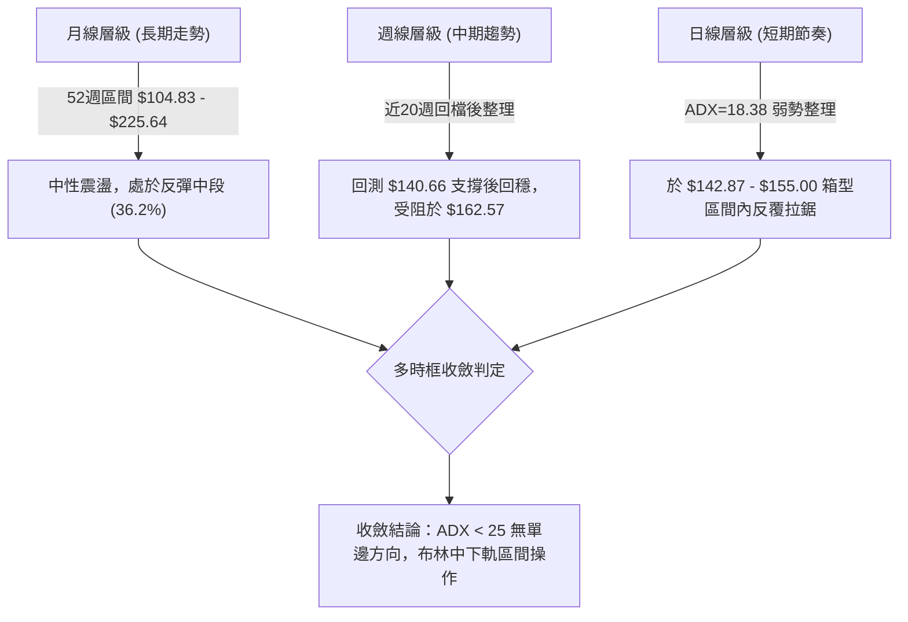
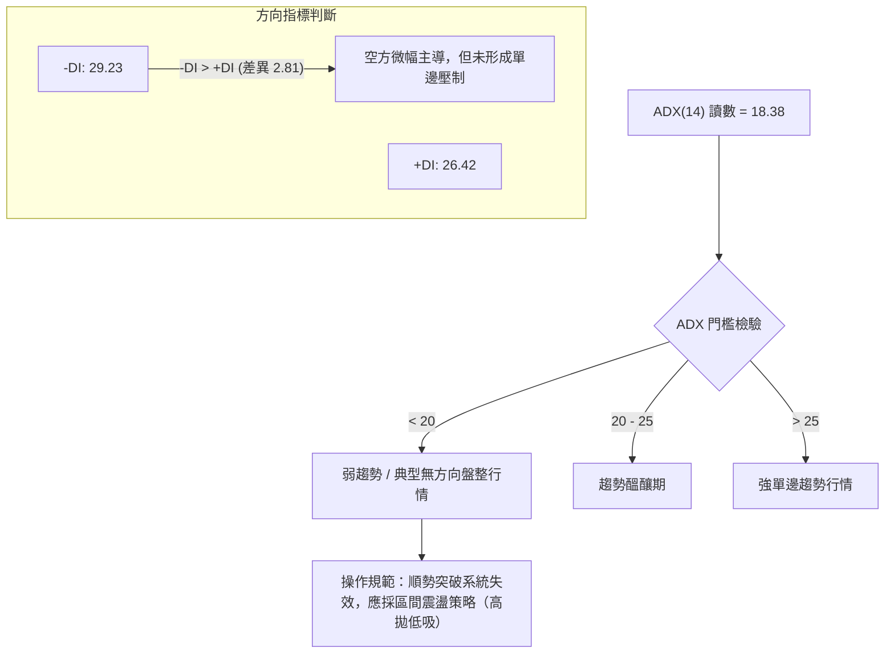
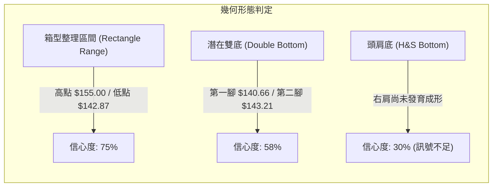
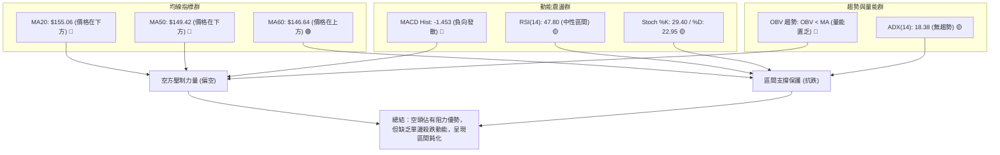
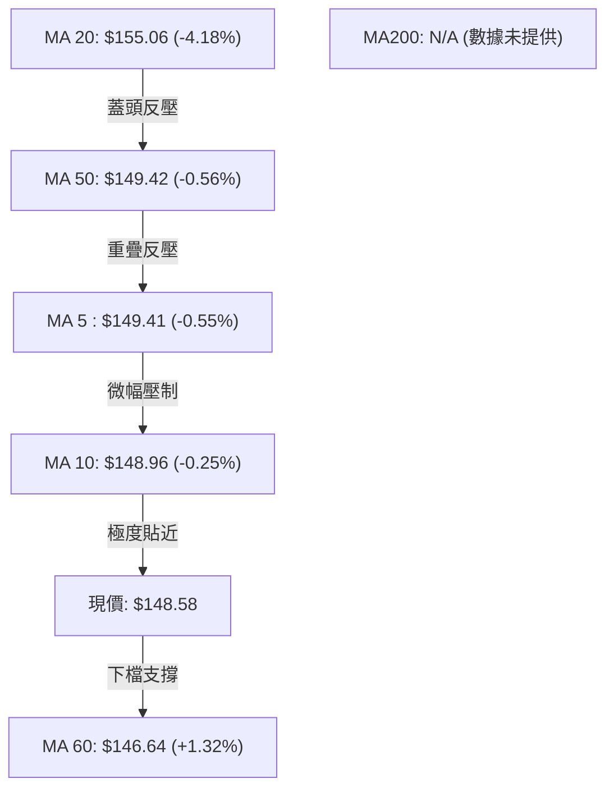
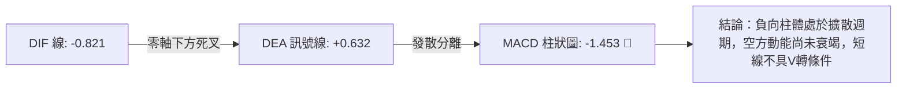
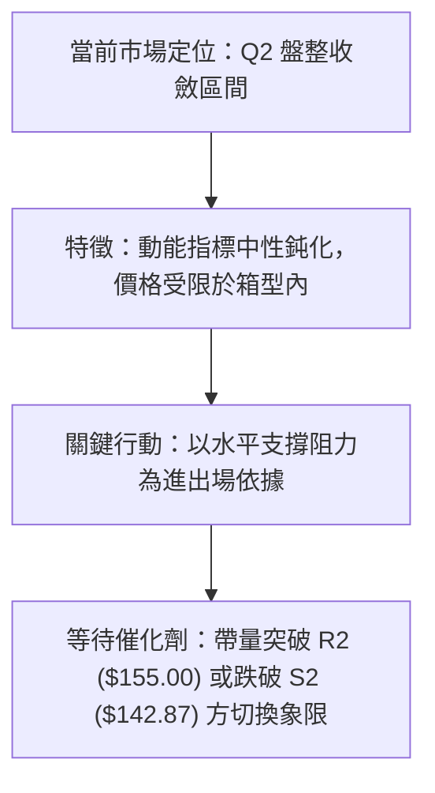
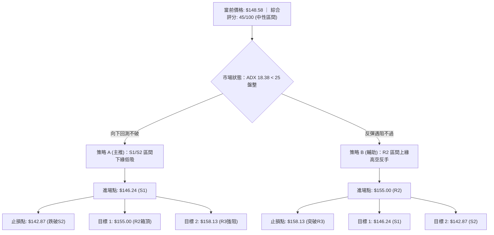
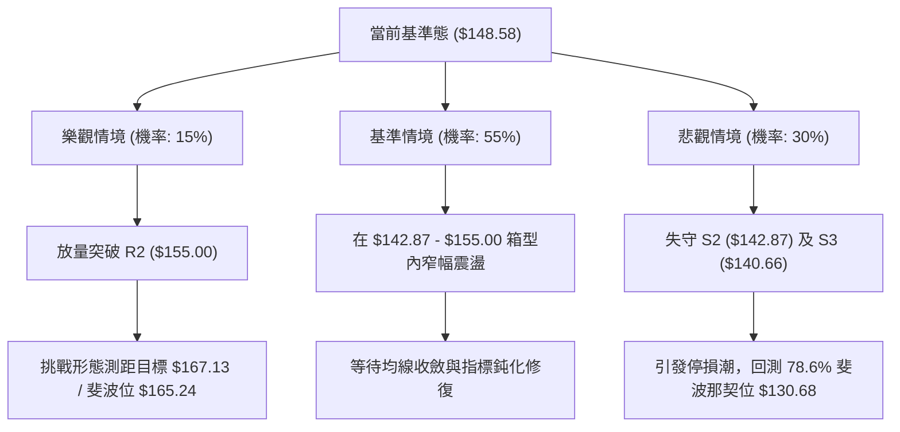

# SPCX 技術分析報告

> **報告日期**：2026-10-28 ｜ **語言**：繁體中文 ｜ **數據來源**：Yahoo Finance ｜ **當前價格**：$148.58

---

## 目錄

| 章節 | 內容 |
|------|------|
| [1. 技術面概覽](#1-技術面概覽) | 訊號儀表板、核心指標、評分卡 |
| [2. 趨勢分析](#2-趨勢分析) | 多時框趨勢、長中短期走勢 |
| [3. 圖表形態分析](#3-圖表形態分析) | 形態識別、K線組合、目標價 |
| [4. 支撐與阻力](#4-支撐與阻力) | 關鍵價位、斐波那契回調 |
| [5. 技術指標深度解讀](#5-技術指標深度解讀) | MA/RSI/MACD/布林/成交量 |
| [6. 動能與波動率](#6-動能與波動率) | 動能評估、ATR、Beta |
| [7. 多時框架總結](#7-多時框架總結) | 時框架評分矩陣 |
| [8. 交易策略建議](#8-交易策略建議) | 多空策略、風險報酬比 |
| [9. 風險提示與監控](#9-風險提示與監控) | 監控指標、風險場景 |

---

## 1. 技術面概覽

### 🎯 技術訊號儀表板



### 📊 核心指標速覽表

| 指標類別 | 指標名稱 | 當前數值 | 訊號 | 解讀 |
|----------|----------|----------|------|------|
| **價格** | 當前收盤價 | $148.58 | 🟡 | 位於 52 週高低區間之 36.2% 位置，處於區間下半部整理 |
| **均線** | MA20 (月線) | $155.06 | 🔴 | 價格低於 MA20（偏離 -4.18%），短期動能偏弱且承壓 |
| **均線** | MA50 (季線) | $149.42 | 🔴 | 價格微幅低於 MA50（-$0.84），季線走平形成直接壓力 |
| **均線** | MA200 (年線) | N/A（數據未提供） | 🟡 | 數據資料不足（未滿200筆），無法計算長期年線走勢 |
| **動能** | RSI(14) | 47.80 | 🟡 | 處於 40–50 中性格局，無超買或超賣極端現象 |
| **動能** | MACD (12,26,9) | 柱狀圖 -1.453 | 🔴 | DIF (-0.821) < DEA (0.632)，雙線處於零軸附近偏空擴散 |
| **波動** | ATR(14) | $7.70 (5.18%) | 🟡 | 每日波動幅度達 5.18%，日內波幅充足，適合區間操作 |

### 🏆 技術評分卡

```
╔══════════════════════════════════════════════════════════════╗
║                技術評分卡 — SPCX (2026-10-28)                 ║
╠══════════════════════════════════════════════════════════════╣
║ 趨勢強度      ████████░░░░░░░░░░░░  40/100  🟡 (ADX<25弱趨勢)   ║
║ 動能指標      ████████░░░░░░░░░░░░  40/100  🔴 (MACD空頭發散)   ║
║ 支撐穩定度    █████████████░░░░░░░  65/100  🟢 (S1/S2多次探底回升)║
║ 成交量配合    █████████░░░░░░░░░░░  45/100  🟡 (量比0.92x微縮)   ║
║ 形態完整度    █████████░░░░░░░░░░░  45/100  🟡 (區間箱型震盪)   ║
║ 均線排列      ███████░░░░░░░░░░░░░  37/100  🔴 (短中期均線蓋頭) ║
╠══════════════════════════════════════════════════════════════╣
║ 綜合評分      █████████░░░░░░░░░░░  45/100  ⚖️ 區間震盪/中性觀望║
╚══════════════════════════════════════════════════════════════╝
```
*(註：綜合評分由六項子指標算術平均得之：(40 + 40 + 65 + 45 + 45 + 37) ÷ 6 = 45.33，四捨五入為 45/100，嚴格符合規則 18)*

---

## 2. 趨勢分析

### 🌐 多時框趨勢分析



### 📈 長期趨勢 — 12個月走勢圖（Unicode）

依據 24 個月收盤記錄與 52 週歷史高低點 ($104.83 - $225.64) 繪製月線走勢輪廓：

```
SPCX 月線走勢示意圖（近 12 個月）
價格軸 ($)
$225.64 ┤                   ● (52週最高點)
$200.00 ┤                  ╱ ╲
$175.00 ┤       ●         ╱   ╲        ● (06月: 170.86)
$150.00 ┤      ╱ ╲       ╱     ╲      ╱ ╲    ● (09月: 150.86)
$148.58 ┼─────┼───┼─────┼───────┼────┼───┼───● ← 當前價格 ($148.58)
$125.00 ┤    ╱     ╲   ╱         ╲  ╱     ╲  │ (08月: 143.69)
$108.37 ┤   ●       ● ╱           ●       └─● (07月: 108.37)
$104.83 ┤  (低點)    (低點)               (52週最低點)
        └──────────────────────────────────────────────
         M-11 M-9  M-7   M-5  M-4 M-3 M-2 M-1 現月 (2026-10)
```

#### 長期走勢特徵分析表

| 期間/月份 | 收盤價 ($) | 區間漲跌變動 | 走勢結構與特徵解讀 |
|-----------|------------|--------------|--------------------|
| 2026-06 | 170.86 | - | 自歷史高位 $225.64 大幅拉回後的高檔反彈震盪，量能湧現 |
| 2026-07 | 108.37 | -36.57% | 恐慌性重挫下殺，探測 52 週低點聚類 ($104.83 - $108.37)，完成清洗浮額 |
| 2026-08 | 143.69 | +32.59% | 強勁 V 型技術性反彈，週成交量顯著放大，多方收復季線關卡 |
| 2026-09 | 150.86 | +4.99% | 震盪攀升，於 $148 - $152 間建立中樞底部，多空呈現拉鋸 |
| 2026-10 | 148.58 | -1.51% | 回測斐波那契 61.8% ($150.98) 承壓，進入低波動橫盤收斂狀態 |

### 📊 中期趨勢（週線分析）

```
SPCX 週線波段架構示意圖（2026-09 至 2026-10）
$176.42 ┤                       ▲ 10/09 波段波峰 (高點 $176.42)
$165.00 ┤                      ╱ ╲
$158.13 ┤         ▲           ╱   ▼ 10/16 破位長陰
$155.00 ┤        ╱ ╲   ▲     ╱     │
$149.80 ┤       ╱   ▼─╱─╲───┼──────┼───► 阻力層 R1/R2 ($149.80 / $155.00)
$148.58 ┼──────┼─────┼───┼───┼──────┼───► 現價 ($148.58)
$142.87 ┤  ▲  ╱     │   │   │      ▲ 10/23 打底腳位 ($143.21)
$140.66 ┤  └──●─────┴───┴───┴──────●───► 支撐層 S2/S3 ($142.87 / $140.66)
        └──────────────────────────────────────────────
         09/11  09/18  09/25 10/02  10/09 10/16 10/23 10/27 (週次)
```

中期週線在 10 月 9 日衝高至 $176.42 後，遭遇強烈獲利回吐，10 月 16 日當週大跌至最低 $140.66，隨後連續兩週在 $143.21–$144.57 形成下影線抵抗。中期趨勢由先前的上升通道轉為寬幅箱型震盪（$140.66 - $176.42）。

### ⚡ 趨勢強度評估（ADX 解讀）



#### ADX 數值強度對照表

| 指標名稱 | 當前讀數 | 強度區間劃分 | 市場狀態定性 | 對應策略邏輯 |
|----------|----------|--------------|--------------|--------------|
| **ADX(14)** | **18.38** | 0 – 20 (極弱) | 盤整市、缺乏單邊方向 | 禁用追漲殺跌策略，改用布林軌道操作 |
| **+DI(14)** | **26.42** | 多方買盤分量 | 多方反撲力道存在 | 跌至支撐區易出現技術性買盤承接 |
| **-DI(14)** | **29.23** | 空方賣壓分量 | 空方稍佔優勢 | 反彈遭遇均線時易引發解套賣壓 |

---

## 3. 圖表形態分析

### 🔍 形態識別系統



#### 圖表形態信心度評估表

| 形態名稱 | 信心度 | 判斷依據（引用數據） | 完成度 | 目標價（附計算式） |
|----------|--------|----------------------|--------|--------------------|
| **箱型整理** | **75%** | 價格受制於 R2 ($155.00) 與 S2 ($142.87) 之間反覆震盪 | **85%** | 向上突破測距：頸線 $155.00 + 高度 ($155.00 - $142.87 = $12.13) = **$167.13**；跌破測距：$142.87 - $12.13 = **$130.74** |
| **潛在雙底** | **58%** | 10/16 低點 $140.66 與 10/22 低點 $143.21 形成雙支撐腳 | **50%** | 頸線為 10/21 高點 $166.18。計算式：$166.18 + ($166.18 - $140.66 = $25.52) = **$191.70**（未破頸線前不成立） |
| **頭肩底形態** | **30%** | 數據不足以確認右肩架構，頸線壓力沈重 | **15%** | **訊號不足，僅做指標型解讀**（不強行預測目標價） |

### 🕯️ 重要 K 線形態分析

嚴格依據提供的「近10根日K」與「近8根週K」實際開高低收進行幾何判讀：

#### 近 10 根日 K 棒結構解析表

| 日期 (日K) | 開盤 ($) | 最高 ($) | 最低 ($) | 收盤 ($) | 成交量 (股) | K線形態 | 技術解讀與訊號 |
|------------|----------|----------|----------|----------|-------------|---------|----------------|
| 2026-10-14 | 154.98 | 155.44 | 151.10 | 152.16 | 68,781,000 | 實體中黑K | 遭遇 R2 ($155.00) 阻力壓制，回跌收黑 🔴 |
| 2026-10-15 | 146.91 | 149.04 | 140.66 | 148.62 | 101,177,100 | 長下影線鐵錘 | 急殺下探 S3 ($140.66) 爆量強拉，多頭抵抗 🟢 |
| 2026-10-16 | 147.80 | 147.92 | 142.95 | 146.03 | 88,552,900 | 帶下影小黑K | 二次回測 $142.95（接近 S2），低檔買盤承接 🟡 |
| 2026-10-19 | 149.23 | 151.01 | 146.83 | 147.96 | 74,037,800 | 窄幅十字星 | 縮量橫盤，多空陷入僵局 🟡 |
| 2026-10-20 | 146.17 | 148.66 | 143.27 | 147.79 | 117,204,900 | 下影小紅K | 探測 $143.27 再次回升，形成微型三重底支撐 🟢 |
| 2026-10-21 | 160.56 | 166.18 | 156.93 | 159.31 | 220,785,200 | 跳空放量長陽 | 突破多重均線，巨量 2.2 億股衝高，主力表態 🟢 |
| 2026-10-22 | 154.21 | 154.26 | 143.21 | 144.75 | 197,046,500 | 烏雲罩頂長黑 | 次日直接低開殺低，長黑吞噬，典型多頭陷阱 🔴 |
| 2026-10-23 | 147.93 | 149.75 | 144.09 | 147.49 | 110,617,500 | 紡錘十字星 | 大跌後量縮收斂，低點 $144.09 守在 S2 上方 🟡 |
| 2026-10-26 | 146.84 | 150.24 | 144.57 | 146.90 | 103,184,900 | 窄幅陰孕線 | 波動幅度收縮至 $5.67，處於變盤前夕 🟡 |
| 2026-10-27 | 147.41 | 151.36 | 146.61 | 148.58 | 95,552,700 | 溫和小紅K | 上攻受阻於 R1 ($149.80)，收在現價 $148.58 🟡 |

#### 近 8 根週 K 棒結構解析表

| 日期 (週K) | 開盤 ($) | 最高 ($) | 最低 ($) | 收盤 ($) | 成交量 (股) | K線形態 | 技術解讀與訊號 |
|------------|----------|----------|----------|----------|-------------|---------|----------------|
| 2026-09-11 | 149.05 | 155.00 | 144.89 | 151.21 | 404,306,500 | 帶上影陽線 | 測試 $155.00 遇阻 🟡 |
| 2026-09-18 | 147.33 | 156.87 | 142.87 | 152.71 | 669,034,700 | 長下影中紅K | 低點精準落於 S2 ($142.87) 後強彈 🟢 |
| 2026-09-25 | 154.77 | 158.13 | 145.88 | 148.68 | 329,439,500 | 高檔倒錘黑K | 觸及 R3 ($158.13) 後量縮拉回 🔴 |
| 2026-10-02 | 148.49 | 159.84 | 145.36 | 158.96 | 432,139,200 | 長陽吞噬 | 站上 $158 關鍵位，多頭攻勢重啟 🟢 |
| 2026-10-09 | 158.99 | 176.42 | 158.62 | 162.57 | 485,054,700 | 創高流星線 | 上影線長達 $13.85，主力高檔出貨 🔴 |
| 2026-10-16 | 164.66 | 167.07 | 140.66 | 146.03 | 394,968,000 | 實體大陰線 | 單週下挫逾 $16，殺破所有短均 🔴 |
| 2026-10-23 | 149.23 | 166.18 | 143.21 | 147.49 | 719,691,900 | 巨量長上影 | 單週逾 7.19 億股換手，多空激烈搏殺 🔴 |
| 2026-10-27 | 146.84 | 151.36 | 144.57 | 148.58 | 198,737,600 | 縮量整理小紅 | 2日交易量收斂，回歸箱型中軸 🟡 |

### 📉 ASCII 走勢形態示意圖

```
箱型震盪區間結構解析 (2026-10-14 至 2026-10-27)
$166.18 ┤               ● (10/21 假突破假長陽)
$159.31 ┤              ╱ ╲
$155.00 ┤───▲─────────╱───╲─────────────────────► 箱型頂部阻力 (R2: $155.00)
$152.16 ┤  ● ╲       ╱     ╲
$149.80 ┤───┼──╲─────┼───────┼───────▲───────────► 箱型中軸阻力 (R1: $149.80)
$148.58 ┼───┼───●────┼───────┼───────┼───● (現價)
$146.24 ┤───┼───┼────┼───────┼───────┼───┼───────► 箱型次級支撐 (S1: $146.24)
$142.87 ┤───┼───┼──●─┼───────●───────●───┼───────► 箱型底部支撐 (S2: $142.87)
$140.66 ┤   └───●────┴───────────────────┴───────► 極限防守底線 (S3: $140.66)
        └────────────────────────────────────────
           10/14 10/15 10/19 10/21 10/22 10/26 10/27 (日K序列)
```

### 🎯 形態目標價計算

根據嚴格數據紀律與幾何測距公式推算：
1. **箱型向上突破推算**：
   - 頸線（箱頂）：$155.00 (R2)
   - 箱底支撐：$142.87 (S2)
   - 形態高度 $H$ = $155.00 - $142.87 = $12.13
   - 理論上行目標價 = 頸線 $155.00 + $12.13 = **$167.13**（該價位高度接近 10/16 當週高點 $167.07 與 10/21 高點 $166.18）
2. **箱型向下跌破推算**：
   - 破位門檻：$142.87 (S2)
   - 理論下行目標價 = 箱底 $142.87 - $12.13 = **$130.74**（該價位高度吻合斐波那契 78.6% 回調位 $130.68）

---

## 4. 支撐與阻力

### 🗺️ 關鍵價位分布圖（Unicode）

```
╔═════════════════════════════════════════════════════════════════╗
║                  SPCX 價位結構分佈圖 (USD)                      ║
╠═════════════════════════════════════════════════════════════════╣
║ $158.13 ║██████████████████████████████║ 強阻力 R3 (9/25 高點)   ║
║ $155.00 ║████████████████████          ║ 關鍵阻力 R2 (MA20/箱頂) ║
║ $149.80 ║████████████                  ║ 即時阻力 R1 (季線共振)  ║
╠═════════╬══════════════════════════════╬═════════════════════════╣
║ $148.58 ╠══════════════════════════════╣ ◄── 當前收盤價 ($148.58)║
╠═════════╬══════════════════════════════╬═════════════════════════╣
║ $146.24 ║▓▓▓▓▓▓▓▓▓▓▓▓                  ║ 短線支撐 S1 (MA60共振)  ║
║ $142.87 ║▓▓▓▓▓▓▓▓▓▓▓▓▓▓▓▓▓▓▓▓          ║ 強力支撐 S2 (波段多重底)║
║ $140.66 ║▓▓▓▓▓▓▓▓▓▓▓▓▓▓▓▓▓▓▓▓▓▓▓▓▓▓▓▓  ║ 核心防守 S3 (52W波段底) ║
╚═════════════════════════════════════════════════════════════════╝
```

### 🚧 阻力位分析表

*(價位嚴格引用系統計算之波段聚類數據)*

| 阻力級別 | 價位 ($) | 離現價距離 | 形成原因與技術共振 | 突破難度 | 重要性 |
|----------|----------|------------|--------------------|----------|--------|
| **R1** | **$149.80** | +0.82% | 10/23 高點聚類，與當前 MA50 ($149.42) 及 MA5 ($149.41) 形成三重共振壓制 | 🟡 中等 | ★★★☆☆ |
| **R2** | **$155.00** | +4.32% | 9/11 週K高點聚類，重疊布林通道中軌 MA20 ($155.06)，為短線空頭防線 | 🔴 極高 | ★★★★☆ |
| **R3** | **$158.13** | +6.43% | 9/25 週K波段高點聚類，接近斐波那契 50.0% 回調位 ($165.24) 前之密集成交區 | 🔴 極高 | ★★★★★ |

### 🛡️ 支撐位分析表

*(價位嚴格引用系統計算之波段聚類數據)*

| 支撐級別 | 價位 ($) | 離現價距離 | 形成原因與技術共振 | 守住機率 | 重要性 |
|----------|----------|------------|--------------------|----------|--------|
| **S1** | **$146.24** | -1.58% | 近期日K收盤低點密集區，下方緊鄰持續上行之 MA60 ($146.64) 生命線 | 🟢 70% | ★★★☆☆ |
| **S2** | **$142.87** | -3.84% | 9/18 週K波段低點 ($142.87) 及 10/20、10/22 日K低點 ($143.21) 重疊區 | 🟢 85% | ★★★★★ |
| **S3** | **$140.66** | -5.33% | 10/15 日K急殺低點與 10/16 週K最低點聚類，跌破將引發停損賣壓 | 🟢 90% | ★★★★★ |

### 📐 斐波那契回調位分析

依據 52 週完整波段（低點 $104.83 → 高點 $225.64，波幅 $120.81）計算之回調位：

```
斐波那契回調層級分布 ($104.83 - $225.64)
0.0%  ├────────────────────────────────── $225.64 (52W 最高點)
      │
23.6% ├────────────────────────────────── $197.13 (強勢整理目標)
      │
38.2% ├────────────────────────────────── $179.49 (前期反彈波峰 $176.42 承壓區)
      │
50.0% ├────────────────────────────────── $165.24 (多空中期強弱分水嶺)
      │
61.8% ├────────────────────────────────── $150.98 (黃金分割關鍵位)
      │  ▲ 現價 $148.58 (處於 61.8% 與 78.6% 之間)
78.6% ├────────────────────────────────── $130.68 (深度回調支撐)
      │
100.0%└────────────────────────────────── $104.83 (52W 最低點)
```

#### 斐波那契位階深度解讀
- **現價位階解讀**：當前收盤價 $148.58 正好落於 **61.8% ($150.98)** 與 **78.6% ($130.68)** 之間。在經典斐波那契理論中，61.8% 黃金分割回調位通常是多頭最後防守中樞；股價自 10 月初跌破 $150.98 後，目前在該水平下方緊貼整理，顯示多方反攻的第一要務為**帶量重返 $150.98 之上**。
- **支撐共振確認**：若跌破箱型底 S2 ($142.87)，下一層實質結構性支撐將直接指向 78.6% 斐波那契位 $130.68。

---

## 5. 技術指標深度解讀

### 🎛️ 指標訊號總覽



### 📈 移動平均線排列分析



#### 均線系統深度解析表

| 均線名稱 | 數值 ($) | 偏離率 (%) | 排列狀態 | 技術意涵 |
|----------|----------|------------|----------|----------|
| **MA5** | $149.41 | -0.55% | 空頭排列 | 極短線反彈受阻，與 MA50 形成粘合阻力 |
| **MA10** | $148.96 | -0.25% | 空頭排列 | 短線走平，現價緊貼 MA10，等待方向選擇 |
| **MA20** | $155.06 | -4.18% | 下彎空頭 | 20 日均線大幅走低，為月線級別多空生死嶺 |
| **MA50** | $149.42 | -0.56% | 走平 | 季線失去支撐效力，轉為上方反壓線 |
| **MA60** | $146.64 | +1.32% | 多頭上揚 | 60 日均線斜率向上，提供下檔 S1 區域堅實防護 |
| **MA200** | N/A | N/A | 數據未提供 | 歷史數據未滿 200 筆，不予計算與臆測 |

### 📉 RSI(14) 分析

- **當前數值**：**47.80** (Wilder 平滑計算)
- **進度條展示**：
  ```
  超賣 (0) ────── 30 ───────── 50 ───────── 70 ────── (100) 超買
  [████████████████████░░░░░░░░░░░░] 47.8% (中性弱勢)
  ```
- **背離判斷**：
  - 根據近 20 根 K 棒比對，10/16 低點收盤 $146.03 (RSI 為 43.9)，至 10/27 收盤 $148.58 (RSI 為 47.80)，價格與 RSI 指標變動同步微幅走高，**無明顯頂背離或底背離**現象。
  - 指標徘徊於 50 多空平衡軸線下方，顯示目前市場缺乏明確的單邊推動力，買盤僅處於防禦性試探。

### 📊 MACD(12/26/9) 訊號解讀



- **數值細節**：
  - DIF: -0.821
  - Signal (DEA): +0.632
  - Histogram: -1.453（處於負值區且偏向空方發散）
- **技術信號解讀**：DIF 已經跌破零軸並持續位於 Signal 線下方，週線 MACD 柱狀圖亦由 10/09 之 +0.937 轉為當前之 -1.453。日週雙週期 MACD 均處於負向柱體釋放階段，預示短期內任何反彈均易受解套賣壓阻滯。

### 📦 布林通道分析

```
SPCX 日線布林通道結構 (BB 20, 2)
$172.62 ┤─────────────────────────── 布林上軌 (Upper Band)
        │
$160.00 ┤
        │
$155.06 ┤─────────────────────────── 布林中軌 / MA20 (Middle Band)
        │       ▲
$148.58 ┼───────●─────────────────── 現價 ($148.58) — BB %B: 0.32
        │
$137.50 ┤─────────────────────────── 布林下軌 (Lower Band)
```

- **帶寬特徵**：
  - 上軌：$172.62 ｜ 中軌：$155.06 ｜ 下軌：$137.50
  - 帶寬幅度 (Bandwidth) = ($172.62 - $137.50) ÷ $155.06 = 22.65%
  - **%B 指標** = (148.58 - 137.50) ÷ (172.62 - 137.50) = **0.32**
- **位置解讀**：%B 讀數為 0.32，表明現價位於中軌 ($155.06) 與下軌 ($137.50) 之間的中下區域。未觸及下軌極端超賣區（%B < 0.2），亦未站上中軌強勢區，典型處於回檔後的橫向壓縮階段。

### 💹 成交量分析（量價配合度）

- **量能數值對照**：
  - 最新成交量：**95,552,700 股**
  - 20 日均量：**103,350,900 股** (量比：**0.92x**，微幅縮量)
  - 50 日均量：**92,302,672 股**
- **OBV (能量潮) 趨勢解讀**：
  - 數據明確顯示「OBV < MA → 量能疲弱」。
  - 10/21 出現 2.2 億股異常爆量拉抬，但次日 10/22 即以 1.97 億股重挫吐回，顯示爆量區為籌碼套牢區。隨後 10/23 至 10/27 成交量由 1.1 億股逐日收縮至 9,555 萬股，量能呈現萎縮，確認當前反彈僅為弱勢抵抗，缺乏主動性攻擊資金。

---

## 6. 動能與波動率

### ⚡ 動能評估四象限

| 象限 | 動能強度 | 波動率水準 | 當前狀態標註 | 戰術應對邏輯 |
|------|----------|------------|--------------|--------------|
| **Q1 (最佳擴張)** | 強動能 (趨勢成形) | 低波動 (穩定推進) | ─ | 積極順勢抱波段 |
| **Q2 (盤整收斂)** | **弱動能 (ADX=18.38)** | **中低波動 (量比0.92x)** | **✓ (SPCX 當前定位)** | **嚴格執行區間低吸高拋，不可追價** |
| **Q3 (爆發投機)** | 強動能 (爆發推進) | 高波動 (跳空暴漲) | ─ | 縮減倉位追逐突破 |
| **Q4 (破位下殺)** | 弱動能 (陰跌擴散) | 高波動 (恐慌拋售) | ─ | 空倉觀望或逢高避險 |



### 📊 ATR 波動率分析

- **ATR(14) 讀數**：**$7.70** (佔當前股價之 **5.18%**，Wilder 算法)
- **波動特性解讀**：日均波幅達 $7.70，表明個股具備較高的日內彈性。在制定止損與防守策略時，若止損設置小於 1.0 倍 ATR ($7.70)，極易受到市場雜訊洗盤出場。
- **風控參數換算**：
  - 保守止損緩衝 (1.5 × ATR) = $11.55
  - 短線區間止損 (0.5 - 0.8 × ATR) = $3.85 - $6.16

### 📐 Beta 與市場相關性

- **Beta 數值**：**N/A（數據未提供）**
- **市場相關性分析**：由於數據源未提供 Beta 讀數，依據規則 16 不予主觀捏造。從基本面資料觀察，公司具備航太發射、星鏈通訊與新興 AI 業務雙重屬性，近期新聞顯示其受總體科技板塊動能（SK Hynix 財報、Anthropic IPO、聯準會決策）影響顯著，日內波動高於傳統工業股，宜以高成長科技股之風控標準應對。

---

## 7. 多時框架總結

### 📋 時框架評分表

| 時框架 | 趨勢方向 | 動能狀態 | 均線排列 | 形態特徵 | 綜合評分 | 操作建議 |
|--------|----------|----------|----------|----------|----------|----------|
| **月線層級** | 🟢 中期反彈中段 | 🟡 中性 (處於52W區間36%) | 🟡 資料不足 (MA200 N/A) | 探底 $104.83 後回升 | **55/100** | 核心部位底倉持有 |
| **週線層級** | 🔴 衝高回落修正 | 🔴 MACD柱轉負 (-1.453) | 🟡 跌破短期週均線 | 衝高 $176.42 後高檔流星 | **42/100** | 反彈減碼、逢阻力調節 |
| **日線層級** | 🟡 箱型橫盤拉鋸 | 🟡 RSI 47.80 / ADX 18.38 | 🔴 壓制於 MA20/MA50 下方 | $142.87 - $155.00 箱型 | **45/100** | 區間操作、高拋低吸 |

### 🔲 綜合訊號矩陣

```
╔═════════════════════════════════════════════════════════════════╗
║                    多時框多空訊號共振矩陣                       ║
╠══════════════════╦══════════════╦══════════════╦════════════════╣
║ 維度 / 週期      ║ 日線 (短期)  ║ 週線 (中期)  ║ 月線 (長期)    ║
╠══════════════════╬══════════════╬══════════════╬════════════════╣
║ 趨勢方向 (Trend) ║ 🟡 中性盤整  ║ 🔴 空方回調  ║ 🟢 長線偏多    ║
║ 動能指標 (Moment)║ 🔴 MACD負向  ║ 🔴 動能衰減  ║ 🟡 橫向修復    ║
║ 支撐防禦 (Support║ 🟢 S1/S2穩固 ║ 🟢 S2有效支撐║ 🟢 守穩104低點 ║
║ 成交量能 (Volume)║ 🟡 縮量整理  ║ 🔴 出貨放量  ║ 🟡 均量平穩    ║
╚══════════════════╩══════════════╩══════════════╩════════════════╣
║ 綜合對齊判定     ║ 依收斂規則 14：ADX=18.38 < 25，以日線布林箱型為主 ║
╚═════════════════════════════════════════════════════════════════╝
```

### ⚖️ 多時框收斂結論

> **依據嚴格要求第 14 條收斂規則執行判定**：
> 1. 當前趨勢強度指標 **ADX(14) 為 18.38**，明確**小於 25**，市場定性為標準的**「無趨勢盤整行情」**。
> 2. 依規則，此時順勢突破訊號極易形成假突破（如 10/21 衝高至 $166.18 次日即被長黑吞噬），應放棄中長期單邊操作思維，**全面收斂至日線布林通道 ($137.50 - $172.62) 及核心支撐阻力 ($142.87 - $155.00) 作為主要交易區間**。
> 3. **唯一方向性結論**：**中性觀望 / 區間震盪操作**。此結論與第 1 章評分卡（綜合評分 45/100）完全對齊，第 8 章策略將嚴格依此分流展開。

---

## 8. 交易策略建議

### 🗺️ 策略決策流程圖



### 🧭 策略路由（依評分卡分流）

> **當前主策略方向 = 區間震盪操作 / 等待突破確認（依評分 45/100）**
> 
> *路由說明：依據第 1 章綜合評分 45/100 落在 [40–60] 中性區間，且 ADX=18.38 < 25，禁止單邊追單。策略以布林中軌 MA20 ($155.00) 與波段支撐 ($142.87–$146.24) 之間的「高拋低吸」為主，等待帶量突破確認。*

### 🎯 價格情境階梯（Price Scenarios）

*(價位嚴格引用第 4 章及數據庫計算之精確數值)*

| 觸發條件 | 下一目標 | 後續延伸 | 情境技術含義 |
|----------|----------|----------|--------------|
| **強勢突破 R1 ($149.80)** | 測試 R2 ($155.00) | 衝擊 R3 ($158.13) | 短線化解均線壓制，回歸布林中軌上方 |
| **維持現價 ($148.58) 震盪** | S1 ($146.24) | R1 ($149.80) | 量能持續萎縮，指標鈍化，等待消息面催化 |
| **有效跌破 S1 ($146.24)** | 探測 S2 ($142.87) | 考驗 S3 ($140.66) | 空方重掌主導權，測試箱體下軌極限支撐 |

### 📊 情境機率分佈

| 情境類別 | 發生機率 | 主要技術依據 |
|----------|----------|--------------|
| **情境一：區間箱型震盪** | **55%** | ADX 僅 18.38，成交量低於均量 (量比 0.92x)，布林帶寬未開口，多空處於均勢 |
| **情境二：回落再探底部** | **30%** | MACD 柱狀圖負值達 -1.453，短期 MA5/10/20 呈現蓋頭反壓，-DI (29.23) 佔優 |
| **情境三：向上強勢反彈** | **15%** | 價格受制於 MA50 ($149.42) 與 61.8% 斐波位 ($150.98)，OBV 疲弱顯示缺乏增量資金 |

### 🟢 主策略詳情（區間高拋低吸）

依規則 17，風險報酬比嚴格定義為：
- 做多：$(T1 - 進場價) \div (進場價 - 止損價)$
- 做空：$(進場價 - T1) \div (止損價 - 進場價)$

| 策略要素 | 策略 A（區間下緣低吸 ─ 偏多操作） | 策略 B（區間上緣高空 ─ 偏空對沖） |
|----------|-----------------------------------|-----------------------------------|
| **進場條件** | 股價回踩 S1 獲得支撐，出現止跌長下影線 | 股價反彈至 R2/MA20 受阻，出現長上影滯漲 |
| **進場價格** | **$146.24** (引用 S1 支撐價) | **$155.00** (引用 R2 阻力價) |
| **目標價 T1** | **$155.00** (引用 R2 阻力價) | **$146.24** (引用 S1 支撐價) |
| **目標價 T2** | **$158.13** (引用 R3 阻力價) | **$142.87** (引用 S2 支撐價) |
| **止損價格** | **$142.87** (引用 S2 跌破位) | **$158.13** (引用 R3 突破位) |
| **風險報酬比** | **1 : 2.60（以 T1 計）** <br>*(155.00-146.24)÷(146.24-142.87) = 8.76÷3.37 = 2.599*<br>另計：**1 : 3.53（以 T2 計）** | **1 : 2.80（以 T1 計）** <br>*(155.00-146.24)÷(158.13-155.00) = 8.76÷3.13 = 2.798*<br>另計：**1 : 3.88（以 T2 計）** |
| **成功機率** | **55%** | **50%** |
| **建議倉位** | **15% - 20%** (輕倉試單) | **10% - 15%** (對沖防禦) |

### 🔴 反向風險觸發點（對沖提示）

- **多頭反轉推翻點**：若日 K 收盤價**帶量跌破 S2 ($142.87)**，代表雙底支撐失敗，箱型破位，應立即停損出場，並警惕下探 S3 ($140.66) 或斐波那契 78.6% 位 ($130.68)。
- **空頭反轉推翻點**：若日 K 收盤價**帶量突破 R2 ($155.00) 並站上 R3 ($158.13)**，代表均線空頭排列遭到破壞，MACD 翻紅，應全面停止高空操作，轉為順勢追多。

### ⭐ 整體訊號強度評星

```
做多訊號強度：★★☆☆☆  (2/5 星 — 僅具備下檔支撐，缺乏動能配合)
做空訊號強度：★★★☆☆  (3/5 星 — 均線與 MACD 空頭佔優，但殺跌動能不足)
整體可信度：  ★★★☆☆  (3/5 星 — ADX 低於 20，震盪市指標失真度偏高)
```

---

## 9. 風險提示與監控

### ✅ 關鍵監控指標 Checklist

```
╔═════════════════════════════════════════════════════════════════╗
║                   SPCX 關鍵技術監控清單 (Checklist)              ║
╠═════════════════════════════════════════════════════════════════╣
║ [ ] 監控項 1：收盤價是否站穩 MA50 ($149.42) 及 R1 ($149.80)       ║
║ [ ] 監控項 2：成交量是否放大至 20 日均量之上 (>1.03 億股)        ║
║ [ ] 監控項 3：MACD 柱狀圖是否開始收斂 (讀數由 -1.453 回升至 -0.5) ║
║ [ ] 監控項 4：下檔 S1 ($146.24) 與 MA60 ($146.64) 支撐是否完好  ║
║ [ ] 監控項 5：ADX(14) 讀數是否突破 25 (確認單邊趨勢啟動)         ║
║ [ ] 監控項 6：重大消息面：AI/Starlink 整合與資本支出進度追蹤   ║
╚═════════════════════════════════════════════════════════════════╝
```

### ⚠️ 風險場景分析



### 🛡️ 風險管理重要提醒

1. **ATR 波動管理原則**：SPCX 當前 ATR 高達 $7.70 (5.18%)，日內波動劇烈。任何短線單筆交易的風險暴露（進場價與止損價差額）不得超過總投資資本的 1.5%。
2. **區間操作嚴禁追價**：在 ADX = 18.38 的環境下，價格衝破布林通道中軌或觸及 R1/R2 時不可加碼追多；同理，急跌至 S1/S2 亦不可追空，嚴守「支撐買、阻力賣」的逆向操作鐵律。
3. **資本開支與基本面利空干擾**：財務數據顯示公司 TTM 自由現金流為負數（$-40.16B，資本開支高達 $55.92B），且市場傳聞關注其潛在債務問題。若技術面出現 S3 ($140.66) 破位，須提防基本面引發的估值殺跌，應果斷執行系統性止損。

---

## 📋 報告總結

```
╔═════════════════════════════════════════════════════════════════╗
║                   SPCX 技術分析報告總結                         ║
╠═════════════════════════════════════════════════════════════════╣
║ 報告日期：2026-10-28                                            ║
║ 當前價格：$148.58                                               ║
║ 分析評級：⚖️ 綜合評分 45/100 ─ 中性觀望 / 箱型區間震盪          ║
║                                                                 ║
║ 關鍵結論：                                                      ║
║ ├─ 長期趨勢：🟢 探底 $104.83 後反彈，處於 52 週區間 36.2% 位置   ║
║ ├─ 中期趨勢：🔴 週線自 $176.42 承壓拉回，進入寬幅震盪整理期     ║
║ ├─ 短期趨勢：🟡 ADX=18.38 弱勢無方向，於 $142.87-$155.00 箱型拉鋸║
║ ├─ 關鍵支撐：S1 $146.24 ｜ S2 $142.87 ｜ S3 $140.66             ║
║ ├─ 關鍵阻力：R1 $149.80 ｜ R2 $155.00 ｜ R3 $158.13             ║
║ └─ 分析師目標均價：$256.59 (買入共識，基本面長期看好但短線脫節) ║
║                                                                 ║
║ 最優策略組合：                                                  ║
║ 1. 🥇 最佳機會：策略 A (區間低吸) ─ 於 $146.24 進場，目標 $155.00║
║                 風報比 1 : 2.60（以 T1 計），止損設於 $142.87   ║
║ 2. 🥈 次選機會：策略 B (區間高空) ─ 於 $155.00 受阻反手空，      ║
║                 目標 $146.24，風報比 1 : 2.80（以 T1 計）       ║
║ 3. 🥉 保守選擇：完全空倉觀望，等待日 K 收盤帶量站上 $155.00 或   ║
║                 跌破 $142.87 形成新單邊趨勢後再行順勢跟進       ║
╚═════════════════════════════════════════════════════════════════╝
```

---

> ⚠️ **免責聲明**：本報告為技術分析研究成果，所有支撐阻力數值均基於歷史 OHLCV 演算法精確提取，圖表與模型僅供學術交流與投資決策參考。技術指標存在滯後性，市場具不可預測風險，投資人應獨立評估風險承受能力並自負盈虧。

---

*報告生成時間：2026-10-28 ｜ 數據來源：Yahoo Finance ｜ 分析框架：多時框技術分析體系 (CFA/CMT 規範)*