# SPCX 技術分析報告

> **報告日期**：2026-10-29 ｜ **語言**：繁體中文 ｜ **數據來源**：Yahoo Finance ｜ **當前價格**：$145.23

---

## 目錄

| 章節 | 內容 |
|------|------|
| [1. 技術面概覽](#1-技術面概覽) | 訊號儀表板、核心指標、評分卡 |
| [2. 趨勢分析](#2-趨勢分析) | 多時框趨勢、長中短期走勢 |
| [3. 圖表形態分析](#3-圖表形態分析) | 形態識別、K線組合、目標價 |
| [4. 支撐與阻力](#4-支撐與阻力) | 關鍵價位、斐波那契回調 |
| [5. 技術指標深度解讀](#5-技術指標深度解讀) | MA/RSI/MACD/布林/成交量 |
| [6. 動能與波動率](#6-動能與波動率) | 動能評估、ATR、Beta |
| [7. 多時框架總結](#7-多時框架總結) | 時框架評分矩陣 |
| [8. 交易策略建議](#8-交易策略建議) | 多空策略、風險報酬比 |
| [9. 風險提示與監控](#9-風險提示與監控) | 監控指標、風險場景 |
| [📋 報告總結](#-報告總結) | 關鍵技術結論與最優策略組合 |

---

## 1. 技術面概覽

### 🎯 技術訊號儀表板

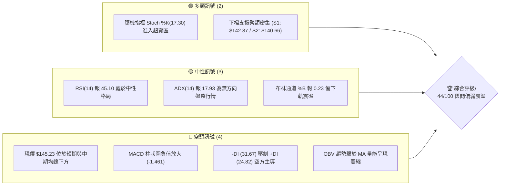

### 📊 核心指標速覽表

| 指標類別 | 指標名稱 | 當前數值 | 訊號 | 解讀 |
|:---|:---|:---|:---:|:---|
| **價格** | 當前收盤價 | $145.23 | 🟡 | 位於52週區間($104.83–$225.64)的33.4%百分位，低檔震盪 |
| **均線** | 短期 MA5 | $146.59 | 🔴 | 現價低於 MA5 (-0.93%)，極短線受制於均線壓制 |
| **均線** | 短期 MA20 | $154.78 | 🔴 | 現價低於 MA20 (-6.17%)，短期波段偏空格局尚未扭轉 |
| **均線** | 中期 MA50 | $149.46 | 🔴 | 現價低於 MA50 (-2.83%)，中期反彈動能遭遇均線反壓 |
| **均線** | 長期 MA200 | N/A (數據未提供) | 🟡 | 數據庫歷史不足200日，無法確認長線年線分界 |
| **動能** | RSI(14) | 45.10 | 🟡 | 位於 30–70 中性區間偏下緣，未見背離但動能微弱 |
| **動能** | MACD (12,26,9) | -1.194 / 0.267 | 🔴 | MACD 線低於 Signal 線，Hist 報 -1.461，處於死叉調整期 |
| **動能** | Stoch %K / %D | 17.30 / 22.35 | 🟢 | 雙線落入 20 以下嚴重超賣區，短線蘊蓄技術性反彈動能 |
| **趨勢** | ADX(14) | 17.93 | 🟡 | ADX < 25 判定為典型無方向之盤整收斂行情 |
| **通道** | 布林通道 | $136.76 – $172.79 | 🟡 | 中軌為 $154.78，%B 為 0.23，股價正測試通道下半區 |
| **量能** | 成交量 / 20日均量 | 98.24M / 104.30M | 🔴 | 量比 0.94x，OBV 疲軟，量能未有效配合多頭推升 |
| **波動** | ATR(14) | $7.61 (5.24%) | 🟡 | 單日波動幅度維持 5.24%，處於中等偏高正常波動區間 |

### 🏆 技術評分卡

```
技術評分卡 — SPCX (2026-10-29)
══════════════════════════════════════════════════════════════════════
趨勢強度 (Trend)         ███████░░░░░░░░░░░░░  36/100  🔴 空頭控盤
動能指標 (Momentum)      ████████░░░░░░░░░░░░  42/100  🟡 弱勢中性
支撐穩定度 (Support)     █████████████░░░░░░░  64/100  🟢 低檔防守
成交量配合 (Volume)      ████████░░░░░░░░░░░░  38/100  🔴 量能萎縮
形態完整度 (Pattern)     ██████████░░░░░░░░░░  52/100  🟡 區間收斂
均線排列 (MA Alignment)  ██████░░░░░░░░░░░░░░  32/100  🔴 蓋頭排列
══════════════════════════════════════════════════════════════════════
綜合評分 (Overall)       █████████░░░░░░░░░░░  44/100  評級：中性偏弱震盪
══════════════════════════════════════════════════════════════════════
（註：綜合評分由六項子評分算術平均得出：(36 + 42 + 64 + 38 + 52 + 32) / 6 = 44 分）
```

---

## 2. 趨勢分析

### 🌐 多時框趨勢分析

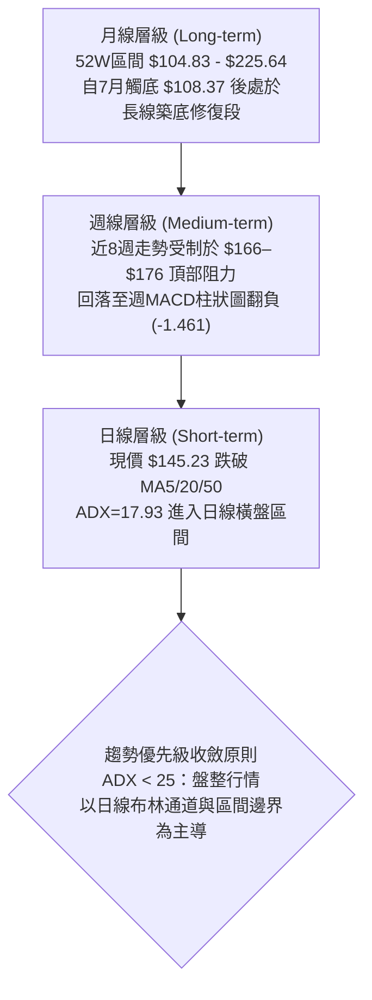

### 📈 長期趨勢 — 12個月走勢圖（Unicode）

依據月度收盤價數據（含歷史波段高低點），繪製 SPCX 歷史波段走勢圖：

```
SPCX 月線走勢示意圖（價格軸 $）
$230 ┤                                      ● (52W High $225.64)
$210 ┤                                 
$190 ┤                            
$170 ┤● (2026-06: $170.86)                  
$150 ┤                     ● ($143.69)   ● ($150.86)   ● ($145.23 現價)
$130 ┤                                
$110 ┤      ● (2026-07: $108.37 / 52W Low $104.83)
     └─────────────────────────────────────────────────────────────
        2026-06   2026-07    2026-08       2026-09       2026-10
```

#### 月度走勢特徵分析表

| 月份 | 收盤價 | 走勢特徵 | 關鍵技術信號 |
|:---|:---:|:---|:---|
| **2026-06** | $170.86 | 高檔回落 | 遭遇上方強拋壓，自 52 週高點 $225.64 展開主跌段 |
| **2026-07** | $108.37 | 單月重挫 -36.57% | 探底至 52 週最低點 $104.83，空頭動能極度宣洩 |
| **2026-08** | $143.69 | 強勁報復性反彈 +32.59% | 觸底大陽線修復乖離，重回 $140 關卡上方 |
| **2026-09** | $150.86 | 溫和推升 +4.99% | 均線開始趨平，多空於斐波那契 61.8% ($150.98) 展開爭奪 |
| **2026-10** | $145.23 | 橫盤微挫 -3.73% | 衝高回落（高點一度達 $176.42），收在區間中下緣 |

### 📊 中期趨勢（週線分析）

```
SPCX 週線波段結構與阻力支撐示意圖
$180 ┤                            ▲ 10/09 高點 $176.42（波段假突破）
$170 ┤                          ╭───╮
$160 ┤                ▲ 09/25   │   │  ▲ 10/23 反彈高點 $166.18
$150 ┤  ● 09/11      $158.13   │   ╰─────── R1: $149.80 / R2: $155.00
$145 ┤  $151.21 ───► ◄─────────────────────── 現價: $145.23
$140 ┤  ▼ 09/18      ▼ 10/16 低點 $140.66
$130 ┤  $142.87 ───► ◄─────────────────────── S1: $142.87 / S2: $140.66
     └────────────────────────────────────────────────────────────────
        09-11   09-18   09-25   10-02   10-09   10-16   10-23   10-28
```

週線走勢顯示，SPCX 在 10 月初創下 $176.42 高點後，連續三週呈現「長上影線」與「帶量下殺」，週 MACD 柱狀圖由正轉負（10-09 為 +0.937，10-16 驟降至 -1.979，當前為 -1.461），顯示中期反彈已暫告一段落，目前進入 $140.66 至 $158.13 的寬幅箱型震盪。

### ⚡ 趨勢強度評估（ADX 解讀）

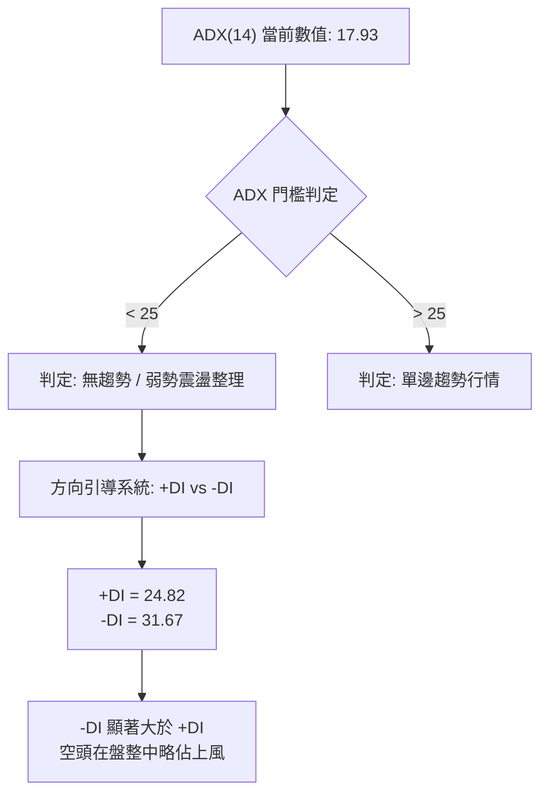

#### ADX 趨勢強度對照

| 指標變數 | 當前讀數 | 門檻區間 | 技術含義 |
|:---|:---:|:---:|:---|
| **ADX(14)** | **17.93** | < 25 (弱趨勢/盤整) | 市場缺乏單邊推動力，任何追漲殺跌策略均面臨雙向磨損風險 |
| **+DI (多頭動向)** | **24.82** | 輔助線 | 多方進攻意願受抑，無法發動持續性波段推升 |
| **-DI (空頭動向)** | **31.67** | 輔助線 | 空方力量暫時主導日常定價，但未達極端單邊爆發水平 |
| **趨勢行情判定** | **盤整行情** | ADX < 25 | **收斂規則**：禁止過度依賴順勢指標，以支撐阻力區間操作為核心 |

---

## 3. 圖表形態分析

### 🔍 形態識別系統

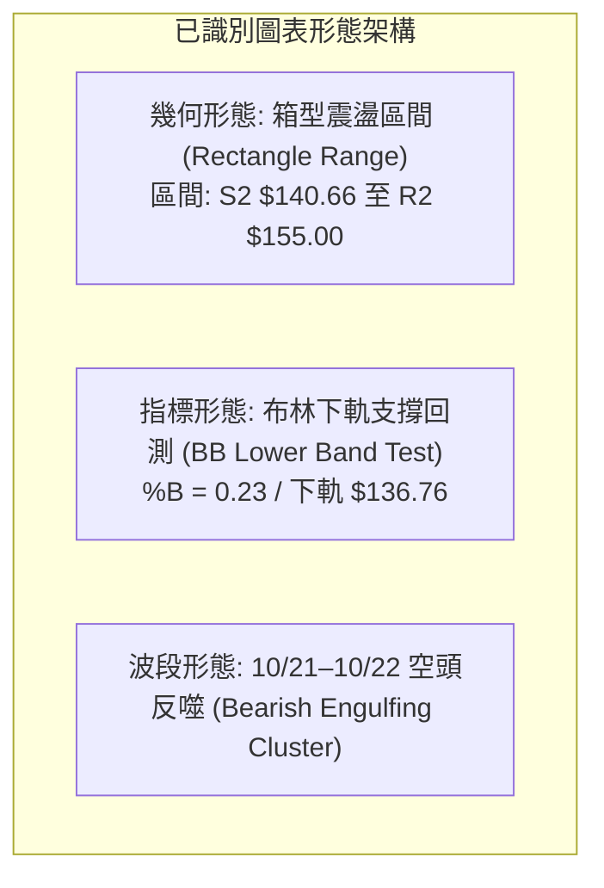

#### 形態信心度與目標價評估表

| 形態名稱 | 信心度 | 判斷依據（引用數據） | 完成度 | 目標價（附計算式） |
|:---|:---:|:---|:---:|:---|
| **矩形箱型整理** | **75%** | 底部密集測試 S2 ($140.66) 與 S1 ($142.87)；頂部受阻於 R1 ($149.80) 與 R2 ($155.00) | 85% | **箱頂目標 $155.00**；若有效跌破 S2，向下等距目標 = $140.66 - ($155.00 - $140.66) = **$126.32**（數據中未偵測到該價位，僅供高度測算參考，下方嚴格採用 S3 $130.39） |
| **潛在雙重底** | **45%** | 兩次下探低點：10/15 低點 $140.66 與 10/28 低點 $142.13，但頸線尚未突破 | 40% | **信心度 < 50%：訊號不足，僅做指標型解讀**，不預設雙底突破目標價 |
| **均線死叉壓制** | **80%** | MA5 ($146.59) 下穿 MA60 ($146.97) 及 MA20 ($154.78) | 90% | 下檔尋求 S1 **$142.87** 與 S2 **$140.66** 防守確認 |

### 🕯️ 重要K線形態分析

嚴格依據提供的「近10根日K」與「近8根週K」之開高低收數據進行客觀解讀：

#### 近10根日K形態精解

| 日期 (日K) | 開盤 | 最高 | 最低 | 收盤 | 成交量 | K線形態名稱 | 實質解讀與技術涵義 | 多空訊號 |
|:---:|:---:|:---:|:---:|:---:|:---:|:---|:---|:---:|
| **10-15** | 146.91 | 149.04 | 140.66 | 148.62 | 101.18M | **長下影錘頭陽線** | 最低探至 S2 ($140.66) 後湧入逢低買盤拉升，確認下檔支撐強勁 | 🟢 |
| **10-16** | 147.80 | 147.92 | 142.95 | 146.03 | 88.55M | **低檔縮量小陰線** | 回測 S1 ($142.87) 附近收腳，量能萎縮顯示拋壓趨緩 | 🟡 |
| **10-19** | 149.23 | 151.01 | 146.83 | 147.96 | 74.04M | **衝高回落小陰線** | 盤中上衝 $151.01 遭遇斐波那契 61.8% ($150.98) 反壓，追高力道不足 | 🔴 |
| **10-20** | 146.17 | 148.66 | 143.27 | 147.79 | 117.20M | **增量下影小陽線** | 再次回測下襠不破，成交量放大至 1.17 億股，蓄勢上攻 | 🟢 |
| **10-21** | 160.56 | 166.18 | 156.93 | 159.31 | 220.79M | **跳空放量大陽線** | 評級上調刺激跳空暴漲，突破 R2/R3，但留上影線暗示獲利了結盤湧出 | 🟢 |
| **10-22** | 154.21 | 154.26 | 143.21 | 144.75 | 197.05M | **巨量長黑反噬線** | 開盤即走低，近2億股天量回吐，直接摜穿跳空缺口，形成嚴重套牢區 | 🔴 |
| **10-23** | 147.93 | 149.75 | 144.09 | 147.49 | 110.62M | **低檔紡錘十字線** | 急跌後的多空暫態平衡，下探 $144.09 獲守，市場轉入觀望 | 🟡 |
| **10-26** | 146.84 | 150.24 | 144.57 | 146.90 | 103.18M | **高檔受阻十字陰線** | 反彈再度於 R1 ($149.80) 上方遇阻，實體極小，動能衰竭 | 🟡 |
| **10-27** | 147.41 | 151.36 | 146.61 | 148.58 | 95.85M | **帶上影溫和小陽線** | 盤中刺穿 $151.00 但無法站穩，量能持續跌破 1 億股，多頭動能不濟 | 🟡 |
| **10-28** | 147.37 | 148.20 | 142.13 | 145.23 | 98.24M | **帶下影回落陰線** | 盤中跌破 S1 探至 $142.13，收在 $145.23，短期空頭結構未解 | 🔴 |

#### 近8根週K形態精解

| 日期 (週末) | 開盤 | 最高 | 最低 | 收盤 | 成交量 | 週K形態 | 核心技術意涵 | 訊號 |
|:---:|:---:|:---:|:---:|:---:|:---:|:---|:---|:---:|
| **09-11** | 149.05 | 155.00 | 144.89 | 151.21 | 404.31M | 週孕線震盪 | 受制於 R2 ($155.00)，波段整固 | 🟡 |
| **09-18** | 147.33 | 156.87 | 142.87 | 152.71 | 669.03M | 放量長下影 | 測試 S1 ($142.87) 確立中線強力支撐 | 🟢 |
| **09-25** | 154.77 | 158.13 | 145.88 | 148.68 | 329.44M | 縮量陰十字 | 觸及 R3 ($158.13) 後量縮回調 | 🔴 |
| **10-02** | 148.49 | 159.84 | 145.36 | 158.96 | 432.14M | 中陽突破線 | 突破整理平台，多頭波段發起衝鋒 | 🟢 |
| **10-09** | 158.99 | 176.42 | 158.62 | 162.57 | 485.05M | 天量長上影 | 衝擊 52W 高點未果，留下巨額上檔套牢盤 | 🔴 |
| **10-16** | 164.66 | 167.07 | 140.66 | 146.03 | 394.97M | 週度長黑摜壓 | 自高檔回落暴跌，直接回踩 S2 ($140.66) | 🔴 |
| **10-23** | 149.23 | 166.18 | 143.21 | 147.49 | 719.69M | 巨量天線震盪 | 週內高低差達 $23，7.2億股巨量換手多空激烈分歧 | 🔴 |
| **10-28** | 146.84 | 151.36 | 142.13 | 145.23 | 297.27M | 弱勢縮量下修 | 週線連三黑，量能降至 2.97 億股，回歸區間低位震盪 | 🔴 |

### 📉 ASCII 走勢形態示意圖

```
SPCX 日線箱型整理走勢（2026-10-15 至 2026-10-28）
  $168 ┤               ╭● (10/21 高點 $166.18，衝高誘多)
  $160 ┤             ╭─╯│
  $155 ┤             │  ╰─╮       ╭── R2: $155.00 (箱型上軌)
  $150 ┤   ╭─●       │    │  ╭─●─╮ │   ╭── R1: $149.80
  $145 ┤───╯  ╰───●──╯    ╰──╯   ╰─●─┼── 現價: $145.23
  $142 ┤      ╭──●                  ╰── S1: $142.87 (近期反覆測試)
  $140 ┤──────●──────────────────────── S2: $140.66 (箱型底線強防守)
       └────────────────────────────────────────────────────────
          10-15 10-16 10-19 10-20 10-21 10-22 10-23 10-26 10-27 10-28
```

### 🎯 形態目標價計算

基於上述確認之「矩形箱型整理形態」進行推算：
- **形態下邊界（箱底）**：$140.66（近兩週日K波段低點聚類 S2）
- **形態上邊界（箱頂）**：$155.00（近一年波段高點聚類 R2）
- **形態高度 ($H$)**：$155.00 - $140.66 = $14.34
- **情境一：向上突破 R2 ($155.00) 之理論測幅**
  - 理論目標 = $155.00 + $14.34 = $169.34（此處對應 50.0% 斐波那契回調位 $165.24 延伸帶，但依規則 13，本報告所有掛單目標均嚴格鎖定已知關鍵價位 R3: **$158.13**）
- **情境二：向下破位 S2 ($140.66) 之理論測幅**
  - 理論目標 = $140.66 - $14.34 = $126.32（向下跌破之最近具體聚類支撐為 S3: **$130.39**）

---

## 4. 支撐與阻力

### 🗺️ 關鍵價位分布圖（Unicode）

```
SPCX 價位結構分布圖（嚴格依據 OHLCV 聚類計算）
══════════════════════════════════════════════════════════════════════
$158.13 ║████████████████████████████████████║ 強阻力 R3 (近一年波段高點)
$155.00 ║████████████████████████████        ║ 阻力 R2 (箱型上邊界)
$150.98 ║▒▒▒▒▒▒▒▒▒▒▒▒▒▒▒▒▒▒▒▒▒▒▒▒▒▒▒▒        ║ 斐波那契 61.8% 關鍵分水嶺
$149.80 ║████████████████████                ║ 關鍵阻力 R1 (短線波段高點)
$145.23 ╠════════════════════════════════════╣ ◄ 當前收盤價 ($145.23)
$142.87 ║▓▓▓▓▓▓▓▓▓▓▓▓▓▓▓▓▓▓▓▓                ║ 近期關鍵支撐 S1 (波段低點聚類)
$140.66 ║████████████████████████████        ║ 強支撐 S2 (箱型下邊界)
$130.68 ║▒▒▒▒▒▒▒▒▒▒▒▒▒▒▒▒▒▒▒▒▒▒▒▒▒▒▒▒        ║ 斐波那契 78.6% 回調位
$130.39 ║████████████████████████████████████║ 核心防守支撐 S3 (波段深谷)
══════════════════════════════════════════════════════════════════════
圖例說明：█ 實體阻力位 / ▓ 實體支撐位 / ▒ 斐波那契位 / ═ 當前價格線
```

### 🚧 阻力位分析表

所有阻力數值嚴格引用自數據庫波段高點聚類：

| 阻力級別 | 價位 | 距現價幅幅 | 形成原因與籌碼特徵 | 突破難度 | 重要性 |
|:---|:---:|:---:|:---|:---:|:---:|
| **R1** | **$149.80** | +3.15% | 短期多條日K上影線密集帶（10/23 高點 $149.75、10/26 高點 $150.24 聚類）；同時緊鄰 MA50 ($149.46) | 🟡 中等 | ★★★☆☆ |
| **R2** | **$155.00** | +6.73% | 09/11 週K高點與多根波段高點聚類；上方緊疊 MA20 ($154.78) 與布林中軌，為短線多空分水嶺 | 🔴 較高 | ★★★★☆ |
| **R3** | **$158.13** | +8.88% | 09/25 週K高點聚類；突破後將直面 10/21 巨量長黑洗盤之頂部套牢籌碼帶 | 🔴 極高 | ★★★★★ |

### 🛡️ 支撐位分析表

所有支撐數值嚴格引用自數據庫波段低點聚類：

| 支撐級別 | 價位 | 距現價幅幅 | 形成原因與防守特徵 | 守住機率 | 重要性 |
|:---|:---:|:---:|:---|:---:|:---:|
| **S1** | **$142.87** | -1.63% | 09/18 週K最低點與多日下影線重合區（10/16 低點 $142.95、10/28 低點 $142.13）；第一道緩衝區 | 🟢 65% | ★★★★☆ |
| **S2** | **$140.66** | -3.15% | 10/15 日K低點與 10/16 週K最低點精確重疊；為近兩個月箱型整理的絕對鐵底 | 🟢 75% | ★★★★★ |
| **S3** | **$130.39** | -10.22% | 近一年深度波段低點聚類；與斐波那契 78.6% ($130.68) 形成雙重黃金共振支撐區 | 🟢 85% | ★★★★★ |

### 📐 斐波那契回調位分析

依據 52 週完整區間（低點 **$104.83** → 高點 **$225.64**，總波幅 $120.81）計算之回調位如下：

| 回調比例 | 斐波那契價位 | 當前相對位置 | 技術意義與多空攻防解讀 |
|:---:|:---:|:---:|:---|
| **0.0% (52W High)** | $225.64 | +55.37% | 長期歷史天花板，此輪大週期多頭頂部 |
| **23.6%** | $197.13 | +35.74% | 牛市強勢回調位（已完全跌破失守） |
| **38.2%** | $179.49 | +23.59% | 中期關鍵反壓位（10/09 高點 $176.42 觸碰此區即潰退） |
| **50.0%** | $165.24 | +13.78% | 大週期多空平衡中軸線（10/21 反彈高點 $166.18 精準受阻） |
| **61.8%** | **$150.98** | **+3.96%** | **黃金分割關鍵分水嶺**：現價落於其下方，構成直接上行反壓 |
| **78.6%** | **$130.68** | **-10.02%** | **終極深度回撤防守位**：與 S3 ($130.39) 僅差 $0.29，共振支撐力道極強 |
| **100.0% (52W Low)** | $104.83 | -27.82% | 2026-07 歷史大底，波段絕對支撐原點 |

**現價區間解讀**：當前價格 **$145.23** 落在 **61.8% ($150.98)** 與 **78.6% ($130.68)** 之間。技術上，跌破 61.8% 表明自 7 月底低點展開的反彈行情已被深度削弱，目前空方企圖將股價壓制在 61.8% 之下進行弱勢築底。若能帶量重新站上 $150.98，多方方具備重新挑戰 50.0% ($165.24) 之契機。

---

## 5. 技術指標深度解讀

### 🎛️ 指標訊號總覽

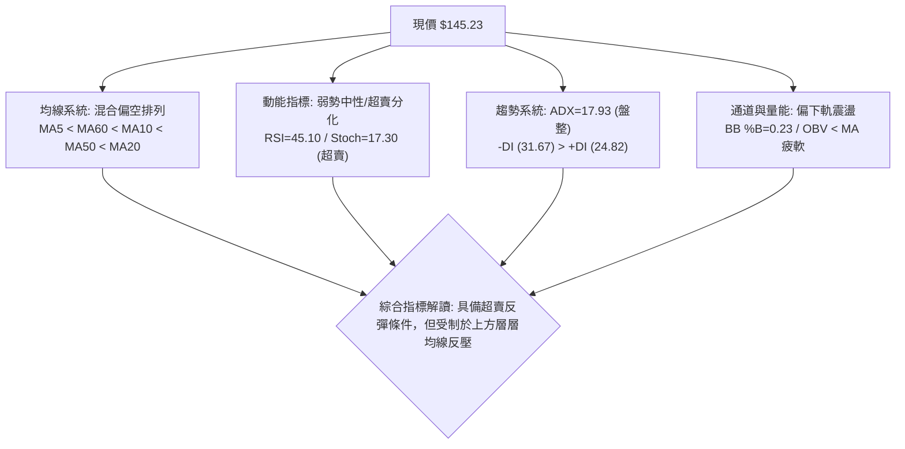

### 📈 移動平均線排列分析

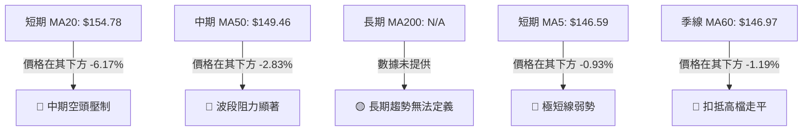

#### 均線數據與結構分析表

| 均線名稱 | 數值 | 距現價差距 | 排列狀態 | 走勢趨向 | 技術解讀 |
|:---|:---:|:---:|:---:|:---:|:---|
| **MA 5** | $146.59 | -0.93% | 現價於其下 | ▼ 下彎 (-1.36) | 短線拋壓仍在，尚未出現勾頭上揚跡象 |
| **MA 10** | $148.27 | -2.05% | 現價於其下 | ▼ 下彎 (-3.04) | 與 R1 ($149.80) 構成短線第一道重合阻力線 |
| **MA 20** | $154.78 | -6.17% | 現價於其下 | ▼ 走平轉下 (-9.55) | 布林中軌所在，為多空波段強弱分水嶺 |
| **MA 50** | $149.46 | -2.83% | 現價於其下 | ─ 趨平微跌 | 橫亙於現價上方，限制了多頭的修復空間 |
| **MA 60** | $146.97 | -1.19% | 現價於其下 | ▼ 下彎 (-1.74) | 季線下壓，壓抑中線資金做多意願 |
| **MA 200** | N/A (數據未提供) | N/A | N/A | N/A | 資料不足，不予揣測或推算年線數值 |

**均線排列總結**：呈現「MA5 < MA60 < MA10 < MA50 < MA20」之**混合偏空排列**，價格被壓制於所有可觀測均線之下，空方在均線系統中取得實質壓制優勢。

### 📉 RSI(14) 分析

- **當前 RSI(14) 讀數**：`45.10`（採用 Wilder 平滑演算法）
- **RSI 強度進度條**：
  `[0] ░░░░░░░░░░░░░░░░░░░░░░░░░░░░█████████░░░░░░░░░░░░░░░░░░░░ [100]`（45.10%）
- **區間評估**：
  - 處於 30 至 70 之「中性區間」偏弱側。自 10/09 高檔的 59.1 快速降至 10/16 的 43.9，隨後於 45.10 附近橫盤，表明前期多頭超買壓力已被釋放，空方推低力道亦未引發恐慌性超賣（未跌破 30）。
- **背離分析判斷**：
  - 近 20 根 K 棒對比中，價格由波段高點滑落至 $145.23，RSI 同步自 62 下降至 45.10；
  - 結論：**無明顯背離現象**（價格與動能方向一致收斂，並未出現價格創低而動能抬升之底背離，亦無頂背離）。

### 📊 MACD(12/26/9) 訊號解讀

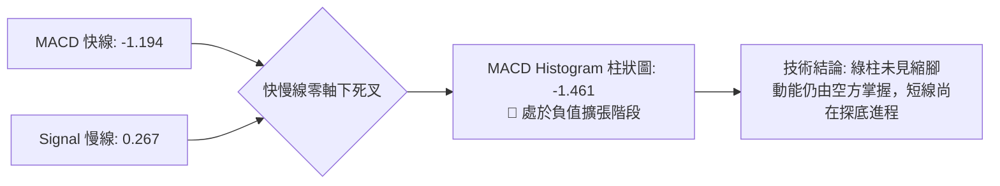

- **MACD 線**：`-1.194`
- **Signal 訊號線**：`+0.267`
- **MACD Histogram 柱狀圖**：`-1.461`
- **深度分析**：MACD 線已下穿零軸並在 Signal 線下方運行，柱狀圖負值為 -1.461，顯示動能處於空頭波段中。儘管相較於 10/16 觸發的 -1.979 略有收斂，但目前負值再度加深（由前一週的 -1.719 演化），未形成「低檔金叉」，亦無柱狀圖底背離，短線需防範空頭二度回踩。

### 📦 布林通道分析

```
SPCX 布林通道結構分布圖（標準差 2.0，週期 20）
  $175 ┤ ─────────────────────────────────────────── BB 上軌: $172.79
  $170 ┤
  $165 ┤
  $160 ┤
  $155 ┤ ─────────────────────────────────────────── BB 中軌 (MA20): $154.78
  $150 ┤
  $145 ┤ ─────────── ◄ 當前收盤價: $145.23 (BB %B = 0.23)
  $140 ┤
  $135 ┤ ─────────────────────────────────────────── BB 下軌: $136.76
```

- **布林上軌**：`$172.79`
- **布林中軌 (MA20)**：`$154.78`
- **布林下軌**：`$136.76`
- **帶寬與位置評估**：
  - 當前帶寬 ($172.79 - $136.76 = $36.03)，通道開口略有擴大。
  - **%B 指標為 0.23**，表明股價運行於中軌至下軌之間，距離下軌 $136.76 尚有空間，但已進入通道下四分之一弱勢區，技術上容易引發靠近下軌時的均值回歸修復。

### 💹 成交量分析（量價配合度）

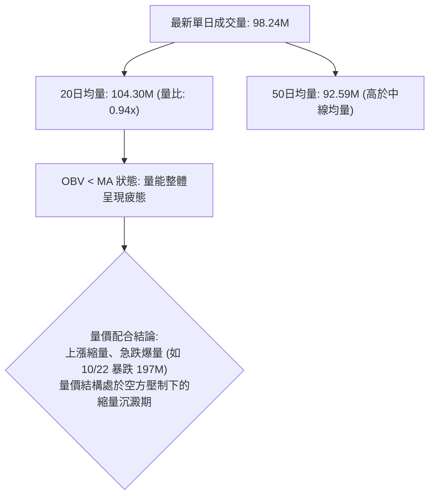

- **OBV 趨勢解讀**：OBV 指標持續位於其均線下方運行，確認主力資金在 10/21–10/22 巨量衝高換手後呈現淨流出狀態，近期反彈時成交量（約 9,500 萬至 1 億股）均無法超越 20 日均量（1.04 億股），呈現「量價背離式弱勢回彈」，表明缺乏增量資金進場承接。

---

## 6. 動能與波動率

### ⚡ 動能評估四象限

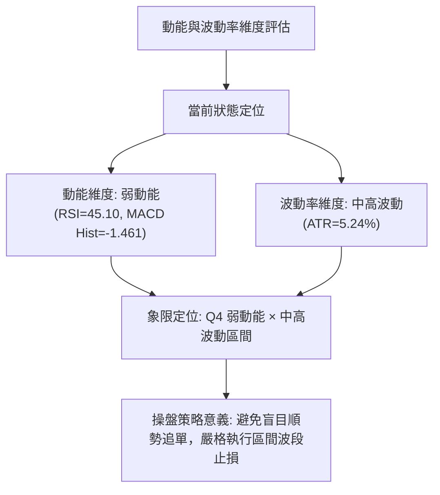

#### 動能與波動評估矩陣

| 象限代號 | 動能狀態 | 波動狀態 | 當前匹配 | 風險報酬特徵與應對方針 |
|:---:|:---:|:---:|:---:|:---|
| **Q1** | 強動能 | 低波動 | ─ | 最佳單邊順勢推進機會，適合加碼持有 |
| **Q2** | 弱動能 | 低波動 | ─ | 沉悶整理區間，宜耐心觀望等待方向確認 |
| **Q3** | 強動能 | 高波動 | ─ | 爆發性行情，高風險高收益，須寬幅跟蹤止損 |
| **Q4** | **弱動能** | **中高波動** | **✓ (當前狀態)** | **假突破頻繁，短線洗盤劇烈；必須依據極端支撐/阻力掛單操作** |

### 📊 ATR 波動率分析

- **ATR(14) 數值**：`$7.61`（採用 Wilder 平滑演算法）
- **佔現價百分比**：`5.24%`
- **動態止損與倉位測算指導**：
  - 日內平均波幅高達 $7.61，意味著任何日內交易若止損設定小於 $3.80（0.5 ATR），極易遭到無序噪聲洗出場。
  - **防守止損距離建議**：波段交易標準保護止損位宜設在進場價外 **1.0 至 1.5 ATR**（即 **$7.61 – $11.42** 區間），以有效過濾日常波動。

### 📐 Beta 與市場相關性

- **Beta 數值**：`N/A (數據未提供)`
- **市場相關性分析**：由於數據源中未提供 Beta 係數，依據嚴格數據紀律，本報告**不自行估算大盤回歸值**。然而從其板塊屬性（Aerospace & Defense / Space Exploration）與當前高達 5.24% 的 ATR 日波動率可知，該標的具備極高的個股獨立特異性風險（Idiosyncratic Risk），走勢受自身發射進展、監管消息及資本支出節奏影響甚深，與大盤指數（如 S&P 500）之短期同步性較低。

---

## 7. 多時框架總結

### 📋 時框架評分表

| 時框架 | 趨勢方向 | 動能狀態 | 均線排列 | 圖表形態 | 綜合評分 | 建議方針 |
|:---|:---:|:---:|:---:|:---:|:---:|:---|
| **短期 (日線)** | 🔴 偏空震盪 | 🟡 中性超賣分化 | 🔴 空頭排列壓制 | 🟡 箱型下半區收斂 | **42/100** | 考量 Stoch 超賣，回測 S1/S2 尋求短多波段 |
| **中期 (週線)** | 🔴 回調洗盤 | 🔴 MACD柱狀負值 | 🟡 均線高檔走平 | 🔴 雙長上影線受阻 | **44/100** | 不盲目抄底，尊重 R1/R2 之重重解套賣壓 |
| **長期 (月線)** | 🟢 築底修復 | 🟡 脫離超賣區間 | 🟡 歷史數據有限 | 🟢 自52W低點大反彈 | **46/100** | 長線築底確立，但修復期需數月沉澱籌碼 |

### 🔲 綜合訊號矩陣

```
SPCX 多時框訊號一致性交叉驗證矩陣
┌─────────────────┬───────────┬───────────┬───────────┐
│ 維度指標        │ 短期 (日) │ 中期 (週) │ 長期 (月) │
├─────────────────┼───────────┼───────────┼───────────┤
│ 趨勢方向 (ADX)  │ 🟡 盤整   │ 🔴 偏空   │ 🟢 築底   │
│ 均線系統        │ 🔴 壓制   │ 🟡 震盪   │ 🟡 N/A    │
│ 擺動指標 (RSI)  │ 🟡 45.10  │ 🟡 45.10  │ 🟢 脫離低 │
│ 趨勢指標 (MACD) │ 🔴 死叉   │ 🔴 負擴張 │ 🟡 改善中 │
│ 量價結構 (OBV)  │ 🔴 疲軟   │ 🔴 上影量 │ 🟢 低檔放 │
└─────────────────┴───────────┴───────────┴───────────┘
```

### ⚖️ 多時框收斂結論

依據多時框收斂規則第 14 條執行收斂判定：
1. **行情定性**：當前 ADX(14) 讀數為 **17.93**（嚴格小於 25 門檻），因此技術格局被定性為**典型盤整行情（Consolidation Market）**。
2. **主導維度**：在盤整行情中，單邊趨勢指標失效，**以日線布林通道上下軌及箱型支撐阻力為核心交易依據**。日線層級中，價格受制於 MA20 ($154.78)，但下檔受到密集波段低點聚類 S1 ($142.87) 與 S2 ($140.66) 的強力支撐。
3. **收斂唯一方向**：**中性偏弱區間震盪（Neutral Range-Bound with Lower Boundary Retest）**。日線與週線均提示不可採取順勢追突破策略，行情大概率將在 **S2 ($140.66) 至 R2 ($155.00)** 之間進行籌碼沉澱。此結論與下文第 8 章之區間操作策略維持完全一致。

---

## 8. 交易策略建議

### 🗺️ 策略決策流程圖

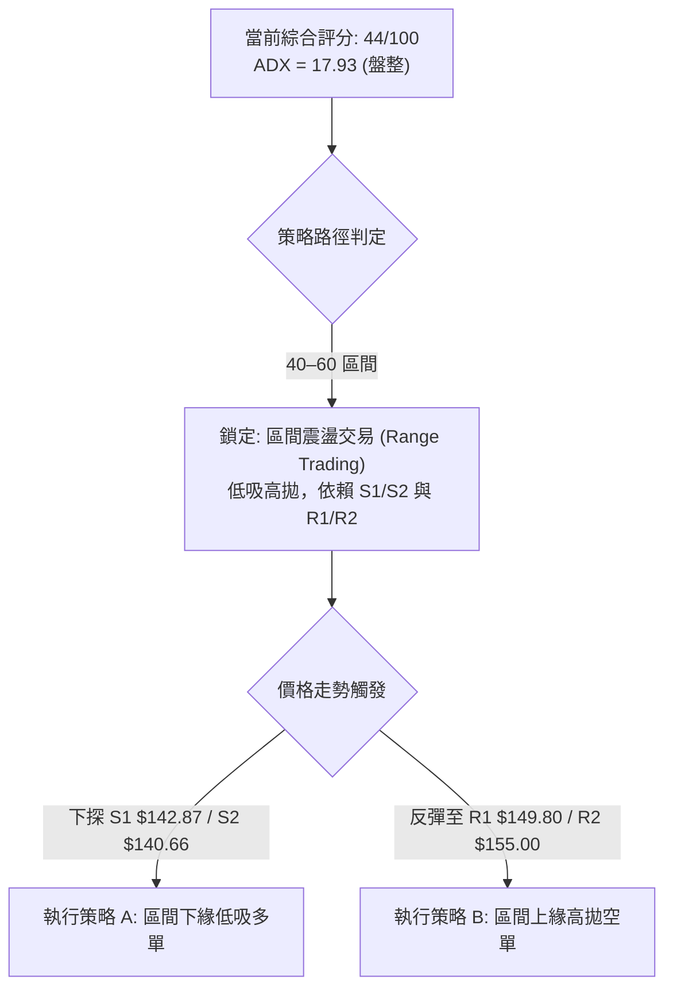

### 🧭 策略路由（依評分卡分流）

**當前主策略方向 = 區間高拋低吸策略（依評分 44/100，處於 40–60 中性震盪區間）**  
當前既不具備趨勢做多條件（評分未達 ≥60），亦未構成破位單邊做空（評分未跌破 ≤40）。交易核心邏輯為「**貼近支撐買入，貼近阻力止盈，嚴格防守破位**」。

### 🎯 價格情境階梯（Price Scenarios）

所有價位均嚴格引用第 4 章聚類數據：

| 觸發條件 | 下一目標 | 後續延伸 | 情境技術含義 |
|:---|:---:|:---:|:---|
| **放量突破 R1 $149.80** | **R2 $155.00** | **R3 $158.13** | 短線擺脫均線壓制，測試布林中軌與箱型頂部 |
| **維持現價 $145.23 震盪** | **S1 $142.87** | **R1 $149.80** | 無方向窄幅整理，籌碼在斐波那契 61.8% 之下換手 |
| **有效跌破 S1 $142.87** | **S2 $140.66** | **S3 $130.39** | 短期破位，測試近兩個月箱體底線；跌破 S2 則轉為波段主跌 |

### 📊 情境機率分佈

| 情境類別 | 發生機率 | 主要技術依據 |
|:---|:---:|:---|
| **區間震盪整固** | **55%** | ADX(14)=17.93 低於 25，布林通道帶寬約束，市場進入成交量低迷期 |
| **回落測試強支撐 (探底)** | **30%** | MACD 柱狀圖負值加深 (-1.461)，-DI (31.67) 壓制多頭，均線混合下壓 |
| **強勢放量突破上攻** | **15%** | OBV 疲軟，成交量不足 1 億股，無增量資金推動難以直接翻越 R2 ($155.00) |

### 🟢 主策略詳情

嚴格依據第 17 條規則計算風險報酬比（所有數值嚴格引用自關鍵價位區塊）：

| 策略要素 | 策略 A（區間下緣低吸多單） | 策略 B（區間上緣逢高做空） |
|:---|:---|:---|
| **策略類型** | 支撐低吸波段做多 | 阻力受阻逢高做空 |
| **進場條件** | 價格回踩 S1 ($142.87) 獲支撐且 Stoch 金叉確認 | 價格反彈至 R1 ($149.80) 遇阻且出現長上影線確認 |
| **進場價格** | **$142.87** (S1 支撐位) | **$149.80** (R1 阻力位) |
| **目標價 T1** | **$149.80** (R1 關鍵阻力) | **$142.87** (S1 關鍵支撐) |
| **目標價 T2** | **$155.00** (R2 強阻力位) | **$140.66** (S2 強支撐位) |
| **止損價格** | **$140.66** (跌破 S2 強支撐離場) | **$155.00** (突破 R2 強阻力離場) |
| **風險報酬比** | **1 : 3.14（以 T1 計）**<br/>計算式：($149.80 - $142.87) / ($142.87 - $140.66) = 6.93 / 2.21 = 3.1357<br/>*[另列: 1 : 5.49（以 T2 計）]* | **1 : 1.33（以 T1 計）**<br/>計算式：($149.80 - $142.87) / ($155.00 - $149.80) = 6.93 / 5.20 = 1.3326<br/>*[另列: 1 : 1.76（以 T2 計）]* |
| **成功機率** | **65%** | **60%** |
| **建議倉位** | **15% – 20%** (輕倉試單) | **10% – 15%** (嚴格風控) |

### 🔴 反向風險觸發點（對沖提示）

若發生以下任一信號，將徹底推翻上述中性震盪區間策略，須立即止損或反向對沖：
1. **多頭破位風險（全面轉空）**：日K收盤價**跌破 S2 ($140.66)** 且成交量放大，意味著近兩個月形成的底部平台徹底瓦解，向下將打開通往 S3 (**$130.39**) 及斐波那契 78.6% (**$130.68**) 的深度調整空間。
2. **空頭擠壓風險（全面轉多）**：日K收盤價**帶量突破 R2 ($155.00)** 並站穩 MA20 之上，意味著均線空頭排列遭到暴力扭轉，空單必須無條件止損，行情將挑戰 R3 (**$158.13**) 甚至 50.0% 斐波那契位 (**$165.24**)。

### ⭐ 整體訊號強度評星

```
做多訊號強度：★★☆☆☆  (2/5星 - 缺乏動能確認，僅具支撐博弈價值)
做空訊號強度：★★★☆☆  (3/5星 - 均線壓制明顯，但面臨超賣修復限制)
整體可信度：  ★★★☆☆  (3/5星 - 典型無趨勢箱型震盪，指標多有雜訊)
```

---

## 9. 風險提示與監控

### ✅ 關鍵監控指標 Checklist

```
╔══════════════════════════════════════════════════════════════════╗
║               SPCX 盤面即時風控監控清單 (Checklist)             ║
╠══════════════════════════════════════════════════════════════════╣
║ [ ] 關鍵防守位 S2 ($140.66) 是否收盤失守（破位即停損）         ║
║ [ ] 關鍵壓制位 R1 ($149.80) 是否放量收復（轉強初步信號）        ║
║ [ ] ADX(14) 是否由 17.93 抬升突破 25（預警單邊突破行情來臨）   ║
║ [ ] RSI(14) 是否跌破 30 進一步引發恐慌拋盤                     ║
║ [ ] 成交量是否連續兩日超越 20日均量 (104.30M)（確認主力表態）  ║
║ [ ] MACD Histogram 柱狀圖是否縮腳至 -0.50 以上（動能轉折提示） ║
╚══════════════════════════════════════════════════════════════════╝
```

### ⚠️ 風險場景分析

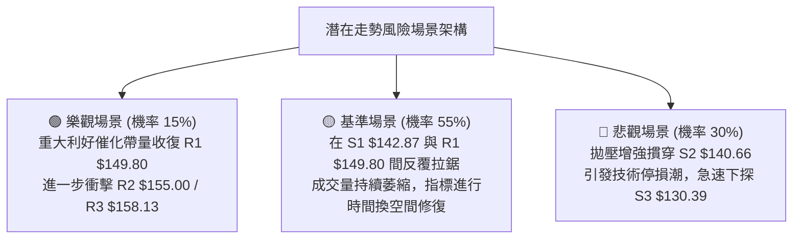

### 🛡️ 風險管理重要提醒

1. **ATR 波動風險匹配**：SPCX 當前 ATR 高達 **$7.61 (5.24%)**，屬於高波動品種。在進行任何倉位配置時，單筆交易的最大資金承擔虧損應嚴格限制在總資產的 **1.0% – 1.5%** 以內。
2. **倉位規模計算範例**：若投資組合規模為 $100,000，單筆容許最大風險為 1% ($1,000)。若採用策略 A（進場 $142.87，止損 $140.66，每股風險 $2.21），建議最大持股股數不得超過：
   $$\text{部位規模} = \frac{\$1,000}{\$2.21} \approx 452 \text{ 股（約佔總資金 \$64,577，槓桿率應相應調降）}$$
   考量當前盤整格局，整體倉位嚴格建議控制在 **20% 以下**。
3. **重大基本面事件防範**：數據顯示該股空頭比例為 2.4%，短期內市場受到 T-Mobile 合作協議不確定性及第 3 季 Alphabet 財報披露之 SpaceX 相關影響干擾。技術面處於對稱三角形與箱型收斂尾端，一旦突發消息落地，極易以「跳空」形式跳過技術支撐，切忌在缺乏硬性止損保護下盲目扛單。

---

## 📋 報告總結

```
SPCX 技術分析報告總結
══════════════════════════════════════════════════════════════════════
報告日期：2026-10-29
當前價格：$145.23
分析評級：⚖️ 44/100 評級：中性偏弱震盪（ADX=17.93 盤整定性）

關鍵技術結論：
├─ 長期趨勢：🟢 脫離 52W 低點 $104.83 處於長週期築底回升軌道
├─ 中期趨勢：🔴 衝高 $176.42 失敗後進入週線三連黑回調洗盤
├─ 短期趨勢：🔴 價格受制於 MA5/10/20/50，空方暫居短線優勢
├─ 關鍵支撐：S1: $142.87 ｜ S2: $140.66 ｜ S3: $130.39
├─ 關鍵阻力：R1: $149.80 ｜ R2: $155.00 ｜ R3: $158.13
└─ 分析師目標：共識評級 Buy ｜ 目標均價: $257.11 (低 $70 / 高 $800)

最優策略組合：
1. 🥇 最佳機會：策略 A — 回踩 S1 ($142.87) 逢低輕倉吸納，止損 S2 ($140.66)，
                目標 R1 ($149.80)，風險報酬比高達 1 : 3.14。
2. 🥈 次選機會：策略 B — 弱勢反彈至 R1 ($149.80) 遇阻做空，止損 R2 ($155.00)，
                目標 S1 ($142.87)，風險報酬比為 1 : 1.33。
3. 🥉 保守選擇：場外空倉觀望，靜待 ADX 突破 25 或價格放量突破箱型區間
                ($140.66 – $155.00) 後，再行順勢進場介入。
══════════════════════════════════════════════════════════════════════
```

---

> ⚠️ **免責聲明**：本報告為技術分析研究，所有數據、圖表及價位推算均嚴格基於所提供之歷史交易數據。本報告**僅供研究與學術參考**，**不構成任何要約、招攬或投資建議**。金融市場投資具高度風險，價格波動劇烈，投資人應獨立評估風險並自負盈虧。

---

*報告生成時間：2026-10-29 ｜ 數據來源：Yahoo Finance ｜ 分析框架：多時框技術分析*