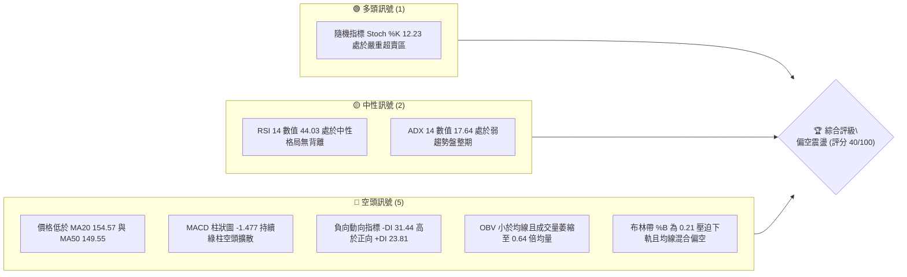
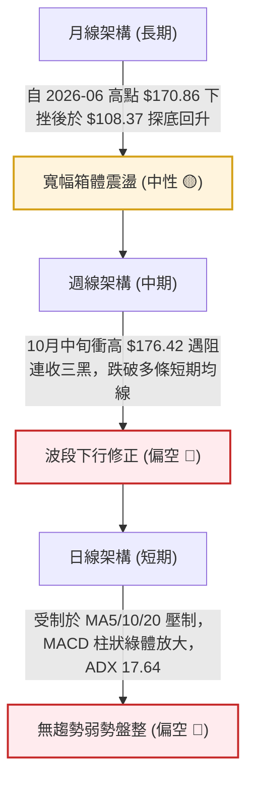
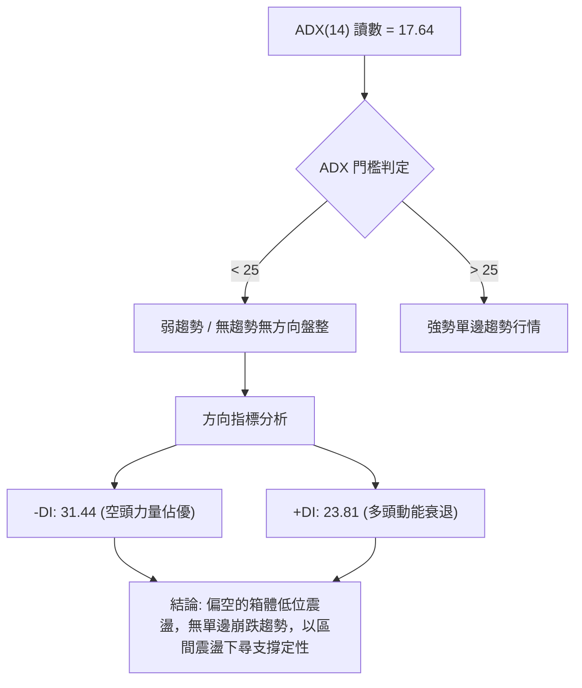
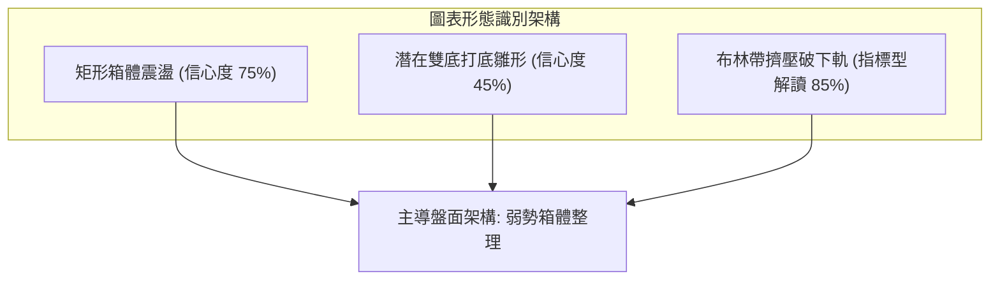
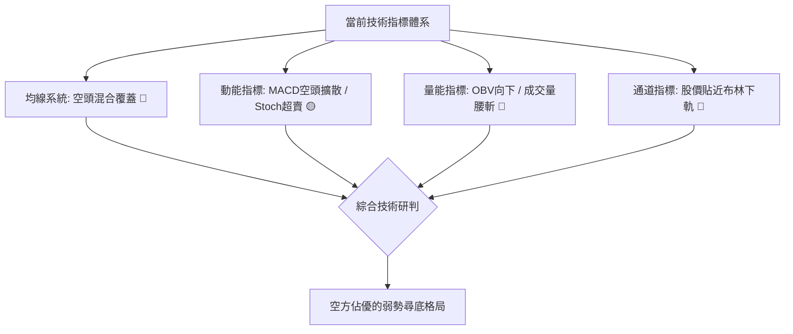
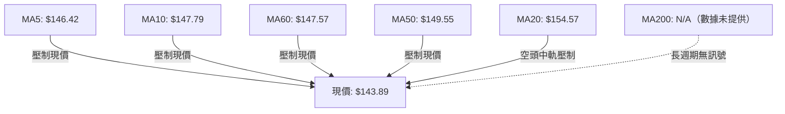
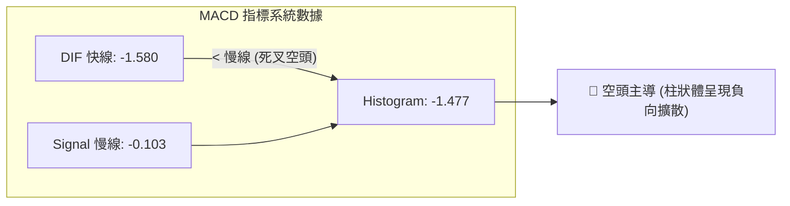
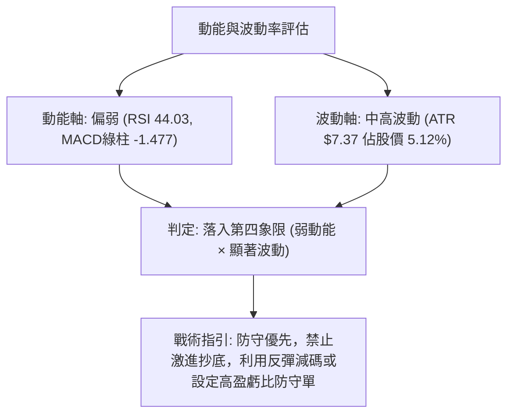
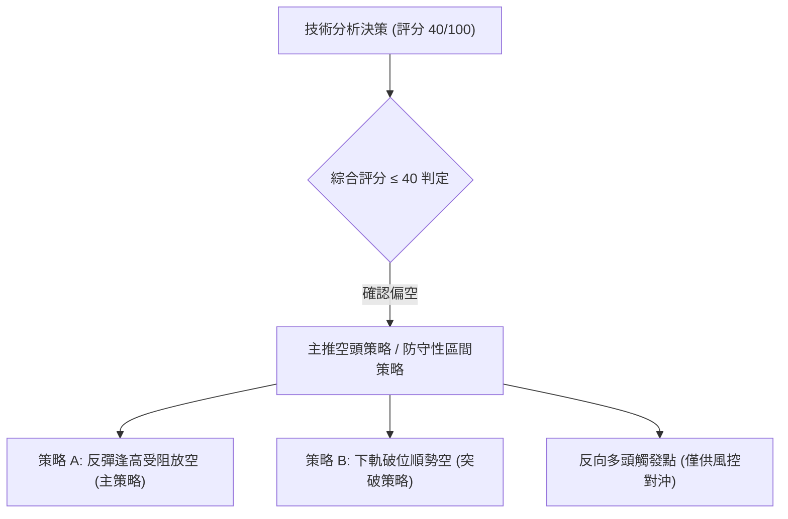
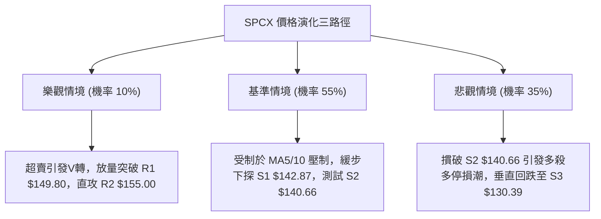

# SPCX 技術分析報告

> **報告日期**：2026-10-30 ｜ **語言**：繁體中文 ｜ **數據來源**：Yahoo Finance ｜ **當前價格**：$143.89

---

## 目錄

| 章節 | 內容 |
|------|------|
| [1. 技術面概覽](#1-技術面概覽) | 訊號儀表板、核心指標、評分卡 |
| [2. 趨勢分析](#2-趨勢分析) | 多時框趨勢、長中短期走勢 |
| [3. 圖表形態分析](#3-圖表形態分析) | 形態識別、K線組合、目標價 |
| [4. 支撐與阻力](#4-支撐與阻力) | 關鍵價位、斐波那契回調 |
| [5. 技術指標深度解讀](#5-技術指標深度解讀) | MA/RSI/MACD/布林/成交量 |
| [6. 動能與波動率](#6-動能與波動率) | 動能評估、ATR、Beta |
| [7. 多時框架總結](#7-多時框架總結) | 時框架評分矩陣 |
| [8. 交易策略建議](#8-交易策略建議) | 多空策略、風險報酬比 |
| [9. 風險提示與監控](#9-風險提示與監控) | 監控指標、風險場景 |

---

## 1. 技術面概覽

### 🎯 技術訊號儀表板



### 📊 核心指標速覽表

| 指標類別 | 指標名稱 | 當前數值 | 訊號 | 解讀 |
|----------|----------|----------|------|------|
| **價格** | 當前收盤價 | $143.89 | 🔴 | 位於52週區間 32.3% 分位，價格壓制於所有短期均線之下 |
| **均線** | MA20 | $154.57 | 🔴 | 價格低於 MA20 達 -6.91%，中期趨勢承壓明顯 |
| **均線** | MA50 | $149.55 | 🔴 | 價格低於 MA50 達 -3.78%，跌破中期生命線 |
| **均線** | MA200 | N/A（數據未提供） | 🟡 | 數據庫未達200日歷史，長週期均線暫無法評估 |
| **動能** | RSI(14) | 44.03 | 🟡 | 位於 30–70 中性區間偏弱側，未觸及超賣亦無背離訊號 |
| **動能** | MACD (12,26,9) | -1.580 / -0.103 | 🔴 | DIF 線低於訊號線，柱狀體為 -1.477，空頭動能主導 |
| **動能** | Stoch %K / %D | 12.23 / 19.64 | 🟢 | 雙線落入 20 以下嚴重超賣區，短線具技術性抽頭契機 |
| **趨勢** | ADX(14) | 17.64 | 🟡 | ADX < 25 表明無強單邊趨勢，行情定性為偏弱盤整 |
| **趨勢** | 方向指標 (+/-DI) | 23.81 / 31.44 | 🔴 | -DI 大於 +DI，空方力量占據主導優勢 |
| **通道** | 布林通道 (%B) | 0.21 | 🔴 | 價格貼近布林下軌（$136.14），帶寬收斂下軌支撐受測 |
| **量能** | 20日成交量比 | 0.64x (66.61M) | 🔴 | 量能較20日均量大幅萎縮，呈現價跌量縮之鈍化格局 |
| **波動** | ATR(14) | $7.37 | 🟡 | 每日波幅占股價 5.12%，處於中等偏高日常波動範疇 |

### 🏆 技術評分卡

```
╔════════════════════════════════════════════════════════════════╗
║                   技術評分卡 — SPCX (2026-10-30)               ║
╠════════════════════════════════════════════════════════════════╣
║ 趨勢強度      ███████░░░░░░░░░░░░░  35/100  🔴 弱勢盤整偏空    ║
║ 動能指標      ████████░░░░░░░░░░░░  38/100  🔴 空方動能擴散    ║
║ 支撐穩定度    ██████████░░░░░░░░░░  52/100  🟡 S1/S2 密集測試  ║
║ 成交量配合    ██████░░░░░░░░░░░░░░  32/100  🔴 量能萎縮未放量  ║
║ 形態完整度    ██████████░░░░░░░░░░  48/100  🟡 區間箱體未破    ║
║ 均線排列      ███████░░░░░░░░░░░░░  35/100  🔴 空頭混合排列    ║
╠════════════════════════════════════════════════════════════════╣
║ 綜合評分      ████████░░░░░░░░░░░░  40/100  🔴 偏空弱勢震盪    ║
╚════════════════════════════════════════════════════════════════╝
*註：綜合評分 = (35 + 38 + 52 + 32 + 48 + 35) ÷ 6 = 40/100（嚴格依算術平均計算）
```

---

## 2. 趨勢分析

### 🌐 多時框趨勢分析



### 📈 長期趨勢 — 12個月走勢圖（Unicode）

依據月度歷史數據與52週極值點繪製之歷史走勢輪廓如下：

```
SPCX 月線走勢圖（2025-11 至 2026-10）
價格軸 ($)
$225.64 ┤                           ●(52W High $225.64)
$200.00 ┤                          / \
$175.00 ┤    ●(06月 $170.86)      /   \
$150.00 ┤───/──────\─────────────●─────\──●(09月 $150.86)
$143.89 ┤           \           /       \      ●←(現價 $143.89)
$125.00 ┤            \         /         ●(08月 $143.69)
$104.83 ┤             ●(07月 $108.37 / 52W Low $104.83)
         └───────────────────────────────────────────────
         2025-11 ... 2026-06 2026-07 2026-08 2026-09 2026-10
```

#### 長期走勢特徵分析表格

| 階段區間 | 起訖月份 | 區間收盤變化 | 漲跌幅 | 走勢結構與技術特徵 |
|----------|----------|--------------|--------|--------------------|
| 高位崩跌段 | 2026-06 → 2026-07 | $170.86 → $108.37 | -36.57% | 遭遇流動性拋壓，連續巨幅回撤直逼 52 週最低點 $104.83 |
| 絕地反彈段 | 2026-07 → 2026-08 | $108.37 → $143.69 | +32.59% | 底部出現強勁報復性買盤，V型抽腳收復 $140 關卡 |
| 震盪推升段 | 2026-08 → 2026-09 | $143.69 → $150.86 | +4.99% | 買盤動能減緩，推進至斐波那契 61.8% 關鍵回調位（$150.98）受阻 |
| 衝高回落段 | 2026-09 → 2026-10 | $150.86 → $143.89 | -4.62% | 10月週線衝刺 $176.42 失敗，反轉收黑抹平當月漲幅，技術面再度走疲 |

### 📊 中期趨勢（週線分析）

中期技術面於 2026-10-09 當週達到波段頂峰 $176.42 後急速反轉。週線圖表中呈現明確的頂部受阻與均線失守軌跡：

```
中期週線價格壓力與支撐示意圖
═════════════════════════════════════════════════════════════════
 $176.42 ┬── 10/09 週高點 (波段頂部天花板)
         │   ▼ 湧現獲利了結與套牢賣壓
 $162.57 ├── 10/09 週收盤價
         │   ▼ 連續破位
 $150.98 ├── 斐波那契 61.8% 回調線 (多空分水嶺)
 $147.49 ├── 10/23 週收盤價
 $143.89 ├── 10/29 現價 (逼近下檔防線)
         │   ▲
 $140.66 ┴── 10/16 週低點 / 關鍵支撐 S2
═════════════════════════════════════════════════════════════════
```

週線指標呈現同步惡化：週 MACD 柱狀體由 10/09 的 +0.937 連續三週跳水至 -1.979、-1.719 與 -1.477；週線 RSI 從 62.4 高位滑落至 44.0，顯示中期動能已由多頭反彈轉變為空頭主控的回調循環。

### ⚡ 趨勢強度評估（ADX 解讀）



#### ADX 趨勢強度對照

| 指標變數 | 當前讀數 | 門檻區間 | 技術意義 | 交易指導原則 |
|----------|----------|----------|----------|--------------|
| **ADX(14)** | 17.64 | 0 – 25 | 弱趨勢 / 盤整市場 | 嚴禁採用單邊突破追價系統；應依循震盪指標與區間下軌高拋低吸 |
| **+DI** | 23.81 | N/A | 多方做多力量 | 處於弱勢收縮狀態，多頭缺乏向上攻擊的量能與動能 |
| **-DI** | 31.44 | N/A | 空方做空力量 | 空方主控日內盤面，高出 +DI 達 7.63，形成日常陰跌壓制 |

---

## 3. 圖表形態分析

### 🔍 形態識別系統



#### 形態信心度與目標價評估表格

| 形態類別 | 信心度 | 判斷依據（引用數據） | 完成度 | 目標價（附嚴謹計算式） |
|----------|--------|----------------------|--------|------------------------|
| **矩形箱體整理** | 75% | 頂部受阻於阻力 R2（$155.00），底部獲支撐位 S2（$140.66）支撐 | 70% | 區間下限 $140.66；若下破則箱體測幅目標：$140.66 - ($155.00 - $140.66) = **$126.32**（數據中未偵測到此支撐，向下對齊 S3 **$130.39**） |
| **潛在雙重底** | 45% | 第一底為 10/16 低點 $140.66，第二底正測試 S1 $142.87 至 S2 區間 | 35% | 訊號不足（信心度 < 50%）。若成立頸線為 R2 $155.00，理論高度 $155.00 - $140.66 = $14.34，上行目標 $155.00 + $14.34 = **$169.34**（數據中未確認突破） |
| **布林帶下軌擠壓** | 85% | 價格 $143.89 壓迫布林下軌 $136.14，%B = 0.21，均線空頭覆蓋 | 90% | 指標型技術跌破。下軌延伸動態目標價即為下軌值 **$136.14** |

### 🕯️ 重要K線形態分析

嚴格依據數據庫中提供的「近10根日K」與「近8根週K」四價數據進行專業燭體型態辨別：

#### 近10根日K形態追蹤

| 日期（日K） | 開盤價 | 最高價 | 最低價 | 收盤價 | K線形態 | 深度解讀 | 訊號 |
|-------------|--------|--------|--------|--------|---------|----------|------|
| 2026-10-16 | $147.80 | $147.92 | $142.95 | $146.03 | 下影陰線 | 盤中殺跌觸及 $142.95 後獲逢低買盤支撐，空方仍佔優 | 🔴 |
| 2026-10-19 | $149.23 | $151.01 | $146.83 | $147.96 | 衝高回落小陰 | 試圖收復 $150 關卡未果，留有上影線，多頭上攻意願薄弱 | 🟡 |
| 2026-10-20 | $146.17 | $148.66 | $143.27 | $147.79 | 探底小陽線 | 於 $143.27 獲得支撐，微幅收漲，成交量放大至 117.2M 具初步承接 | 🟢 |
| 2026-10-21 | $160.56 | $166.18 | $156.93 | $159.31 | 跳空巨量長黑 | 跳空高開 $160.56 衝高至 $166.18 後爆出 220.78M 歷史巨量下殺，主力出貨特徵 | 🔴 |
| 2026-10-22 | $154.21 | $154.26 | $143.21 | $144.75 | 長黑崩跌吞噬 | 延續出貨潮，全日暴跌，開盤即最高，直接摜破多道短期支撐 | 🔴 |
| 2026-10-23 | $147.93 | $149.75 | $144.09 | $147.49 | 震盪反彈陽線 | 跌深後的喘息整理，高點壓制於 $150 之下，成交量腰斬至 110.6M | 🟡 |
| 2026-10-26 | $146.84 | $150.24 | $144.57 | $146.90 | 紡錘十字星 | 開收盤幾乎持平，多空在 MA10 與 $147 附近劇烈僵持拉鋸 | 🟡 |
| 2026-10-27 | $147.41 | $151.36 | $146.61 | $148.58 | 小陽線阻力受挫 | 觸及 $151.36 遇阻回吐，未能突破 60日線（$147.57）實質防線 | 🟡 |
| 2026-10-28 | $147.37 | $148.20 | $142.13 | $145.23 | 破位下影陰線 | 再次下探 $142.13 創一週新低，收盤失守 $146，重回弱勢走勢 | 🔴 |
| 2026-10-29 | $142.26 | $144.95 | $141.03 | $143.89 | 低開弱勢陽星 | 低開於 $142.26 逼近 S2，雖收於低點之上但成交量急縮至 66.6M | 🟡 |

#### 近8根週K形態追蹤

| 日期（週K） | 開盤價 | 最高價 | 最低價 | 收盤價 | K線形態 | 深度解讀 | 訊號 |
|-------------|--------|--------|--------|--------|---------|----------|------|
| 2026-09-11 | $149.05 | $155.00 | $144.89 | $151.21 | 平台突破小陽 | 突破前期高位平台，確立短波段震盪向上多頭走勢 | 🟢 |
| 2026-09-18 | $147.33 | $156.87 | $142.87 | $152.71 | 長下影長陽棒 | 回測 S1 $142.87 成功引爆買盤，成交量放大至 669.0M | 🟢 |
| 2026-09-25 | $154.77 | $158.13 | $145.88 | $148.68 | 烏雲罩頂黑K | 創 $158.13 波段高點後遭遇強拋壓，回吐全週漲幅 | 🔴 |
| 2026-10-02 | $148.49 | $159.84 | $145.36 | $158.96 | 包覆強勢大陽 | 強勢包覆前週黑K，多頭重新奪回 $155 控制權 | 🟢 |
| 2026-10-09 | $158.99 | $176.42 | $158.62 | $162.57 | 墓碑上影長K | 衝刺 $176.42 創數月高點後引發巨額拋盤，形成典型中期見頂訊號 | 🔴 |
| 2026-10-16 | $164.66 | $167.07 | $140.66 | $146.03 | 實體大陰崩落 | 單週暴跌超 16 美元，實體直接砸破多個支撐位，確認頂部成立 | 🔴 |
| 2026-10-23 | $149.23 | $166.18 | $143.21 | $147.49 | 巨量倒轉錘頭 | 巨量 719.7M 誘多拉高至 $166.18 後崩潰，留下近 19 美元巨幅上影線 | 🔴 |
| 2026-10-29 | $146.84 | $151.36 | $141.03 | $143.89 | 量縮下行陰線 | 低點直逼 $141.03，量能劇降至 364.3M，多頭無力承接 | 🔴 |

### 📉 ASCII 走勢形態示意圖

```
SPCX 日線箱體與巨量墓碑頂形態拆解
價格軸 ($)
$166.18 ┬───────────────────▲ (10/21 巨量假突破爆量 220M)
        │                  / \
$155.00 ┼── 阻力 R2 ──────/───\───────────── (箱體頂部強壓)
        │                /     \  ┌─ 10/26 紡錘十字星
$149.80 ┼── 阻力 R1 ────/───────\─┼─────────── (反彈第一阻力)
        │              /         \│ 
$143.89 ┼── 當前價格 ─●           ● (10/29 現價 $143.89)
        │                         │ 
$140.66 ┴── 支撐 S2 ─────────────┴─────────── (10/16 低點，箱底生命線)
```

### 🎯 形態目標價計算

根據矩形箱體與破位理論計算之各維度技術目標：
1. **箱體上限阻力回抽位**：阻力位 R1 **$149.80**、阻力位 R2 **$155.00**。
2. **箱體破位測幅滿足點**：
   - 形態頂部高度 = R2 ($155.00)
   - 形態底部邊界 = S2 ($140.66)
   - 垂直震盪幅度 = $155.00 - $140.66 = **$14.34**
   - 下行量度目標 = 頸線破位點 ($140.66) - 形態幅度 ($14.34) = **$126.32**
   - 由於 $126.32 處於數據未記載點，技術路徑向下尋求實體波段低點聚類支撐 **S3 ($130.39)** 與 斐波那契 78.6% 回調位 **$130.68** 之重疊共振帶。

---

## 4. 支撐與阻力

### 🗺️ 關鍵價位分布圖（Unicode）

```
SPCX 價位結構分布圖
═════════════════════════════════════════════════════════════════
 $158.13 ║████████████████████████║ 強阻力 R3 (近一年波段高點聚類)
 $155.00 ║████████████████████    ║ 阻力 R2 (MA20 壓制帶 / 箱體頂)
 $150.98 ║▓▓▓▓▓▓▓▓▓▓▓▓▓▓▓▓▓▓▓▓    ║ 斐波那契 61.8% 重合帶
 $149.80 ║████████████████████████║ 關鍵阻力 R1 (MA50 覆蓋區)
 $143.89 ╠════════════════════════╣ ◄ 現價 ($143.89)
 $142.87 ║▓▓▓▓▓▓▓▓▓▓▓▓▓▓▓▓        ║ 近期支撐 S1 (近一年波段低點聚類)
 $140.66 ║████████████████████████║ 強支撐 S2 (近兩週防守底線)
 $136.14 ║▒▒▒▒▒▒▒▒▒▒▒▒▒▒▒▒▒▒▒▒▒▒▒▒║ 布林下軌支撐
 $130.39 ║████████████████████████║ 極限強支撐 S3 (Fib 78.6% $130.68)
═════════════════════════════════════════════════════════════════
```

### 🚧 阻力位分析表

所有價位嚴格引用自 OHLCV 波段高點聚類統計數據：

| 阻力級別 | 價位 | 與現價距離 | 形成原因與技術共振 | 突破難度 | 重要性 |
|----------|------|------------|--------------------|----------|--------|
| **R1** | $149.80 | +4.11% | 近一年波段高點聚類；與 MA50 ($149.55) 形成重疊壓制，為多頭反彈第一道關卡 | 🟡 中等 | ★★★☆☆ |
| **R2** | $155.00 | +7.72% | 近一年波段高點聚類；與 MA20 ($154.57) 及 布林中軌共振，為多空分水嶺 | 🔴 極高 | ★★★★☆ |
| **R3** | $158.13 | +9.90% | 09-25 週高點聚類阻力；突破此處方能逆轉中期偏價格局 | 🔴 極高 | ★★★★★ |

### 🛡️ 支撐位分析表

所有價位嚴格引用自 OHLCV 波段低點聚類統計數據：

| 支撐級別 | 價位 | 與現價距離 | 形成原因與技術共振 | 守住機率 | 重要性 |
|----------|------|------------|--------------------|----------|--------|
| **S1** | $142.87 | -0.71% | 近一年波段低點聚類；09-18 週低點與 10-16 日低點重疊區 | 🟡 55% | ★★★☆☆ |
| **S2** | $140.66 | -2.24% | 10-16 週低點聚類；日線與週線級別箱底核心支撐，跌破將引發停損潮 | 🟡 50% | ★★★★☆ |
| **S3** | $130.39 | -9.38% | 近一年重大波段低點聚類；與斐波那契 78.6% 回調位（$130.68）高度重合 | 🟢 80% | ★★★★★ |

### 📐 斐波那契回調位分析

依據 52 週完整區間最低點 $104.83 至最高點 $225.64 計算之精確黃金分割矩陣：

| 回調比例 | 斐波那契價位 | 當前相對位置 | 技術意涵與價格行為解讀 |
|----------|--------------|--------------|------------------------|
| 0.0% | $225.64 | +56.81% | 52 週歷史高點，長期強烈天花板 |
| 23.6% | $197.13 | +37.00% | 第一強回調目標，牛市強支撐已轉為長期壓力 |
| 38.2% | $179.49 | +24.74% | 10/09 週高點 $176.42 觸發回調之阻力密集區 |
| 50.0% | $165.24 | +14.84% | 10/21–10/23 爆量巨陰之套牢平台核心 |
| **61.8%** | **$150.98** | **+4.93%** | **黃金分割關鍵分界線**；現價位於此線下方，確認技術性破位 |
| **78.6%** | **$130.68** | **-9.18%** | **深度防守分界線**；與波段低點聚類 S3（$130.39）構成共振防禦盾 |
| 100.0% | $104.83 | -27.15% | 52 週歷史低點，極限熊市邊界 |

> **位置判定**：當前收盤價 **$143.89** 精確座落於 **61.8% ($150.98)** 與 **78.6% ($130.68)** 兩大關鍵黃金分割位之間。價格自 61.8% 跌落代表自 7 月低點以來的反彈浪潮已遭遇空頭實質性瓦解，若短線無法快速站回 $150.98 之上，技術引力將持續向 78.6% 回調位（$130.68）方向下探尋求共振支撐。

---

## 5. 技術指標深度解讀

### 🎛️ 指標訊號總覽



### 📈 移動平均線排列分析



#### 均線階層架構解讀

| 均線名稱 | 數值 | 與現價價差 | 傾斜走勢與型態 | 多空訊號 |
|----------|------|------------|----------------|----------|
| **MA 5** | $146.42 | -1.73% | 下彎走平，壓制超短期動能 | 🔴 空頭 |
| **MA 10** | $147.79 | -2.64% | 加速向下傾斜，短線空頭下壓 | 🔴 空頭 |
| **MA 20** | $154.57 | -6.91% | 自高位大幅拐頭下彎，形成沉重天花板 | 🔴 空頭 |
| **MA 50** | $149.55 | -3.78% | 走平略微下傾，生命線遭到跌破 | 🔴 空頭 |
| **MA 60** | $147.57 | -2.49% | 季線位置走平，成為反彈第一阻力 | 🔴 空頭 |
| **MA 120** | N/A | N/A（數據未提供） | 數據不足（需要120筆數據） | 🟡 中性 |
| **MA 200** | N/A | N/A（數據未提供） | 數據不足（需要200筆數據） | 🟡 中性 |
| **MA 240** | N/A | N/A（數據未提供） | 數據不足（需要240筆數據） | 🟡 中性 |

當前短期均線呈現 MA5 < MA10 < MA20 的典型空頭下壓排列，且 MA20 大幅高於 MA50，呈現長短週期的「均線混合排列」，尚未進入單邊流暢發散的完美空頭排列，但空方無疑佔據盤面防守主導權。

### 📉 RSI(14) 分析

#### RSI 數值強度展示
```
超賣 (0-30)           中性弱勢 (30-50)       中性強勢 (50-70)      超買 (70-100)
├────────────────────┼──────────────────────┼────────────────────┼────────────┤
                     ▲
                 RSI: 44.03 [█████████░░░░░░░░░░░░ 44.03%]
```

- **超買超賣判定**：RSI(14) 讀數為 **44.03**，未落入 30 以下之極端超賣區，亦遠離 70 以上之超買區。整體處於 40–50 之弱勢整理區。
- **背離嚴格檢驗**：依據近 20 根 K 棒比對價格走勢與 RSI 方向，價格於 10/22 創下階段低點後於 10/28–10/29 再次探低，同期間 RSI 自 43.9 微幅波動至 44.03，斜率近乎一致，**系統判定無明顯頂背離或底背離**。這意味著當前的下跌是動能與價格同向發散的正常回調，尚未浮現動能衰竭的反轉訊號。

### 📊 MACD(12/26/9) 訊號解讀



MACD 主線落於零軸下方（-1.580），訊號線亦位於 -0.103。柱狀圖（Histogram）數值為 **-1.477**，呈現綠柱向下放大態勢。這表明中短期價格動能正處於負向加速度階段，零軸下方的死亡交叉持續壓制市場心理，短線任何未帶量之反彈均屬技術性修復，尚未構成買進訊號。

### 📦 布林通道分析

```
SPCX 日線布林通道結構
═════════════════════════════════════════════════════════════════
 $173.00 ┬── 上軌 (Upper Band)
         │   
         │   通道寬度: $36.86 (25.6%)
         │   
 $154.57 ┼── 中軌 (Middle Band = MA20)
         │   
 $143.89 ┼── 現價 (Price, %B = 0.21) ◄ 緊貼下軌
         │   
 $136.14 ┴── 下軌 (Lower Band)
═════════════════════════════════════════════════════════════════
```

當前布林通道帶寬為 $173.00 - $136.14 = **$36.86**。價格為 $143.89，**%B 數值為 0.21**，極度接近布林下軌（0 代表下軌，0.5 代表中軌）。通道開口略有擴大趨勢，價格沿下軌進行弱勢滑行。若日內跌破下軌 $136.14 且伴隨帶寬擴散，將引發新一輪波動率擴大的單邊下墜走勢；反之，%B 接近 0.20 亦顯示短線下行空間在未破下軌前受到一定通道物理支撐。

### 💹 成交量分析（量價配合度）

```
成交量對比進度條
─────────────────────────────────────────────────────────────────
最新成交量 (66.61M) : ██████░░░░░░░░░░░░░░ (64% of 20MA)
20日均量  (104.20M) : ██████████░░░░░░░░░░ (基準線 100%)
50日均量   (92.40M) : █████████░░░░░░░░░░░ (89% of 20MA)
─────────────────────────────────────────────────────────────────
OBV 現況: OBV < 均線 🔴 量能疲弱，缺乏主力資金建倉跡象
```

- **量價背離分析**：10/21 股價暴跌放量至 220.78M，隨後在 10/22 持續湧出 197.05M 賣壓。而至 10/29 股價探低至 $141.03 時，成交量急劇萎縮至 66.61M（量比僅 0.64x）。這種「下跌量縮」的特徵顯示籌碼並未出現恐慌性棄守，但同時「OBV < MA」且低於 50日均量，印證多頭買盤同樣處於高度觀望，缺乏推升價格所需的承接流動性。

---

## 6. 動能與波動率

### ⚡ 動能評估四象限

| 象限分區 | 動能維度 (RSI / MACD) | 波動維度 (ATR / 布林帶寬) | 當前狀態判定 | 操作環境與技術意涵 |
|----------|-----------------------|---------------------------|--------------|--------------------|
| **象限 I** | 強動能 (Bullish) | 低波動 (Low Vol) | — | 最佳順勢突破買點 |
| **象限 II** | 弱動能 (Bearish) | 低波動 (Low Vol) | — | 沉悶磨底打底期 |
| **象限 III** | 強動能 (Bullish) | 高波動 (High Vol) | — | 牛市主升浪衝刺期 |
| **象限 IV** | **弱動能 (Bearish)** | **高波動 (High Vol)** | **✓ (SPCX 所處環境)** | **弱勢震盪下探，假突破頻繁，嚴格控制倉位** |



### 📊 ATR 波動率分析

- **ATR(14) 讀數**：**$7.37**，占目前股價 $143.89 之 **5.12%**（Wilder 計算模型）。
- **日內波動區間**：股價單日正常雜訊波動範圍高達 ±$7.37，意味著任何日內交易若止損設定小於 $7.37，極易遭到常規流動性清洗而無效觸發。
- **止損距離建議**：
  - **保守型止損（1.5 × ATR）**：$7.37 × 1.5 = **$11.06**。
  - **激進型/短線止損（1.0 × ATR）**：$7.37 × 1.0 = **$7.37**。
  - **緊縮防守止損（0.5 × ATR）**：$7.37 × 0.5 = **$3.69**（僅適用於日內精確回抽邊界進場）。

### 📐 Beta 與市場相關性

- **Beta 數值**：**N/A（數據未提供）**。
- **市場特徵詮釋**：由於數據源中未提供 Beta 指標，依據技術面高達 5.12% 的日波動率（ATR $7.37）與市值 $1.95T 之特徵判定，該股具備極高的高科技成長股獨立波動特徵。在無 Beta 數據下，嚴禁假設其與標普500具備固定係數聯動，應聚焦於自身 $140–$155 區間之量價行為。

---

## 7. 多時框架總結

### 📋 時框架評分表

| 時框架 | 趨勢方向 | 動能狀態 | 均線排列 | 圖表形態 | 綜合評分 | 戰術建議 |
|--------|----------|----------|----------|----------|----------|----------|
| **月線 (長期)** | 🟡 寬幅箱體 | 中性 (回吐) | MA200 N/A（數據未提供） | $104–$225 巨型震盪 | 50/100 | 長期投資者暫停大額加倉 |
| **週線 (中期)** | 🔴 波段下行 | 轉弱 (MACD綠柱) | 短期均線跌破 | 10/09 $176.42 墓碑見頂 | 35/100 | 中期波段多單離場觀望 |
| **日線 (短期)** | 🔴 弱勢盤整 | 偏空 (Stoch超賣) | 混合空頭排列 | 箱體下軌尋求支撐 | 40/100 | 以布林帶區間防守交易為主 |

### 🔲 綜合訊號矩陣

```
時框與指標維度矩陣分析
═════════════════════════════════════════════════════════════════
維度 / 時框     短期 (日線)          中期 (週線)          長期 (月線)
─────────────────────────────────────────────────────────────────
價格 vs 均線    🔴 低於 MA20/50      🔴 跌破短期週MA      🟡 守於 07月低點上
MACD 動能       🔴 DIF < 訊號線      🔴 綠柱大幅擴散      🟡 震盪整理
RSI 強度        🟡 44.03 (弱勢中性)  🟡 44.00 (回調中)    🟢 56–60 水位
量價關係        🔴 量縮無買盤承接    🔴 衝高巨量長黑      🟡 換手充分
─────────────────────────────────────────────────────────────────
共振結論        🔴 短期承壓顯著      🔴 中期修正持續      🟡 長期支撐猶存
═════════════════════════════════════════════════════════════════
```

### ⚖️ 多時框收斂結論

依據多時框收斂規則（規則 14）：
1. **行情定性**：當前日線 ADX(14) 讀數為 **17.64 < 25**，嚴格判定為**「盤整行情」**，而非單邊流暢的趨勢行情。
2. **主導維度**：在盤整行情中，日線布林通道上下軌（$136.14 – $173.00）及前期波段低點聚類構成主要震盪箱體，不應以趨勢追突破策略操作。
3. **時框優先級收斂**：雖然中期週線（10/09 $176.42 頂部回調）與日線動能均偏向空方，但鑑於 ADX 顯示趨勢極度疲弱、且隨機指標 Stoch 已達嚴重超賣（%K = 12.23），行情並不支持強烈單邊追空；向下空間受制於 S1 ($142.87) 與 S2 ($140.66) 的密集買盤。
4. **唯一方向性結論**：**中性偏空觀望（弱勢區間震盪）**。技術重心持續下移，操作上應以反彈高空或等待區間下軌防守測試為主。

---

## 8. 交易策略建議

### 🗺️ 策略決策流程圖



### 🧭 策略路由（依評分卡分流）

> **當前主策略方向 = 偏空弱勢震盪操作（依評分 40/100，落於偏空邊界）**
> 依據嚴格路由規則，綜合評分 ≤ 40 主推空頭策略。惟因 ADX 17.64 表明為無趨勢盤整，不可直接追空，策略重心定為「反彈遇阻放空」與「關鍵支撐跌破之順勢跟進」。

### 🎯 價格情境階梯（Price Scenarios）

價位嚴格引用自「關鍵價位」區塊與斐波那契回調數據：

| 觸發條件 | 下一目標 | 後續延伸 | 情境含義 |
|----------|----------|----------|----------|
| **強勢突破 R1 $149.80** | R2 $155.00 | R3 $158.13 | 短線技術反彈，修復日線均線失真 |
| **壓制於現價與 R1 間** | S1 $142.87 | S2 $140.66 | 弱勢箱體整理，指標持續鈍化沉澱 |
| **實體跌破 S1 $142.87** | S2 $140.66 | 布林下軌 $136.14 | 空頭推進，向下測試中期箱底支撐 |
| **摜破強支撐 S2 $140.66** | S3 $130.39 | Fib 78.6% $130.68 | 盤整破位，轉化為中期單邊下瀉行情 |

### 📊 情境機率分佈

| 情境類別 | 機率估計 | 主要技術依據與指標驗證 |
|----------|----------|------------------------|
| **弱勢下探 / 破位尋底** | 55% | MACD 綠柱放大 (-1.477)、-DI 壓制 (+DI 23.81 vs -DI 31.44)、價格落於 MA20/50 之下 |
| **箱體區間震盪** | 35% | ADX 僅 17.64（無強趨勢）、Stoch 嚴重超賣（%K 12.23 限制下跌斜率）、成交量萎縮至 0.64x |
| **強勢反彈反轉** | 10% | 缺乏成交量配合、OBV 趨勢向下、均線尚未出現金叉翻揚信號 |

### 🟢 主策略詳情（方向依上方路由：偏空主導）

所有價位與計算完全遵循規則 13 與規則 17，數值皆能精確回算：

| 策略要素 | 策略 A（反彈高空策略 — 推薦） | 策略 B（破位跟空策略） |
|----------|--------------------------------|------------------------|
| **策略定位** | 測試阻力位 R1 之逢高放空 | 跌破箱底支撐 S2 之順勢放空 |
| **進場條件** | 股價反彈至 R1 附近且日K留上影線受阻 | 日K實體跌破 S2 ($140.66) 且成交量放大 |
| **進場價格** | **$149.80**（阻力位 R1） | **$140.66**（支撐位 S2 破位點） |
| **目標價 T1** | **$142.87**（支撐位 S1） | **$136.14**（布林下軌） |
| **目標價 T2** | **$136.14**（布林下軌） | **$130.39**（極限強支撐 S3） |
| **止損價格** | **$154.57**（MA20 / 布林中軌） | **$143.89**（當前收盤價阻力） |
| **風險報酬比** | **1 : 1.45（以 T1 計）**<br>*計算: (149.80-142.87)/(154.57-149.80) = 6.93/4.77*<br>*(以 T2 計: 1 : 2.86)* | **1 : 1.40（以 T1 計）**<br>*計算: (140.66-136.14)/(143.89-140.66) = 4.52/3.23*<br>*(以 T2 計: 1 : 3.18)* |
| **成功機率** | 60% | 52% |
| **建議倉位** | 15% 總資金倉位 | 10% 總資金倉位 |

### 🔴 反向風險觸發點（對沖提示）

若出現以下訊號，空頭主策略即刻失效，空單必須全數停損離場，並啟動多頭風控對沖：
1. **關鍵價位逆轉**：收盤價以大陽線有效站穩 **阻力位 R2 ($155.00)** 與 **MA20 ($154.57)** 之上。
2. **指標金叉確認**：日線 MACD 於零軸下方出現黃金交叉，且柱狀體翻紅大於 0。
3. **成交量爆發**：突破 R1 ($149.80) 時單日成交量突破 20日均量 1.5 倍（> 156M）。

### ⭐ 整體訊號強度評星

```
做多訊號強度：★★☆☆☆  (2/5星 - 僅 Stoch 超賣支撐，反彈動能嚴重不足)
做空訊號強度：★★★☆☆  (3/5星 - 均線與動能偏空，但受制於 ADX 盤整限制)
整體可信度：  ★★★★☆  (4/5星 - 量價指標高度共振，阻力支撐邊界清晰)
```

---

## 9. 風險提示與監控

### ✅ 關鍵監控指標 Checklist

```
╔════════════════════════════════════════════════════════════════╗
║                   關鍵技術監控清單 (Checklist)                 ║
╠════════════════════════════════════════════════════════════════╣
║ [ ] 價格防禦：密切監視 $142.87 (S1) 與 $140.66 (S2) 是否守住   ║
║ [ ] 均線動態：觀察 MA5 ($146.42) 是否能止跌由下轉平            ║
║ [ ] 動能變更：追蹤 MACD 綠柱是否由 -1.477 開始收斂縮短         ║
║ [ ] 震盪指標：關注 Stoch %K 是否於 20 以下形成金叉向上上穿 %D   ║
║ [ ] 趨勢強度：ADX 是否突破 25（預告單邊趨勢開啟）               ║
║ [ ] 成交量能：日成交量是否放量突破 104.2M (20日均量線)         ║
║ [ ] 通道邊界：現價與布林下軌 $136.14 之互動情況                ║
╚════════════════════════════════════════════════════════════════╝
```

### ⚠️ 風險場景分析



### 🛡️ 風險管理重要提醒

1. **基本面催化劑風險**：SpaceX（SPCX）伴隨高估值（Forward P/E 61.37、P/S 60.99），且自由現金流為 -40.16B，資本支出龐大（$55.92B）。技術面上任何消息面擾動（如近期新聞所提及亞馬遜 2026 衛星服務競爭威脅、或 Anthropic 營收依存度）皆可能放大 ATR 波動。
2. **倉位管理守則**：鑑於 ADX 為 17.64 盤整局勢，嚴格單筆交易虧損不得超過總投資組合淨值的 **1.0%**。以 ATR = $7.37 為標準，進場倉位應維持在 10%–15% 的輕倉水位，禁止在下軌未確立支撐前重倉抄底。

---

## 📋 報告總結

```
╔════════════════════════════════════════════════════════════════╗
║                     SPCX 技術分析報告總結                      ║
╠════════════════════════════════════════════════════════════════╣
║ 報告日期：2026-10-30                                           ║
║ 當前價格：$143.89                                              ║
║ 分析評級：⚖️ 偏空弱勢震盪 (評分: 40/100)                       ║
║                                                                ║
║ 關鍵技術結論：                                                 ║
║ ├─ 長期趨勢：🟡 寬幅箱體震盪 (52W 高點 $225.64 / 低點 $104.83) ║
║ ├─ 中期趨勢：🔴 頂部回調波段 (10/09 $176.42 見頂連跌)          ║
║ ├─ 短期趨勢：🔴 偏空箱體尋底 (承壓於 MA5/10/20 及布林中軌)    ║
║ ├─ 關鍵支撐：S1: $142.87 ｜ S2: $140.66 ｜ S3: $130.39        ║
║ ├─ 關鍵阻力：R1: $149.80 ｜ R2: $155.00 ｜ R3: $158.13        ║
║ └─ 分析師目標均價：$257.11 (技術面當前與基本面預期脫鉤)        ║
║                                                                ║
║ 最優策略組合：                                                 ║
║ 1. 🥇 最佳機會：策略 A (反彈至 R1 $149.80 逢高放空，R:R 1:1.45) ║
║ 2. 🥈 次選機會：策略 B (跌破 S2 $140.66 順勢跟空，目標下軌)     ║
║ 3. 🥉 保守選擇：完全空倉觀望，等待日線突破 MA20 或跌至 S3 止跌 ║
╚════════════════════════════════════════════════════════════════╝
```

---

> ⚠️ **免責聲明**：本報告為技術分析研究，所有數據、圖表及估算均基於市場歷史價格與交易量資訊（Yahoo Finance）。本報告**僅供研究與學術參考**，**不構成任何要約、推薦或投資建議**。市場有風險，交易需嚴格執行風險管理與止損紀律。

---

*報告生成時間：2026-10-30 ｜ 數據來源：Yahoo Finance ｜ 分析框架：資深多時框技術分析體系*