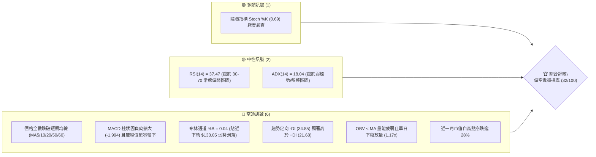
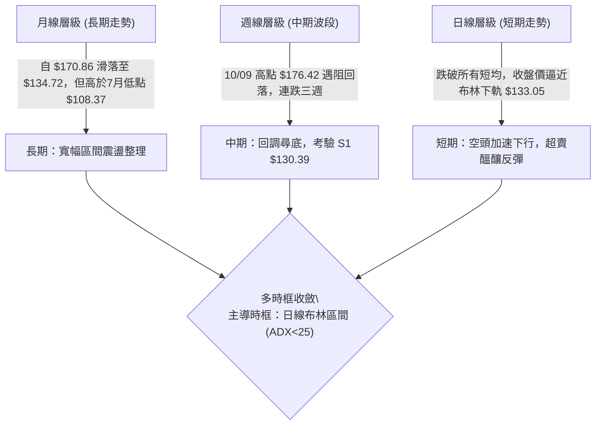
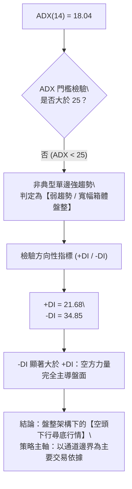
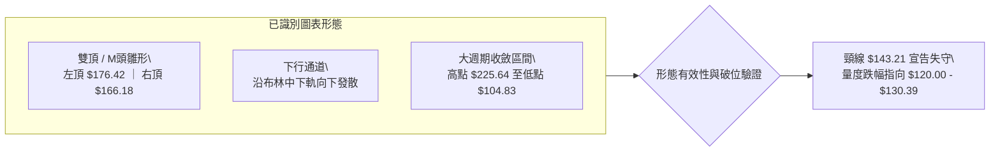
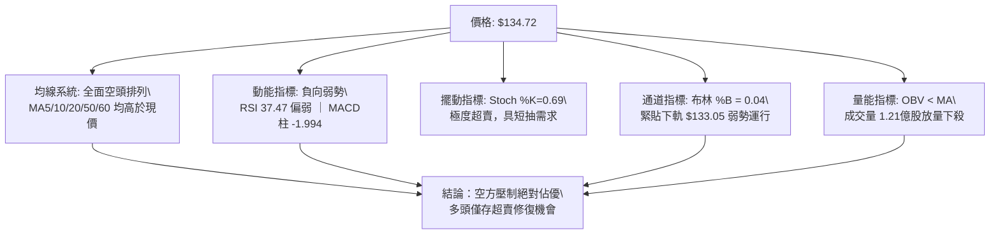
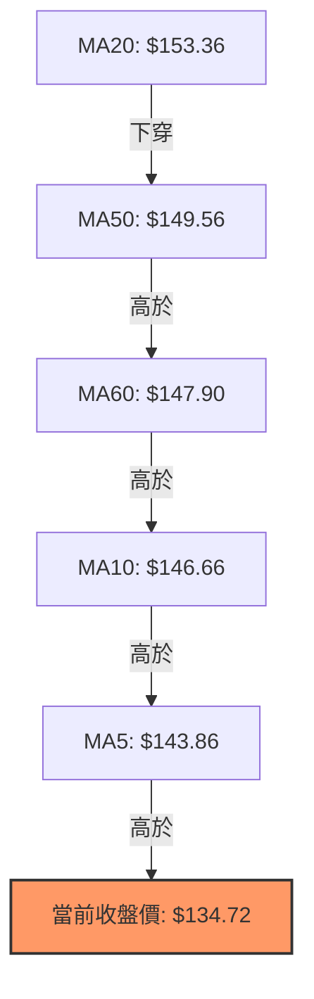
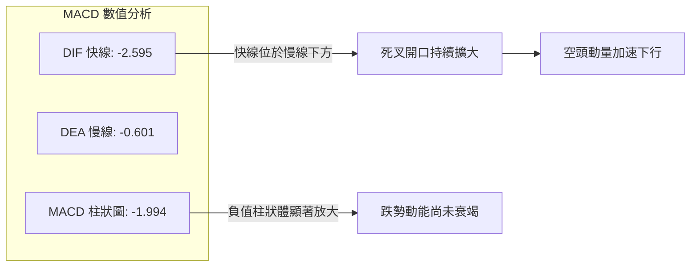
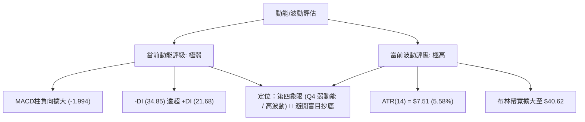
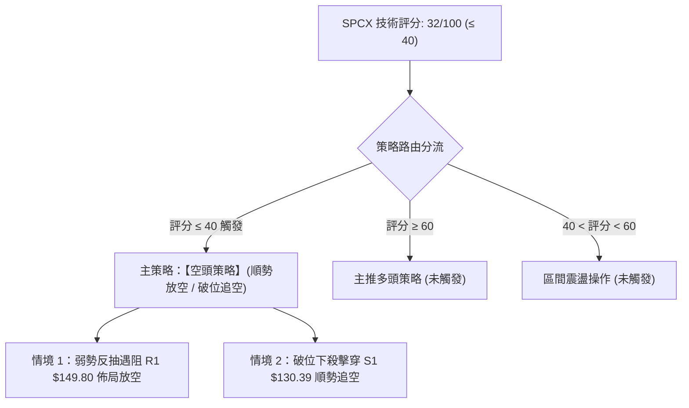
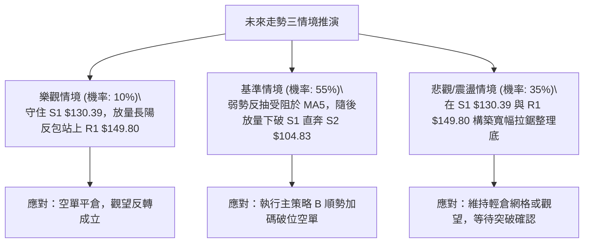

# SPCX 技術分析報告

> **報告日期**：2026-10-31 ｜ **語言**：繁體中文 ｜ **數據來源**：Yahoo Finance ｜ **當前價格**：$134.72

---

## 目錄

| 章節 | 內容 |
|------|------|
| [1. 技術面概覽](#1-技術面概覽) | 訊號儀表板、核心指標、評分卡 |
| [2. 趨勢分析](#2-趨勢分析) | 多時框趨勢、長中短期走勢、ADX 解讀 |
| [3. 圖表形態分析](#3-圖表形態分析) | 形態識別、K線組合、目標價推算 |
| [4. 支撐與阻力](#4-支撐與阻力) | 關鍵價位結構、斐波那契回調 |
| [5. 技術指標深度解讀](#5-技術指標深度解讀) | MA均線、RSI、MACD、布林通道、成交量 |
| [6. 動能與波動率](#6-動能與波動率) | 動能四象限、ATR 波動率、Beta |
| [7. 多時框架總結](#7-多時框架總結) | 時框架矩陣、多時框收斂結論 |
| [8. 交易策略建議](#8-交易策略建議) | 策略路由、主策略詳情、風險報酬比 |
| [9. 風險提示與監控](#9-風險提示與監控) | 關鍵監控清單、情境分析、風控準則 |

---

## 1. 技術面概覽

### 🎯 技術訊號儀表板



### 📊 核心指標速覽表

| 指標類別 | 指標名稱 | 當前數值 | 訊號 | 解讀 |
|:---|:---|:---|:---:|:---|
| **價格** | 當前收盤價 | $134.72 | 🔴 | 位於 52 週區間 24.7% 低分位，空方主導推進 |
| **均線** | 短期 MA20 | $153.36 | 🔴 | 現價低於 MA20 達 -12.15%，短期下行趨勢顯著 |
| **均線** | 中期 MA50 | $149.56 | 🔴 | 現價低於 MA50 達 -9.92%，中期波段結構偏空 |
| **均線** | 長期 MA200 | N/A（數據未提供） | 🟡 | 歷史數據不足以計算 MA200，無法判斷超長期牛熊分界 |
| **動能** | RSI(14) | 37.47 | 🟡 | 接近超賣門檻（30）但尚未出現超賣底背離反轉 |
| **動能** | MACD | -2.595 | 🔴 | 快慢線均在零軸之下，MACD 柱為 -1.994，跌勢加速 |
| **動能** | Stoch %K / %D | 0.69 / 10.08 | 🟢 | 極度超賣區間，技術面上隨時具備短線反抽技術修復動能 |
| **趨勢** | ADX(14) | 18.04 | 🟡 | 數值小於 25，顯示當前非單邊強趨勢，屬於空方主導的弱趨勢盤整 |
| **通道** | 布林通道 | 下軌 $133.05 | 🔴 | %B 為 0.04，價格貼緊下軌運行，尚未擺脫尋底慣性 |
| **量能** | 20日成交量比 | 1.17x (121.98M) | 🔴 | 10/30 下跌長陰放量，OBV 低於均線，量能呈現空頭壓制 |
| **波動** | ATR(14) | $7.51 (5.58%) | 🔴 | 日內波動幅度高達 5.58%，市場情緒高度不穩定 |

### 🏆 技術評分卡

```
╔══════════════════════════════════════════════════════════════════╗
║               技術評分卡 — SPCX (2026-10-31)                   ║
╠══════════════════════════════════════════════════════════════════╣
║ 趨勢強度 (ADX/DI)   █████░░░░░░░░░░░░░░░  28/100  🔴 空頭壓制   ║
║ 動能指標 (MACD/RSI) ██████░░░░░░░░░░░░░░  32/100  🔴 負向加速   ║
║ 支撐穩定度 (S1/Fib) ████████░░░░░░░░░░░░  42/100  🟡 考驗S1關鍵 ║
║ 成交量配合 (OBV/量) ███████░░░░░░░░░░░░░  34/100  🔴 帶量下殺   ║
║ 形態完整度 (K線/區間)███████░░░░░░░░░░░░  36/100  🔴 破位下行   ║
║ 均線排列 (MA5-60)   ████░░░░░░░░░░░░░░░░  20/100  🔴 空頭排列   ║
╠══════════════════════════════════════════════════════════════════╣
║ 綜合評分            ██████░░░░░░░░░░░░░░  32/100  🔴 偏空震盪   ║
║ 評級結論：六項指標算術平均為 32 分，觸發偏空策略路由             ║
╚══════════════════════════════════════════════════════════════════╝
```

---

## 2. 趨勢分析

### 🌐 多時框趨勢分析



### 📈 長期趨勢 — 12個月走勢圖（Unicode）

依據月度收盤與 52 週極值數據繪製長期走勢架構：

```
SPCX 月度價格走勢圖（2025-11 至 2026-10）
價格軸 ($)
$225.64 ┤                          ● (52W歷史高點)
$200.00 ┤                         ╱ ╲
$175.00 ┤          ●             ╱   ╲
$170.86 ┤─────────● (06月收盤)  ╱     ● (10/09波段高點 $176.42)
$150.86 ┤        ╱             ● (09月收盤) ╲
$143.69 ┤       ╱      ● (08月收盤)          ╲
$134.72 ┤──────●──────────────────────────────● (10月收盤/現價)
$108.37 ┤      │ ● (07月收盤)
$104.83 ┤──────● (52W歷史低點)
        └──────────────────────────────────────────────
         11   12   01   02   03   04   05   06   07   08   09   10 (月份)
```

#### 月度收盤特徵分析

| 年月份 | 收盤價 | 單月漲跌幅 | 走勢特徵與結構解讀 |
|:---|:---:|:---:|:---|
| **2026-06** | $170.86 | 基準月 | 股價自 52 週高點 $225.64 回落後，高位震盪構築頂部。 |
| **2026-07** | $108.37 | -36.57% | 遭遇流動性劇烈衝擊，下探逼近 52 週歷史低點 $104.83 後迅速獲得承接。 |
| **2026-08** | $143.69 | +32.59% | 強勁技術性超跌反彈，成交量放大，重回 $140 之上。 |
| **2026-09** | $150.86 | +4.99% | 震盪盤整推升，成交量萎縮，上攻動能有所放緩。 |
| **2026-10** | $134.72 | -10.70% | 10月中旬衝高至 $176.42 後遭巨量賣壓摜壓，月末連續下挫，收於全月最低點附近。 |

### 📊 中期趨勢（週線分析）

從近 8 週週 K 線數據觀察，中期波段在 2026-10-09 當週創下波段高點 $176.42（收盤 $162.57）後，隨即引發結構性破位：
- **2026-10-16 當週**：開盤 $164.66，最低下探 $140.66，收盤 $146.03，週 RSI 急墜至 43.9，MACD 柱由正轉負（-1.979），確認多轉空。
- **2026-10-23 當週**：多空於 $166.18 至 $143.21 間劇烈洗盤，成交量暴增至 719,691,900 股，收在 $147.49，形成高位換手套牢帶。
- **2026-10-30 當週**：空方全面吞噬，最低觸及 $134.50，收盤 $134.72，週跌幅 -8.66%，週 MACD 柱維持 -1.994，跌勢未見收斂。

```
SPCX 中期壓力與支撐階梯（週線級別）
─────────────────────────────────────────────────────────────
$176.42 ───┼─ 中期波段峰頂 (10/09 高點)
$158.13 ───┼─ R3 強阻力帶 (9/25 與 10/02 週高點聚類)
$155.00 ───┼─ R2 中期頸線阻力 (9/11 週高點)
$149.80 ───┼─ R1 短期轉換阻力帶 (近週開盤/收盤密集區)
$134.72 ───┼─ 當前價格 (測試布林下軌 $133.05)
$130.39 ───┼─ S1 近期波段關鍵支撐 (波段低點聚類 / Fib 78.6% $130.68)
$104.83 ───┼─ S2 歷史極限強支撐 (52W Low)
─────────────────────────────────────────────────────────────
```

### ⚡ 趨勢強度評估（ADX 解讀）



#### ADX 趨勢強度指標對照

| 參數指標 | 數值 | 狀態區間 | 技術解讀 |
|:---|:---:|:---:|:---|
| **ADX(14)** | 18.04 | 弱趨勢 / 盤整 (<25) | 當前市場並未處於強烈的單邊動量趨勢中，單邊追空風險偏高。 |
| **+DI** | 21.68 | 多頭動能減退 | 多方買盤萎縮，反彈缺乏持續性買盤推動。 |
| **-DI** | 34.85 | 空頭動能主導 | 空方主控盤面，下行壓力未除，反彈易引發賣壓。 |
| **方向差距 (DI Spread)** | -13.17 | 空方優勢擴大 | 差距顯著，顯示價格慣性仍偏向向下測試支撐。 |

---

## 3. 圖表形態分析

### 🔍 形態識別系統

依據近幾個月日線與週線走勢，識別出以下圖表形態：



#### 形態識別信心度與目標價評估

| 形態名稱 | 信心度 | 判斷依據（引用數據） | 完成度 | 目標價（附計算式） |
|:---|:---:|:---|:---:|:---|
| **雙頂形態 (M-Top)** | 75% | 10/09週高 $176.42 與 10/21日高 $166.18 構成雙頂；跌破 10/22 低點頸線 $143.21 | 85% | 頸線 $143.21 − (右頂 $166.18 − 頸線 $143.21 = $22.97) = **$120.24**（數據中未直接列出，由形態高度推算） |
| **下行通道** | 65% | 價格受制於 MA20 ($153.36) 壓制，沿布林下軌 ($133.05) 延伸下行 | 90% | 通道下軌支撐區間重疊於關鍵支撐 **S1 $130.39** |
| **收斂大三角整理** | 45% | 長期 52W 高點 $225.64 與 52W 低點 $104.83 間震盪，信心度不足 50% | 40% | 訊號不足，僅做指標型解讀，不預設延伸目標價 |

### 🕯️ 重要 K 線形態分析

嚴格依據數據中「近10根日K」與「近8根週K」的實際開、高、低、收數據進行專業解讀：

#### 近10根日K形態精解

| 日期 | 開盤價 | 最高價 | 最低價 | 收盤價 | K線形態 | 深度解讀 | 訊號 |
|:---|:---:|:---:|:---:|:---:|:---|:---|:---:|
| **2026-10-19** | 149.23 | 151.01 | 146.83 | 147.96 | 小陰十字線 | 窄幅縮量震盪，多空暫時觀望。 | 🟡 |
| **2026-10-20** | 146.17 | 148.66 | 143.27 | 147.79 | 下影小陽錘線 | 低位下探獲支撐，引發隔日跳空買盤。 | 🟢 |
| **2026-10-21** | 160.56 | 166.18 | 156.93 | 159.31 | 跳空爆量大陽線 | 成交量激增至 2.2億股，衝高遇阻回落留下影線。 | 🟢 |
| **2026-10-22** | 154.21 | 154.26 | 143.21 | 144.75 | 長陰吞噬 (Bearish Engulfing) | 高開低走，完全吞噬前日漲幅，套牢巨量籌碼。 | 🔴 |
| **2026-10-23** | 147.93 | 149.75 | 144.09 | 147.49 | 縮量十字星 | 暴跌後的多空中繼整理，反彈無力。 | 🟡 |
| **2026-10-26** | 146.84 | 150.24 | 144.57 | 146.90 | 上影小陰線 | 盤中反彈測試 $150 關卡無功而返。 | 🔴 |
| **2026-10-27** | 147.41 | 151.36 | 146.61 | 148.58 | 衝高回落小陽線 | 試圖收復 MA5/10 失敗，上方賣壓沉重。 | 🟡 |
| **2026-10-28** | 147.37 | 148.20 | 142.13 | 145.23 | 中陰線下破 | 破壞短期平台整理，創 10/22 以來新低。 | 🔴 |
| **2026-10-29** | 142.26 | 144.95 | 141.03 | 143.89 | 弱勢縮量小陽 | 成交量萎縮至 68.36M，多頭缺乏抵抗意願。 | 🟡 |
| **2026-10-30** | 137.85 | 140.20 | 134.50 | 134.72 | 跳空放量光腳大陰線 | 破位加速下殺，收在最低點附近，成交量放大至 121.98M。 | 🔴 |

#### 近8根週K形態精解

| 日期 | 開盤價 | 最高價 | 最低價 | 收盤價 | 週K形態 | 深度解讀 | 訊號 |
|:---|:---:|:---:|:---:|:---:|:---|:---|:---:|
| **2026-09-11** | 149.05 | 155.00 | 144.89 | 151.21 | 震盪小陽星 | 確立中軌支撐，維持多頭緩步推升節奏。 | 🟢 |
| **2026-09-18** | 147.33 | 156.87 | 142.87 | 152.71 | 長下影帶量陽線 | 成交量 6.69億股，顯示低位承接買盤積極。 | 🟢 |
| **2026-09-25** | 154.77 | 158.13 | 145.88 | 148.68 | 衝高回落陰線 | 遇阻 R3 $158.13，多頭獲利了結賣壓湧現。 | 🔴 |
| **2026-10-02** | 148.49 | 159.84 | 145.36 | 158.96 | 實體中陽線 | 再次挑戰阻力，多頭力量再度展現。 | 🟢 |
| **2026-10-09** | 158.99 | 176.42 | 158.62 | 162.57 | 長上影流星線 (Shooting Star) | 衝刺 52W 高點未果，留下巨額上影線頂部訊號。 | 🔴 |
| **2026-10-16** | 164.66 | 167.07 | 140.66 | 146.03 | 轉折大陰破位線 | 跌破 20日均線支撐，確立中期頂部成立。 | 🔴 |
| **2026-10-23** | 149.23 | 166.18 | 143.21 | 147.49 | 天量長影倒錘線 | 單週換手 7.2億股，衝高回落，主力出貨特徵明確。| 🔴 |
| **2026-10-30** | 146.84 | 151.36 | 134.50 | 134.72 | 破位光腳實體陰線 | 放量摜破平台底，完全抹平 8-9 月漲幅。 | 🔴 |

### 📉 ASCII 走勢形態示意圖

```
SPCX 日線破位形態示意圖（2026-10-19 至 10-30）
價格軸 ($)
$166.18 ┤           ▲ (10/21 跳空高開峰頂)
$160.00 ┤          ╱ ╲
$155.00 ┤         ╱   ╲ ◄ (10/22 巨量陰吞噬)
$149.80 ┤────────┼─────┼───────▲ (10/27 遇阻 R1 回落)
$143.21 ┤        │     ▼───────┴──────┐ ◄ 形態頸線破位
$140.00 ┤        │                    ╲
$134.72 ┤────────┼─────────────────────▼◄ 現價 (10/30 光腳陰線收盤)
$130.39 ┤        │                       ◄ 關鍵支撐 S1 / Fib 78.6%
        └────────┴─────────────────────────────
        10-19  10-21  10-23  10-26  10-28  10-30 (日期)
```

### 🎯 形態目標價計算

1. **雙頂 (M-Top) 形態等幅量度計算**：
   - 頂部高點取值：10/21 日高點 $166.18。
   - 形態頸線取值：10/22 日破位低點 $143.21。
   - 垂直形態高度：$166.18 − $143.21 = **$22.97**。
   - 等幅下行目標價：$143.21 − $22.97 = **$120.24**（由形態高度推算）。
2. **短期盤整區間箱體破位量度計算**：
   - 近期震盪箱頂：阻力位 **R1 $149.80**。
   - 近期震盪箱底：支撐位 **S1 $130.39**。
   - 箱體垂直高度：$149.80 − $130.39 = **$19.41**。
   - 若有效跌破 S1，向下等幅量度目標價：$130.39 − $19.41 = **$110.98**（由箱體高度推算），進一步逼近 52 週歷史低點 **S2 $104.83**。

---

## 4. 支撐與阻力

### 🗺️ 關鍵價位分布圖（Unicode）

```
╔══════════════════════════════════════════════════════════════════╗
║                   SPCX 價位結構分布圖                            ║
╠══════════════════════════════════════════════════════════════════╣
║ $158.13 ║██████████████████████████████║ 強阻力 R3 (波段高點聚類) ║
║ $155.00 ║████████████████████          ║ 阻力 R2 (9/11高點頸線)   ║
║ $149.80 ║██████████████████████████    ║ 關鍵阻力 R1 (反彈強壓)   ║
║ $134.72 ╠══════════════════════════════╣ ◄ 當前收盤價 (布林下軌)  ║
║ $130.68 ║▓▓▓▓▓▓▓▓▓▓▓▓▓▓▓▓▓▓▓▓▓▓        ║ 斐波那契 78.6% 回調位    ║
║ $130.39 ║██████████████████████████    ║ 近期關鍵支撐 S1          ║
║ $104.83 ║██████████████████████████████║ 52週歷史低點強支撐 S2    ║
╚══════════════════════════════════════════════════════════════════╝
```

### 🚧 阻力位分析表

所有阻力價位嚴格引用系統計算之波段高點聚類數值：

| 阻力級別 | 精確價位 | 距現價幅標 | 形成原因與籌碼特徵 | 突破難度 | 重要性 |
|:---|:---:|:---:|:---|:---:|:---:|
| **R1** | **$149.80** | +11.19% | 近一年波段高點聚類；與 10/23、10/26 震盪平台重疊，MA50 ($149.56) 位於此處。 | 🔴 極高 | ★★★★★ |
| **R2** | **$155.00** | +15.05% | 9/11 週高點；與 MA20 ($153.36) 構成密集阻力帶，中期多空分水嶺。 | 🔴 高 | ★★★★☆ |
| **R3** | **$158.13** | +17.38% | 9/25 週高點；前期多頭向上假突破起跌點，上方堆積超過 10 億股套牢量。 | 🔴 極高 | ★★★☆☆ |

### 🛡️ 支撐位分析表

所有支撐價位嚴格引用系統計算之波段低點聚類數值：

| 支撐級別 | 精確價位 | 距現價幅標 | 形成原因與籌碼特徵 | 守住機率 | 重要性 |
|:---|:---:|:---:|:---|:---:|:---:|
| **S1** | **$130.39** | -3.21% | 近一年波段低點聚類；與 78.6% 斐波那契位 ($130.68) 共振，短線最後防線。 | 🟡 55% | ★★★★★ |
| **S2** | **$104.83** | -22.19% | 52週歷史最低點；長期超級支撐位，2026年7月暴跌止跌起漲點。 | 🟢 85% | ★★★★★ |
| **S3** | 數據中未偵測到 | N/A | 原生數據庫中未定義 S3 數值，依紀律不捏造。 | N/A | N/A |

### 📐 斐波那契回調位分析

依據 52 週完整波段（歷史低點 $104.83 → 歷史高點 $225.64，波段垂直跨度 $120.81）分析：

| 回調比率 | 斐波那契價位 | 價格相對狀態 | 技術含義解讀 |
|:---|:---:|:---:|:---|
| **0.0% (52W High)** | $225.64 | 現價下方 +67.49% | 歷史牛市最高頂點，長期終極阻力。 |
| **23.6%** | $197.13 | 現價下方 +46.33% | 強勢回調防守點，已被實質跌破。 |
| **38.2%** | $179.49 | 現價下方 +33.23% | 多頭分界線；10/09 高點 $176.42 觸及此線即被空頭擊退。 |
| **50.0%** | $165.24 | 現價下方 +22.65% | 核心均衡軸心；10/21 衝高 $166.18 假突破後引發崩跌。 |
| **61.8%** | $150.98 | 現價下方 +12.07% | 黃金分割防守位；現已轉化為強大反壓，壓制反彈空間。 |
| **78.6%** | **$130.68** | 現價上方 -3.00% | **極深回調防守位；現價 ($134.72) 緊密逼近此位。** |
| **100.0% (52W Low)** | $104.83 | 現價上方 -22.19% | 原始起漲基石，破位則確認進入長期熊市探底。 |

> **位置判定**：當前收盤價 **$134.72** 精準落於 **61.8% ($150.98)** 與 **78.6% ($130.68)** 之間，且距離 78.6% 回調位僅剩 -3.00% 空間。技術上，此區間為多頭「最後防禦壕溝」，若收盤跌破 $130.68 並擊穿 S1 ($130.39)，則回調趨勢將完全演化為向 100% 斐波那契位 ($104.83) 尋求支撐的崩塌走勢。

---

## 5. 技術指標深度解讀

### 🎛️ 指標訊號總覽



### 📈 移動平均線排列分析



#### 均線系統監控矩陣

| 均線名稱 | 當前數值 | 現價偏離幅度 | 排列方向 | 短期趨勢評估 |
|:---|:---:|:---:|:---:|:---|
| **MA 5** | $143.86 | -6.36% | ▼ 下行 | 極短線第一道動態下壓阻力，未突破前空方完全主導。 |
| **MA 10** | $146.66 | -8.14% | ▼ 下行 | 短期波段下壓線，斜率陡峭向下。 |
| **MA 20 (布林中軌)** | $153.36 | -12.15% | ▼ 下行 | 短期多空分界線，偏離度逾 -12%，負乖離過大。 |
| **MA 50** | $149.56 | -9.92% | ▼ 下行 | 中期波段生命線，已被放量擊穿。 |
| **MA 60** | $147.90 | -8.91% | ▼ 下行 | 季線水平，走平轉跌，中期支撐轉為強阻力。 |
| **MA 120** | N/A（數據未提供） | N/A | 資料不足 | 原生數據不足 120 筆，不予計算。 |
| **MA 200** | N/A（數據未提供） | N/A | 資料不足 | 原生數據不足 200 筆，無法評估年線。 |

### 📉 RSI(14) 分析

- **RSI(14) 最新讀數**：**37.47**
- **區間判定**：處於 30 至 70 之常態偏空區間，尚未跌破 30 達到傳統「極度超賣」閾值。
- **背離分析**：系統對比近 20 根 K 棒首尾價格與 RSI 方向，**無明顯背離**（價格創低，RSI 亦同步走低，走勢完全同步，未見底背離或頂背離反轉跡象）。

```
RSI(14) 狀態進度條：
37.47  [████████░░░░░░░░░░░░░░░░░░░░] 37.47% (偏弱空方區間)
0              30(超賣)           70(超買)          100
```

### 📊 MACD(12, 26, 9) 訊號解讀



- **DIF (-2.595)** 與 **DEA (-0.601)** 雙雙沉於零軸之下，且快線與慢線負向距離高達 -1.994，顯示中線空頭趨勢強烈。
- **背離診斷**：週線 MACD 柱狀圖自 10/09 之 +0.937 驟降至 10/30 之 -1.994，日線與週線均呈負向共振加速，**無底背離訊號**。

### 📦 布林通道分析

```
SPCX 布林通道位置截面圖 ($)
上軌  $173.67 ┤
中軌  $153.36 ┤ (MA20)
下軌  $133.05 ┤
現價  $134.72 ┼───● (%B = 0.04)
              └────────────────────────
```

- **軌道寬度**：上軌 $173.67 − 下軌 $133.05 = $40.62，帶寬擴張，顯示波動率劇烈釋放。
- **通道指標 %B = 0.04**：現價 $134.72 緊貼下軌 $133.05，距離下軌僅 $1.67（1.25%）。在無反轉 K 線確認前，貼軌滑落是標準的空頭慣性推進。

### 💹 成交量分析（量價配合度）

- **最新日成交量**：121,979,900 股。
- **20日均量**：104,389,750 股（量比：**1.17x**）。
- **50日均量**：92,477,198 股。
- **OBV 趨勢**：**OBV < MA**。
- **量價配合診斷**：10/30 日線下跌 -6.37% 同時成交量放大至 1.21 億股，高於 20 日均量 17%，呈現典型的**「放量下挫」**空頭特徵；量能疲弱，缺乏主力資金主動回補跡象。

---

## 6. 動能與波動率

### ⚡ 動能評估四象限

| 象限標記 | 動能維度 | 波動維度 | 代表特徵 | SPCX 當前狀態 |
|:---:|:---:|:---:|:---|:---:|
| **Q1** | 強動能 (Bullish) | 低波動 | 穩健單邊上升通道，最佳持股機會 | ── |
| **Q2** | 弱動能 (Bearish) | 低波動 | 窄幅盤整磨底，方向未明 | ── |
| **Q3** | 強動能 (Bullish) | 高波動 | 暴漲暴跌，多頭高風險博弈 | ── |
| **Q4** | **弱動能 (Bearish)** | **高波動** | **加速破位殺跌，多單高危險區間** | **✓ (符合現況)** |



### 📊 ATR 波動率分析

- **ATR(14) 數值**：**$7.51**（佔現價比例 **5.58%**，採 Wilder 平滑算法）。
- **風控止損距離建議**：
  - **超短線進場（1.0 × ATR）**：防守安全緩衝距離為 **$7.51**。
  - **波段交易防守（1.5 × ATR）**：防守安全緩衝距離為 **$11.27**。
  - **趨勢反轉過濾（2.0 × ATR）**：防守安全緩衝距離為 **$15.02**。
- **解讀**：單日預期合理波動高達 $7.51，意味著若在現價 $134.72 建立任何反向頭寸，極易受到日內常態波動震盪洗出場，必須給予充分的止損空間或收緊倉位規模。

### 📐 Beta 與市場相關性

- **Beta 數值**：**N/A（數據未提供）**。
- **市場相關性分析**：儘管官方 Beta 數據缺失，但由近期新聞脈絡（Alphabet 創下單月最差跌幅、科技股流動性緊縮、SPCX 單月市值縮水逾 5000 億美元）可見，SPCX 與總體流動性及大型科技成長股具有高度系統性關聯，且呈現顯著的弱於大盤特徵。

---

## 7. 多時框架總結

### 📋 時框架評分表

| 時框架 | 趨勢方向 | 動能狀態 | 均線排列 | 形態特徵 | 綜合評分 | 操作建議 |
|:---|:---:|:---:|:---:|:---:|:---:|:---|
| **長期 (月線)** | 寬幅震盪 | 🟡 中性走平 | 未能形成多頭排列 | 考驗 78.6% 回調帶 | 45/100 | 觀望，等待底部分歧消除 |
| **中期 (週線)** | 偏空回調 | 🔴 負向加速 | 跌破 20週均線 | 流星線頂部回落 | 30/100 | 嚴格逢高減碼，順勢偏空 |
| **短期 (日線)** | 空頭破位 | 🔴 貼軌殺跌 | 均線空頭排列 | 跳空放量光腳大陰 | 22/100 | 嚴禁盲目摸底，以反彈空為主 |

### 🔲 綜合訊號矩陣

```
時框訊號一致性評估矩陣：
╔══════════════╦══════════════╦══════════════╦══════════════╗
║ 指標類別     ║ 短期 (日線)  ║ 中期 (週線)  ║ 長期 (月線)  ║
╠══════════════╬══════════════╬══════════════╬══════════════╣
║ 均線系統     ║ 🔴 空頭排列  ║ 🔴 破位向下  ║ 🟡 區間走平  ║
║ MACD 動量    ║ 🔴 負向擴大  ║ 🔴 死叉加速  ║ 🟡 零軸上方  ║
║ RSI 相對強弱 ║ 🔴 37.47偏弱 ║ 🔴 37.5轉弱  ║ 🟡 50附近    ║
║ K 線形態     ║ 🔴 光腳陰線  ║ 🔴 實體大陰  ║ 🔴 墓碑回撤  ║
║ 成交量配合   ║ 🔴 帶量破位  ║ 🔴 週放量殺  ║ 🟡 均量持平  ║
╠══════════════╬══════════════╬══════════════╬══════════════╣
║ 矩陣收斂結果 ║ 🔴 80% 強空  ║ 🔴 75% 偏空  ║ 🟡 50% 中性  ║
╚══════════════╩══════════════╩══════════════╩══════════════╝
```

### ⚖️ 多時框收斂結論

嚴格遵循多時框收斂優先級規則：
1. **趨勢/盤整識別**：當前 **ADX(14) 為 18.04**（小於 25），在定義上屬於**盤整行情（Range/Consolidation Market）**。
2. **主導時框與空間判定**：依規則 14，盤整行情中應以**日線布林通道上下軌 ($133.05 - $173.67)** 及**關鍵支撐阻力結構**為主要交易邊界。
3. **收斂取捨**：雖然日線跌幅深且 Stoch %K (0.69) 出現技術超賣，但在日線放量破位、週線光腳大陰且 -DI (34.85) 完全主導的多重壓制下，不宜主觀判定見底。
4. **唯一方向性結論**：**【偏空觀望，順勢逢高偏空】**。當前價格 $134.72 正在考驗布林下軌 $133.05 與關鍵支撐 S1 $130.39，在未見帶量陽線反包或 MACD 底背離前，整體結構完全由空方掌控。

---

## 8. 交易策略建議

### 🗺️ 策略決策流程圖



### 🧭 策略路由（依評分卡分流）

> **當前主策略方向 = 空頭策略（依綜合評分 32/100 偏空，嚴格執行順勢偏空路徑）**

### 🎯 價格情境階梯（Price Scenarios）

價位完全嚴格引用數據庫「關鍵價位」與「斐波那契回調」數值：

| 觸發條件 | 下一目標 | 後續延伸 | 情境技術含義 |
|:---|:---:|:---:|:---|
| **強勢突破 R1 $149.80** | R2 $155.00 | R3 $158.13 | 短線破位失敗，轉為超跌強力反彈，空單全面離場。 |
| **反彈受阻於 MA5 ($143.86) 或 R1** | 現價 $134.72 | S1 $130.39 | 標準弱勢反抽確認，空頭次級加碼點。 |
| **跌破 S1 $130.39 / Fib $130.68** | S2 $104.83 | 數據中未偵測到 | 破位加速，向 52 週歷史低點 S2 展開等幅尋底。 |

### 📊 情境機率分佈

| 情境劇本 | 發生機率 | 主要技術依據 |
|:---|:---:|:---|
| **回落 / 再探底 (破位下探 S1/S2)** | **55%** | 10/30 放量下殺陰線、MACD 柱負向擴大至 -1.994、OBV < MA 量能疲弱。 |
| **區間震盪 (於 S1 $130.39 至 R1 $149.80 間磨底)** | **35%** | ADX(14) 僅 18.04 處盤整帶、Stoch %K (0.69) 極度超賣引發技術護盤。 |
| **強勢反彈 / V型反轉 (向上收復 R1 $149.80)** | **10%** | 目前日線均線空頭排列，缺乏重大買盤放量回補跡象。 |

### 🟢 主策略詳情（空頭策略）

依規則 17，風險報酬比公式為：做空 RR = (進場價 − 目標價) ÷ (止損價 − 進場價)。

| 策略要素 | 策略 A（反彈遇阻做空 — 最佳勝率） | 策略 B（跌破 S1 順勢破位放空 — 動量追擊） |
|:---|:---|:---|
| **進場條件** | 價格反抽至短期阻力 R1 遇阻回落，或回抽 MA5 乏力 | 實體日 K 跌破關鍵支撐 S1 $130.39 確認失守 |
| **進場價格** | **$149.80**（精確引用阻力 R1） | **$130.39**（精確引用支撐 S1 破位） |
| **目標價 T1** | **$130.39**（關鍵支撐 S1） | **$110.98**（由箱體高度 $19.41 等幅推算） |
| **目標價 T2** | **$104.83**（52W歷史低點強支撐 S2） | **$104.83**（52W歷史低點強支撐 S2） |
| **止損價格** | **$155.00**（阻力 R2 上方） | **$134.72**（現價 / 布林下軌反壓位） |
| **風險報酬比** | **1 : 3.73（以 T1 計）**<br>*(計算: (149.80 - 130.39) / (155.00 - 149.80) = 19.41 / 5.20 = 3.73)*<br>*(以 T2 計則為 1 : 8.65)* | **1 : 4.48（以 T1 計）**<br>*(計算: (130.39 - 110.98) / (134.72 - 130.39) = 19.41 / 4.33 = 4.48)*<br>*(以 T2 計則為 1 : 5.90)* |
| **成功機率** | 60% | 55% |
| **建議倉位** | 10% - 15% 總資金 | 8% - 10% 總資金 |

### 🔴 反向風險觸發點（對沖提示）

- **多頭反轉觸發位**：日線收盤價若帶量突破 **R1 $149.80** 並站穩 **MA20 ($153.36)**，則宣告 M 頭形態破位失效，空頭必須無條件全數止損離場。
- **對沖博弈提示**：若價格觸及 S1 $130.39 同時 Stoch 指標金叉，激進型交易者僅可動用 3% 輕倉短線博弈超賣反抽，嚴格止損於 $128.00（跌破 S1 逾 1.5%）。

### ⭐ 整體訊號強度評星

```
做多訊號強度：★☆☆☆☆  (1/5星 - 僅具備超賣修復可能，右側訊號全無)
做空訊號強度：★★★★☆  (4/5星 - 均線、動量、K線形態全面偏空)
整體可信度：  ★★★★☆  (4/5星 - 多時框數據吻合，破位特徵明確)
```

---

## 9. 風險提示與監控

### ✅ 關鍵監控指標 Checklist

```
╔══════════════════════════════════════════════════════════════════╗
║                   每日交易監控清單 (Checklist)                   ║
╠══════════════════════════════════════════════════════════════════╣
║ [ ] 價格是否跌破 S1 ($130.39)？跌破則確認開啟新一輪下行探底      ║
║ [ ] RSI(14) 是否跌破 30？進入超賣區需警惕單日暴力反抽空頭回補    ║
║ [ ] 日成交量是否萎縮至 9,000 萬股以下？縮量下挫通常跌勢未竭      ║
║ [ ] 價格能否有效收復 MA5 ($143.86)？若無法收復則弱勢格局不變     ║
║ [ ] MACD 柱狀圖負值是否收斂？收斂為動能衰竭的第一個預警訊號      ║
╚══════════════════════════════════════════════════════════════════╝
```

### ⚠️ 風險場景分析



### 🛡️ 風險管理重要提醒

1. **ATR 波動防禦**：當前 ATR 高達 **$7.51 (5.58%)**，日內洗盤振幅巨大。單筆交易最大虧損額必須嚴格控制在總投資組合淨值的 **1.0%** 以內。
2. **財報與流動性黑天鵝**：SPCX 自由現金流 (TTM) 為負的 $40.16B，資本支出高達 $55.92B，近期市場對科技巨頭資本開支與流動性瓶頸高度敏感，謹防非技術面跳空風險。
3. **執行紀律**：嚴禁在現價與 S1 之間的模糊地帶盲目開立大額多單「接飛刀」；技術交易者應堅持「見確認訊號才進場」的紀律。

---

## 📋 報告總結

```
╔══════════════════════════════════════════════════════════════════╗
║                    SPCX 技術分析報告總結                         ║
╠══════════════════════════════════════════════════════════════════╣
║ 報告日期：2026-10-31                                             ║
║ 當前價格：$134.72                                                ║
║ 分析評級：🔴 偏空震盪探底 (技術綜合評分: 32/100)                  ║
║                                                                  ║
║ 關鍵結論：                                                       ║
║ ├─ 長期趨勢：🟡 中性偏弱 (自高位回撤，處於寬幅箱體下半區)       ║
║ ├─ 中期趨勢：🔴 弱勢回調 (10/09 流星線確立頂部，三連陰下殺)      ║
║ ├─ 短期趨勢：🔴 空頭主導 (10/30 放量大陰，均線空頭排列)          ║
║ ├─ 關鍵支撐：S1: $130.39 ｜ S2: $104.83                          ║
║ ├─ 關鍵阻力：R1: $149.80 ｜ R2: $155.00 ｜ R3: $158.13          ║
║ └─ 分析師目標均價：$257.11 (基本面共識與當前技術盤面嚴重脫節)   ║
║                                                                  ║
║ 最優策略組合：                                                   ║
║ 1. 🥇 最佳機會：策略 A (反彈至 R1 $149.80 遇阻做空，RR = 1:3.73) ║
║ 2. 🥈 次選機會：策略 B (跌破 S1 $130.39 順勢追空，RR = 1:4.48) ║
║ 3. 🥉 保守選擇：場外空倉觀望，耐心等待價格下探測試 S1/S2 之訊號  ║
╚══════════════════════════════════════════════════════════════════╝
```

---

> ⚠️ **免責聲明**：本報告為依據定量技術分析指標自動生成之研究報告，所有數據、圖表及價位推算均嚴格基於所提供的歷史交易資訊。本報告**僅供學術研究與投資分析參考**，**不構成任何要約、招攬或具體投資建議**。市場有風險，交易需依個人風險承受能力審慎決策。

---

*報告生成時間：2026-10-31 ｜ 數據來源：Yahoo Finance ｜ 分析框架：多時框技術分析模型*