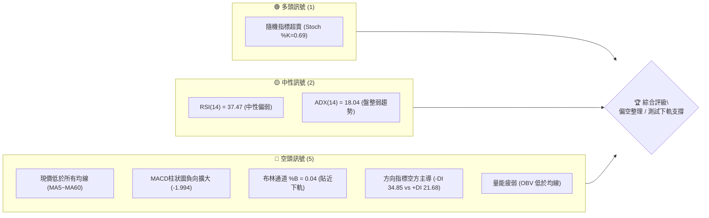
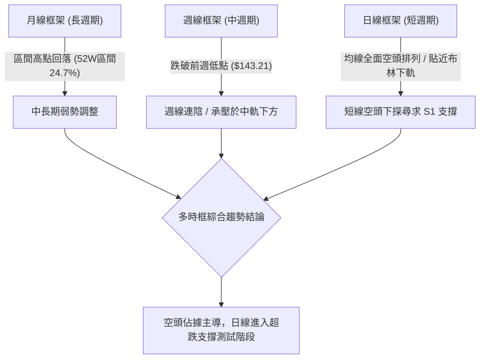
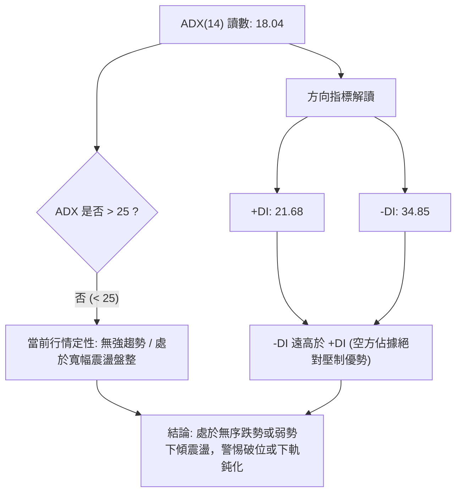
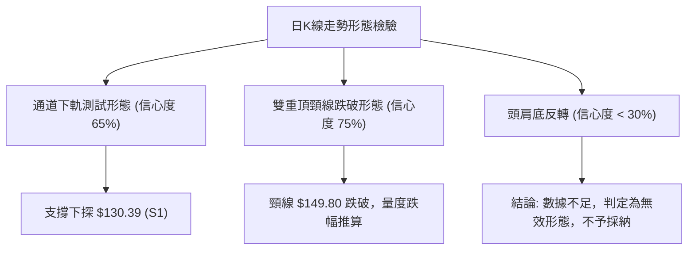
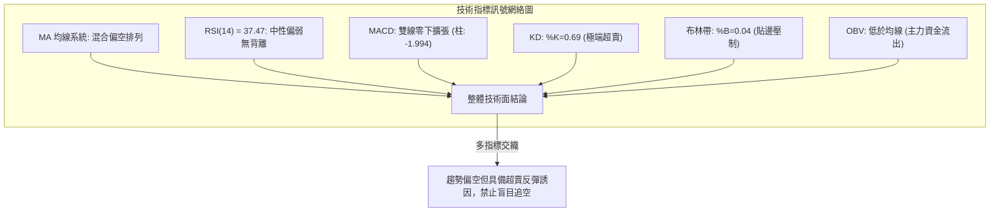
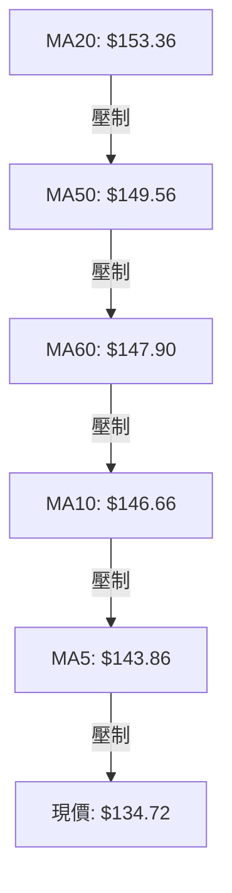
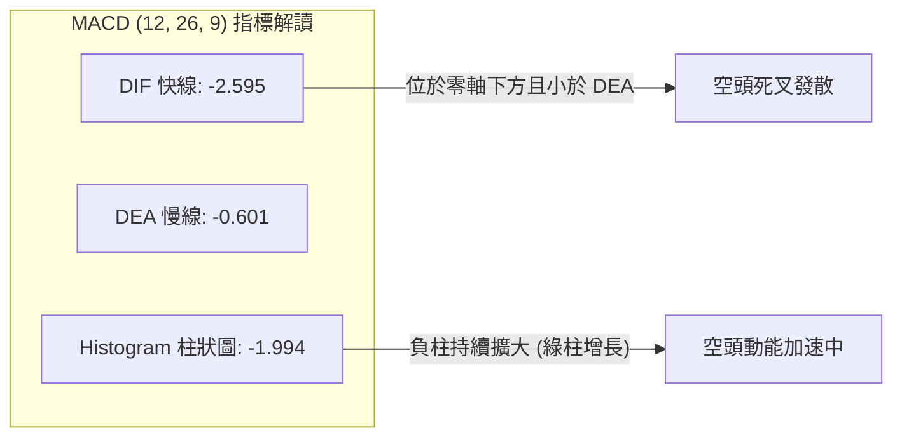
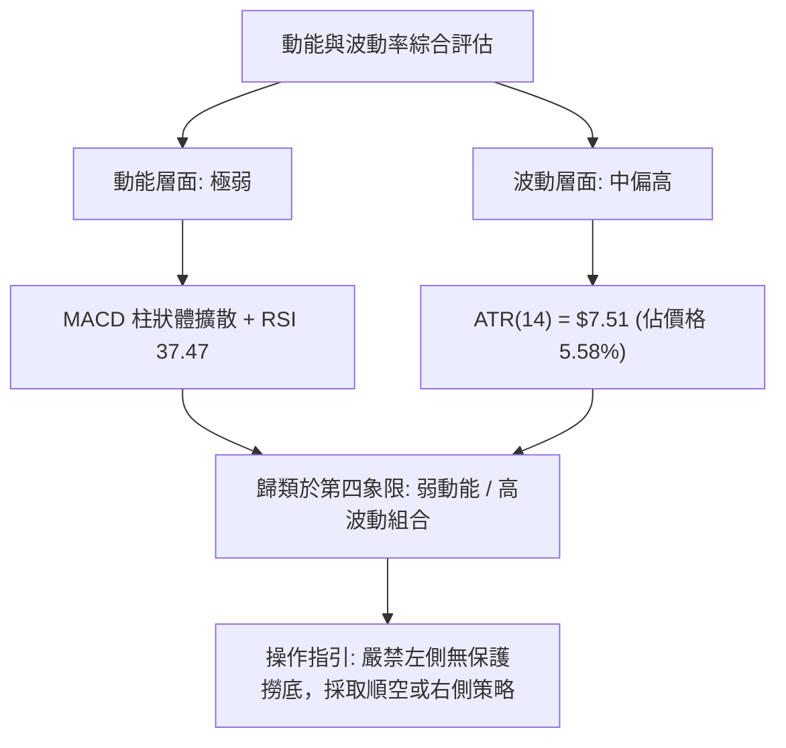
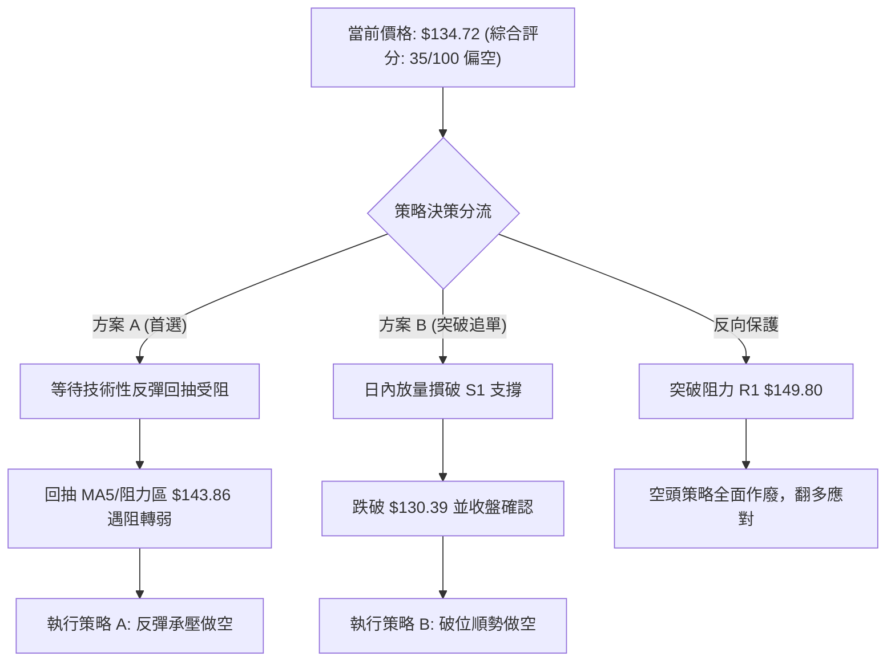
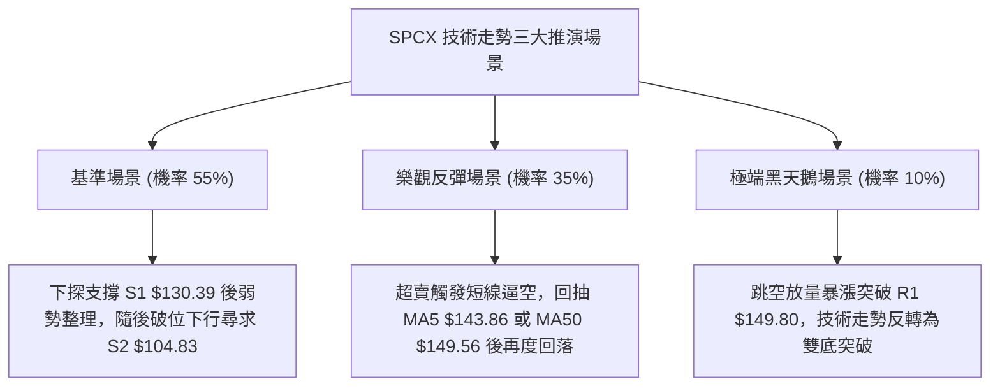

# SPCX 技術分析報告

> **報告日期**：2026-11-01 ｜ **語言**：繁體中文 ｜ **數據來源**：Yahoo Finance ｜ **當前價格**：$134.72

---

## 目錄

| 章節 | 內容 |
|------|------|
| [1. 技術面概覽](#1-技術面概覽) | 訊號儀表板、核心指標、評分卡 |
| [2. 趨勢分析](#2-趨勢分析) | 多時框趨勢、長中短期走勢 |
| [3. 圖表形態分析](#3-圖表形態分析) | 形態識別、K線組合、目標價 |
| [4. 支撐與阻力](#4-支撐與阻力) | 關鍵價位、斐波那契回調 |
| [5. 技術指標深度解讀](#5-技術指標深度解讀) | MA/RSI/MACD/布林/成交量 |
| [6. 動能與波動率](#6-動能與波動率) | 動能評估、ATR、Beta |
| [7. 多時框架總結](#7-多時框架總結) | 時框架評分矩陣 |
| [8. 交易策略建議](#8-交易策略建議) | 多空策略、風險報酬比 |
| [9. 風險提示與監控](#9-風險提示與監控) | 監控指標、風險場景 |

---

## 1. 技術面概覽

### 🎯 技術訊號儀表板



### 📊 核心指標速覽表

| 指標類別 | 指標名稱 | 當前數值 | 訊號 | 解讀 |
|----------|----------|----------|------|------|
| **價格** | 當前收盤價 | $134.72 | 🔴 | 位於 52 週區間 24.7% 分位，空方主導下探 |
| **均線** | MA20 | $153.36 | 🔴 | 現價低於 MA20 達 -12.15%，短中期下行壓力沉重 |
| **均線** | MA50 | $149.56 | 🔴 | 現價低於 MA50，且 MA20 位於 MA50 上方但向下拐頭 |
| **均線** | MA200 | N/A（數據未提供） | 🟡 | 資料不足，長週期基準線暫不可考 |
| **動能** | RSI(14) | 37.47 | 🟡 | 位於 30–70 中性偏弱區間，尚未進入極端超賣 (<30) |
| **動能** | MACD (12,26,9) | -2.595 / 柱: -1.994 | 🔴 | 雙線位於零軸下方發散，柱狀圖負向擴張，空頭動能強烈 |
| **動能** | KD (%K / %D) | 0.69 / 10.08 | 🟢 | 進入深度超賣區間，技術性隨時可能引發短線抽腳反彈 |
| **趨勢** | ADX(14) | 18.04 (-DI: 34.85) | 🔴 | ADX < 25 屬無趨勢盤整，但 -DI 壓制 +DI，空方具控盤優勢 |
| **波動** | ATR(14) | $7.51 (5.58%) | 🟡 | 日內平均振幅較高，單日波幅具備充足操作空間 |
| **通道** | 布林通道 | 下軌: $133.05 (%B: 0.04) | 🔴 | 價格緊貼下軌運作，屬空頭弱勢推擠邊界現象 |
| **量能** | 成交量 / OBV | 121,979,900 (量比 1.17x) | 🔴 | 下跌帶量，且 OBV < MA，資金呈現持續淨流出 |

### 🏆 技術評分卡

```
╔══════════════════════════════════════════════════════════════╗
║                技術評分卡 — SPCX (2026-11-01)               ║
╠══════════════════════════════════════════════════════════════╣
║ 趨勢強度 (Trend)     ███████░░░░░░░░░░░░░  35/100  🔴 空頭壓制 ║
║ 動能指標 (Momentum)  ██████░░░░░░░░░░░░░░  30/100  🔴 動能疲弱 ║
║ 支撐穩定度 (Support) █████████░░░░░░░░░░░  45/100  🟡 臨近下軌 ║
║ 成交量配合 (Volume)  ███████░░░░░░░░░░░░░  35/100  🔴 價跌量增 ║
║ 形態完整度 (Pattern) ████████░░░░░░░░░░░░  40/100  🟡 箱底測試 ║
║ 均線排列 (MAs)       █████░░░░░░░░░░░░░░░  25/100  🔴 空頭發散 ║
╠══════════════════════════════════════════════════════════════╣
║ 綜合評分             ███████░░░░░░░░░░░░░  35/100  🔴 偏空弱勢 ║
║ 評分定義：六項算術平均 (35+30+45+35+40+25) ÷ 6 = 35/100      ║
╚══════════════════════════════════════════════════════════════╝
```

---

## 2. 趨勢分析

### 🌐 多時框趨勢分析



### 📈 長期趨勢 — 12個月走勢圖（Unicode）

依據過去歷史月份收盤價與 52 週最高點 ($225.64)、最低點 ($104.83) 繪製月線走勢：

```
SPCX 月線走勢示意圖（過去12個月歷史軌跡）
價格軸 ($)
$225.64 ┤                   ● (52W 高點)
$200.00 ┤              ●    │
$175.00 ┤        ●     │    │
$170.86 ┤        │     │    └──● (2026-06: 170.86)
$150.86 ┤        │     │       │     ● (2026-09: 150.86)
$143.69 ┤        │     │       │  ●──┘ (2026-08: 143.69)
$134.72 ┤●───────┼─────┼───────┼──┼──────● (2026-10: 134.72 現價)
$108.37 ┤        │     │       └──● (2026-07: 108.37)
$104.83 ┤  ● (52W 低點)
        └────────────────────────────────────────────
          M1  M2   M3    M4     M5 M6 M7  M8  M9  M10  M11 M12 (2026-10)
```

#### 走勢特徵分析表格

| 期間/月份 | 收盤價 ($) | 漲跌幅 (%) | 價量特徵與結構解讀 |
|-----------|-----------|-----------|--------------------|
| 2026-06 | $170.86 | 基期高位 | 高位長陰回落，見頂 $225.64 後爆發強烈拋壓，週成交量放大至 9.25 億股 |
| 2026-07 | $108.37 | -36.57% | 恐慌性深幅回踩，快速下探逼近 52 週低點 $104.83 後獲買盤低吸支撐 |
| 2026-08 | $143.69 | +32.59% | 絕地反彈，多頭報復性回補，量能有效放大推動價格重回 $140 之上 |
| 2026-09 | $150.86 | +4.99% | 向上衝擊 $155.00 阻力受挫，高位換手遲疑，反彈動能衰竭進入收斂 |
| 2026-10 | $134.72 | -10.70% | 空方再度啟動向下突破，失守 MA20 ($153.36)，月線收長陰並逼近布林下軌 |

### 📊 中期趨勢（週線分析）

中期走勢呈現「反彈遇阻後震盪下行」的弱勢格局。自 2026-10-09 衝擊波段高點 $176.42（收盤 $162.57）失敗後，連續 3 週收陰線。近兩週週 K 棒更跌破關鍵平台，週線 MACD 柱狀圖自 +0.937 急劇翻負至 -1.994，顯示中期動能全面轉向空方。

```
 SPX 週線關鍵阻力與支撐架構示意圖
 ══════════════════════════════════════════════════════════
 $158.13 ───┬──────────────────────── (R3 聚類阻力)
            │
 $155.00 ───┼──────────────────────── (R2 頸線阻力 / 9月反彈頂部)
            │
 $149.80 ───┼── 週線密集成交套牢區 ── (R1 強阻力 / MA50: $149.56)
            │
 $134.72 ───★ 現價 (2026-10-30 收盤)
            │
 $130.39 ───┴── 前期回調關鍵支撐 ──── (S1 近端支撐 / Fib 78.6% $130.68)
            │
 $104.83 ─────── 52 週極端低點 ─────── (S2 終極底限支撐)
 ══════════════════════════════════════════════════════════
```

### ⚡ 趨勢強度評估（ADX 解讀）



#### ADX 趨勢強度對照表

| 指標名稱 | 當前數值 | 參考門檻 | 當前技術狀態解讀 |
|----------|----------|----------|------------------|
| **ADX(14)** | 18.04 | 25.00 | **弱趨勢 / 震盪行情**（小於 20 表明單邊趨勢強度不足） |
| **+DI (多頭)** | 21.68 | — | 多頭攻擊動能低迷，買盤缺乏持續推升能力 |
| **-DI (空頭)** | 34.85 | — | 空方控制盤面，高於 +DI 達 13.17 個點位，佔據相對優勢 |
| **趨勢定性** | 空方佔優盤整 | — | 依多時框收斂原則，缺乏單邊動能，應以區間軌道邊界為核心參考 |

---

## 3. 圖表形態分析

### 🔍 形態識別系統



#### 形態識別與信心度評估表

| 形態名稱 | 信心度 (%) | 判斷依據（引用數據與點位） | 完成度 (%) | 目標價（附嚴謹計算式） |
|----------|------------|----------------------------|------------|------------------------|
| **雙重頂頸線跌破** | 75% | 10/09 高點 $176.42 與 10/21 高點 $166.18 構成雙頂；跌破波段頸線 R1 ($149.80) | 85% | 形態高度 = $166.18 − $149.80 = $16.38<br>理論量度目標 = 頸線 $149.80 − $16.38 = **$133.42**（已逼近目標，現價 $134.72） |
| **下降通道邊界測試** | 65% | 價格受制於 MA20 ($153.36) 壓制，連續受阻於 $151.36 (10/27) 並向 BB 下軌 ($133.05) 擠壓 | 70% | 下軌支撐目標 = 關鍵支撐 **$130.39 (S1)** |
| **頭肩底形態** | 20% | 數據中未偵測到右肩構築跡象，當前各均線呈壓制狀態 | 0% | 訊號不足，僅做指標型解讀，不予推算 |

### 🕯️ 重要K線形態分析

嚴格依據提供的「近10根日K」與「近8根週K」實際開高低收進行逐根形態解讀：

#### 近 10 根日 K 線形態解讀

| 日期（日K） | 開盤 ($) | 最高 ($) | 最低 ($) | 收盤 ($) | 成交量 | K線形態名稱 | 技術解讀與多空訊號 | 訊號 |
|------------|----------|----------|----------|----------|--------|-------------|--------------------|------|
| 2026-10-19 | 149.23 | 151.01 | 146.83 | 147.96 | 74,037,800 | 窄幅實體小陰線 | 承壓於 $151.00 下方，多頭上攻無力 | 🔴 |
| 2026-10-20 | 146.17 | 148.66 | 143.27 | 147.79 | 117,204,900 | 下影小陽線 | 探底 $143.27 後獲短線買盤支撐收回 | 🟡 |
| 2026-10-21 | 160.56 | 166.18 | 156.93 | 159.31 | 220,785,200 | 跳空長陽伴長上影 | 巨量衝高受阻於 $166.18，外生消息引發主力派發 | 🔴 |
| 2026-10-22 | 154.21 | 154.26 | 143.21 | 144.75 | 197,046,500 | 穿頭破腳大陰線 | 吞噬前日陽線，高開低走，確立 10/21 為假突破孤島 | 🔴 |
| 2026-10-23 | 147.93 | 149.75 | 144.09 | 147.49 | 110,617,500 | 震盪十字小陽星 | 多空在 $147.50 僵持，反彈受制於 $149.75 | 🟡 |
| 2026-10-26 | 146.84 | 150.24 | 144.57 | 146.90 | 103,184,900 | 上影小陽十字 | 試圖收復 $150.00 關口失敗，賣壓持續 | 🔴 |
| 2026-10-27 | 147.41 | 151.36 | 146.61 | 148.58 | 95,845,400 | 溫和收高倒錘頭 | 反彈高點逐日下移（最高 $151.36），動能匱乏 | 🟡 |
| 2026-10-28 | 147.37 | 148.20 | 142.13 | 145.23 | 98,705,800 | 破位中陰線 | 跌破前幾日低點平台，最低探至 $142.13 | 🔴 |
| 2026-10-29 | 142.26 | 144.95 | 141.03 | 143.89 | 68,364,400 | 低位縮量十字孕線 | 跌勢稍歇，但反彈最高僅觸及 $144.95，量縮觀望 | 🟡 |
| 2026-10-30 | 137.85 | 140.20 | 134.50 | 134.72 | 121,979,900 | 跳空放量光腳大陰 | 跌破 $140 心理關口，收在全日最低點附近，極度弱勢 | 🔴 |

#### 近 8 根週 K 線形態解讀

| 日期（週K） | 開盤 ($) | 最高 ($) | 最低 ($) | 收盤 ($) | 週成交量 | K線形態名稱 | 技術解讀與多空訊號 | 訊號 |
|------------|----------|----------|----------|----------|----------|-------------|--------------------|------|
| 2026-09-11 | 149.05 | 155.00 | 144.89 | 151.21 | 404,306,500 | 蓄勢小陽線 | 站穩 $150 關口，高點觸及 R2 聚類區 $155.00 | 🟢 |
| 2026-09-18 | 147.33 | 156.87 | 142.87 | 152.71 | 669,034,700 | 長影震盪小陽 | 放量洗盤，向上測試 $156.87 受阻 | 🟡 |
| 2026-09-25 | 154.77 | 158.13 | 145.88 | 148.68 | 329,439,500 | 高位射擊之星陰線 | 衝擊 R3 聚類區 $158.13 失敗回落，形成頂部警戒 | 🔴 |
| 2026-10-02 | 148.49 | 159.84 | 145.36 | 158.96 | 432,139,200 | 下影長陽線 | 多頭再度發力收復失地，收在週高點附近 | 🟢 |
| 2026-10-09 | 158.99 | 176.42 | 158.62 | 162.57 | 485,054,700 | 天量巨陰倒錘頭 | 衝高至 $176.42 留下近 14 美元長上影，見頂信號 | 🔴 |
| 2026-10-16 | 164.66 | 167.07 | 140.66 | 146.03 | 394,968,000 | 破位長黑大陰線 | 實體下挫逾 18 美元，單週重挫跌破多道短期均線 | 🔴 |
| 2026-10-23 | 149.23 | 166.18 | 143.21 | 147.49 | 719,691,900 | 巨量多空絞殺線 | 週內振幅達 $22.97，巨量換手但收於中低位，多頭力竭 | 🔴 |
| 2026-10-30 | 146.84 | 151.36 | 134.50 | 134.72 | 488,080,400 | 光腳中陰線 | 連續第二週跌破前週低點，直逼波段支撐 S1 ($130.39) | 🔴 |

### 📉 ASCII 走勢形態示意圖

```
SPCX 日線短期雙頂頸線跌破形態示意
$166.18 ───────┬───────────── (頂部 2: 10/21 衝高回落高點)
               │    ▲
               │   ╱ ╲
$154.00 ───────┼──╱───╲────── (假突破回抽確認)
               │ ╱       ╲
$149.80 ───────┼╱─────────╲─── (頸線位置 R1)
               │            ╲
$143.89 ───────┼─────────────╲ (10/29 弱勢反彈中繼點)
               │              ╲
$134.72 ───────★───────────────● (10/30 現價：光腳大陰擊穿)
               │                 ▼ 量度目標區 ($133.42)
$130.39 ───────┴───────────────── (S1 關鍵支撐 / 潛在反彈點)
```

### 🎯 形態目標價計算

依據 2026-10-21 至 2026-10-30 走勢中構築之局部破位幾何形態進行精確量度計算：

1. **雙重頂/平台破位量度跌幅計算式**：
   * 局部高點（頭部）：$166.18（2026-10-21 日K最高價）
   * 頸線基準點：$149.80（技術數據定義之 R1 關鍵阻力）
   * 形態垂直高度 $H = \$166.18 - \$149.80 = \$16.38$
   * 理論量度下跌第一目標 $T_1 = 頸線 - H = \$149.80 - \$16.38 = \mathbf{\$133.42}$
   * **驗證與解讀**：10月30日最低跌至 $134.50，收盤 $134.72，距離第一理論目標 $133.42 僅差 $1.30（吻合度極高），顯示形態做空能量已釋放逾 90%。

2. **次級延伸延伸目標計算**：
   * 若跌破布林下軌 $133.05 及支撐位 S1 ($130.39)，則進入大級別 52 週箱體下沿尋底路徑，量度目標指向波段底部的關鍵支撐 **$104.83 (S2)**。

---

## 4. 支撐與阻力

### 🗺️ 關鍵價位分布圖（Unicode）

```
╔══════════════════════════════════════════════════════════════════╗
║               SPCX 價位結構分布圖 (由 OHLCV 計算)                ║
╠══════════════════════════════════════════════════════════════════╣
║ $158.13 ║████████████████████████║ 強阻力 R3 (9月波段聚類頂部)   ║
║ $155.00 ║████████████████████    ║ 阻力 R2 (反彈高點聚類位)      ║
║ $149.80 ║████████████████████████║ 關鍵頸線阻力 R1 (MA50 匯合點)  ║
║ $134.72 ╠════════════════════════╣ ◄ 當前收盤價                  ║
║ $133.05 ║░░░░░░░░░░░░░░░░░░░░░░░░║ 日線布林通道下軌              ║
║ $130.68 ║▓▓▓▓▓▓▓▓▓▓▓▓▓▓▓▓▓▓▓▓▓▓▓▓║ 斐波那契 78.6% 回調關鍵位     ║
║ $130.39 ║▓▓▓▓▓▓▓▓▓▓▓▓▓▓▓▓        ║ 近期波段關鍵支撐 S1           ║
║ $104.83 ║████████████████████████║ 終極強支撐 S2 (52W 最低點)    ║
╚══════════════════════════════════════════════════════════════════╝
```

### 🚧 阻力位分析表

所有價位嚴格引用數據庫「關鍵價位」中近一年波段高點聚類計算值：

| 阻力級別 | 精確價位 | 距現價幅動 (%) | 形成原因與籌碼結構 | 突破難度 | 技術重要性 |
|----------|----------|----------------|--------------------|----------|------------|
| **R1** | **$149.80** | +11.19% | 近一年波段高點聚類下沿，密集套牢區頸線，且與 MA50 ($149.56) 構成重合共振 | 極高 | ★★★★★（短線多空分水嶺） |
| **R2** | **$155.00** | +15.05% | 9月中旬波段反彈高點聚類區，疊加 MA20 ($153.36) 下行反壓帶 | 高 | ★★★★☆（中期趨勢扭轉點） |
| **R3** | **$158.13** | +17.38% | 9月25日當週高點及歷史密集成交區上沿，強多頭陷阱發起點 | 極高 | ★★★☆☆（強阻力屏障） |

### 🛡️ 支撐位分析表

所有價位嚴格引用數據庫「關鍵價位」中近一年波段低點聚類計算值：

| 支撐級別 | 精確價位 | 距現價幅動 (%) | 形成原因與買盤基礎 | 守住機率 | 技術重要性 |
|----------|----------|----------------|--------------------|----------|------------|
| **S1** | **$130.39** | -3.21% | 近一年波段低點聚類核心位，下方緊鄰 Fib 78.6% ($130.68) 共振防線 | 55% | ★★★★☆（短線生命線） |
| **S2** | **$104.83** | -22.19% | 52 週最低點，年內終極結構底部，長期多頭主力最後防線 | 80% | ★★★★★（長線分水嶺） |

*註：S3 於系統輸入數據中未偵測到獨立聚類節點，故依數據紀律不予捏造。*

### 📐 斐波那契回調位分析

依據 52 週完整波動區間（低點 **$104.83** → 高點 **$225.64**，總波幅 $120.81）精確回調點位解讀：

```
斐波那契回調梯隊分布（52W 區間 $104.83 → $225.64）
0.0%  (52W High) ── $225.64  ────────────────────────────
23.6%            ── $197.13  ────────────────────────────
38.2%            ── $179.49  ────────────────────────────
50.0%            ── $165.24  ────────────────────────────
61.8% (黃金分割) ── $150.98  ── (壓制現價，反彈強阻力) ──
78.6% (極限回調) ── $130.68  ── (下方緊鄰支撐) ─────────
                  ▲
                  │  【現價 $134.72 處於 78.6% 與 61.8% 之間】
                  ▼
100.0% (52W Low) ── $104.83  ── (底部終極回調原點) ──────
```

#### 斐波那契關鍵位置解讀

* **當前所處區間**：現價 **$134.72** 精確運行於 **78.6% 回調位 ($130.68)** 與 **61.8% 回調位 ($150.98)** 之間。
* **技術意涵**：
  1. 價格跌破 61.8% 黃金分割位 ($150.98) 意味著自 $104.83 發起的中期牛市回升浪已遭到嚴重破壞，市場進入深幅回撤模式。
  2. 78.6% 回調位 ($130.68) 是技術派多頭的最後「斐波那契防線」，此位置與波段支撐位 **S1 ($130.39)** 僅相距 $0.29，形成強烈的**雙重共振支撐區間 [$130.39, $130.68]**。
  3. 若該共振區失守，技術結構將出現「斐波那契 100% 全回撤」風險，下行目標將無阻礙指向 52 週低點 **$104.83**。

---

## 5. 技術指標深度解讀

### 🎛️ 指標訊號總覽



### 📈 移動平均線排列分析



#### 移動平均線詳細狀態對照表

| 均線名稱 | 當前價格 ($) | 偏離現價幅度 (%) | 短期趨勢形態 | 排列解讀 |
|----------|--------------|------------------|--------------|----------|
| **MA5** | $143.86 | -6.36% | 下行 (▁▁▁) | 超短期下行加速，形成日內第一道動態反壓 |
| **MA10** | $146.66 | -8.14% | 下行 (▁▁▁) | 短期空頭防守位，壓制近兩週多頭反抗 |
| **MA20** | $153.36 | -12.15% | 高位拐頭向下 (█████▇▆) | 月線級生命線失守，中軌持續下壓 |
| **MA50** | $149.56 | -9.92% | 走平微跌 | 季線防守潰敗，與 R1 ($149.80) 構成多頭反攻天花板 |
| **MA60** | $147.90 | -8.91% | 上行末端轉平 (▇▇████) | 中期波段支撐轉為反壓阻力 |
| **MA120** | N/A（數據未提供） | — | 資料不足 | 無法計算半年度趨勢 |
| **MA200** | N/A（數據未提供） | — | 資料不足 | 無法計算年度牛熊分水嶺 |

**均線結構綜合判斷**：系統目前顯示為「混合排列」，主要因 MA20 ($153.36) 仍高於 MA50 ($149.56)；但所有短期均線（MA5、MA10、MA20）均已調頭向下，且**現價 $134.72 運行於所有均線系統下方**，技術結構為標準的「短線空頭發散空頭排列」。

### 📉 RSI(14) 分析

* **當前數值**：**37.47** (Wilder 平滑法)
* **區間定位**：屬於 30–70 之中性偏弱區間，進度條展示如下：

```
RSI(14) 強度儀表:
[0] ──────────超賣 [30] ────── [37.47] ───────────────── [70] 超買 ────────── [100]
▓▓▓▓▓▓▓▓▓▓▓▓▓▓▓░░░░░░░░░░░░░░░░░░░░░░░░░░░░░░░░░░░░░░  37.47%
```

#### 背離判斷與結論

依據近 20 根 K 棒的首尾價格與 RSI 數值比對：
* 10月23日收盤 $147.49（週 RSI 為 46.7），10月30日收盤 $134.72（日 RSI 跌至 37.47，週 RSI 跌至 37.5）。
* **背離結論**：**無明顯背離**。價格創出近兩週新低，RSI 亦同步同步走低創出階段新低，動能指標如實反映價格之弱勢下挫，未出現「底背離」見底特徵，表明空頭動能仍在順暢宣洩。

### 📊 MACD(12/26/9) 訊號解讀



* **數據狀態**：DIF 線 (-2.595) 運行於 DEA 訊號線 (-0.601) 下方，MACD 差值柱狀圖為 **-1.994**。
* **深入解讀**：雙線位於零軸下方運行的死叉發散被稱為「水下死叉」，是典型的強勢空頭趨勢信號。柱狀圖自前週的 -1.719 擴大至 -1.994，顯示空方動能並未收斂，短線尚未出現任何空頭衰竭或金叉預警信號。

### 📦 布林通道分析

```
SPCX 日線布林通道結構示意圖 (帶寬: $40.62)
$173.67 ─────────────────────────────────────────────── 上軌 (Upper Band)
        │
        │
$153.36 ─────────────────────── 中軌 (MA20) ─────────── 中軌 (Middle Band)
        │                                      
        │                                      
$134.72 ──★ 現價 (%B = 0.04) ────────────────────────── (極度貼近下軌)
$133.05 ─────────────────────────────────────────────── 下軌 (Lower Band)
```

* **軌道參數**：
  * 上軌：$173.67
  * 中軌 (MA20)：$153.36
  * 下軌：$133.05
* **%B 指標分析**：當前 **%B = 0.04**（0 代表下軌，0.5 代表中軌，1.0 代表上軌）。
* **市場含義**：現價 $134.72 距離下軌 $133.05 僅有 $1.67 之遙。在無趨勢行情（ADX < 25）中，價格觸及或跌破下軌往往會引發均值回歸的「技術性反彈」；但在空頭排列主導下，若價格沿下軌向下「開口滑落」，則轉化為下軌鈍化，需密切觀察能否在下軌獲得實質支撐。

### 💹 成交量分析（量價配合度）

#### 量能數據對比

* 最新日成交量：**121,979,900 股**
* 20日均量：**104,389,750 股**（量比：**1.17x**）
* 50日均量：**92,477,198 股**（量比：**1.32x**）
* OBV 趨勢判定：**OBV < MA → 量能疲弱**

#### 量價結構解讀

1. **量增價跌現象**：10月30日單日重挫 -6.37%（跌至 $134.72），成交量放大至 1.21 億股，超過 20 日均量達 1.17 倍。這是典型的「放量破位」空頭擴散信號，表明多頭停損盤與恐慌拋盤被動湧出。
2. **OBV 線下運行**：能量潮指標（OBV）持續走弱且低於其移動平均線，驗證了自 10月中旬 $176.42 高位回落以來，主力資金持續撤離，量能並未對價格的反彈提供正向配合。

---

## 6. 動能與波動率

### ⚡ 動能評估四象限

根據「動能指標強度（RSI/MACD）」與「價格波動率（ATR/歷史波幅）」建立技術狀態評估：

| 象限 | 動能維度 (Momentum) | 波動維度 (Volatility) | 當前狀態判定 | 戰略應對評估 |
|------|---------------------|-----------------------|:------------:|--------------|
| **第一象限 (Q1)** | 強（多頭主導） | 低（窄幅波動） | — | 最佳趨勢低吸突破機會 |
| **第二象限 (Q2)** | 弱（多頭匱乏） | 低（震盪收斂） | — | 缺乏流動性，謹慎觀望 |
| **第三象限 (Q3)** | 強（空頭加速） | 高（日振幅 > 5%） | — | 極高風險，適合動能波段交易 |
| **第四象限 (Q4)** | **弱（空頭壓制）** | **高（ATR 5.58%）** | **✓ (當前所處位置)** | **下行擴散期，嚴格控倉，警惕高波動破位** |



### 📊 ATR 波動率分析

* **當前 ATR(14)**：**$7.51**（採 Wilder 平滑計算）
* **波動率佔比**：佔當前股價之 **5.58%**。
* **止損與部位管理指引**：
  * **1.0 倍 ATR**：$7.51，作為日內交易與超短期突破保護空間。
  * **1.5 倍 ATR**：$11.27，推薦作為波段交易之常規止損緩衝距。
  * **2.0 倍 ATR**：$15.02，適用於趨勢性做空或做多防守極限。
* **波動特徵解讀**：SPCX 日均波動高達 $7.51，單日漲跌幅動輒突破 5%，這表明盤面受消息面及期權持倉變動擾動極大，任何策略均不可設置低於 1.0 ATR ($7.51) 的過窄止損，否則極易被市場噪聲洗盤出局。

### 📐 Beta 與市場相關性

* **Beta 係數**：**N/A（數據未提供）**
* **技術解讀與替代評估**：
  * 數據中未提供相對於標普 500 指數之標準 36 個月 Beta 值。
  * 依據日線 ATR 達 5.58% 與 52 週振幅（$104.83 至 $225.64，波幅達 115.2%）判斷，該股技術行為呈現典型的**高貝塔 (High-Beta) / 高波動成長股**屬性。在大盤環境承壓或加息預期擾動下，其波動幅度通常會放大市場基準指數的 1.5 至 2.5 倍。

---

## 7. 多時框架總結

### 📋 時框架評分表

| 時框架 | 趨勢方向 | 動能狀態 | 均線排列特徵 | 關鍵技術形態 | 綜合評分 | 建議方向 |
|--------|----------|----------|--------------|--------------|:--------:|----------|
| **月線 (長期)** | 震盪偏弱 | 中性偏弱 | 52週中低位運行 | 高位見頂後長陰回落 | **40/100** | 逢高減磅 / 長期觀望 |
| **週線 (中期)** | 明確偏空 | 空頭強化 | 跌破 MA20 壓制 | 雙頂成型 / 連續三陰 | **30/100** | 波段做空 / 逢反彈沽空 |
| **日線 (短期)** | 空頭下探 | 極度超賣 | 空頭排列發散 | 貼近布林下軌 / 測試 S1 | **35/100** | 下軌超跌，謹防誘空抽腳 |

### 🔲 綜合訊號矩陣

```
╔══════════════════════════════════════════════════════════════════╗
║                   多時框架綜合訊號共振矩陣                       ║
╠═════════════════╦══════════════╦══════════════╦══════════════════╣
║ 分析維度        ║ 日線 (短期)  ║ 週線 (中期)  ║ 月線 (長期)      ║
╠═════════════════╬══════════════╬══════════════╬══════════════════╣
║ 趨勢方向        ║ 🔴 空頭下行  ║ 🔴 空頭下行  ║ 🟡 寬幅箱體震盪  ║
║ 均線排列        ║ 🔴 空頭發散  ║ 🔴 拐頭跌破  ║ 🟡 混合整理      ║
║ MACD 動能       ║ 🔴 水下擴散  ║ 🔴 負柱放大  ║ 🟡 零軸上方收斂  ║
║ RSI 狀態        ║ 🟡 37.5 偏弱 ║ 🟡 37.5 偏弱 ║ 🟡 中性平衡      ║
║ KDJ / 隨機指標  ║ 🟢 極度超賣  ║ 🔴 下行發散  ║ 🟡 中性          ║
║ 成交量配合      ║ 🔴 破位放量  ║ 🔴 陰線放量  ║ 🟡 量能萎縮      ║
╠═════════════════╬══════════════╬══════════════╬══════════════════╣
║ 訊號共振結論    ║ 🔴 空方主導  ║ 🔴 空方主導  ║ 🟡 缺乏單邊方向  ║
╚═════════════════╩══════════════╩══════════════╩══════════════════╣
```

### ⚖️ 多時框收斂結論

嚴格遵循多時框收斂規則收斂：
1. **行情定性**：當前 ADX(14) 讀數為 **18.04 (< 25)**，嚴格判定為**「盤整行情」**。
2. **主導維度**：依據盤整行情規則，以**「日線布林通道上下軌（下軌 $133.05，上軌 $173.67）及波段聚類支撐 S1 ($130.39)」**為核心交易邊界。
3. **衝突裁決**：日線雖然隨機指標呈現極度超賣（%K = 0.69，發出超跌短多訊號），但週線連收巨量陰線，且 MACD 水下發散。在多時框共振下，**弱勢盤整不可盲目逆勢抄底**。
4. **唯一方向性結論**：**【偏空觀望 / 逢反彈沽空】**。
   * 市場正全力測試 [$130.39, $133.05] 支撐防區，第 8 章交易策略嚴格錨定此偏空結論，主推**反彈至反壓區做空**或**跌破 S1 破位追空**之空頭策略。

---

## 8. 交易策略建議

### 🗺️ 策略決策流程圖



### 🧭 策略路由

* **當前主策略方向 = 【主推空頭策略】（依據第 1 章技術評分卡綜合評分 35/100，符合 ≤ 40 偏空標準）**
* 多頭方向僅保留為「反轉風險觸發點（對沖提示）」，嚴禁在下軌未企穩前進行主動做多佈局。

### 🎯 價格情境階梯（Price Scenarios）

以當前收盤價 **$134.72** 為基準，向上與向下完全引用第 4 章關鍵價位區塊實際數值構建路徑：

| 觸發條件 | 下一目標價位 | 後續延伸價位 | 情境技術含義與應對 |
|----------|--------------|--------------|--------------------|
| **突破 R1 $149.80** | R2 **$155.00** | R3 **$158.13** | 空頭結構被化解，多頭短線轉強，觸發空頭停損離場 |
| **反彈受阻於 MA5 $143.86** | 現價 **$134.72** | S1 **$130.39** | 超跌反彈結束，順應週線空頭趨勢二次探底（策略 A） |
| **跌破 S1 $130.39** | Fib 78.6% **$130.68** 失守 | S2 **$104.83** | 箱體結構徹底瓦解，步入 52 週低點極端尋底模式（策略 B） |

### 📊 情境機率分佈

| 情境劃分 | 發生機率 | 主要技術與量價依據 |
|----------|:--------:|--------------------|
| **回落 / 跌破探底** | **55%** | MACD 水下柱狀圖擴散 (-1.994)，-DI (34.85) 壓制 +DI，量增價跌且 OBV 走弱 |
| **超跌弱反彈後震盪** | **35%** | Stoch %K=0.69 處於極度超賣，價格貼近布林下軌 $133.05 與 S1 $130.39，易引發空頭回補 |
| **反轉向上突破** | **10%** | 全球均線（MA5/10/20/50）形成上方重重天花板，上方 $149.80 處堆積巨量套牢盤 |

---

### 🟢 主策略詳情（方向：空頭主導）

所有價位均來自第 4 章核心數值，風險報酬比嚴格依規則 17 計算：

$$\text{做空風險報酬比} = \frac{\text{進場價} - \text{目標價 T1}}{\text{止損價} - \text{進場價}}$$

| 策略要素 | 策略 A（首選：反彈阻力位沽空） | 策略 B（次選：跌破 S1 破位追空） |
|----------|--------------------------------|----------------------------------|
| **策略邏輯** | 依據隨機指標超賣引發抽腳，於 MA5 壓制處逢高沽空 | 依據支撐 S1 失守，斐波那契 78.6% 破位加速下探 |
| **進場條件** | 反彈至 MA5 附近出現長上影線或 1 小時圖頂背離 | 日線收盤價實質跌破支撐位 S1 ($130.39) |
| **進場價格** | **$143.86**（引用 MA5 精確值） | **$130.39**（引用 S1 破位點） |
| **止損價格** | **$149.80**（引用 R1 關鍵頸線） | **$133.05**（引用日線布林下軌） |
| **目標價 T1** | **$130.39**（引用關鍵支撐 S1） | **$104.83**（引用 52 週最低點 S2） |
| **目標價 T2** | **$104.83**（引用終極支撐 S2） | N/A（數據中未提供更低支撐） |
| **風險報酬比** | **1 : 2.27**（以 T1 計）<br>*(計算: (143.86-130.39) / (149.80-143.86) = 13.47 / 5.94 = 2.27)*<br>*(以 T2 計為 1 : 6.57)* | **1 : 9.61**（以 T1 計）<br>*(計算: (130.39-104.83) / (133.05-130.39) = 25.56 / 2.66 = 9.61)* |
| **成功機率** | **65%** | **55%** |
| **建議倉位** | **總資金之 10% – 15%** | **總資金之 5% – 8%**（破位單需防假突破） |

### 🔴 反向風險觸發點（對沖提示）

若市場出現外生利多導致走勢推翻空頭邏輯，以下關鍵節點為**多頭反轉確認信號**，空頭部位必須無條件強制止損，甚至反手佈局多頭對沖：
* **關鍵觸發價位**：**日線收盤價站穩 $149.80 (R1)**。
* **技術推翻條件**：
  1. 日線實體突破 R1 ($149.80)，並伴隨單日成交量放大至 1.5 億股以上（超越 20 日均量）。
  2. MACD 柱狀圖翻紅（回升至零軸上方），且 RSI(14) 突破 50.0 進入多頭強勢區。
* **對沖行動指引**：全數平倉空頭部位，激進者可於回踩 $149.80 不破時介入短多，目標上看 R2 ($155.00) 與 R3 ($158.13)。

### ⭐ 整體訊號強度評星

```
做多訊號強度：★☆☆☆☆  (1/5 星 — 僅靠超賣支撐，順應趨勢不宜做多)
做空訊號強度：★★★★☆  (4/5 星 — 均線與動能共振偏空，反彈做空勝率高)
整體可信度：  ★★★★☆  (4/5 星 — 盤整下傾格局明朗，價位聚類完整)
```

---

## 9. 風險提示與監控

### ✅ 關鍵監控指標 Checklist

```
╔══════════════════════════════════════════════════════════════════╗
║                   每日交易監控清單 (Checklist)                   ║
╠══════════════════════════════════════════════════════════════════╣
║ [ ] 1. 價格是否跌破 S1 $130.39？ (若放量跌破，觸發策略 B 追空)   ║
║ [ ] 2. 布林下軌 $133.05 是否形成鈍化？ (%B 是否維持在 0.05 以下) ║
║ [ ] 3. 隨機指標 %K (當前 0.69) 是否低位金叉 %D？ (短線抽腳預警)  ║
║ [ ] 4. 日成交量是否顯著超越 104,389,750 (20日均量)？            ║
║ [ ] 5. 反彈測試 MA5 $143.86 時之量能表現？ (縮量即為做空點)      ║
║ [ ] 6. 價格是否意外突破 R1 $149.80？ (若突破，空頭全面停損)      ║
╚══════════════════════════════════════════════════════════════════╝
```

### ⚠️ 風險場景分析



### 🛡️ 風險管理重要提醒

1. **ATR 波動風險管控**：
   * SPCX 目前的 ATR 為 **$7.51 (5.58%)**，單日潛在波動劇烈。嚴格禁止重倉操作，任何單一空頭策略的部位風險暴露（即進場價與止損價的差額 × 股數）不應超過投資組合總權益的 **1.0% – 1.5%**。
2. **超賣反抽踩踏風險**：
   * 當前 Stoch %K 低至 0.69，處於歷史極值區間。切忌在現價（$134.72）盲目下殺追空。極易遭遇空頭回補引發的日內「V 型暴抽」，最佳入場時機必須嚴格等待價格回抽阻力位（如策略 A 的 MA5 $143.86）出現滯漲衰竭時進場。
3. **盤整市道停損紀律**：
   * 因 ADX(14) 僅為 18.04，行情隨時可能轉入寬幅箱體洗盤。一旦價格向上突破關鍵阻力位 R1 **$149.80**，表明技術結構已脫離空方軌道，必須無條件嚴格執行止損，嚴禁扛單。

---

## 📋 報告總結

```
╔══════════════════════════════════════════════════════════════════╗
║                   SPCX 技術分析報告總結卡                        ║
╠══════════════════════════════════════════════════════════════════╣
║ 報告日期：2026-11-01                                             ║
║ 當前價格：$134.72                                                ║
║ 綜合技術評分：35 / 100 (算術平均)                                ║
║ 分析評級：🔴 偏空震盪 / 反彈沽空 (Sell on Rallies)               ║
╠══════════════════════════════════════════════════════════════════╣
║ 關鍵結論：                                                       ║
║ ├─ 長期趨勢：🟡 52週寬幅箱體，現處 24.7% 偏低分位                 ║
║ ├─ 中期趨勢：🔴 週線連陰，雙頂破位頸線下探                       ║
║ ├─ 短期趨勢：🔴 現價壓制於所有均線下方，貼近布林下軌             ║
║ ├─ 關鍵支撐：S1 $130.39 (近端防線) ｜ S2 $104.83 (52W 低點)       ║
║ ├─ 關鍵阻力：R1 $149.80 (頸線) ｜ R2 $155.00 ｜ R3 $158.13        ║
║ └─ 分析師目標價：均值 $257.11 (低 $70.00 / 高 $800.00)           ║
╠══════════════════════════════════════════════════════════════════╣
║ 最優策略組合：                                                   ║
║ 1. 🥇 最佳機會：策略 A (反彈至 MA5 $143.86 沽空，盈虧比 1:2.27)    ║
║ 2. 🥈 次選機會：策略 B (跌破 S1 $130.39 破位追空，盈虧比 1:9.61)   ║
║ 3. 🥉 保守選擇：空倉觀望，等待日線跌破 S1 或重新站上 R1 後右側進場║
╚══════════════════════════════════════════════════════════════════╝
```

---

> ⚠️ **免責聲明**：本報告為 AI 自動生成之技術分析，所有數據及估算均基於提供的歷史價格資訊。本報告**僅供研究與學術參考**，**不構成任何投資建議**。投資有風險，入市需謹慎。

---

*報告生成時間：2026-11-01 ｜ 數據來源：Yahoo Finance ｜ 分析框架：多時框技術分析*