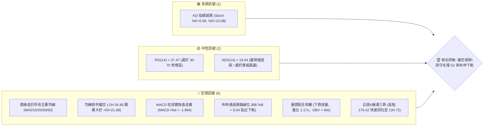
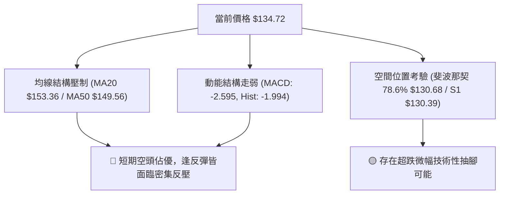
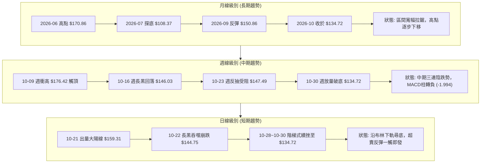
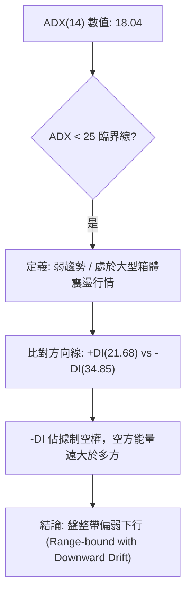
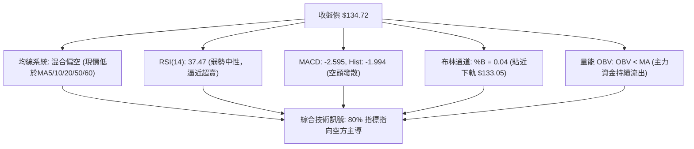
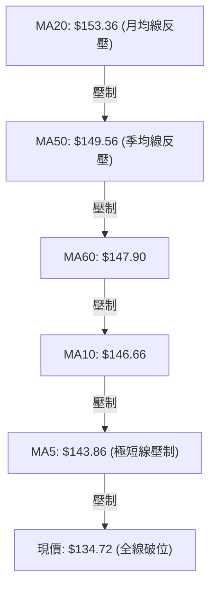
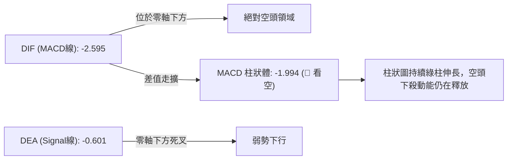
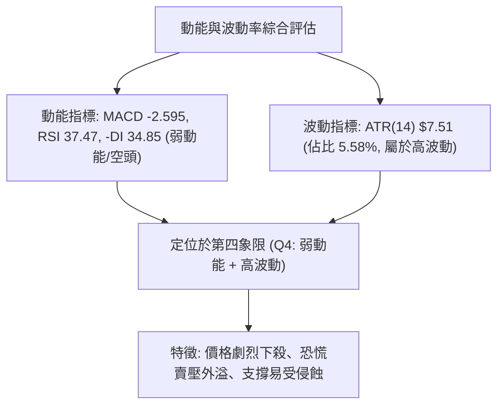
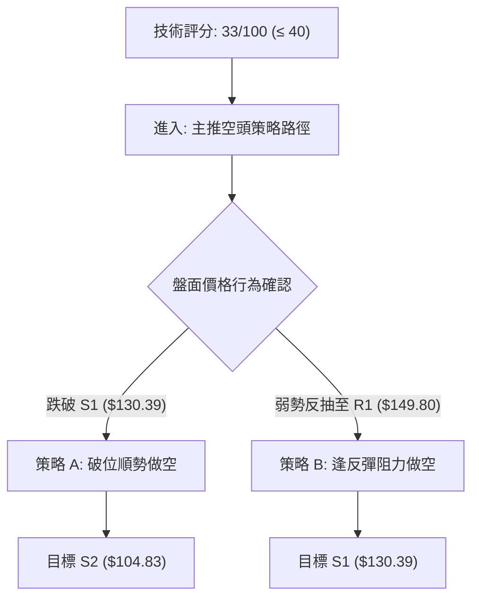
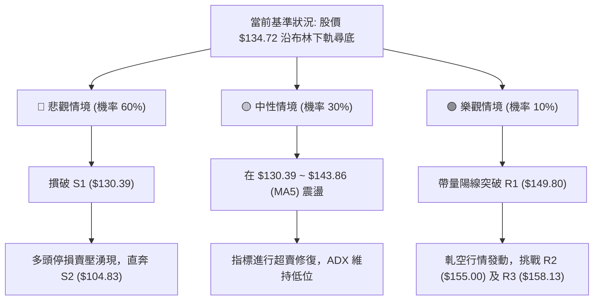

# SPCX 技術分析報告

> **報告日期**：2026-11-02 ｜ **語言**：繁體中文 ｜ **數據來源**：Yahoo Finance ｜ **當前價格**：$134.72

---

## 目錄

| 章節 | 內容 |
|------|------|
| [1. 技術面概覽](#1-技術面概覽) | 訊號儀表板、核心指標、評分卡 |
| [2. 趨勢分析](#2-趨勢分析) | 多時框趨勢、長中短期走勢 |
| [3. 圖表形態分析](#3-圖表形態分析) | 形態識別、K線組合、目標價 |
| [4. 支撐與阻力](#4-支撐與阻力) | 關鍵價位、斐波那契回調 |
| [5. 技術指標深度解讀](#5-技術指標深度解讀) | MA/RSI/MACD/布林/成交量 |
| [6. 動能與波動率](#6-動能與波動率) | 動能評估、ATR、Beta |
| [7. 多時框架總結](#7-多時框架總結) | 時框架評分矩陣 |
| [8. 交易策略建議](#8-交易策略建議) | 多空策略、風險報酬比 |
| [9. 風險提示與監控](#9-風險提示與監控) | 監控指標、風險場景 |
| [📋 報告總結](#-報告總結) | 總體評級、關鍵支撐阻力與決策矩陣 |

---

## 1. 技術面概覽

### 🎯 技術訊號儀表板





### 📊 核心指標速覽表

| 指標類別 | 指標名稱 | 當前數值 | 訊號 | 解讀 |
|----------|----------|----------|------|------|
| **價格** | 當前收盤價 | $134.72 | 🔴 | 位於52週區間24.7%低位，貼近下半年回檔深水區 |
| **均線** | MA20 | $153.36 | 🔴 | 現價低於MA20達-12.15%，短期趨勢向下遠離月線 |
| **均線** | MA50 | $149.56 | 🔴 | 現價低於MA50，中期上升波段遭跌破 |
| **均線** | MA200 | N/A（數據未提供） | 🟡 | 數據庫未提供200日均線，以現有MA60 ($147.90)輔助判斷 |
| **動能** | RSI(14) | 37.47 | 🟡 | 進入弱勢中性區，逼近30超賣區但尚未形成明確超跌鈍化 |
| **動能** | MACD (12,26,9) | -2.595 | 🔴 | 快慢線均在零軸下方運行，柱狀體為-1.994，空方動能強勢 |
| **動能** | Stoch %K / %D | 0.69 / 10.08 | 🟢 | 極度超賣狀態，短線具備技術性跌深反抽之潛在條件 |
| **趨勢** | ADX(14) | 18.04 | 🟡 | ADX < 25，表明非單邊強趨勢，盤面呈下偏之弱勢盤整 |
| **趨勢** | DMI (+DI / -DI) | 21.68 / 34.85 | 🔴 | -DI顯著高於+DI，空方完全主導日線盤面話語權 |
| **通道** | 布林通道 (%B) | 0.04 | 🔴 | 極度貼近下軌($133.05)，軌道帶寬開口向下擴張 |
| **波動** | ATR(14) | $7.51 | 🔴 | 佔價格5.58%，單日振幅高，市場情緒處於放量宣洩期 |
| **量能** | 20日成交量比 | 1.17x (121.98M) | 🔴 | 下跌出量，且OBV < MA，資金主力持續偏空換手流出 |

### 🏆 技術評分卡

```
╔══════════════════════════════════════════════════════════════╗
║              技術評分卡 — SPCX (2026-11-02)                  ║
╠══════════════════════════════════════════════════════════════╣
║ 趨勢強度 (ADX=18.04, -DI主導)   ███████░░░░░░░░░░░░░  35/100 🔴 ║
║ 動能指標 (MACD空頭, RSI弱勢)    ██████░░░░░░░░░░░░░░  30/100 🔴 ║
║ 支撐穩定度 (考驗S1與斐波78.6%)  █████████░░░░░░░░░░░  45/100 🟡 ║
║ 成交量配合 (下跌帶量, OBV弱)   ██████░░░░░░░░░░░░░░  30/100 🔴 ║
║ 形態完整度 (未現築底反轉型)    ███████░░░░░░░░░░░░░  35/100 🔴 ║
║ 均線排列 (現價低於全均線)      █████░░░░░░░░░░░░░░░  25/100 🔴 ║
╠══════════════════════════════════════════════════════════════╣
║ 綜合評分 (依規則18算術平均)     ███████░░░░░░░░░░░░░  33/100 🔴 ║
║ 評級結論: 偏空弱勢 (Bearish Breakdown Bias)                   ║
╚══════════════════════════════════════════════════════════════╝
```
*計算公式：(35 + 30 + 45 + 30 + 35 + 25) ÷ 6 = 200 ÷ 6 = 33.33，四捨五入為 33/100。*

---

## 2. 趨勢分析

### 🌐 多時框趨勢分析



### 📈 長期趨勢 — 12個月走勢圖（Unicode）

依據提供之 24 個月收盤記錄與 52 週極值 ($104.83 ~ $225.64)，SPCX 近期自 2026 年初歷史高位震盪回落，呈現高波動大型對稱旗形或矩形整理結構。

```
SPCX 月線走勢示意圖（近階段歷史價格軸）
價格 ($)
$225.64 ┤                    ● (52W High: $225.64)
$197.13 ┤            ●
$179.49 ┤  ●                 
$170.86 ┤  ● (06月: 170.86)
$150.86 ┤                  ● (09月: 150.86)
$143.69 ┤              ● (08月: 143.69)
$134.72 ┤━━━━━━━━━━━━━━━━━━━━━━━━━● (10月收盤: $134.72 ◄ 現價)
$108.37 ┤      ● (07月: 108.37)
$104.83 ┤          ● (52W Low: $104.83)
        └──────────────────────────────────────────────
           M-5   M-4   M-3   M-2   M-1   當前月(2026-10)
```

#### 長期月線走勢特徵分析表格

| 階段月份 | 收盤價 ($) | 區間漲跌幅 (%) | 量能與形態特徵 | 趨勢結論 |
|----------|-----------|---------------|----------------|----------|
| 2026-06  | 170.86    | 基準起算點    | 高位換手劇烈，週成交量一度達 925M | 高位多頭力竭 🔴 |
| 2026-07  | 108.37    | -36.57%       | 單月出現斷崖式回調，逼近52W低點 $104.83 | 恐慌拋售築底 🟢 |
| 2026-08  | 143.69    | +32.59%       | 展開V型強勁修復，量能回升至 920M 水平 | 跌深暴力反彈 🟢 |
| 2026-09  | 150.86    | +4.99%        | 衝高遇阻於波段高點聚類，震盪收斂 | 升勢趨緩受阻 🟡 |
| 2026-10  | 134.72    | -10.70%       | 衝擊 176.42 失敗後反轉下挫，月線收中黑 | 二次探底啟動 🔴 |

### 📊 中期趨勢（週線分析）

從近 8 週 K 棒（2026-09-11 至 2026-10-30）走勢可見，價格在 2026-10-09 當週創下 $176.42 的階段頂部後，多頭動能迅速衰竭。隨後 3 週連續拉出陰線：
- **10-16 當週**：高點 $167.07，低點 $140.66，收 $146.03，單週跌幅達 -10.17%，失守 MA20。
- **10-23 當週**：多頭反撲受制於阻力位聚類，最高衝至 $166.18，但終場僅收於 $147.49，留長上影線。
- **10-30 當週**：破位下殺，開盤 $146.84，最低探至 $134.50，收盤 $134.72，創 8 月中旬以來的波段收盤新低。

```
週線關鍵支撐與壓力階梯圖
阻力 R3 ── $158.13 ──────────────────────────────── (09-25 週高點壓制)
阻力 R2 ── $155.00 ──────────────────────────────── (09-11 週高點聚類)
阻力 R1 ── $149.80 ──────────────────────────────── (10-23 週反彈密集成交區)
               │
當前現價 ── $134.72 ──◄◄◄ (正向下方支撐尋求測試)
               │
支撐 S1 ── $130.39 ──────────────────────────────── (關鍵波段低點聚類)
支撐 S2 ── $104.83 ──────────────────────────────── (52週絕對歷史低點)
```

### ⚡ 趨勢強度評估（ADX 解讀）



#### ADX 趨勢強度對照表

| 指標名稱 | 當前數值 | 參考標準區間 | 當前強度評級 | 市場含義 |
|----------|----------|--------------|--------------|----------|
| **ADX(14)** | 18.04 | 0 ~ 20: 疲弱或無趨勢<br>20 ~ 25: 趨勢萌芽<br>25 ~ 50: 強趨勢行情 | ░░░░░░░ 18% (弱) 🟡 | 市場並非處於標準單邊主升/主跌浪，而是處於大型整理區間內的下行波段 |
| **+DI(14)** | 21.68 | > 25: 多方強勢 | ░░░░░░░░ 21% (偏弱) 🟡 | 多方買盤意願低迷，追高動力枯竭 |
| **-DI(14)** | 34.85 | > 25: 空方強勢 | █████████░ 35% (強勢) 🔴 | 賣壓宣洩顯著，空頭掌控了短線的盤中定價權 |

---

## 3. 圖表形態分析

### 🔍 形態識別系統


#### 形態識別信心度與評估表（依規則 15）

| 形態名稱 | 信心度 (%) | 判斷依據（引用數據） | 完成度 (%) | 目標價（附計算式） |
|----------|------------|----------------------|------------|--------------------|
| **假突破反轉 (Bull Trap)** | 75% | 10-21 日跳空高開上衝至高點 $166.18，次日(10-22)長黑實體吞噬直接跌破開盤價收 $144.75 | 100% | 破位測幅已達現價 $134.72（形態完成） |
| **日線布林下軌破位走跌** | 80% | 10-30 日收盤 $134.72，布林 %B 跌至 0.04，貼緊下軌 $133.05 進行弱勢擠壓 | 85% | 測幅下探 S1 $130.39（依數據波段支撐位） |
| **頭肩頂 / 複合雙頂幾何形態** | 35% | 數據不足以支撐幾何頸線確認（10-09高點 $176.42 與 06-18收盤 $185.00 相隔過遠） | N/A | **訊號不足，僅做指標型解讀**，不強行繪製目標價 |

### 🕯️ 重要K線形態分析（嚴格依據近10根日K與8根週K）

#### 近 10 根日 K 線形態解讀（2026-10-19 至 2026-10-30）

| 日期（日K） | 開 | 高 | 低 | 收 | 成交量 | K線形態 | 解讀與訊號 |
|------------|----|----|----|----|--------|---------|------------|
| 2026-10-19 | 149.23 | 151.01 | 146.83 | 147.96 | 74,037,800 | 窄幅小陰線 | 縮量橫盤，多空觀望 🟡 |
| 2026-10-20 | 146.17 | 148.66 | 143.27 | 147.79 | 117,204,900 | 下影小陽線 | 探底 $143.27 獲買盤支撐收高 🟢 |
| 2026-10-21 | 160.56 | 166.18 | 156.93 | 159.31 | 220,785,200 | 放量大陽線 | 消息面推動跳空暴衝，量能放大至220M 🟢 |
| 2026-10-22 | 154.21 | 154.26 | 143.21 | 144.75 | 197,046,500 | 烏雲罩頂/吞噬長黑 | 開低走低，長黑完全吞沒前日漲幅，誘多確立 🔴 |
| 2026-10-23 | 147.93 | 149.75 | 144.09 | 147.49 | 110,617,500 | 孕線十字小陽 | 多頭抵抗，量能腰斬，反抽無力 🟡 |
| 2026-10-26 | 146.84 | 150.24 | 144.57 | 146.90 | 103,184,900 | 衝高回落十字星 | 盤中反彈逼近150整數關卡遇阻回落 🔴 |
| 2026-10-27 | 147.41 | 151.36 | 146.61 | 148.58 | 95,845,400 | 上影小陽線 | 挑戰阻力位 R1 ($149.80) 未果 🟡 |
| 2026-10-28 | 147.37 | 148.20 | 142.13 | 145.23 | 98,705,800 | 破位光腳陰線 | 跌破前低 $143.21，收盤創本波新低 🔴 |
| 2026-10-29 | 142.26 | 144.95 | 141.03 | 143.89 | 68,364,400 | 極縮量陰線 | 破位後多頭無抵抗，成交量驟降至 68M 🔴 |
| 2026-10-30 | 137.85 | 140.20 | 134.50 | 134.72 | 121,979,900 | 放量近乎光腳大陰線 | 跳空下挫，最低點收在 $134.72，量增至 121M，恐慌盤湧出 🔴 |

#### 近 8 根週 K 線形態解讀（2026-09-11 至 2026-10-30）

| 日期（週K） | 開 | 高 | 低 | 收 | 成交量 | K線形態 | 解讀與訊號 |
|------------|----|----|----|----|--------|---------|------------|
| 2026-09-11 | 149.05 | 155.00 | 144.89 | 151.21 | 404,306,500 | 實體陽線 | 突破 MA50，均線向上收斂 🟢 |
| 2026-09-18 | 147.33 | 156.87 | 142.87 | 152.71 | 669,034,700 | 放量長上影陽線 | 衝擊 156 上方籌碼沉重，巨量換手 🟡 |
| 2026-09-25 | 154.77 | 158.13 | 145.88 | 148.68 | 329,439,500 | 高位中陰線 | 觸及阻力位 R3 ($158.13) 後拉回 🔴 |
| 2026-10-02 | 148.49 | 159.84 | 145.36 | 158.96 | 432,139,200 | 長紅反包陽線 | 重新站回 158 上方，多頭強勢反撲 🟢 |
| 2026-10-09 | 158.99 | 176.42 | 158.62 | 162.57 | 485,054,700 | 倒錘子星長上影線 | 創52W次高 $176.42 後遭強大獲利了結盤擊退 🔴 |
| 2026-10-16 | 164.66 | 167.07 | 140.66 | 146.03 | 394,968,000 | 實體破位大陰線 | 單週下挫逾 16 元，破壞多頭架構 🔴 |
| 2026-10-23 | 149.23 | 166.18 | 143.21 | 147.49 | 719,691,900 | 巨量天線十字陰線 | 週成交量爆出 719M 天量，反彈完全遭壓制 🔴 |
| 2026-10-30 | 146.84 | 151.36 | 134.50 | 134.72 | 488,080,400 | 光腳破位中長陰 | 跌破 140 整數心理防線，全週最低點作收 🔴 |

### 📉 ASCII 走勢形態示意圖

```
SPCX 近期日線「假突破與破位階梯走勢」示意圖
$166.18 ┤               ▲ (10-21 假突破高點)
$159.31 ┤              ╱ █
$153.36 ┤             ╱  █ ── MA20 月線反壓位
$148.58 ┤   ┌───┐    ╱   █ ┌─┐ (10-27 反抽高點 151.36)
$144.75 ┤───┘   └───╱    ███ │ └──┐
$142.13 ┤                         └──┐ 
$134.72 ┤────────────────────────────██ ◄ 現價 (10-30 收盤破底)
$133.05 ┤ - - - - - - - - - - - - - - - - - - - - - - - 布林帶下軌支撐
$130.39 ┤============================================= 關鍵波段支撐位 S1
        └──────────────────────────────────────────────
         10-19  10-20  10-21 10-22 ... 10-28 10-29 10-30
```

### 🎯 形態目標價計算

根據 10-21 日形成的巨量誘多頂部與 10-30 日的破位 K 線，評估形態跌幅滿足點：
1. **日線假突破跌幅測算（形態高度推算）**：
   - 頂部頸線參考位 = 10-20 與 10-22 之密集支撐區中軸：$146.00
   - 形態最高點 = 10-21 高點：$166.18
   - 形態垂直高度 $H = \$166.18 - \$146.00 = \$20.18$
   - 理論等幅滿足點 = 頸線破位點 $\$146.00 - \$20.18 = \$125.82$
2. **與現有預設關鍵價位映射**：
   - 第一跌幅滿足緩衝區：**S1 = $130.39**（斐波那契 78.6% $130.68 共同守護）
   - 若 S1 遭實體長黑摜破，理論下探極限將指向歷史區間底部：**S2 = $104.83**

---

## 4. 支撐與阻力

### 🗺️ 關鍵價位分布圖（Unicode）

```
SPCX 價位結構分布圖（嚴格依據 OHLCV 計算聚類價位）
═══════════════════════════════════════════════════════════
$158.13 ║██████████████████████████████║ 強阻力 R3 (09-25波段高點)
$155.00 ║████████████████████          ║ 阻力 R2 (09-11週高點阻力)
$149.80 ║████████████████████████      ║ 關鍵阻力 R1 (反彈頸線壓制)
        ║                              ║
$134.72 ╠══════════════════════════════╣ ◄ 現價 ($134.72)
$133.05 ║- - - - - - - - - - - - - - - ║ 動態支撐 (布林下軌)
$130.68 ║▓▓▓▓▓▓▓▓▓▓▓▓▓▓▓▓▓▓▓▓▓▓▓▓      ║ 斐波那契 78.6% 回調關鍵位
$130.39 ║████████████████████████      ║ 關鍵支撐 S1 (近一年波段低點)
$104.83 ║██████████████████████████████║ 極限強支撐 S2 (52週最低價)
═══════════════════════════════════════════════════════════
```

### 🚧 阻力位分析表

阻力位完全引用數據庫提供的近一年波段高點聚類數值：

| 阻力級別 | 價位 ($) | 距現價幅烈 (%) | 形成原因與籌碼結構 | 突破難度 | 重要性 |
|----------|----------|----------------|--------------------|----------|--------|
| **R1** | $149.80 | +11.19% | 10月中下旬多次反彈高點聚類（10-27高點151.36及MA50 $149.56重合區），多頭套牢密集 | 4/5 難 🔴 | 極高（反轉轉強分水嶺） |
| **R2** | $155.00 | +15.05% | 9月中旬波段起跌點與 MA20 ($153.36) 下降趨勢線反壓區 | 4/5 難 🔴 | 高（空頭主要防守位） |
| **R3** | $158.13 | +17.38% | 09-25 週高點與10月整理箱頂部，巨量堆積套牢籌碼峰 | 5/5 極難 🔴 | 關鍵波段頂部 |

### 🛡️ 支撐位分析表

支撐位完全引用數據庫提供的近一年波段低點聚類數值：

| 支撐級別 | 價位 ($) | 距現價幅烈 (%) | 形成原因與籌碼結構 | 守住機率 | 重要性 |
|----------|----------|----------------|--------------------|----------|--------|
| **S1** | $130.39 | -3.21% | 近一年波段低點聚類，與斐波那契 78.6% ($130.68) 形成雙重黃金共振支撐 | 55% 🟡 | 極高（短線唯一多頭馬其諾防線） |
| **S2** | $104.83 | -22.19% | 52 週最低點（2026年7月暴跌最終止跌點），極限價值底 | 85% 🟢 | 絕對底部（長期生命線） |
| **S3** | N/A | N/A | **數據中未偵測到** S3 價位（依數據紀律不予編造） | N/A | N/A |

### 📐 斐波那契回調位分析

依據 52 週完整波段起訖點（低點 $104.83 → 高點 $225.64）之官方計算回調數值：

| 斐波那契回調層級 | 官方精確價位 ($) | 與現價 ($134.72) 相對關係 | 結構技術意義解讀 |
|------------------|------------------|---------------------------|------------------|
| **0.0% (52W High)** | $225.64 | +67.49% | 本輪多頭循環終極歷史高點 |
| **23.6%** | $197.13 | +46.33% | 極強勢回調位，已被徹底跌穿 |
| **38.2%** | $179.49 | +33.23% | 多空平衡強弱分界線，10-09高點 $176.42 觸頂於此線下方 |
| **50.0%** | $165.24 | +22.65% | 核心中軸，10-21 出量大陽線衝高 $166.18 正好在此線遭遇壓制 |
| **61.8% (黃金分割)** | $150.98 | +12.07% | 牛熊轉換關鍵線，目前已由支撐全面轉化為強大阻力（與 R1 呼應） |
| **78.6%** | $130.68 | -3.00% | **當前價格核心測試目標**，多頭最後的深度防守位 |
| **100.0% (52W Low)**| $104.83 | -22.19% | 全年最低點，若 78.6% 破位將重回此區間測試 |

**位置研判**：當前收盤價 $134.72 落在 **61.8% ($150.98)** 與 **78.6% ($130.68)** 之間，且距離 78.6% 僅差 $4.04 (-3.00%)。技術上，一旦跌破 61.8% 黃金分割，通常走勢具備奔向 78.6% 甚至測試 100% 的慣性。$130.68 與 S1 ($130.39) 僅相距 $0.29，是極強的共振價格帶。

---

## 5. 技術指標深度解讀

### 🎛️ 指標訊號總覽



### 📈 移動平均線排列分析



#### 各期移動平均線監控

| 均線名稱 | 數值 ($) | 距現價差距 (%) | 走勢微型圖 | 狀態解讀 |
|----------|----------|----------------|------------|----------|
| **MA 5** | $143.86 | -6.36% | ▃▄▄▃▃▂▂▂▂▃▅▆▇███▇▆▅▄▃▂▃▂▂▂▂▁▁▁ | 極速下墜，短線第一動態反壓 |
| **MA 10** | $146.66 | -8.14% | ▂▃▃▃▂▂▃▃▂▃▄▅▆▆▇█████▇▅▅▄▃▂▂▁▁▁ | 形成空頭扣抵向下助跌 |
| **MA 20** | $153.36 | -12.15% | ▁▁▂▂▂▃▃▃▃▄▅▆▆▇▇█████████████▇▆ | 月線已見頂下彎，中期反轉受阻 |
| **MA 50** | $149.56 | -9.92% | (數值提供: $149.56) | 與 MA20 形成死叉隱憂，壓制反彈 |
| **MA 60** | $147.90 | -8.91% | ▁▁▁▁▁▁▁▁▁▁▁▁▂▂▂▃▃▄▄▄▅▅▆▆▇▇████ | 走平後開始向下勾頭 |
| **MA 120**| N/A（數據未提供） | N/A | 資料不足（需120筆數據） | 不予置評 |
| **MA 200**| N/A（數據未提供） | N/A | 資料不足（需240筆數據） | 不予置評 |

**均線總評**：短中均線呈階梯式空頭空壓排列，現價遠離各級均線。由於 MA5 負乖離達 -6.36%，短線雖然超賣，但若無放量長紅收復 MA5，所有反抽皆屬死貓跳。

### 📉 RSI(14) 分析

- **RSI(14) 當前數值**：**37.47**
- **進度條顯示**：███████░░░░░░░░░░░░░ 37.47% (偏弱區間)
- **背離判斷**：
  - 根據系統近 20 根 K 棒首尾之比對：**無明顯背離**。
  - 價格自 10-21 高點 $166.18 回落至 10-30 低點 $134.50，RSI 同步自中軸回落至 37.47，價格創新低與指標方向完全一致，確認下跌趨勢並非虛跌，未見底背離買訊。

### 📊 MACD(12/26/9) 訊號解讀



- **MACD 線**：-2.595，已跌穿零軸並持續擴大負值。
- **Signal 線**：-0.601，已拐頭向下形成死叉。
- **Histogram 柱狀體**：-1.994，連續 3 根日線柱體擴張，空頭能量柱毫無收斂跡象，表明賣壓仍在主導走勢。

### 📦 布林通道分析

```
ASCII 布林通道相對位置圖
$173.67 ┬────────────────────────────────────────── 布林上軌 (帶寬收縮後向下擴張)
        │
$153.36 ┼────────────────────────────────────────── 布林中軌 (MA20 下移)
        │
$134.72 │  ◄ 現價 ($134.72, %B = 0.04) 瀕臨破軌
$133.05 ┴────────────────────────────────────────── 布林下軌
```
- **帶寬與位置**：上軌 $173.67、中軌 $153.36、下軌 $133.05。
- **%B 指標**：僅為 **0.04**（0 代表下軌，1 代表上軌），現價緊貼下軌運行。
- **解讀**：當前出現典型的「布林下軌開口下行（Lower Band Walking）」特徵，若未能迅速跳空收回 $135 以上，下軌將形成強大下拉磁吸效應。

### 💹 成交量分析（量價配合度）

- **成交量**：最新單日成交量為 **121,979,900** 股。
- **均量對比**：20日均量為 104,389,750 股，**量比達 1.17x**；50日均量為 92,477,198 股。
- **OBV (能量潮)**：**OBV < MA**。能量潮走勢疲弱，量價嚴重呈現「下跌帶量、反彈縮量」之空方特徵。
- **量價背離結論**：10-21 日上漲放量 220M 隨後即被 10-22 日 197M 與 10-30 日 121M 的下跌量能擊破，籌碼呈現主力撤退、散戶承接之空頭換手盤。

---

## 6. 動能與波動率

### ⚡ 動能評估四象限

| 象限 | 動能維度 (Momentum) | 波動率維度 (Volatility) | 標的當前落點 | 狀態評估與交易策略指引 |
|------|--------------------|------------------------|--------------|------------------------|
| **Q1** | 強 (Bullish) | 低 (Low ATR) | — | 穩定多頭主升段（積極做多） |
| **Q2** | 弱 (Bearish) | 低 (Low ATR) | — | 沉悶牛皮整理盤（觀望） |
| **Q3** | 強 (Bullish) | 高 (High ATR) | — | 高動量狂暴拉升（順勢突破） |
| **Q4** | **弱 (Bearish)** | **高 (High ATR)** | **✓ (SPCX 落點)** | **弱勢高波動下跌段（🔴 嚴禁逆勢抄底，反彈做空為宜）** |



### 📊 ATR 波動率分析

- **ATR(14) 數值**：**$7.51**（Wilder 平滑法）。
- **ATR 佔比**：高達現價的 **5.58%**，屬於高波動性個股。
- **止損距離建議**：
  - **短線交易（1.0 × ATR）**：緩衝空間需設定為 **$7.51**，以防盤中正常毛刺噪音掃損。
  - **波段交易（1.5 ~ 2.0 × ATR）**：建議設定為 **$11.27 ~ $15.02**。
  - 鑑於單日震幅即可達 $7.51 以上，任何進場點若過度貼近現價，極易因常態波動而出局。

### 📐 Beta 與市場相關性

- **Beta 數值**：**N/A（數據未提供）**。
- **依據數據紀律說明**：官方套件中未載明具體數值，不進行數字編造。
- **質化與大盤關聯分析**：由新聞面「Can SpaceX Overcome the AI Trade Sell-Off?」與「Dow Jones Futures Rise But Market Still Ails」可推論，SPCX 深度受制於美股大型科技與 AI 族群之板塊輪動賣壓，近期與大盤走勢呈現高連動拋售效應。

---

## 7. 多時框架總結

### 📋 時框架評分表

| 時框架 | 趨勢方向 | 動能狀態 | 均線排列 | 形態結構 | 綜合評分 | 建議處置 |
|--------|----------|----------|----------|----------|----------|----------|
| **長期 (月線)** | 中性偏弱 🟡 | MACD柱收窄，RSI轉弱 | 區間交織 | 大型箱體拉鋸，高點下移 | 45/100 🟡 | 減倉觀望 |
| **中期 (週線)** | 空頭向下 🔴 | MACD柱轉負 (-1.994) | 跌破多數均線 | 三連陰破位，巨量反彈受阻 | 30/100 🔴 | 逢反彈偏空操作 |
| **短期 (日線)** | 弱勢下探 🔴 | Stoch超賣但RSI走弱 | 均線完全空頭空壓 | 假突破後跳空破底 | 25/100 🔴 | 嚴禁盲目搶反彈 |

### 🔲 綜合訊號矩陣

```
訊號維度矩陣檢驗
┌──────────────────┬──────────────┬──────────────┬──────────────┐
│ 技術維度         │ 短期 (日線)  │ 中期 (週線)  │ 長期 (月線)  │
├──────────────────┼──────────────┼──────────────┼──────────────┤
│ 均線趨勢 (MA)    │ 🔴 跌破全線  │ 🔴 跌破MA20  │ 🟡 混合整理  │
│ 震盪指標 (RSI)   │ 🔴 37.47偏弱 │ 🔴 37.5走弱  │ 🟡 中性平緩  │
│ 趨勢指標 (MACD)  │ 🔴 死叉向下  │ 🔴 柱狀負值  │ 🟡 零軸上方  │
│ 成交量配合度     │ 🔴 下跌放量  │ 🔴 放量收陰  │ 🟡 量能均衡  │
└──────────────────┴──────────────┴──────────────┴──────────────┘
訊號共振結論：日線與週線在空方維度展現極高的一致性 (Bearish Confluence)。
```

### ⚖️ 多時框收斂結論

- **收斂規則執行（依嚴格要求 14）**：
  - 當前 **ADX(14) = 18.04 < 25**，依規則界定為「**盤整/寬幅箱體行情**」。
  - 在盤整行情中，分析核心應以**日線布林通道上下軌 ($133.05 ~ $173.67)** 為主要交易活動區間。
  - 然而，當前價格已行駛至下軌極端值（%B = 0.04），且日線、週線動能指標（-DI = 34.85, MACD Hist = -1.994）全面由空頭掌控，中短期方向產生空方共振。
  - **唯一收斂結論**：**🔴 偏空弱勢，主導權在於空方**。短線雖因 Stoch 極度超賣而在布林下軌 $133.05 與支撐 S1 $130.39 附近有技術性弱反彈可能，但中期空頭架構未改，整體基調為「**逢反彈放空或跌破追空**」。

---

## 8. 交易策略建議

### 🗺️ 策略決策流程圖



### 🧭 策略路由（依評分卡分流）

> **當前主策略方向 = 🔴 偏空做空為主（依技術評分 33/100，嚴格依據規則分流至空頭策略）**

### 🎯 價格情境階梯（Price Scenarios）

價位完全嚴格引用數據庫「關鍵價位」與「斐波那契」精確數值：

| 觸發條件 | 下一目標 | 後續延伸 | 情境含義解讀 |
|----------|----------|----------|--------------|
| **強勢突破 R1 ($149.80)** | R2 ($155.00) | R3 ($158.13) | 空頭結構被扭轉，短線轉強，空單必須全面平倉止損 |
| **跌破 S1 ($130.39)** | S2 ($104.83) | N/A（數據未偵測S3）| 中長期防守徹底失守，開啟奔向 52 週最低點之單邊暴跌 |
| **受制於 R1 且反彈無力** | S1 ($130.39) | 斐波 78.6% ($130.68) | 維持弱勢下飄，於下軌與支撐間進行恐慌探底 |

### 📊 情境機率分佈

| 情境劇本 | 機率估計 (%) | 主要技術依據 |
|----------|--------------|--------------|
| **弱勢下挫 / 再探底 (破位)** | 60% | MACD 綠柱拉長 (-1.994)、-DI(34.85)強勢、OBV<MA 下跌帶量 |
| **區間震盪 / 跌深反抽** | 30% | Stoch 極度超賣 (%K=0.69)、布林下軌支撐效應、ADX=18.04 趨勢未到極致單邊 |
| **強勢反轉 / 向上突破** | 10% | 目前全均線空頭排列，基本面有大額 Capex 赤字壓制，技術上難有反轉 |

### 🔴 主策略詳情（空頭主導策略）

依嚴格要求 17 定義計算：**做空風險報酬比 = (進場價 − 目標價 T1) ÷ (止損價 − 進場價)**。

| 策略要素 | 策略 A（破位追空策略） | 策略 B（反彈受阻放空策略） |
|----------|------------------------|----------------------------|
| **進場條件** | 日K收盤跌破支撐位 S1 並確認放量 | 盤中反抽至阻力位 R1 遇阻回落收上影線 |
| **進場價格** | **$130.00**（以跌破 S1 $130.39 下方入場） | **$149.80**（精準在 R1 阻力位放空） |
| **目標價 T1** | **$104.83**（精準引用 S2 / 52W 低點） | **$130.39**（精準引用 S1 支撐位） |
| **目標價 T2** | N/A（數據未偵測到更低價位，以 S2 為終極目標）| **$104.83**（精準引用 S2 支撐位） |
| **止損價格** | **$137.51**（進場價 + 1.0 × ATR $7.51） | **$155.00**（精準引用 R2 阻力位上方） |
| **風險報酬比** | **1 : 3.35**（以 T1 計） | **1 : 3.73**（以 T1 計） |
| **計算檢驗** | ($130.00 - $104.83) ÷ ($137.51 - $130.00) = $25.17 ÷ $7.51 = 3.35 | ($149.80 - $130.39) ÷ ($155.00 - $149.80) = $19.41 ÷ $5.20 = 3.73 |
| **成功機率** | 65% | 60% |
| **建議倉位** | 15%（高波動控制） | 10%（逢高佈局） |

*註：策略 B 若以 T2 ($104.83) 計，風險報酬比為 ($149.80 - $104.83) ÷ ($155.00 - $149.80) = $44.97 ÷ $5.20 = 1 : 8.65（以 T2 計）。*

### 🟡 反向風險觸發點（多頭對沖 / 止損提示）

若出現下列極端反轉訊號，原空頭架構將被推翻，空單須即刻強制平倉：
1. **價格強勢站回 R1 ($149.80)**，且伴隨成交量突破 20 日均量（> 104M）。
2. **日線 MACD 柱狀體快速收斂至 -0.50 以上並形成底背離黃金交叉**。
3. 若發生上述情況，激進型多頭方可嘗試以 **$149.80** 為支撐進場，止損設於 **$142.29** ($149.80 - 1.0 ATR)，目標價看至 **$158.13 (R3)**。

### ⭐ 整體訊號強度評星

```
╔══════════════════════════════════════════════╗
║ 做多訊號強度：★☆☆☆☆  (1/5星) — 僅超賣指標支撐 ║
║ 做空訊號強度：★★★★☆  (4/5星) — 均線動能全空頭 ║
║ 整體可信度：  ★★★★☆  (4/5星) — 量價指標極協調 ║
╚══════════════════════════════════════════════╝
```

---

## 9. 風險提示與監控

### ✅ 關鍵監控指標 Checklist

```
╔══════════════════════════════════════════════════════════════════╗
║                  SPCX 技術監控清單 (Checklist)                   ║
╠══════════════════════════════════════════════════════════════════╣
║ [ ] 價格是否觸及 S1 ($130.39) 且爆出 >150M 恐慌長下影線？         ║
║ [ ] 布林通道 %B 是否自 0.04 以下強勢勾頭穿回 0.20 以上？          ║
║ [ ] 日線 RSI(14) 是否跌破 30 形成極端鈍化，抑或出現第一道底背離？  ║
║ [ ] 成交量能是否萎縮至 70M 以下，顯示空方無力進一步砸盤？        ║
║ [ ] 阻力位 R1 ($149.80) 是否在反抽中展現強烈壓制陰線？            ║
╚══════════════════════════════════════════════════════════════════╝
```

### ⚠️ 風險場景分析



### 🛡️ 風險管理重要提醒

1. **極高 ATR 波動防範**：SPCX 單日 ATR 高達 **$7.51 (5.58%)**，盤中跳空頻繁。嚴格禁止在無止損保護下建立部位，單筆交易虧損上限應嚴格控制在總資金的 **1.0% ~ 1.5%** 之內。
2. **財報與現金流風險共振**：公司雖然營收爆發，但 TTM 自由現金流為 **$-40.16B**（資本支出高達 $55.92B），處於極高資本開支階段，這為基本面空頭提供了源源不絕的籌碼拋售理由。
3. **倉位管理守則**：鑑於當前綜合評分僅 33/100，處於空頭主導階段，建立空頭部位倉位不宜超過 15%；若意圖博取短線超賣反抽，多頭倉位必須嚴格限制在 5% 以下，且必須遵循「快進快出」原則。

---

## 📋 報告總結

```
╔══════════════════════════════════════════════════════════════════╗
║                  SPCX 技術分析報告總結                          ║
╠══════════════════════════════════════════════════════════════════╣
║ 報告日期：2026-11-02                                             ║
║ 當前價格：$134.72                                                ║
║ 技術面綜合評分：33 / 100                                         ║
║ 分析評級：🔴 偏空弱勢 (Bearish Breakdown Bias)                   ║
║                                                                  ║
║ 關鍵結論：                                                       ║
║ ├─ 長期趨勢：🟡 寬幅箱體震盪 (52W 高低點間大幅拉鋸)             ║
║ ├─ 中期趨勢：🔴 週線三連陰破位，MACD柱狀體轉負 (-1.994)          ║
║ ├─ 短期趨勢：🔴 跌破全部均線，布林通道沿下軌向下擴張             ║
║ ├─ 關鍵支撐：S1: $130.39  /  S2: $104.83                         ║
║ ├─ 關鍵阻力：R1: $149.80  /  R2: $155.00  /  R3: $158.13         ║
║ └─ 分析師目標價共識：均價 $257.11 (低標 $70.00 / 高標 $800.00)   ║
║                                                                  ║
║ 最優策略組合：                                                   ║
║ 1. 🥇 最佳機會：破位做空 (跌破 S1 $130.39 追空，目標 S2 $104.83) ║
║ 2. 🥈 次選機會：反抽放空 (反彈至 R1 $149.80 佈空，目標 S1 $130.39)║
║ 3. 🥉 保守選擇：空手觀望，靜待 $130.39 支撐測試結果與放量訊號   ║
╚══════════════════════════════════════════════════════════════════╝
```

---

> ⚠️ **免責聲明**：本報告為 AI 自動生成之技術分析，所有數據及估算均基於提供的歷史價格資訊。本報告**僅供研究與學術參考**，**不構成任何投資建議**。投資有風險，入市需謹慎。

---
*報告生成時間：2026-11-02 ｜ 數據來源：Yahoo Finance ｜ 分析框架：多時框技術分析*