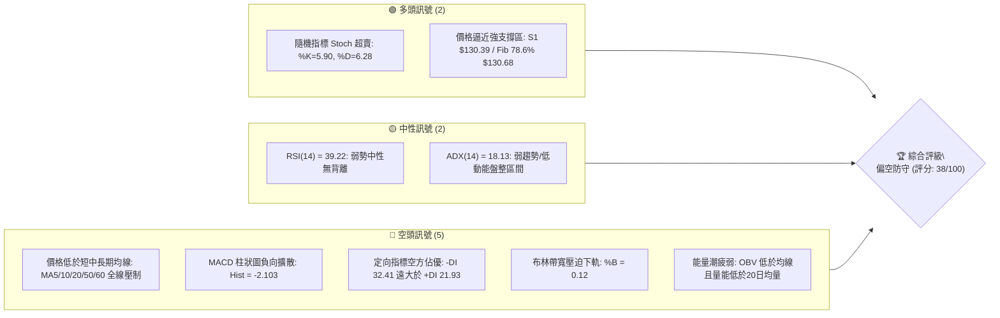
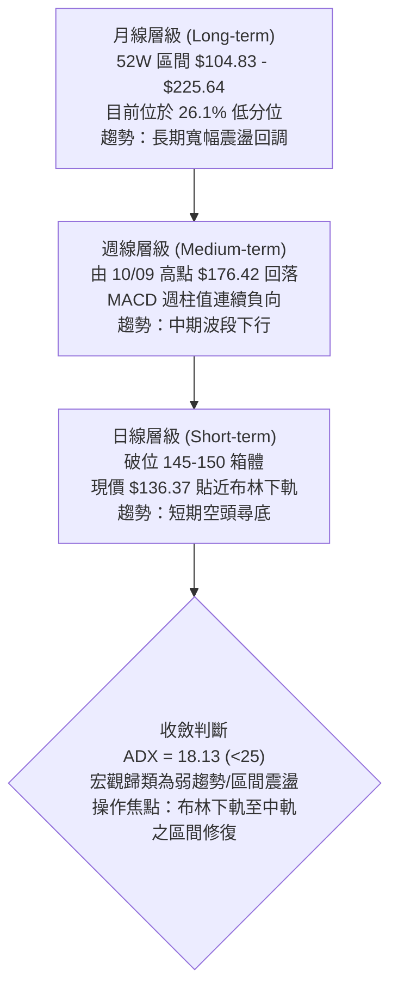
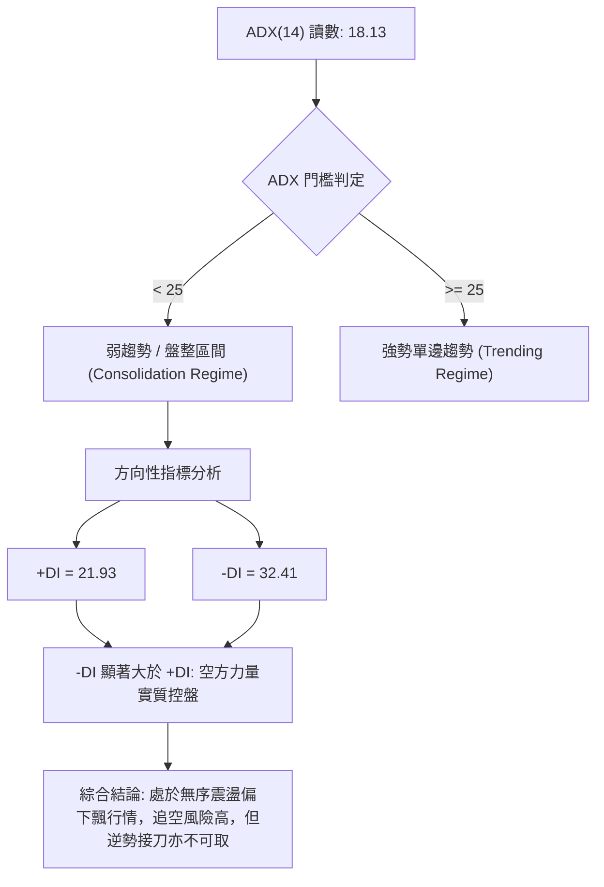
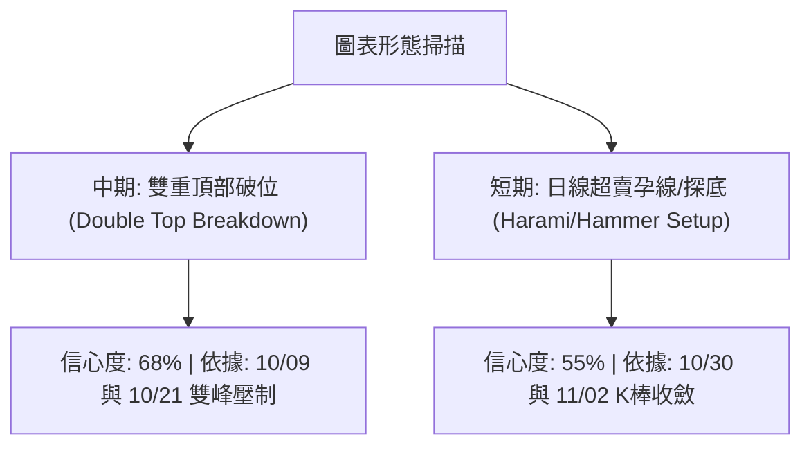
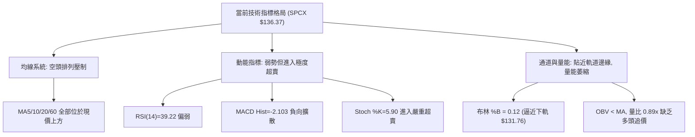
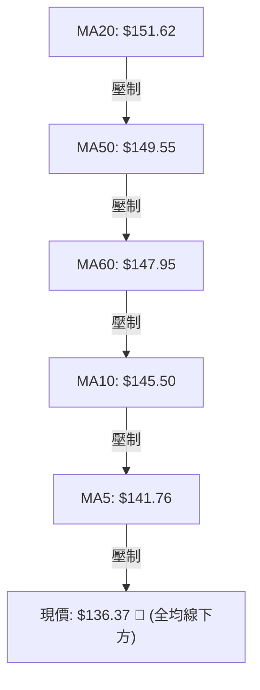
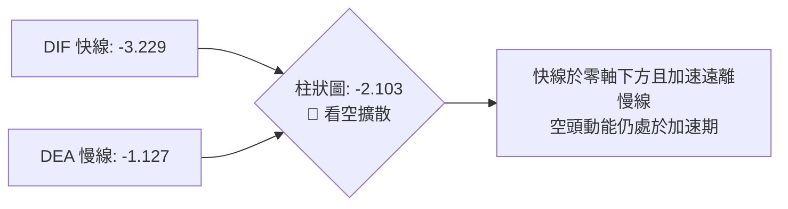
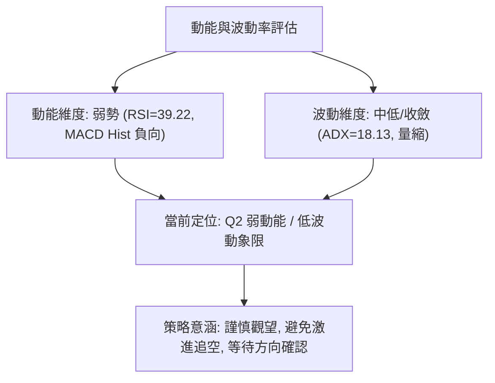
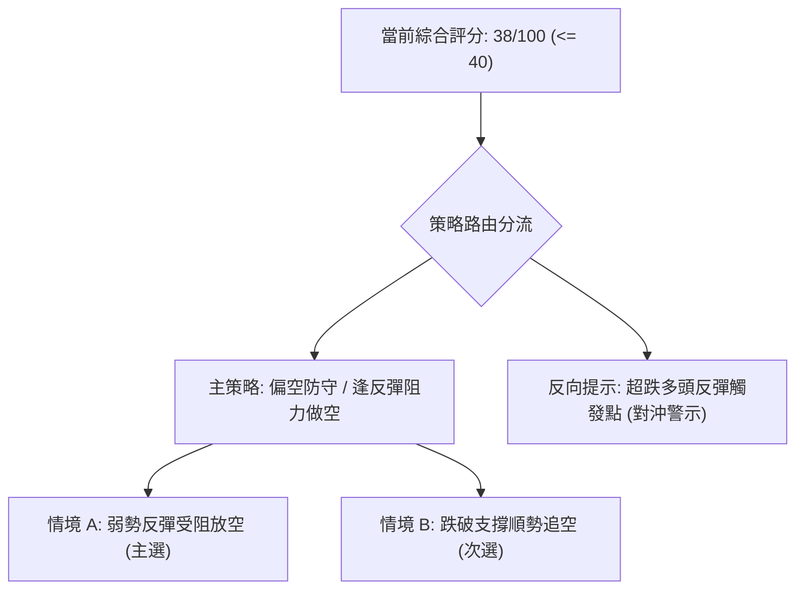
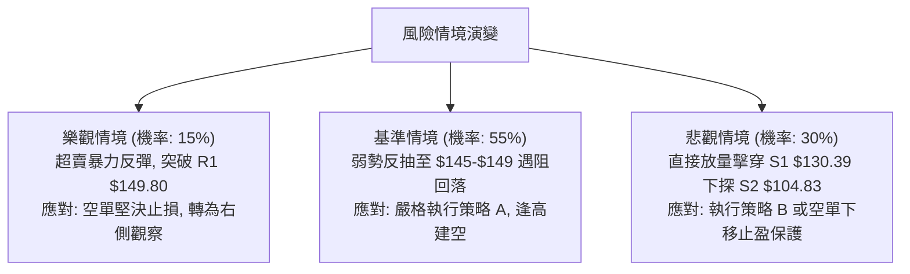

# SPCX 技術分析報告

> **報告日期**：2026-11-03 ｜ **語言**：繁體中文 ｜ **數據來源**：Yahoo Finance ｜ **當前價格**：$136.37

---

## 目錄

| 章節 | 內容 |
|------|------|
| [1. 技術面概覽](#1-技術面概覽) | 訊號儀表板、核心指標、評分卡 |
| [2. 趨勢分析](#2-趨勢分析) | 多時框趨勢、長中短期走勢 |
| [3. 圖表形態分析](#3-圖表形態分析) | 形態識別、K線組合、目標價 |
| [4. 支撐與阻力](#4-支撐與阻力) | 關鍵價位、斐波那契回調 |
| [5. 技術指標深度解讀](#5-技術指標深度解讀) | MA/RSI/MACD/布林/成交量 |
| [6. 動能與波動率](#6-動能與波動率) | 動能評估、ATR、Beta |
| [7. 多時框架總結](#7-多時框架總結) | 時框架評分矩陣 |
| [8. 交易策略建議](#8-交易策略建議) | 多空策略、風險報酬比 |
| [9. 風險提示與監控](#9-風險提示與監控) | 監控指標、風險場景 |

---

## 1. 技術面概覽

### 🎯 技術訊號儀表板



---

### 📊 核心指標速覽表

| 指標類別 | 指標名稱 | 當前數值 | 訊號 | 解讀 |
|----------|----------|----------|:---:|------|
| **價格** | 當前收盤價 | $136.37 | 🔴 | 位於 52 週區間 26.1% 分位，深陷下行回調 |
| **均線** | MA5 | $141.76 | 🔴 | 現價低於 MA5 達 -3.80%，超短期走勢疲軟 |
| **均線** | MA10 | $145.50 | 🔴 | 現價低於 MA10 達 -6.28%，短線反彈壓力顯著 |
| **均線** | MA20 | $151.62 | 🔴 | 現價低於 MA20 達 -10.06%，短期多空分水嶺失守 |
| **均線** | MA50 | $149.55 | 🔴 | 現價低於 MA50，中期上升波段結構遭到破壞 |
| **均線** | MA60 | $147.95 | 🔴 | 現價低於 MA60 達 -7.83%，季線層級形成空頭反壓 |
| **均線** | MA200 | N/A（數據未提供） | 🟡 | 歷史數據筆數不足，長期年線未能繪出 |
| **動能** | RSI(14) | 39.22 | 🟡 | 弱勢中性區間（30–70），暫無超賣極值亦無背離 |
| **動能** | MACD (12,26,9) | -3.229 / 柱狀圖 -2.103 | 🔴 | 快慢線均於零軸下方運行，空頭動能加速釋放 |
| **動能** | Stoch %K / %D | 5.90 / 6.28 | 🟢 | 進入極度超賣區（<20），短線存在技術性反抽修復需求 |
| **趨勢** | ADX (14) | 18.13 (-DI: 32.41, +DI: 21.93) | 🔴 | ADX<25 顯示非單邊強趨勢，但 -DI 壓制說明空頭握有控盤權 |
| **通道** | 布林帶 (%B) | 0.12 (下軌 $131.76 / 中軌 $151.62) | 🔴 | 價格緊貼下軌運行，通道開口向下，處於弱勢空頭軌道 |
| **波動** | ATR(14) | $7.50 (佔股價 5.50%) | 🟡 | 每日平均波動幅度 $7.50，日內波幅適中偏活躍 |
| **量能** | 當日量 / 20日均量 | 90,648,600 / 102,171,420 (0.89x) | 🔴 | 量比低於 1.0x，量能未能配合價格反彈，OBV 處於 MA 下方 |

---

### 🏆 技術評分卡

```
技術評分卡 — SPCX (2026-11-03)
════════════════════════════════════════════════════
趨勢強度      ███████░░░░░░░░░░░░░  35/100  🔴 空頭主導
動能指標      ███████░░░░░░░░░░░░░  35/100  🔴 動能向下
支撐穩定度    ██████████░░░░░░░░░░  50/100  🟡 臨近支撐
成交量配合    ███████░░░░░░░░░░░░░  35/100  🔴 量能疲弱
形態完整度    ████████░░░░░░░░░░░░  40/100  🟡 破位待定
均線排列      ██████░░░░░░░░░░░░░░  30/100  🔴 空頭壓制
════════════════════════════════════════════════════
綜合評分      ███████░░░░░░░░░░░░░  38/100  評級：偏空防守 🔴
════════════════════════════════════════════════════
計算說明：綜合評分 = (35 + 35 + 50 + 35 + 40 + 30) ÷ 6 = 37.5 → 四捨五入至整數 38/100
```

---

## 2. 趨勢分析

### 🌐 多時框趨勢分析



---

### 📈 長期趨勢 — 12個月走勢圖（Unicode）

依據提供的月線歷史數據與 52 週高低點位標注：

```
SPCX 月線走勢圖（過去12個月歷史軌跡）
價格軸 ($)
$225.64 ┤                    ● (52W High: $225.64)
$200.00 ┤                   / \
$175.00 ┤   ● (06月: 170.86)   \
$150.00 ┤    \        ●(08月: 143.69)─●(09月: 150.86)
$136.37 ┤     \      /                         \──●(10月: 134.72)─●← 現價 ($136.37)
$108.37 ┤      ● (07月: 108.37)
$104.83 ┤       ● (52W Low: $104.83)
        └─────────────────────────────────────────────────────────────
         2025-12  ...  2026-06  2026-07  2026-08  2026-09  2026-10  2026-11
```

#### 走勢特徵分析表格

| 週期階段 | 起訖收盤價區間 | 漲跌幅 | 走勢結構與特徵分析 |
|----------|----------------|:------:|-------------------|
| **2026-06 至 2026-07** | $170.86 → $108.37 | -36.57% | 發生斷崖式深度洗盤，一度下探 52 週低點 $104.83 後迅速收腳。 |
| **2026-07 至 2026-09** | $108.37 → $150.86 | +39.21% | 展開強勁的 V 型與波段修復行情，連續站回 $140 及 $150 整數關卡。 |
| **2026-09 至 2026-10** | $150.86 → $134.72 | -10.70% | 10 月初衝擊 $176.42 週高點受阻後回落，跌破月線收盤基準線。 |
| **2026-10 至 2026-11** | $134.72 → $136.37 | +1.22% | 於 $134–$137 區域展開低位整固，嘗試在斐波那契 78.6% 回調位止跌。 |

---

### 📊 中期趨勢（週線分析）

```
SPCX 近期週線壓力與支撐架構示意圖
═════════════════════════════════════════════════════════════════
$176.42 ── 週波段最高點 (2026-10-09) [強壓區頂部]
  │
$162.57 ── 週線收盤高點 (2026-10-09)
  │
$158.13 ── 阻力 R3 (波段高點聚類)
$155.00 ── 阻力 R2 (反彈強阻力)
$149.80 ── 阻力 R1 / Fib 61.8% ($150.98) ─── [多空轉折頸線]
  │
$136.37 ── 當前價格 (2026-11-02 週線低位徘徊) ◄ 現價
  │
$130.68 ── Fib 78.6% 回調位
$130.39 ── 支撐 S1 (近一年波段低點聚類) ─── [第一道防禦壁壘]
  │
$104.83 ── 支撐 S2 / 52週最低點 ─────────── [終極結構性支撐]
═════════════════════════════════════════════════════════════════
```

中期週線在 2026-10-09 當週達到波段峰值 $162.57（最高點 $176.42）後，週線 MACD 柱狀圖由正轉負（+0.937 轉為 -1.979），隨後連續 3 週收陰，直接擊穿了 9 月份建立的週線平台，使中期形態由上升通道轉化為寬幅拉回修正。

---

### ⚡ 趨勢強度評估（ADX 解讀）



#### ADX 與方向指標強度對照

| 指標名稱 | 當前讀數 | 標準區間 | 市場狀態解讀 |
|----------|:--------:|:--------:|--------------|
| **ADX (14)** | **18.13** | < 25 (弱趨勢/盤整) | 趨勢強度匱乏，目前未形成單邊不可逆的單向暴跌，屬於回調震盪盤。 |
| **+DI (14)** | **21.93** | 0 – 100 | 多頭進攻意願低落，無法有效組織推升浪潮。 |
| **-DI (14)** | **32.41** | 0 – 100 | 空頭拋壓持續存在，數值超越 30 顯示賣壓佔據主導優勢。 |

---

## 3. 圖表形態分析

### 🔍 形態識別系統



#### 形態識別與信心度評估表

| 形態名稱 | 信心度 | 判斷依據（引用數據） | 完成度 | 目標價（附計算式） |
|----------|:------:|----------------------|:------:|--------------------|
| **雙頂破位 (Double Top)** | **68%** | 兩次波段高點分別在 2026-10-09 週高 $176.42 及 2026-10-21 日高 $166.18，隨後跌破頸線 R1 $149.80。 | 85% | 頸線 $149.80 − 形態高度 ($166.18 − $149.80 = $16.38) = **$133.42**（已極度逼近 S1 $130.39）。 |
| **日線超賣孕線/探底組合** | **55%** | 2026-10-30 大陰線（低點 $134.50）後，2026-11-02 出現實體收斂的小陽線（收 $136.37），伴隨 Stoch %K=5.90 極度超賣。 | 60% | 由孕線高點 $142.05 推算短線反彈目標：突破 $142.05 則上看 MA60 **$147.95** 與 R1 **$149.80**。 |
| **頭肩底形態** | **20%** | 數據中未偵測到相應的左肩與頭部結構，形態特徵不足。 | 0% | 訊號不足，僅做指標型解讀，不預設立場。 |

---

### 🕯️ 重要K線形態分析

根據提供的「近10根日K」與「近8根週K」之精確 OHLC 數據進行逐根形態解讀：

#### 近 10 根日 K 線形態解讀

| 日期 | 開 (O) | 高 (H) | 低 (L) | 收 (C) | K線形態 | 專業解讀 | 訊號 |
|:---:|:---:|:---:|:---:|:---:|:---:|---|:---:|
| **2026-10-20** | $146.17 | $148.66 | $143.27 | $147.79 | 溫和實體陽線 | 震盪收高，為次日跳空拉抬蓄積動能。 | 🟢 |
| **2026-10-21** | $160.56 | $166.18 | $156.93 | $159.31 | 爆量長陽線 | 向上跳空高開，成交量放大至 2.20 億股，衝擊波段高點。 | 🟢 |
| **2026-10-22** | $154.21 | $154.26 | $143.21 | $144.75 | 跳空長黑吞噬 | 巨量 1.97 億股下殺，全日幾無上影線，多頭獲利了結潰敗。 | 🔴 |
| **2026-10-23** | $147.93 | $149.75 | $144.09 | $147.49 | 窄幅震盪小陽 | 在低位嘗試止血，但反彈無法越過前日陰線半數。 | 🟡 |
| **2026-10-26** | $146.84 | $150.24 | $144.57 | $146.90 | 上影小陰十字 | 盤中上衝 $150.24 遇阻，顯示上方解套賣壓沈重。 | 🔴 |
| **2026-10-27** | $147.41 | $151.36 | $146.61 | $148.58 | 小實體紅K | 上攻受制於 MA20 ($151.62)，多頭推進乏力。 | 🟡 |
| **2026-10-28** | $147.37 | $148.20 | $142.13 | $145.23 | 破位中黑K | 跌破 5 日均線，下測 $142.13，賣壓再度轉強。 | 🔴 |
| **2026-10-29** | $142.26 | $144.95 | $141.03 | $143.89 | 弱勢低開陽十字 | 縮量至 6,836 萬股，市場觀望氣氛濃厚，反彈無量。 | 🟡 |
| **2026-10-30** | $137.85 | $140.20 | $134.50 | $134.72 | 破位大陰線 | 放量至 1.22 億股擊穿 $140 整數關卡，收盤光腳迫近低點。 | 🔴 |
| **2026-11-02** | $137.01 | $142.05 | $135.72 | $136.37 | 帶長上影小陽線 | 盤中反抽 $142.05 受阻回落，實體收斂於前日區間內，呈現孕線整理。 | 🟡 |

#### 近 8 根週 K 線形態解讀

| 日期 (週末) | 開 (O) | 高 (H) | 低 (L) | 收 (C) | K線形態 | 專業解讀 | 訊號 |
|:---:|:---:|:---:|:---:|:---:|:---:|---|:---:|
| **2026-09-18** | $147.33 | $156.87 | $142.87 | $152.71 | 週紅K推進 | 量能 6.69 億股，延續上升通道，維持多頭主控。 | 🟢 |
| **2026-09-25** | $154.77 | $158.13 | $145.88 | $148.68 | 高檔回吐黑K | 縮量拉回，測試 $145 平台支撐。 | 🟡 |
| **2026-10-02** | $148.49 | $159.84 | $145.36 | $158.96 | 強勢收復陽K | 伴隨放量，再度逼近 $160 關卡。 | 🟢 |
| **2026-10-09** | $158.99 | $176.42 | $158.62 | $162.57 | 衝高回落長上影 | 創 52 週波段次高 $176.42 後引發強烈獲利回吐，波段見頂特徵。 | 🔴 |
| **2026-10-16** | $164.66 | $167.07 | $140.66 | $146.03 | 週線大長黑 | 週跌幅逾 10%，實體完全吞噬前兩週漲幅，中線轉弱。 | 🔴 |
| **2026-10-23** | $149.23 | $166.18 | $143.21 | $147.49 | 巨量天線紡錘線 | 成交量激增至 7.19 億股，劇烈雙向換手，多頭上攻無功而返。 | 🔴 |
| **2026-10-30** | $146.84 | $151.36 | $134.50 | $134.72 | 光腳大陰線 | 破位下殺，跌破多條週均線，尋求下檔支撐。 | 🔴 |
| **2026-11-02** | $137.01 | $142.05 | $135.72 | $136.37 | 單日縮量小陽 | （當週初值）暫時止跌於 $135 上方，動能待確認。 | 🟡 |

---

### 📉 ASCII 走勢形態示意圖

```
SPCX 日線破位與雙頂測幅示意圖
價格 ($)
$166.18 ┤               ● (次頂 10/21: $166.18)
        │              / \
$155.00 ┤             /   \      ● (反抽高點 10/27: $151.36)
$149.80 ┤──────[頸線 R1 $149.80]──\─────/───\──────────────────
        │                          \   /     \
$140.00 ┤                           \ /       \
$136.37 ┤                                      \   ● 現價: $136.37
$133.42 ┤───────────────────────────────────────\─- 形態量測目標價 ($133.42)
$130.39 ┤                                         ● 關鍵支撐 S1 ($130.39)
        └─────────────────────────────────────────────────────────────
```

---

### 🎯 形態目標價計算

1. **雙頂形態測幅公式**：
   $$\text{形態高度 } H = \text{波段頂點 (\$166.18)} - \text{頸線位 (\$149.80)} = \$16.38$$
   $$\text{等幅下行滿足點 } T_{\text{down}} = \text{頸線位 (\$149.80)} - H = \$149.80 - \$16.38 = \mathbf{\$133.42}$$
   *解讀*：當前價格 $136.37 距離等幅測量目標 $133.42 僅剩約 $2.95 的下跌空間，且該價位緊鄰關鍵波段支撐 **S1 $130.39** 與斐波那契 78.6% 回調位 **$130.68**，顯示空頭下行第一階段之形態滿足度已達 85% 以上。

---

## 4. 支撐與阻力

### 🗺️ 關鍵價位分布圖（Unicode）

```
SPCX 價位結構分布圖（嚴格依據 OHLCV 計算值）
═════════════════════════════════════════════════════════════════
$158.13 ║████████████████████████║ 強阻力 R3 (近一年波段高點聚類)
$155.00 ║████████████████████    ║ 阻力 R2 (反彈強壓區)
$149.80 ║████████████████████████║ 關鍵阻力 R1 (頸線與前高聚類)
$136.37 ╠════════════════════════╣ ◄ 當前收盤價 ($136.37)
$130.68 ║▓▓▓▓▓▓▓▓▓▓▓▓▓▓▓▓▓▓▓▓    ║ 斐波那契 78.6% 回調位
$130.39 ║▓▓▓▓▓▓▓▓▓▓▓▓▓▓▓▓        ║ 近期支撐 S1 (波段低點聚類)
$104.83 ║████████████████████████║ 強支撐 S2 (52週最低點)
═════════════════════════════════════════════════════════════════
```

---

### 🚧 阻力位分析表

所有阻力數值均直接引用數據中「關鍵價位」之波段高點聚類：

| 阻力級別 | 價位 | 形成原因（嚴格引用數據） | 突破難度 | 重要性 |
|:---:|:---:|---|:---:|:---:|
| **R1** | **$149.80** | 近一年波段高點聚類，同時共振日線 MA50 ($149.55) 與斐波那契 61.8% ($150.98)。現價距此 +9.85%。 | 🟡 中等偏高 | ★★★★☆ |
| **R2** | **$155.00** | 波段高點聚類與密集成交區頂部，現價距此 +13.66%。 | 🔴 高 | ★★★☆☆ |
| **R3** | **$158.13** | 2026-09-25 週線高點聚類，為多頭強勢反轉之分界線，現價距此 +15.96%。 | 🔴 極高 | ★★★★★ |

---

### 🛡️ 支撐位分析表

所有支撐數值均直接引用數據中「關鍵價位」之波段低點聚類：

| 支撐級別 | 價位 | 形成原因（嚴格引用數據） | 守住機率 | 重要性 |
|:---:|:---:|---|:---:|:---:|
| **S1** | **$130.39** | 近一年波段低點聚類，緊鄰斐波那契 78.6% ($130.68) 及布林下軌 ($131.76)。現價距此 -4.39%。 | 65% | ★★★★☆ |
| **S2** | **$104.83** | 52 週最低點（2026-07 探底低點），為年度終極防線。現價距此 -23.13%。 | 85% | ★★★★★ |
| **S3** | **數據中未偵測到** | 原始數據中僅計算 S1 與 S2，依規則不予捏造。 | N/A | N/A |

---

### 📐 斐波那契回調位分析

依據 52 週區間極值點（最低 $104.83 → 最高 $225.64），絕對點差為 $120.81：

| 斐波那契比例 | 精確價位 | 相對現價位置 | 技術意義解讀 |
|:---:|:---:|:---:|---|
| **0.0% (52W High)** | **$225.64** | +65.46% | 歷史極限高點，本輪多頭超級大循環頂部。 |
| **23.6%** | **$197.13** | +44.56% | 極強回調支撐位（現已轉為超長期遠端阻力）。 |
| **38.2%** | **$179.49** | +31.62% | 10 月初週高 $176.42 逼近此處後遭遇空頭伏擊。 |
| **50.0%** | **$165.24** | +21.17% | 心理平衡中軸，亦為 10/21 跳空高開受阻之關鍵位。 |
| **61.8% (黃金分割)** | **$150.98** | +10.71% | 經典牛熊分水嶺，與 R1 $149.80 和 MA20 $151.62 形成複合阻力帶。 |
| **78.6% (深度回撤)** | **$130.68** | -4.17% | **當前防守核心**：現價落於 61.8% ($150.98) 與 78.6% ($130.68) 之間。 |
| **100.0% (52W Low)** | **$104.83** | -23.13% | 年度絕對底部。若跌破 78.6%，將觸發向此位置全面下探。 |

---

## 5. 技術指標深度解讀

### 🎛️ 指標訊號總覽



---

### 📈 移動平均線排列分析



#### 均線體系現狀評估

- **MA5 ($141.76)**：短期超快線，每日下壓，現價落後 3.80%，反映連續回落之慣性。
- **MA10 ($145.50)**：雙週線，現價落後 6.28%，為多頭短線反抽之初級減壓閥。
- **MA20 ($151.62)**：月線／布林中軌，現價落後 10.06%，為當前最重要的短中期分水嶺。
- **MA50 ($149.55) & MA60 ($147.95)**：中生命線，MA20 雖然仍在 MA50/60 之上，但現價已跌破此兩線，構成短期均線與中長均線交錯的「混合排列（偏空）」。
- **MA200**：**N/A（數據未提供）**，數據源歷史長度不足 240 筆，不予推估。

---

### 📉 RSI(14) 分析

```
RSI(14) 讀數儀表 (39.22)
[ 0 ────── 30 ────── 39.22 ────── 50 ────── 70 ────── 100 ]
  超賣區       弱勢中性  ▲       平衡區       超買區
進度條: ████████░░░░░░░░░░░░ 39.22%
```

- **超買超賣判定**：數值 39.22，雖未進入 <30 的絕對超賣區，但已處於空頭弱勢控盤範圍內。
- **背離分析**：系統偵測近 20 根 K 棒之價格波段與 RSI 走勢，結論為**「無明顯背離」**。價格創新低之際，RSI 同步滑落，表明跌勢屬於實質性動能釋放，並非衰竭性假摔。

---

### 📊 MACD(12,26,9) 訊號解讀



- **MACD 線**：-3.229
- **MACD Signal (訊號線)**：-1.127
- **MACD Histogram (柱狀圖)**：**-2.103** 🔴
- **專業解讀**：柱狀圖持續呈現擴大的負值，且快慢線位於零軸下方形成空頭排列。雖然價格尚未跌破 S1，但 MACD 尚未見收斂紅柱，提示中線轉折時機未成熟。

---

### 📦 布林通道分析

```
SPCX 日線布林通道結構示意圖 ($131.76 - $171.48)
價格 ($)
$171.48 ─── 上軌 (Upper Band)
  │
  │
$151.62 ─── 中軌 (Middle Band / MA20)
  │
  │
$136.37 ─── 當前價格 (%B = 0.12) ◄ 現價
  │
$131.76 ─── 下軌 (Lower Band)
═════════════════════════════════════════════════════════════════
```

- **帶寬與位置**：BB 上軌 $171.48，中軌 $151.62，下軌 $131.76。帶寬達 $39.72。
- **%B 指標解讀**：%B 讀數為 **0.12**，代表價格極度貼近下軌（0 代表下軌，0.5 代表中軌）。此類情況常伴隨兩種劇本：若伴隨巨量則為「向下開口破位」，若伴隨量縮則為「下軌支撐鈍化後引發均值回歸反抽」。當前成交量小於均量，偏向後者。

---

### 💹 成交量分析（量價配合度）

```
SPCX 成交量對比長條圖 (股數)
最新量 (11-02):  █████████░ 90.65M (0.89x)
20日均量:        ██████████ 102.17M
50日均量:        █████████░  92.73M
```

- **量價特徵**：最新成交量 90,648,600 股，相較於 20 日均量 102,171,420 股，量比僅為 0.89x。
- **OBV 能量潮判斷**：數據明確顯示 **OBV < MA → 量能疲弱**。股價下跌過程中，資金承接意願不足，機構主力尚未在當前價位發動規模化吸籌。

---

## 6. 動能與波動率

### ⚡ 動能評估四象限



#### 動能與波動象限矩陣表

| 象限代號 | 動能狀態 | 波動狀態 | 當前符合度 | 戰略評估 |
|:---:|:---:|:---:|:---:|---|
| **Q1** | 強動能 (多頭) | 低波動 | - | 最佳追隨機會（強勢平穩推升）。 |
| **Q2** | **弱動能 (偏空)** | **低/中波動** | **✓ (當前狀態)** | **謹慎觀望：市場處於弱勢回調但尚未觸發崩潰式波動，適合防守。** |
| **Q3** | 強動能 | 高波動 | - | 突破或單邊洗盤行情，高風險高收益。 |
| **Q4** | 弱動能 | 高波動 | - | 惡性恐慌拋售，絕對避免進場接刀。 |

---

### 📊 ATR 波動率分析

- **ATR(14) 數值**：**$7.50**（採用 Wilder 平滑法）。
- **佔股價比例**：**5.50%**，說明 SPCX 具備典型的航太高成長/動量股之天然波動特徵。
- **交易風控意涵**：
  - **日內安全噪音濾網**：正常日內隨機波動區間約在 $\pm \$7.50$。任何短線止損設置若小於 $1.0 \times \text{ATR}$（即 $7.50），將極易被市場雜訊掃出場。
  - **專業止損距離建議**：波段交易建議採用 $1.5 \times \text{ATR} = \$11.25$ 作為寬鬆風控距離，或以關鍵結構位（如 R1 或 S1 外緣）加上 $0.5 \times \text{ATR} = \$3.75$ 作為精確止損邊界。

---

### 📐 Beta 與市場相關性

- **Beta 數值**：**N/A（數據未提供）**。
- **替代性市場相關性觀察**：依據新聞與產業資訊，SPCX 涉及衛星寬頻與星鏈業務，近期受相關概念股（如 ASTS、RKLB、GSAT）跌勢波及，顯示該標的與新興航太/通訊板塊展現較高的族群同動性。在缺乏官方 Beta 數據下，嚴格遵循紀律，不自行編造估算值。

---

## 7. 多時框架總結

### 📋 時框架評分表

| 時框架 | 趨勢方向 | 動能狀態 | 均線排列 | 形態特徵 | 綜合評分 | 戰略建議 |
|--------|:--------:|:--------:|:--------:|:--------:|:--------:|----------|
| **短期 (日線)** | 偏空尋底 🔴 | 超賣反彈 🟢 | 空頭壓制 🔴 | 日線孕線 🟡 | 35/100 | 嚴禁盲目搶反彈，靜待反抽阻力沽空 |
| **中期 (週線)** | 震盪回調 🔴 | 轉弱偏空 🔴 | 混合交叉 🟡 | 雙頂壓制 🔴 | 38/100 | 跌破 9 月平台，中期處於去槓桿洗盤 |
| **長期 (月線)** | 寬幅震盪 🟡 | 中性蓄勢 🟡 | 資料不足 🟡 | 守住低位 🟢 | 45/100 | 守在 52W 低點 $104.83 之上，長期未死 |

---

### 🔲 綜合訊號矩陣

```
綜合訊號矩陣圖
─────────────────────────────────────────────────────────────
時框層級       趨勢   均線   動能   量能   形態   指標共振度
短期 (Daily)    🔴     🔴     🟡     🔴     🟡     65% 偏空
中期 (Weekly)   🔴     🟡     🔴     🔴     🔴     80% 偏空
長期 (Monthly)  🟡     N/A    🟡     🟡     🟢     50% 中性
─────────────────────────────────────────────────────────────
```

---

### ⚖️ 多時框收斂結論

依據多時框收斂規則：
1. **行情性質判定**：當前日線 **ADX(14) = 18.13 (< 25)**，技術架構明確屬於**「盤整/弱勢震盪行情」**而非單邊趨勢行情。
2. **操作區間界定**：依規則，在 ADX < 25 的盤整環境中，**以日線布林通道上下軌（下軌 $131.76 至中軌 $151.62）作為核心交易區間**。
3. **主導方向收斂**：日線均線全線壓制（MA5/10/20 空頭排列），週線 MACD 柱狀圖連續負向，且第 1 章技術評分卡綜合評分為 **38/100 (≤ 40)**。綜合多時框優先級，得出**唯一收斂結論**：**偏空防守（主推逢反彈遇阻做空，不建議逆勢左側抄底）**。

---

## 8. 交易策略建議

### 🗺️ 策略決策流程圖



---

### 🧭 策略路由

> **當前主策略方向 = 偏空防守，逢反彈遇阻做空（依評分 38/100，規則：評分 ≤ 40 主推空頭策略）**

---

### 🎯 價格情境階梯（Price Scenarios）

所有價位均嚴格引用自「關鍵價位」與「斐波那契回調」數據：

| 觸發條件 | 下一目標 | 後續延伸 | 情境技術含義 |
|----------|----------|----------|--------------|
| **向上突破 R1 $149.80** | R2 **$155.00** | R3 **$158.13** | 空頭結構被化解，多頭短線扭轉頹勢，形成對沖平倉點。 |
| **站穩現價區間 ($134–$137)** | MA10 **$145.50** | R1 **$149.80** | 極度超賣引發技術性修復，朝布林中軌進行均值回歸。 |
| **有效跌破 S1 $130.39** | S2 **$104.83** | 數據中未偵測到 | 破位下行空間被打開，行情將向 52 週最低點尋求支撐。 |

---

### 📊 情境機率分佈

| 情境劇本 | 機率 | 主要技術依據 |
|----------|:----:|--------------|
| **反彈受阻後回落續跌（主情境）** | **55%** | 全均線空頭反壓、MACD Hist 負向擴散 (-2.103)、OBV 疲軟未見主力買盤。 |
| **低檔區間震盪整理（次情境）** | **30%** | ADX 僅 18.13 (<25) 缺乏單邊暴跌能量、Stoch 處於 5.90 極度超賣。 |
| **強勢 V 轉重拾升勢（極端情境）** | **15%** | 需連續放量站上 R1 $149.80 與 MA20 $151.62，目前量價架構尚未支持。 |

---

### 🟢 主策略詳情（空頭主導）

所有止損與目標價位均嚴格取自數據之關鍵價位；風險報酬比嚴格按公式 $\text{RR} = (\text{進場價} - T1) \div (\text{止損價} - \text{進場價})$ 計算：

| 策略要素 | 策略 A：反彈受阻放空（主選） | 策略 B：破位順勢做空（破位單） |
|----------|------------------------------|--------------------------------|
| **進場條件** | 股價受超賣反彈向上抽測阻力，在 R1 附近出現滯漲長上影K棒時進場 | 股價放量跌破 S1 支撐位，確認下軌通道破位時順勢跟進 |
| **進場價格** | **$149.80** (關鍵阻力 R1) | **$130.39** (關鍵支撐 S1 破位) |
| **止損價格** | **$155.00** (關鍵阻力 R2 上方) | **$136.37** (當前收盤價位) |
| **目標價 T1** | **$136.37** (當前收盤價位) | **$104.83** (關鍵支撐 S2 / 52W低點) |
| **目標價 T2** | **$130.39** (關鍵支撐 S1) | **$104.83** (維持 S2) |
| **風險報酬比** | **1 : 2.58（以 T1 計）**<br/>計算式：$(149.80 - 136.37) \div (155.00 - 149.80) = 13.43 \div 5.20 = 2.58$<br/>另：以 T2 計為 **1 : 3.73（以 T2 計）** [$(149.80 - 130.39) \div 5.20$] | **1 : 4.27（以 T1 計）**<br/>計算式：$(130.39 - 104.83) \div (136.37 - 130.39) = 25.56 \div 5.98 = 4.27$ |
| **成功機率** | **60%** | **45%** |
| **建議倉位** | **15% 總資金** | **10% 總資金** |

---

### 🔴 反向風險觸發點（對沖提示）

- **推翻做空邏輯之關鍵點**：若日線收盤價強勢突破 **R1 $149.80** 並站穩 **MA20 ($151.62)**，代表空頭波段宣告衰竭，主策略必須全面止損。
- **激進型超跌多頭對沖機會**：
  - 由於 Stoch 處於 5.90 極值超賣且價格貼近 S1 $130.39，若價格回測 **$130.39** 獲得長下影線確認支撐，激進者僅可用小於 5% 的極輕倉博弈反抽，止損設於跌破 $130.39（如 $128.00），目標回看 MA5 **$141.76**。

---

### ⭐ 整體訊號強度評星

```
做多訊號強度：★★☆☆☆  (2/5星 - 僅超賣指標支撐)
做空訊號強度：★★★★☆  (4/5星 - 均線與趨勢全面壓制)
整體可信度：  ★★★★☆  (4/5星 - 數據完整，指標收斂一致)
```

---

## 9. 風險提示與監控

### ✅ 關鍵監控指標 Checklist

```
╔══════════════════════════════════════════════════════════════╗
║               SPCX 每日技術面風控監控清單                     ║
╠══════════════════════════════════════════════════════════════╣
║ [ ] 價格是否跌破 S1 ($130.39) 觸發加速下行警報               ║
║ [ ] 日線成交量是否放大超越 20日均量 (102.17M)                ║
║ [ ] RSI(14) 是否跌破 30 進入實質超賣區                        ║
║ [ ] Stoch %K 是否向上金叉 %D 形成短線反抽信號                ║
║ [ ] MACD 柱狀圖負值是否開始收窄 (小於 -2.103)                ║
║ [ ] 價格反彈是否在 R1 ($149.80) / MA20 ($151.62) 出現滯漲    ║
╚══════════════════════════════════════════════════════════════╝
```

---

### ⚠️ 風險場景分析



---

### 🛡️ 風險管理重要提醒

1. **ATR 風控部位縮放**：鑑於當前 ATR 達 **$7.50**（佔股價 5.50%），單筆交易之最大止損額不應超過投資組合總淨值的 1.5%。若以策略 A 止損距離 $5.20 計算，部位規模需嚴格控制在 15% 以內。
2. **隔夜跳空防範**：10/21 與 10/22 的歷史走勢顯示該股極易受消息面衝擊出現跳空（Gap）走勢，嚴禁使用無保護之過夜高槓桿衍生品。
3. **區間震盪紀律**：當 ADX < 25 時，切忌在布林通道下軌邊緣（如 $134–$136）直接盲目追空，極易遭遇技術性反抽；必須保持耐心，等待價格反彈至阻力位後再行佈局。

---

## 📋 報告總結

```
SPCX 技術分析報告總結
════════════════════════════════════════════════════════════════
報告日期：2026-11-03
當前價格：$136.37
分析評級：⚖️ 偏空防守 (技術評分: 38/100 🔴)

關鍵結論：
├─ 長期趨勢：🟡 寬幅震盪回調，守於 52週低點 $104.83 之上
├─ 中期趨勢：🔴 週線自 $176.42 見頂回落，破位下行進行時
├─ 短期趨勢：🔴 短期均線全線壓制，貼近布林下軌震盪
├─ 關鍵支撐：S1: $130.39 ｜ S2: $104.83 (52W Low)
├─ 關鍵阻力：R1: $149.80 ｜ R2: $155.00 ｜ R3: $158.13
└─ 分析師目標：平均 $257.11 (低 $70.00 / 高 $800.00，共 36 位分析師)

最優策略組合：
1. 🥇 最佳機會：策略 A — 反彈至 R1 $149.80 遇阻放空，止損 $155.00，目標 T1 $136.37 (風報比 1 : 2.58)
2. 🥈 次選機會：策略 B — 跌破 S1 $130.39 順勢追空，止損 $136.37，目標 T1 $104.83 (風報比 1 : 4.27)
3. 🥉 保守選擇：場外空倉觀望，等待股價在 S1 ($130.39) 或 R1 ($149.80) 出現明確結構性突破信號
════════════════════════════════════════════════════════════════
```

---

> ⚠️ **免責聲明**：本報告為 AI 自動生成之技術分析，所有數據及估算均基於提供的歷史價格資訊。本報告**僅供研究與學術參考**，**不構成任何投資建議**。投資有風險，入市需謹慎。

---

*報告生成時間：2026-11-03 ｜ 數據來源：Yahoo Finance ｜ 分析框架：多時框技術分析*