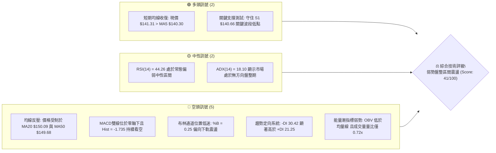
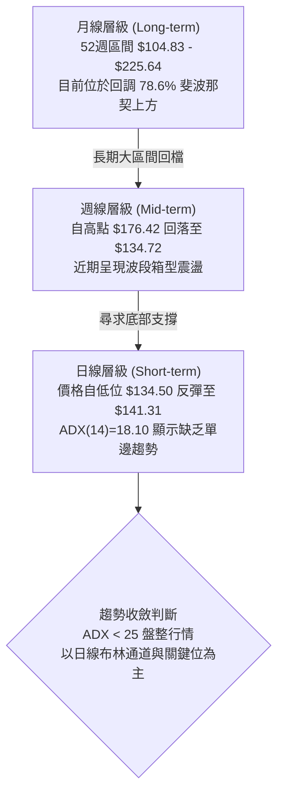
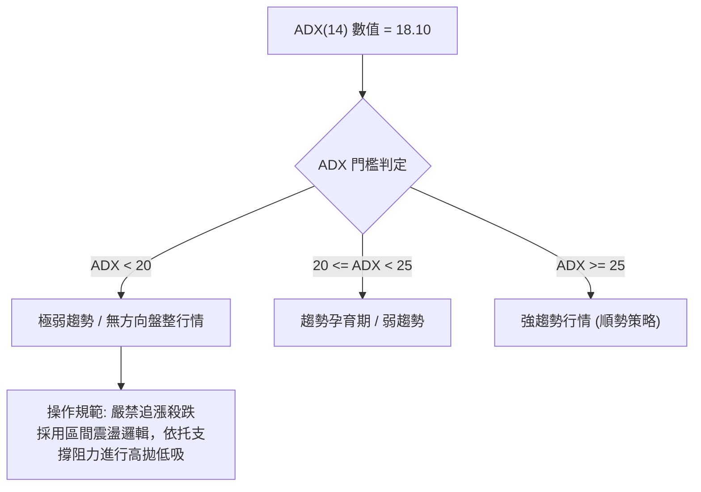
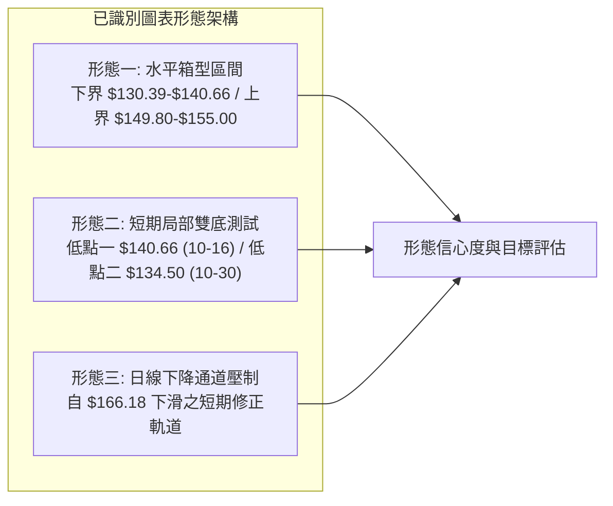
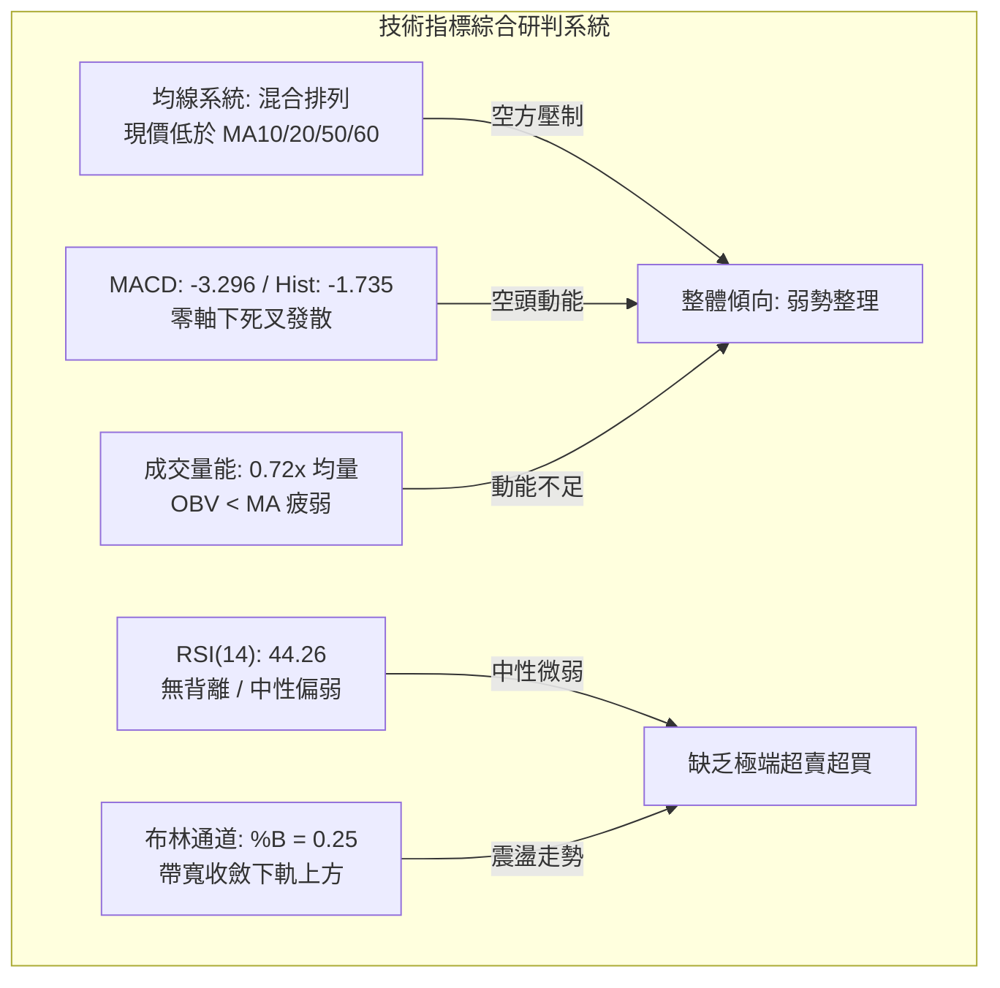
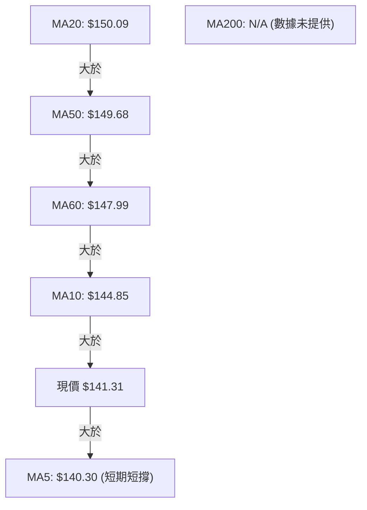
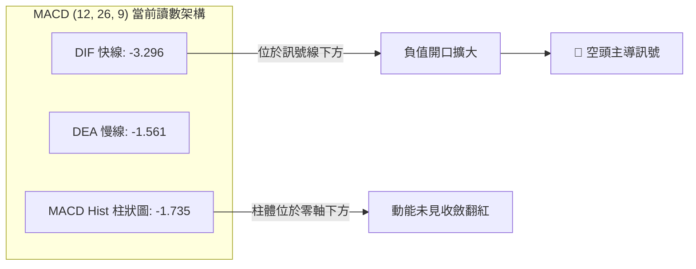
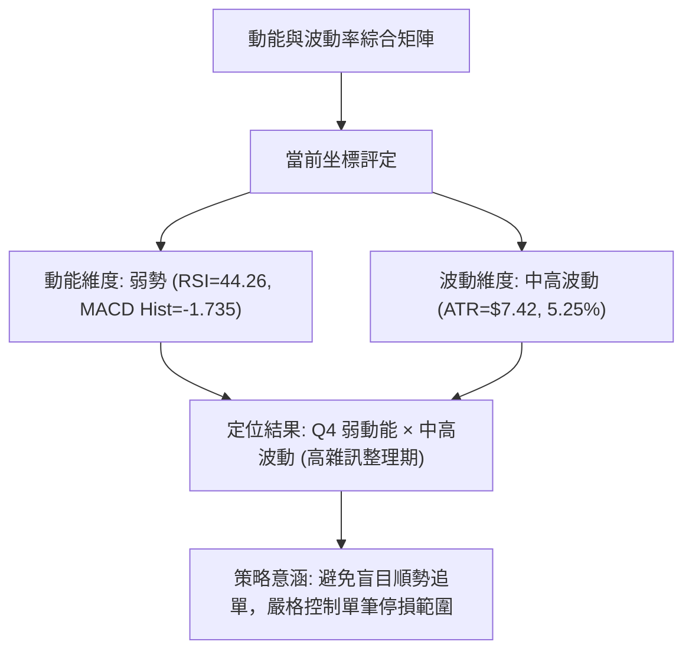
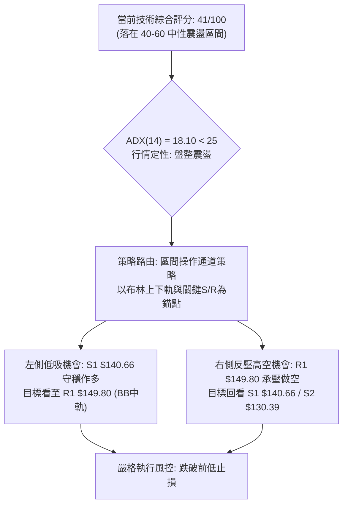
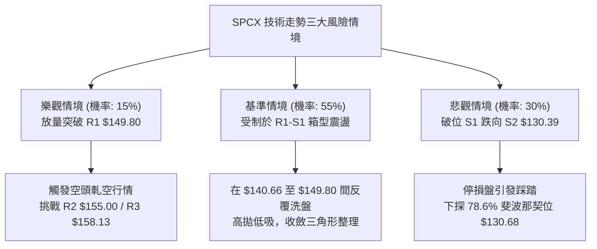

# SPCX 技術分析報告

> **報告日期**：2026-11-04 ｜ **語言**：繁體中文 ｜ **數據來源**：Yahoo Finance ｜ **當前價格**：$141.31

---

## 目錄

| 章節 | 內容 |
|------|------|
| [1. 技術面概覽](#1-技術面概覽) | 訊號儀表板、核心指標、評分卡 |
| [2. 趨勢分析](#2-趨勢分析) | 多時框趨勢、長中短期走勢、ADX強度 |
| [3. 圖表形態分析](#3-圖表形態分析) | 形態識別、K線組合、目標價推算 |
| [4. 支撐與阻力](#4-支撐與阻力) | 關鍵價位、斐波那契回調結構 |
| [5. 技術指標深度解讀](#5-技術指標深度解讀) | MA/RSI/MACD/布林/成交量量價分析 |
| [6. 動能與波動率](#6-動能與波動率) | 動能評估四象限、ATR、市場相關性 |
| [7. 多時框架總結](#7-多時框架總結) | 時框架評分矩陣、多時框收斂結論 |
| [8. 交易策略建議](#8-交易策略建議) | 策略路由、價格情境、多空交易計劃 |
| [9. 風險提示與監控](#9-風險提示與監控) | 關鍵監控清單、情境分析與風控措施 |

---

## 1. 技術面概覽

### 🎯 技術訊號儀表板



### 📊 核心指標速覽表

| 指標類別 | 指標名稱 | 當前數值 | 訊號 | 專業解讀 |
|:---|:---|:---:|:---:|:---|
| **價格** | 當前收盤價 | $141.31 | 🟡 | 位於52週區間 30.2% 位置，短線自低位弱勢回彈 |
| **均線** | MA5 | $140.30 | 🟢 | 價格站上短期5日均線（乖離率 +0.72%），形成極短線支撐 |
| **均線** | MA10 | $144.85 | 🔴 | 價格低於10日均線（乖離率 -2.45%），短期反彈首道均線反壓 |
| **均線** | MA20 | $150.09 | 🔴 | 價格顯著低於20日均線（乖離率 -5.85%），中短期走勢受壓 |
| **均線** | MA50 | $149.68 | 🔴 | 價格低於50日均線，且 MA20 與 MA50 呈現糾結反壓結構 |
| **均線** | MA200 | N/A（數據未提供） | 🟡 | 數據庫不足200筆交易日，長期均線暫不列入運算 |
| **動能** | RSI(14) | 44.26 | 🟡 | 位於 30–70 常態中性區，動能偏弱但尚未進入極端超賣區 |
| **動能** | MACD (12,26,9) | -3.296 | 🔴 | MACD線位於訊號線（-1.561）下方，Hist -1.735 空頭主導 |
| **動能** | 隨機指標 %K/%D | 21.50 / 9.36 | 🟡 | %K 上穿超賣區 %D，釋放短線跌勢趨緩訊號 |
| **趨勢強度** | ADX (14) | 18.10 | 🟡 | ADX < 25 判定為弱趨勢／無方向盤整行情，以區間邏輯應對 |
| **趨勢方向** | +DI / -DI | 21.25 / 30.42 | 🔴 | -DI 大於 +DI，反映空方在盤整震盪中佔據主動權 |
| **通道指標** | 布林通道 (%B) | 0.25 | 🔴 | 位於中軌 $150.09 與下軌 $132.20 間之弱勢半區 |
| **波動** | ATR(14) | $7.42 | 🟡 | 佔現價 5.25%，顯示日線波動度中等偏高，風控須預留緩衝 |
| **量能** | 成交量比 | 0.72x | 🔴 | 最新量 71.85M 低於20日均量 100.43M，反彈缺乏動能配合 |
| **量能** | OBV 走勢 | OBV < MA | 🔴 | 能量潮指標低於均線，量能處於淨流出階段 |

### 🏆 技術評分卡

```
╔════════════════════════════════════════════════════════════════╗
║                   技術評分卡 — SPCX (2026-11-04)               ║
╠════════════════════════════════════════════════════════════════╣
║ 趨勢強度 (Trend)     ███████░░░░░░░░░░░░░  35/100  🔴 空頭佔優 ║
║ 動能指標 (Momentum)  ████████░░░░░░░░░░░░  38/100  🔴 動能疲弱 ║
║ 支撐穩定度 (Support) ███████████░░░░░░░░░  56/100  🟡 考驗S1位 ║
║ 成交量配合 (Volume)  ███████░░░░░░░░░░░░░  35/100  🔴 量能萎縮 ║
║ 形態完整度 (Pattern) ██████████░░░░░░░░░░  48/100  🟡 箱型震盪 ║
║ 均線排列 (MA System) ███████░░░░░░░░░░░░░  34/100  🔴 均線蓋頭 ║
╠════════════════════════════════════════════════════════════════╣
║ 綜合評分             ████████░░░░░░░░░░░░  41/100  🟡 中性偏弱 ║
║ 評級結論：區間震盪整理格局（六項算術平均：246 ÷ 6 = 41）       ║
╚════════════════════════════════════════════════════════════════╝
```

---

## 2. 趨勢分析

### 🌐 多時框趨勢分析

依據多時框收斂框架，當前市場呈現長、中、短期方向分歧的典型特徵。以下為各週期之結構拆解：



- **長期視角（月線）**：52週高點為 $225.64，低點為 $104.83。現價 $141.31 處於整體區間的 30.2% 分位，屬於自歷史高位深度修正後的打底嘗試階段。
- **中期視角（週線）**：近20週數據顯示，股價自2026年7月低點 $108.37 展開強勁回升，於10月上旬觸及 $176.42 高點後大幅拉回至 $134.72。目前於 $135.00–$145.00 形成防守平台。
- **短期視角（日線）**：自2026-10-21高點 $166.18 連續下跌，於2026-10-30探底 $134.50（收盤 $134.72）後連續兩個交易日小幅回彈收於 $141.31，站上 MA5 但受制於 MA10、MA20。

### 📈 長期趨勢 — 12個月走勢圖（Unicode）

以下為根據月度歷史數據與波段端點繪製之價格走勢圖：

```
SPCX 月線走勢示意圖（基準：過去走勢與關鍵端點）
價格軸 ($)
$225.64 ┤                           ● (52W 歷史高點)
$200.00 ┤                          / \
$179.49 ┤  ● (2026-06: 170.86)    /   \
$165.24 ┤   \                    /     \   ● (2026-09: 150.86)
$150.98 ┤    \                  /       \ / \
$141.31 ┤     \      ●---------●---------●---★ (當前現價: $141.31)
$130.68 ┤      \    / (2026-08: 143.69)     \
$104.83 ┤       ●--● (2026-07: 108.37 / 52W 低點 $104.83)
        └────────────────────────────────────────────────────────
         M-5  M-4  M-3  M-2  M-1  當前 (2026-11)
```

#### 月線走勢特徵分析表

| 週期區間 | 起始價 ($) | 結束價 ($) | 區間漲跌幅 | 核心走勢特徵與結構分析 |
|:---|:---:|:---:|:---:|:---|
| **2026-06 至 2026-07** | 170.86 | 108.37 | -36.57% | 恐慌性單邊下挫，回測52週極端低點 $104.83 附近形成築底區域 |
| **2026-07 至 2026-08** | 108.37 | 143.69 | +32.59% | 強力V型反彈，多頭週線放量（單週達 920M）迅速脫離底部區間 |
| **2026-08 至 2026-09** | 143.69 | 150.86 | +4.99% | 震盪爬坡期，於 $145.00–$152.00 構築波段換手中繼平台 |
| **2026-09 至 2026-10** | 150.86 | 134.72 | -10.70% | 創下波段高點 $176.42 後快速拉回，月線收長黑，失守多條短期均線 |
| **2026-10 至 2026-11 (至今)** | 134.72 | 141.31 | +4.89% | 觸及支撐位 S1 $140.66 後企圖止跌回穩，進入低波動整理階段 |

### 📊 中期趨勢（週線分析）

中期結構目前呈現典型的「寬幅區間震盪」。近8週收盤價位軌跡如下：

```
週線區間波動架構示意：
  $176.42 ──┐ (2026-10-09 週高點: 空頭強阻力區)
            │
  $158.13 ──┼─ R3 (前波反彈高點平台)
  $155.00 ──┼─ R2 (波段聚集阻力)
  $149.80 ──┼─ R1 (MA20中軌附近共振壓制)
  $141.31 ──┼◄─── [現價: 位於箱型下緣支撐區]
  $140.66 ──┼─ S1 (近一年波段低點聚類支撐)
  $130.39 ──┴─ S2 (強支撐: 接近78.6%斐波位 $130.68)
```

週線指標顯示，MACD 柱狀圖在連續翻正後，於10月中旬再度翻負（最新週柱狀圖為 -1.735），週線 RSI 自 75.5 高檔一路滑落至當前的 44.3。這表明中期多頭推升動能已經衰竭，市場重回中性格局。

### ⚡ 趨勢強度評估（ADX 解讀）



#### ADX 與定向指標詳細對照

| 指標名稱 | 當前讀數 | 強度分級 | 技術意涵與操作指引 |
|:---|:---:|:---:|:---|
| **ADX (14)** | 18.10 | 弱勢盤整 (<25) | 明確指出當前市場不具備單邊持續推進動能，任何單日大漲或大跌均易演化為震盪拉回。 |
| **+DI (14)** | 21.25 | 多方動能微弱 | 多頭推進力道不足，未達 25 以上的進攻門檻。 |
| **-DI (14)** | 30.42 | 空方佔據主導 | -DI 顯著高於 +DI（差值達 9.17），顯示在震盪結構中空方賣壓仍為主要壓制力量。 |
| **指標結論** | 空方控盤下的低動能整理 | 🟡 觀望震盪 | 行情定性為「弱勢盤整」，操作上必須以低吸高拋的區間通道策略為主，不可採用追突破策略。 |

---

## 3. 圖表形態分析

### 🔍 形態識別系統



#### 形態識別與信心度評估表

| 形態名稱 | 信心度 | 判斷依據（嚴格引用數據） | 完成度 | 目標價（附嚴謹計算式） |
|:---|:---:|:---|:---:|:---|
| **箱型震盪區間** | **70%** | 下邊界以 S1 $140.66 與 10-30 低點 $134.50 構成；上邊界受制於 R1 $149.80 與 R2 $155.00。 | 75% | **箱型上軌目標：$149.80**<br/>若向上突破，等高延伸：$149.80 + ($149.80 - $134.50) = **$165.10** |
| **潛在雙重底結構** | **55%** | 第一次探底於2026-10-16低點 $140.66，第二次探底於2026-10-30低點 $134.50，現價已回升至 $141.31。 | 40% | **頸線突破目標：$164.87**<br/>計算式：頸線 $149.75 (10-23高) + 深度 ($149.75 - $134.50 = 15.25) = $165.00 附近 |
| **短期下降旗形** | **35%** | 自 $166.18 跌落後呈量縮反彈，但由於 ADX 僅 18.10，缺乏強趨勢支撐。 | 30% | *訊號不足（信心度 < 50%），依規則僅作指標型解讀，不預設延伸目標* |

### 🕯️ 重要 K 線形態分析

依據數據庫中提供的「近10根日K」與「近8根週K」之精確開高低收數據進行客觀解讀：

#### 近10根日 K 線形態解讀表

| 日期 (日K) | 開盤價 ($) | 最高價 ($) | 最低價 ($) | 收盤價 ($) | 成交量 | K 線形態名稱 | 技術解讀與多空訊號 |
|:---|:---:|:---:|:---:|:---:|:---:|:---|:---|
| **2026-10-21** | 160.56 | 166.18 | 156.93 | 159.31 | 220.78M | 帶長上影倒轉陰線 | 衝高 $166.18 受阻拉回，巨量爆出顯示高檔出貨賣壓 🔴 |
| **2026-10-22** | 154.21 | 154.26 | 143.21 | 144.75 | 197.05M | 跳空中長黑實體 | 破位大跌，跳空開低並重挫收於低檔，確立短線跌勢 🔴 |
| **2026-10-23** | 147.93 | 149.75 | 144.09 | 147.49 | 110.62M | 低檔十字星型態 | 跌勢暫緩，上下影線均衡，多空在 $147 附近展開爭奪 🟡 |
| **2026-10-26** | 146.84 | 150.24 | 144.57 | 146.90 | 103.18M | 窄幅整理紡錘線 | 實體極小，波動率壓縮，成交量進一步萎縮 🟡 |
| **2026-10-27** | 147.41 | 151.36 | 146.61 | 148.58 | 95.85M | 小陽線但受阻高點 | 嘗試上攻 $151.36，但未能突破前高，反彈乏力 🟡 |
| **2026-10-28** | 147.37 | 148.20 | 142.13 | 145.23 | 98.71M | 破位中陰線 | 跌破前三日低點平台，下探 $142.13，賣方重拾優勢 🔴 |
| **2026-10-29** | 142.26 | 144.95 | 141.03 | 143.89 | 68.36M | 量縮弱勢小陽 | 極致縮量（僅68.36M），顯示買盤退縮，僅屬技術抽腳 🟡 |
| **2026-10-30** | 137.85 | 140.20 | 134.50 | 134.72 | 122.65M | 放量探底大黑棒 | 帶量下殺破 $140，探至波段低點 $134.50，恐慌盤湧出 🔴 |
| **2026-11-02** | 137.01 | 142.05 | 135.72 | 136.37 | 90.99M | 帶長上影低檔陽線 | 盤中衝高 $142.05 但尾盤回吐，顯示逢高解套賣壓沈重 🟡 |
| **2026-11-03** | 137.63 | 142.74 | 137.50 | 141.31 | 71.85M | 下探回升實體紅棒 | 開低走高收在接近全日最高，收復 S1 $140.66 關鍵位 🟢 |

#### 近8根週 K 線形態解讀表

| 日期 (週K) | 開盤價 ($) | 最高價 ($) | 最低價 ($) | 收盤價 ($) | 成交量 | K 線形態名稱 | 技術解讀與多空訊號 |
|:---|:---:|:---:|:---:|:---:|:---:|:---|:---|
| **2026-09-18** | 147.33 | 156.87 | 142.87 | 152.71 | 669.03M | 帶長下影中陽線 | 週線震盪走高，多頭守穩 $142 支撐，量能充沛 🟢 |
| **2026-09-25** | 154.77 | 158.13 | 145.88 | 148.68 | 329.44M | 衝高回落倒轉小陰 | 觸及阻力位 R3 $158.13 後大幅壓回，顯現頭部賣壓 🔴 |
| **2026-10-02** | 148.49 | 159.84 | 145.36 | 158.96 | 432.14M | 下影線反彈長紅 | 多頭再次收復失地，實體大陽線收於全週高位 🟢 |
| **2026-10-09** | 158.99 | 176.42 | 158.62 | 162.57 | 485.05M | 爆量長上影流星線 | 創波段新高 $176.42 但遭遇龐大拋壓，形成中期頂部 🔴 |
| **2026-10-16** | 164.66 | 167.07 | 140.66 | 146.03 | 394.97M | 空頭長黑吞噬棒 | 單週暴跌逾20美元，直接摜破多條均線，確立波段反轉 🔴 |
| **2026-10-23** | 149.23 | 166.18 | 143.21 | 147.49 | 719.69M | 巨量劇烈震盪十字 | 高低震盪達23美元，成交量放大至 719M，多空激烈換手 🟡 |
| **2026-10-30** | 146.84 | 151.36 | 134.50 | 134.72 | 488.75M | 實體大陰線收最低 | 空方完全控盤，收盤摜破前週低點，下探波段新低 🔴 |
| **2026-11-03** | 137.01 | 142.74 | 135.72 | 141.31 | 162.85M | 下影線止跌小紅棒 | 於 $135 附近初現止跌企穩跡象，成交量相對萎縮 🟢 |

### 📉 ASCII 走勢形態示意圖

```
日線雙底測試與箱型震盪示意圖：
價格
$166.18 ┬────● (10-21 高點，確立下降軌道起點)
        │     \
$155.00 ┼──────\─────────● (R2 阻力位)
        │       \       / \
$149.80 ┼────────●-----●---● (頸線 / R1 阻力: 10-23 高點 $149.75)
        │         \   /     \
$141.31 ┼──────────\─/───────★ (現價 $141.31，站上 S1 弱勢反彈)
$140.66 ┼───────────● (底1: 10-16 低點)
        │            \
$134.50 ┴─────────────● (底2: 10-30 低點)
        └───────────────────────────────────────────────► 時間
```

### 🎯 形態目標價計算

根據嚴謹幾何測量規則，以當前確認度最高之「箱型震盪形態」及潛在「雙底反彈」進行目標價推算：

1. **箱型震盪反彈目標（保守）**：
   - 箱體下界基準點：2026-10-30 低點 **$134.50**
   - 箱體第一壓力中樞：數據阻力位 R1 **$149.80**
   - 保守上行目標 $T_1$ 即為箱型頂部：**$149.80**（潛在空間 +6.01%）
2. **形態突破等高測量目標（樂觀）**：
   - 形態垂直幅度 $H = \text{頸線}(R_1) - \text{箱底} = 149.80 - 134.50 = \$15.30$
   - 向上等高測幅目標 $T_{\text{ext}} = R_1 + H = 149.80 + 15.30 = \$165.10$
   - 此數值與 50.0% 斐波那契回調位 **$165.24** 形成完美重合共振。

---

## 4. 支撐與阻力

### 🗺️ 關鍵價位分布圖（Unicode）

```
╔══════════════════════════════════════════════════════════════╗
║              SPCX 關鍵價位結構分布圖 (OHLCV 計算)            ║
╠══════════════════════════════════════════════════════════════╣
║ $158.13 ║████████████████████████║ 強阻力 R3 (近一年波段高點)║
║ $155.00 ║████████████████████    ║ 阻力 R2 (密集套牢反壓區)  ║
║ $149.80 ║████████████████████████║ 關鍵阻力 R1 (MA20/中軌共振)║
║ $141.31 ╠════════════════════════╣ ◄─── 當前現價 ($141.31)   ║
║ $140.66 ║▓▓▓▓▓▓▓▓▓▓▓▓▓▓▓▓        ║ 近期支撐 S1 (波段低點聚類)║
║ $130.39 ║████████████████████████║ 強支撐 S2 (78.6% 斐波位)  ║
║ $104.83 ║████████████████████████║ 終極支撐 S3 (52W 歷史低點)║
╚══════════════════════════════════════════════════════════════╝
```

### 🚧 阻力位分析表

所有阻力價位嚴格引用系統由波段聚類所計算之精確數值：

| 阻力級別 | 價位 ($) | 距現價幅動 | 技術形成原因與結構分析 | 突破難度評估 | 策略重要性 |
|:---|:---:|:---:|:---|:---:|:---:|
| **R1** | **$149.80** | +6.01% | 2026-10-23高點 $149.75 聚類位，同時與布林通道中軌（MA20 $150.09）及 MA50 $149.68 形成三重共振壓制。 | 中等偏高 🔴 | ★★★★★<br/>短線多空分水嶺 |
| **R2** | **$155.00** | +9.69% | 2026-09 下半月多次震盪之密集成交平台下沿，整數心理關卡，套牢籌碼沉重。 | 極高 🔴 | ★★★★☆<br/>波段反彈強阻力 |
| **R3** | **$158.13** | +11.90% | 2026-09-25 週K線高點，亦為10月初起跌前之籌碼密集換手頂部。 | 極高 🔴 | ★★★☆☆<br/>中期反轉確認位 |

### 🛡️ 支撐位分析表

所有支撐價位嚴格引用系統由波段聚類所計算之精確數值：

| 支撐級別 | 價位 ($) | 距現價幅動 | 技術形成原因與結構分析 | 守住機率評估 | 策略重要性 |
|:---|:---:|:---:|:---|:---:|:---:|
| **S1** | **$140.66** | -0.46% | 2026-10-16 週K低點聚類，目前現價 $141.31 正緊貼此位測試，為日線多頭防守的第一道防線。 | 60% 🟡 | ★★★★☆<br/>短線防守基準點 |
| **S2** | **$130.39** | -7.73% | 近一年主要波段低點聚類區，且緊密貼合 78.6% 斐波那契回調位 $130.68 及布林下軌 $132.20。 | 80% 🟢 | ★★★★★<br/>中期箱型底部基石 |
| **S3** | **$104.83** | -25.82% | 52週極端歷史低點（2026-07測試建立），多頭終極生死線。 | 95% 🟢 | ★★★★★<br/>長期多空生死門 |

### 📐 斐波那契回調位分析

依據 52 週完整波動區間（低點 **$104.83** → 高點 **$225.64**，總垂直落差 **$120.81**）精確計算之回調階梯如下：

```
斐波那契回調結構與現價相對位置圖：
0.0%  ──────── $225.64 (52W 最高點)
             │
23.6% ──────── $197.13
             │
38.2% ──────── $179.49
             │
50.0% ──────── $165.24 (多空中樞分水嶺)
             │
61.8% ──────── $150.98 (黃金分割關鍵位，緊貼 MA20 $150.09 / R1 $149.80)
             │ ◄─── [現價 $141.31 處於 61.8% 與 78.6% 之間的弱勢整理區]
78.6% ──────── $130.68 (深度回調支撐位，緊貼 S2 強支撐 $130.39)
             │
100.0%──────── $104.83 (52W 最低點)
```

#### 斐波那契階梯解讀
1. **現價區間定位**：現價 **$141.31** 處於 **61.8% 回調位（$150.98）** 與 **78.6% 回調位（$130.68）** 之間。此區域在技術分析中屬於「深度弱勢回調區」。
2. **雙重共振阻力**：61.8% 斐波那契位 **$150.98** 與日線 MA20（$150.09）及阻力位 R1（$149.80）構成極為強固的「技術阻力共振牆」。在未有效放量突破 $150.98 之前，技術面只能視為低位弱勢震盪。
3. **下檔黃金緩衝**：78.6% 斐波那契位 **$130.68** 與波段強支撐 S2 **$130.39** 僅相差 29 美分，顯示 $130.39–$130.68 區域具備極強的技術支撐買盤，為多頭中期防線的最核心陣地。

---

## 5. 技術指標深度解讀

### 🎛️ 指標訊號總覽



### 📈 移動平均線排列分析



#### 均線系統數據與排列特徵

| 均線名稱 | 當前價格 ($) | 乖離率 (%) | 均線走勢軌跡（歷史微型圖） | 均線狀態與壓制分析 |
|:---|:---:|:---:|:---|:---|
| **MA 5** | 140.30 | +0.72% | ▄▄▄▃▃▃▃▄▅▇████▇▆▅▄▄▃▃▃▃▃▃▂▂▂▁▁ | 現價短線站上，自低檔微幅勾頭翻揚，提供極短線保護 |
| **MA 10** | 144.85 | -2.45% | ▃▃▃▃▃▃▃▃▄▅▆▇▇█████▇▆▅▄▄▃▂▂▂▁▁▁ | 持續下行向下發散，為短線反彈的第一道動態壓制 |
| **MA 20** | 150.09 | -5.85% | ▁▁▁▁▂▂▃▃▄▅▆▇▇██████▇█████▇▇▆▄▃ | 下彎加速，與布林中軌重合，為中期趨勢空頭主導線 |
| **MA 50** | 149.68 | -5.59% | *中中期均線平台* | 走平微跌，與 MA20 形成密集死叉壓制帶 |
| **MA 60** | 147.99 | -4.52% | ▁▁▁▁▁▁▁▁▁▁▂▂▂▃▃▄▄▄▅▅▆▆▇▇██████ | 緩步走平，提供中等阻力 |
| **MA 200** | N/A | N/A | (資料庫未提供200日數據) | **N/A（數據未提供）**，不予主觀臆測 |

**均線綜合結論**：當前呈現「混合弱勢排列」。價格雖勉強站上 MA5（$140.30），但上方受到 MA10（$144.85）、MA60（$147.99）、MA50（$149.68）及 MA20（$150.09）層層密集的空頭「蓋頭反壓」。短期內若無爆發性量能推動，難以一次性突破此複合均線防線。

### 📉 RSI(14) 分析

- **當前讀數**：**44.26**（採用 Wilder 平滑法）
- **指標進度條**：
  ```
  超賣 (0) ─────── 30 ───────────── 50 ───────────── 70 ─────── 超買 (100)
  [██████████████████░░░░░░░░░░░░░░░░░░░░░░] 44.26% (中性弱勢區)
  ```
- **背離檢驗結論**：
  - **日線背離判定**：**無明顯背離**。檢驗近 20 根 K 棒走勢，價格自 10-21 高點 $166.18 回落至 10-30 低點 $134.50，RSI 由 60 附近同步回落至 37.5，指標低點與價格低點同步下移，首尾方向一致，未出現底背離或頂背離特徵。
  - **週線動能驗證**：週線 RSI 自前高 75.5（2026-07）滑落至最新 44.3，中週期多頭能量已經完全釋放，目前處於動能重置期。

### 📊 MACD(12,26,9) 訊號解讀



- **絕對數值解析**：MACD 線（-3.296）大幅低於訊號線（-1.561），且雙線皆深處於零軸之下，證實市場目前處於標準的「空頭掌控領域」。
- **柱狀圖動態**：最新日線柱狀圖為 **-1.735**（較前一日微幅縮減但仍處擴張態勢），週線柱狀圖亦為 **-1.735**，顯示空頭拋壓雖未進一步惡化，但尚未見到金叉收斂訊號，左側抄底風險顯著。

### 📦 布林通道分析

```
SPCX 日線布林通道結構示意圖 (帶寬 20, 2)
$167.98 ┬────────────────────────────── 上軌 (Upper Band: 空頭極端邊界)
        │
$150.09 ┼┄┄┄┄┄┄┄┄┄┄┄┄┄┄┄┄┄┄┄┄┄┄┄┄┄┄┄┄ 中軌 (MA20: 核心多空防線)
        │
$141.31 ┼─────────★──────────────────── 現價 (位於通道 25% 分位，弱勢區間)
        │
$132.20 ┴────────────────────────────── 下軌 (Lower Band: 區間極端支撐)
```

- **通道參數與現況**：
  - **上軌**：$167.98
  - **中軌 (MA20)**：$150.09
  - **下軌**：$132.20
  - **%B 指標**：**0.25**（處於下半區，低於中軌 0.50）
- **技術含義**：布林帶寬目前未出現劇烈單邊張口，通道呈現水平收縮後的小幅下傾狀態。%B = 0.25 顯示價格靠近下軌震盪，下軌 $132.20 與波段支撐 S2 $130.39 形成共振緩衝帶，限制了短線暴跌空間。

### 💹 成交量分析（量價配合度）

1. **成交量對比**：
   - 最新交易日成交量：**71,850,800 股**
   - 20日移動平均量：**100,433,680 股**
   - 50日移動平均量：**92,967,662 股**
   - **量比 (Volume Ratio)**：**0.72x**（成交量顯著萎縮至均量以下）
2. **量價關係特徵**：
   - 2026-10-30 股價跌至最低點 $134.50 時，成交量擴大至 122.65M（放量破位）；隨後兩個交易日股價自低檔回彈至 $141.31，但成交量反向萎縮至 90.99M 與 71.85M。
   - **量價背離診斷**：呈現典型的「**量縮價漲／反彈無量**」格局。無量反彈顯示買盤跟進意願低迷，主要動力來自於空頭短線回補，而非主力資金主動進攻，易在遭遇均線反壓時再次受阻。
3. **OBV 能量潮走勢**：數據明確標示 **OBV < MA**，能量潮指標持續運行於均線下方，驗證中期資金仍處於溫和淨流出狀態，未見明顯機構吸籌訊號。

---

## 6. 動能與波動率

### ⚡ 動能評估四象限

評估 SPCX 在「動能強度」與「波動率」兩大維度的分布定位：



#### 動能評估矩陣分析表

| 象限代號 | 動能屬性 | 波動屬性 | 當前狀態判定 | 戰略應對評估 |
|:---:|:---:|:---:|:---:|:---|
| **Q1** | 強動能 (趨勢明確) | 低波動 (有序推進) | — | 最優順勢加碼環境（非當前現狀） |
| **Q2** | 弱動能 (缺乏方向) | 低波動 (區間壓縮) | — | 突破前夕窄幅蓄勢（非當前現狀） |
| **Q3** | 強動能 (單邊爆發) | 高波動 (情緒激化) | — | 高風險高收益突破行情（非當前現狀） |
| **Q4** | **弱動能 (反覆震盪)** | **中高波動 (日幅較大)** | **✓ (當前狀態)** | **多空拉鋸雜訊高，勝率較低；應降低槓桿與倉位，依托極端邊界低吸** |

### 📊 ATR 波動率分析

- **ATR(14) 絕對數值**：**$7.42**（採用 Wilder 計算標準）
- **波動率佔比 (ATR % of Price)**：**5.25%**
- **風控參數推導**：
  - **正常日波動區間**：現價 $141.31 ± $7.42，代表單日正常震盪範圍在 **$133.89 至 $148.73** 之間。
  - **防洗盤安全止損間距**：
    - 保守型止損（1.5 × ATR）：$1.5 \times 7.42 = \$11.13$
    - 積極型止損（1.0 × ATR）：$1.0 \times 7.42 = \$7.42$
    - 緊密型止損（0.75 × ATR）：$0.75 \times 7.42 = \$5.57$
  - **實戰啟示**：ATR 高達 5.25%，說明 SPCX 單日波動幅度極為劇烈。任何少於 $5.00 的過度緊密止損極易被盤中常態雜訊掃出場，部位規模（Position Sizing）必須相應縮小。

### 📐 Beta 與市場相關性

- **Beta 係數**：**N/A（數據未提供）**
- **機構籌碼與融券結構補充（依據數據庫）**：
  - **機構持股比例 (Institution Own %)**：**47.3%**（機構資金佔據半壁江山，中長期具備基本盤定價權）
  - **內部人持股比例 (Insider Own %)**：**12.5%**
  - **空頭部位比例 (Short % Float)**：**2.4%**；**做空比率 (Short Ratio)**：**1.79**
- **市場特徵解讀**：雖然官方 Beta 數據未提供，但由高達 5.25% 的日線 ATR 以及空頭籌碼比率（Short Ratio 1.79）可知，該股具備高 Beta 成長型太空航太龍頭特徵。消息面（如大選、政府監管與火箭發射進程）對短線股價衝擊劇烈，散戶與機構籌碼在低位換手頻繁。

---

## 7. 多時框架總結

### 📋 時框架評分表

| 時框架 | 趨勢方向 | 動能指標 (RSI/MACD) | 均線排列特徵 | 圖表形態識別 | 週期評分 | 操作建議與定位 |
|:---|:---:|:---:|:---:|:---:|:---:|:---|
| **長期 (月線)** | 🟢 偏多回調 | RSI ~44 / 處於 78.6% 回調上方 | 數據不足 MA200，但處於 52W 區間低位 | 長期打底箱體 ($104.83–$225.64) | **58/100** | 逢低分批布局，重視長期基本面 |
| **中期 (週線)** | 🔴 偏空調整 | RSI 44.3 / MACD Hist -1.735 翻黑 | 跌破多條短期週線，均線蓋頭 | 自 $176.42 回落之寬幅箱型 | **38/100** | 逢高減碼，防範中級調整延伸 |
| **短期 (日線)** | 🟡 弱勢盤整 | RSI 44.26 / MACD 負值 / Stoch 超賣回升 | 收復 MA5，但受阻於 MA10/MA20 | 測試 S1 $140.66，局部雙底未成形 | **41/100** | 區間交易，嚴禁追價，高拋低吸 |

### 🔲 綜合訊號矩陣

```
╔══════════════════════════════════════════════════════════════════╗
║               SPCX 多維度訊號矩陣與方向一致性檢驗                ║
╠══════════════════════╦══════════════╦══════════════╦═════════════╣
║ 分析維度             ║ 長期 (月線)  ║ 中期 (週線)  ║ 短期 (日線) ║
╠══════════════════════╬══════════════╬══════════════╬═════════════╣
║ 趨勢方向 (Trend)     ║ 🟢 偏多守成  ║ 🔴 波段修正  ║ 🟡 弱勢盤整 ║
║ 動能強弱 (Momentum)  ║ 🟡 中性平緩  ║ 🔴 空方主導  ║ 🔴 負值震盪 ║
║ 支撐強度 (Support)   ║ 🟢 S3 $104.83║ 🟢 S2 $130.39║ 🟡 S1 $140.66║
║ 成交量能 (Volume)    ║ 🟢 底部放量  ║ 🔴 量縮下跌  ║ 🔴 反彈無量 ║
║ 形態位置 (Pattern)   ║ 🟢 區間下半  ║ 🔴 頂部回落  ║ 🟡 下軌反彈 ║
╠══════════════════════╬══════════════╬══════════════╬═════════════╣
║ 維度一致性判定       ║ 長短期出現分歧；ADX(14)=18.10 確立無趨勢行情 ║
╚══════════════════════╩════════════════════════════════════════════╝
```

### ⚖️ 多時框收斂結論

依據多時框收斂規則（規則 14）：
1. **行情定性**：當前日線 **ADX(14) 讀數為 18.10**，遠低於趨勢行情門檻值（25.00）。根據規則，**當前定性為標準的「盤整行情（Range-bound Regime）」**。
2. **主導維度與取捨**：在盤整行情中，不可採用順勢突破邏輯，而必須以**日線布林通道（上軌 $167.98、中軌 $150.09、下軌 $132.20）與波段關鍵支撐阻力位為核心交易區間**。中長期的偏空修正限制了反彈空間，日線僅能尋找下軌反彈之高勝率區間交易機會。
3. **唯一收斂結論**：**「中性偏弱區間震盪（Neutral-to-Bearish Consolidation）」**。技術評分卡綜合評分為 **41/100**，策略上嚴禁在區間中軸追價，以防守 S1（$140.66）為前提進行區間下緣波段反彈操作，或於 R1（$149.80）附近進行順應中期趨勢的高空防守。此結論與後續第 8 章交易策略嚴格一致。

---

## 8. 交易策略建議

### 🗺️ 策略決策流程圖



### 🧭 策略路由（依評分卡分流）

> **當前主策略方向 = 區間震盪操作（依評分 41/100，落在 40–60 中性區間，以日線布林通道上下軌與S/R階梯為主，等待方向突破確認）**

因綜合評分為 41/100 處於中性格局，且 ADX 僅 18.10，市場無單邊趨勢。因此主推「**區間邊界高拋低吸之雙向通道策略**」：
- **策略 A（主選：區間下緣博反彈多單）**：依托 S1 $140.66 支撐，博取向布林中軌的反彈。
- **策略 B（次選：區間上軌反壓做空）**：若反彈至 R1 $149.80 承壓無力突破，順應中期空頭動能開空。

### 🎯 價格情境階梯（Price Scenarios）

價位嚴格引用數據庫中計算之真實數值：

| 觸發條件 | 下一目標 | 後續延伸 | 情境技術含義與應對要點 |
|:---|:---:|:---:|:---|
| **強勢突破 R1 ($149.80)** | **R2 ($155.00)** | **R3 ($158.13)** | 短線轉強，站上 MA20 與 61.8% 斐波位，扭轉日線跌勢，空單全面離場。 |
| **守穩現價 ($141.31)** | **R1 ($149.80)** | — | 維持於 $134.50–$149.80 進行箱型收斂震盪，以區間指標高拋低吸為主。 |
| **有效跌破 S1 ($140.66)** | **S2 ($130.39)** | **S3 ($104.83)** | 中期破位轉弱，箱型底部失守，將回測 78.6% 斐波那契位及下軌尋求支撐。 |

### 📊 情境機率分佈

| 情境類別 | 發生機率 | 主要技術依據（嚴格引用指標現狀） |
|:---|:---:|:---|
| **區間震盪整理 (主情境)** | **55%** | **ADX(14) 僅 18.10**，布林帶寬收縮，多空均未展現延續性單邊推進能力。 |
| **下探尋底 / 破位再探** | **30%** | **MACD 柱狀圖為 -1.735**，均線呈現蓋頭反壓，且成交量縮（量比 0.72x）反彈動能薄弱。 |
| **強勢突破反轉向上** | **15%** | 目前上方堆積 R1（$149.80）密集套牢盤，且 OBV < MA 顯示資金尚無大規模流入跡象。 |

### 🟢 主策略詳情（區間震盪雙向計劃）

所有數值均嚴格依據真實數據計算，風險報酬比定義：$(目標價 T_1 - 進場價) \div (進場價 - 止損價)$，做空時反向計算。

| 策略要素 | 策略 A：區間下緣低吸做多 (Long at Support) | 策略 B：阻力位承壓做空 (Short at Resistance) |
|:---|:---|:---|
| **進場條件** | 回測支撐位 S1 $140.66 企穩，且日K收盤不破 | 反彈測試阻力位 R1 $149.80 失敗，出現上影線滯漲 |
| **進場價格** | **$140.66**（S1 關鍵支撐位） | **$149.80**（R1 阻力位 / MA20 中軌共振點） |
| **目標價 T1** | **$149.80**（R1 阻力位 / 箱型上沿） | **$140.66**（S1 支撐位 / 箱型下沿） |
| **目標價 T2** | **$155.00**（R2 強阻力位 / 突破延伸） | **$130.39**（S2 強支撐位 / 78.6% 斐波位） |
| **止損價格** | **$136.00**（跌破2026-11-02日K低點 $135.72） | **$155.00**（突破阻力位 R2 關鍵高點） |
| **風險報酬比** | **1 : 1.96（以 T1 計）**<br/>計算式：$(149.80 - 140.66) \div (140.66 - 136.00) = 9.14 \div 4.66 = 1.96$<br/>*(以 T2 計則為 1 : 3.08)* | **1 : 1.76（以 T1 計）**<br/>計算式：$(149.80 - 140.66) \div (155.00 - 149.80) = 9.14 \div 5.20 = 1.76$<br/>*(以 T2 計則為 1 : 3.73)* |
| **預估勝率** | **55%** | **50%** |
| **建議倉位** | **總資金之 8%–10%**（輕倉試單） | **總資金之 8%–10%**（順中期趨勢輕倉） |

### 🔴 反向風險觸發點（對沖提示）

- **做多部位反向翻空觸發點**：若日K線收盤價**實體跌破 $140.66 (S1)**，特別是跌破近期波段低點 **$134.50**，代表箱型支撐徹底潰敗，多單必須無條件停損，並應啟動反手放空對沖，目標直指 S2 **$130.39**。
- **做空部位強制平倉觸發點**：若盤中帶量突破 **$149.80 (R1)** 並站穩於 MA20（$150.09）之上，代表日線下降通道被無效化，短線反轉確立，所有空頭頭寸必須立刻止損出局。

### ⭐ 整體訊號強度評星

```
做多訊號強度：★★☆☆☆  (2.5/5星: 受制於均線壓制與弱量能，僅限下軌低吸)
做空訊號強度：★★★☆☆  (3.0/5星: 中期趨勢偏空，但短線貼近S1支撐不宜追空)
整體可信度：  ★★★☆☆  (3.0/5星: ADX<25 震盪雜訊較多，需嚴守止損點位)
```

---

## 9. 風險提示與監控

### ✅ 關鍵監控指標 Checklist

```
╔══════════════════════════════════════════════════════════════╗
║              SPCX 交易風控與關鍵監控指標清單                 ║
╠══════════════════════════════════════════════════════════════╣
║ [ ] 價位維度：是否有效守住 S1 支撐 $140.66 (日K收盤價為準)  ║
║ [ ] 阻力維度：向上反彈是否在 R1 $149.80 遭遇巨量長上影線     ║
║ [ ] 動能維度：MACD 柱狀圖是否由當前 -1.735 向上收斂至零軸    ║
║ [ ] 動能維度：RSI(14) 能否突破 50.00 中性分水嶺進入多頭強勢區║
║ [ ] 趨勢維度：ADX(14) 是否自 18.10 向上穿越 25.00 觸發單邊行情║
║ [ ] 量能維度：日成交量是否回升至 20日均量 (100.43M) 之 1.2倍 ║
║ [ ] 宏觀與政治：注意 Musk 與政治選舉關聯事件對航太板塊之衝擊 ║
╚══════════════════════════════════════════════════════════════╝
```

### ⚠️ 風險場景分析



### 🛡️ 風險管理重要提醒

1. **波動幅度管理（ATR 紀律）**：
   - 當前 ATR 高達 **$7.42（5.25%）**，單日潛在波動劇烈。投資者在設定倉位時，必須依據「單筆交易最大虧損不超過總資產 1%–1.5%」原則進行倒推計算。
   - 單筆最大允許股數計算公式：$\text{部位股數} = \frac{\text{總帳戶資金} \times 1\%}{\text{進場價} - \text{止損價}}$。例如 10 萬美元帳戶，最大風險 1,000 美元，若進場 $140.66 止損 $136.00（風險間距 $4.66），則持股上限為 $1,000 \div 4.66 \approx 214 \text{ 股}$。
2. **財報與基本面背離風險**：
   - 數據顯示公司 TTM 營運利潤率為 -2.0%，TTM 自由現金流為負（$-40.16B，主因龐大資本支出 $55.92B），本益比處於 588x 的極高水位。雖然分析師共識平均目標價高達 $257.11，但在高估值與高資本支出背景下，市場情緒一旦受利率或政治政策擾動，極易引發技術面破位下殺。
3. **無趨勢環境下的交易戒律**：
   - 當 ADX < 25 時，**嚴禁採用突破追價策略**。在 R1 $149.80 未經實體紅棒帶量確認前盲目追高，常態下會遭遇中軌反抽而深度套牢；同樣在 S1 $140.66 未帶巨量擊穿前，切忌於區間下軌恐慌性殺跌。

---

## 📋 報告總結

```
╔══════════════════════════════════════════════════════════════════════╗
║                    SPCX 技術分析報告總結精要                         ║
╠══════════════════════════════════════════════════════════════════════╣
║ 報告日期：2026-11-04                                                 ║
║ 當前價格：$141.31 USD                                                ║
║ 綜合技術評分：41 / 100 (六項指標算術平均)                            ║
║ 核心評級結論：⚖️ 弱勢盤整區間震盪（ADX=18.10 顯示單邊動能匱乏）      ║
╠══════════════════════════════════════════════════════════════════════╣
║ 關鍵技術維度：                                                       ║
║ ├─ 長期趨勢 (月線)：🟢 偏多回調 (守於 78.6% 斐波那契位 $130.68 之上) ║
║ ├─ 中期趨勢 (週線)：🔴 空方修正 (自 $176.42 高點回落，均線蓋頭壓制)  ║
║ ├─ 短期趨勢 (日線)：🟡 弱勢整理 (站上 MA5 $140.30，測試 S1 支撐位)   ║
║ ├─ 第一防守支撐：$140.66 (S1 波段聚類) / 強支撐：$130.39 (S2)       ║
║ ├─ 第一阻力分水嶺：$149.80 (R1 / 布林中軌 / MA20 $150.09)            ║
║ └─ 華爾街分析師目標：均價 $257.11 (低 $70.00 / 高 $800.00)           ║
╠══════════════════════════════════════════════════════════════════════╣
║ 最優策略組合導引：                                                   ║
║ 1. 🥇 最佳機會（區間下緣低吸）：$140.66 進場，止損 $136.00，目標    ║
║     $149.80，風險報酬比 1 : 1.96（以 T1 計）。                       ║
║ 2. 🥈 次選機會（反彈遇阻做空）：$149.80 進場，止損 $155.00，目標    ║
║     $140.66，風險報酬比 1 : 1.76（以 T1 計）。                       ║
║ 3. 🥉 保守選擇（觀望等待突破）：等待價格明確帶量突破 $149.80 或     ║
║     有效跌破 $140.66 後，順應新趨勢順勢進場。                        ║
╚══════════════════════════════════════════════════════════════════════╝
```

---

> ⚠️ **免責聲明**：本報告為 AI 自動生成之技術分析，所有數據及估算均嚴格基於所提供的歷史價格與指標資訊。本報告**僅供研究與學術參考**，**不構成任何形式的投資建議與要約**。金融市場具有高度風險，交易決策應獨立審慎評估，投資人須自行承擔市場波動之一切盈虧。

---

*報告生成時間：2026-11-04 ｜ 數據來源：Yahoo Finance ｜ 分析框架：多時框技術分析體系*