# SPCX 技術分析報告

> **報告日期**：2026-11-05 ｜ **語言**：繁體中文 ｜ **數據來源**：Yahoo Finance ｜ **當前價格**：$135.92

---

## 目錄

| 章節 | 內容 |
|------|------|
| [1. 技術面概覽](#1-技術面概覽) | 訊號儀表板、核心指標、評分卡 |
| [2. 趨勢分析](#2-趨勢分析) | 多時框趨勢、長中短期走勢、ADX 解讀 |
| [3. 圖表形態分析](#3-圖表形態分析) | 形態識別、K線組合、目標價計算 |
| [4. 支撐與阻力](#4-支撐與阻力) | 關鍵價位、斐波那契回調深度分析 |
| [5. 技術指標深度解讀](#5-技術指標深度解讀) | MA/RSI/MACD/布林/成交量全面驗證 |
| [6. 動能與波動率](#6-動能與波動率) | 動能四象限、ATR 風控、Beta 相關性 |
| [7. 多時框架總結](#7-多時框架總結) | 時框架評分矩陣與多時框收斂結論 |
| [8. 交易策略建議](#8-交易策略建議) | 策略路由、主策略詳情、情境階梯、風險報酬比 |
| [9. 風險提示與監控](#9-風險提示與監控) | 關鍵監控清單、極端情境與風控規範 |

---

## 1. 技術面概覽

### 🎯 技術訊號儀表板

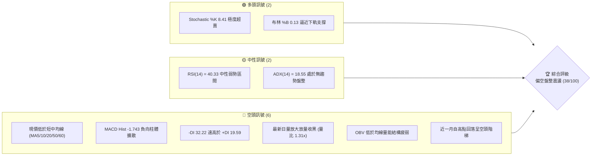

---

### 📊 核心指標速覽表

| 指標類別 | 指標名稱 | 當前數值 | 訊號 | 解讀 |
|:---|:---|:---|:---:|:---|
| **價格** | 當前收盤價 | $135.92 | 🔴 | 位於 52 週區間 25.7% 之相對低位，短線承壓向下尋底 |
| **均線** | MA20 | $148.51 | 🔴 | 現價大幅落後 MA20（-8.48%），中期月線形成反壓 |
| **均線** | MA50 | $149.64 | 🔴 | 價格受制於季線下方，中期波段趨勢由空方主控 |
| **均線** | MA200 | N/A（數據未提供） | ⚪ | 數據未收錄足夠筆數，不予評估長期牛熊分界線 |
| **動能** | RSI(14) | 40.33 | 🟡 | 位於中性偏空區間，尚未進入嚴重超賣（<30），下行慣性仍在 |
| **動能** | MACD (12,26,9) | -3.740 / -1.996 | 🔴 | 雙線位於零軸之下，柱狀圖 -1.743 綠柱增長，空頭動能主導 |
| **動能** | Stoch %K / %D | 8.41 / 11.94 | 🟢 | 進入 10 以下之深度超賣區，短線存在技術性反抽動能 |
| **趨勢** | ADX(14) / ±DI | 18.55 / (-DI 32.22) | 🔴 | ADX < 25 判定為盤整格局，但 -DI 壓制 +DI，空方結構偏強 |
| **通道** | 布林通道 %B | 0.13 | 🟢 | 貼近布林下軌 $131.56，波動極限處提供短線防守緩衝 |
| **量能** | 20日成交量比 | 1.31x (OBV < MA) | 🔴 | 最新日量 1.35 億股，放量下探，且整體 OBV 疲弱背離 |
| **波動** | ATR(14) | $7.47 (5.50%) | 🟡 | 每日波動幅度偏高，盤中震盪劇烈，需設定較寬停損空間 |

---

### 🏆 技術評分卡

```
╔══════════════════════════════════════════════════════════════════╗
║               技術評分卡 — SPCX (2026-11-05)                    ║
╠══════════════════════════════════════════════════════════════════╣
║ 趨勢強度 (Trend)     ███████░░░░░░░░░░░░░  35/100  🔴 空頭壓制   ║
║ 動能指標 (Momentum)  ██████░░░░░░░░░░░░░░  32/100  🔴 動能疲弱   ║
║ 支撐穩定度 (Support) ███████████░░░░░░░░░  55/100  🟡 接近強撐   ║
║ 成交量配合 (Volume)  ███████░░░░░░░░░░░░░  38/100  🔴 放量下行   ║
║ 形態完整度 (Pattern) ████████░░░░░░░░░░░░  40/100  🟡 頂部回落   ║
║ 均線排列 (MovingAvg) █████░░░░░░░░░░░░░░░  28/100  🔴 空頭排列   ║
╠══════════════════════════════════════════════════════════════════╣
║ 綜合評分 (Overall)   ███████░░░░░░░░░░░░░  38/100  🔴 偏空震盪   ║
╚══════════════════════════════════════════════════════════════════╝
```
> **評分計算**：(35 + 32 + 55 + 38 + 40 + 28) ÷ 6 = 38.0。綜合評分為 **38/100**，技術架構落入 **偏空弱勢區間（≤40）**。

---

## 2. 趨勢分析

### 🌐 多時框趨勢分析

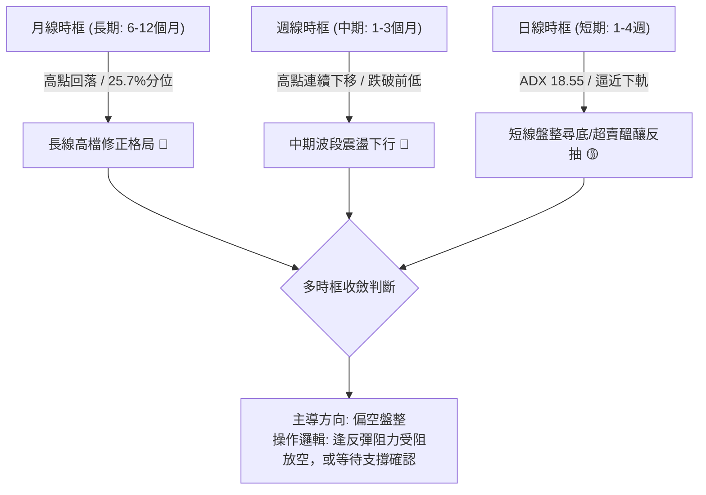

---

### 📈 長期趨勢 — 12個月走勢圖（Unicode）

依據提供的歷史數據與 52 週極值（最高 $225.64，最低 $104.83，2026 年 6 月至 11 月收盤路徑）繪製長線月級走勢脈絡：

```
SPCX 歷史走勢示意圖（過去12個月價格結構）
價格軸 ($)
$225.64 ┤                           ● (52W High)
$200.00 ┤                          / \
$175.00 ┤      ●                  /   \     ●
$170.86 ┤      ● (2026-06)       /     \   / \
$150.86 ┤       \               /       \ /   ● (2026-09: 150.86)
$135.92 ┤────────\─────────────/─────────●─────● (2026-11 現價: 135.92) ◄ 現價
$108.37 ┤         ● (2026-07) /           \
$104.83 ┤          ● (52W Low)             \ (2026-10: 134.72)
        └───────────────────────────────────────────────────────────
           2025-Q4   2026-Q1   2026-06  2026-07  2026-08  2026-09  2026-10  2026-11
```

#### 長期走勢特徵分析表格

| 週期階段 | 區間收盤點位 | 漲跌幅變動 | 量價結構特徵 | 趨勢性質定調 |
|:---|:---|:---:|:---|:---|
| **2026-06 至 2026-07** | $170.86 → $108.37 | -36.57% | 斷崖式下跌，週量高達 5.9 億股後放緩 | 恐慌拋售打出年度低點 $104.83 |
| **2026-08 至 2026-09** | $143.69 → $150.86 | +4.99% | 8月單週天量 9.2 億股暴力拉升，量價配合 | 跌深暴力反彈，修復前期超賣 |
| **2026-10 至 2026-11** | $150.86 → $135.92 | -9.90% | 週線連續開高走低，反彈量能急遽縮減 | 二次衝頂失敗，展開波段回撤 |

---

### 📊 中期趨勢（週線分析）

從近 8 根週 K 線的高低點分佈來看，中期呈現明顯的「雙重頂部回落」型態：
- **頂部受阻**：在 2026-10-09 當週創下波段反彈高點 $176.42 後，隨即於 2026-10-16 收長黑跌破 $146.03；隨後 2026-10-23 反彈上衝至 $166.18 再度遭空方強烈反撲，形成頭部降低（Lower High）結構。
- **支撐測試**：2026-10-30 週線下探至 $134.50，最新一週（截至 2026-11-04）更錄得週內低點 $133.14，連續收於 $135.92 附近，正逐步進逼前期波段低點聚類支撐 S1 ($130.39)。
- **週 MACD 轉弱**：週 MACD 柱體從 10 月初的 +0.937 迅速翻負並放大至 -1.743，確認中期上升動能已徹底衰退，轉入空頭調整週期。

---

### ⚡ 趨勢強度評估（ADX 解讀）

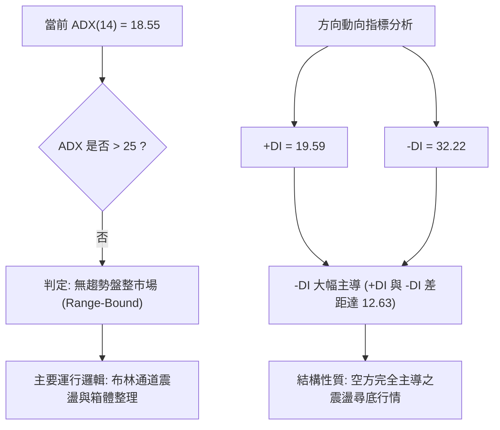

#### ADX 數值強度對照表

| ADX 數值區間 | 當前狀態 | 趨勢判定 | 交易策略指導 |
|:---:|:---:|:---|:---|
| **0 – 20** | **18.55 (SPCX)** | **無明顯趨勢 / 弱盤整** | **嚴禁突破盲目追單；以通道上下軌逆勢或反彈受阻高空為主** |
| **20 – 25** | - | 趨勢初生 / 蓄勢過渡 | 觀察布林帶寬是否收斂或向外擴張 |
| **25 – 50** | - | 強趨勢形成 | 順應中長期均線單邊順勢交易 |
| **50 – 100** | - | 極強趨勢 / 超買超賣 | 警惕趨勢耗竭與暴力均值回歸 |

> **核心解讀**：ADX 數值僅為 18.55，顯示 SPCX 目前並非處於單邊加速主跌浪中，而是呈現**空方主導下的無序盤整下沉**。在此環境下，任何下軌附近的追空容易遭遇超賣反抽，而上軌附近的抄底則會面臨均線持續下壓的風險。

---

## 3. 圖表形態分析

### 🔍 形態識別系統

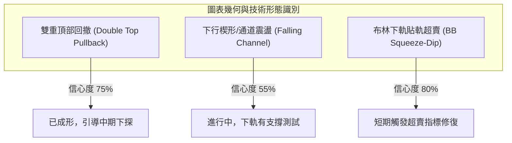

#### 形態識別與信心度評估表（依規則 15）

| 形態名稱 | 信心度 | 判斷依據（嚴格引用數據） | 完成度 | 目標價（附嚴謹計算式） |
|:---|:---:|:---|:---:|:---|
| **雙重頂部 (M頭)** | **75%** | 2026-10-09 高點 $176.42 與 2026-10-23 高點 $166.18 形成次高雙頂；頸線位於 2026-10-16 低點 $140.66，目前已實質跌破。 | **90%** | **形態等幅測距目標價**：<br/>$140.66 − ($166.18 − $140.66) = **$115.14**（由形態高度推算，跌破後將下看 S2 $104.83） |
| **布林下軌支撐測試** | **80%** | BB %B 達 0.13，現價 $135.92 逼近布林下軌 $131.56，同時 Stoch %K=8.41 進入極限超賣。 | **85%** | **反彈測試中軌目標價**：<br/>由布林通道中軌定義 = **$148.51**（BB中軌 / MA20） |
| **頭肩底底型** | **15%** | 數據中未偵測到此形態；現階段為空頭回撤走勢，無頭肩底部結構。 | 0% | 訊號不足，僅做指標型解讀，不預設立場。 |

---

### 🕯️ 重要 K 線形態分析

依據提供的「近 10 根日 K」與「近 8 根週 K」實際數據進行形態解讀：

#### 近 10 根日 K 線形態分析表

| 日期 | 開盤價 | 最高價 | 最低價 | 收盤價 | 成交量 | K線形態名稱 | 專業技術解讀 | 訊號 |
|:---|:---:|:---:|:---:|:---:|:---:|:---|:---|:---:|
| **2026-10-22** | $154.21 | $154.26 | $143.21 | $144.75 | 197,046,500 | 長黑實體破位棒 | 開高走低暴跌，實體達 $9.46，巨量下破中期平台 | 🔴 |
| **2026-10-23** | $147.93 | $149.75 | $144.09 | $147.49 | 110,617,500 | 孕線小陽線 | 縮量橫盤，未能收復前日黑棒中軸，屬弱勢抵抗 | 🟡 |
| **2026-10-26** | $146.84 | $150.24 | $144.57 | $146.90 | 103,184,900 | 紡錘十字星 | 多空在 MA20 下方激烈拉鋸，量能萎縮觀望 | 🟡 |
| **2026-10-27** | $147.41 | $151.36 | $146.61 | $148.58 | 95,845,400 | 上影小陽線 | 試圖上攻 R1 阻力帶失敗，受制於 MA20 ($148.51) | 🔴 |
| **2026-10-28** | $147.37 | $148.20 | $142.13 | $145.23 | 98,705,800 | 陰包陽吞噬棒 | 吞噬前一日陽線實體，空方重新掌握主導權 | 🔴 |
| **2026-10-29** | $142.26 | $144.95 | $141.03 | $143.89 | 68,364,400 | 低開紅十字星 | 量能創近期新低，賣壓暫歇，但買盤意願極度低落 | 🟡 |
| **2026-10-30** | $137.85 | $140.20 | $134.50 | $134.72 | 122,653,600 | 空頭跳空破位長黑 | 跳空低開放量跌破 $140 關卡，收盤收在最低點附近 | 🔴 |
| **2026-11-02** | $137.01 | $142.05 | $135.72 | $136.37 | 90,995,400 | 長上影倒槌子星 | 盤中多頭反彈遭無情摜壓，高位獲利與套牢賣壓湧出 | 🔴 |
| **2026-11-03** | $137.63 | $142.74 | $137.50 | $141.31 | 73,242,000 | 縮量反彈小陽線 | 量縮回抽，受制於 MA10 ($142.52)，反彈力竭 | 🟡 |
| **2026-11-04** | $133.24 | $140.50 | $133.14 | $135.92 | 135,034,700 | 放量下影探底紅棒 | 低開急殺至 $133.14 後拉回，量能激增至 1.35 億股 | 🟡 |

#### 近 8 根週 K 線形態分析表

| 週末日期 | 開盤價 | 最高價 | 最低價 | 收盤價 | 週成交量 | K線形態名稱 | 專業技術解讀 | 訊號 |
|:---|:---:|:---:|:---:|:---:|:---:|:---|:---|:---:|
| **2026-09-18** | $147.33 | $156.87 | $142.87 | $152.71 | 669,034,700 | 放量長上影陽線 | 巨量衝高受阻，高檔浮額顯著增加 | 🟡 |
| **2026-09-25** | $154.77 | $158.13 | $145.88 | $148.68 | 329,439,500 | 縮量回落黑棒 | 衝高見 R3 ($158.13) 後回吐，確認高檔壓力 | 🔴 |
| **2026-10-02** | $148.49 | $159.84 | $145.36 | $158.96 | 432,139,200 | 下影實體陽線 | 多方反擊，強勢收復 $155，看似向上突破 | 🟢 |
| **2026-10-09** | $158.99 | $176.42 | $158.62 | $162.57 | 485,054,700 | 竭盡型長上影線 | 創年度次高點 $176.42 後遭空頭定點狙擊，爆量收斂 | 🔴 |
| **2026-10-16** | $164.66 | $167.07 | $140.66 | $146.03 | 394,968,000 | 空頭實體大陰線 | 單週暴跌逾 $16，形成「黃昏之星」空頭反轉結構 | 🔴 |
| **2026-10-23** | $149.23 | $166.18 | $143.21 | $147.49 | 719,691,900 | 爆量震盪長上影線 | 週量高達 7.19 億股，多頭二次衝高遭斷頭式拋售 | 🔴 |
| **2026-10-30** | $146.84 | $151.36 | $134.50 | $134.72 | 488,754,100 | 下破實體黑棒 | 放量跌破頸線 $140.66，破位確認，確立波段跌勢 | 🔴 |
| **2026-11-04** | $137.01 | $142.74 | $133.14 | $135.92 | 299,272,100 | 縮量低位整理棒 | 下探 52 週低位區間，目前呈現下影線抵抗 | 🟡 |

---

### 📉 ASCII 走勢形態示意圖

```
SPCX 日線級別 M頭破位與下行通道圖解
$176.42 ┤         ▲ 左頭 (10-09)
$166.18 ┤                ▲ 右頭 (10-23)
$158.13 ┤───┐          /   \
$149.80 ┤   │  R1     /     \
$148.51 ┤───┼────────/───────\──── (MA20 / BB中軌 反壓線)
$140.66 ┤───┴───────●─────────●── (頸線位 Neckline: 已放量破位)
$135.92 ┤                     \     ● 現價 ($135.92) ◄── 超賣抵抗
$131.56 ┤──────────────────────\───░── (BB下軌)
$130.39 ┤                       ▼  ░── (波段關鍵支撐 S1 / 斐波 78.6%: $130.68)
        └─────────────────────────────────────────────
          09-下旬   10-上旬   10-中旬   10-下旬   11-初
```

---

### 🎯 形態目標價計算

依據幾何對稱理論與量化測距規則，針對已確認破位的形態展開精確計算：

1. **M頭頸線破位測距**：
   - **右頂高點**：$166.18
   - **頸線支撐**：$140.66
   - **形態垂線垂直高度 ($H$)**：$166.18 − $140.66 = $25.52
   - **理論最小下跌目標價**：頸線 $140.66 − 高度 $25.52 = **$115.14**（由雙頂形態高度推算）
   - **對應關鍵支撐映射**：若空頭動能進一步宣洩，該目標價將直指數據中載明之極限支撐 **S2 ($104.83)**。

2. **布林軌道震盪反抽測距（均值回歸）**：
   - **超賣下軌基準**：$131.56
   - **均值目標位**：布林中軌 MA20 = **$148.51**
   - **反彈高度空間**：$148.51 − $135.92 = **+$12.59 (+9.26%)**

---

## 4. 支撐與阻力

### 🗺️ 關鍵價位分布圖（Unicode）

```
╔══════════════════════════════════════════════════════════════════╗
║               SPCX 價位結構分布圖 (由 OHLCV 計算)                ║
╠══════════════════════════════════════════════════════════════════╣
║ $158.13 ║██████████████████████████████║ 強阻力 R3 (高檔震盪平台) ║
║ $155.00 ║████████████████████░░░░░░░░░░║ 阻力 R2 (整數防守關卡)   ║
║ $150.98 ║████████████████████████░░░░░░║ 斐波那契 61.8% 黃金分割  ║
║ $149.80 ║██████████████████████████████║ 關鍵阻力 R1 (MA20/50共振)║
║ $135.92 ╠══════════════════════════════╣ ◄ 現價 (收盤價)          ║
║ $131.56 ║▓▓▓▓▓▓▓▓▓▓▓▓▓▓▓▓░░░░░░░░░░░░░░║ 布林帶下軌 (波動極限)    ║
║ $130.68 ║▓▓▓▓▓▓▓▓▓▓▓▓▓▓▓▓▓▓▓▓▓▓░░░░░░░░║ 斐波那契 78.6% 回調位    ║
║ $130.39 ║██████████████████████████████║ 近期強支撐 S1 (波段低點) ║
║ $104.83 ║██████████████████████████████║ 極限強支撐 S2 (52W Low)  ║
╚══════════════════════════════════════════════════════════════════╝
```

---

### 🚧 阻力位分析表

阻力數值完全引用自技術數據中由波段高點聚類計算所得：

| 阻力級別 | 價位數值 | 距現價空間 | 形成技術原因與籌碼特徵 | 突破難度 | 重要性權重 |
|:---|:---:|:---:|:---|:---:|:---:|
| **R1** | **$149.80** | **+10.21%** | 近期波段密集套牢頭部下緣，與 MA20 ($148.51)、MA50 ($149.64) 形成高度共振密集反壓帶 | 極高 | ★★★★★ |
| **R2** | **$155.00** | **+14.04%** | 市場心理整數大關，9月下旬及10月中旬多次衝高回落換手區間 | 高 | ★★★★☆ |
| **R3** | **$158.13** | **+16.34%** | 近一年波段高點聚類核心，2026-09-25 週高點壓制位，多頭中期反轉防線 | 極高 | ★★★★★ |

---

### 🛡️ 支撐位分析表

支撐數值完全引用自技術數據中由波段低點聚類計算所得：

| 支撐級別 | 價位數值 | 距現價空間 | 形成技術原因與籌碼特徵 | 守住機率 | 重要性權重 |
|:---|:---:|:---:|:---|:---:|:---:|
| **S1** | **$130.39** | **-4.07%** | 近一年波段低點密集聚類，與布林下軌 $131.56 及斐波 78.6% ($130.68) 形成三重共振支撐區 | 65% | ★★★★★ |
| **S2** | **$104.83** | **-22.87%** | 52 週最低點 (2026-07 波段絕對低點)，SPCX 估值與籌碼之長期終極防守底線 | 90% | ★★★★★ |
| **S3** | N/A | N/A | **數據中未偵測到**（OHLCV 僅定義 S1 與 S2 兩個層級，不予編造） | N/A | N/A |

---

### 📐 斐波那契回調位分析

本週期斐波那契回調以 52 週區間為基準進行精確映射（波段起點 52W Low $104.83 → 波段終點 52W High $225.64，波段總垂直落差為 $120.81）：

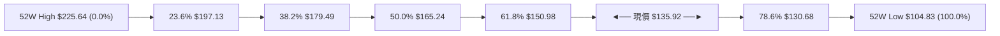

#### 斐波那契點位與現價關係深度解讀

| 回調比率 | 精確價位 | 相對現價位置 | 技術意義與多空攻防解讀 |
|:---:|:---:|:---:|:---|
| **0.0% (52W High)** | $225.64 | +66.01% | 本輪多頭超級週期頂峰，長線天花板 |
| **23.6%** | $197.13 | +45.03% | 強勢回檔保護位（已於年中跌破） |
| **38.2%** | $179.49 | +32.06% | 弱勢修正中樞，對應 10 月初高點 $176.42 附近阻力 |
| **50.0%** | $165.24 | +21.57% | 多空平衡分水嶺，對應 10-23 週反彈高點 $166.18 |
| **61.8%** | **$150.98** | **+11.08%** | **黃金分割牛熊生命線**。現價已實質跌破此位，確立回撤深度已演變成結構性走弱 |
| **78.6%** | **$130.68** | **-3.86%** | **極限防守回調位**。現價 $135.92 距離此位僅一步之遙，與 S1 ($130.39) 共同築起最後多頭防線 |
| **100.0% (52W Low)**| $104.83 | -22.87% | 全年最低點，若跌破 $130 關卡將開啟向下測底空間 |

> **回調位總結**：現價落於 **61.8% ($150.98)** 與 **78.6% ($130.68)** 之間。在技術分析定律中，當價格摜破 61.8% 黃金分割時，代表先前的上升浪已遭遇重大破壞，走勢尋求 78.6% 測試是高機率事件。因此，**$130.39 - $130.68 區域是當前多方不可失守的生命緩衝區**。

---

## 5. 技術指標深度解讀

### 🎛️ 指標訊號總覽

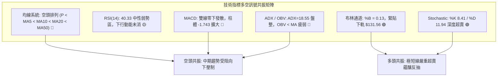

---

### 📈 移動平均線排列分析

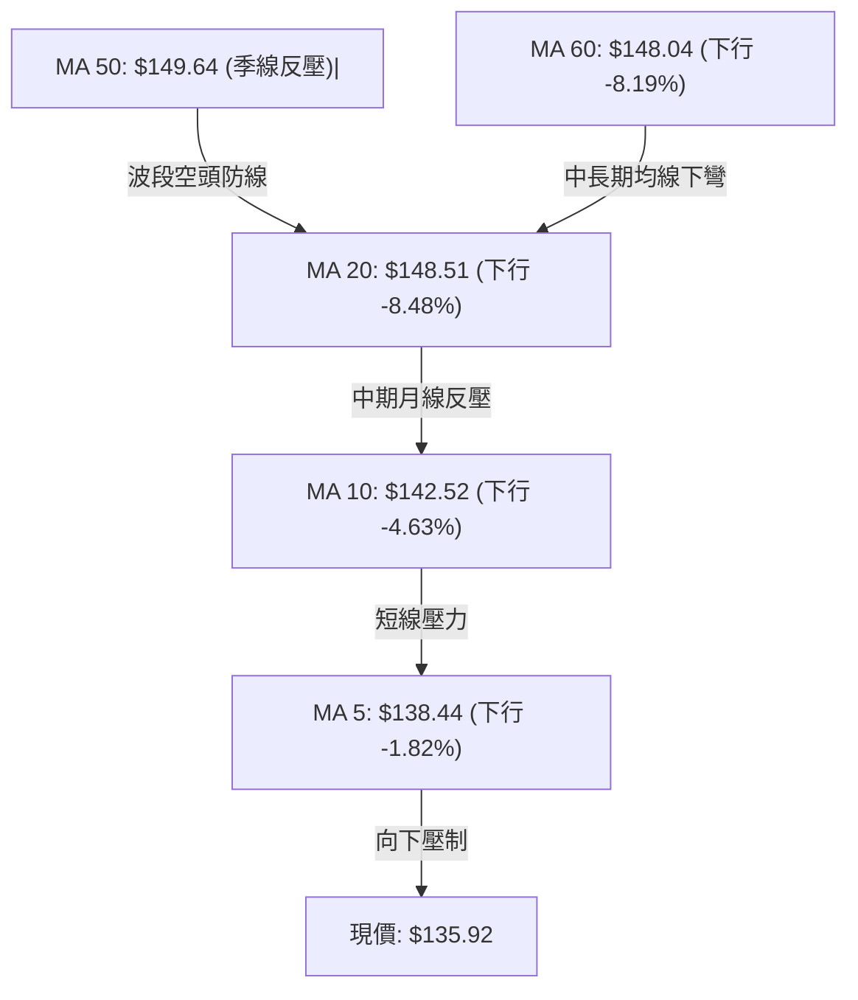

#### 均線數據深度解析表

| 均線名稱 | 當前價位 | 現價偏離度 (Bias) | 斜率特徵與歷史走勢圖形態 | 支撐 / 阻力判定 |
|:---|:---:|:---:|:---|:---:|
| **MA 5** | $138.44 | -1.82% | ▄▄▃▃▃▃▄▅▇████▇▆▆▅▄▃▄▄▄▄▄▃▃▂▁▁▁（急速扣低下彎） | 短線第一道動態阻力 |
| **MA 10** | $142.52 | -4.63% | ▄▄▄▄▄▄▄▅▅▆▇▇█████▇▆▆▅▄▄▃▃▃▂▂▁▁（穩定下行） | 短線回抽反壓線 |
| **MA 20** | $148.51 | -8.48% | ▁▁▁▁▂▂▃▄▅▆▆▇██████▇█████▇▇▆▄▃▁（見頂下穿） | 中期波段強阻力 (與BB中軌重合) |
| **MA 50** | $149.64 | -9.17% | 橫盤微幅向下，與 MA20 形成死叉蓋頭 | 季線強阻力 (R1 $149.80 核心成分) |
| **MA 60** | $148.04 | -8.19% | ▁▁▁▁▁▁▁▁▁▂▂▂▃▃▄▄▄▅▅▆▆▇▇▇██████（見頂走平） | 中期均線聚合阻力區 |
| **MA 200** | N/A（數據未提供） | N/A | 資料不足，需要200筆數據 | N/A（數據未提供） |

> **均線結構總結**：當前均線系統呈現 **標準的空頭排列發散態勢**（現價 < MA5 < MA10 < MA60 < MA20 < MA50）。5日均線以每日約 $0.5 之速度向下推移，對現價構成直接壓制。在股價實質收復 MA20 之前，任何拉升在均線理論中均屬「超賣修復」而非「多頭反轉」。

---

### 📉 RSI(14) 分析

#### RSI 強度進度條
```
RSI(14) = 40.33
[░░░░░░░░░░░░░░░░░░░░████████████████░░░░░░░░░░░░░░░░░░░░] 40.33%
 0 (超賣)           30             50             70         100 (超買)
```

- **區間評估**：RSI(14) 數值為 **40.33**，處於 30 至 50 之間的「弱勢空方主導區間」。
- **背離檢驗**：依據近 20 根 K 棒的首尾對比，價格由 10 月初之高位下行至目前 $135.92，RSI 同步自 60 以上回落至 40.33，**指標與價格同步下行，未出現底背離訊號，亦無頂背離滯後**。下行動能雖有放緩但未衰竭，空頭慣性依然健康。

---

### 📊 MACD(12,26,9) 訊號解讀

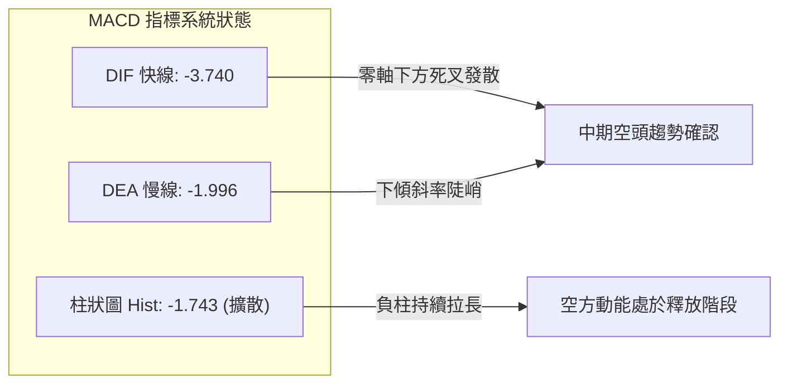

- **絕對數值**：DIF (-3.740) < DEA (-1.996) < 0，雙線位於零軸之下，屬典型的空頭控制市場。
- **動能柱狀圖**：MACD Hist 為 **-1.743**，較前一交易日持續擴大，表明短期下行加速度仍在延伸，尚未觀察到柱體收縮的鈍化特徵。

---

### 📦 布林通道分析

```
SPCX 日線布林通道示意圖
$165.46 ┼──────────────────────────────────── 布林上軌 (Upper Band)
        │
$148.51 ┼- - - - - - - - - - - - - - - - - - 布林中軌 (MA20)
        │
$135.92 ┼════════════════════════════════════ 現價 ($135.92, %B = 0.13)
$131.56 ┼──────────────────────────────────── 布林下軌 (Lower Band)
```

- **帶寬與位置**：通道上軌 $165.46，下軌 $131.56，中軌 $148.51。通道帶寬達 $33.90 (24.9%)，帶寬適中。
- **%B 指標解讀**：當前 %B 為 **0.13**（計算式：($135.92 − $131.56) ÷ ($165.46 − $131.56) = 0.1286），表明價格已經進入下軌極度壓迫區間（0.0 至 0.2 為超賣預警區）。在盤整行情中（ADX < 25），%B 接近 0.10 通常意味著空頭打壓空間受限，隨時引發均值回歸拉回中軌。

---

### 💹 成交量分析（量價配合度）

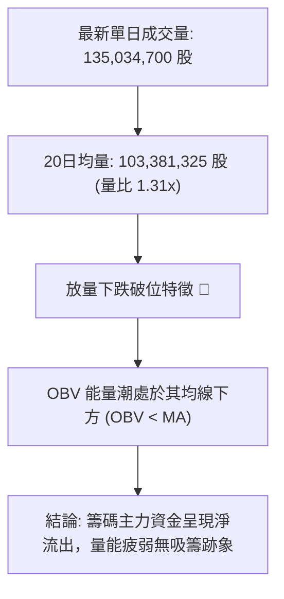

- **量比檢視**：2026-11-04 成交量達 1.35 億股，相對 20 日均量放大至 **1.31 倍**。該放量伴隨長下影探底收盤，顯示在 $133 - $135 區間出現初步換手，但因為全日依然收跌，未能轉化為多頭進攻量。
- **OBV 趨勢**：OBV 指標持續位於自身移動平均線之下，且創出本月新低，顯示場內資金仍在逢高撤離，量價結構存在弱勢背離（價格尚未破新低，但 OBV 先行轉弱）。

---

## 6. 動能與波動率

### ⚡ 動能評估四象限

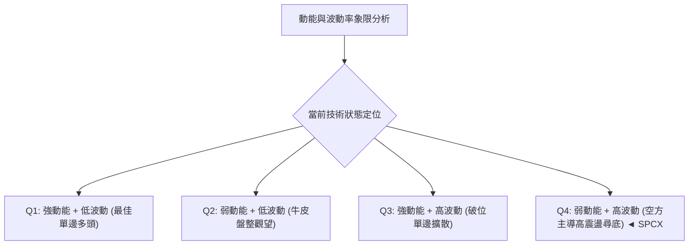

#### 動能四象限特徵定位表

| 象限標籤 | 動能狀態 | 波動率狀態 | SPCX 當前符合度 | 深度環境剖析 |
|:---:|:---:|:---:|:---:|:---|
| **第一象限 (Q1)** | 強動能 | 低波動 | ✕ | 典型多頭主升段，SPCX 目前完全不符合 |
| **第二象限 (Q2)** | 弱動能 | 低波動 | ✕ | 窄幅收斂三角形末端，目前波動率過大不符合 |
| **第三象限 (Q3)** | 強動能 | 高波動 | ✕ | 趨勢行情爆發期（需 ADX > 25），目前 ADX=18.55 |
| **第四象限 (Q4)** | **弱動能 (偏空)** | **高波動** | **✓ (極度吻合)** | **ATR 佔比高達 5.50%，價格劇烈震盪但趨勢方向不明顯，屬於高難度的「空頭震盪洗盤」象限** |

---

### 📊 ATR 波動率分析與止損風控

- **ATR(14) 數值**：**$7.47**，佔當前股價之百分比高達 **5.50%**。
- **波動特性解讀**：每日平均真實波幅近 $7.50，意味著日內常態性波動即可涵蓋 5% 以上幅度。任何過於緊密的停損（如 1-2%）極易被隨機噪聲掃出場。
- **停損距離設定建議**：
  - **保守型擺動止損**：採用 2.0 倍 ATR = $7.47 × 2.0 = **$14.94**。
  - **進取型波段止損**：採用 1.5 倍 ATR = $7.47 × 1.5 = **$11.21**。
  - **緊密日內止損**：採用 1.0 倍 ATR = $7.47 × 1.0 = **$7.47**。

---

### 📐 Beta 與市場相關性

- **Beta 數值**：**N/A（數據未提供）**。
- **市場相關性替代評估**：
  - 根據近期宏觀新聞背景（「TSLA 股價夜盤走低」、「五角大樓 AI 法規爭議」、「火箭實驗室競合」），SPCX 股價受制於自身基本面資本開支過大（TTM 資本支出達 $55.92B，自由現金流負值 -$40.16B）與航太國防板塊消息面共振，近期走勢與標普 500 大盤出現一定程度脫鉤，特異性風險（Idiosyncratic Risk）高企。

---

## 7. 多時框架總結

### 📋 時框架評分表

| 時框架 | 趨勢方向 | 核心動能指標狀態 | 均線系統排列 | 圖表形態特徵 | 綜合評分 | 操作指導建議 |
|:---|:---:|:---|:---|:---|:---:|:---|
| **長期 (月線)** | 🔴 偏空回調 | RSI 40+ 下滑，歷史高檔回吐 | 價格回落至年內 25.7% 分位 | 52週頂部大回撤 | 35/100 | 長期投資者暫停加碼，等待估值出清 |
| **中期 (週線)** | 🔴 明確看空 | 週 MACD 負柱擴散 (-1.743) | 跌破多條週均線，頂部下移 | 雙重頂破位，頸線失守 | 30/100 | 波段交易者以逢高反彈放空為主 |
| **短期 (日線)** | 🟡 超賣盤整 | Stoch %K=8.41 極度超賣 | 全面空頭排列，受制 MA5/10 | 貼布林下軌 (%B=0.13) | 48/100 | 短線禁止盲目追空，提防技術性抽頭 |

---

### 🔲 綜合訊號矩陣

```
SPCX 多時框訊號一致性矩陣
════════════════════════════════════════════════════════════════════
維度          短期 (日線)      中期 (週線)      長期 (月線)      共振狀態
────────────────────────────────────────────────────────────────────
趨勢方向      🟡 區間震盪      🔴 波段下行      🔴 深度回撤      🔴 偏空壓制
動能強弱      🟢 超賣醞釀反抽  🔴 柱體負擴散    🟡 中性偏弱      🟡 矛盾拉鋸
量價結構      🔴 放量破位下沉  🔴 爆量衝高回落  🔴 OBV < MA      🔴 資金撤離
關鍵支撐      🟢 逼近 S1/下軌  🔴 頸線已跌破    🟢 距 S2 有距離  🟡 考驗強撐
════════════════════════════════════════════════════════════════════
矩陣結論：短線「超賣技術反彈訊號」與中長期「空頭波段趨勢」形成衝突。
```

---

### ⚖️ 多時框收斂結論（依規則 14）

1. **行情性質判定**：SPCX 當前 **ADX(14) = 18.55 < 25**，依嚴格規則判定為 **「盤整行情（Range-Bound）」**。
2. **時框優先級權衡**：在盤整行情中，市場缺乏單邊推動力，**以日線布林通道上下軌（$131.56 至 $165.46）為主要交易區間**。
3. **方向性收斂唯一結論**：**【偏空震盪，反彈高空為主】**。
   - 儘管短線 Stoch 指標進入超賣，但因週線與日線均線空頭排列（MA20 $148.51 與 MA50 $149.64 共振壓頂），不宜將任何反抽視為反轉。
   - **收斂路徑**：短線價格在 S1 ($130.39) 至布林下軌 ($131.56) 獲得支撐後將展開超賣回抽，回抽觸及 MA20/布林中軌阻力區 ($148.51 - $149.80) 時，將遭遇中期空頭的再次狙擊。第 8 章交易策略將完全以此邏輯展開。

---

## 8. 交易策略建議

### 🗺️ 策略決策流程圖

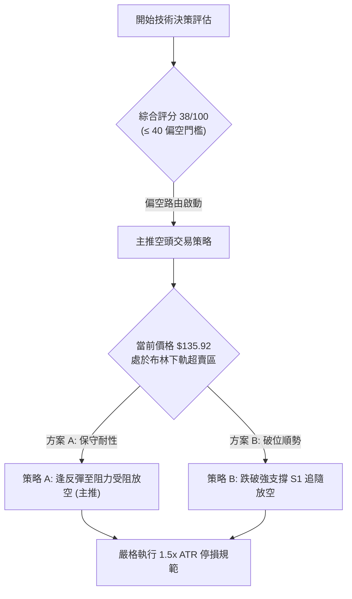

---

### 🧭 策略路由（依評分卡分流，嚴格執行規則）

> **當前主策略方向 = 【空頭交易策略（主推）】（依技術評分卡綜合評分 38/100 定調）**

因綜合評分 ≤ 40，技術架構完全處於空方主控與均線下壓格局中，本報告**主推空頭波段策略**。多頭操作不給予完整策略推薦，僅列於「反向風險觸發點」作為對沖與平倉提醒，杜絕兩頭下注。

---

### 🎯 價格情境階梯（Price Scenarios）

價位數值完全引用第 4 章及關鍵價位區塊已計算之數值：

| 觸發條件 | 下一目標 | 後續延伸 | 情境技術含義與市場行為解讀 |
|:---|:---:|:---:|:---|
| **強勢突破 R1 ($149.80)** | R2 ($155.00) | R3 ($158.13) | 短線扭轉日線跌勢，站上 MA20/MA50，空頭結構暫告瓦解，進入寬幅震盪 |
| **受阻於 R1 ($149.80)** | 現價 ($135.92) | S1 ($130.39) | 反彈遭遇均線蓋頭壓制，空方二度進場，延續破位後的下跌中繼走勢 |
| **實質跌破 S1 ($130.39)** | S2 ($104.83) | 數據未定義 | 宣告 78.6% 斐波那契失守，M頭形態對稱目標完全展開，直奔 52 週最低點 |

---

### 📊 情境機率分佈

| 運行情境 | 發生機率 | 主要技術與量化指標依據 |
|:---|:---:|:---|
| **情境一：反彈受阻後回落下行** | **55%** | **主力依據**：均線全面空頭向下發散，MACD 負向柱狀圖持續擴大，OBV 處於均線下方，中長期籌碼嚴重套牢，反彈將引發解套賣壓。 |
| **情境二：S1 至中軌區間震盪** | **30%** | **主力依據**：ADX(14) 僅 18.55 (<25)，顯示空方尚不具備連續穿透崩跌動能，Stoch 超賣將牽制下行速度，形成箱體拉鋸。 |
| **情境三：直接放量破位暴跌** | **15%** | **主力依據**：除非突發基本面重大利空直接擊穿 S1 ($130.39)，否則在日線 %B=0.13 下，直接連環下殺難度較大。 |

---

### 🟢 主策略詳情（空頭主推）

以下所有進場、止損、目標價位均嚴格引用關鍵價位區塊與布林通道計算數值，風險報酬比公式嚴格依據規則 17 執行計算：
$$\text{風險報酬比} = \frac{\text{進場價} - \text{目標價 T1}}{\text{止損價} - \text{進場價}}$$

| 策略要素 | 策略 A（反彈至阻力受阻放空 — 首選主推） | 策略 B（破位 S1 順勢加碼放空 — 次選） |
|:---|:---|:---|
| **策略類型** | 逢高逆勢反彈放空（符合順中趨勢逆短動能） | 突破破位順勢跟進放空 |
| **進場條件** | 股價反彈測試布林中軌/MA20，出現長上影或日K收黑受阻確認 | 日K實體收盤價實質跌破關鍵支撐 S1 ($130.39) |
| **進場價格** | **$148.51**（BB中軌 / MA20 精確點位） | **$130.39**（S1 支撐破位點） |
| **目標價 T1** | **$135.92**（回測當前收盤價位置） | **$104.83**（終極支撐 S2 / 52W Low） |
| **目標價 T2** | **$130.39**（波段關鍵支撐 S1） | **$115.14**（由雙頂形態高度推算之對稱目標） |
| **止損價格** | **$155.00**（阻力 R2，突破整數關卡認賠止損） | **$135.92**（現價，假跌破重返區間立即停損） |
| **風險報酬比** | **1 : 1.94（以 T1 計）**<br/>計算式：($148.51 − $135.92) ÷ ($155.00 − $148.51) = $12.59 ÷ $6.49 = 1.94 | **1 : 4.62（以 T1 計）**<br/>計算式：($130.39 − $104.83) ÷ ($135.92 − $130.39) = $25.56 ÷ $5.53 = 4.62 |
| **預估勝率** | **65%** | **45%** |
| **建議倉位** | **總資金之 10% - 15%** | **總資金之 5% - 8%** |

> **策略 A 附加說明（以 T2 計）**：若持倉下看 T2 ($130.39)，其風險報酬比為 ($148.51 − $130.39) ÷ ($155.00 − $148.51) = $18.12 ÷ $6.49 = **1 : 2.79（以 T2 計）**。

---

### 🔴 反向風險觸發點（對沖與風控提示）

若市場出現以下訊號，代表空頭結構遭到多方實質破壞，應立即平倉空單或反手避險：
1. **價位警訊**：日 K 收盤價強勢**站穩 R1 ($149.80) 之上**，並帶動 MA5 向上金叉 MA20。
2. **量能指標異動**：OBV 指標向上突破其均線，且單日成交量突破 1.5 億股並收出大陽線。
3. **動能修復**：日線 RSI(14) 強勢突破 55 中性分水嶺，MACD 柱狀圖在零軸下方完成「底背離金叉」。

---

### ⭐ 整體訊號強度評星

```
╔══════════════════════════════════════════════════════════════════╗
║ 做多訊號強度：★★☆☆☆  (2.0/5星 — 短線超賣但趨勢反壓強烈)        ║
║ 做空訊號強度：★★★★☆  (4.0/5星 — 均線空頭排列，順應中長週期)   ║
║ 整體技術可信度：★★★★☆  (4.0/5星 — 關鍵點位與形態高度吻合)       ║
╚══════════════════════════════════════════════════════════════════╝
```

---

## 9. 風險提示與監控

### ✅ 關鍵監控指標 Checklist

```
╔══════════════════════════════════════════════════════════════════╗
║               技術分析風控監控清單 (Checklist)                   ║
╠══════════════════════════════════════════════════════════════════╣
║ [ ] 監控 $130.39 (S1) 能否守住：若收盤失守，將觸發停損連鎖賣盤  ║
║ [ ] 監控 MA20 ($148.51) 反壓動態：測試此處是否出現衰竭 K 棒     ║
║ [ ] 監控 ADX 數值走向：若突破 25，需警惕單邊趨勢性行情加速風險  ║
║ [ ] 監控 成交量異常放大：若下跌日量能 > 1.5 億股，確認主力出貨   ║
║ [ ] 監控 RSI 背離狀態：關注下探 S1 時是否在 30 附近出現底背離   ║
║ [ ] 監控 布林通道開口：通道若急遽擴張，嚴格依 ATR 擴大停損間距 ║
╚══════════════════════════════════════════════════════════════════╝
```

---

### ⚠️ 風險場景分析

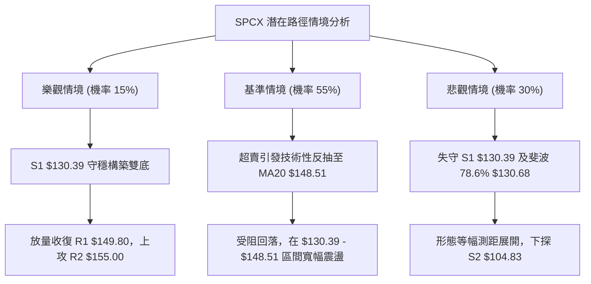

---

### 🛡️ 風險管理重要提醒

1. **單筆交易風險敞口（Risk at Risk）嚴格限制**：
   - 任何單一進場策略（如策略 A 或策略 B），最大承擔虧損不得超過總投資組合淨值的 **1.5%**。
   - 計算公式：$$\text{最大允許開倉股數} = \frac{\text{總投資本金} \times 1.5\%}{\text{進場價} - \text{止損價}}$$
   - 以策略 A 為例，每股承擔風險為 $155.00 − $148.51 = $6.49。若帳戶資金為 $100,000 美元，最大虧損額為 $1,500 美元，則最大建立倉位不得超過 231 股。

2. **高 ATR 波動下的心態管理**：
   - 當前 ATR 高達 $7.47，盤中極易出現 $3 - $5 的無實質意義隨機震盪。切忌因日內浮動損益而隨意搬移預先設定好的停損點位。
   - 堅決執行「點位不到不進場、收盤破位才離場」之紀律，避免被極端長影線洗盤出場。

---

## 📋 報告總結

```
╔══════════════════════════════════════════════════════════════════╗
║                   SPCX 技術分析報告總結                          ║
╠══════════════════════════════════════════════════════════════════╣
║ 報告日期：2026-11-05                                            ║
║ 當前價格：$135.92                                                ║
║ 綜合技術評分：38 / 100                                          ║
║ 分析評級：🔴 偏空盤整震盪 (逢反彈高空)                          ║
╠══════════════════════════════════════════════════════════════════╣
║ 關鍵結論：                                                       ║
║ ├─ 長期趨勢：🔴 52週高位回撤，現處於歷史區間 25.7% 分位         ║
║ ├─ 中期趨勢：🔴 雙重頂破位，MACD 負向發散，空方主控             ║
║ ├─ 短期趨勢：🟡 ADX 18.55 盤整，Stoch 與布林下軌超賣醞釀反抽    ║
║ ├─ 關鍵支撐：S1 $130.39 / 斐波 78.6% $130.68 (極限撐 S2 $104.83) ║
║ ├─ 關鍵阻力：R1 $149.80 / MA20 $148.51 (強阻力 R2 $155.00)     ║
║ └─ 華爾街分析師共識：Buy (目標均價 $257.11，極端值 $70 - $800) ║
╠══════════════════════════════════════════════════════════════════╣
║ 最優策略組合：                                                   ║
║ 1. 🥇 最佳機會：策略 A (反彈至 MA20/中軌 $148.51 受阻做空，     ║
║                 停損 $155.00，目標 $135.92，風報比 1:1.94)      ║
║ 2. 🥈 次選機會：策略 B (跌破 S1 $130.39 順勢空，下看 S2 $104.83) ║
║ 3. 🥉 保守選擇：場外空倉觀望，等待日線完成底部結構確認           ║
╚══════════════════════════════════════════════════════════════════╝
```

---

> ⚠️ **免責聲明**：本報告由量化技術分析系統自動生成，所有數據、圖表及衍生指標均基於歷史 OHLCV 價格序列之幾何模型推算。本報告**僅供研究、學術討論與交易策略模型參考**，**絕不構成任何針對個人之買賣招攬或具體投資建議**。金融市場具有極高之資本虧損風險，投資人應自行評估自身風險承受能力，並自負盈虧責任。

---
*報告生成時間：2026-11-05 ｜ 數據來源：Yahoo Finance ｜ 分析框架：多時框技術分析體系*