# SPCX 技術分析報告

> **報告日期**：2026-11-06 ｜ **語言**：繁體中文 ｜ **數據來源**：Yahoo Finance ｜ **當前價格**：$123.62

---

## 目錄

| 章節 | 內容 |
|------|------|
| [1. 技術面概覽](#1-技術面概覽) | 訊號儀表板、核心指標、評分卡 |
| [2. 趨勢分析](#2-趨勢分析) | 多時框趨勢、長中短期走勢 |
| [3. 圖表形態分析](#3-圖表形態分析) | 形態識別、K線組合、目標價 |
| [4. 支撐與阻力](#4-支撐與阻力) | 關鍵價位、斐波那契回調 |
| [5. 技術指標深度解讀](#5-技術指標深度解讀) | MA/RSI/MACD/布林/成交量 |
| [6. 動能與波動率](#6-動能與波動率) | 動能評估、ATR、Beta |
| [7. 多時框架總結](#7-多時框架總結) | 時框架評分矩陣 |
| [8. 交易策略建議](#8-交易策略建議) | 多空策略、風險報酬比 |
| [9. 風險提示與監控](#9-風險提示與監控) | 監控指標、風險場景 |

---

## 1. 技術面概覽

### 🎯 技術訊號儀表板

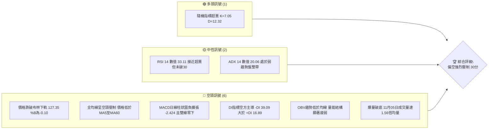

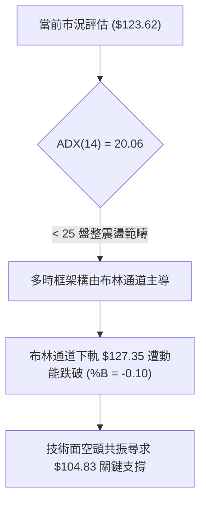

### 📊 核心指標速覽表

| 指標類別 | 指標名稱 | 當前數值 | 訊號 | 解讀 |
|----------|----------|----------|------|------|
| **價格** | 當前價格 | $123.62 | 🔴 | 創近3個月新低，逼近52W區間底部的15.6%分位 |
| **均線** | MA20 | $146.66 | 🔴 | 價格低於MA20達 -15.71%，短中期下行趨勢顯著 |
| **均線** | MA50 | $149.31 | 🔴 | 價格遠落後中期均線，MA50走平後開始反轉向下向下壓制 |
| **均線** | MA200 | N/A（數據未提供） | 🟡 | 上市歷史不足240筆交易日，長期均線無數據參考 |
| **動能** | RSI(14) | 33.11 | 🟡 | 位於弱勢中性偏超賣區間，無底背離確認，空方掌權 |
| **動能** | MACD(12,26,9) | -5.026 / -2.602 / -2.424 | 🔴 | MACD線持續低於信號線，負向柱狀體持續拉長，空方擴張 |
| **波動** | ATR(14) | $8.05 | 🔴 | 佔股價 6.51%，日線波幅極大，單日殺盤慣性強烈 |

### 🏆 技術評分卡

```
╔══════════════════════════════════════════════════════════════════╗
║                技術評分卡 — SPCX (2026-11-06)                   ║
╠══════════════════════════════════════════════════════════════════╣
║ 趨勢強度      ██████░░░░░░░░░░░░░░  30/100  🔴 空頭壓制強烈       ║
║ 動能指標      ██████░░░░░░░░░░░░░░  30/100  🔴 MACD負擴張       ║
║ 支撐穩定度    ████░░░░░░░░░░░░░░░░  20/100  🔴 跌破布林下軌       ║
║ 成交量配合    ████████░░░░░░░░░░░░  40/100  🔴 放量下殺量價背離   ║
║ 形態完整度    ██████░░░░░░░░░░░░░░  30/100  🔴 空方矩形破位       ║
║ 均線排列      ██████░░░░░░░░░░░░░░  30/100  🔴 均線呈現空頭發散   ║
╠══════════════════════════════════════════════════════════════════╣
║ 綜合評分      ██████░░░░░░░░░░░░░░  30/100  🔴 強烈偏空           ║
╚══════════════════════════════════════════════════════════════════╝
```

*註：綜合評分由六項子評分取算術平均：(30 + 30 + 20 + 40 + 30 + 30) ÷ 6 = 30/100。*

---

## 2. 趨勢分析

### 🌐 多時框趨勢分析

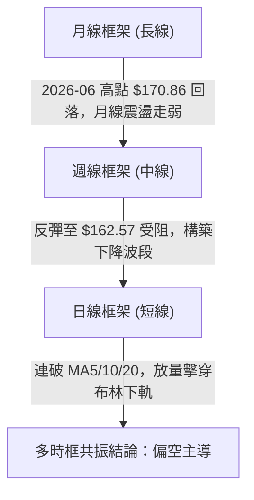

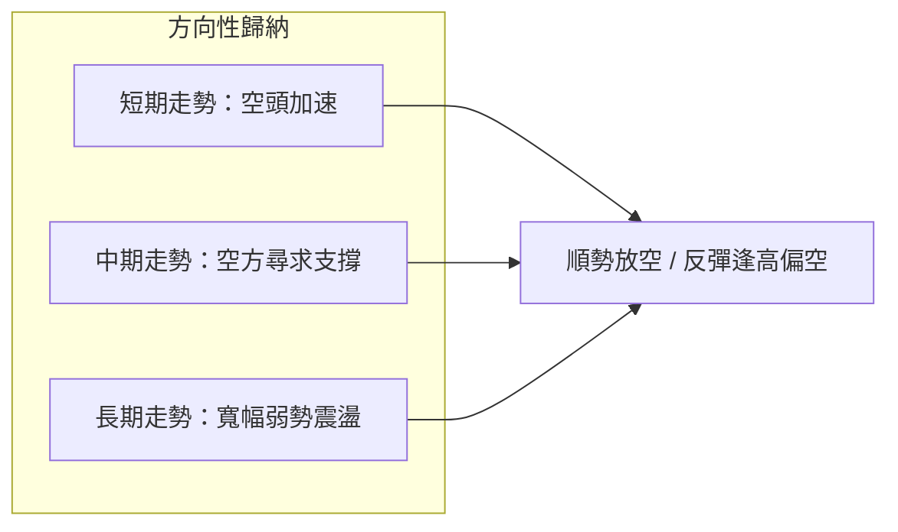

### 📈 長期趨勢 — 12個月走勢圖（Unicode）

依據 24 個月走勢資料，SPCX 歷史區間呈現自低檔拉升至 52W 高點 $225.64 後快速回落的走勢。近 6 個月歷史收盤價如下：

```
SPCX 月線走勢圖（2026-06 至 2026-11）
價格軸 ($)
$180 ┤
$170 ┤ ● (2026-06: $170.86)
$160 ┤
$150 ┤                               ● (2026-09: $150.86)
$140 ┤                   ● (2026-08: $143.69)
$130 ┤                                           ● (2026-10: $134.72)
$120 ┤                                                       ● (2026-11: $123.62)
$110 ┤
$100 ┤       ● (2026-07: $108.37 低點)
     └─────────────────────────────────────────────────────────────
          06        07        08        09        10        11
```

**走勢特徵分析表格**：

| 時間區間 | 起始價 | 終止價 | 區間漲跌幅 | 主要走勢特徵 |
|----------|--------|--------|------------|--------------|
| 2026-06 ~ 2026-07 | $170.86 | $108.37 | -36.57% | 單月重挫，摜破 52W 低點 $104.83 附近支撐區邊緣 |
| 2026-07 ~ 2026-09 | $108.37 | $150.86 | +39.21% | 超跌後報復性反彈，受阻於斐波那契 61.8% ($150.98) |
| 2026-09 ~ 2026-11 | $150.86 | $123.62 | -18.06% | 反彈動能衰竭，連續兩個月黑K下挫，空頭重新掌權 |

### 📊 中期趨勢（週線分析）

中期走勢圖示展現了在 2026-10-09 當週觸及最高 $176.42（收盤 $162.57）後形成雙頂結構並連續四周走跌的形態：

```
週線等級壓力與支撐空間示意
────────────────────────────────────────────────────────────
$176.42 ┬─ 波段高點受阻回落
        │
$158.13 ┼─ 阻力 R3 (密集套牢區間上沿)
$155.00 ┼─ 阻力 R2
$149.80 ┼─ 阻力 R1 (原反彈平台頸線位置)
        │
$123.62 ┼─ 當前價格 (擊穿斐波那契 78.6% $130.68)
        │
$104.83 ┴─ 支撐 S1 / 52週歷史最低點 (潛在中期煞車點)
────────────────────────────────────────────────────────────
```

### ⚡ 趨勢強度評估（ADX 解讀）

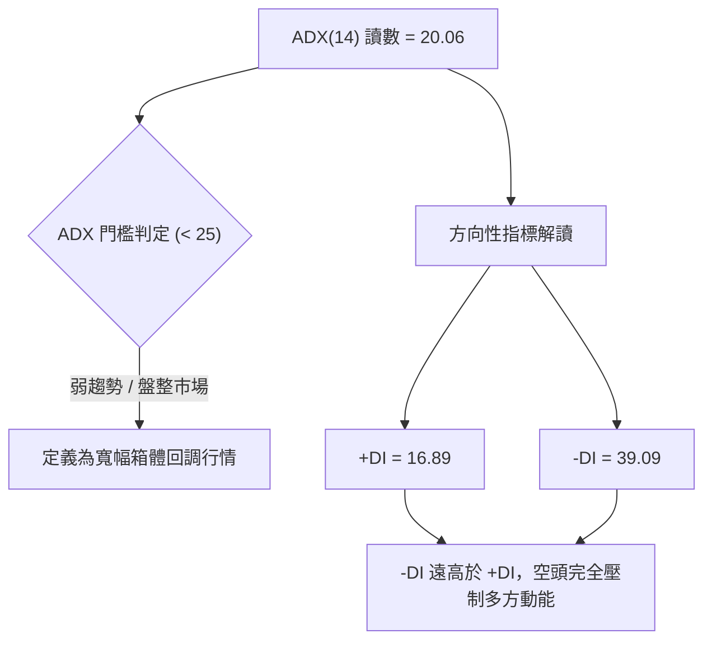

**ADX 狀態對照表**：

| 指標 | 數值 | 參考標準 | 狀態解讀 |
|------|------|----------|----------|
| **ADX(14)** | 20.06 | < 25 (弱趨勢/盤整); > 25 (強趨勢) | 當前雖處於弱趨勢讀數，但呈現由低檔拐頭向上狀態 |
| **+DI** | 16.89 | 數值越小多頭動能越弱 | 多方攻擊動能瀕臨枯竭 |
| **-DI** | 39.09 | 數值越大空頭動能越強 | 空方動能處於壓倒性主導地位，預告新一輪下行趨勢成型 |

---

## 3. 圖表形態分析

### 🔍 形態識別系統

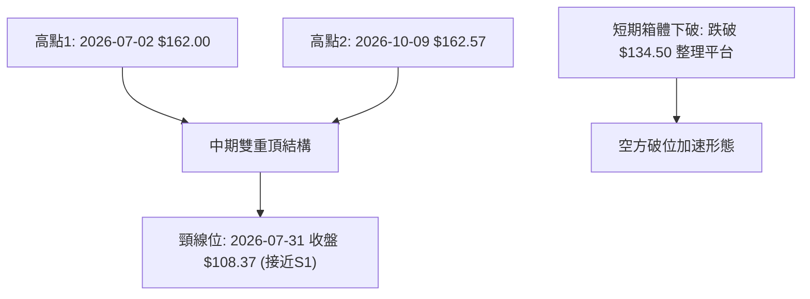

**形態識別與信心度評估表**：

| 形態 | 信心度 | 判斷依據（引用數據） | 完成度 | 目標價（附計算式） |
|------|--------|----------------------|--------|--------------------|
| **中期雙重頂 (Double Top)** | 70% | 頂部1為 2026-07-02 週收盤 $162.00，頂部2為 2026-10-09 週收盤 $162.57，兩次受阻於 $162 阻力帶 | 75% | 形態未完全跌破頸線 $108.37。若破頸線，目標價由幾何推算：$108.37 - ($162.57 - $108.37) = $54.17（數據中未偵測到此支撐，保守看 S1 $104.83） |
| **短期矩形平台向下破位** | 85% | 10-23 至 11-04 股價於 $133.14 至 $151.36 震盪，11-05 放量大陰線跌破下沿 $133.14 | 100% | 破位點 $133.14 - 形態高度 ($148.58 - $133.14 = $15.44) = $117.70 (短期推算目標) |
| **頭肩底形態** | 0% | 數據中未偵測到相應底背離或右肩幾何特徵，指標不足以支持此形態宣稱 | 0% | 訊號不足，僅做指標型解讀 |

### 🕯️ 重要K線形態分析

嚴格依據數據中「近10根日K」與「近8根週K」進行客觀解讀：

| 日期（日K/週K） | 開 | 高 | 低 | 收 | K線形態 | 解讀 | 訊號 |
|-----------------|---|---|---|---|---------|------|------|
| **2026-10-23 (日K)** | 147.93 | 149.75 | 144.09 | 147.49 | 紡錘線 (Spinning Top) | 實體極小，多空在 MA20 附近陷入膠著平衡 | 🟡 |
| **2026-10-27 (日K)** | 147.41 | 151.36 | 146.61 | 148.58 | 小陽十字星 | 上衝至波段高點 $151.36 後回落，反彈阻力強勁 | 🟡 |
| **2026-10-30 (日K)** | 137.85 | 140.20 | 134.50 | 134.72 | 大陰棒 (Bearish Marubozu) | 開高走低光腳收盤，放量摜破短期支撐均線群 | 🔴 |
| **2026-11-03 (日K)** | 137.63 | 142.74 | 137.50 | 141.31 | 中陽反彈線 | 弱勢反抽，未能回補上方跳空缺口，量能萎縮 | 🟡 |
| **2026-11-04 (日K)** | 133.24 | 140.50 | 133.14 | 135.92 | 長上影流星假突破 | 多頭盤中反攻遭沉重賣壓打回，確立空方掌控 | 🔴 |
| **2026-11-05 (日K)** | 131.34 | 131.87 | 120.39 | 123.62 | 破位長黑大陰線 | 爆出 169.2M 巨量摜破 $130，跌破布林下軌，空方宣洩 | 🔴 |
| **2026-10-09 (週K)** | 158.99 | 176.42 | 158.62 | 162.57 | 長上影假突破倒錘頭 | 衝擊波段高點 $176.42 後遭主力倒貨收長上影 | 🔴 |
| **2026-10-16 (週K)** | 164.66 | 167.07 | 140.66 | 146.03 | 長陰吞噬 (Bearish Engulf) | 週跌逾 16 元，一舉吃掉前兩週漲幅，中線轉空 | 🔴 |
| **2026-11-05 (週K)** | 137.01 | 142.74 | 120.39 | 123.62 | 實體大陰線跌破支撐 | 當週收盤跌穿前期低點，確立週線等級空頭主跌段 | 🔴 |

### 📉 ASCII 走勢形態示意圖

```
短期破位與中期頂部幾何圖示
$162.57 ┬───────────● 週頂部1 (2026-07) ──────● 週頂部2 (2026-10)
        │            \                         /
$148.58 ┼─ 盤整箱頂 ──\───────────────────────● (10-27 反抽高點)
        │               \                     │
$133.14 ┼─ 盤整箱底 ─────\────────────────────┴─┐ (11-04 跌破邊緣)
        │                 \                     ▼
$123.62 ┼─ 現價破位 ───────\────────────────────● (11-05 放量大陰線收盤)
        │                   \                   │
$104.83 ┴─ 52週歷史低點 ─────● (2026-07-31 低點) ─┴─ 潛在測試支撐 S1
```

### 🎯 形態目標價計算

依據幾何破位理論與既有數據的推導：
1. **短期箱體形態目標**：
   - 形態箱體頂部：$148.58（2026-10-27 收盤）
   - 形態箱體底部：$133.14（2026-11-04 低點）
   - 形態高度：$148.58 - $133.14 = $15.44
   - 破位等幅下測目標 = 破位點 $133.14 - $15.44 = **$117.70**
2. **中期支撐對齊**：
   - 若 $117.70 無法止住跌勢，價格將直接考驗關鍵價位區塊所確認的近一年波段低點聚類 **S1: $104.83**。

---

## 4. 支撐與阻力

### 🗺️ 關鍵價位分布圖（Unicode）

```
SPCX 價位結構分布圖
══════════════════════════════════════════════════════════════════
$158.13 ║████████████████████████║ 強阻力 R3 (近一年波段高點聚類)
$155.00 ║████████████████████    ║ 阻力 R2 (密集整理籌碼區)
$149.80 ║████████████████████████║ 關鍵阻力 R1 (Fib 61.8% / MA50 匯聚)
$130.68 ║▓▓▓▓▓▓▓▓▓▓▓▓▓▓▓▓        ║ 斐波那契 78.6% 回調破位轉阻力
$127.35 ║▓▓▓▓▓▓▓▓▓▓▓▓            ║ 布林通道下軌動態阻力
$123.62 ╠════════════════════════╣ ◄ 當前收盤價 ($123.62)
$104.83 ║████████████████████████║ 極限強支撐 S1 (52週最低點)
══════════════════════════════════════════════════════════════════
```

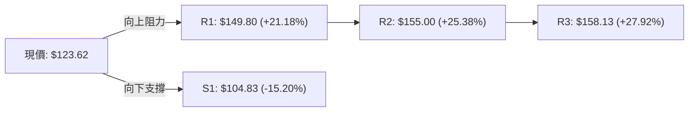

### 🚧 阻力位分析表

價位嚴格引用自關鍵價位與技術指標快照：

| 阻力級別 | 價位 | 形成原因 | 突破難度 | 重要性 |
|----------|------|----------|----------|--------|
| **極短阻力** | $127.35 | 日線布林通道下軌遭跌破後形成的反抽壓制點 | 中等 | 🟡 短線多空強弱分水嶺 |
| **波段阻力** | $130.68 | 斐波那契 78.6% 回調位，原重要支撐位破位轉阻力 | 較高 | 🟡 中短線反彈首要關卡 |
| **阻力 R1** | $149.80 | 近一年波段高點聚類，與 MA50 ($149.31) 形成共振密集壓制 | 極高 | 🔴 多空牛熊反轉決定性防線 |
| **阻力 R2** | $155.00 | 近一年波段高點聚類，整數籌碼套牢平台 | 極高 | 🔴 中期反轉確認位 |
| **阻力 R3** | $158.13 | 近一年波段高點聚類，週K級別頭部平台下沿 | 極限 | 🔴 戰略級強壓力 |

### 🛡️ 支撐位分析表

| 支撐級別 | 價位 | 形成原因 | 守住機率 | 重要性 |
|----------|------|----------|----------|--------|
| **支撐 S1** | $104.83 | 52週歷史低點、近一年波段低點聚類唯一核心支撐 | 55% | 🔴 空頭最終目標價與生命線 |
| **支撐 S2** | 數據中未偵測到 | 數據中未列出更低層級歷史支撐數值 | N/A | N/A |
| **支撐 S3** | 數據中未偵測到 | 數據中未列出更低層級歷史支撐數值 | N/A | N/A |

### 📐 斐波那契回調位分析

基準區間採用 52 週波段：高點 **$225.64** → 低點 **$104.83**（總落差 $120.81）：

| 回調比例 | 斐波那契價位 | 當前相對位置與市場解讀 |
|----------|--------------|------------------------|
| 0.0% | $225.64 | 52週歷史高點 |
| 23.6% | $197.13 | 長期牛市防線（已深幅跌破） |
| 38.2% | $179.49 | 2026-10-09 上衝最高點 $176.42 受阻於此區間下方 |
| 50.0% | $165.24 | 中期多空中軸線 |
| 61.8% | $150.98 | 黃金分割回調位，與當前 MA50 ($149.31) 和 R1 ($149.80) 高度疊合 |
| 78.6% | $130.68 | 深幅回調極限支撐，**現價 $123.62 已確認摜破此位** |
| 100.0% | $104.83 | 52週歷史低點，即將面臨考驗的終極底線 |

**解讀**：現價 $123.62 落在 **78.6% ($130.68)** 與 **100.0% ($104.83)** 之間。當股價有效跌破 78.6% 回調位時，在技術結構上代表自 $104.83 展開的所有反彈波段已被徹底瓦解，回測 100% 低點 $104.83 的機率急劇攀升。

---

## 5. 技術指標深度解讀

### 🎛️ 指標訊號總覽

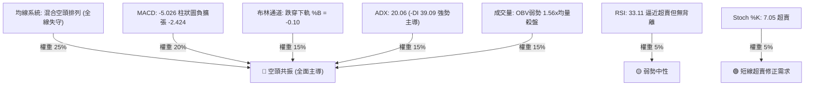

### 📈 移動平均線排列分析

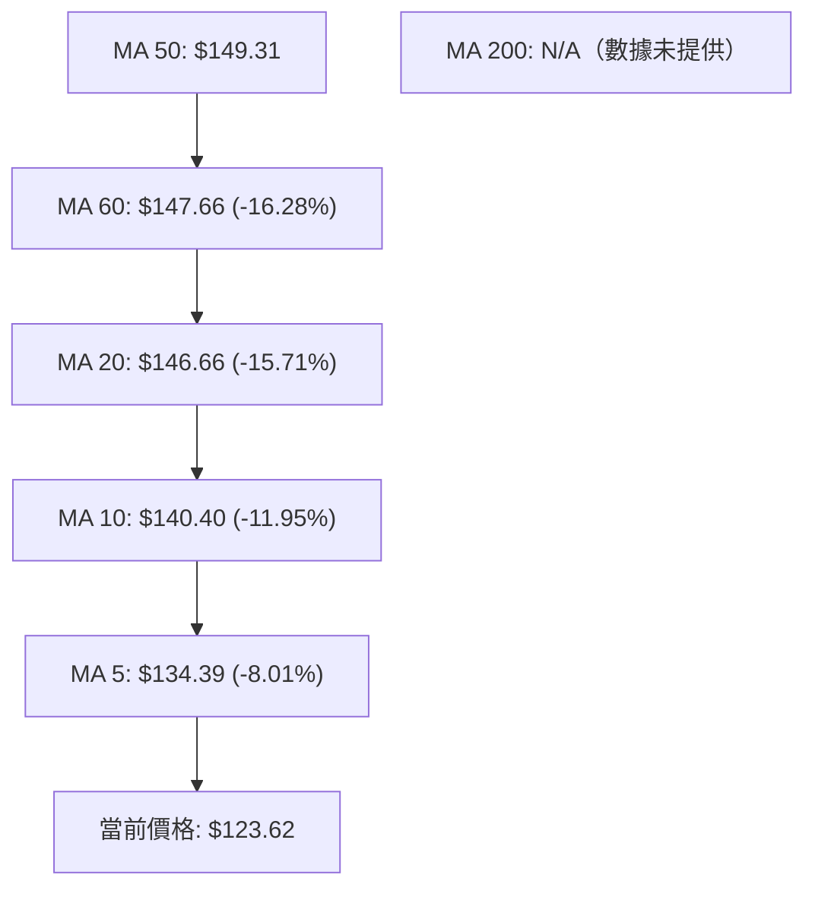

**移動平均線數值與乖離率統計表**：

| 均線天期 | 當前價位 | 乖離幅度 (對比現價) | 排列方向與軌跡特徵 |
|----------|----------|---------------------|--------------------|
| MA 5 | $134.39 | -8.01% | 陡峭向下俯衝，短期下壓動能極其強悍 |
| MA 10 | $140.40 | -11.95% | 空頭發散，形成第一道移動動態阻力帶 |
| MA 20 | $146.66 | -15.71% | 走平後下彎，布林中軌所在位置，中期走勢全面轉空 |
| MA 50 | $149.31 | -17.21% | 核心趨勢線被連續拉開負乖離，確立波段多空反轉 |
| MA 60 | $147.66 | -16.28% | 剛由高檔拐頭，與 MA50 形成雙重死叉壓力帶 |
| MA 200 | N/A（數據未提供） | N/A（數據未提供） | 上市數據不足200日，無法計算 |

### 📉 RSI(14) 分析

- **RSI 當前數值**：**33.11**（Wilder 計算法）
- **RSI 數值進度條**：
  ```
  0 [█████████████░░░░░░░░░░░░░░░░░░░░░░░░░] 100  (33.11 接近超賣)
  ```
- **區間評估**：RSI 處於 30 至 70 的中性區間偏下緣，雖然逼近 30 超賣線，但尚未正式落入超賣區（<30），顯示下行空方動能尚未完全宣洩完畢。
- **背離分析判斷**：
  - 根據近 20 根 K 棒的首尾對比，價格創出短期波段新低，RSI 同步滑落至 33.11。
  - **結論**：明確判定**無底背離**現象。在缺乏底背離技術支撐下，盲目抄底風險極大，符合跌勢未盡的特徵。

### 📊 MACD(12,26,9) 訊號解讀

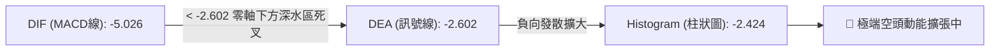

- **MACD 線**：-5.026
- **訊號線 (Signal)**：-2.602
- **MACD 柱狀體 (Histogram)**：-2.424
- **解讀**：雙線深陷零軸下方，且柱狀體為負值並持續向下擴張（自前期 -1.719 擴大至 -2.424），顯示中期空頭趨勢具備加速特徵，沒有任何收斂或底背離徵兆。

### 📦 布林通道分析

```
SPCX 日線布林通道結構
────────────────────────────────────────────────────────────
$165.96 ┬─ BB 上軌 (動態上限)
        │
        │
$146.66 ┼─ BB 中軌 (MA20 下彎壓制)
        │
        │
$127.35 ┼─ BB 下軌 (支撐遭跌破)
        │ 
$123.62 ┴─ 當前價格 (%B = -0.10，跌穿下軌軌道外發散)
────────────────────────────────────────────────────────────
```

- **BB %B 數值**：**-0.10**
- **解讀**：%B 小於 0 代表價格已實質貫穿布林帶下軌。通常情況下，收在下軌外側代表短期極端超賣，有沿下軌走低「布林通道向下開口」的強空頭慣性，或者隨時引發技術性乖離修復反抽（回測下軌 $127.35）。

### 💹 成交量分析（量價配合度）

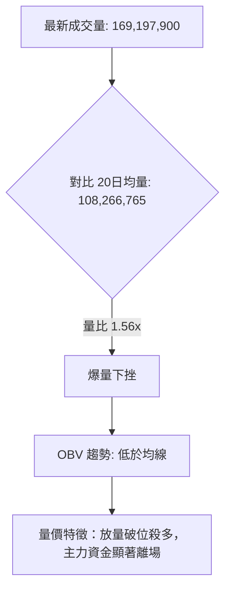

- **量價配合評估**：
  - 11-05 當日成交量達到 1.692 億股，相對 20 日均量放量 1.56 倍，但當日跌幅達大陰線實體，屬於典型的「放量破位殺盤」。
  - **OBV（能量潮）**：OBV < 移動平均線，呈現量能持續流出狀態，量能無法支持任何反轉結構。

---

## 6. 動能與波動率

### ⚡ 動能評估四象限

| 象限 | 動能維度 | 波動維度 | SPCX 當前狀態 | 策略應對評估 |
|------|----------|----------|---------------|--------------|
| **Q1** | 強多頭動能 | 低波動 | — | 最佳波段順勢作多 |
| **Q2** | 弱多頭動能 | 低波動 | — | 橫盤整理觀望 |
| **Q3** | 強空頭動能 | 高波動 | **✓ 當前所處位置** | **高風險破位階段，順應空勢逢高做空或嚴格觀望** |
| **Q4** | 衰竭動能 | 高波動 | — | 恐慌末端等待超賣左側反轉 |

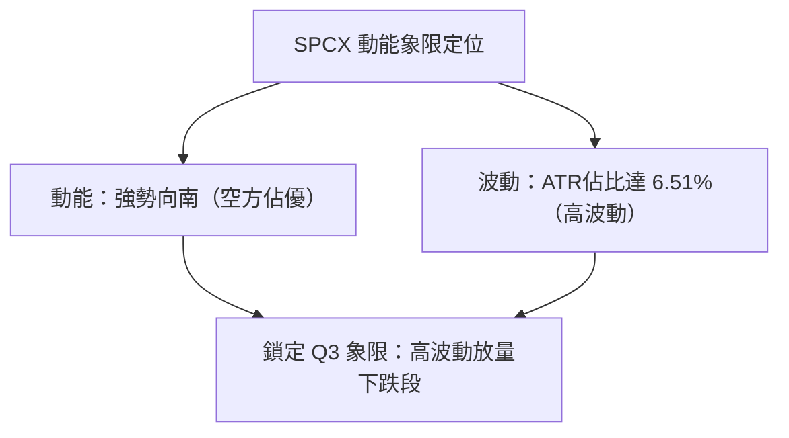

### 📊 ATR 波動率分析

- **ATR(14) 數值**：**$8.05**
- **ATR 佔比**：佔當前股價（$123.62）之 **6.51%**（依 Wilder 平滑法）。
- **風控止損應用解讀**：
  - SPCX 單日波動幅度極大，正常單日呼吸區間即達 $8.05。
  - **多頭操作（若進行超賣博弈）**：止損幅度若小於 1.5 倍 ATR（約 $12.08），極易被日常隨機波動洗出場。
  - **做空保護止損建議**：進場點上方保留 1.0 至 1.5 倍 ATR，以避免被短線軋空反抽波及。

### 📐 Beta 與市場相關性

- **Beta 數值**：**N/A（數據未提供）**
- **市場相關性分析**：
  - 由於數據中明確標示 Beta 為 N/A，無法給出精確量化的大盤 Beta 係數。
  - 但從宏觀新聞背景與成交量爆發可觀察出，近期 Nasdaq 重挫 5.5% 伴隨科技股大幅下殺，SPCX 呈現與高估值科技族群的高度同步下行特性，且其單日波動（ATR 6.51%）展現出高於一般大盤指數的波動彈性。

---

## 7. 多時框架總結

### 📋 時框架評分表

| 時框架 | 趨勢方向 | 動能指標 | 均線排列 | 圖表形態 | 綜合評分 | 操作建議 |
|--------|----------|----------|----------|----------|----------|----------|
| **短期 (日線)** | 🔴 極度偏空 | RSI 33.11 / MACD負擴張 | 空頭排列 (跌破MA5-60) | 矩形下破，跌出布林外 | 25/100 | 嚴禁盲目抄底，逢反抽測試壓力做空 |
| **中期 (週線)** | 🔴 偏空 | 週MACD柱轉負 (-2.424) | MA20、MA50失守下彎 | 雙頂成型回測頸線中 | 30/100 | 下探 $104.83 關鍵歷史支撐 |
| **長期 (月線)** | 🟡 弱勢盤整 | 自高點下挫，月K連黑 | MA200 N/A（數據未提供） | 寬幅劇烈震盪箱體 | 35/100 | 長線資金靜待波段落底再行評估 |

### 🔲 綜合訊號矩陣

```
時框與指標共振矩陣
╔══════════════════╦══════════════╦══════════════╦══════════════╗
║ 評估維度         ║ 短期 (日線)  ║ 中期 (週線)  ║ 長期 (月線)  ║
╠══════════════════╬══════════════╬══════════════╬══════════════╣
║ 趨勢方向 (Trend) ║ 🔴 下行破位  ║ 🔴 雙頂成型  ║ 🟡 寬幅箱體  ║
║ 動能強度 (Moment)║ 🔴 空方加速  ║ 🔴 負向擴大  ║ 🔴 衰退下行  ║
║ 均線結構 (MA)    ║ 🔴 均線死叉  ║ 🔴 壓制失守  ║ 🟡 均線不全  ║
║ 量價配合 (Volume)║ 🔴 放量下殺  ║ 🔴 連週陰跌  ║ 🟡 量能萎縮  ║
║ 波動狀態 (Volat) ║ 🔴 ATR擴大   ║ 🔴 震盪加劇  ║ 🔴 波動加劇  ║
╚══════════════════╩══════════════╩══════════════╩══════════════╝
```

### ⚖️ 多時框收斂結論

依據多時框收斂規則嚴格檢驗：
1. **行情屬性判定**：當前 ADX(14) 讀數為 **20.06 (< 25)**，指標分類上處於**盤整震盪行情**範疇；但同時 -DI (39.09) 大幅碾壓 +DI (16.89)，且股價已實質跌穿日線布林通道下軌（$127.35，%B = -0.10）。
2. **時框優先權取捨**：依規則，盤整行情應以日線布林通道上下軌為主要交易邊界。然而當前價格並未在下軌獲得支撐，而是帶量「破軌下行」，這代表震盪區間遭到空方單向擊破。因此必須向中長期週線級別收斂——週線級別雙頂結構正主導中期價格尋求近一年波段低點聚類 **S1: $104.83**。
3. **收斂唯一方向**：**強烈偏空（主推順勢做空策略）**。此結論與第 1 章評分卡（30/100）、第 2 章趨勢分析及第 5 章技術指標全數保持一致。

---

## 8. 交易策略建議

### 🗺️ 策略決策流程圖

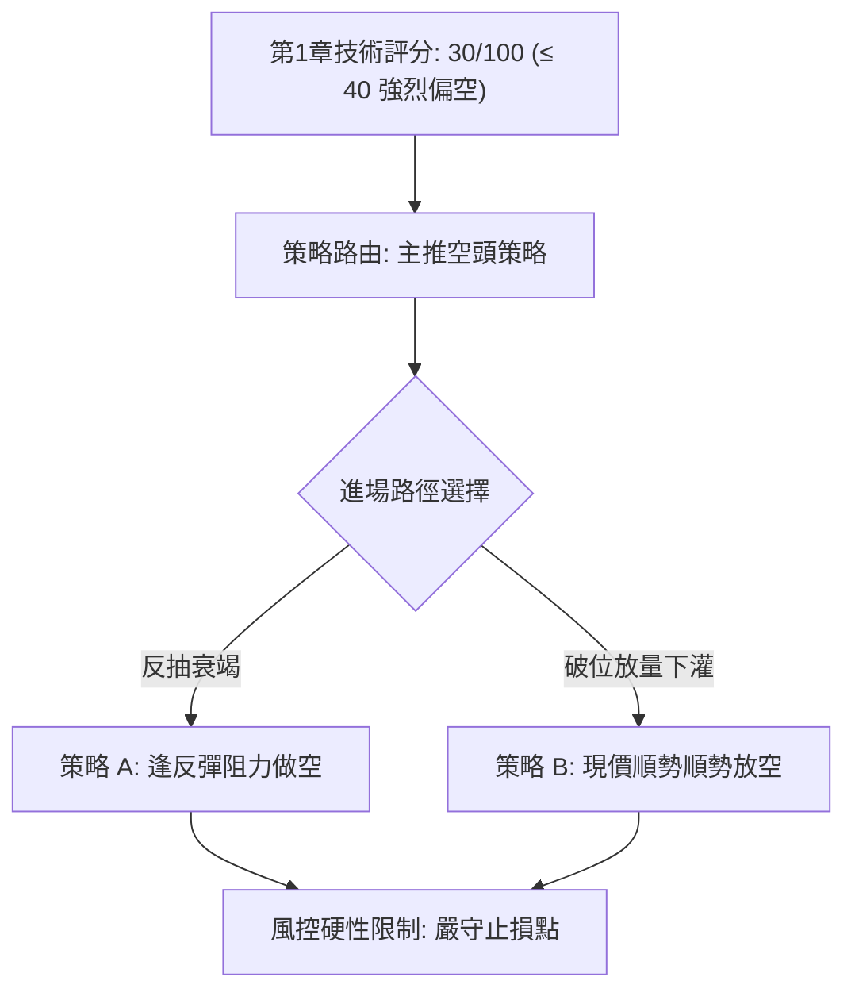

### 🧭 策略路由（依評分卡分流）

**當前主策略方向 = 空頭策略（主推空方做空，多頭僅列為反轉風險對沖提示；綜合評分 30/100）**

### 🎯 價格情境階梯（Price Scenarios）

以當前價格 **$123.62** 為基準，所有價位皆引用自第 4 章／關鍵價位區塊之實際數據：

| 觸發條件 | 下一目標 | 後續延伸 | 情境含義 |
|----------|----------|----------|----------|
| **反彈受阻於布林下軌 $127.35** | 測 11-05 低點 $120.39 | 直探支撐 S1 $104.83 | 弱勢反抽結束，空頭主跌段重啟 |
| **向上反抽站上 Fib 78.6% $130.68** | 考驗 MA20 $146.66 | 挑戰阻力 R1 $149.80 | 空頭乖離修復，轉入寬幅箱體修整 |
| **跌破今日低點 $120.39** | 考驗整數關卡 | 直接回測 S1 $104.83 | 空頭加速宣洩，尋求52週低點防線 |

### 📊 情境機率分佈

| 情境 | 機率 | 主要依據 |
|------|------|----------|
| **延續跌勢，再探支撐 S1** | **65%** | MACD 零下負擴張 (-2.424)、OBV 疲軟、-DI 高達 39.09 且放量殺跌 |
| **區間震盪，低檔打底修復** | **25%** | Stoch 超賣 (%K=7.05)、布林 %B 負值，短線具備技術性跌深收斂需求 |
| **強烈 V 轉反彈至 R1** | **10%** | 全均線呈空頭反壓，籌碼面出現破位殺多，無任何底背離支持反轉 |

### 🟢 主策略詳情（做空交易策略）

所有價位均來自關鍵價位區塊或明確幾何推算；進場若為區間以中點計算，風險報酬比定義：(進場價 − 目標價 T1) ÷ (止損價 − 進場價)。

| 策略要素 | 策略 A（反彈高空 — 穩健型） | 策略 B（現價追空 — 激進型） |
|----------|----------------------------------|----------------------------------|
| **操作方向** | 做空 (Short) | 做空 (Short) |
| **進場條件** | 反抽遇布林下軌及 Fib 78.6% 阻力不破時進場 | 當前價格直接進場，順應破位動能下挫 |
| **進場價格** | **$129.02** (以區間 $127.35–$130.68 中點計) | **$123.62** (即當前收盤價) |
| **目標價 T1** | **$104.83** (引用波段支撐 S1) | **$104.83** (引用波段支撐 S1) |
| **目標價 T2** | **$70.00** (引用分析師共識最低目標) | **$70.00** (引用分析師共識最低目標) |
| **止損價格** | **$137.01** (引用近週K開盤價與阻力位) | **$131.87** (引用 11-05 當日最高價) |
| **風險報酬比** | **1 : 3.03**（以 T1 計）<br>*(計算式: (129.02 - 104.83) ÷ (137.01 - 129.02) = 24.19 ÷ 7.99)* | **1 : 2.28**（以 T1 計）<br>*(計算式: (123.62 - 104.83) ÷ (131.87 - 123.62) = 18.79 ÷ 8.25)* |
| **成功機率** | 65% | 60% |
| **建議倉位** | 10%–15% 總資本 | 5%–8% 總資本 |

### 🔴 反向風險觸發點（對沖提示）

若出現以下情況，主空頭策略立即失效，應全數平倉空單並停止放空：
1. **關鍵點位突破**：日 K 實體收盤價重新站穩至 **Fib 78.6% ($130.68)** 之上，或帶量突破 **MA5 ($134.39)**。
2. **指標轉折警訊**：RSI(14) 重新反彈站回 40 以上，且日線 MACD 柱狀圖由負擴張轉為連續 2 日正向收斂。

### ⭐ 整體訊號強度評星

```
╔══════════════════════════════════════════════════════════════════╗
║ 做多訊號強度：★☆☆☆☆  (1/5星 - 僅Stoch超賣，無底背離)             ║
║ 做空訊號強度：★★★★☆  (4/5星 - 破位帶量，均線全面壓制)           ║
║ 整體可信度：  ★★★★☆  (4/5星 - 多時框共振空方走勢)               ║
╚══════════════════════════════════════════════════════════════════╝
```

---

## 9. 風險提示與監控

### ✅ 關鍵監控指標 Checklist

```
╔══════════════════════════════════════════════════════════════════╗
║                   盤面日常重點監控清單 (Checklist)               ║
╠══════════════════════════════════════════════════════════════════╣
║ [ ] 價格是否跌破 11-05 盤中最低點 $120.39                         ║
║ [ ] RSI(14) 是否跌破 30 正式進入極端超賣區                        ║
║ [ ] MACD 負柱狀體是否出現縮腳收斂 (當前 -2.424)                   ║
║ [ ] 單日成交量是否回落至 20日均量 (108.2M) 以下                   ║
║ [ ] 價格能否重新收復布林通道下軌 $127.35                          ║
║ [ ] 空單追蹤止損是否已嚴格設置於 $131.87 (11-05高點)              ║
╚══════════════════════════════════════════════════════════════════╝
```

### ⚠️ 風險場景分析

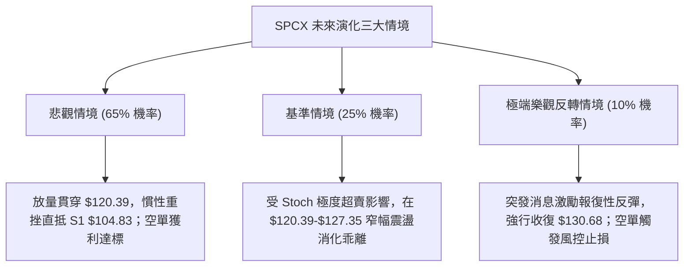

### 🛡️ 風險管理重要提醒

1. **ATR 波動性倉位調節**：SPCX 當前 ATR 高達 **$8.05 (6.51%)**，代表持有一手標的的隔夜風險極大。任何單一方向的交易倉位，建議**不超過總投資組合的 15%**，並應預留 1.5 倍 ATR 空間以因應跳空波動。
2. **基本面催化劑風險**：雖然技術面偏空，但新聞面顯示分析師給予買入評級（共識目標均價 $257.11），且 SpaceX 具備龐大產業話題性與 IPO/數據中心催化題材；若市場情緒瞬間轉向，極易引發軋空。因此做空交易**必須將止損點嚴格輸入系統，絕不可心存僥倖手動凹單**。

---

## 📋 報告總結

```
╔══════════════════════════════════════════════════════════════════╗
║                   SPCX 技術分析報告總結                          ║
╠══════════════════════════════════════════════════════════════════╣
║ 報告日期：2026-11-06                                             ║
║ 當前價格：$123.62                                                ║
║ 分析評級：🔴 強烈偏空 (綜合評分: 30 / 100)                       ║
║                                                                  ║
║ 關鍵結論：                                                       ║
║ ├─ 長期趨勢：🟡 寬幅弱勢震盪，月線動能走平向下                   ║
║ ├─ 中期趨勢：🔴 雙頂成型回測頸線，週線 MACD 轉負                 ║
║ ├─ 短期趨勢：🔴 放量大陰線跌破布林下軌與箱體，空頭加速           ║
║ ├─ 關鍵支撐：S1: $104.83 (52週低點)                              ║
║ ├─ 關鍵阻力：R1: $149.80 / 斐波 78.6%: $130.68                   ║
║ └─ 分析師目標：均價 $257.11 / 最低 $70.00                        ║
║                                                                  ║
║ 最優策略組合：                                                   ║
║ 1. 🥇 最佳機會：策略 A (反彈至 $129.02 逢高做空，風報比 1:3.03)  ║
║ 2. 🥈 次選機會：策略 B (現價 $123.62 順勢空，停損設 $131.87)    ║
║ 3. 🥉 保守選擇：空手觀望，靜待股價回測 $104.83 支撐確認後再布局  ║
╚══════════════════════════════════════════════════════════════════╝
```

---

> ⚠️ **免責聲明**：本報告為 AI 自動生成之技術分析，所有數據及估算均基於提供的歷史價格資訊。本報告**僅供研究與學術參考**，**不構成任何投資建議**。投資有風險，入市需謹慎。

---

*報告生成時間：2026-11-06 ｜ 數據來源：Yahoo Finance ｜ 分析框架：多時框技術分析*