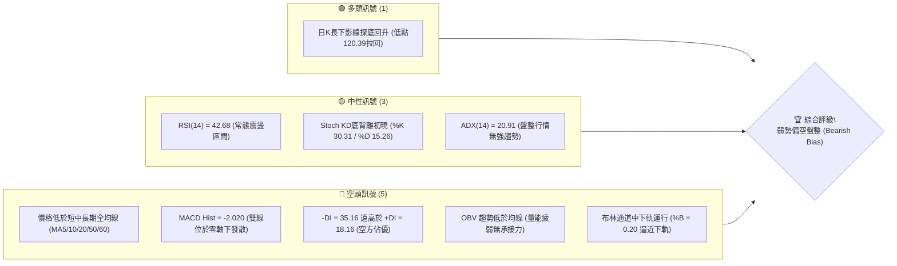
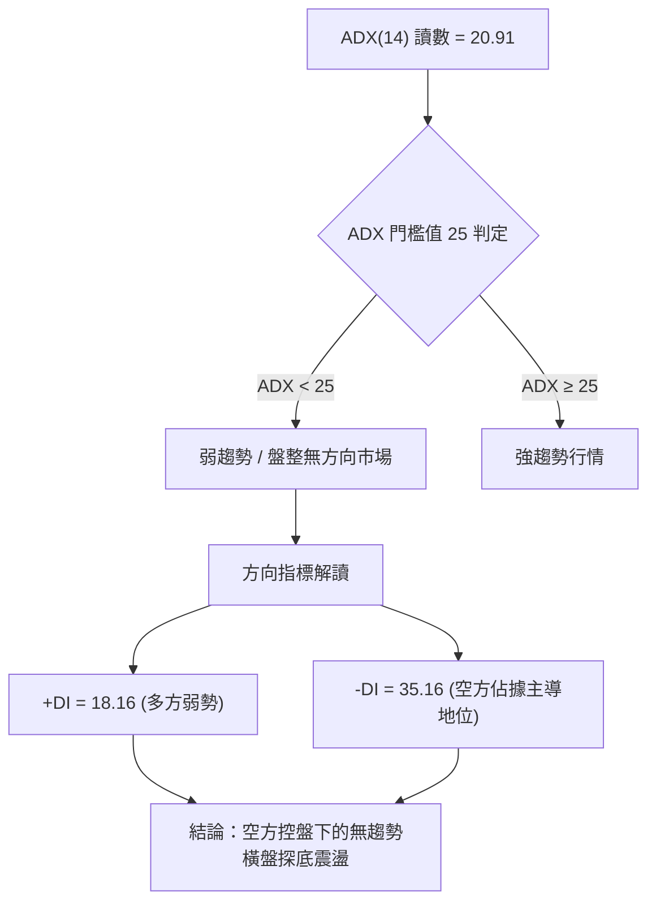
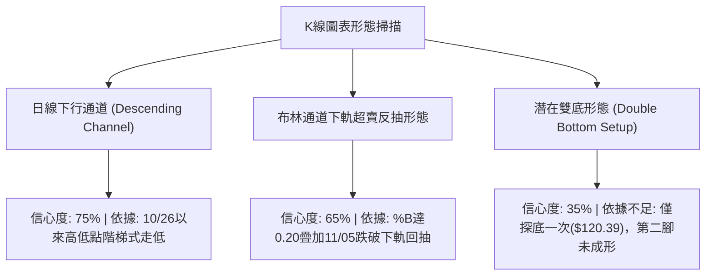
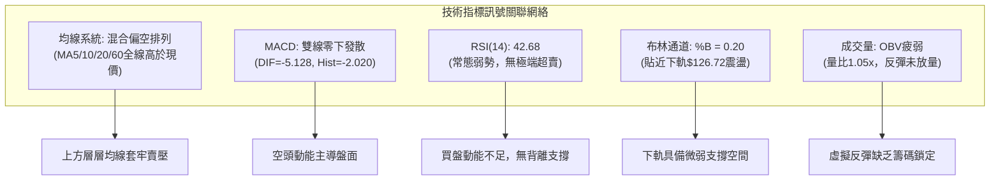
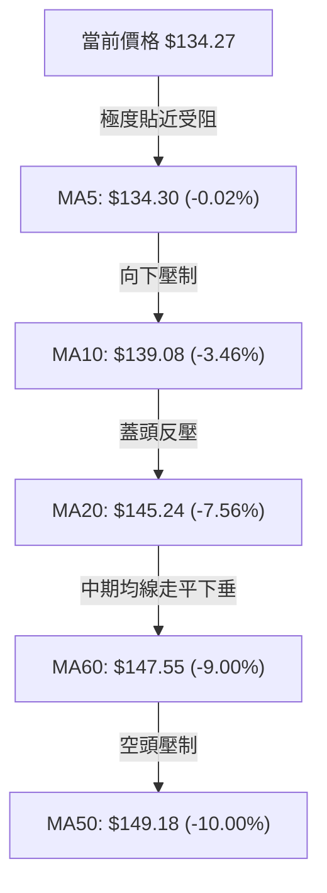
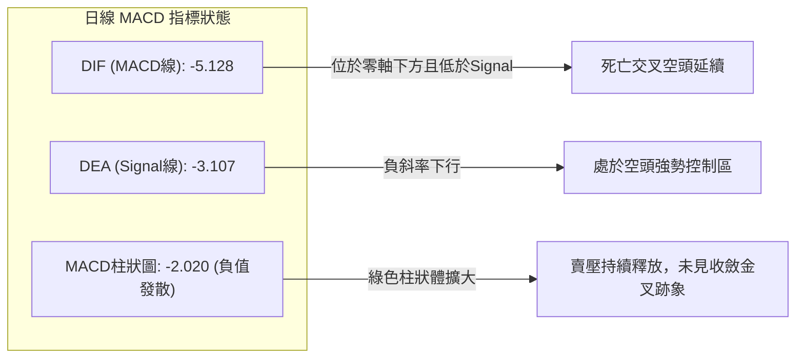
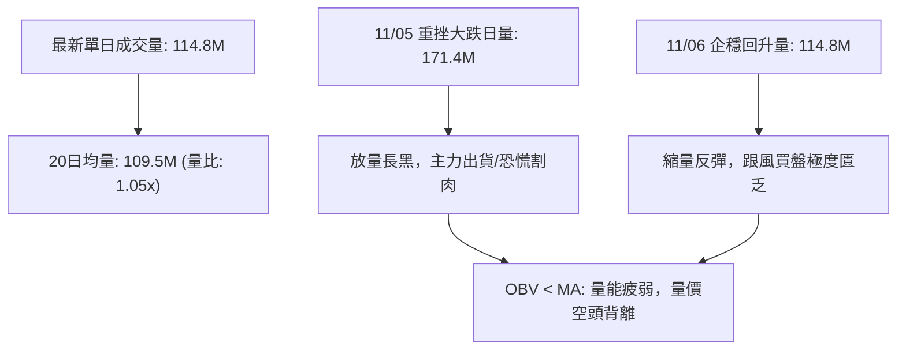
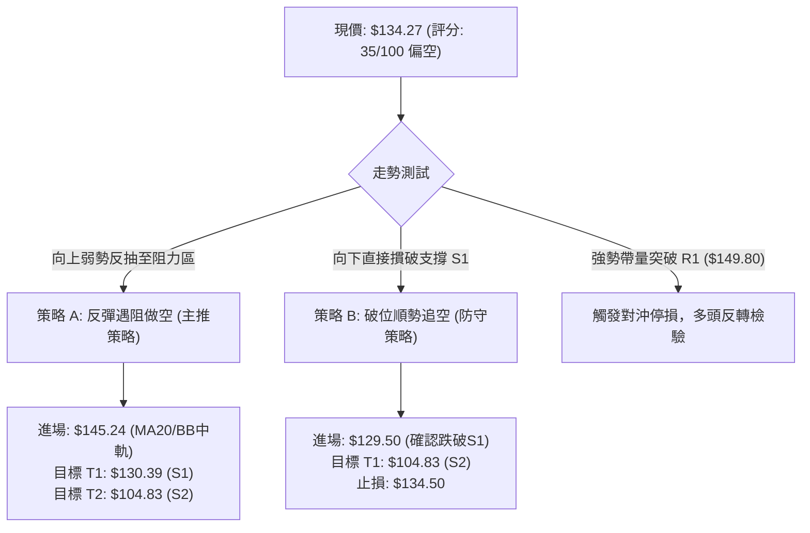
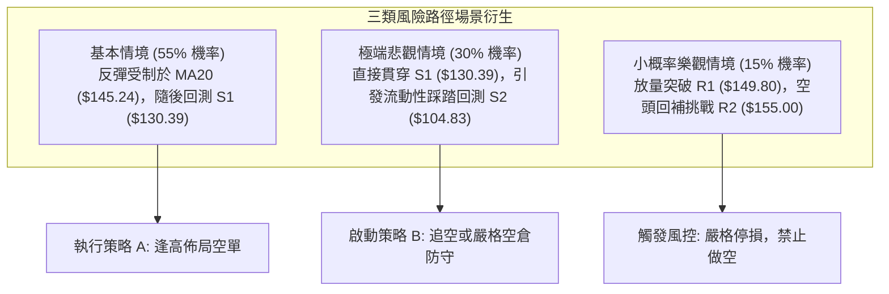

# SPCX 技術分析報告

> **報告日期**：2026-11-07 ｜ **語言**：繁體中文 ｜ **數據來源**：Yahoo Finance ｜ **當前價格**：$134.27

---

## 目錄

| 章節 | 內容 |
|------|------|
| [1. 技術面概覽](#1-技術面概覽) | 訊號儀表板、核心指標、評分卡 |
| [2. 趨勢分析](#2-趨勢分析) | 多時框趨勢、長中短期走勢 |
| [3. 圖表形態分析](#3-圖表形態分析) | 形態識別、K線組合、目標價 |
| [4. 支撐與阻力](#4-支撐與阻力) | 關鍵價位、斐波那契回調 |
| [5. 技術指標深度解讀](#5-技術指標深度解讀) | MA/RSI/MACD/布林/成交量 |
| [6. 動能與波動率](#6-動能與波動率) | 動能評估、ATR、Beta |
| [7. 多時框架總結](#7-多時框架總結) | 時框架評分矩陣 |
| [8. 交易策略建議](#8-交易策略建議) | 多空策略、風險報酬比 |
| [9. 風險提示與監控](#9-風險提示與監控) | 監控指標、風險場景 |

---

## 1. 技術面概覽

### 🎯 技術訊號儀表板



### 📊 核心指標速覽表

| 指標類別 | 指標名稱 | 當前數值 | 訊號 | 解讀 |
|----------|----------|----------|:----:|------|
| **價格** | 當前收盤價 | $134.27 | 🔴 | 位於52週區間24.4%低位階，受制於所有短期均線阻力 |
| **均線** | MA20 (月線) | $145.24 | 🔴 | 現價低於MA20達-7.56%，空頭排列顯著，為短線強壓 |
| **均線** | MA50 (季線) | $149.18 | 🔴 | 現價低於MA50達-10.00%，中期趨勢受壓抑，尚未扭轉 |
| **均線** | MA200 (年線)| N/A（數據未提供） | 🟡 | 上市數據不足200日，無法判定長期均線位置 |
| **動能** | RSI(14) | 42.68 | 🟡 | 位於弱勢中性區間(30–50)，未見超賣極端，下行動能尚未衰竭 |
| **動能** | MACD(12,26,9) | -5.128 / -3.107 / -2.020 | 🔴 | 雙線在零軸下方運行且柱狀圖維持負值(-2.020)，空頭掌控節奏 |
| **波動** | ATR(14) | $8.31 (6.19%) | 🔴 | 每日平均波動幅度高達6.19%，短線震盪劇烈，破位風險較高 |

### 🏆 技術評分卡

```
╔══════════════════════════════════════════════════════════════════╗
║                 技術評分卡 — SPCX (2026-11-07)                  ║
╠══════════════════════════════════════════════════════════════════╣
║ 趨勢強度 (ADX=20.91, -DI=35.16)   ██████░░░░░░░░░░░░░░  30/100 🔴 ║
║ 動能指標 (RSI=42.68, MACD=-2.02)  ████████░░░░░░░░░░░░  40/100 🔴 ║
║ 支撐穩定度 (S1=$130.39, 78.6%位)   ██████████░░░░░░░░░░  50/100 🟡 ║
║ 成交量配合 (OBV疲弱, 破位放量)     ██████░░░░░░░░░░░░░░  30/100 🔴 ║
║ 形態完整度 (下行通道延伸/無底形)   ████████░░░░░░░░░░░░  40/100 🔴 ║
║ 均線排列 (短中均線全線向下蓋頭)   ████░░░░░░░░░░░░░░░░  20/100 🔴 ║
╠══════════════════════════════════════════════════════════════════╣
║ 綜合評分 (六項算術平均)           ███████░░░░░░░░░░░░░  35/100 🔴 ║
║ 評估結論：空頭主導盤整 (偏空防禦，以反彈做空或區間下緣觀察為主) ║
╚══════════════════════════════════════════════════════════════════╝
```

*評分標準說明：(30 + 40 + 50 + 30 + 40 + 20) / 6 = 35.0 分，四捨五入為 35/100，評級為空頭主導（≤40）。*

---

## 2. 趨勢分析

### 🌐 多時框趨勢分析

```mermaid
graph TD
    A["月線層級 (Long-term)"] -->|"區間大幅震盪 / 寬幅拉回"| B["中性偏弱 (收盤落於低位區間)"]
    C["週線層級 (Medium-term)"] -->|"跌破MA20與BB中軌，MACD柱轉負"| D["中期回檔修正 (Bearish Correction)"]
    E["日線層級 (Short-term)"] -->|"空頭排列，受制於MA5("$134.30")"| F["短線尋求S1支撐弱勢盤整"]
    B --> G{"多時框收斂判定"}
    D --> G
    F --> G
    G -->|"ADX=20.91 < 25"| H["判定為盤整震盪市場，以日線區間邊界操作為主導"]
```

### 📈 長期趨勢 — 12個月走勢圖（Unicode）

依據 24 個月收盤走勢與 52 週最高價 ($225.64) 及最低價 ($104.83) 標定之月度收盤示意：

```
SPCX 月線走勢圖（過去12個月價格結構軌跡）
價格軸 ($)
$225.64 ┤                              ● (52W High)
$200.00 ┤                             ╱ ╲
$175.00 ┤       ●(2026-06: 170.86)   ╱   ╲
$150.00 ┤        ╲                  ●(09: 150.86)
$134.27 ┤─────────╲─────────────────●───────────● (現價: 134.27)
$120.00 ┤          ╲               ╱   (10: 134.72)
$108.37 ┤           ●(2026-07: 108.37)
$104.83 ┤           ● (52W Low)
        └──────────────────────────────────────────────
         2025-12  ...  06    07    08    09    10    11 (當前)
```

#### 長期走勢特徵分析表格

| 歷史週期 | 區間收盤價 | 漲跌幅度 | 走勢特徵與技術含義 |
|:---|:---:|:---:|:---|
| **2026-06 至 2026-07** | $170.86 ➔ $108.37 | -36.57% | 遭遇重挫放量拋售，直接回測年度底部 $104.83 附近並止跌。 |
| **2026-07 至 2026-09** | $108.37 ➔ $150.86 | +39.21% | 強勁技術性反彈，週成交量顯著放大，波段最高拉升至 $176.42。 |
| **2026-09 至 2026-10** | $150.86 ➔ $134.72 | -10.70% | 反彈動能耗盡，受阻於阻力帶，收盤回落至月線下方。 |
| **2026-10 至 2026-11** | $134.72 ➔ $134.27 | -0.33% | 日線持續探底至 $120.39 後收腳，目前在 $134 附近形成極弱勢停頓。 |

### 📊 中期趨勢（週線分析）

週線系統顯示，SPCX 在 2026-10-09 當週衝高至 $176.42 失敗後，連續 4 週收陰線或處於回檔整理。近 4 週收盤價由 $162.57 快速滑落至 $134.27，跌幅達 -17.41%。

```
週線阻力與支撐分佈示意圖：
$162.57 ── 強阻力（10/09收盤高點 / 波段破位起跌點）
   │
$149.80 ── 結構性阻力 R1（近一年波段高點聚類）
   │
$134.27 ── 【當前收盤價】
   │
$130.39 ── 近期波段支撐 S1（斐波那契 78.6% 回調位 $130.68 疊加區）
   │
$104.83 ── 52週歷史低點 S2（年度極限鐵底）
```

- **週線 MACD 柱狀圖變化**：由 2026-10-09 的 `+0.937` 迅速轉負至當週的 `-2.020`，空頭動能顯著發散。
- **週線 RSI 走勢**：由高點 75.5 持續下滑至 42.7，顯示中期多頭結構已被完全瓦解，目前處於弱勢整理期。

### ⚡ 趨勢強度評估（ADX 解讀）



#### ADX 指標強度對照表

| 指標名稱 | 實際數值 | 參考標準區間 | 當前技術含義判定 |
|:---|:---:|:---:|:---|
| **ADX(14)** | **20.91** | < 25 (弱趨勢/盤整)；> 25 (強趨勢) | 當前市場缺乏單邊趨勢慣性，多空陷入鋸齒狀震盪。 |
| **+DI (14)**| **18.16** | > 25 為多方強勢；< 20 為極度弱勢 | 多方買盤力道潰散，難以推動長紅突破。 |
| **-DI (14)**| **35.16** | > 25 為空方佔優；> 30 為空方掌控 | 賣壓依然籠罩盤面，但因 ADX 偏低，尚未演變為單邊崩跌。 |

---

## 3. 圖表形態分析

### 🔍 形態識別系統



#### 圖表形態信心度評估表

| 識別形態名稱 | 信心度 | 判斷依據（引用數據） | 當前完成度 | 目標價（附計算式） |
|:---|:---:|:---|:---:|:---|
| **短期下行通道** | **75%** | 10/27高點$151.36 ➔ 11/03高點$142.74，低點由$141.03 ➔ $120.39，階梯式走低。 | 85% | 由通道下軌破位反抽幅度推算：$134.27 + ($142.74 - $133.14) = **$143.87**（遇阻回落） |
| **布林下軌突破反抽** | **65%** | 11/05日K下探$120.39大幅擊穿BB下軌($126.72)，隨後次日拉回下軌之上，形成超跌抽腳。 | 70% | 反抽中軌 MA20 計算：**$145.24** |
| **潛在雙重底** | **35%** | 目前僅於11/05見到波段低點$120.39，距離前低S2($104.83)尚有距離，且未形成第二隻腳。 | 20% | 訊號不足，僅做指標型解讀（未確認頸線與形態高度）。 |

### 🕯️ 重要K線形態分析

嚴格依據數據中「近10根日K」與「近8根週K」的開高低收數據進行判定：

| 日期與週期 | 開盤價 | 最高價 | 最低價 | 收盤價 | K線形態名稱 | 技術解讀 | 訊號方向 |
|:---|:---:|:---:|:---:|:---:|:---|:---|:---:|
| **2026-10-30 (日K)** | 137.85 | 140.20 | 134.50 | 134.72 | **光腳大陰線** | 開高走低，實體跌破多條短期均線，帶量下殺(-122.6M量)。 | 🔴 強烈看空 |
| **2026-11-03 (日K)** | 137.63 | 142.74 | 137.50 | 141.31 | **縮量紅棒** | 反彈受制於5日均線，成交量僅73.2M萎縮，屬弱勢弱反彈。 | 🟡 中性偏弱 |
| **2026-11-05 (日K)** | 131.34 | 131.87 | 120.39 | 123.62 | **爆量長下影陰線** | 單日跌幅深重，破位下探$120.39，放量171.3M爆出恐慌拋售盤。 | 🔴 短線恐慌 |
| **2026-11-06 (日K)** | 130.94 | 135.32 | 128.57 | 134.27 | **低開中陽線** | 承接前日恐慌，早盤回踩$128.57不破前低，收盤拉升至全日高位。 | 🟢 短線止跌 |
| **2026-10-09 (週K)** | 158.99 | 176.42 | 158.62 | 162.57 | **長上影流星線** | 週線衝高至$176.42遇強阻力回落，留下近14美元上影線。 | 🔴 波段見頂 |
| **2026-11-06 (週K)** | 137.01 | 142.74 | 120.39 | 134.27 | **爆量探底錘頭線** | 測試$120.39後收回至$134.27，週成交量放大至585.8M，多空激烈交戰。 | 🟡 變盤訊號 |

### 📉 ASCII 走勢形態示意圖

近 10 個交易日走勢形態示意（由高位 $151.36 連續挫跌至 $120.39 爆量收腳）：

```
SPCX 日線短期下行與探底收腳形態示意圖
價格軸 ($)
$151.36 ┬─ [10/27 高點]
$148.58 ┤   ●
$145.23 ┤     ● [10/28 跌破MA20]
$141.31 ┤         ● [11/03 弱反彈受阻]
$134.72 ┤       ●     ● [10/30]
$134.27 ┤─────────────────────● [11/06 現價收盤，企圖築底]
$128.57 ┤                   ╱
$123.62 ┤                 ● [11/05 實體陰線]
$120.39 ┴────────────────●─── [11/05 恐慌低點，長下影線探底]
```

### 🎯 形態目標價計算

根據日線於 11/05 形成的「爆量長下影線破低反轉」結構：
- **形態底點 (Support Low)**：$120.39 (2026-11-05 最低價)
- **短線反彈壓制 (Neckline/Resistance)**：$142.74 (2026-11-03 波段反彈高點)
- **形態振幅高度 (Pattern Height)**：$142.74 - $120.39 = **$22.35**
- **短線反彈延伸目標 (推算)**：若能突破頸線 $142.74，等距目標為 $142.74 + $22.35 = **$165.09**（接近布林上軌與斐波那契50%位）。
- **當前受制目標**：在突破 $142.74 之前，價格首先受制於均線壓制位 **$145.24** (MA20) 與阻力位 **$149.80** (R1)。

---

## 4. 支撐與阻力

### 🗺️ 關鍵價位分布圖（Unicode）

```
╔══════════════════════════════════════════════════════════════════╗
║                    SPCX 關鍵價位結構分佈圖                       ║
╠══════════════════════════════════════════════════════════════════╣
║ $158.13 ║████████████████████████████████║ 強阻力 R3 (波段高點)  ║
║ $155.00 ║████████████████████████        ║ 阻力 R2 (整數關卡聚類)║
║ $150.98 ║██████████████████████████      ║ 斐波那契 61.8% 重合壓 ║
║ $149.80 ║████████████████████████████    ║ 關鍵阻力 R1 (MA50壓制)║
║ $145.24 ║████████████                    ║ 布林中軌 / MA20       ║
║ $134.27 ╠════════════════════════════════╣ ◄ 現價 (收盤價)       ║
║ $130.68 ║▓▓▓▓▓▓▓▓▓▓▓▓▓▓▓▓▓▓▓▓▓▓▓▓        ║ 斐波那契 78.6% 回調位 ║
║ $130.39 ║▓▓▓▓▓▓▓▓▓▓▓▓▓▓▓▓▓▓▓▓▓▓▓▓▓▓▓▓    ║ 近期關鍵支撐 S1       ║
║ $126.72 ║▓▓▓▓▓▓▓▓▓▓                      ║ 布林通道下軌          ║
║ $104.83 ║████████████████████████████████║ 歷史強支撐 S2 (52W底) ║
╚══════════════════════════════════════════════════════════════════╝
```

### 🚧 阻力位分析表

阻力位完全引用數據中「關鍵價位」區塊由波段高點聚類計算之數值：

| 阻力級別 | 準確價位 | 距現價幅動 | 形成原因與技術意涵 | 突破難度 | 重要性等級 |
|:---|:---:|:---:|:---|:---:|:---:|
| **R1** | **$149.80** | +11.57% | 近一年波段高點聚類位，且與 MA50 ($149.18) 高度重疊，為中期多空分水嶺。 | 極高 | ★★★★★ |
| **R2** | **$155.00** | +15.44% | 整數心理關卡，前期密集籌碼套牢區下沿。 | 高 | ★★★★☆ |
| **R3** | **$158.13** | +17.77% | 2026-09-25 週K高點與波段峰值聚類區，突破代表中期空頭趨勢徹底終結。 | 極高 | ★★★★☆ |

### 🛡️ 支撐位分析表

支撐位完全引用數據中「關鍵價位」區塊由波段低點聚類計算之數值：

| 支撐級別 | 準確價位 | 距現價幅動 | 形成原因與技術意涵 | 守住機率 | 重要性等級 |
|:---|:---:|:---:|:---|:---:|:---:|
| **S1** | **$130.39** | -2.89% | 近一年波段低點聚類，與斐波那契 78.6% 回調位 ($130.68) 共振，短線核心防線。 | 55% | ★★★★★ |
| **S2** | **$104.83** | -21.93% | 52週歷史極值低點 (52W Low)，為全年度最強結構支撐。 | 85% | ★★★★★ |
| **S3** | **數據中未偵測到** | N/A | 原數據僅計算至 S2 支撐層級。 | N/A | N/A |

### 📐 斐波那契回調位分析

依據 52 週波動區間（高點 **$225.64** ➔ 低點 **$104.83**，波段跨度 $120.81）精確計算：

| 斐波那契比例 | 關鍵價位 | 技術狀態解讀與現價關係 |
|:---|:---:|:---|
| **0.0% (52W High)** | **$225.64** | 全年牛市頂部，長期歷史阻力天花板。 |
| **23.6%** | **$197.13** | 極度強勢回調位，當前價格遠在其下。 |
| **38.2%** | **$179.49** | 強勢調整位，與 10/09 週高點 ($176.42) 形成高檔壓制區。 |
| **50.0%** | **$165.24** | 多空中樞平衡位，亦為中期走勢由空翻多的關鍵閥值。 |
| **61.8%** | **$150.98** | 黃金分割分割點，與 R1 ($149.80) 構成強力阻力共振帶。 |
| **78.6%** | **$130.68** | **【現價落點防線】現價 $134.27 位於 61.8% 與 78.6% 之間**。 |
| **100.0% (52W Low)**| **$104.83** | 全年回撤終極支撐，不容跌破的最後底線。 |

**深入解讀**：
現價 $134.27 跌破 61.8% ($150.98) 黃金分割防線後，已下探至 78.6% ($130.68) 的極限深度回調區。若 $130.68 疊加 S1 ($130.39) 宣告失守，價格將失去任何強支撐緩衝，直奔 100% 斐波那契位 $104.83。

---

## 5. 技術指標深度解讀

### 🎛️ 指標訊號總覽



### 📈 移動平均線排列分析



#### 均線架構解讀表

| 均線名稱 | 數值 | 偏離幅度 | 趨勢軌跡 (Sparkline 解讀) | 技術含義 |
|:---|:---:|:---:|:---|:---|
| **MA 5** | $134.30 | -0.02% | ▄▄▄▄▄▆▇████▇▇▆▅▄▄▄▄▄▄▄▄▃▃▂▂▂▁▁ | 短期扣抵高位，下穿現價，形成極短線第一道反壓。 |
| **MA 10** | $139.08 | -3.46% | ▄▅▅▄▅▅▆▇▇██████▇▆▆▅▅▄▄▄▄▃▃▃▂▁▁ | 斜率急遽向下，多方短線反彈的第一道停損賣壓聚集處。 |
| **MA 20** | $145.24 | -7.56% | ▃▃▄▄▄▅▆▆▇▇██████████████▇▅▄▃▂▁ | 月線已完全向下彎頭，且為布林中軌，中期轉空標準標誌。 |
| **MA 60** | $147.55 | -9.00% | ▁▁▁▁▁▁▁▂▂▂▃▃▄▄▄▅▅▆▆▇▇▇████████ | 季線位階走平下垂，中長線買進持有者已陷入全線套牢。 |
| **MA 50** | $149.18 | -10.00% | 走勢向下發散 | 與 MA60 形成死叉壓制帶，壓抑任何中期回升浪。 |
| **MA 200**| N/A | N/A | 數據未提供（歷史數據不足） | 無法判斷牛熊分水嶺。 |

### 📉 RSI(14) 分析

- **當前讀數**：**42.68**（Wilder 算法平滑）
- **指標進度條**：`████████░░░░░░░░░░░░` 42.68% (位於弱勢中性區間 30–50)
- **背離狀況檢驗**：
  - **日線背離判定**：無明顯背離。近 20 根 K 棒中，價格自 10/27 的 $148.58 滑落至 $134.27，RSI 亦同步從 50 以上跌落至 42.68，指標與價格方向一致，未出現低點抬高的「底背離」，亦無超賣鈍化。
  - **週線狀態確認**：近 4 週 RSI 由 59.1 ➔ 43.9 ➔ 46.7 ➔ 37.5 ➔ 42.7，呈現標準的弱勢下行震盪，空方牢牢掌握動能優勢。

### 📊 MACD(12/26/9) 訊號解讀



**結論**：MACD 線 (-5.128) 位於訊號線 (-3.107) 下方達 2.021 個點位，柱狀圖為 `-2.020`，明確顯示波段下跌動能未現衰竭，任何拉升暫時只能視為負乖離過大引發的短線修正，而非趨勢反轉。

### 📦 布林通道分析 (Bollinger Bands, 20, 2)

```
布林通道現狀示意圖 (寬度: $37.05，波動劇烈)：
$163.77 ┬─ BB 上軌 (Upper Band)
        │
$145.24 ┼─ BB 中軌 (MA20) ─── 中期強反壓 (-7.56%)
        │
$134.27 ┼─ 現價 (%B = 0.20，徘徊於下軌上方)
        │
$126.72 ┴─ BB 下軌 (Lower Band) ─── 近期動態支撐
```

- **帶寬與位置**：BB 上軌 $163.77，BB 下軌 $126.72。目前 `%B = 0.20`，表明收盤價極度接近下軌。
- **下軌測試意義**：11/05 盤中最低跌至 $120.39，曾跌破下軌 ($126.72) 達 6 美元以上，隨後強勢拉回，顯示下軌附近具備一定技術性超跌買盤支撐，目前處於自下軌向中軌反抽的過渡期。

### 💹 成交量分析（量價配合度）



- **量能評估**：11/05 暴跌破位時爆出 171,356,200 股的巨量，為近兩週最大成交量，顯示恐慌賣盤湧出；而 11/06 反彈至 $134.27 時，成交量迅速萎縮至 114,807,000 股（量比僅 1.05x），屬於典型的「下跌放量、反彈縮量」，籌碼沉澱極不充分。
- **OBV 能量潮**：數據明確提示「`OBV趨勢: OBV < MA → 量能疲弱`」，資金呈現實質淨流出狀態。

---

## 6. 動能與波動率

### ⚡ 動能評估四象限

| 象限標記 | 動能強度 (RSI/MACD) | 波動率 (ATR/BB帶寬) | SPCX 當前所處狀態 | 操作評估與策略導向 |
|:---:|:---:|:---:|:---:|:---|
| **Q1** | 強 (多頭掌控) | 低 (低波壓縮) | — | 趨勢爆發前夕，最佳進場佈局點。 |
| **Q2** | 弱 (空頭/無動能) | 低 (低波收斂) | — | 牛皮整理，資金沉澱，觀望為主。 |
| **Q3** | 強 (極度偏向空方)| 高 (高波劇烈) | **✓ (當前歸屬)** | **下行動能主導，日內震盪劇烈，高風險高折價，嚴禁追多。** |
| **Q4** | 弱 (無方向) | 高 (寬幅震盪) | — | 消息面驅動的無序洗盤，容易多空雙巴。 |

### 📊 ATR 波動率分析

- **ATR(14) 讀數**：**$8.31**
- **價格波動百分比**：**6.19%**（相對當前股價 $134.27）
- **止損距離建議**：
  - **極短線交易（1.0 × ATR）**：建議安全停損間距至少為 **$8.31**。
  - **波段交易（1.5 × ATR）**：建議安全防守間距為 **$12.47**。
  - **當前波動特性**：單日振幅高達 6% 以上，顯示該標的具備極高的投機槓桿性質，過於狹窄的止損（如 < $5）極易被市場雜訊掃出場。

### 📐 Beta 與市場相關性

- **Beta 數值**：**N/A（數據未提供）**
- **市場特徵代償分析**：雖然 Beta 數據未公佈，但由流通股數 3.05B、市值 1.82T、日均成交量逾 1 億股以及空頭部位佔流通股 2.4% (Short Ratio 1.79) 判定，該股屬於超大型高波動科技/航太龍頭。近期股價連續受政治與管理層變動消息衝擊（如董事辭職、監管擔憂），表現出大幅脫離大盤獨立下挫的弱勢特性。

---

## 7. 多時框架總結

### 📋 時框架評分表

| 時框架 | 趨勢方向 | 動能狀態 | 均線排列 | 形態特徵 | 綜合評分 | 建議方向 |
|:---|:---:|:---:|:---:|:---:|:---:|:---|
| **長期 (月線)** | 寬幅震盪 | 減弱中 | 歷史資料不足 | 高檔回落整理 | **45/100** | 減持觀望 |
| **中期 (週線)** | 偏弱下跌 | MACD柱為負 | MA20向下彎曲 | 流星線破位後探底 | **30/100** | 反彈做空 |
| **短期 (日線)** | 弱勢築底 | 超跌收腳 | 全線空頭壓制 | 貼下軌爆量長下影 | **35/100** | 區間短打/防守 |

### 🔲 綜合訊號矩陣

```
訊號維度對照矩陣：
┌─────────────────┬──────────┬──────────┬──────────┐
│ 維度            │ 短期(日) │ 中期(週) │ 長期(月) │
├─────────────────┼──────────┼──────────┼──────────┤
│ 均線方向 (Trend)│ 🔴 空頭  │ 🔴 空頭  │ 🟡 中性  │
│ 擺動指標 (Osc.) │ 🟡 中性  │ 🔴 空頭  │ 🟡 中性  │
│ 成交量配合(Vol.)│ 🔴 疲弱  │ 🔴 偏空  │ 🟡 中性  │
│ 支撐防守力(Supp)│ 🟢 守住S1│ 🟡 測試S1│ 🟢 遠高於S2│
└─────────────────┴──────────┴──────────┴──────────┘
```

### ⚖️ 多時框收斂結論

嚴格遵守多時框收斂原則 14：
1. **趨勢/盤整性質判定**：當前日線 ADX(14) 讀數為 **20.91**（嚴格小於 25 臨界值），判定當前市場**並非單邊強趨勢行情，而是處於弱勢盤整震盪市場**。
2. **主導時框取捨**：依據規則，在盤整行情下，**以日線布林通道上下軌 ($126.72 – $163.77) 作為主要交易區間**，不可盲目追空或追多。
3. **方向性唯一結論**：**【弱勢偏空中性觀望】**。整體技術評分僅 35/100，空方在中短期全面掌控優勢，但因短線跌破布林下軌引發負乖離超跌收腳，目前將在支撐位 **S1 ($130.39)** 與阻力位 **R1 ($149.80)** 之間進行弱勢拉鋸。主策略以**反彈高空（偏空佈局）**為主導。

---

## 8. 交易策略建議

### 🗺️ 策略決策流程圖



### 🧭 策略路由

**當前主策略方向 = 【空頭主推策略】（依綜合評分 35/100 ≤ 40 嚴格判定）**
由於綜合評分僅 35 分，均線全線蓋頭反壓，且 OBV 量能極度疲弱，因此主推兩套空方策略，多頭僅列為反轉風控提示，嚴禁在未出底部形態前盲目左側撈底。

### 🎯 價格情境階梯（Price Scenarios）

價位嚴格引用關鍵價位區塊與第 4 章之數值：

| 觸發條件 | 下一目標 | 後續延伸 | 情境技術含義 |
|:---|:---:|:---:|:---|
| **向上突破 R1 $149.80** | **R2 $155.00** | **R3 $158.13** | 突破季線與下降通道，短線空頭架構瓦解，進入中期反轉。 |
| **受阻於 MA20 $145.24** | **S1 $130.39** | **$126.72 (BB下軌)** | 反彈動能耗盡，確認弱勢下行通道上軌壓制有效。 |
| **向下跌破 S1 $130.39** | **S2 $104.83** | **數據中未偵測到S3** | 78.6% 斐波那契失守，恐慌盤引爆，深跌回測 52 週最低點。 |

### 📊 情境機率分佈

| 預測情境 | 發生機率 | 主要技術指標依據 |
|:---|:---:|:---|
| **情境一：弱勢反抽遇阻回落** | **55%** | MACD負柱發散(-2.020)、均線MA20/MA50反壓沉重，反彈縮量無承接力。 |
| **情境二：跌破 S1 加速探底** | **30%** | -DI 高達 35.16 空方佔優、OBV 趨勢疲弱，跌破 $130.39 將引發多殺多。 |
| **情境三：強勢反轉站上 R1** | **15%** | ADX 僅 20.91 缺乏單邊多頭動能，短期內直接V轉難度極高。 |

### 🔴 主策略詳情（空頭主推）

嚴格按照規則 17 計算風險報酬比 `(進場價 − 目標價 T1) ÷ (止損價 − 進場價)`：

| 策略要素 | 策略 A（反彈遇阻做空 - 首選） | 策略 B（跌破 S1 順勢追空） |
|:---|:---|:---|
| **策略類型** | 順向逢高防守做空 | 破位順勢空頭追擊 |
| **進場條件** | 反彈至布林中軌/MA20附近遇阻收黑 | 日K收盤實體跌破支撐位 S1 |
| **進場價格** | **$145.24** (MA20精確價位) | **$129.50** (確認跌破 $130.39) |
| **目標價 T1** | **$130.39** (支撐位 S1) | **$104.83** (支撐位 S2 / 52W Low) |
| **目標價 T2** | **$104.83** (支撐位 S2 / 52W Low) | **數據中未偵測到** |
| **止損價格** | **$149.80** (阻力位 R1 上緣) | **$134.50** (回抽站回原支撐區) |
| **風險報酬比** | **1 : 3.26（以 T1 計）**<br>*(145.24-130.39)/(149.80-145.24)=14.85/4.56*<br>*(以 T2 計為 1 : 8.86)* | **1 : 4.93（以 T1 計）**<br>*(129.50-104.83)/(134.50-129.50)=24.67/5.00* |
| **成功機率** | **60%** | **50%** |
| **建議倉位** | **15%** | **10%** |

### 🟢 反向風險觸發點（多頭反轉對沖提示）

若出現以下情境，必須無條件終止所有做空計畫並平倉空單：
1. **價位突破**：日K收盤價強勢帶量站上 **$149.80 (R1)**，代表中期下降壓力被有效突破。
2. **指標轉折**：日線 MACD 出現零軸下金叉，且成交量單日放大至 1.5 億股以上（高於 50 日均量）。
3. **多頭試倉點**：若且唯若價格在 **$130.39 (S1)** 形成「雙底」且次日跳空開高，激進投資人方可以極小倉位 (5%) 試單多頭，止損設於 11/05 低點 **$120.39**，首要目標看至 **$145.24**。

### ⭐ 整體訊號強度評星

```
做多訊號強度：★☆☆☆☆  (1/5星 - 缺乏結構支撐，逆勢風險極大)
做空訊號強度：★★★★☆  (4/5星 - 均線與動能共振偏空，順應波段結構)
整體可信度：  ★★★★☆  (4/5星 - 數據樣本完整，量價與均線指向高度一致)
```

---

## 9. 風險提示與監控

### ✅ 關鍵監控指標 Checklist

```
╔══════════════════════════════════════════════════════════════════╗
║               交易員每日關鍵技術指標監控 Checklist               ║
╠══════════════════════════════════════════════════════════════════╣
║ [ ] 監控價位 $130.39 (S1)：是否出現實體黑K收破 (破位則加速下行) ║
║ [ ] 監控均線 $145.24 (MA20)：反彈碰觸時是否收長上影線遇阻回落   ║
║ [ ] 監控動能 MACD Hist：柱狀體是否由 -2.020 出現明顯向零軸收斂  ║
║ [ ] 監控成交量變異：單日成交量是否超越 50日均量 (98.0M) 達 1.5x ║
║ [ ] 監控布林通道下軌：現價是否再度跌出下軌 $126.72 引發超賣     ║
║ [ ] 監控市場異動：關注管理層及德州政策後續，防範突發消息跳空    ║
╚══════════════════════════════════════════════════════════════════╝
```

### ⚠️ 風險場景分析



### 🛡️ 風險管理重要提醒

1. **ATR 波動風險管控**：由於目前 SPCX 的 ATR 高達 **$8.31**（單日波動率 6.19%），日內走勢極為兇悍。交易者嚴禁使用高槓桿，且單筆交易之最大曝險金額（虧損金額）不得超過總帳戶權益的 **1.5%**。
2. **消息面與政治政策溢價**：近期新聞顯示公司正面臨「德州立法監管、高層董事接連辭職、合併案受政治阻礙」等重大非技術面利空，基本面消息對技術圖表具有瞬間穿透力，隔夜留倉部位必須嚴格帶有保護性止損單。
3. **流動性與點差監控**：雖然該標的具備日均 1 億股以上的超大流動性，但在美股盤前盤後時段流動性折價顯著，切忌在非正規交易時段市價追單。

---

## 📋 報告總結

```
╔══════════════════════════════════════════════════════════════════╗
║                    SPCX 技術分析報告總結                         ║
╠══════════════════════════════════════════════════════════════════╣
║ 報告日期：2026-11-07                                             ║
║ 當前價格：$134.27                                                ║
║ 分析評級：🔴 空頭主導 / 弱勢盤整 (綜合評分: 35/100)              ║
╠══════════════════════════════════════════════════════════════════╣
║ 關鍵結論：                                                       ║
║ ├─ 長期趨勢：🟡 中性偏弱 (自歷史高檔大幅修正，位於52W區間24.4%) ║
║ ├─ 中期趨勢：🔴 弱勢修正 (週線MACD負值，受阻於10/09流星線反轉)   ║
║ ├─ 短期趨勢：🔴 空頭排列 (現價低於MA5/10/20，日線尋求S1支撐)    ║
║ ├─ 關鍵支撐：S1: $130.39  /  S2: $104.83                         ║
║ ├─ 關鍵阻力：R1: $149.80  /  R2: $155.00  /  R3: $158.13         ║
║ └─ 分析師目標：華爾街平均目標價 $257.11 (低標 $70 / 高標 $800)   ║
╠══════════════════════════════════════════════════════════════════╣
║ 最優策略組合：                                                   ║
║ 1. 🥇 最佳機會：反彈至布林中軌/MA20 ($145.24) 做空，停損 $149.80 ║
║    目標 T1 看至 S1 ($130.39)，風報比高達 1 : 3.26。              ║
║ 2. 🥈 次選機會：實體黑K摜破 S1 ($130.39) 順勢做空至 S2 ($104.83) ║
║    風報比達 1 : 4.93，防守點設於 $134.50。                       ║
║ 3. 🥉 保守選擇：完全空倉觀望，等待日線有效築底或突破 R1 確立方向║
╚══════════════════════════════════════════════════════════════════╝
```

---

> ⚠️ **免責聲明**：本報告為技術分析研究，所有數據、圖表及估算均嚴格基於所提供之歷史價格與量化資訊產出。本報告**僅供研究與學術參考**，**不構成任何要約、招攬或投資買賣建議**。金融市場瞬息萬變，投資人應獨立評估風險，入市需極度謹慎。

---

*報告生成時間：2026-11-07 ｜ 數據來源：Yahoo Finance ｜ 分析框架：多時框技術分析模型*