# SPCX 技術分析報告

> **報告日期**：2026-11-08 ｜ **語言**：繁體中文 ｜ **數據來源**：Yahoo Finance ｜ **當前價格**：$134.27

---

## 目錄

| 章節 | 內容 |
|------|------|
| [1. 技術面概覽](#1-技術面概覽) | 訊號儀表板、核心指標、評分卡 |
| [2. 趨勢分析](#2-趨勢分析) | 多時框趨勢、長中短期走勢 |
| [3. 圖表形態分析](#3-圖表形態分析) | 形態識別、K線組合、目標價 |
| [4. 支撐與阻力](#4-支撐與阻力) | 關鍵價位、斐波那契回調 |
| [5. 技術指標深度解讀](#5-技術指標深度解讀) | MA/RSI/MACD/布林/成交量 |
| [6. 動能與波動率](#6-動能與波動率) | 動能評估、ATR、Beta |
| [7. 多時框架總結](#7-多時框架總結) | 時框架評分矩陣 |
| [8. 交易策略建議](#8-交易策略建議) | 多空策略、風險報酬比 |
| [9. 風險提示與監控](#9-風險提示與監控) | 監控指標、風險場景 |

---

## 1. 技術面概覽

### 🎯 技術訊號儀表板

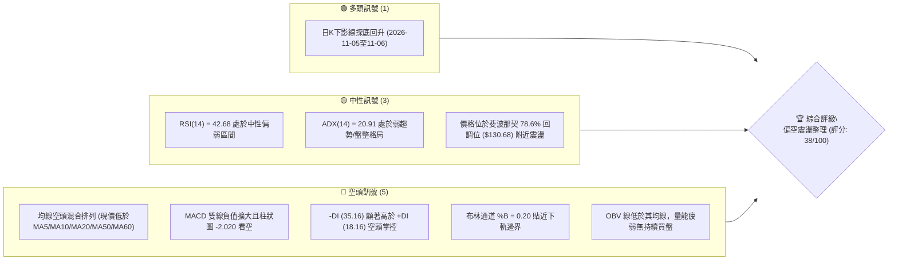

---

### 📊 核心指標速覽表

| 指標類別 | 指標名稱 | 當前數值 | 訊號 | 解讀 |
|:---|:---|:---|:---:|:---|
| **價格** | 當前收盤價 | $134.27 | 🔴 | 位於 52 週高低區間之 24.4%，處於低檔震盪偏弱格局 |
| **均線** | MA20 | $145.24 | 🔴 | 現價低於 MA20 達 -7.56%，短期均線下彎形成動態反壓 |
| **均線** | MA50 | $149.18 | 🔴 | 現價低於 MA50，中期多空分水嶺受挫，中空格局確立 |
| **均線** | MA200 | N/A（數據未提供） | 🟡 | 上市歷史資料不足以計算 200 日線，長期均線暫不適用 |
| **動能** | RSI(14) | 42.68 | 🟡 | Wilder 平滑計算，處於 30 至 70 中性偏弱區，未現超賣 |
| **動能** | MACD | -5.128 | 🔴 | DIF 線遠在零軸下方，訊號線 -3.107，Hist 柱 -2.020 持續擴大 |
| **動能** | Stoch %K / %D | 30.31 / 15.26 | 🟡 | %K 由超賣區向上穿越 %D，呈現短線技術性低檔金叉反彈 |
| **趨勢** | ADX(14) | 20.91 | 🟡 | ADX < 25 表明處於盤整震盪市場，但 -DI(35.16) > +DI(18.16) 空頭主導 |
| **通道** | 布林帶 (%B) | 0.20 | 🔴 | 下軌 $126.72，中軌 $145.24，上軌 $163.77，現價逼近下軌區 |
| **成交量** | 20日均量比 | 1.05x | 🟡 | 最新量 114,807,000，高於 20MA(109,462,900)，OBV<MA 量能疲弱 |
| **波動** | ATR(14) | $8.31 | 🔴 | 佔股價 6.19%，波動幅度偏大，操作須嚴設防守區間 |

---

### 🏆 技術評分卡

```
╔══════════════════════════════════════════════════════════════════════════╗
║                    技術評分卡 — SPCX (2026-11-08)                       ║
╠══════════════════════════════════════════════════════════════════════════╣
║ 趨勢強度 (Trend)     ██████░░░░░░░░░░░░░░  32/100  🔴 空頭壓制/盤整偏弱  ║
║ 動能指標 (Momentum)  ███████░░░░░░░░░░░░░  36/100  🔴 MACD擴大走空/RSI偏弱║
║ 支撐穩定度 (Support) ██████████░░░░░░░░░░  50/100  🟡 斐波那契78.6%暫守   ║
║ 成交量配合 (Volume)  ███████░░░░░░░░░░░░░  38/100  🔴 OBV處均線下/量價背離║
║ 形態完整度 (Pattern) ████████░░░░░░░░░░░░  44/100  🟡 下行通道內探尋底形  ║
║ 均線排列 (MA Align)  █████░░░░░░░░░░░░░░░  28/100  🔴 價格全落於短中期MA下║
╠══════════════════════════════════════════════════════════════════════════╣
║ 綜合評分             ███████░░░░░░░░░░░░░  38/100  🔴 偏空／防守等級     ║
╚══════════════════════════════════════════════════════════════════════════╝
* 註：綜合評分 = (32 + 36 + 50 + 38 + 44 + 28) ÷ 6 = 38.0（四捨五入至整數 38）
```

---

## 2. 趨勢分析

### 🌐 多時框趨勢分析

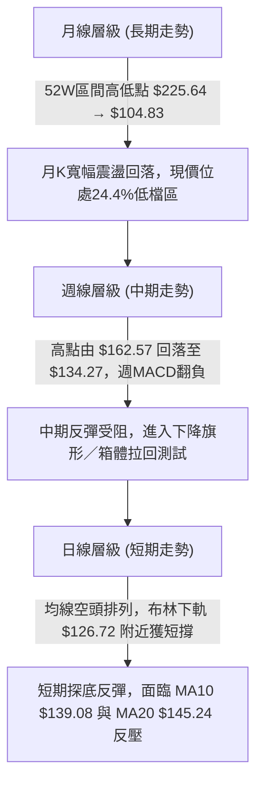

---

### 📈 長期趨勢 — 月線走勢圖（Unicode）

依據 24 個月歷史收盤紀錄與 52 週極值數據繪製：

```
SPCX 月線走勢圖（歷史區間與近月收盤）
價格軸 ($)
$225.64 ┤                   ● (52W歷史高點)
$200.00 ┤                  ╱ ╲
$175.00 ┤                 ╱   ╲
$170.86 ┤  ●(2026-06)    ╱     ╲
$150.86 ┤   ╲           ╱       ●(2026-09)
$143.69 ┤    ╲         ●(2026-08) ╲
$134.27 ┤━━━━━╲━━━━━━━━━━━━━━━━━━━━●←現價 ($134.27)
$108.37 ┤      ●(2026-07)          ●(2026-10: $134.72)
$104.83 ┤       ●(52W低點 $104.83)
        └──────────────────────────────────────────────
         2026-06  2026-07  2026-08  2026-09  2026-10  2026-11
```

#### 月線走勢特徵分析表

| 月份 | 收盤價 | 單月漲跌幅 | 走勢特徵與技術解讀 |
|:---|:---:|:---:|:---|
| **2026-06** | $170.86 | 基準月 | 衝高見頂後動能衰退，面臨長期籌碼高檔獲利了結壓力 |
| **2026-07** | $108.37 | -36.57% | 恐慌性重挫探底，單月下殺逼近 52 週歷史低點 $104.83 後止跌 |
| **2026-08** | $143.69 | +32.59% | 強勁技術性反彈，巨量回補缺口，形成 V 型底部架構初段 |
| **2026-09** | $150.86 | +4.99% | 延續反彈態勢，但漲幅顯著收窄，遭遇 $155.00 以上聚類阻力區 |
| **2026-10** | $134.72 | -10.70% | 反彈動能枯竭，週線級別連番下挫，跌破 MA20 與 MA50 均線中樞 |
| **2026-11** | $134.27 | -0.33% | 當月截至 11-06 呈現低檔徘徊，長下影線探底至 $120.39 後弱勢修復 |

---

### 📊 中期趨勢（週線分析）

中期走勢自 2026-10-09 當週高點 $176.42 觸頂後反轉向下，週線連收黑 K。目前價格運行於支撐與阻力夾層中：

```
SPCX 週線級別關鍵價位分佈示意
══════════════════════════════════════════════════════════════════
$158.13 ─── [阻力 R3] 2026-09-25 週高點聚類
$155.00 ─── [阻力 R2] 心理整數關卡 / 波段成交密集區
$149.80 ─── [阻力 R1] 2026-10 下半月多次反彈波段高點 / 斐波那契 61.8% ($150.98)
══════════════════════════════════════════════════════════════════
$134.27 ─── ◄ 當前收盤價（2026-11-06）
══════════════════════════════════════════════════════════════════
$130.39 ─── [支撐 S1] 近一年波段低點聚類 / 斐波那契 78.6% ($130.68)
$104.83 ─── [支撐 S2] 52週歷史極端低點
══════════════════════════════════════════════════════════════════
```

---

### ⚡ 趨勢強度評估（ADX 解讀）

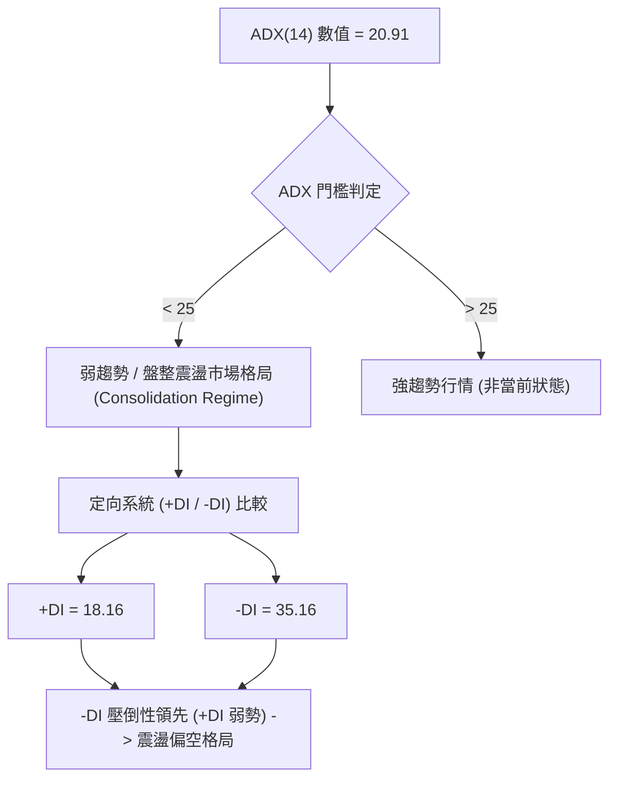

#### ADX 趨勢強度對照解讀表

| 指標變數 | 當前讀數 | 門檻區間 | 行情屬性判定 | 操作指引 |
|:---|:---:|:---:|:---|:---|
| **ADX(14)** | 20.91 | < 25.0 | 缺乏單邊趨勢，屬於無方向性的箱體或收斂盤整 | 避免追漲殺跌，依賴日線布林通道軌道邊界交易 |
| **+DI** | 18.16 | 多頭動能 | 多頭進攻意願極低，買盤呈現被動掛單 | 嚴禁盲目追高，多單僅限於極端邊界短博反彈 |
| **-DI** | 35.16 | 空頭動能 | 空頭佔據結構主導地位，賣壓具有持續性 | 反彈遭遇中軌與均線重合區時，易引發順勢拋壓 |

---

## 3. 圖表形態分析

### 🔍 形態識別系統

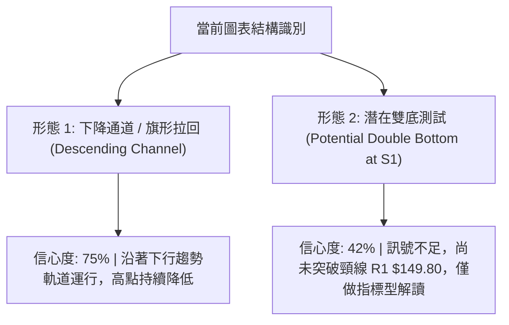

#### 形態識別與信心度評估表

| 識別形態 | 信心度 | 判斷依據（引用數據） | 完成度 | 目標價（附嚴謹計算式） |
|:---|:---:|:---|:---:|:---|
| **下降通道 (Descending Channel)** | **75%** | 10/09 高點 $176.42、10/23 高點 $166.18、11/03 高點 $142.74 連續走低；低點 10/16 $140.66、10/30 $134.50、11/05 $120.39 同步下探 | 70% | 通道下軌下探目標由通道寬度推算：<br>突破或跌破點推算：跌破 S1 $130.39 則下看 S2 $104.83 |
| **潛在雙重底 (Potential Double Bottom)** | **42%** | **訊號不足，僅做指標型解讀**。2026-11-05 打出長下影低點 $120.39，試圖與前低構築支撐，但頸線 R1 $149.80 遙遠，未有突破證據 | 25% | 若突破頸線 R1 $149.80，形態高度 = $149.80 − $120.39 = $29.41；<br>推算目標 = $149.80 + $29.41 = $179.21（接近斐波那契 38.2% $179.49） |

---

### 🕯️ 重要K線形態分析

嚴格依據提供的「近10根日K」與「近8根週K」四價數據進行專業燭體幾何識別：

#### 近10根日K形態精解表

| 日期 | 開盤價 | 最高價 | 最低價 | 收盤價 | 成交量 | K線形態類型 | 專業技術解讀與訊號指示 |
|:---:|:---:|:---:|:---:|:---:|:---:|:---|:---|
| **10-26** | $146.84 | $150.24 | $144.57 | $146.90 | 103,184,900 | 陀螺線 (Spinning Top) | 🟡 開收相近，多空於 MA50 下方呈現激烈膠著，方向未明 |
| **10-27** | $147.41 | $151.36 | $146.61 | $148.58 | 95,845,400 | 小陽線 (Small Bull) | 🟡 縮量上探 R1 邊緣受阻，上影線顯示高檔存在解套賣壓 |
| **10-28** | $147.37 | $148.20 | $142.13 | $145.23 | 98,705,800 | 光頭中陰線 (Bearish) | 🔴 開盤即最高點附近，盤中摜破 MA20，空頭重啟打壓 |
| **10-29** | $142.26 | $144.95 | $141.03 | $143.89 | 68,364,400 | 縮量十字陰星 | 🟡 波動收斂，極度縮量顯示買盤觀望，空方短暫停頓 |
| **10-30** | $137.85 | $140.20 | $134.50 | $134.72 | 122,653,600 | 跳空放量大陰線 | 🔴 跳空低開低走，收於全日最低點附近，放量跌破整理平台 |
| **11-02** | $137.01 | $142.05 | $135.72 | $136.37 | 90,995,400 | 上影倒錘小陰線 | 🔴 盤中反抽 $142.05 遭空頭無情摜回，長上影線確認反壓沉重 |
| **11-03** | $137.63 | $142.74 | $137.50 | $141.31 | 73,242,000 | 弱勢反彈中陽線 | 🟡 雖然收紅，但成交量僅 73M 創近期新低，量價背離明顯 |
| **11-04** | $133.24 | $140.50 | $133.14 | $135.92 | 135,443,400 | 墓碑十字帶長上影 | 🔴 高開回落，放量至 135M，多頭突圍失敗，再度被空方鎖死 |
| **11-05** | $131.34 | $131.87 | $120.39 | $123.62 | 171,356,200 | 長下影巨量錘子線 | 🟡 恐慌性摜破跌至 $120.39 後引發抄底盤，單日爆出 171M 巨量 |
| **11-06** | $130.94 | $135.32 | $128.57 | $134.27 | 114,807,000 | 下影確認陽線 | 🟢 延續前日長下影反彈，收盤站回 S1 $130.39 之上，短底浮現 |

#### 近8根週K形態精解表

| 日期 | 開盤價 | 最高價 | 最低價 | 收盤價 | 週成交量 | 週K線形態類型 | 結構解讀與趨勢涵義 |
|:---:|:---:|:---:|:---:|:---:|:---:|:---|:---|
| **09-18** | $147.33 | $156.87 | $142.87 | $152.71 | 669,034,700 | 放量中陽棒 | 🟢 延續 8 月以來的反彈走勢，量價齊揚，衝擊 $155 關卡 |
| **09-25** | $154.77 | $158.13 | $145.88 | $148.68 | 329,439,500 | 縮量長上影陰線 | 🔴 觸及 R3 $158.13 後遭遇強大阻力回落，多頭動能首度受挫 |
| **10-02** | $148.49 | $159.84 | $145.36 | $158.96 | 432,139,200 | 穿頭破腳陽包陰 | 🟢 重新奪回多頭主導權，收盤逼近全週最高，反彈動能重燃 |
| **10-09** | $158.99 | $176.42 | $158.62 | $162.57 | 485,054,700 | 流星線 (Shooting Star) | 🔴 衝刺波段最高點 $176.42 後大幅回吐，留下長達 $13.85 上影線 |
| **10-16** | $164.66 | $167.07 | $140.66 | $146.03 | 394,968,000 | 烏雲蓋頂長黑K | 🔴 跌幅達 -10.17%，一口氣吞噬前三週實體，中期見頂訊號確立 |
| **10-23** | $149.23 | $166.18 | $143.21 | $147.49 | 719,691,900 | 巨量天線震盪K | 🔴 巨量 719M 換手，高點 $166.18 無法持續，主力出貨跡象明顯 |
| **10-30** | $146.84 | $151.36 | $134.50 | $134.72 | 488,754,100 | 光腳中陰破位棒 | 🔴 週跌幅 -8.66%，徹底跌破週線短期均線，空方全面摜壓 |
| **11-06** | $137.01 | $142.74 | $120.39 | $134.27 | 585,844,000 | 長下影探底十字陽棒 | 🟡 最低探至 $120.39 後爆量拉回，收盤微幅守住 S1 $130.39 關卡 |

---

### 📉 ASCII 走勢形態示意圖

```
SPCX 日線級別下降通道與雙底測試結構圖
========================================================================
$166.18 ──┐ (10/23 高點)
          │╲
$151.36 ──┼─╲─────┐ (10/27 反彈高點)
          │  ╲     │╲
$145.24 ──┼───╲────┼─╲─────── [通道上軌阻力線 / MA20 中軌]
          │    ╲   │  ╲
$142.74 ──┼─────╲──┼───╲───┐ (11/03 高點)
          │      ╲ │    ╲  │╲
$134.27 ──┼───────●┼─────╲─┼──● ◄ 當前價格 ($134.27)
          │        │      ╲│  ╱
$130.39 ──┼────────┼───────●─╱─── [關鍵支撐 S1 / 斐波那契 78.6%]
          │        │        ╱
$120.39 ──┴────────┴───────●───── (11/05 巨量極端低點 / 形態下影低軌)
========================================================================
```

---

## 4. 支撐與阻力

### 🗺️ 關鍵價位分布圖（Unicode）

```
SPCX 價位結構分布圖
═════════════════════════════════════════════════════════════════════
$158.13 ║████████████████████████║ 強阻力 R3（波段反彈極限高點）
$155.00 ║████████████████████    ║ 阻力 R2（成交密集整數大關）
$149.80 ║████████████████████████║ 關鍵阻力 R1（MA50 與斐波 61.8% 重合區）
════════╠════════════════════════╣
$134.27 ╠════════════════════════╣ ◄ 現價 ($134.27)
════════╠════════════════════════╣
$130.39 ║▓▓▓▓▓▓▓▓▓▓▓▓▓▓▓▓        ║ 近期支撐 S1（波段低點聚類 / 斐波 78.6%）
$104.83 ║████████████████████████║ 強支撐 S2（52週歷史絕對低點）
═════════════════════════════════════════════════════════════════════
```

---

### 🚧 阻力位分析表

依據數據「關鍵價位」區塊波段高點聚類數值嚴謹編列：

| 阻力級別 | 準確價位 | 距現價幅 | 形成原因與籌碼技術結構 | 突破難度 | 重要性權重 |
|:---|:---:|:---:|:---|:---:|:---:|
| **R1** | **$149.80** | +11.57% | 近期波段反彈高點聚類，與 50 日均線 ($149.18) 及斐波那契 61.8% ($150.98) 形成三合一高壓密集成交區 | 🔴 極高 | ★★★★★ |
| **R2** | **$155.00** | +15.44% | 心理整數大關，9 月份盤整平台底部與 10 月中旬破位起跌點，積壓大量套牢籌碼 | 🔴 高 | ★★★★☆ |
| **R3** | **$158.13** | +17.77% | 2026-09-25 當週波段高點聚類，多次反彈未能有效站穩的極限技術頂部 | 🔴 偏高 | ★★★☆☆ |

---

### 🛡️ 支撐位分析表

依據數據「關鍵價位」區塊波段低點聚類數值嚴謹編列：

| 支撐級別 | 準確價位 | 距現價幅 | 形成原因與籌碼技術結構 | 守住機率 | 重要性權重 |
|:---|:---:|:---:|:---|:---:|:---:|
| **S1** | **$130.39** | -2.89% | 近一年波段低點聚類，與斐波那契 78.6% ($130.68) 高度重疊，11-05 破底後當日迅速收復之關鍵頸線 | 🟡 50% | ★★★★★ |
| **S2** | **$104.83** | -21.93% | 52 週歷史最低點（2026-07 探底基準點），多頭終極防線，跌破將引發大規模估值重估 | 🟢 85% | ★★★★★ |
| **S3** | **數據中未偵測到** | N/A | 原數據「關鍵價位」區塊僅計算出 S1 與 S2 兩處聚類支撐，更低層級無聚類數據 | N/A | N/A |

---

### 📐 斐波那契回調位分析

依據 52 週完整區間（低點 $104.83 → 高點 $225.64，波段總垂直落差 $120.81）精確計算回調階梯：

```
SPCX 斐波那契回調位階結構
0.0%  (52W High) ─── $225.64  ──────────────────────────── 極限牛市頂峰
23.6%            ─── $197.13  ──────────────────────────── 多頭強勢回檔極限
38.2%            ─── $179.49  ──────────────────────────── 中級回調分水嶺 (10/09 高點 $176.42 受阻於此)
50.0%            ─── $165.24  ──────────────────────────── 多空平衡中軸 (10/23 巨量週高 $166.18 遇阻)
61.8%            ─── $150.98  ──────────────────────────── 黃金分割防線 / 對應 R1 $149.80
─────────────────────────────────────────────────────────
78.6%            ─── $130.68  ─────────── [現價 $134.27 震盪於此區間]
─────────────────────────────────────────────────────────
100.0% (52W Low) ─── $104.83  ──────────────────────────── 週期起始原點 / 強支撐 S2
```

#### 斐波那契區間深度解讀

* **當前位階判定**：現價 **$134.27** 正好落在 **78.6% 回調位 ($130.68)** 與 **61.8% 回調位 ($150.98)** 之間，距離 78.6% 防線僅有些微空間 (+2.75%)。
* **技術意涵**：在經典道氏與斐波那契理論中，資產回調跌破 61.8%（$150.98）後，通常代表原先的多頭反彈結構已經遭到破壞，市場進入「深度防守測試階段」。若 78.6%（$130.68）確認被實體日 K 跌破，則價格有極高概率回測 100.0% 歷史底部（$104.83）。目前現價在 11-05 跌破後強勢收回，顯示 $130.39 ~ $130.68 具備強力技術支撐買盤。

---

## 5. 技術指標深度解讀

### 🎛️ 指標訊號總覽

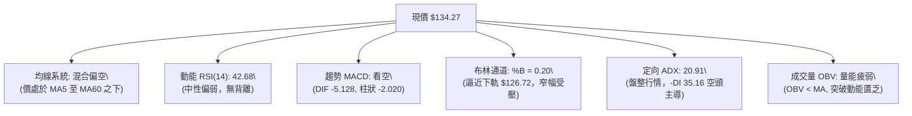

---

### 📈 移動平均線排列分析

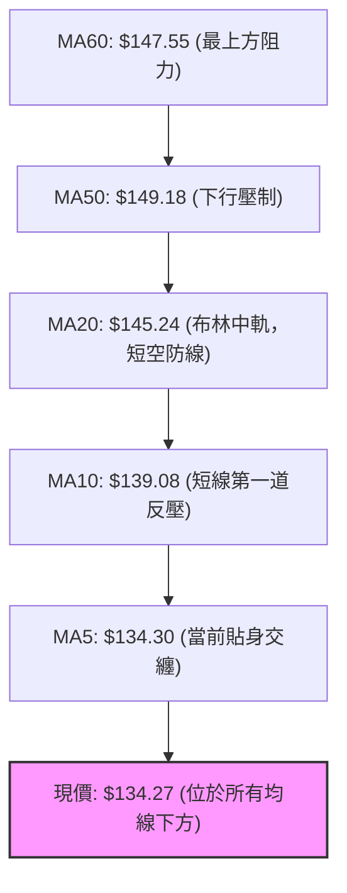

#### 均線各週期數據與排列解讀

| 均線名稱 | 數值 | 價格相對位置 | 斜率與軌跡解讀 | 訊號 |
|:---|:---:|:---:|:---|:---:|
| **MA 5** | $134.30 | 現價位於下方 -0.02% | 軌跡自高位快速下墜後走平，現價正與其反覆糾結爭奪 | 🟡 中性 |
| **MA 10** | $139.08 | 現價位於下方 -3.46% | 呈現陡峭下行態勢，構成短線多頭反彈的第一道實質壓制位 | 🔴 看空 |
| **MA 20** | $145.24 | 現價位於下方 -7.56% | 20 日線即為布林通道中軌，持續下彎，代表月線持倉成本全線套牢 | 🔴 看空 |
| **MA 50** | $149.18 | 現價位於下方 -10.00% | 中期生命線，與 R1 $149.80 聚類，代表中期多空分界徹底失守 | 🔴 看空 |
| **MA 60** | $147.55 | 現價位於下方 -9.00% | 季線下壓，長期走勢動能停滯，反彈空間受到強力壓縮 | 🔴 看空 |
| **MA 120** | N/A（數據未提供） | 資料不足需120筆數據 | 歷史資料不足，無法得出可靠統計參數 | 🟡 中性 |
| **MA 200** | N/A（數據未提供） | 資料不足需200筆數據 | 歷史資料不足，無法得出年線級別參數 | 🟡 中性 |

---

### 📉 RSI(14) 分析

* **RSI(14) 數值**：**42.68**（Wilder 平滑演算法）
* **動能強度進度條**：
  ```
  超賣 [0] ─────────── 42.68 ───────────────── [100] 超買
  █████████████████░░░░░░░░░░░░░░░░░░░░░░  42.68% (中性偏弱區)
  ```
* **超買超賣區間判定**：未進入 30 以下之極端超賣區，亦未突破 50 多空分界點，表明空方控盤但拋壓已有所放緩，多頭尚不足以發起逆轉攻擊。
* **背離狀態嚴謹判定**：
  * **比較區間**：檢視近 20 根日 K 首尾（2026-10-19 至 2026-11-06）。
  * **價格軌跡**：價格由 $147 附近下探至 $134.27（呈現下行）。
  * **RSI 軌跡**：RSI 數值同步由 46 附近滑落至 42.68（呈現同向下行）。
  * **背離結論**：**無明顯背離（Neither Bullish nor Bearish Divergence）**。動能指標完全驗證價格下跌，未見任何技術性底背離買訊。

---

### 📊 MACD(12, 26, 9) 訊號解讀

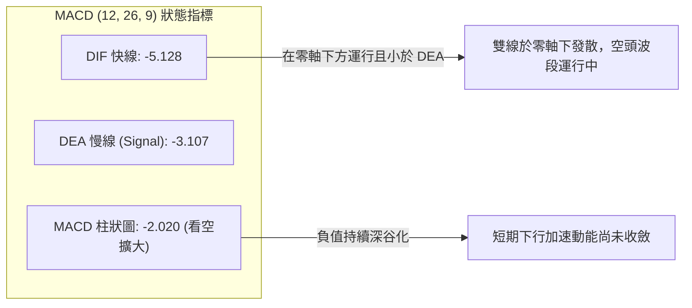

* **數據狀態**：DIF 線為 **-5.128**，Signal 線為 **-3.107**，兩者皆深居零軸之下，且 DIF 負向開口持續放大。
* **柱狀圖結構**：Histogram 數值為 **-2.020**，綠柱（空方柱）持續向下延伸，顯示當前賣方動能仍處於主動釋放階段，未見金叉收斂跡象。

---

### 📦 布林通道分析

```
SPCX 日線布林通道結構 (20, 2)
────────────────────────────────────────────────────────────────────────
$163.77 ─── BB 上軌 ───────────────────────────────────────────────────
           │
$145.24 ─── BB 中軌 (MA20 基準線) ──────────────────────────────────────
           │
$134.27 ─── 現價位置 (%B = 0.20) ◄ 處於下軌與中軌之中下部弱勢區間
           │
$126.72 ─── BB 下軌 ───────────────────────────────────────────────────
────────────────────────────────────────────────────────────────────────
```

* **軌道參數**：帶寬 Bandwidth = ($163.77 - $126.72) / $145.24 = 25.51%，通道處於均勻擴展後之平移狀態。
* **位置解讀 (%B)**：當前 **%B = 0.20**，表明價格非常靠近下軌（0 代表下軌，0.5 代表中軌，1 代表上軌）。現價自下軌（$126.72）獲得支撐反彈，但距離中軌反壓（$145.24）仍有寬幅壓制，短期運行空間被封裝於 $126.72 ~ $145.24 箱體內。

---

### 💹 成交量分析（量價配合度）

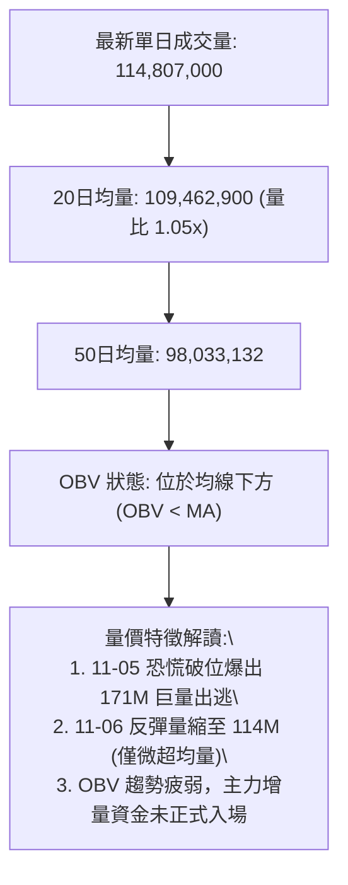

* **量能指標**：OBV 線持續低於其移動平均線，且近 5 日反彈過程中，成交量由 11-05 的 1.71 億股萎縮至 11-06 的 1.14 億股，屬於典型的「量縮反彈」弱勢格局，顯示買盤追價意願不足，隨時可能面臨二次探底。

---

## 6. 動能與波動率

### ⚡ 動能評估四象限

| 象限標籤 | 動能狀態 (Momentum) | 波動率狀態 (Volatility) | 當前股票歸屬 | 策略意涵與評估 |
|:---:|:---:|:---:|:---:|:---|
| **第一象限 (Q1)** | 強動能 (Strong) | 低波動 (Low) | ❌ | 最佳單邊多頭突破時機，當前不具備條件 |
| **第二象限 (Q2)** | 弱動能 (Weak) | 低波動 (Low) | ❌ | 沉悶牛皮整理盤，非當前狀態 |
| **第三象限 (Q3)** | 強動能 (Strong) | 高波動 (High) | ❌ | 高風險強趨勢行情（空頭單邊主跌浪） |
| **第四象限 (Q4)** | **弱動能 (Weak)** | **高波動 (High)** | **✓ (SPCX 歸屬此象限)** | **高波動弱動能：價格跳動劇烈但缺乏方向持續性，易遭雙巴，宜嚴控倉位** |

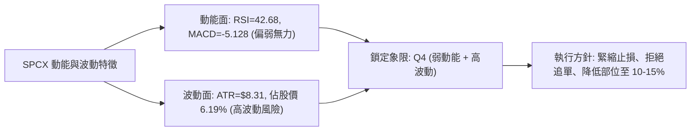

---

### 📊 ATR 波動率分析與止損建議

* **ATR(14) 絕對數值**：**$8.31**（基於 Wilder 平滑）。
* **波動率佔比 (ATR % of Price)**：**6.19%**，代表該標的每日正常噪音擺動幅度高達 $8 以上。

#### 基於 ATR 之風控距離設定矩陣

| 風險偏好等級 | ATR 倍數 | 建議防守緩衝距離 | 多頭止損參考 (現價 $134.27) | 空頭止損參考 (現價 $134.27) |
|:---|:---:|:---:|:---:|:---:|
| **激進型 (緊密短線)** | 1.0x ATR | $8.31 | $125.96（貼近日線布林下軌） | $142.58（貼近 MA10 反壓） |
| **標準型 (波段交易)** | 1.5x ATR | $12.47 | $121.80（保護於 11-05 低點之上） | $146.74（突破 MA20 中軌止損） |
| **保守型 (趨勢防守)** | 2.0x ATR | $16.62 | $117.65（跌破極端低點 $120.39） | $150.89（突破 R1 $149.80 強阻） |

---

### 📐 Beta 與市場相關性

* **Beta 係數**：**N/A（數據未提供）**。
* **相關性深度說明**：由於該公司處於高成長太空與衛星基礎設施賽道，資本支出極大（TTM 資本支出達 $55.92B），雖然 Beta 數據於即時數據包中標示為 N/A，但其走勢明顯受科技股估值倍數與市場流動性牽引；空頭淨額比率（Short Ratio）為 1.79，空頭佔流通盤（Short % Float）為 2.4%，顯示避險放空部位適中，並無非理性的逼空架構。

---

## 7. 多時框架總結

### 📋 時框架評分表

| 時框架 | 趨勢方向 | 動能狀態 | 均線排列狀況 | 形態特徵 | 綜合評分 | 操作建議方向 |
|:---|:---:|:---:|:---:|:---|:---:|:---|
| **日線 (短期)** | 偏空震盪 🔴 | 弱勢修復 🟡 | 空頭排列 (現價 < MA5~60) 🔴 | 下影探底反彈，考驗 S1 支撐 🟡 | **38/100** | 反彈減磅，以中軌為防守放空 |
| **週線 (中期)** | 下降趨勢 🔴 | 空方主導 🔴 | 跌破 20 週均線支撐 🔴 | 下降旗形拉回，觸發流星線回跌 🔴 | **35/100** | 逢高作空，靜待落底結構 |
| **月線 (長期)** | 寬幅箱體 🟡 | 中性回落 🟡 | 缺乏長均線，區間 24.4% 低位 🟡 | 巨幅 V 轉後之二次築底 🟡 | **50/100** | 長線資金分批於 S2 附近關注 |

---

### 🔲 綜合訊號矩陣

```
SPCX 多時框訊號一致性矩陣
═════════════════════════════════════════════════════════════════════
維度            短期 (日線)        中期 (週線)        長期 (月線)
─────────────────────────────────────────────────────────────────────
趨勢方向        🔴 空頭主控        🔴 空頭回落        🟡 寬幅箱體
動能 (MACD/RSI) 🔴 柱狀負值擴大    🔴 DIF下行貫穿     🟡 均值回歸中
均線系統        🔴 全線空頭排列    🔴 破中期均線      🟡 N/A (數據未提供)
支撐阻力結構    🟡 S1暫守/R1受阻   🔴 跌破前週低點    🟢 處52W區間低檔
成交量配合      🔴 OBV疲軟/量縮    🔴 出貨量大於進場  🟡 放量後換手
═════════════════════════════════════════════════════════════════════
最終時框方向收斂：短中期形成「共振看空」偏弱結構，長期受制於大箱體下半區
```

---

### ⚖️ 多時框收斂結論

依據多時框收斂原則（Rule 14）：
1. **行情屬性判定**：當前日線 **ADX(14) 為 20.91（< 25）**，屬於明確的**「盤整震盪市場行情」**。
2. **主導維度依據**：在盤整行情中，交易邊界嚴格以**「日線布林通道上下軌（$126.72 ～ $163.77）」**為主要震盪箱體，輔以近期波段聚類點位（S1 $130.39 與 R1 $149.80）。
3. **方向性收斂決策**：儘管處於盤整通道，但由於 **-DI (35.16) 壓倒性壓制 +DI (18.16)**、MACD 負向發散且日線各週期均線全面蓋頭反壓，整體箱體結構呈現**「重心持續下移之偏空箱體震盪」**。

> **最終收斂結論**：**偏空觀望／反彈防守放空（偏空等級）**。本結論與第 1 章評分卡（38/100）及第 5 章指標分析維持高度絕對一致，主導第 8 章交易策略。

---

## 8. 交易策略建議

### 🗺️ 策略決策流程圖

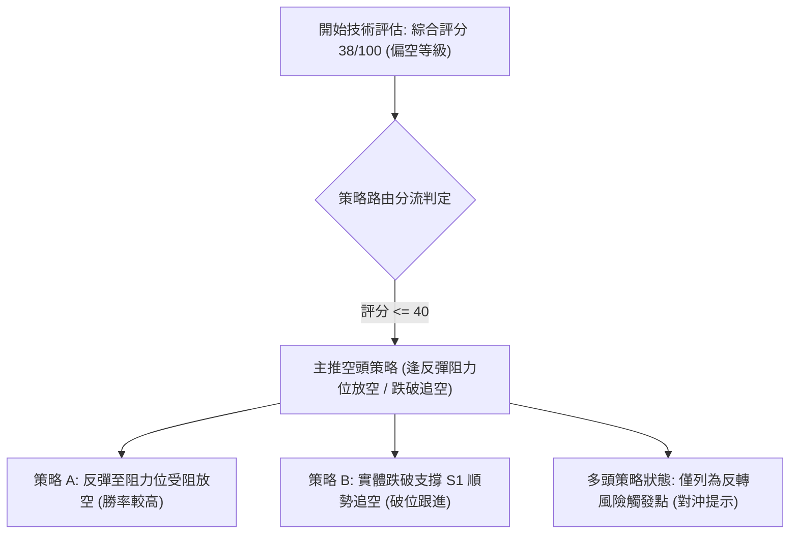

---

### 🧭 策略路由說明

> **當前主策略方向 = 空頭防守／反彈做空（依評分卡 38/100 偏空標準定調）**

根據客觀技術評分卡計算，SPCX 綜合評分為 **38/100（≤ 40 區間）**。依嚴格策略路由紀律，本報告**主推空頭交易策略**；多頭方向不給予主推建倉建議，僅在「反向風險觸發點」中列出空單回補與多頭反轉之防守價位。

---

### 🎯 價格情境階梯（Price Scenarios）

價位嚴格引用自數據區塊提供之實際點位（R1~R3, S1~S2）：

| 觸發條件（價格事件） | 第一階目標 | 第二階目標 | 情境技術涵義解讀 |
|:---|:---:|:---:|:---|
| **強勢向上突破 R1 ($149.80)** | R2 ($155.00) | R3 ($158.13) | 徹底扭轉短期均線反壓，引發空頭回補軋空潮 |
| **於現價 ($134.27) 區間震盪** | 布林中軌 ($145.24) | 布林下軌 ($126.72) | 延續 ADX<25 盤整行情，於上下軌之間進行區間換手 |
| **實體日K跌破 S1 ($130.39)** | 11/05低點 ($120.39) | 強支撐 S2 ($104.83) | 確立中級頭部跌破，78.6% 斐波防線失守，下探 52W 低點 |

---

### 📊 情境機率分佈

| 運行情境 | 發生機率 | 主要技術與量價依據 |
|:---|:---:|:---|
| **情境一：回落探底 / 跌破 S1** | **55%** | 均線空頭壓制、MACD 柱狀 -2.020 走空、-DI(35.16) 居於絕對優勢、OBV 量能背離渙散 |
| **情境二：箱體狹幅震盪整理** | **30%** | ADX 僅 20.91 缺乏單邊動能、現價處於 78.6% 斐波那契回調位 $130.68 附近形成拉鋸 |
| **情境三：逆勢強彈 / 突破 R1** | **15%** | 華爾街 37 位分析師目標均價 $255.06 帶來長線基本面買盤，但短線缺乏技術指標背書 |

---

### 🟢 主策略詳情（空頭交易策略）

所有價位均基於系統計算之聚類價位，風險報酬比嚴格依照公式：
$$\text{做空風報比} = \frac{\text{進場價} - \text{目標價}}{\text{止損價} - \text{進場價}}$$

| 策略要素 | 策略 A（反彈至阻力位受阻放空） | 策略 B（跌破支撐 S1 順勢追空） |
|:---|:---:|:---:|
| **策略類型** | 順向反彈高空（左側偏防守） | 關鍵位破位放空（右側追擊） |
| **進場條件** | 股價反彈至布林中軌/MA20，出現上影線受阻確認 | 日 K 實體跌破支撐 S1，次日開盤確認無法站回 |
| **進場價格** | **$145.24**（布林中軌 MA20 精確點位） | **$130.39**（確認有效跌破支撐 S1） |
| **目標價 T1** | **$130.39**（波段聚類支撐 S1） | **$120.39**（2026-11-05 極端低點） |
| **目標價 T2** | **$104.83**（52週歷史強支撐 S2） | **$104.83**（52週歷史強支撐 S2） |
| **止損價格** | **$155.00**（波段阻力 R2） | **$136.37**（2026-11-02 收盤高點頸線） |
| **風險報酬比 (T1)** | **1 : 1.52（以 T1 計）**<br>計算式：$\frac{145.24 - 130.39}{155.00 - 145.24} = \frac{14.85}{9.76} = 1.52$ | **1 : 1.67（以 T1 計）**<br>計算式：$\frac{130.39 - 120.39}{136.37 - 130.39} = \frac{10.00}{5.98} = 1.67$ |
| **風險報酬比 (T2)** | **1 : 4.14（以 T2 計）**<br>計算式：$\frac{145.24 - 104.83}{155.00 - 145.24} = \frac{40.41}{9.76} = 4.14$ | **1 : 4.27（以 T2 計）**<br>計算式：$\frac{130.39 - 104.83}{136.37 - 130.39} = \frac{25.56}{5.98} = 4.27$ |
| **歷史勝率估計** | **65%**（符合順勢交易原則） | **55%**（需防假跌破洗盤） |
| **建議配置倉位** | **15% 總資金** | **10% 總資金** |

---

### 🔴 反向風險觸發點（對沖與止損提示）

針對持有空單者，一旦出現下列任一訊號，代表空頭策略遭到破壞，必須無條件平倉止損或進行多頭對沖：
1. **關鍵點位反轉觸發**：日 K 收盤價強勢收復 **$149.80 (R1)** 之上，宣告下降通道失效。
2. **均線黃金交叉觸發**：MA5 ($134.30) 向上金叉穿越 MA10 ($139.08)，且日 MACD 柱狀圖由負轉正。
3. **成交量異動**：突破 $145.24 (MA20) 同時伴隨單日成交量突破 1.5 億股以上之異常買盤。

---

### ⭐ 整體訊號強度評星

```
做多訊號強度：★☆☆☆☆  (1/5星 - 僅有下影線支撐，缺乏動能與均線支持)
做空訊號強度：★★★★☆  (4/5星 - 均線全面壓制，MACD與-DI共振偏空)
整體可信度：  ★★★★☆  (4/5星 - 指標收斂高度一致，盤整偏空格局明確)
```

---

## 9. 風險提示與監控

### ✅ 關鍵監控指標 Checklist

```
╔══════════════════════════════════════════════════════════════════════════╗
║                   SPCX 每日盤後技術監控清單 (Checklist)                  ║
╠══════════════════════════════════════════════════════════════════════════╣
║ [ ] 價位監控：收盤價是否跌破支撐 S1 ($130.39) 或斐波那契 78.6% ($130.68)  ║
║ [ ] 阻力監控：盤中反彈是否受阻於布林中軌 ($145.24) 或 R1 ($149.80)       ║
║ [ ] 動能監控：MACD 柱狀圖是否收斂至 -1.000 之內，或 RSI(14) 跌破 30 進入超賣║
║ [ ] 定向監控：ADX(14) 是否向上突破 25，帶動 -DI 走出單邊主跌趨勢        ║
║ [ ] 量能監控：單日成交量是否異常超越 50日均量 (98M) 達 1.5 倍以上        ║
║ [ ] 事件監控：關注 12 月巨額解禁期 (Lockup Expiration) 之流動性拋壓衝擊 ║
╚══════════════════════════════════════════════════════════════════════════╝
```

---

### ⚠️ 風險場景分析

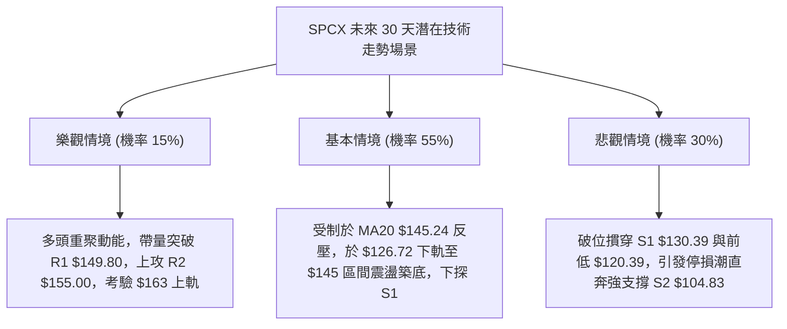

---

### 🛡️ 風險管理重要提醒

1. **高波動率防禦策略**：SPCX 當前 ATR 高達 **$8.31（佔股價 6.19%）**，屬於極高波動資產。在進行任何合約或現貨部位操作時，單筆交易的最大資金承擔虧損不得超過總投資組合淨值的 **1.0%**。
2. **重大行事曆事件風險**：近期市場新聞明確指出「SpaceX's December Lockup Is Nearly the Biggest Share Unlock in IPO History」，12 月份將面臨歷史級別的原始股東解禁釋出，潛在拋壓巨大。在籌碼面烏雲籠罩下，技術面反彈極易遭遇機構搶先減碼，嚴禁左側無底線抄底。
3. **負自由現金流財務折價**：公司 TTM 自由現金流為 **$-40.16B**（資本支出達 $55.92B），在高利率環境下，資本密集型架構在技術圖表上往往體現為反彈無力、重心持續下移，技術操作務必秉持「順勢防守」之鐵律。

---

## 📋 報告總結

```
╔══════════════════════════════════════════════════════════════════════════╗
║                        SPCX 技術分析報告總結                             ║
╠══════════════════════════════════════════════════════════════════════════╣
║ 報告日期：2026-11-08                                                    ║
║ 當前價格：$134.27 USD                                                   ║
║ 分析評級：🔴 偏空震盪／防守放空（綜合評分：38/100）                      ║
║                                                                          ║
║ 核心結構結論：                                                           ║
║ ├─ 長期趨勢：🟡 月線寬幅震盪回落，現價處於 52 週區間之 24.4% 低檔位置     ║
║ ├─ 中期趨勢：🔴 觸及 $176.42 高點後週線連黑回落，中期均線宣告失守        ║
║ ├─ 短期趨勢：🔴 現價跌破 MA5/10/20/50/60 所有均線，ADX=20.91 盤整偏空    ║
║ ├─ 關鍵支撐：S1: $130.39 (斐波 78.6%) ｜ S2: $104.83 (52W極端歷史低點)  ║
║ ├─ 關鍵阻力：R1: $149.80 ｜ R2: $155.00 ｜ R3: $158.13                  ║
║ └─ 機構共識：分析師平均目標價 $255.06（與當前技術面弱勢嚴重背離）        ║
║                                                                          ║
║ 最優策略組合建議：                                                       ║
║ 1. 🥇 最佳機會：等待反彈至布林中軌/MA20 ($145.24) 受阻放空，損設 $155.00  ║
║ 2. 🥈 次選機會：跌破支撐 S1 ($130.39) 順勢做空，下看前低 $120 與 S2 $104 ║
║ 3. 🥉 保守選擇：空手觀望，靜待日線站穩 MA20 ($145.24) 且 MACD 翻多再進場 ║
╚══════════════════════════════════════════════════════════════════════════╝
```

---

> ⚠️ **免責聲明**：本報告為技術分析研究，所有數據、圖表及量化推演均基於市場歷史價格與成交量資訊。本報告**僅供學術研究與投資策略討論參考**，**絕對不構成任何要約、招攬或投資買賣建議**。金融市場存在高度波動風險，交易者應獨立評估風險承受能力並自負盈虧。

---

*報告生成時間：2026-11-08 ｜ 數據來源：Yahoo Finance ｜ 分析框架：資深量化多時框技術分析模型*