# SPCX 技術分析報告

> **報告日期**：2026-11-10 ｜ **語言**：繁體中文 ｜ **數據來源**：Yahoo Finance ｜ **當前價格**：$142.07 USD

---

## 目錄

| 章節 | 內容 |
|------|------|
| [1. 技術面概覽](#1-技術面概覽) | 訊號儀表板、核心指標、評分卡 |
| [2. 趨勢分析](#2-趨勢分析) | 多時框趨勢、長中短期走勢、ADX強度 |
| [3. 圖表形態分析](#3-圖表形態分析) | 形態識別、近期K線組合、目標價推算 |
| [4. 支撐與阻力](#4-支撐與阻力) | 關鍵價位架構、斐波那契回調深度解析 |
| [5. 技術指標深度解讀](#5-技術指標深度解讀) | MA均線、RSI、MACD、布林通道、成交量 |
| [6. 動能與波動率](#6-動能與波動率) | 動能四象限、ATR波動分析、Beta相關性 |
| [7. 多時框架總結](#7-多時框架總結) | 時框架矩陣、多時框收斂與方向定調 |
| [8. 交易策略建議](#8-交易策略建議) | 策略路由、情境階梯、主策略與風報比 |
| [9. 風險提示與監控](#9-風險提示與監控) | 監控指標Checklist、風險場景、部位管理 |
| [📋 報告總結](#-報告總結) | 全方位核心技術結論與操作要點彙整 |

---

## 1. 技術面概覽

### 🎯 技術訊號儀表板

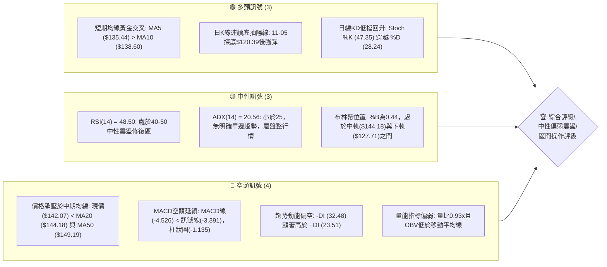

### 📊 核心指標速覽表

| 指標類別 | 指標名稱 | 當前數值 | 訊號 | 專業解讀 |
|:---|:---|:---|:---:|:---|
| **價格** | 當前收盤價 | $142.07 | 🟡 | 位於52週區間($104.83 - $225.64)的30.8%分位，屬低檔弱勢震盪反彈 |
| **短期均線** | MA5 / MA10 | $135.44 / $138.60 | 🟢 | MA5已上揚金叉MA10，超短期動能自低點強勁修復 |
| **中期均線** | MA20 (月線) | $144.18 | 🔴 | 價格受制於MA20下方(-1.46%)，中軌構成短線動態反彈第一阻力 |
| **中期均線** | MA50 (季線) | $149.19 | 🔴 | 價格低於MA50(-4.77%)，中期趨勢仍處空方壓制格局 |
| **長期均線** | MA200 (年線) | N/A（數據未提供） | 🟡 | 數據資料庫未提供，依現有MA60 ($147.58) 判斷中長期處於修復期 |
| **動能指標** | RSI(14) | 48.50 | 🟡 | 位於中性平衡區，未見超買或超賣，短線動能自30以下修復 |
| **動能指標** | MACD (12,26,9) | -4.526 / -3.391 | 🔴 | 雙線位於零軸下方且負擴散，Histogram為-1.135，空方動能主導 |
| **趨勢強度** | ADX(14) / ±DI | 20.56 (-DI:32.48) | 🔴 | ADX小於25代表趨勢疲弱進入箱型盤整；-DI大於+DI確立空頭佔優 |
| **波動通道** | 布林通道帶寬 | $127.71 - $160.64 | 🟡 | %B為0.44，自下軌獲得支撐後向中軌($144.18)推進 |
| **波動風險** | ATR(14) | $8.35 (5.88%) | 🟡 | 每日波動幅度達5.88%，價格震盪劇烈，需設定寬鬆止損空間 |
| **成交量能** | 20日均量比 | 0.93x (OBV < MA) | 🔴 | 最新成交量未達20日均量，量價背離且OBV疲弱，反彈動能不足 |

### 🏆 技術評分卡

依規則 18，綜合評分為六項子評分之算術平均值：`(38 + 42 + 55 + 40 + 48 + 41) ÷ 6 = 264 ÷ 6 = 44`。

```
╔══════════════════════════════════════════════════════════════════════╗
║                   技術評分卡 — SPCX (2026-11-10)                     ║
╠══════════════════════════════════════════════════════════════════════╣
║ 趨勢強度 (ADX=20.56, -DI空頭主導)    ███████░░░░░░░░░░░░░  38/100 🔴 ║
║ 動能指標 (RSI=48.5, MACD柱=-1.135)   ████████░░░░░░░░░░░░  42/100 🔴 ║
║ 支撐穩定度 (S1=$140.66, S2=$130.39)  ███████████░░░░░░░░░  55/100 🟡 ║
║ 成交量配合 (量比0.93x, OBV<MA)       ████████░░░░░░░░░░░░  40/100 🔴 ║
║ 形態完整度 (日線V型反抽/箱型下緣)    ██████████░░░░░░░░░░  48/100 🟡 ║
║ 均線排列 (MA5/10金叉但承壓於MA20/50) ████████░░░░░░░░░░░░  41/100 🔴 ║
╠══════════════════════════════════════════════════════════════════════╣
║ 綜合評分                             █████████░░░░░░░░░░░  44/100 🟡 ║
║ 綜合判定：中性偏弱震盪（40–60 區間操作，以布林通道與高低點為準）      ║
╚══════════════════════════════════════════════════════════════════════╝
```

---

## 2. 趨勢分析

### 🌐 多時框趨勢分析

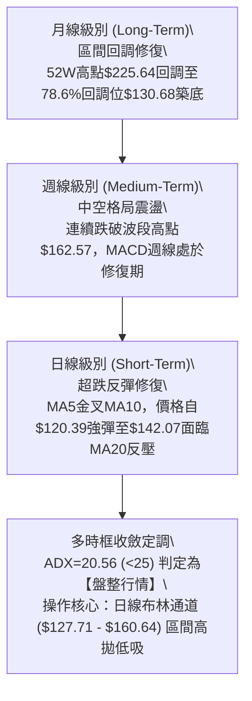

### 📈 長期趨勢 — 12個月走勢圖（Unicode）

以下為根據月度收盤數據與 52 週極端值繪製之 ASCII 長期走勢圖：

```
SPCX 月線走勢圖（過去12個月歷史波動軌跡）
價格軸 ($)
$225.64 ┤                              ● (52W High: $225.64)
$200.00 ┤                             ╱ ╲
$179.49 ┤                            ╱   ╲
$170.86 ┤                  ● (26-06)╱     ╲
$150.86 ┤                          ╱       ● (26-09: $150.86)
$142.07 ┤━━━━━━━━━━━━━━━━━━━━━━━━━╱━━━━━━━━━●← 現價 ($142.07)
$134.72 ┤                        ╱     ● (26-10: $134.72)
$108.37 ┤            ● (26-07)  ● (26-08: $143.69)
$104.83 ┤    ● (52W Low: $104.83)
         └─────────────────────────────────────────────────────────────
          25-12  26-02  26-04  26-06  26-07  26-08  26-09  26-10  26-11
```

#### 走勢特徵分析表格

| 期間階段 | 起點/終點收盤價 | 區間漲跌幅 | 走勢結構與技術特徵 |
|:---|:---|:---:|:---|
| **2026-06 → 2026-07** | $170.86 → $108.37 | -36.57% | 遭遇劇烈拋售，直探年度低點區域($104.83)，RSI快速跌入極度超賣 |
| **2026-07 → 2026-08** | $108.37 → $143.69 | +32.59% | 強勁的V型超跌反彈，單月成交量激增，回補前期空頭缺口 |
| **2026-08 → 2026-09** | $143.69 → $150.86 | +4.99% | 震盪推升，嘗試挑戰斐波那契61.8%回調位($150.98)與中期均線密集區 |
| **2026-09 → 2026-10** | $150.86 → $134.72 | -10.70% | 承壓回落，多頭動能衰竭，月K線收出陰線跌破MA20支撐 |
| **2026-10 → 2026-11(現)**| $134.72 → $142.07 | +5.46% | 11月初下探$120.39低點後展開修復反彈，現報$142.07，進行築底確認 |

### 📊 中期趨勢（週線分析）

中期走勢圖展示近期波段高低點與壓力支撐關係：

```
SPCX 週線波段架構示意圖
$162.57 ┤          ▲ 波段高點 (2026-10-09)
$158.13 ┤──────────┼───────────────────── R3 阻力位 ($158.13)
$155.00 ┤          │                     R2 阻力位 ($155.00)
$149.80 ┤──────────┼───────────────────── R1 阻力位 ($149.80) / MA50 ($149.19)
$142.07 ┤··········┼···················· ◄ 當前收盤價 ($142.07)
$140.66 ┤──────────┼───────────────────── S1 支撐位 ($140.66)
$130.39 ┤          │                     S2 支撐位 ($130.39) / 斐波 78.6% ($130.68)
$120.39 ┤          ▼ (11-05 探底極限低點)
$104.83 ┤──────────────────────────────── S3 歷史極限支撐 ($104.83)
```

從近8週收盤走勢觀察，價格於2026-10-09創下波段高點$162.57（當週最高達$176.42）後，週線呈現階梯式下行，連續跌破$146.03、$134.72，並在2026-11-06當週下探$120.39。目前最新週線收盤回升至$142.07，守在S1支撐位$140.66之上，週線MACD負柱狀圖收斂至-1.135，顯示中期拋壓有趨緩跡象，但尚未出現確立翻轉的右側買訊。

### ⚡ 趨勢強度評估（ADX 解讀）

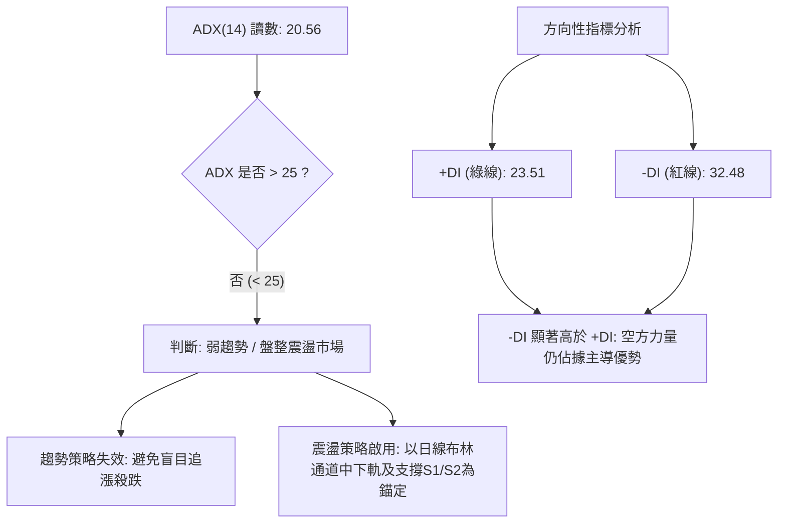

#### ADX 趨勢強度對照表

| 指標變數 | 當前讀數 | 門檻區間 | 市場狀態解讀 | 交易戰術指引 |
|:---|:---:|:---:|:---|:---|
| **ADX (14)** | **20.56** | 0 – 25 | 弱趨勢 / 無方向盤整行情 | 嚴禁趨勢突破單，採用區間反轉低吸高拋 |
| **+DI (14)** | **23.51** | - | 多方買盤推動力偏弱 | 逢高獲利了結，多頭不宜長線戀戰 |
| **-DI (14)** | **32.48** | - | 空方賣壓主導市場情緒 | 警惕跌破S1支撐後引發的空方慣性回踩 |
| **DI差值 (DMI)** | **-8.97** | 負值擴散 | 空方動能大於多方 | 反彈先視為技術性解套波而非主升段 |

---

## 3. 圖表形態分析

### 🔍 形態識別系統

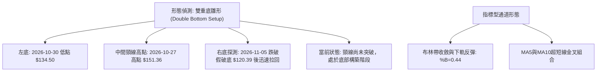

#### 形態識別與信心度評估表

依規則 15 嚴格評估圖表形態，拒絕過度推論：

| 形態名稱 | 信心度 | 判斷依據（嚴格引用數據） | 完成度 | 目標價計算式（依規則13/15） |
|:---|:---:|:---|:---:|:---|
| **雙重底雛形 (W底)** | **58%** | 兩次下探：第一次低點為10-30的$134.50，第二次下探11-05低點$120.39後迅速拉回至現價$142.07，頸線為10-27波段高點$151.36。 | 45% | 依形態高度推算：頸線$151.36 + 形態高度($151.36 - $134.50 = $16.86) = **$168.22**（註：未突破前僅供參考） |
| **布林帶下軌支撐反彈** | **75%** | 11-05下穿下軌($127.71)後，11-06即收在$134.27，11-09更強彈至$142.07，%B達0.44回歸通道內。 | 85% | 目標向中軌推進：目標價為布林中軌 **$144.18** 及 R1 **$149.80** |
| **大型頭肩頂頸線回測** | **35%** | 訊號不足，僅做指標型解讀。雖左側有$176.42高點，但下方無連續性跌破確認，信心度低於50%，不予立案。 | N/A | 形態無效，不設定目標價 |

### 🕯️ 重要K線形態分析

嚴格依據數據提供的「近10根日K」與「近8根週K」實體數據進行K線結構判讀：

#### 近10根日K線結構深度解析表

| 日期 (日K) | 開盤價 | 最高價 | 最低價 | 收盤價 | K線形態名稱 | 形態深度解讀 | 多空訊號 |
|:---|:---:|:---:|:---:|:---:|:---:|:---|:---:|
| **2026-10-27** | $147.41 | $151.36 | $146.61 | $148.58 | 小陽十字線 | 高點衝擊$151.36受阻於R1阻力區，多空力量陷入膠著 | 🟡 中性 |
| **2026-10-28** | $147.37 | $148.20 | $142.13 | $145.23 | 中陰線 | 開高走低，實體向下吞噬前日低點，空方重掌優勢 | 🔴 看空 |
| **2026-10-29** | $142.26 | $144.95 | $141.03 | $143.89 | 紡錘陰線 | 震盪收縮，於S1支撐位$140.66上方尋求支撐，多頭抵抗弱 | 🔴 看空 |
| **2026-10-30** | $137.85 | $140.20 | $134.50 | $134.72 | 大陰線 | 跳空低開低走收最低，放量跌破$140整數關卡，恐慌盤湧現 | 🔴 強空 |
| **2026-11-02** | $137.01 | $142.05 | $135.72 | $136.37 | 倒錘子陰線 | 盤中衝高至$142.05遭空頭痛擊，長上影線顯示上方解套壓沉重 | 🔴 看空 |
| **2026-11-03** | $137.63 | $142.74 | $137.50 | $141.31 | 中陽反彈線 | 實體收復前日失土，收盤突破$141，短線空頭力道有所減緩 | 🟢 看多 |
| **2026-11-04** | $133.24 | $140.50 | $133.14 | $135.92 | 墓碑線/倒錘線 | 跳空開低衝高回落，收盤接近開盤價，空頭再度下壓 | 🔴 看空 |
| **2026-11-05** | $131.34 | $131.87 | $120.39 | $123.62 | 長下影長陰線 | 恐慌崩跌下探$120.39，放量1.71億股，但下影線達$3.23，主力低吸 | 🟡 異動 |
| **2026-11-06** | $130.94 | $135.32 | $128.57 | $134.27 | 破底翻陽包陰 | 跳空低開後強烈拉升，收盤價超過前日開盤，確認$120.39為極端恐慌底 | 🟢 強多 |
| **2026-11-09** | $136.51 | $143.20 | $135.37 | $142.07 | 光頭大陽線 | 連續第二日大漲，收盤收在近全日最高點$142.07，確立超跌反彈段 | 🟢 強多 |

#### 近8根週K線結構深度解析表

| 日期 (週最後日) | 開盤價 | 最高價 | 最低價 | 收盤價 | 週K線形態 | 形態深度解讀 | 訊號 |
|:---|:---:|:---:|:---:|:---:|:---:|:---|:---:|
| **2026-09-25** | $154.77 | $158.13 | $145.88 | $148.68 | 穿頭破腳陰線 | 高點觸及R3阻力位$158.13後跳水，形成週線頂部滯漲 | 🔴 看空 |
| **2026-10-02** | $148.49 | $159.84 | $145.36 | $158.96 | 長陽突破線 | 多頭反撲突破$158，週成交量達4.32億股 | 🟢 看多 |
| **2026-10-09** | $158.99 | $176.42 | $158.62 | $162.57 | 長上影高檔墓碑 | 衝擊$176.42後大幅回落，上影線長達$13.85，主力高檔出貨 | 🔴 強空 |
| **2026-10-16** | $164.66 | $167.07 | $140.66 | $146.03 | 烏雲蓋頂長陰 | 連續跌破$160與$150關卡，直測S1支撐位$140.66 | 🔴 強空 |
| **2026-10-23** | $149.23 | $166.18 | $143.21 | $147.49 | 震盪射擊之星 | 爆出7.19億股歷史巨量但收盤無功而返，多空劇烈換手 | 🟡 震盪 |
| **2026-10-30** | $146.84 | $151.36 | $134.50 | $134.72 | 大陰線破位 | 週線實體完全吞噬，跌破MA20週線支撐，賣壓宣洩 | 🔴 看空 |
| **2026-11-06** | $137.01 | $142.74 | $120.39 | $134.27 | 超長下影錘頭線 | 單週下影線長達$13.88，下檔低點$120.39遭遇強烈機構買盤承接 | 🟢 轉多 |
| **2026-11-09** | $136.51 | $143.20 | $135.37 | $142.07 | 連續回抽陽棒 | 接續前週長下影線動能，開低走高重回$140之上 | 🟢 偏多 |

### 📉 ASCII 走勢形態示意圖

```
SPCX 日線破底翻與反彈走勢示意圖（2026-10-27 至 2026-11-09）
$151.36 ┤  ┌─┐(10-27高點)
$148.00 ┤  │ │  ┌─┐
$144.18 ┤  │ │  │ │  (MA20 阻力線) ───────────────────────────
$142.07 ┤  │ │  │ │                                      ┌─┐(11-09收盤現價)
$140.66 ┤──┼─┼──┼─┼──────────────(S1支撐)──────────────────│ │─────
$136.00 ┤  │ │  │ │        ┌─┐               ┌─┐        │ │
$134.72 ┤  └─┘  │ │  ┌─┐   │ │         ┌─┐   │ │(11-06) │ │
$130.00 ┤        └─┘  │ │   │ │         │ │   └─┘        └─┘
$123.62 ┤             │ │   └─┘         │ │(11-05長陰)
$120.39 ┤             └─┘               │ 
        └───────────────────────────────┴─────────────────────────────
         10-27 10-28 10-30 11-02 11-03 11-05   11-06      11-09
                                        (極限低點 $120.39 破底翻)
```

### 🎯 形態目標價計算

1. **破底翻反抽目標**：
   - 起漲低點：11-05 低點 $120.39
   - 當前頸線壓力：S1轉壓力或MA20 = $144.18
   - 第一波目標價：由日線波段高點阻力計算，為關鍵價位 **R1: $149.80**
2. **潛在雙底突破延伸目標**：
   - 頸線位置：2026-10-27 波段高點 $151.36
   - 形態底部：2026-10-30 收盤低點 $134.72（以波段基底收盤計算）
   - 形態高度：$151.36 − $134.72 = $16.64
   - 向上等距測幅目標價 = 頸線 $151.36 + $16.64 = **$168.00**（接近斐波那契50.0%回調位 $165.24）

---

## 4. 支撐與阻力

### 🗺️ 關鍵價位分布圖（Unicode）

```
SPCX 價位結構分布圖（嚴格依據 OHLCV 計算之關鍵價位）
═══════════════════════════════════════════════════════════════════════
$225.64 ║██████████████████████████████║ 52W High (0.0% 斐波那契)
$197.13 ║████████████████████          ║ 23.6% 斐波那契回調位
$179.49 ║██████████████████            ║ 38.2% 斐波那契回調位
$165.24 ║████████████████              ║ 50.0% 斐波那契平衡位
$160.64 ║▓▓▓▓▓▓▓▓▓▓▓▓▓▓▓▓▓▓▓▓          ║ 布林通道上軌
$158.13 ║████████████████████████      ║ 強阻力 R3 (近一年波段高點聚類)
$155.00 ║████████████████              ║ 阻力 R2 (波段高點聚類)
$150.98 ║████████████████████          ║ 61.8% 斐波那契回調位 (黃金分割)
$149.80 ║████████████████████████      ║ 關鍵阻力 R1 (波段密集高點 / MA50)
$144.18 ║┈┈┈┈┈┈┈┈┈┈┈┈┈┈┈┈┈┈┈┈┈┈┈┈┈┈┈┈┈┈║ 布林中軌 (MA20 動態反壓)
$142.07 ╠══════════════════════════════╣ ◄ 當前收盤價 ($142.07)
$140.66 ║▓▓▓▓▓▓▓▓▓▓▓▓▓▓▓▓▓▓▓▓▓▓▓▓      ║ 近期關鍵支撐 S1 (近一年波段低點聚類)
$130.68 ║████████████████████          ║ 78.6% 斐波那契回調位
$130.39 ║████████████████████████      ║ 強支撐 S2 (波段低點聚類)
$127.71 ║▓▓▓▓▓▓▓▓▓▓▓▓▓▓▓▓              ║ 布林通道下軌
$104.83 ║██████████████████████████████║ 52W Low / 強支撐 S3 (100.0% 斐波那契)
═══════════════════════════════════════════════════════════════════════
```

### 🚧 阻力位分析表

所有阻力價位嚴格引用自數據之「關鍵價位」區塊，絕無自行捏造：

| 阻力級別 | 精確價位 | 距現價空間 | 形成技術原因（數據聚類） | 突破難度 | 重要性權重 |
|:---|:---:|:---:|:---|:---:|:---:|
| **R1** | **$149.80** | +5.44% | 近一年波段高點聚類點，重合MA50季線($149.19)與斐波61.8%($150.98) | 🔴 高度困難 | ★★★★★ |
| **R2** | **$155.00** | +9.10% | 整數心理關卡，2026年9月至10月多次衝高回落換手套牢帶 | 🟡 中度困難 | ★★★☆☆ |
| **R3** | **$158.13** | +11.30% | 2026-09-25週線高點，近一年高點聚類頂部，接近布林上軌($160.64) | 🔴 極度困難 | ★★★★☆ |

### 🛡️ 支撐位分析表

所有支撐價位嚴格引用自數據之「關鍵價位」區塊：

| 支撐級別 | 精確價位 | 距現價空間 | 形成技術原因（數據聚類） | 守住機率 | 重要性權重 |
|:---|:---:|:---:|:---|:---:|:---:|
| **S1** | **$140.66** | -0.99% | 近一年波段低點聚類，2026-10-16週線最低點，當前第一防線 | 🟡 60% | ★★★★★ |
| **S2** | **$130.39** | -8.22% | 波段低點聚類，重合斐波那契78.6%回調位($130.68)與布林下軌附近 | 🟢 75% | ★★★★☆ |
| **S3** | **$104.83** | -26.21% | 52週歷史極限低點(52W Low)，長期結構生命線 | 🟢 90% | ★★★★★ |

### 📐 斐波那契回調位分析

依據 52 週波段區間（$104.83 → $225.64）之官方數據精確計算：

```
斐波那契回調結構階梯
0.0%  ── $225.64 (52W High)
23.6% ── $197.13
38.2% ── $179.49
50.0% ── $165.24
61.8% ── $150.98  ◄── 重大黃金分割阻力區間 (接近 R1: $149.80)
現價  ── $142.07  [落於 61.8% 與 78.6% 之間]
78.6% ── $130.68  ◄── 深度回調關鍵支撐 (重合 S2: $130.39)
100%  ── $104.83 (52W Low)
```

- **位置意義解讀**：當前收盤價 $142.07 精確落於 **61.8% ($150.98)** 與 **78.6% ($130.68)** 之間。在技術分析理論中，跌破 61.8% 回調位意味著前波牛市多頭推進浪已被破壞，行情由強轉弱，進入深度折價與防禦性整理。
- **支撐有效性**：日前下探至 $120.39 雖短暫跌穿 78.6%（$130.68），但隨即在數日內強勢收復至 $142.07，證明 78.6% 回調位（$130.68）與波段支撐 S2（$130.39）構成極具買盤防守力度的「雙重結構共振帶」。只要週線不有效收破 $130.39，中長期超跌反彈架構依然成立。

---

## 5. 技術指標深度解讀

### 🎛️ 指標訊號總覽

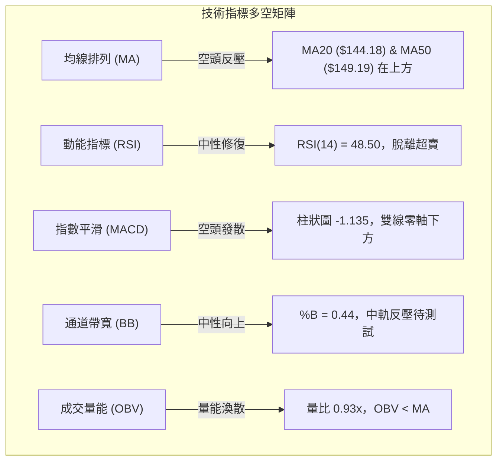

### 📈 移動平均線排列分析

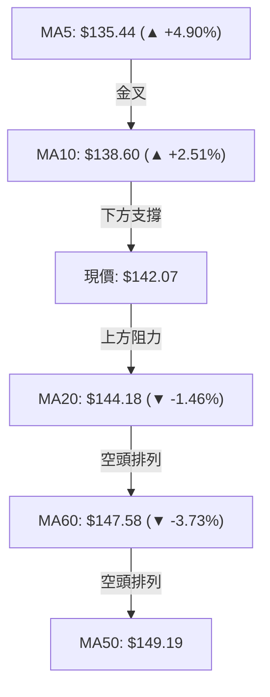

#### 均線系統數據與狀態

| 均線名稱 | 當前價格 | 與現價偏離度 | 斜率走向 | 排列狀態與技術解讀 |
|:---|:---:|:---:|:---:|:---|
| **MA5** | $135.44 | +4.90% | ▲ 陡峭向上 | 超短期多頭掌控，構成極短線回踩第一防線 |
| **MA10** | $138.60 | +2.51% | ▲ 轉折向上 | 5日線金叉10日線，短線底部反轉確立 |
| **MA20** | $144.18 | -1.46% | ▼ 下行趨緩 | 即時動態反壓，布林通道中軌所在，若突破則轉強 |
| **MA50** | $149.19 | -4.77% | ▼ 下行壓制 | 季線阻力，重合關鍵阻力 R1 ($149.80)，中期強阻力 |
| **MA60** | $147.58 | -3.73% | ▼ 持續走低 | 均線扣高走低，顯示中期籌碼成本仍在套牢狀態 |
| **MA200** | N/A（數據未提供）| N/A | N/A | 資料庫歷史長度不足240日，標記為N/A（數據未提供） |

**綜合均線型態結論**：當前均線呈「混合排列」。超短期（5/10日）金叉呈現強勁反彈，但中長期均線（20/50/60日）全數位於現價上方並呈空頭排列下壓。典型之「空頭格局下的超跌反抽」，切忌追高。

### 📉 RSI(14) 分析

```
RSI(14) 動能進度條
0 ──────────── 30 ──────────────── 50 ──────────────── 70 ─────────── 100
[ 超賣區間 ]     [   弱勢反彈區間   ]  ▲  [   強勢推進區間   ]     [ 超買區間 ]
████████████████████████░░░░░░░░░░░░░░░░░░░░░░░░░░░  48.50
```

- **當前數值**：48.50（Wilder平滑演算法）。
- **區間評估**：脫離 30 以下之極端弱勢區，尚未觸及 50 多空分水嶺，處於典型之「中性修復震盪」。
- **背離檢驗結論**：依數據庫比對近20根K棒首尾之價格與RSI走向，結論為**無明顯背離**。近一週收盤自 $134.27 升至 $142.07，RSI同步由 42.70 回升至 48.50，指標與價格走勢同向收斂，未見頂背離或底背離訊號。

### 📊 MACD(12, 26, 9) 訊號解讀

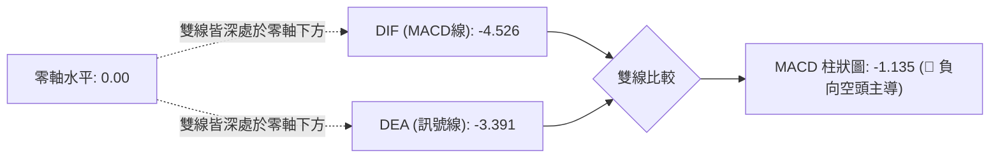

- **MACD線**：-4.526
- **訊號線 (Signal)**：-3.391
- **柱狀圖 (Histogram)**：-1.135（負值）
- **技術解讀**：DIF 線仍在 DEA 線下方運行，雖然週線柱狀圖自 -2.020 略微收斂至 -1.135，但雙線仍在零軸下深處，空方結構未扭轉，任何反彈未見雙線零軸上金叉前均屬次級折返。

### 📦 布林通道分析

```
SPCX 布林通道 (Bollinger Bands 20, 2) 架構圖
$160.64 ┤═══════════════════════════════════════════ 上軌 (Upper Band)
        │
$144.18 ┤------------------------------------------- 中軌 (MA20 阻力: $144.18)
$142.07 ┤                     ● (現價 %B = 0.44)
        │
$127.71 ┤═══════════════════════════════════════════ 下軌 (Lower Band)
```

- **布林參數**：上軌 $160.64 ｜ 中軌 $144.18 ｜ 下軌 $127.71 ｜ 帶寬 $32.93
- **%B 指標**：0.44。現價位於下軌向中軌推進之途中，距離中軌僅差 $2.11 (-1.46%)。
- **通道行為解析**：日前股價在11-05穿破下軌後迅速縮回通道內部，帶寬未出現異常喇叭口放大，顯示下行爆發力減弱。目前受到下軌有效支撐，向上測試中軌 $144.18 為標準均值回歸走勢。

### 💹 成交量分析（量價配合度）

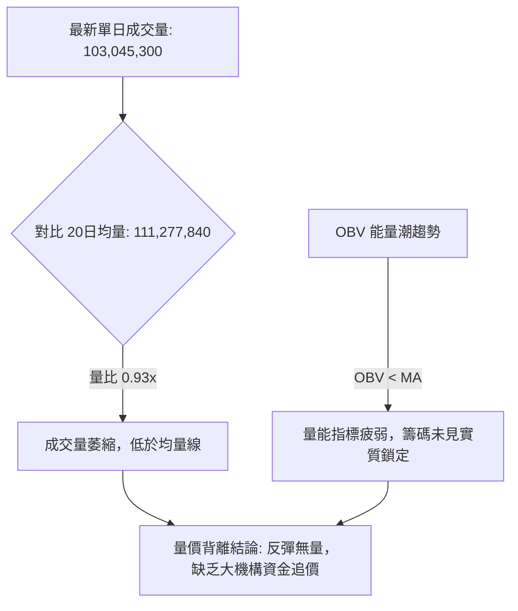

- **成交量對比**：最新日成交量為 103,045,300 股，相較於 20 日均量 111,277,840 股，量比為 **0.93x**；相較於 50 日均量 99,005,574 股，則略高於季均量。
- **OBV 趨勢**：系統檢測明確標示 **OBV < MA**，能量潮處於其移動平均線下方，顯示籌碼整體仍處於淨流出背景下的弱勢修復。
- **量能評估**：上週五及本週一的上漲過程中量能未見有效遞增（11-06為1.15億股，11-09降至1.03億股），屬典型的「縮量反抽」。若要突破 R1 ($149.80)，單日成交量必須放大至 1.35 億股以上。

---

## 6. 動能與波動率

### ⚡ 動能評估四象限

根據當前動能指標（RSI=48.50, MACD=-4.526）與波動率水準（ATR=$8.35, 帶寬$32.93），股票在市場矩陣中之定位如下表：

| 象限代號 | 動能維度 (Momentum) | 波動維度 (Volatility) | 當前狀態判定 | 戰略應對方針 |
|:---:|:---:|:---:|:---:|:---|
| **Q1** | 強動能 (Bullish) | 低波動 (Low Vol) | - | 穩健單邊趨勢，最佳加碼擴大部位時機 |
| **Q2** | 弱動能 (Bearish) | 低波動 (Low Vol) | - | 陰跌築底行情，宜耐心觀望等待訊號 |
| **Q3** | 強動能 (Bullish) | 高波動 (High Vol) | - | 突破加速段，適合追擊但需嚴控移動停利 |
| **Q4** | **弱動能 (中性偏空)** | **高波動 (ATR 5.88%)** | **✓ [SPCX 當前位置]** | **高風險震盪期：動能偏弱但波動巨大，嚴禁追高，僅能區間快進快出** |

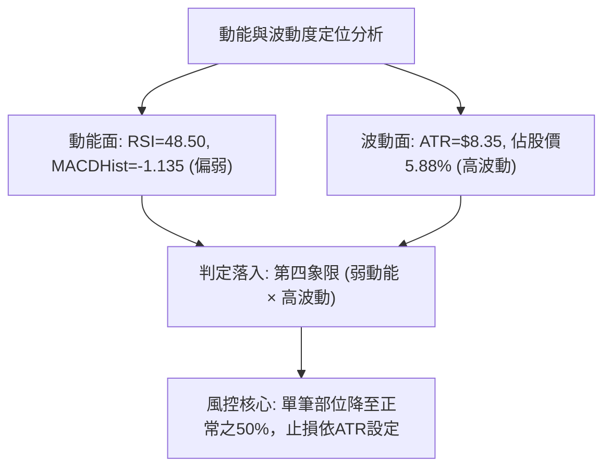

### 📊 ATR 波動率分析

- **ATR(14) 讀數**：**$8.35**（採 Wilder 平滑演算法計算）。
- **ATR 佔價格比**：**5.88%**（以現價 $142.07 計算）。
- **市場意義解讀**：每日平均震盪幅度達 $8.35，表示 SPCX 為極高彈性之高波動標的。任何過於緊密的止損（如 1-2%）極易在盤中日內噪音中被掃出場。
- **風控止損建議**：
  - **激進型（短線交易）**：1.0 × ATR = **$8.35**
  - **常規型（波段操作）**：1.5 × ATR = **$12.53**
  - **防守型（底倉保護）**：2.0 × ATR = **$16.70**

### 📐 Beta 與市場相關性

- **Beta 數值**：**N/A（數據未提供）**（資料庫標註為 N/A）。
- **市場特徵說明**：雖然數據未提供具體 Beta 係數，但從 ATR 佔比 5.88% 與 52 週振幅（$104.83 至 $225.64，振幅達 115.2%）以及當前高本益比（Trailing P/E: 617.7）可推知，該標的具備超高彈性科技成長股的屬性，對市場風險偏好及宏觀流動性高度敏感。
- **空頭部位比例**：放空比例佔流通股 2.4%，放空比率（Short Ratio）為 1.79 天，顯示空頭籌碼未出現極度擁擠，短期無大規模軋空（Short Squeeze）推升基礎。

---

## 7. 多時框架總結

### 📋 時框架評分表

| 時框架 | 趨勢方向 | 動能指標 | 均線排列 | 圖表形態 | 綜合評分 | 操作戰略建議 |
|:---|:---:|:---:|:---:|:---:|:---:|:---|
| **月線 (長期)** | 🟡 中性整理 | RSI走平 | 回調至半年線 | 78.6%斐波震盪 | 48/100 | 長線資金分批建立核心觀察底倉 |
| **週線 (中期)** | 🔴 空方承壓 | MACD負柱收斂 | 均線高檔反壓 | 長下影錘頭測試 | 40/100 | 中線反彈先以減磅解套、降槓桿為主 |
| **日線 (短期)** | 🟢 超跌反抽 | RSI回升/KD金叉| MA5/10金叉反彈 | 破底翻反抽中軌 | 52/100 | 短線順應動能回抽，嚴設止損進行高拋低吸 |

### 🔲 綜合訊號矩陣

```
SPCX 多時框訊號一致性評估矩陣
─────────────────────────────────────────────────────────────────
維度          短期 (日線)      中期 (週線)      長期 (月線)
─────────────────────────────────────────────────────────────────
趨勢方向      🟢 反彈修復      🔴 階梯下行      🟡 箱型深調
動能強度      🟢 轉向金叉      🔴 空頭掌控      🟡 中性回落
均線位階      🟡 短多中空      🔴 空頭排列      🟡 尋求支撐
量價結構      🔴 縮量反彈      🔴 巨量套牢      🟡 放量沉澱
─────────────────────────────────────────────────────────────────
矩陣結論：長中短期訊號存在衝突，尚未形成全週期「多頭共振」。
─────────────────────────────────────────────────────────────────
```

### ⚖️ 多時框收斂結論

依「嚴格要求 14」執行精確多時框收斂判定：

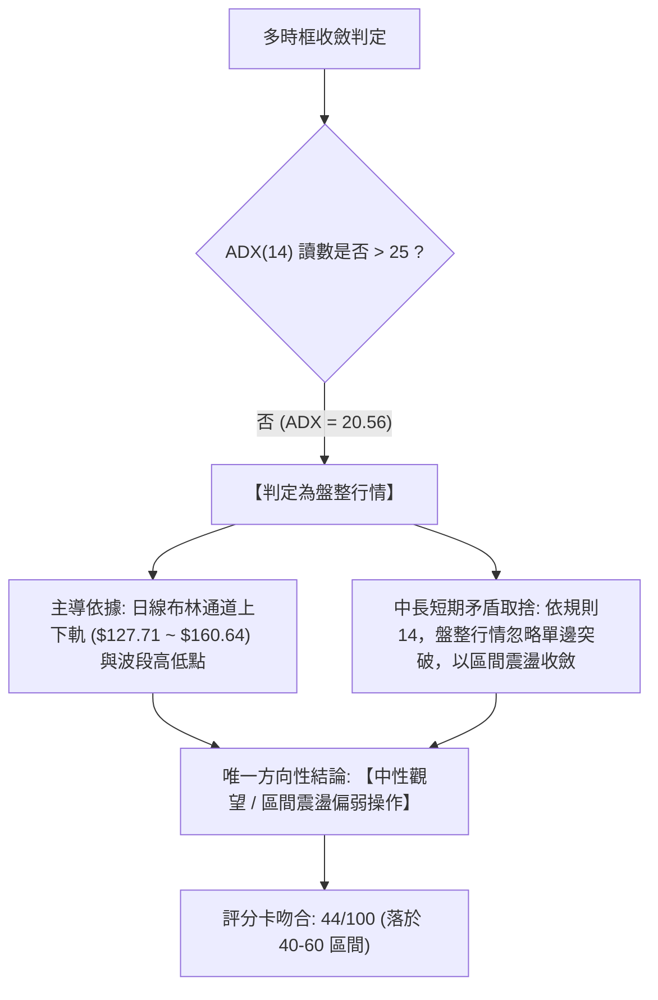

1. **行情性質判定**：ADX(14) = 20.56（< 25），明確判定為**盤整震盪行情**，而非單邊趨勢行情。
2. **優先級收斂**：在盤整行情中，趨勢跟隨型均線指標失效，交易重心必須收斂至**日線布林通道上下軌（$127.71 至 $160.64）**以及**關鍵價位（S1: $140.66、S2: $130.39 與 R1: $149.80）**所構成的實體箱型之內。
3. **最終方向性結論**：**中性偏弱震盪觀望（Neutral to Weak Consolidation）**。第 1 章評分卡為 **44/100**，日線短多反彈僅能視為震盪箱型內部的均值回歸，受制於中期週線空頭反壓，主策略定調為**區間震盪操作**。

---

## 8. 交易策略建議

### 🗺️ 策略決策流程圖

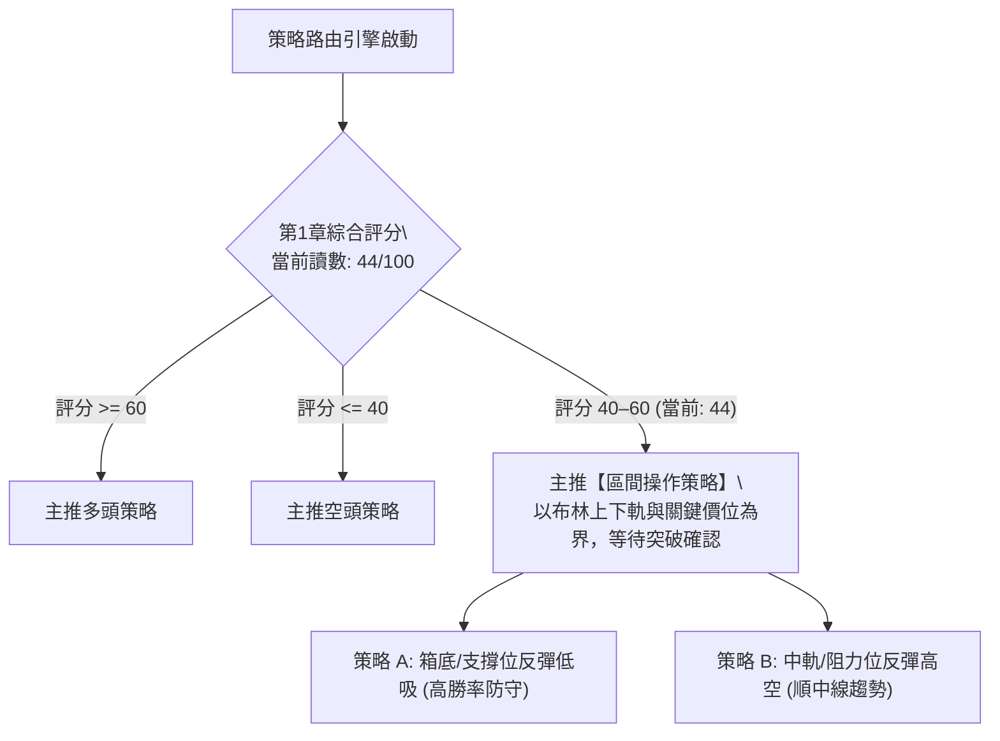

### 🧭 策略路由（依評分卡分流）

> **當前主策略方向 = 區間震盪操作（依評分 44/100，中性偏弱區間）**  
> 說明：綜合評分 44 分落入 40–60 之中性盤整區間，ADX 20.56 確認為無趨勢盤整。當前既不具備強力突破做多的多頭共振條件，亦因超跌反彈強勁而不宜在底部盲目殺跌。操作原則為「**以關鍵價位為邊界的區間操作，嚴格執行防守，靜待日線級別突破方向確認**」。

### 🎯 價格情境階梯（Price Scenarios）

價位嚴格引用自第 4 章及關鍵價位區塊之真實數據：

| 觸發條件 | 下一目標 | 後續延伸目標 | 情境含義與技術演變 |
|:---|:---:|:---:|:---|
| **強勢突破 R1 ($149.80)** | **R2 ($155.00)** | **R3 ($158.13)** | 短線轉強，站上MA50季線，挑戰布林上軌與近一年波段高點 |
| **受阻於 MA20 ($144.18)** | **S1 ($140.66)** | 區間震盪中點 | 均線反壓有效，多空於現價附近進行籌碼換手與窄幅洗盤 |
| **跌破關鍵支撐 S1 ($140.66)** | **S2 ($130.39)** | **S3 ($104.83)** | 中期轉弱，破底翻失敗，回測78.6%斐波回調位甚至52週歷史低點 |

### 📊 情境機率分佈

| 情境劇本 | 預估機率 | 主要技術依據與數據驗證 |
|:---|:---:|:---|
| **情境一：區間震盪整理** | **55%** | ADX=20.56確立弱趨勢，布林帶寬收縮，量比0.93x顯示資金缺乏單邊攻擊意願 |
| **情境二：遇阻回落再探底** | **30%** | 中期均線MA20/50蓋頭向下，MACD柱狀圖仍為負值(-1.135)，-DI(32.48)佔優 |
| **情境三：連續放量突破上攻** | **15%** | 短線僅MA5/10金叉，成交量未見顯著放大，突破R1($149.80)需大量資金推動 |

### 🟢 區間主策略詳情（精確數值計算）

依據規則 17，所有價位嚴格引用系統數據，風險報酬比公式為：
- 做多：`(T1 − 進場價) ÷ (進場價 − 止損價)`
- 做空：`(進場價 − T1) ÷ (止損價 − 進場價)`
- 比值格式：`1 : X.XX（以 T1 計）`

| 策略要素 | 策略 A（區間下緣低吸多單） | 策略 B（區間阻力高拋空單） |
|:---|:---|:---|
| **策略類型** | 區間震盪低吸（等待回踩確認） | 順應中期均線壓制之反彈高空 |
| **進場條件** | 價格回踩 S1 獲得支撐，或現價站穩進場 | 價格反彈至 MA20 與 R1 阻力帶受阻滯漲 |
| **進場價格** | **$140.66**（精確引用 S1 支撐位） | **$149.80**（精確引用 R1 關鍵阻力位） |
| **目標價 T1** | **$149.80**（引用 R1 阻力位） | **$140.66**（引用 S1 支撐位） |
| **目標價 T2** | **$155.00**（引用 R2 阻力位） | **$130.39**（引用 S2 強支撐位） |
| **止損價格** | **$135.00**（設定於近期低點密集區下方） | **$155.00**（突破 R2 阻力嚴格止損） |
| **風險報酬比** | **1 : 1.62（以 T1 計）**<br>計算式：($149.80 - $140.66) / ($140.66 - $135.00) = $9.14 / $5.66 = 1.615 | **1 : 1.76（以 T1 計）**<br>計算式：($149.80 - $140.66) / ($155.00 - $149.80) = $9.14 / $5.20 = 1.758 |
| **次級風報比** | 1 : 2.53（以 T2 計，分子為 $155.00 - $140.66 = $14.34） | 1 : 3.73（以 T2 計，分子為 $149.80 - $130.39 = $19.41） |
| **成功機率** | **55%**（受制於上方均線反壓） | **50%**（受短期超跌反彈動能干擾） |
| **建議倉位** | **10% - 15%**（輕倉試單） | **10% - 15%**（輕倉對沖） |

### 🔴 反向風險觸發點（對沖提示）

- **多頭部位之警戒線**：若日線收盤價跌破 **S1: $140.66**，且成交量放大，表示短期築底反彈失敗，應立即將多頭倉位降至 5% 以下或執行對沖；若進一步跌破 **S2: $130.39**，必須全數離場止損。
- **空頭部位之警戒線**：若價格強勢帶量收復 **R1: $149.80**（日成交量超過 1.35 億股），意味著空頭結構被實質破壞，所有試盤空單必須立即止損退場。

### ⭐ 整體訊號強度評星

```
做多訊號強度：★★☆☆☆  (2.5/5星 — 短線反彈但受制中期均線與量能不足)
做空訊號強度：★★★☆☆  (3.0/5星 — 中期趨勢偏空，反彈阻力密集)
整體可信度：  ★★★☆☆  (3.0/5星 — 處於 ADX<25 盤整期，訊號多有反覆)
```

---

## 9. 風險提示與監控

### ✅ 關鍵監控指標 Checklist

```
╔══════════════════════════════════════════════════════════════════════╗
║                    SPCX 每日關鍵技術監控清單                         ║
╠══════════════════════════════════════════════════════════════════════╣
║ [ ] 價格防線檢驗：收盤價是否守穩 S1 ($140.66) ？                   ║
║ [ ] 均線動態阻力：日內最高價是否受壓於 MA20 ($144.18) ？           ║
║ [ ] 動能翻轉確認：RSI(14) 能否順利突破 50 多空分水嶺？             ║
║ [ ] 空頭縮減訊號：MACD 柱狀圖是否由 -1.135 持續朝零軸收斂？         ║
║ [ ] 突破確認指標：ADX(14) 是否脫離 20 水平並向上突破 25？           ║
║ [ ] 量能配合檢測：單日成交量是否超過 20 日均量 (111,277,840 股)？   ║
║ [ ] 極端風險防範：價格是否再度觸發接近 ATR (單日波動 > $8.35)？     ║
╚══════════════════════════════════════════════════════════════════════╝
```

### ⚠️ 風險場景分析

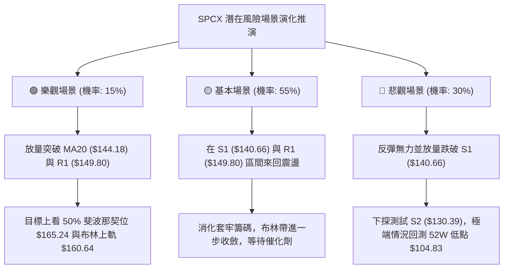

### 🛡️ 風險管理重要提醒

1. **極高波動率防禦**：
   - 本標的最新 ATR 高達 **$8.35**，單日潛在波動率達 **5.88%**。
   - 在高波動環境下，切忌滿倉或高槓桿交易。單筆交易承擔之風險金額（進場價與止損價之差額 × 股數）絕不可超過總投資資金之 **1.5%**。
2. **基本面估值偏離風險**：
   - 儘管本報告專注於技術面，但數據顯示 SPCX 之滾動本益比（Trailing P/E）高達 **617.70**，自由現金流（FCF TTM）為 **$-40.16B**。
   - 極端的高估值倍數意味著一旦大盤風險偏好下降或增長不及預期，極易引發技術面支撐失效之「多殺多」踩踏行情。
3. **部位規模管理規範**：
   - 總持有部位建議控制在總倉位的 **20%** 以內。
   - 區間波段單務必恪守「到點即走」原則，在未見到週線級別放量確認突破前，切勿將短線區間單轉為長線套牢單。

---

## 📋 報告總結

```
╔══════════════════════════════════════════════════════════════════════╗
║                     SPCX 技術分析報告總結                            ║
╠══════════════════════════════════════════════════════════════════════╣
║ 報告日期：2026-11-10                                                 ║
║ 當前價格：$142.07 USD                                                ║
║ 綜合技術評分：44 / 100 (算術平均)                                    ║
║ 分析評級：⚖️ 中性偏弱震盪觀望（區間操作評級）                         ║
╠══════════════════════════════════════════════════════════════════════╣
║ 關鍵技術結論：                                                       ║
║ ├─ 長期趨勢 (月線)：🟡 中性深調，處於 52W 區間 30.8% 之低檔沉澱區      ║
║ ├─ 中期趨勢 (週線)：🔴 空方壓制，階梯式下行，承壓於週均線之下        ║
║ ├─ 短期趨勢 (日線)：🟢 超跌反抽，MA5/10 金叉，由 $120.39 強勁回彈    ║
║ ├─ 行情屬性定調：ADX = 20.56 (< 25)，無趨勢盤整，以布林通道為主要依據║
║ ├─ 關鍵支撐價位：S1: $140.66 ｜ S2: $130.39 ｜ S3: $104.83           ║
║ ├─ 關鍵阻力價位：R1: $149.80 ｜ R2: $155.00 ｜ R3: $158.13           ║
║ └─ 分析師目標共識：$255.06 (買入共識，最高 $800.00 / 最低 $70.00)     ║
╠══════════════════════════════════════════════════════════════════════╣
║ 最優策略組合指引：                                                   ║
║ 1. 🥇 最佳機會（區間低吸）：回踩 S1 ($140.66) 企穩進場，止損 $135.00， ║
║    目標 T1: $149.80，風報比 1 : 1.62（以 T1 計）。                   ║
║ 2. 🥈 次選機會（反彈高空）：反抽 R1 ($149.80) 受阻放空，止損 $155.00， ║
║    目標 T1: $140.66，風報比 1 : 1.76（以 T1 計）。                   ║
║ 3. 🥉 保守選擇（空倉觀望）：等待價格實質突破 R1 ($149.80) 或有效放量   ║
║    跌破 S1 ($140.66) 後，順應新單邊趨勢順勢跟進。                    ║
╚══════════════════════════════════════════════════════════════════════╝
```

---

> ⚠️ **免責聲明**：本報告為依據標準技術分析模型與歷史數據自動生成之研究報告，所有價位、圖表及推算僅供學術研究與投資策略探討參考，**絕不構成任何具體之買賣要約或投資決策建議**。技術分析指標具備滯後性與機率極限，金融市場交易存在極高之本金損失風險，投資人應獨立評估自身財務承受能力與風險屬性，並自行承擔所有交易損益。

---

*報告生成時間：2026-11-10 ｜ 數據來源：Yahoo Finance ｜ 分析框架：多時框技術分析模型 (MTFA)*