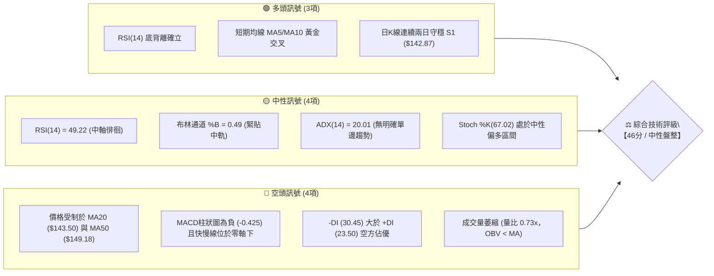
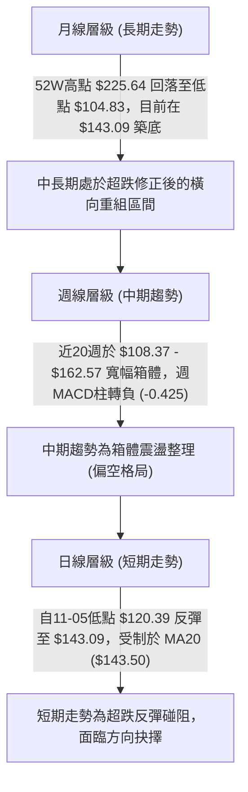
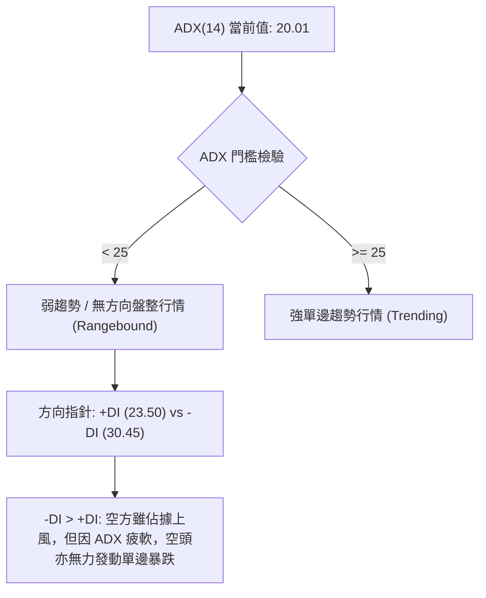
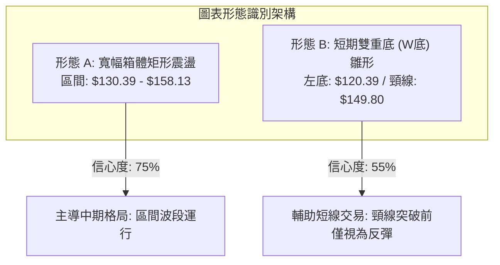
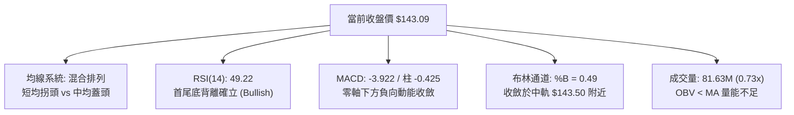
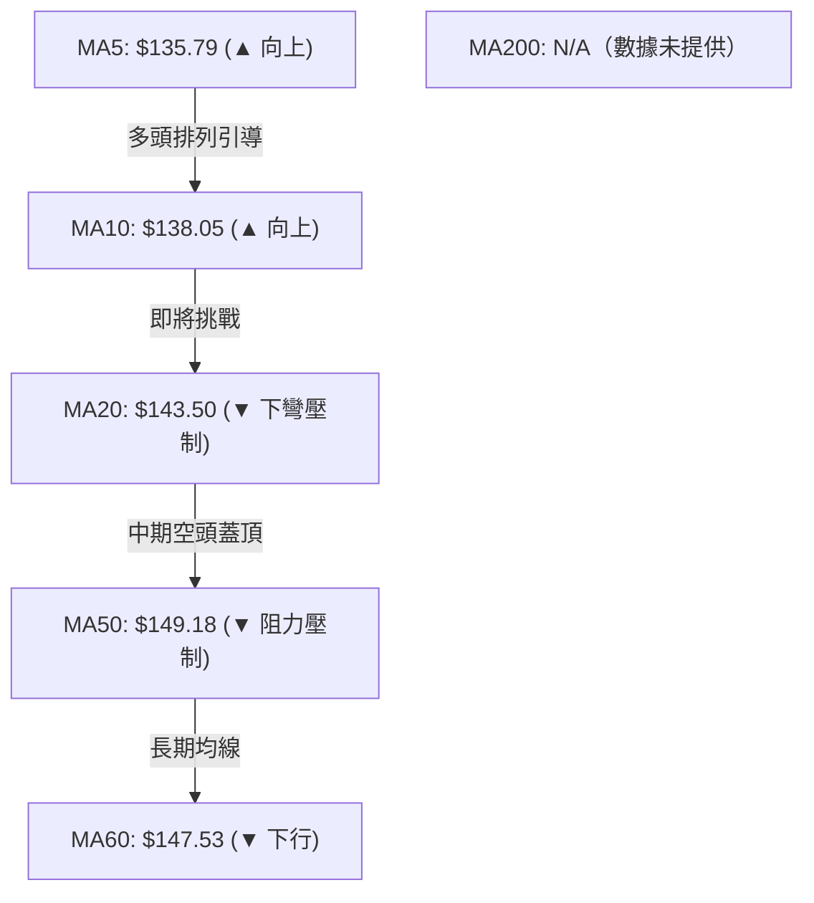
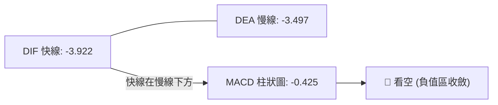
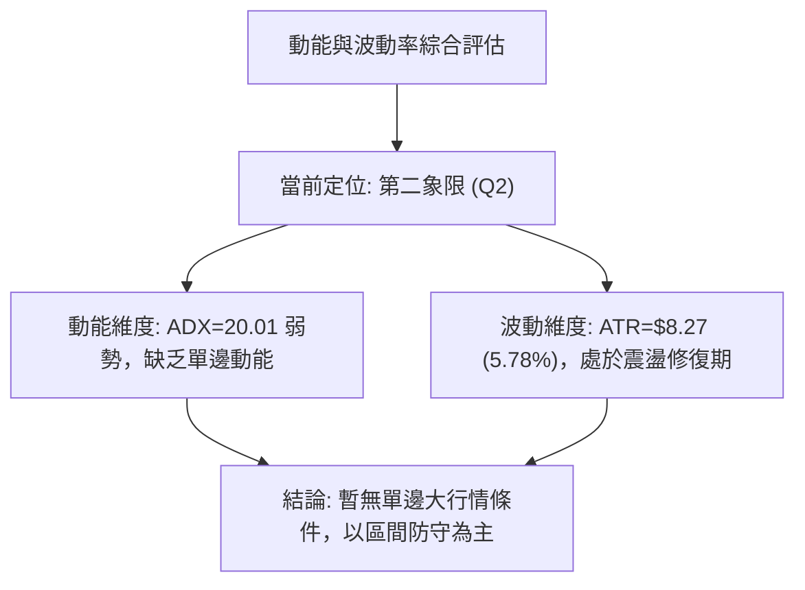
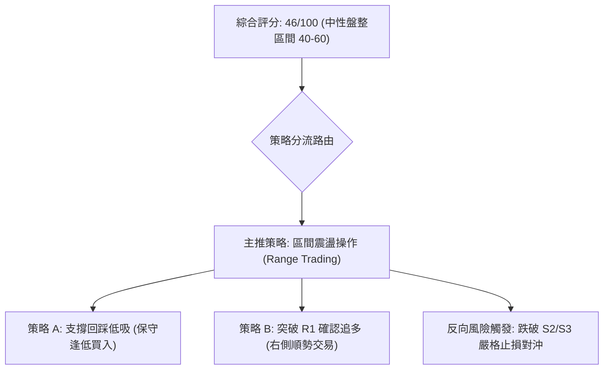
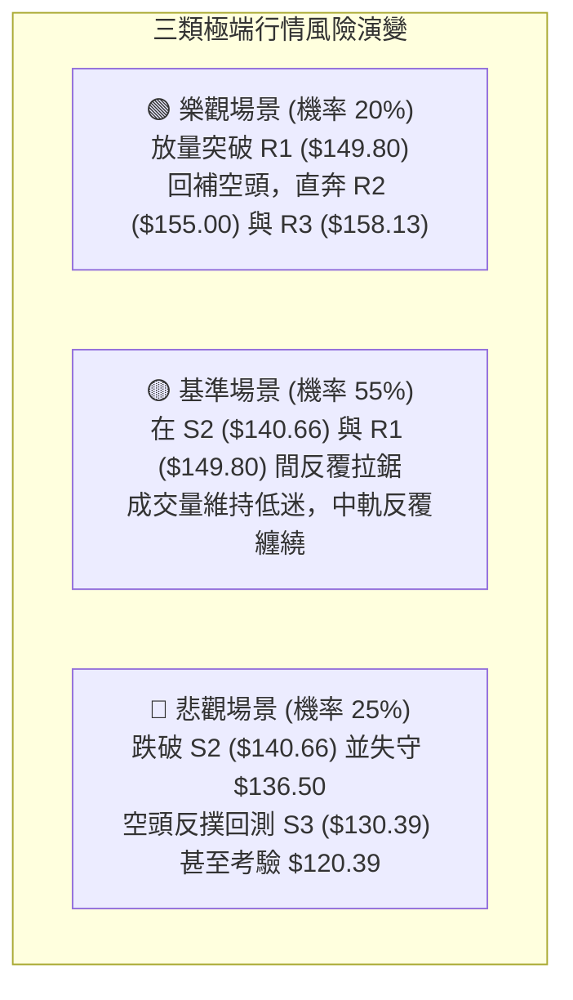

# SPCX 技術分析報告

> **報告日期**：2026-11-11 ｜ **語言**：繁體中文 ｜ **數據來源**：Yahoo Finance ｜ **當前價格**：$143.09

---

## 目錄

| 章節 | 內容 |
|------|------|
| [1. 技術面概覽](#1-技術面概覽) | 訊號儀表板、核心指標速覽表、技術評分卡 |
| [2. 趨勢分析](#2-趨勢分析) | 多時框趨勢判斷、12個月月線走勢圖、週線與ADX解讀 |
| [3. 圖表形態分析](#3-圖表形態分析) | 形態識別信心度、近10日與近8週K線組合、目標價推算 |
| [4. 支撐與阻力](#4-支撐與阻力) | 價位結構分布圖、阻力/支撐分析表、斐波那契回調 |
| [5. 技術指標深度解讀](#5-技術指標深度解讀) | 均線系統、RSI底背離、MACD柱狀圖、布林通道與OBV量能 |
| [6. 動能與波動率](#6-動能與波動率) | 動能評估四象限、ATR波動分析、Beta相關性說明 |
| [7. 多時框架總結](#7-多時框架總結) | 時框架矩陣、信號收斂結論（ADX<25 盤整優先） |
| [8. 交易策略建議](#8-交易策略建議) | 決策路由、價格情境階梯、主策略詳情（精確風報比） |
| [9. 風險提示與監控](#9-風險提示與監控) | 監控指標Checklist、風險情境與資金管理 |

---

## 1. 技術面概覽

### 🎯 技術訊號儀表板



### 📊 核心指標速覽表

| 指標類別 | 指標名稱 | 當前數值 | 訊號 | 解讀 |
|:---|:---|:---|:---:|:---|
| **價格基準** | 當前收盤價 | $143.09 | 🟡 | 位於52週區間 31.7% 低分位處，處於區間震盪築底階段 |
| **短期均線** | MA20 (布林中軌) | $143.50 | 🔴 | 現價位於 MA20 下方 -0.29%，短線面臨中軌反壓 |
| **中期均線** | MA50 | $149.18 | 🔴 | 現價低於 MA50 -4.08%，中期結構仍受壓制 |
| **長期均線** | MA200 | N/A（數據未提供） | 🟡 | 數據歷史不足以計算200日線，以長期高低點區間觀察 |
| **超買超賣** | RSI(14) | 49.22 | 🟡 | 位於 30–70 中性區，具備近20日首尾底背離買訊 |
| **趨勢動能** | MACD (12,26,9) | -3.922 / -3.497 | 🔴 | 柱狀圖為 -0.425，處於負值區間，空方動能收斂中 |
| **擺動指標** | Stoch %K / %D | 67.02 / 48.23 | 🟢 | 快線向上穿越慢線，短線呈現反彈動能修復跡象 |
| **趨勢強度** | ADX(14) | 20.01 | 🟡 | ADX < 25 表明處於盤整市，-DI(30.45) > +DI(23.50) |
| **波動帶** | 布林通道帶寬 | $128.10 – $158.90 | 🟡 | 現價緊貼中軌 ($143.50)，帶寬收窄醞釀方向選擇 |
| **波動幅度** | ATR(14) | $8.27 | 🟡 | 每日波幅佔股價 5.78%，屬中高波動個股特性 |
| **量能狀態** | 成交量 / 20日均量 | 81.63M / 111.93M | 🔴 | 最新量比僅 0.73x，OBV < MA，量能匱乏不利單邊突破 |

### 🏆 技術評分卡

```
╔══════════════════════════════════════════════════════════════╗
║               技術評分卡 — SPCX (2026-11-11)                  ║
╠══════════════════════════════════════════════════════════════╣
║ 趨勢強度 (ADX=20.01 / 均線壓制)  ████████░░░░░░░░░░░░  42/100 🔴 ║
║ 動能指標 (RSI底背離 vs MACD負值) ██████████░░░░░░░░░░  48/100 🟡 ║
║ 支撐穩定度 (S1/S2支撐發揮效力)   ███████████░░░░░░░░░  54/100 🟡 ║
║ 成交量配合 (量比0.73x / OBV疲弱) ███████░░░░░░░░░░░░░  38/100 🔴 ║
║ 形態完整度 (回踩120.39後收雙底)  ██████████░░░░░░░░░░  52/100 🟡 ║
║ 均線排列 (短均向上但中長均蓋頭)  ████████░░░░░░░░░░░░  42/100 🔴 ║
╠══════════════════════════════════════════════════════════════╣
║ 綜合評分 (依規則18算術平均值)    █████████░░░░░░░░░░░  46/100 🟡 ║
║ 評級結論：【46/100 區間盤整／中性偏弱】                      ║
╚══════════════════════════════════════════════════════════════╝
```
*計算公式：綜合評分 = (42 + 48 + 54 + 38 + 52 + 42) ÷ 6 = 276 ÷ 6 = 46.0（四捨五入取整為 46）。*

---

## 2. 趨勢分析

### 🌐 多時框趨勢分析



### 📈 長期趨勢 — 12個月走勢圖（Unicode）

依據月度收盤價與52週極值數據繪製長期走勢輪廓：

```
SPCX 走勢圖（過去12個月與關鍵拐點）
價格軸 ($)
$225.64 ┤                           ● (52W 高點)
$200.00 ┤                          / \
$175.00 ┤         ●(2026-06: 170.86)   \
$150.00 ┤        /                      ●(09: 150.86)  ●(現在: 143.09)
$125.00 ┤       /     ●(08: 143.69)        \          /
$104.83 ┤──────●(07: 108.37 / 52W低點)──────●(10: 134.72)────────
        └─────────────────────────────────────────────────────
         2025-12  ...   2026-06  2026-07  2026-08  2026-09  2026-10  2026-11
```

**長期走勢特徵分析表格**：

| 時間區間 | 起訖價格 / 關鍵點位 | 區間變動 | 走勢結構與技術特徵 |
|:---|:---|:---:|:---|
| 52週高點至築底 | $225.64 → $104.83 | -53.54% | 遭遇劇烈單邊殺跌，回撤幅度超過五成，釋放高估值風險 |
| 2026-06 至 2026-07 | $170.86 → $108.37 | -36.57% | 空頭加速放量崩跌，於 7 月創下月收盤低點 $108.37（逼近 52W 低點 $104.83） |
| 2026-07 至 2026-09 | $108.37 → $150.86 | +39.21% | 觸底後迎來強勁技術性反彈，收復 150 美元整數關卡 |
| 2026-09 至 2026-10 | $150.86 → $134.72 | -10.70% | 承壓於 61.8% 斐波那契位 ($150.98)，動能減弱轉入二次回踩 |
| 2026-10 至 2026-11 | $134.72 → $143.09 | +6.21% | 探底 $120.39 後快速回升至現價 $143.09，圍繞中軌進行籌碼沉澱 |

### 📊 中期趨勢（週線分析）

中期技術面以 2026-10-09 週高點 $176.42 及收盤 $162.57 為頂部，隨後展開連續回調。近期測試 2026-11-06 週低點 $120.39 後拉出長下影線，本週（截至 11-10）收於 $143.09。

```
 SPX 週線多空關鍵攻防示意圖
 ────────────────────────────────────────────────────────────
 [強阻力] $158.13 (R3 / 近期週K波段密集區)
    ▲
    │    [中軌阻力] $149.80 (R1 / 斐波那契 61.8% $150.98 聚類)
    │       ▲
    │       │   ───► 當前收盤價: $143.09 (貼近 MA20 $143.50)
    │       ▼
    │    [關鍵支撐] $140.66 (S2 / 10-16週低點支撐)
    ▼
 [強支撐] $130.39 (S3 / 斐波那契 78.6% $130.68 聚類防線)
 ────────────────────────────────────────────────────────────
```

### ⚡ 趨勢強度評估（ADX 解讀）



**ADX 趨勢強度對照解讀表**：

| 指標變數 | 數值 | 狀態評定 | 交易涵義與操作指引 |
|:---|:---:|:---:|:---|
| **ADX (14)** | **20.01** | 弱趨勢 / 盤整市 | ADX 遠低於 25 臨界值，單邊突破追價策略極易遭遇假突破，應轉為高拋低吸之區間震盪策略 |
| **+DI** | **23.50** | 多方動能弱 | 多頭推升力量有限，短線反彈高度受制於上方均線阻力 |
| **-DI** | **30.45** | 空方相對優勢 | 賣壓依然高於買盤，但未能推升 ADX，意味著主動性殺跌盤動能正在鈍化衰竭 |

---

## 3. 圖表形態分析

### 🔍 形態識別系統



**形態識別與信心度評估表（依規則 15）**：

| 形態名稱 | 信心度 | 判斷依據（嚴格引用已知數據） | 完成度 | 目標價（附嚴謹計算式） |
|:---|:---:|:---|:---:|:---|
| **寬幅箱體矩形震盪** | **75%** | 價格在 S3 ($130.39) 至 R3 ($158.13) 間反覆震盪；近8週高點多次止步於 $158.13–$159.84，低點守穩 $130 關卡 | 85% | 上軌目標：$158.13 (R3)<br/>下軌目標：$130.39 (S3) |
| **短期雙底 (W底) 雛形** | **55%** | 2026-11-05 探底 $120.39 後迅速拉升至現價 $143.09，頸線對應 R1 ($149.80)。由於尚未帶量突破頸線，僅屬構築階段 | 45% | **形態理論目標價**：<br/>頸線 $149.80 + 形態高度 ($149.80 - $120.39 = $29.41) = **$179.21**<br/>*(註：接近斐波那契 38.2% 位 $179.49)* |

### 🕯️ 重要K線形態分析

嚴格依據數據中「近10根日K」與「近8根週K」實際開高低收數據進行客觀解讀：

| 日期（週期） | 開盤價 | 最高價 | 最低價 | 收盤價 | K線形態名稱 | 技術解讀 | 訊號強度 |
|:---|:---:|:---:|:---:|:---:|:---|:---|:---:|
| **2026-11-05 (日K)** | 131.34 | 131.87 | 120.39 | 123.62 | **恐慌長黑破底棒** | 盤中下挫至 $120.39 創波段新低，單日成交量激增至 171.36M，呈現空頭衰竭性拋售 | 🔴 極弱 |
| **2026-11-06 (日K)** | 130.94 | 135.32 | 128.57 | 134.27 | **低位長下影陽線** | 開低走高收出中陽線，低點未破昨日，收盤重回 $134 之上，確認低檔買盤承接力道 | 🟢 轉強 |
| **2026-11-09 (日K)** | 136.51 | 143.20 | 135.37 | 142.07 | **強勁多頭推進大陽線** | 跳空高開並強勢收復 $142，貫穿短期均線，確認 11-05 之破底為短線空頭陷阱 | 🟢 看多 |
| **2026-11-10 (日K)** | 139.16 | 144.89 | 137.65 | 143.09 | **高檔震盪小陽星** | 衝高觸及 $144.89 後遇 MA20 ($143.50) 反壓收斂，量能縮至 81.63M，顯示追價轉趨謹慎 | 🟡 中性 |
| **2026-11-06 (週K)** | 137.01 | 142.74 | 120.39 | 134.27 | **探底長下影週錘頭** | 單週振幅達 16.3%，下影線長達 $13.88，巨量 586.53M 換手，為典型中期止跌轉折K線 | 🟢 看多 |
| **2026-11-10 (週K)** | 136.51 | 144.89 | 135.37 | 143.09 | **回升週紅K棒** | 截至前半週已站上上週收盤價，實體推進 +6.57%，確認中期低點支撐效力 | 🟢 偏多 |

### 📉 ASCII 走勢形態示意圖

```
SPCX 日線短期雙底反彈與箱體結構示意
 價格 ($)
$158.13 ┼──────────────────────────────● (箱體上軌 R3)
        │                             / \
$149.80 ┼──────────────● 頸線 (R1) ───/───\──────────── (阻力區)
        │             / \            /     \
$143.09 ┼────────────/───\──────────● 現價 ──\────────── (MA20 爭奪)
        │           /     \        /
$130.39 ┼──────────●───────\──────/─────────────────── (箱體下軌 S3)
        │                   \    /
$120.39 ┼────────────────────● (11-05 破底低點)
        └──────────────────────────────────────────────
                          時間軸 (2026-10 → 2026-11)
```

### 🎯 形態目標價計算

1. **短期反彈形態（W底）目標推算**：
   - 形態底部低點：$120.39（2026-11-05 日低點）
   - 形態頸線位置：$149.80（波段聚類阻力 R1）
   - 形態垂直高度 $H = \text{頸線} - \text{底點} = \$149.80 - \$120.39 = \$29.41$
   - 突破目標價 $T = \text{頸線} + H = \$149.80 + \$29.41 =$ **$179.21**
   - *驗證性對照：該目標價與 52 週斐波那契 38.2% 回調位 ($179.49) 高度共振。*
2. **中期箱體運行目標**：
   - 當前處於箱體下半區向中軸回歸階段，箱體理論中軸為 $(\$158.13 + \$130.39) \div 2 = \$144.26$，目前現價 $143.09 緊貼該中軸。

---

## 4. 支撐與阻力

### 🗺️ 關鍵價位分布圖（Unicode）

```
╔══════════════════════════════════════════════════════════════╗
║               SPCX 價位結構分布圖 (由 OHLCV 計算)              ║
╠══════════════════════════════════════════════════════════════╣
║ $158.13 ║████████████████████████║ 強阻力 R3 (近8週高點密集區)  ║
║ $155.00 ║████████████████████    ║ 阻力 R2 (整數心理/波段高點) ║
║ $149.80 ║████████████████████████║ 關鍵阻力 R1 (頸線/MA50交匯) ║
║ $143.09 ╠════════════════════════╣ ◄ 當前收盤價 (現價位置)     ║
║ $142.87 ║▓▓▓▓▓▓▓▓▓▓▓▓▓▓▓▓        ║ 近期支撐 S1 (極短線樞紐防線) ║
║ $140.66 ║████████████████████    ║ 中度支撐 S2 (10-16週低點聚類)║
║ $130.39 ║████████████████████████║ 強支撐 S3 (箱體下軌/強防線) ║
╚══════════════════════════════════════════════════════════════╝
```

### 🚧 阻力位分析表

所有價位均嚴格引用自數據之「關鍵價位」高點聚類分析：

| 阻力級別 | 精確價位 | 距現價幅動 | 形成原因與技術共振 | 突破難度 | 重要性權重 |
|:---|:---:|:---:|:---|:---:|:---:|
| **R1** | **$149.80** | +4.69% | 近期波段高點聚類、MA50 ($149.18) 蓋頭壓制，且與斐波那契 61.8% ($150.98) 形成密集阻力帶 | 中等偏高 | 🟢🟢🟢 (極高) |
| **R2** | **$155.00** | +8.32% | 籌碼密集套牢區波段高點聚類，同時為整數大關心理壓力位 | 中等 | 🟢🟢 (中等) |
| **R3** | **$158.13** | +10.51% | 2026-09-25 週高點，布林通道上軌 ($158.90) 所在位置，為中期箱體震盪之上軌頂界 | 極高 | 🟢🟢🟢 (極高) |

### 🛡️ 支撐位分析表

所有價位均嚴格引用自數據之「關鍵價位」低點聚類分析：

| 支撐級別 | 精確價位 | 距現價幅動 | 形成原因與技術共振 | 守住機率 | 重要性權重 |
|:---|:---:|:---:|:---|:---:|:---:|
| **S1** | **$142.87** | -0.15% | 極短線波段低點聚類，緊鄰 MA20 ($143.50)，現階段多空短兵相接的樞紐位 | 60% | 🟢🟢 (中等) |
| **S2** | **$140.66** | -1.70% | 2026-10-16 週K實體低點聚類，多頭防守的第一道實質性堡壘 | 70% | 🟢🟢🟢 (高) |
| **S3** | **$130.39** | -8.88% | 近一年波段低點聚類，與斐波那契 78.6% 回調位 ($130.68) 精確重疊，中期生命線 | 85% | 🟢🟢🟢 (極高) |

### 📐 斐波那契回調位分析

依據 52 週絕對極值區間（低點 $104.83 → 高點 $225.64，垂直跨度 $120.81）計算之回調位體系：

| 回調比率 | 絕對價位 | 當前相對位置 | 技術意義解讀 |
|:---|:---:|:---:|:---|
| **0.0% (52W High)** | **$225.64** | +57.69% | 歷史高點牛市極限阻力 |
| **23.6%** | **$197.13** | +37.77% | 強勢回檔阻力位 |
| **38.2%** | **$179.49** | +25.44% | 中期重要反彈阻力位（與雙底形態理論目標價 $179.21 共振） |
| **50.0%** | **$165.24** | +15.48% | 多空平衡分水嶺中樞 |
| **61.8%** | **$150.98** | +5.51% | 黃金分割強壓位，與阻力 R1 ($149.80) 構成難以逾越的共振壓力區 |
| **78.6%** | **$130.68** | -8.67% | 深幅回調防守位，與支撐 S3 ($130.39) 構成黃金分割強支撐共振帶 |
| **100.0% (52W Low)**| **$104.83** | -26.74% | 52 週絕對底部，終極支撐防線 |

**回調位解讀**：
當前收盤價 **$143.09** 嚴格落於 **61.8% ($150.98)** 與 **78.6% ($130.68)** 兩大核心回調位之間。此區間屬於典型的空頭回撤後深幅震盪整理帶，在未帶量有效攻克 61.8%（$150.98）前，技術結構無法確認扭轉為多頭趨勢。

---

## 5. 技術指標深度解讀

### 🎛️ 指標訊號總覽



### 📈 移動平均線排列分析



**均線系統詳細參數表**：

| 均線週期 | 當前價格 | 距現價差距 | 方向 | 排列與技術影響 |
|:---|:---:|:---:|:---:|:---|
| **MA5** | $135.79 | -5.10% | ▲ 向上 | 短線助漲支撐，過去 5 日推升力道強勁 (+5.37%) |
| **MA10** | $138.05 | -3.52% | ▲ 向上 | 與 MA5 形成短線多頭金叉，為短線回踩提供第一道緩衝 |
| **MA20** | $143.50 | +0.29% | ▼ 下彎 | 現價緊貼其下，為布林中軌，下彎斜率限制多頭推進速度 |
| **MA50** | $149.18 | +4.26% | ▼ 下彎 | 中期強大蓋頭壓力，與 R1 ($149.80) 形成強阻力共振 |
| **MA60** | $147.53 | +3.10% | ▼ 下行 | 季線下行，顯示過去 3 個月持股成本沉重，反彈解套賣壓大 |
| **MA200**| N/A | N/A | N/A | **N/A（數據未提供）**，數據源歷史天數不足，不作主觀估算 |

### 📉 RSI(14) 分析

當前 RSI(14) Wilder 數值為 **49.22**。

```
RSI(14) 區間位置：
0        30              49.22  50                 70       100
├────────┼─────────────────█────┼──────────────────┼────────┤
超賣區    弱勢區             ▲  中軸  強勢區             超買區
```

- **超買超賣判定**：49.22 處於 30 至 70 之中性區間，且精確緊貼 50 榮枯線，反映多空力量在此陷入短暫均衡。
- **背離分析（極關鍵）**：
  - 系統偵測到明確的 **⚠️ 底背離 (Bullish Divergence)**。
  - **背離證據**：比較近 20 根 K 棒走勢，價格自 2026-10-30 收盤 $134.72 跌至 2026-11-05 盤中最低 $120.39（收 $123.62），創出顯著新低；然而 RSI 指標在此期間未破前低，自 37.5 向上抬升至目前的 49.22，呈現「價格創低、指標不創新低」之典型日線底背離形態，預示短期拋壓耗盡，反彈修復具備動能支撐。

### 📊 MACD(12,26,9) 訊號解讀



- **數值狀態**：DIF (-3.922) < DEA (-3.497)，雙線皆在零軸深處運行。
- **柱狀圖動態**：當前柱狀圖為 **-0.425**。相較於前兩週的負值低點（10-30週 -1.994、11-06週 -2.020），MACD 負向柱體已大幅收縮縮短，顯示中短期空頭殺跌動能正在顯著鈍化，快慢線有低位醞釀「水下金叉」之潛在趨勢。

### 📦 布林通道分析

```
SPCX 日線布林通道位置示意圖 (帶寬: $128.10 - $158.90)
 價格 ($)
$158.90 ┼────────────────────────────── BB 上軌 (超買阻力)
        │
$143.50 ┼────────────────────────────── BB 中軌 (MA20 反壓)
$143.09 ┼─● 現價 (BB %B = 0.49，緊貼中軌)
        │
$128.10 ┼────────────────────────────── BB 下軌 (超賣支撐)
        └──────────────────────────────
```

- **通道指標分析**：
  - 上軌：$158.90 ｜ 中軌：$143.50 ｜ 下軌：$128.10 ｜ 帶寬：$30.80。
  - **%B 指標為 0.49**（0=下軌，0.5=中軌，1=上軌）。現價 $143.09 幾乎精確處於中軌（0.49），代表價格已經完成自下軌（11-05 探底 $120.39 跌破下軌）向中軌的均值回歸。中軌走平下彎，若無法帶量突破中軌，價格將在中軌與下軌間重啟拉鋸。

### 💹 成交量分析（量價配合度）

- **量能規模**：最新交易日成交量為 **81,629,900 股**。
- **均量對比**：20日均量為 111,929,605 股，最新成交量佔 20MA 比例為 **0.73x (量縮 -27.07%)**；50日均量為 99,383,830 股。
- **OBV 趨勢評估**：數據顯示 **OBV < MA**。在 11-06 至 11-10 的反彈推進過程中，成交量由 115.5M 遞減至 81.6M，呈現典型的「量價背離（價漲量縮）」現象。這表明當前反彈主要源於空頭平倉與惜售，而非主力增量資金大舉進場搶籌，反彈若要持續突破上方強阻力 R1 ($149.80)，必須補量至 1.12 億股（20MA）之上。

---

## 6. 動能與波動率

### ⚡ 動能評估四象限

動能與波動率交互檢驗當前標的狀態：

| 象限分區 | 動能強度 | 波動率狀態 | 當前符合狀態 | 技術含義與操作對策 |
|:---:|:---:|:---:|:---:|:---|
| **第一象限 (Q1)** | 強動能 (ADX>25) | 低波動 (ATR低) | — | 穩定主升浪行情，適合趨勢跟隨與逢低加碼 |
| **第二象限 (Q2)** | **弱動能 (ADX<25)** | **中低波動 (帶寬中等)** | **✓ (當前狀態)** | **無明確趨勢之震盪市，動能匱乏，謹慎觀望，僅適宜區間操作** |
| **第三象限 (Q3)** | 強動能 (ADX>25) | 高波動 (ATR激增) | — | 單邊暴漲暴跌行情，高風險高回報，需設嚴格止損 |
| **第四象限 (Q4)** | 弱動能 (ADX<25) | 高波動 (ATR偏高) | — | 混亂洗盤市場，假突破頻繁，極易遭遇多空雙巴 |



### 📊 ATR 波動率分析

- **ATR(14) 數值**：**$8.27**（基於 Wilder 平滑計算），佔當前股價之 **5.78%**。
- **波幅特徵**：SPCX 具備典型高成長航太標的之高波幅屬性，日均震盪接近 $8.30。
- **動態止損距離設定建議**：
  - **短線激進型 (1.0x ATR)**：止損緩衝距離為 **$8.27**。以現價 $143.09 計算，止損位約落於 $134.82。
  - **波段標準型 (1.5x ATR)**：止損緩衝距離為 **$12.41**。以現價 $143.09 計算，止損位約落於 $130.68（精確共振 S3 與斐波那契 78.6% 回調位）。
  - **中長線保守型 (2.0x ATR)**：止損緩衝距離為 **$16.54**。以現價 $143.09 計算，止損位約落於 $126.55。

### 📐 Beta 與市場相關性

- **Beta 數值**：**N/A（數據未提供）**。
- **市場特徵定性解讀**：
  - 由於 SPCX 數據包未提供 Beta 具體數值，根據其所屬航太國防（Aerospace & Defense）及高度資本支出衛星寬頻運營商特點，結合 ATR 高達 5.78% 的特徵，可定性其對流動性與市場風險偏好極為敏感。
  - 股價目前在 52 週低檔 31.7% 分位震盪，受到公司高額資本支出（TTM 資本支出達 $55.92B、自由現金流為 -$40.16B）影響，其技術走勢呈現脫離大盤指數、獨立進行高波動籌碼消化的特質。

---

## 7. 多時框架總結

### 📋 時框架評分表

| 時框架 | 趨勢方向 | 動能狀態 | 均線排列 | 形態特徵 | 綜合評分 | 交易建議方向 |
|:---|:---:|:---:|:---:|:---:|:---:|:---|
| **長期 (月線)** | 偏弱震盪 | RSI 偏低，處於長期超跌 | 長期均線缺失 (N/A) | 自 $225.64 深度回調後築底 | **45/100** | 長期投資者逢低分批佈局 |
| **中期 (週線)** | 偏空整理 | MACD 柱負值收斂 (-0.425) | 週均線下彎蓋頂 | 寬幅箱體 ($130.39 - $158.13) | **44/100** | 箱體操作，接近上軌減碼 |
| **短期 (日線)** | 中性反彈 | RSI 49.22 (底背離成立) | MA5/10 金叉，承壓 MA20 | 探底 $120.39 後雙底回升 | **50/100** | 區間交易，背靠支撐低吸 |

### 🔲 綜合訊號矩陣

```
SPCX 多時框訊號一致性矩陣
══════════════════════════════════════════════════════════════
維度            短期 (日線)       中期 (週線)       長期 (月線)
──────────────────────────────────────────────────────────────
方向趨勢        🟡 中性反彈       🔴 偏空震盪       🔴 下行築底
動能強度        🟢 底背離轉強     🟡 負動能減弱     🟡 處於中低位
量能配合        🔴 價漲量縮       🔴 OBV 疲軟       🟡 縮量沉澱
關鍵位置        🟡 承壓中軌       🟡 處於箱體中下區 🟢 接近歷史防線
一致性結論：多時框目前呈現「短多、中空、長築底」之相互交織狀態。
══════════════════════════════════════════════════════════════
```

### ⚖️ 多時框收斂結論（依規則 14 嚴格執行）

- **行情報考**：當前日線 **ADX(14) 為 20.01**，嚴格滿足 **ADX < 25 之「盤整行情」判定標準**。
- **優先級收斂原則**：
  - 依規則 14，在 ADX < 25 的盤整市態下，**日線布林通道上下軌 ($128.10 - $158.90) 及波段支撐阻力結構為主要交易導向**，不可採用順勢追突破策略。
  - 中期週線雖偏空，但短線日線具備 RSI 底背離支撐；然而受制於 MA20 ($143.50) 與 MA50 ($149.18) 蓋頭，向上空間亦受壓制。
- **唯一方向性結論**：
  **【中性觀望／區間震盪操作】**。以支撐位 S2 ($140.66) 及 S1 ($142.87) 為防守底線，以阻力位 R1 ($149.80) 及 R2 ($155.00) 為反彈目標，進行高拋低吸之區間震盪應對。

---

## 8. 交易策略建議

### 🗺️ 策略決策流程圖



### 🧭 策略路由

> **當前主策略方向 = 區間震盪操作（依技術評分卡綜合評分：46/100）**
> 
> 依評分分流機制：綜合評分 46 分處於 40–60 之「中性區間」，不具備單邊重倉做多或追空條件，主推「高拋低吸之區間波段策略」，並以布林帶中軌爭奪與 S2 支撐為核心參照。

### 🎯 價格情境階梯（Price Scenarios）

所有價位均嚴格引用第 4 章由 OHLCV 計算之實際數值：

| 觸發條件 | 下一目標 | 後續延伸 | 情境含義與技術演變解讀 |
|:---|:---:|:---:|:---|
| **強勢突破 R1 ($149.80)** | **R2 ($155.00)** | **R3 ($158.13)** | 短線形態轉強，W底頸線突破確立，上攻布林上軌及箱體頂部 |
| **受制於 MA20 於現價震盪** | **S1 ($142.87)** | **R1 ($149.80)** | 區間沉澱消化套牢籌碼，圍繞布林中軌進行窄幅整理 |
| **放量跌破 S1 ($142.87)** | **S2 ($140.66)** | **S3 ($130.39)** | 弱勢回跌重啟，考驗中期箱體下軌生命線 |

### 📊 情境機率分佈

| 演變情境 | 評估機率 | 主要技術依據（嚴格引用指標數據） |
|:---|:---:|:---|
| **區間震盪蓄勢** | **50%** | ADX(14) 僅 20.01 顯示無單邊動能；布林通道中軌橫向走平，帶寬收縮限制波動擴張 |
| **震盪反彈衝高** | **35%** | 日線 RSI 底背離確立；短期 MA5 與 MA10 金叉上行；週K收出低檔長下影錘頭 |
| **破底向下回落** | **15%** | 量能萎縮（量比 0.73x，OBV < MA）；價格仍受制於 MA20、MA50 及 MACD 零軸下負值壓制 |

### 🟢 主策略詳情

本策略專為 46 分盤整市態設計，提供兩套嚴謹之操作方案：

| 策略要素 | 策略 A（支撐回踩逢低做多 — 左側防守） | 策略 B（帶量突破 R1 追多 — 右側確認） |
|:---|:---|:---|
| **交易邏輯** | 依託 S2 支撐位止跌信號低吸，博取回歸中軌與 R1 反彈 | 待放量突破站穩 R1 頸線，確認 W 底形態完成後順勢買入 |
| **進場條件** | 股價回踩 S2 不破，日K線收出止跌下影線時進場 | 日K收盤價有效站上 R1 ($149.80) 且日成交量 > 111.9M (20MA) |
| **進場價格** | **$140.66**（精確對應支撐 S2） | **$149.80**（突破 R1 後回踩確認點） |
| **目標價 T1** | **$149.80**（對應關鍵阻力 R1） | **$158.13**（對應阻力 R3 / 箱體上軌） |
| **目標價 T2** | **$155.00**（對應波段阻力 R2） | **$165.24**（對應斐波那契 50.0% 回調位） |
| **止損價格** | **$135.00**（跌破 11-06 日K實體與 S2 緩衝區） | **$144.50**（跌破 MA20 均線重回區間內） |
| **風險報酬比** | **1 : 1.61（以 T1 計）**<br/>*(計算式: (149.80 - 140.66) ÷ (140.66 - 135.00) = 9.14 ÷ 5.66 = 1.61)*<br/>*註：以 T2 計為 1 : 2.53 ((155.00 - 140.66) ÷ 5.66)* | **1 : 1.57（以 T1 計）**<br/>*(計算式: (158.13 - 149.80) ÷ (149.80 - 144.50) = 8.33 ÷ 5.30 = 1.57)*<br/>*註：以 T2 計為 1 : 2.91 ((165.24 - 149.80) ÷ 5.30)* |
| **預估勝率** | 55% | 50% |
| **建議倉位** | 10% – 15%（輕倉試單） | 15% – 20%（確認加碼） |

### 🔴 反向風險觸發點（對沖提示）

- **多頭結構推翻點**：若日K線收盤價跌破 **S2 ($140.66)**，且隨後擊穿前波跳空缺口 **$136.50**，則宣告短期反彈浪潮徹底夭折。
- **對沖應對指引**：持有者應果斷將多頭倉位降至 5% 以下，或利用反向標的對沖，下方需直接防守 **S3 ($130.39)** 乃至 11-05 破底低點 **$120.39**。

### ⭐ 整體訊號強度評星

```
╔══════════════════════════════════════════════════════════════╗
║                    整體技術訊號評星                           ║
╠══════════════════════════════════════════════════════════════╣
║ 做多訊號強度：★★☆☆☆  (2.5/5星 — 底背離支持，但受制均線壓制) ║
║ 做空訊號強度：★★☆☆☆  (2.5/5星 — -DI佔優，但拋壓鈍化收縮)    ║
║ 整體可信度：  ★★★☆☆  (3.0/5星 — 處於 ADX<25 震盪混沌期)   ║
╚══════════════════════════════════════════════════════════════╝
```

---

## 9. 風險提示與監控

### ✅ 關鍵監控指標 Checklist

```
╔══════════════════════════════════════════════════════════════╗
║               SPCX 盤面即時監控清單 (Checklist)              ║
╠══════════════════════════════════════════════════════════════╣
║ [ ] 價格突破監控：日收盤能否站穩布林中軌 MA20 ($143.50) 以上   ║
║ [ ] 關鍵阻力攻防：攻入 R1 ($149.80) 時，成交量是否 > 1.12 億股 ║
║ [ ] 關鍵支撐防守：回踩 S1 ($142.87) 與 S2 ($140.66) 是否守穩  ║
║ [ ] 動能背離跟蹤：RSI(14) 能否進一步突破 50 中軸確立多頭掌控 ║
║ [ ] MACD 轉折確認：負柱狀圖 (-0.425) 能否在本週翻紅形成金叉   ║
║ [ ] 波動異常預警：單日波幅若超越 ATR ($8.27)，提防方向性突破  ║
╚══════════════════════════════════════════════════════════════╝
```

### ⚠️ 風險場景分析



### 🛡️ 風險管理重要提醒

1. **嚴禁盤整市盲目追高**：ADX 數值僅 20.01，表明當前市場毫無單邊趨勢慣性，任何逼近 R1 ($149.80) 或 R2 ($155.00) 的長紅K棒若無巨量配合，極易誘多反殺，切忌追高。
2. **波動風險防範**：ATR 達 $8.27（5.78%），單日波動極大。投資者部位規模不宜超過常規總資金的 20%，單筆交易虧損上限必須鎖定在總資產的 1.5% 以內。
3. **基本面催化劑風險**：公司自由現金流為負（TTM -$40.16B）且市銷率較高（P/S 達 60.65），消息面若出現融資、政治折價或大盤科技板塊估值回調，可能引發技術支撐失效之跳空風險。

---

## 📋 報告總結

```
╔══════════════════════════════════════════════════════════════╗
║                   SPCX 技術分析報告總結                       ║
╠══════════════════════════════════════════════════════════════╣
║ 報告日期：2026-11-11                                         ║
║ 當前價格：$143.09                                            ║
║ 分析評級：⚖️ 中性觀望／區間盤整 (綜合評分: 46 / 100)           ║
║                                                              ║
║ 關鍵結論：                                                   ║
║ ├─ 長期趨勢：🔴 處於 52 週高點 ($225.64) 下跌後之築底區間       ║
║ ├─ 中期趨勢：🔴 箱體寬幅震盪 ($130.39 - $158.13)，均線蓋頭    ║
║ ├─ 短期趨勢：🟡 探底 $120.39 後弱勢反彈，面臨 MA20 ($143.50) 阻力║
║ ├─ 關鍵支撐：S1: $142.87 ｜ S2: $140.66 ｜ S3: $130.39       ║
║ ├─ 關鍵阻力：R1: $149.80 ｜ R2: $155.00 ｜ R3: $158.13       ║
║ └─ 外資共識：37位分析師買入評級，均價 $255.06 (偏向長期基本面) ║
║                                                              ║
║ 最優策略組合：                                               ║
║ 1. 🥇 最佳機會：策略 A (回踩 S2 $140.66 不破低吸，風報比 1:1.61)║
║ 2. 🥈 次選機會：策略 B (帶量突破 R1 $149.80 右側跟進，目標 R3) ║
║ 3. 🥉 保守選擇：場外觀望，靜待日收盤突破 MA20 與 ADX>25 指引 ║
╚══════════════════════════════════════════════════════════════╝
```

---

> ⚠️ **免責聲明**：本報告為依據量化技術分析模型生成之客觀研究文檔，所引用之價位均來自歷史行情聚類與 OHLCV 計算。本報告**僅供學術研究與交易架構參考**，**不構成任何要約、招攬或具體投資買賣建議**。金融市場瞬息萬變，高波動標的投資風險極高，投資者應獨立評估財務狀況並嚴格執行風控紀律。

---
*報告生成時間：2026-11-11 ｜ 數據來源：Yahoo Finance ｜ 分析框架：多時框技術分析模型*