# SPCX 技術分析報告

> **報告日期**：2026-11-12 ｜ **語言**：繁體中文 ｜ **數據來源**：Yahoo Finance ｜ **當前價格**：$139.75

---

## 目錄

| 章節 | 內容 |
|------|------|
| [1. 技術面概覽](#1-技術面概覽) | 訊號儀表板、核心指標、評分卡 |
| [2. 趨勢分析](#2-趨勢分析) | 多時框趨勢、長中短期走勢 |
| [3. 圖表形態分析](#3-圖表形態分析) | 形態識別、K線組合、目標價 |
| [4. 支撐與阻力](#4-支撐與阻力) | 關鍵價位、斐波那契回調 |
| [5. 技術指標深度解讀](#5-技術指標深度解讀) | MA/RSI/MACD/布林/成交量 |
| [6. 動能與波動率](#6-動能與波動率) | 動能評估、ATR、Beta |
| [7. 多時框架總結](#7-多時框架總結) | 時框架評分矩陣 |
| [8. 交易策略建議](#8-交易策略建議) | 多空策略、風險報酬比 |
| [9. 風險提示與監控](#9-風險提示與監控) | 監控指標、風險場景 |

---

## 1. 技術面概覽

### 🎯 技術訊號儀表板

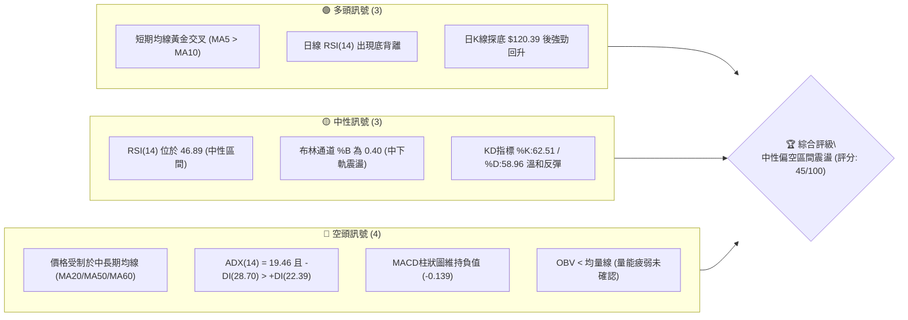

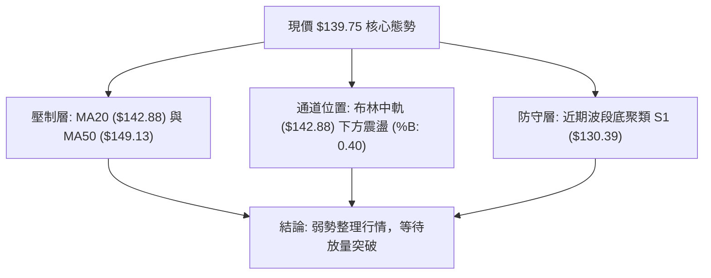

### 📊 核心指標速覽表

| 指標類別 | 指標名稱 | 當前數值 | 訊號 | 解讀 |
|:---|:---|:---|:---:|:---|
| **價格** | 當前收盤價 | $139.75 | 🟡 | 位於52週區間 28.9% 位置，自低點反彈但整體偏弱 |
| **均線** | MA5 / MA10 | $136.56 / $137.50 | 🟢 | 短天期均線微幅走揚，呈現極短線超跌反抽態勢 |
| **均線** | MA20 (月線) | $142.88 | 🔴 | 價格低於MA20，且MA20下彎（-2.19%），為第一道動態阻力 |
| **均線** | MA50 (季線) | $149.13 | 🔴 | 價格位於MA50下方，中中期趨勢空頭排列壓制 |
| **均線** | MA60 (季線) | $147.47 | 🔴 | 價格低於MA60達-5.23%，中期修正趨勢尚未扭轉 |
| **均線** | MA200 (年線)| N/A（數據未提供） | 🟡 | 歷史數據長度不足以計算，長線基準不適用 |
| **動能** | RSI(14) | 46.89 | 🟢 | 數值落於中性區間，但首尾20根K棒呈現底背離結構 |
| **動能** | MACD (12,26,9) | 線:-3.671 / 訊:-3.532 | 🔴 | 雙線位於零軸下方，柱狀圖為-0.139，空頭動能仍佔優 |
| **動能** | KD (Stochastic) | %K:62.51 / %D:58.96 | 🟡 | 反彈進入中軸偏高位，未達超買但追價動能趨緩 |
| **趨勢** | ADX / DMI | ADX:19.46 / -DI:28.70 | 🔴 | ADX<25顯示無方向性單邊趨勢，-DI大於+DI偏弱震盪 |
| **波動** | ATR(14) | $8.15 (5.83%) | 🟡 | 每日波動幅度偏高，操作必須預留足夠止損緩衝 |
| **通道** | 布林通道 | 上:$157.81 / 下:$127.96| 🟡 | 軌道寬度收斂，%B為0.40，價格運行於中軌下方 |
| **量能** | 20日均量比 | 112.78M / 114.15M (0.99x)| 🔴 | 成交量未達放大標準，OBV低於其均線，量價配合不足 |

### 🏆 技術評分卡

```
╔══════════════════════════════════════════════════════════════════╗
║                 技術評分卡 — SPCX (2026-11-12)                  ║
╠══════════════════════════════════════════════════════════════════╣
║ 趨勢強度 (Trend)     ████████░░░░░░░░░░░░  38/100  🔴 空頭壓制  ║
║ 動能指標 (Momentum)  ██████████░░░░░░░░░░  48/100  🟡 弱勢反彈  ║
║ 支撐穩定度 (Support) ████████████░░░░░░░░  58/100  🟡 區間支撐  ║
║ 成交量配合 (Volume)  ████████░░░░░░░░░░░░  42/100  🔴 量能疲弱  ║
║ 形態完整度 (Pattern) █████████░░░░░░░░░░░  45/100  🟡 箱型未決  ║
║ 均線排列 (Moving Avg)████████░░░░░░░░░░░░  39/100  🔴 空頭排列  ║
╠══════════════════════════════════════════════════════════════════╣
║ 綜合評分 (Overall)   █████████░░░░░░░░░░░  45/100  🟡 中性偏弱  ║
╚══════════════════════════════════════════════════════════════════╝
```
*(備註：綜合評分 = 六項子評分算術平均之四捨五入整數值，(38 + 48 + 58 + 42 + 45 + 39) ÷ 6 = 45.0)*

---

## 2. 趨勢分析

### 🌐 多時框趨勢分析

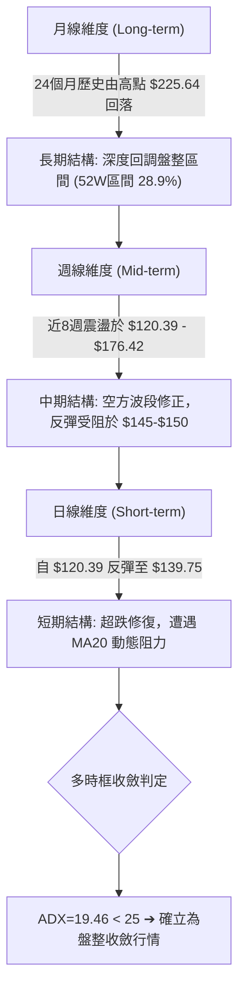

### 📈 長期趨勢 — 12個月走勢圖（Unicode）

以下為根據月度走勢數據與關鍵高低點繪製之過去走勢圖（涵蓋歷史高點 $225.64 至波段低點 $104.83，標注現價 $139.75）：

```
SPCX 走勢圖與歷史關鍵高低點軌跡
價格軸 ($)
$225.64 ┤                   ● (52W High: $225.64)
$200.00 ┤                  ╱ ╲
$175.00 ┤  ● (06月: 170.86)   ╲       ● (10月頂: 162.57)
$150.00 ┤   ╲       ●(09月:150.86)   ╱ ╲   ● (現價: $139.75)
$135.00 ┤    ╲     ╱        ╲      ╱   ╲ ╱
$110.00 ┤     ●───●          ╲    ● (11/05探底: 120.39)
$104.83 ┤   (07月: 108.37)    ● (52W Low: $104.83)
        └─────────────────────────────────────────────────────► 時間
           2026-06  07    08    09    10    11(即時)
```

**走勢特徵分析表格**：

| 時間區間 | 起始價 ($) | 結束價 ($) | 區間漲跌幅 | 走勢核心特徵 |
|:---|:---:|:---:|:---:|:---|
| **2026-06 至 2026-07** | 170.86 | 108.37 | -36.57% | 巨量單邊殺跌，跌破多道支撐並逼近52週低點 $104.83 |
| **2026-07 至 2026-09** | 108.37 | 150.86 | +39.21% | 絕地反彈，量能有效放大（08/07當週達9.2億股），形成V型反轉 |
| **2026-09 至 2026-10** | 150.86 | 134.72 | -10.70% | 創下波段高點 $162.57 後高檔承壓，週線連續收黑回吐 |
| **2026-10 至 2026-11** | 134.72 | 139.75 | +3.73% | 盤中插針 $120.39 後弱勢拉回，日線呈現低檔縮量盤整 |

### 📊 中期趨勢（週線分析）

週線架構上，SPCX 在 2026-10-09 創下近期反彈高點 $176.42 後展開三週急跌，並在 2026-11-06 當週下探 $120.39。目前週收盤價站回 $139.75，但週線 MACD 柱狀圖仍為負值（-0.139），週 RSI 位於 46.9。

```
週線關鍵位階動態架構
$165.24 ────────────────────────────────────── 斐波那契 50.0% 回調位
$158.13 ══════════════════════════════════════ 近期波段阻力 R3
$149.80 ────────────────────────────────────── 波段反彈頸線阻力 R1 / MA50 ($149.13)
$142.88 ┄┄┄┄┄┄┄┄┄┄┄┄┄┄┄┄┄┄┄┄┄┄┄┄┄┄┄┄┄┄┄┄┄┄ 日線 MA20 / 布林中軌壓制
$139.75 ◄─── 現價位置 (弱勢整理)
$130.68 ────────────────────────────────────── 斐波那契 78.6% 回調位
$130.39 ══════════════════════════════════════ 近期波段強支撐 S1
$120.39 ┈┈┈┈┈┈┈┈┈┈┈┈┈┈┈┈┈┈┈┈┈┈┈┈┈┈┈┈┈┈┈┈┈┈┈┈┈┈ 11/05 單日恐慌下影線低點
```

### ⚡ 趨勢強度評估（ADX 解讀）

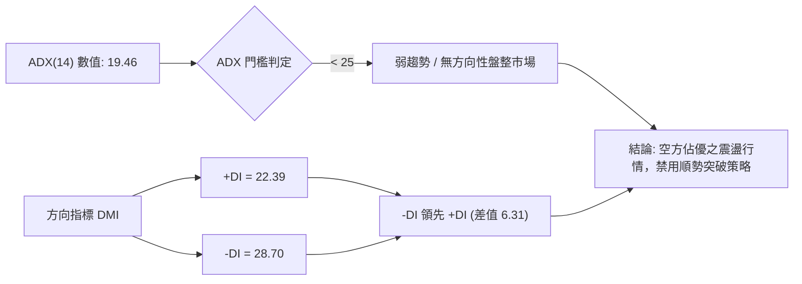

**ADX 趨勢強度對照表**：

| 指標項目 | 數據值 | 判定區間 | 趨勢屬性解讀 |
|:---|:---:|:---:|:---|
| **ADX(14)** | 19.46 | < 25 (弱趨勢/盤整) | 市場缺乏單邊推動力，價格容易反覆穿越均線形成假突破 |
| **+DI (14)** | 22.39 | 多頭牽引力不足 | 買盤不具備發動強趨勢的主動性攻擊意願 |
| **-DI (14)** | 28.70 | 空頭佔主導優勢 | 拋壓雖佔優，但因 ADX 走平，未形成大規模崩跌走勢 |
| **趨勢運作結論** | 盤整市 | 規則 14 優先級生效 | **嚴格以日線布林通道上下軌 ($127.96 - $157.81) 為邊界操作** |

---

## 3. 圖表形態分析

### 🔍 形態識別系統

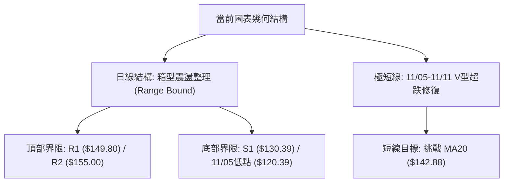

**形態信心度與目標計算表**：

| 形態名稱 | 信心度 | 判斷依據（嚴格引用數據） | 完成度 | 目標價（附嚴謹計算式） |
|:---|:---:|:---|:---:|:---|
| **寬幅箱型整理** | 70% | 價格在 S1 $130.39 與 R1 $149.80 間來回震盪，ADX=19.46 佐證盤整 | 65% | 區間震盪上限目標即為阻力位 **$149.80** |
| **短線雙重底雛形** | 45% | 10/30低點 $134.50 與 11/06低點 $128.57 形成次級底部，但因 11/05 曾急刺 $120.39，結構不對稱 | 35% | 訊號不足（<50%），依規則15不予推算延伸目標 |
| **布林中軌壓制受阻** | 75% | 11/11日K高點 $145.16 觸及布林中軌 MA20 ($142.88) 後拉回收 $139.75 | 85% | 指標型解讀：向下測試布林下軌 **$127.96** |

### 🕯️ 重要K線形態分析

根據提供的「近10根日K」與「近8根週K」嚴格列出實際開高低收進行技術識別：

| 日期（週期） | 開盤價 ($) | 最高價 ($) | 最低價 ($) | 收盤價 ($) | K線形態名稱 | 形態深度解讀 | 訊號 |
|:---|:---:|:---:|:---:|:---:|:---|:---|:---:|
| **11-04 (日K)** | 133.24 | 140.50 | 133.14 | 135.92 | 衝高回落倒狀陽星 | 盤中反彈受阻於整數關卡，留長上影線，空頭醞釀下殺 | 🔴 |
| **11-05 (日K)** | 131.34 | 131.87 | 120.39 | 123.62 | 帶量長黑破位棒 | 放量1.71億股長黑重挫，盤中創波段低點 $120.39，市場恐慌拋售 | 🔴 |
| **11-06 (日K)** | 130.94 | 135.32 | 128.57 | 134.27 | 低檔長下影陽線 (錘頭) | 價格回測低點後獲得強力買盤支撐，下影線長達 $2.37，顯示逢低承接力道 | 🟢 |
| **11-09 (日K)** | 136.51 | 143.20 | 135.37 | 142.07 | 實體大陽棒 | 多頭反撲確認 11/05-11/06 探底有效，突破多根短期均線 | 🟢 |
| **11-10 (日K)** | 139.16 | 144.89 | 137.65 | 143.09 | 高檔滯漲陽十字 | 連續反彈後遇高點阻力，成交量萎縮至82M，上攻動能趨緩 | 🟡 |
| **11-11 (日K)** | 143.38 | 145.16 | 138.62 | 139.75 | 倒狀流星黑K棒 | 衝高 $145.16 遇 MA20 ($142.88) 反轉下殺，收最低點附近，短線承壓 | 🔴 |
| **11-06 (週K)** | 137.01 | 142.74 | 120.39 | 134.27 | 巨量長下影下探週K | 留長達 $13.88 的極長下影線，週成交量達5.86億股，形成關鍵防守錨點 | 🟢 |
| **11-11 (週K)** | 136.51 | 145.16 | 135.37 | 139.75 | 衝高受阻上影線週K | 嘗試反攻受制於前高密集套牢區，量能銳減，呈現反彈無力狀態 | 🔴 |

### 📉 ASCII 走勢形態示意圖

```
SPCX 日線近7根K棒價格攻防路徑圖
價格 ($)
$145.16 ┤                         ╭─ 11/11 流星高點 (遇 MA20 $142.88 回落)
$143.09 ┤                   ●────●
$140.00 ┤                  ╱      ╲   ◄ 11/11 收盤: $139.75
$135.00 ┤            ●────●        
$130.00 ┤      ●────● 11/06 錘頭低點 $128.57
$123.62 ┤     ● 11/05 長黑收盤
$120.39 ┤    ● 11/05 恐慌插針低點
        └─────────────────────────────────────────► 日期
            11-05   11-06   11-09   11-10   11-11
```

### 🎯 形態目標價計算

根據日線自 11/05 低點 $120.39 反彈至 11/11 高點 $145.16 之波動區間分析：
1. **區間箱型假突破回撤目標**：
   - 頂部阻力頸線：R1 = $149.80
   - 本波實質反彈阻力：MA20 = $142.88
   - 形態推算：當前受阻於 $145.16，回測支撐位優先看 S1 **$130.39**。
2. **反轉上攻理論目標（需突破頸線確認）**：
   - 若未來放量收復 R1 ($149.80)，箱體高度 = $149.80 - $130.39 = $19.41
   - 突破目標 = 頸線 $149.80 + 形態高度 $19.41 = **$169.21**（但受制於 R2 $155.00 與 R3 $158.13 之實體阻力壓制，突破難度極高）。

---

## 4. 支撐與阻力

### 🗺️ 關鍵價位分布圖（Unicode）

```
╔══════════════════════════════════════════════════════════════════╗
║               SPCX 價位結構分布與密集交投帶分布圖                ║
╠══════════════════════════════════════════════════════════════════╣
║ $158.13 ║██████████████████████████████║ 強阻力 R3 (近一年高點) ║
║ $155.00 ║████████████████████          ║ 阻力 R2 (整數關卡)     ║
║ $150.98 ║------------------------------║ 斐波那契 61.8% 回調位  ║
║ $149.80 ║██████████████████████████    ║ 關鍵頸線阻力 R1        ║
║ $142.88 ║┈┈┈┈┈┈┈┈┈┈┈┈┈┈┈┈┈┈┈┈┈┈┈┈┈┈┈┈┈┈║ 布林中軌 / MA20 動態壓 ║
║ $139.75 ╠══════════════════════════════╣ ◄── 現價位置           ║
║ $130.68 ║------------------------------║ 斐波那契 78.6% 回調位  ║
║ $130.39 ║▓▓▓▓▓▓▓▓▓▓▓▓▓▓▓▓▓▓▓▓▓▓▓▓      ║ 近期波段關鍵支撐 S1    ║
║ $127.96 ║┈┈┈┈┈┈┈┈┈┈┈┈┈┈┈┈┈┈┈┈┈┈┈┈┈┈┈┈┈┈║ 布林下軌動態支撐       ║
║ $104.83 ║██████████████████████████████║ 歷史強支撐 S2 (52W Low)║
╚══════════════════════════════════════════════════════════════════╝
```

### 🚧 阻力位分析表

*(價位嚴格引用自數據之「關鍵價位」區塊)*

| 阻力級別 | 價位 ($) | 距離現價幅度 | 形成原因與交投結構 | 突破難度 | 重要性權重 |
|:---|:---:|:---:|:---|:---:|:---:|
| **阻力 R1** | $149.80 | +7.19% | 近一年波段高點聚類，與 MA50 ($149.13) 及斐波那契 61.8% ($150.98) 形成重疊共振帶 | 🔴 極高 | ★★★★★ |
| **阻力 R2** | $155.00 | +10.91% | 近一年多重反彈高點聚類，整數心理賣壓區間 | 🟡 中偏高 | ★★★★☆ |
| **阻力 R3** | $158.13 | +13.15% | 波段反彈極限高點聚類，接近布林通道上軌 ($157.81) | 🔴 極高 | ★★★★★ |

### 🛡️ 支撐位分析表

*(價位嚴格引用自數據之「關鍵價位」區塊)*

| 支撐級別 | 價位 ($) | 距離現價幅度 | 形成原因與交投結構 | 守住機率 | 重要性權重 |
|:---|:---:|:---:|:---|:---:|:---:|
| **支撐 S1** | $130.39 | -6.70% | 近一年波段低點聚類，緊鄰斐波那契 78.6% 回調位 ($130.68)，為多頭核心防線 | 🟡 60% | ★★★★★ |
| **支撐 S2** | $104.83 | -24.99% | 52週歷史最低點 ($104.83)，長線空頭最後防禦底線 | 🟢 85% | ★★★★★ |

### 📐 斐波那契回調位分析

依據 52週區間極值點（最低點 $104.83 至 最高點 $225.64，垂直落差 $120.81）精確計算回調階梯：

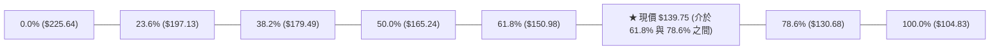

**斐波那契位階結構解析**：
- **當前位置歸屬**：現價 $139.75 運行於 **61.8% 回調位 ($150.98)** 與 **78.6% 回調位 ($130.68)** 之間。
- **深度回撤含義**：股價跌破 61.8% 黃金分割分水嶺（$150.98），說明自 52週高點 $225.64 以來的多頭推動浪已被徹底瓦解，市場進入殘餘回撤防守狀態。
- **支撐共振驗證**：斐波那契 78.6% 位階 **$130.68** 與波段支撐位 S1 **$130.39** 僅差 $0.29，形成極為強固的數理幾何支撐共振區。多頭若無法守穩 $130.39-$130.68，將面臨下探 100% 原始起漲點 **$104.83** 的極高風險。

---

## 5. 技術指標深度解讀

### 🎛️ 指標訊號總覽

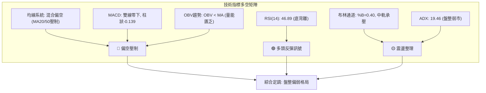

### 📈 移動平均線排列分析

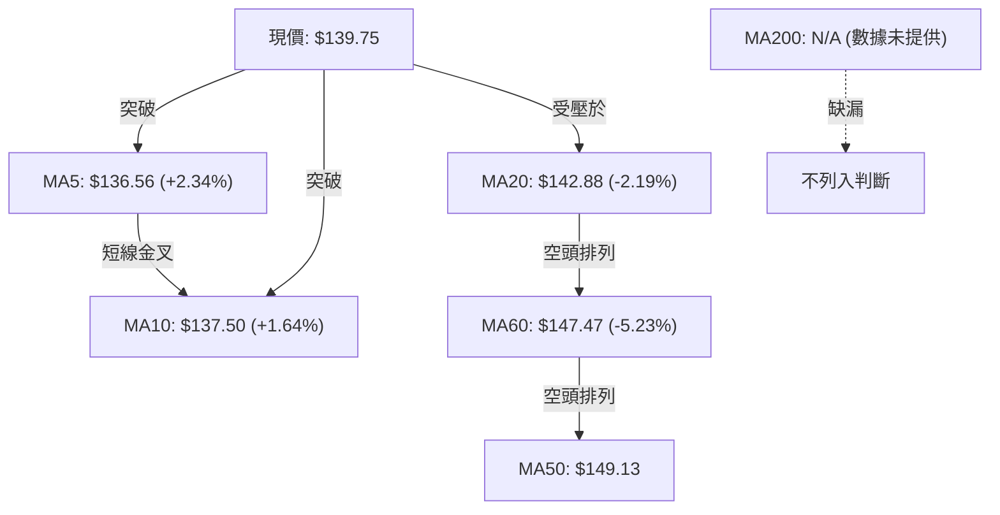

**均線狀態解讀**：
- **短天期金叉**：MA5 ($136.56) 快速上穿 MA10 ($137.50)，反映日線自 $120.39 展開的技術性超跌修復。
- **中長天期壓制**：上方 MA20 ($142.88)、MA60 ($147.47) 及 MA50 ($149.13) 依序遞增並向下發散，形成標準的中期空頭反壓防線。
- **MA200 缺漏處理**：因資料不足未提供數值，標記為 N/A（數據未提供），中長期趨勢完全依據週線與 MA50/MA60 作為界定。

### 📉 RSI(14) 分析

```
RSI(14) 指標狀態儀表
[0] ─────────── [30 超賣] ───────●─────── [70 超買] ─────────── [100]
                              46.89 (中性區)
進度條: █████████░░░░░░░░░░░  46.89%
```

- **超買超賣評估**：RSI(14) 當前數值為 46.89，位於 30-70 的常態中性區間，無極端超買或超賣現象。
- **背離判斷（底背離確立）**：
  - 數據明確顯示 **⚠️ 底背離 (Bullish Divergence)**。
  - 對比近20根K棒首尾，價格在 11/05 創下波段低點 $120.39，但同期 RSI 未同步跌破前低，反而呈現震盪墊高形態。
  - **結論**：空方下殺動能已出現衰竭跡象，短線技術性反彈具備指標支撐，但需克服均線阻力方能轉化為有效波段。

### 📊 MACD(12/26/9) 訊號解讀

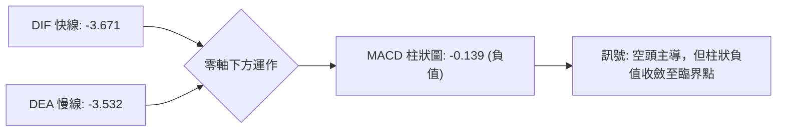

- **雙線位階**：DIF (-3.671) 與 DEA (-3.532) 皆處於負值深水區，代表中期空頭趨勢仍未被逆轉。
- **柱狀圖動能**：MACD Histogram 為 **-0.139**，呈現空頭排列（🔴 看空）。然而，柱狀體負值幅度相較於 10月中下旬的 -1.979 顯著收斂，說明下行動能趨弱，即將面臨快慢線低檔交叉的轉折節點。

### 📦 布林通道分析

```
SPCX 布林通道 (20, 2) 結構圖
$157.81 ────────────────────────────────────── 上軌 Upper Band
        │
$142.88 ┄┄┄┄┄┄┄┄┄┄┄┄┄┄┄┄┄┄┄┄┄┄┄┄┄┄┄┄┄┄┄┄┄┄┄┄ 中軌 (MA20) 阻力
        │   ◄─── $139.75 現價 (%B = 0.40)
$127.96 ────────────────────────────────────── 下軌 Lower Band
```

- **通道寬度與波動**：布林帶寬度為 $157.81 - $127.96 = $29.85。
- **%B 指標分析**：當前 %B 為 **0.40**（0代表下軌，0.5代表中軌，1代表上軌）。股價位於下半通道，且正向中軌 MA20 ($142.88) 發起測試。11/11 日K高點 $145.16 短暫越過中軌即遭打回，證實中軌動態壓力真實有效。

### 💹 成交量分析（量價配合度）

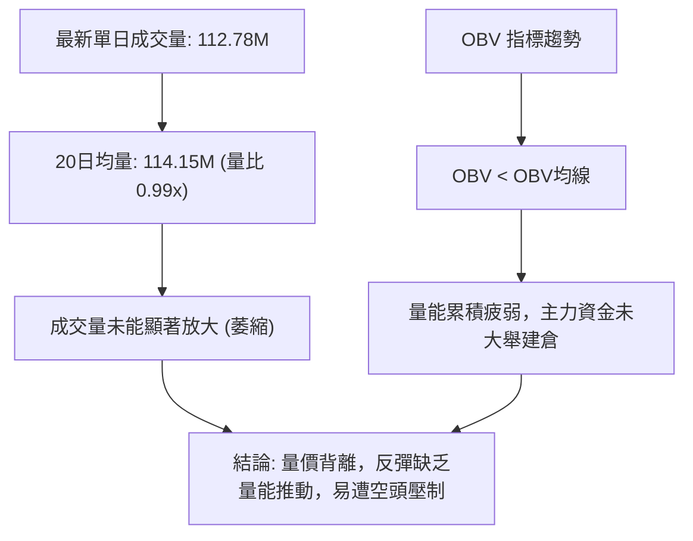

- **成交量比**：最新量比僅 0.99x，在反彈攻堅時未見主動買盤擴量（例如 11/09 上漲時量僅 103M，11/10 更是萎縮至 82M）。
- **OBV 能量潮**：OBV 趨勢持續低於其移動平均線，明確發出量能疲弱警告，說明籌碼沉澱仍不充分，難以支撐持續性多頭單邊走勢。

---

## 6. 動能與波動率

### ⚡ 動能評估四象限

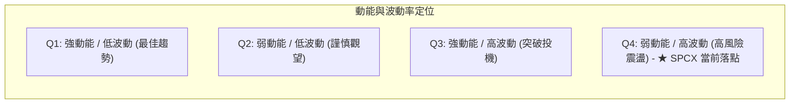

| 象限區間 | 動能強度 | 波動率狀態 | 當前狀態標記 | 技術評估與操作導向 |
|:---:|:---:|:---:|:---:|:---|
| **第一象限 (Q1)** | 強 (ADX>25, RSI>60) | 低 (ATR%<3%) | — | 最佳順勢單邊機會 |
| **第二象限 (Q2)** | 弱 (ADX<25, RSI 40-60)| 低 (ATR%<3%) | — | 狹幅無聊整理，觀望為主 |
| **第三象限 (Q3)** | 強 (ADX>25) | 高 (ATR%>5%) | — | 高風險高報酬突破行情 |
| **第四象限 (Q4)** | **弱 (ADX:19.46, RSI:46.89)** | **高 (ATR: 5.83%)** | **✓ SPCX 當前位置** | **寬幅震盪洗盤，避免追漲殺跌，嚴格區間邊緣操作** |

### 📊 ATR 波動率分析

```
ATR (14, Wilder) 波動度量尺
ATR 數值:     $8.15
佔當前股價比: 5.83%  (極高日內波動度)
進度條:       █████████████░░░░░░░  58.3% (波動風險偏高)
```

- **日內波動測算**：SPCX 的 ATR(14) 高達 **$8.15**，佔現價之 5.83%，說明單日平均振幅接近 $8-$10。
- **止損距離建議**：
  - **短線交易止損**：應設定在 1.0 × ATR = **$8.15** 以上，以防日內正常雜訊震盪觸發洗盤。
  - **波段操作止損**：應採用 1.5 × 至 2.0 × ATR = **$12.23 至 $16.30**，配合關鍵波段支撐位 S1 ($130.39) 進行動態防護。

### 📐 Beta 與市場相關性

| 參數項目 | 數據值 | 屬性解析 |
|:---|:---:|:---|
| **Beta (β)** | N/A（數據未提供） | 依規則16，數據未提供，不予任意估算或衍生推論 |
| **放空比例 (Short % Float)** | 2.1% | 放空佔流通盤比例極低，無軋空 (Short Squeeze) 結構支撐 |
| **放空天數比 (Short Ratio)** | 1.38 天 | 融券空頭回補壓力微弱，市場波動主要由流動性與現貨買賣盤主導 |

---

## 7. 多時框架總結

### 📋 時框架評分表

| 時框架 | 趨勢方向 | 動能狀態 | 均線排列 | 形態特徵 | 綜合評分 | 建議動作 |
|:---|:---:|:---:|:---:|:---:|:---:|:---|
| **月線 (長期)** | 🔴 空方修正 | 弱勢 (中軌下方) | 中長期壓制 | 52W高點深度回吐 | 38/100 | 長線資金保留現金 |
| **週線 (中期)** | 🔴 偏空震盪 | MACD負值收斂 | 空頭排列 | 高檔拉回測試低位 | 42/100 | 反彈減碼或持有對沖 |
| **日線 (短期)** | 🟡 區間震盪 | RSI底背離 | 短多長空 (混合) | 箱型築底測試中軌 | 48/100 | 箱型下緣低吸，嚴格止損 |
| **綜合彙整** | 🟡 **中性偏弱** | **動能修復中** | **混合排列** | **寬幅箱型震盪** | **45/100** | **區間波段操作，靜待突破** |

### 🔲 綜合訊號矩陣

```mermaid
graph TD
    subgraph MATRIX ["多時框訊號收斂矩陣"]
        TF_D["日線: 底背離反彈受阻中軌 🟡"]
        TF_W["週線: 承壓於 $145-$150 阻力區 🔴"]
        TF_M["月線: 52週區間 28.9% 弱勢區 🔴"]
    end
    TF_D & TF_W & TF_M --> ADX_CHECK{"規則 14: ADX 強度檢驗"}
    ADX_CHECK -->|"ADX("14") = 19.46 (< 25)"| RANGE["定調: 盤整震盪行情 (Consolidation)"]
    RANGE --> ACTION["以日線布林通道上下軌 ($127.96 - $157.81) 為邊界"]
```

### ⚖️ 多時框收斂結論

嚴格遵守**嚴格要求 14（多時框收斂規則）**：
1. **行情屬性判定**：當前 ADX(14) 數值為 **19.46**，明確小於 25 臨界值，技術面確立為**盤整行情（ADX < 25）**，非趨勢單邊市。
2. **主導時框與交易邊界**：依規則 14，在盤整行情中，中長期單邊趨勢權重讓位於震盪區間，**日線布林通道上下軌成為主要交易區間**：
   - 震盪區間上軌阻力：**$157.81**（與 R3 $158.13 重疊共振）。
   - 震盪區間下軌支撐：**$127.96**（緊扣 S1 $130.39 與斐波那契 78.6% $130.68）。
3. **唯一方向性結論**：**中性偏弱區間觀望（Neutral-to-Weak Range-bound）**。股價短期雖有 RSI 底背離反彈，但受制於 MA20 ($142.88) 與阻力帶 R1 ($149.80)，無法形成單邊向上突破，必須以區間高拋低吸或等待放量突破為唯一指導原則。

---

## 8. 交易策略建議

### 🗺️ 策略決策流程圖

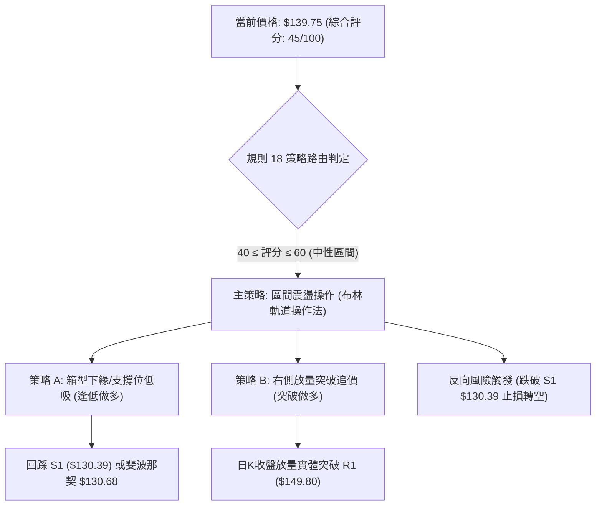

### 🧭 策略路由（依評分卡分流）

**當前主策略方向 = 中性區間震盪操作（依評分 45/100，落於 40–60 區間）**  
依規則約束，當前評分處於中性區間，**不具備單邊重倉做多或追空條件**。以日線布林上下軌及核心波段點位為主要交易區間，核心精神為「**高拋低吸、等待突破確認**」。

### 🎯 價格情境階梯（Price Scenarios）

*(價位嚴格引用自「關鍵價位」區塊與斐波那契計算)*

| 觸發條件 | 下一目標 | 後續延伸 | 情境技術含義 |
|:---|:---:|:---:|:---|
| **向上突破 R1 $149.80** | R2 $155.00 | R3 $158.13 | 突破 MA50 壓制，短線轉強，朝布林上軌發起衝擊 |
| **站穩現價區間 ($135.00 - $142.88)** | MA20 $142.88 | R1 $149.80 | 區間震盪修復，底背離動能緩步釋放 |
| **向下跌破 S1 $130.39** | S2 $104.83 | 數據中未偵測到 | 破壞近期箱型防線，中期破位轉弱，下探52週最低點 |

### 📊 情境機率分佈

| 情境類別 | 機率預估 | 主要技術指標依據 |
|:---|:---:|:---|
| **情境一：區間震盪盤整** | **50%** | ADX=19.46 (<25) 顯示趨勢極弱；布林中軌壓制且帶寬收縮；量比 0.99x 缺乏突破動能 |
| **情境二：震盪反彈衝擊 R1** | **30%** | 日線 RSI 出現底背離；MACD 柱狀圖負值大幅收斂至 -0.139；K線探底 $120.39 後留長下影 |
| **情境三：跌破 S1 再探新低** | **20%** | OBV 疲弱低於均線；-DI(28.70) 仍壓制 +DI(22.39)；MA20/50 中期空頭排列壓制 |

### 🟢 主策略詳情（方向依上方路由：區間與突破操作）

*(嚴格遵循規則 17 收益風險比計算式：$RRR = (T1 - 進場價) \div (進場價 - 止損價)$)*

| 策略要素 | 策略 A（左側支撐低吸策略） | 策略 B（右側突破追多策略） |
|:---|:---|:---|
| **策略導向** | 回測關鍵支撐 S1 / 斐波那契 78.6% 低吸 | 放量實體突破關鍵阻力 R1 後順勢進場 |
| **進場條件** | 價格回調至 $130.50-$131.50 出現止跌K棒 | 日K實體收盤突破 R1 $149.80 且量比 > 1.5x |
| **進場價格** | **$131.00**（區間中點） | **$150.50**（突破確認點） |
| **目標價 T1** | **$149.80**（波段阻力 R1） | **$158.13**（波段阻力 R3） |
| **目標價 T2** | **$155.00**（波段阻力 R2） | **$165.24**（斐波那契 50.0% 回調位） |
| **止損價格** | **$126.00**（跌破布林下軌 $127.96） | **$142.88**（跌破布林中軌 / MA20） |
| **風險報酬比** | **1 : 3.76（以 T1 計）**<br>*(計算: (149.80 - 131.00) / (131.00 - 126.00) = 18.80 / 5.00)* | **1 : 1.00（以 T1 計）**<br>*(計算: (158.13 - 150.50) / (150.50 - 142.88) = 7.63 / 7.62)* |
| **風險報酬比 (T2)**| **1 : 4.80（以 T2 計）**<br>*(計算: (155.00 - 131.00) / 5.00 = 24.00 / 5.00)* | **1 : 1.93（以 T2 計）**<br>*(計算: (165.24 - 150.50) / 7.62 = 14.74 / 7.62)* |
| **勝率預估** | 55% | 45% |
| **建議倉位** | 10% - 15%（輕倉試單） | 15% - 20%（趨勢確認加碼） |

### 🔴 反向風險觸發點（對沖與風控提示）

- **多頭止損與防禦觸發點**：若價格帶量跌破 **$130.39 (S1)**，說明日線底背離修復失敗，箱型防線全面崩潰，必須無條件終止一切多頭策略，多單嚴格止損。
- **空頭加速信號**：日K收盤價若低於 **$127.96（布林下軌）**，將觸發向下破位延伸浪，下行目標將直接指向 52週低點 **$104.83 (S2)**。此時可建立相應看跌期權或輕倉放空對沖現貨敞口。

### ⭐ 整體訊號強度評星

```
╔══════════════════════════════════════════════════╗
║ 做多訊號強度：★★☆☆☆  (2.5/5星 - 僅存底背離反彈)║
║ 做空訊號強度：★★★☆☆  (3.0/5星 - 均線空頭壓制)  ║
║ 整體可信度：  ★★★☆☆  (3.5/5星 - 處於盤整磨底)  ║
╚══════════════════════════════════════════════════╝
```

---

## 9. 風險提示與監控

### ✅ 關鍵監控指標 Checklist

```
╔══════════════════════════════════════════════════════════════════╗
║                   SPCX 即時交易監控 Checklist                   ║
╠══════════════════════════════════════════════════════════════════╣
║ [ ] 監控點 1：MA20 ($142.88) 能否放量站穩（突破短期壓制樞紐）   ║
║ [ ] 監控點 2：S1 支撐位 ($130.39) 之防守有效性（日K收盤不可跌破） ║
║ [ ] 監控點 3：成交量是否突破 20日均量 114.15M（突破確認之量能） ║
║ [ ] 監控點 4：MACD 柱狀圖能否翻正至 0 軸上方（動能轉多確認）    ║
║ [ ] 監控點 5：ADX(14) 數值是否升破 25（判斷單邊趨勢是否成型）   ║
║ [ ] 監控點 6：單日波動幅度是否超過 1.5×ATR ($12.23) 觸發異常警報║
╚══════════════════════════════════════════════════════════════════╝
```

### ⚠️ 風險場景分析

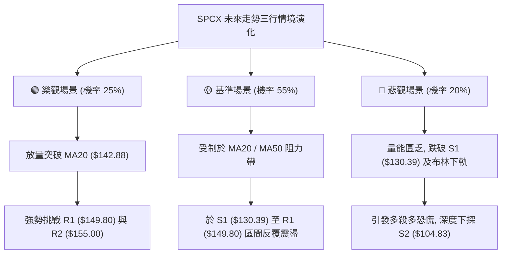

### 🛡️ 風險管理重要提醒

1. **極高 ATR 波動控制**：
   - 當前 ATR(14) 為 **$8.15**，佔股價比例達 5.83%，屬於超高波動性標的。任何單筆交易之名目倉位不宜過大，單筆交易的最大容許虧損金額應嚴格限制在總投資組合淨值的 **1.0% - 1.5%** 範圍內。
2. **假突破頻繁風險**：
   - 在 **ADX = 19.46 (< 25)** 的盤整環境中，任何未伴隨顯著放大成交量（量比 < 1.3x）的向上破位，皆有極高機率為誘多假突破（如 11/11 衝高 $145.16 後遭遇流星黑K回落），嚴禁在阻力位 R1 ($149.80) 下方盲目市價追高。
3. **數據缺漏風險考量**：
   - 由於 MA200 與 Beta 數據缺漏（N/A），長線大盤連動性模型失效，投資人應完全以個股價格行為（Price Action）與幾何價位作為唯一風控依歸。

---

## 📋 報告總結

```
╔══════════════════════════════════════════════════════════════════╗
║                     SPCX 技術分析報告總結                      ║
╠══════════════════════════════════════════════════════════════════╣
║ 報告日期：2026-11-12                                             ║
║ 當前價格：$139.75                                                ║
║ 技術評分：45 / 100 (算術平均精確值)                              ║
║ 分析評級：⚖️ 中性偏弱 ── 區間震盪整理 (Neutral-to-Weak Range)  ║
║                                                                  ║
║ 關鍵趨勢結論：                                                   ║
║ ├─ 長期趨勢：🔴 弱勢修正 (回調至 52週區間 28.9% 位置)            ║
║ ├─ 中期趨勢：🔴 空頭排列承壓 (MA50: $149.13 與 MA60: $147.47)    ║
║ ├─ 短期趨勢：🟡 超跌修復遇阻 (受壓於日線 MA20: $142.88)         ║
║ ├─ 關鍵支撐：S1: $130.39 ｜ S2: $104.83                          ║
║ ├─ 關鍵阻力：R1: $149.80 ｜ R2: $155.00 ｜ R3: $158.13           ║
║ └─ 分析師目標：均價 $255.06 (最低 $70.00 / 最高 $800.00)         ║
║                                                                  ║
║ 最優策略組合：                                                   ║
║ 1. 🥇 最佳機會：策略 A (逢低佈局) ── 於 $131.00 附近輕倉低吸，   ║
║                止損 $126.00，目標 T1 $149.80 (風報比 1 : 3.76)   ║
║ 2. 🥈 次選機會：策略 B (突破跟進) ── 實體站上 $150.50 後右側追多，║
║                止損 $142.88，目標 T1 $158.13 (風報比 1 : 1.00)   ║
║ 3. 🥉 保守選擇：空倉觀望 ── 等待 ADX 升破 25 或價格回測 S1 確認 ║
╚══════════════════════════════════════════════════════════════════╝
```

---

> ⚠️ **免責聲明**：本報告為技術分析研究，所有數據指標及價位階梯均基於提供之市場歷史交易資訊客觀推導。本報告**僅供學術研究與參考**，**不構成任何形式的要約、招攬或投資買賣建議**。金融市場具有高度波動風險，投資人進場交易前應審慎評估自身風險承受能力並自負盈虧。

---

*報告生成時間：2026-11-12 ｜ 數據來源：Yahoo Finance ｜ 分析框架：多時框技術分析模型*