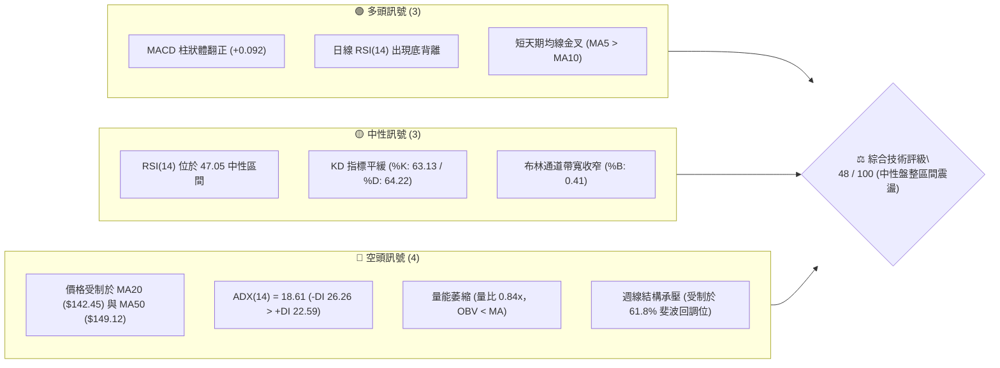
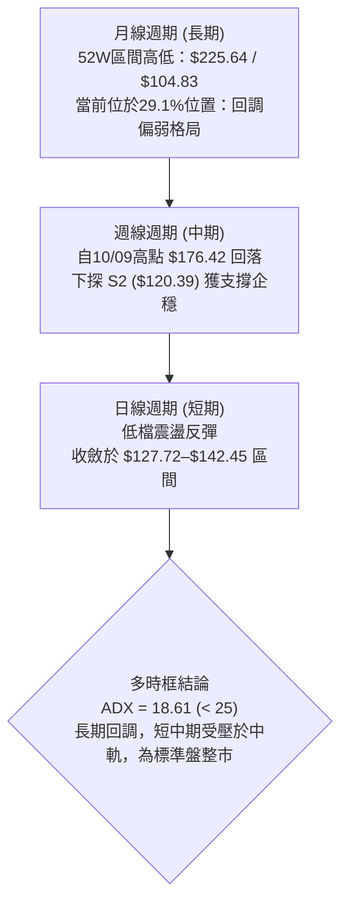
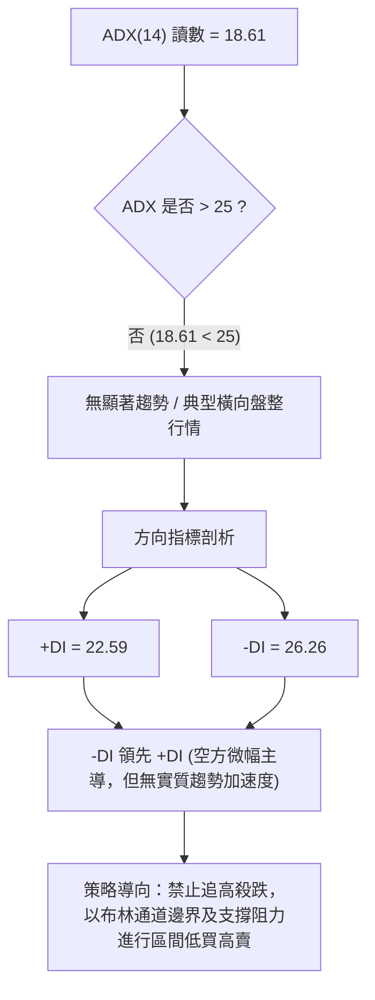
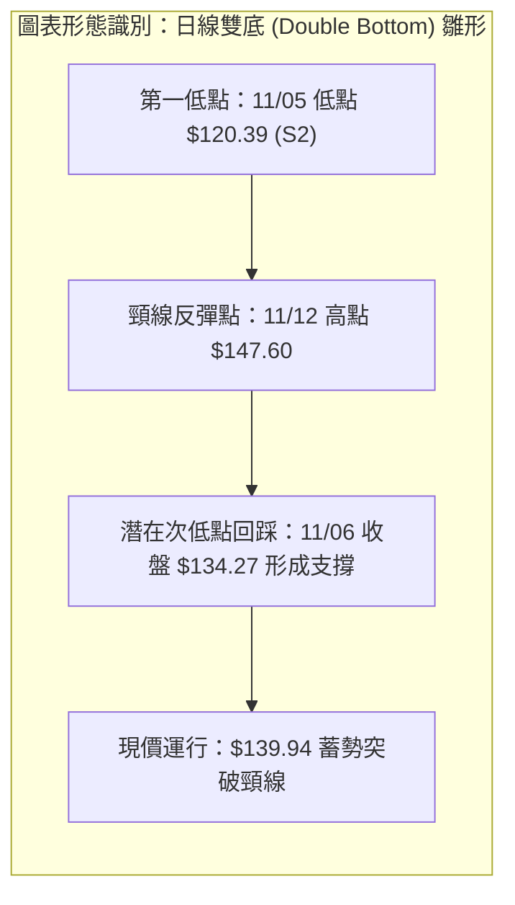
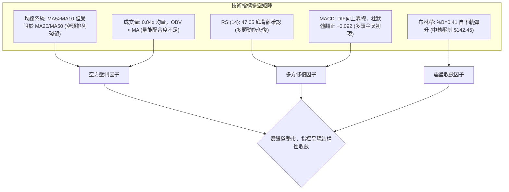
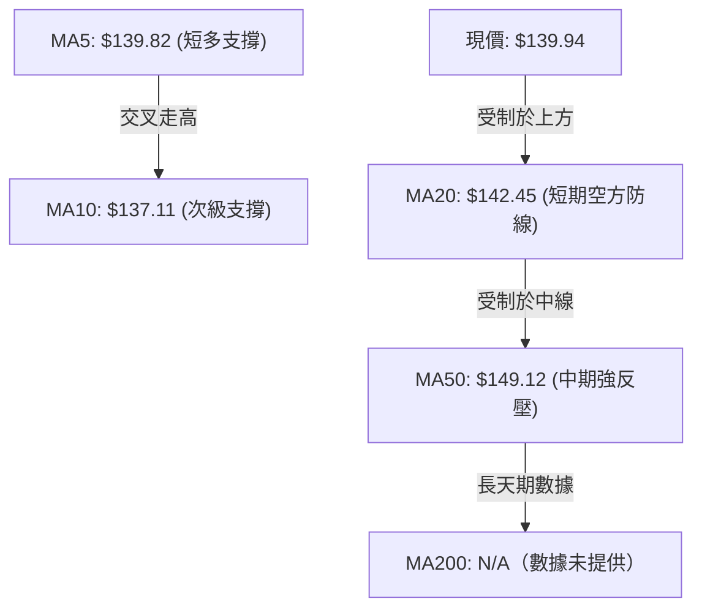
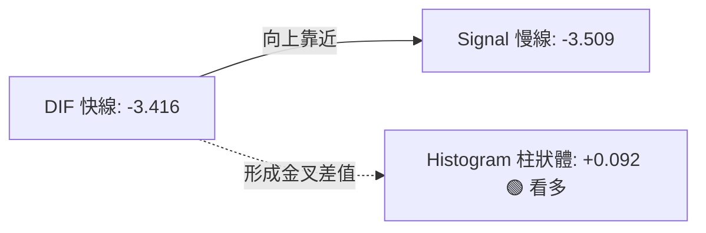
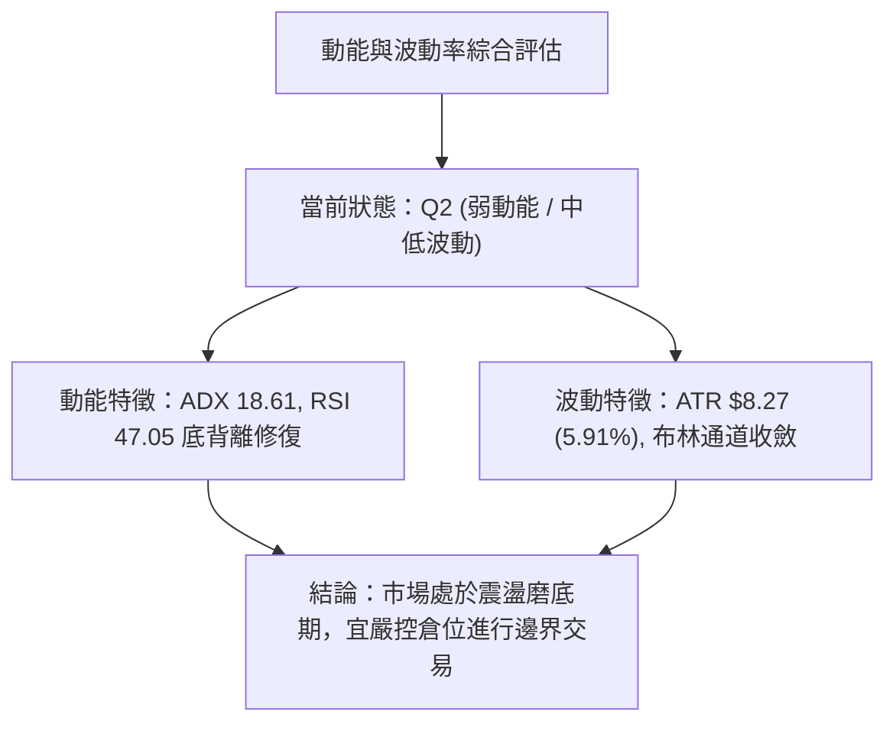
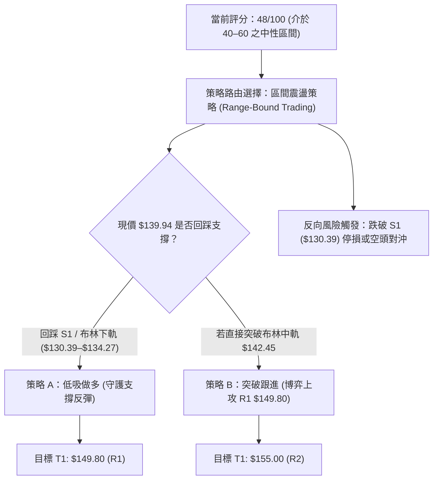
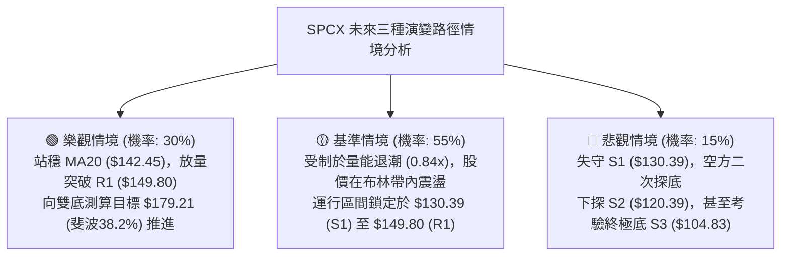

# SPCX 技術分析報告

> **報告日期**：2026-11-13 ｜ **語言**：繁體中文 ｜ **數據來源**：Yahoo Finance ｜ **當前價格**：$139.94

---

## 目錄

| 章節 | 內容 |
|------|------|
| [1. 技術面概覽](#1-技術面概覽) | 訊號儀表板、核心指標、評分卡 |
| [2. 趨勢分析](#2-趨勢分析) | 多時框趨勢、長中短期走勢、ADX 解讀 |
| [3. 圖表形態分析](#3-圖表形態分析) | 形態識別、K線組合、目標價推算 |
| [4. 支撐與阻力](#4-支撐與阻力) | 關鍵價位、斐波那契回調結構 |
| [5. 技術指標深度解讀](#5-技術指標深度解讀) | MA/RSI/MACD/布林/成交量全面驗證 |
| [6. 動能與波動率](#6-動能與波動率) | 動能評估四象限、ATR 波動率分析 |
| [7. 多時框架總結](#7-多時框架總結) | 時框架評分矩陣、多時框收斂結論 |
| [8. 交易策略建議](#8-交易策略建議) | 策略路由、區間操作、風險報酬比 |
| [9. 風險提示與監控](#9-風險提示與監控) | 監控指標清單、極端情境與風控處方 |

---

## 1. 技術面概覽

### 🎯 技術訊號儀表板



### 📊 核心指標速覽表

| 指標類別 | 指標名稱 | 當前數值 | 訊號 | 解讀 |
|:---|:---|:---|:---:|:---|
| **價格** | 當前價格 | $139.94 | 🟡 | 位於52週區間29.1%，短線於低檔築底反彈 |
| **均線** | MA20 | $142.45 | 🔴 | 價格低於MA20 (-1.76%)，短中期反壓仍在 |
| **均線** | MA50 | $149.12 | 🔴 | 價格低於MA50 (-6.16%)，中期空頭防線堅固 |
| **均線** | MA200 | N/A（數據未提供） | ⚪ | 數據不足，長期趨勢以週線趨勢替代評估 |
| **動能** | RSI(14) | 47.05 | 🟢 | 處於40–50中性修復區，近20根K棒首尾呈現底背離 |
| **動能** | MACD(12,26,9) | -3.416 / -3.509 | 🟢 | DIF向訊號線靠攏，Histogram為+0.092初現金叉 |
| **動能** | KD(9,3,3) | 63.13 / 64.22 | 🟡 | 隨機指標自超賣區回升至中軸，未顯過熱 |
| **趨勢強度**| ADX(14) | 18.61 | 🟡 | 數值低於25，市場處於典型無趨勢盤整震盪 |
| **通道** | 布林通道 %B | 0.41 | 🟡 | 運行於中軌（$142.45）與下軌（$127.72）間，偏弱震盪 |
| **成交量** | 20日均量比 | 0.84x | 🔴 | 當日量95.24M低於均量113.93M，OBV低於均線量能偏弱 |
| **波動** | ATR(14) | $8.27 | 🟡 | 佔股價5.91%，每日正常波動幅度適中，盤整壓縮特徵 |

### 🏆 技術評分卡

```
╔══════════════════════════════════════════════════════════════╗
║               技術評分卡 — SPCX (2026-11-13)                 ║
╠══════════════════════════════════════════════════════════════╣
║ 趨勢強度 (Trend)     ███████░░░░░░░░░░░░░  35/100  🔴 空頭佔優  ║
║ 動能指標 (Momentum)  ███████████░░░░░░░░░  55/100  🟡 底背修復  ║
║ 支撐穩定度 (Support) █████████████░░░░░░░  65/100  🟢 低檔承接  ║
║ 成交量配合 (Volume)  ████████░░░░░░░░░░░░  40/100  🔴 量能退潮  ║
║ 形態完整度 (Pattern) ██████████░░░░░░░░░░  50/100  🟡 區間築底  ║
║ 均線排列 (MAs)       ████████░░░░░░░░░░░░  43/100  🟡 糾結偏空  ║
╠══════════════════════════════════════════════════════════════╣
║ 綜合評分             ██████████░░░░░░░░░░  48/100  ⚖️ 中性觀望  ║
║ (評分定義：六項指標算術平均，(35+55+65+40+50+43)/6 = 48)     ║
╚══════════════════════════════════════════════════════════════╝
```

---

## 2. 趨勢分析

### 🌐 多時框趨勢分析



### 📈 長期趨勢 — 12個月走勢圖（Unicode）

下圖展示 SPCX 過去之價格運行結構，自歷史波段高點 $225.64 回落至波段深谷 $104.83，當前收在 $139.94：

```
SPCX 歷史走勢軌跡圖（價格軸單位：USD）
$225.64 ┤                    ● (52W 波段最高點)
$200.00 ┤                   / \
$179.49 ┤                  /   \     ● (09-10月反彈波段 $176.42)
$170.86 ┤  ● (06月收盤)    /     \   / \
$150.86 ┤   \             /       \ /   \
$143.69 ┤    \           /         ●     \
$139.94 ┤─────\─────────/─────────────────● ◄【當前現價 $139.94】
$120.39 ┤      \       /                   \  ▲ (11/05 插針深V $120.39)
$108.37 ┤       \     ● (08月波段底部)      ●
$104.83 ┤        ● (07月觸及 52W 低點 $104.83)
         └────────────────────────────────────────────────────────────
          2026-06   07      08     09    10    11-05 11-12 (現況)
```

#### 走勢特徵分析表格

| 階段區間 | 起訖價位區間 | 走勢特徵 | 量能狀態 | 技術含義 |
|:---|:---|:---|:---|:---|
| **2026-06 至 2026-07** | $170.86 → $108.37 | 單邊急速重挫，探底至 $104.83 | 315M–426M 週均量釋放 | 恐慌性拋售，形成年度底部 S3 ($104.83) |
| **2026-08 至 2026-10** | $108.37 → $162.57 | 強勢V型反彈，最高觸及 $176.42 | 突破時量能激增至 920M | 大級別回血，惟受阻於斐波那契 50% ($165.24) |
| **2026-10 至 2026-11** | $162.57 → $134.27 | 階梯式陰跌，跌破 61.8% 分界水準 | 量能收斂於 395M–586M | 中期多頭退場，空方主導向下尋找二度支撐 |
| **當前最新狀態** | $120.39 → $139.94 | 於 S2 支撐位止跌，收於 $139.94 | 當日量萎縮至 95.24M | 空方殺跌力道衰竭，進入窄幅橫盤築底期 |

### 📊 中期趨勢（週線分析）

從近8週的高低點變化觀察，SPCX 呈現明顯的波段回調與收斂：
- **頂部受阻**：2026-10-09 當週創下波段高點 $176.42，但收盤未能站上 $165.24（50% 斐波回調位），隨後連續三週下跌。
- **低檔承接**：2026-11-06 當週下探至最低 $120.39（精確命中 S2 支撐位），多方強烈承接，當週收盤拉回至 $134.27，本週更進一步收上 $139.94。
- **壓力與支撐示意**：
  ```
  週線阻力帶 ─── $150.98 (61.8% 斐波位) / R1: $149.80 ─── 空方主要堡壘
  週線震盪軸 ─── MA20 中軌: $142.45 / 現價: $139.94 ────── 多空角力中樞
  週線支撐帶 ─── S1: $130.39 / 78.6% 斐波位: $130.68 ───── 多方第一道護城河
  週線極限底 ─── S2: $120.39 ──────────────────────────── 關鍵結構底（不容跌破）
  ```

### ⚡ 趨勢強度評估（ADX 解讀）



#### ADX 強度量化對照表

| 指標變數 | 當前讀數 | 臨界標準值 | 趨勢判定 | 操作策略指導 |
|:---|:---:|:---:|:---:|:---|
| **ADX (14)** | **18.61** | 25.00 | 弱趨勢 / 盤整市場 | 趨勢跟隨無效，震盪擺動指標（Oscillators）權重提高 |
| **+DI (14)** | **22.59** | 20.00 | 多頭擴張力道偏弱 | 多方上攻欠缺動能連續性，阻力位易受挫 |
| **-DI (14)** | **26.26** | 20.00 | 空方防守仍具壓制力 | -DI 高於 +DI，反彈上方空間受制於均線束縛 |
| **ADX 變化率**| 平緩走平 | 轉向向上 | 動能壓縮階段 | 預示即將迎來通道壓縮後的變盤，目前處於蓄勢期 |

---

## 3. 圖表形態分析

### 🔍 形態識別系統

依據當前數據中的關鍵低點與日K結構，SPCX 正處於日線級別的「雙底雛形（W底）」構築過程中。



#### 形態識別與信心度評估表

| 識別形態名稱 | 信心度 | 判斷依據（嚴格引用數據） | 完成度 | 目標價（附嚴謹計算式） |
|:---|:---:|:---|:---:|:---|
| **日線級別雙底 (W-Bottom)** | **58%** | 兩次下探分別於 2026-11-05 觸及最低點 $120.39（精確命中 S2），以及波段低點聚類 S1 ($130.39) 獲有力支撐，目前突破短天期 MA5/MA10。 | 45% | 依據形態高度推算：頸線取阻力 R1 ($149.80)，形態低點取 S2 ($120.39)，形態高度 = $149.80 − $120.39 = $29.41。<br/>**突破目標價 = $149.80 + $29.41 = $179.21**（接近斐波 38.2% 回調位 $179.49）。 |
| **布林通道下軌極限收斂** | **72%** | 現價自布林下軌 $127.72 彈升，%B 由近 0 回升至 0.41，通道帶寬呈現向內收斂狀態。 | 80% | 以回歸中軌為目標：**目標價 = 布林中軌 (MA20) = $142.45**，進階目標為阻力位 R1 ($149.80)。 |

### 🕯️ 重要K線形態分析

嚴格依據數據中「近10根日K」與「近8根週K」的實際開高低收數據進行客觀解讀：

#### 近10根日K形態精確拆解

| 日期（日K） | 開盤價 | 最高價 | 最低價 | 收盤價 | K線形態特徵 | 專業解讀 | 訊號方向 |
|:---|:---:|:---:|:---:|:---:|:---|:---|:---:|
| **2026-10-30** | $137.85 | $140.20 | $134.50 | $134.72 | 光腳陰線 | 空方殺跌摜破短期均線，收於全日低位附近 | 🔴 |
| **2026-11-02** | $137.01 | $142.05 | $135.72 | $136.37 | 衝高回落小陽 | 盤中反彈受壓於MA20，留上影線 | 🟡 |
| **2026-11-03** | $137.63 | $142.74 | $137.50 | $141.31 | 實體中陽線 | 連續推升收復部分跌幅，多頭展現韌性 | 🟢 |
| **2026-11-04** | $133.24 | $140.50 | $133.14 | $135.92 | 跳空下挫陰線 | 吞噬前一日陽線實體，重啟空頭波段 | 🔴 |
| **2026-11-05** | $131.34 | $131.87 | $120.39 | $123.62 | **長下影錘頭大陰線** | 爆量 171.35M 摜破下軌觸及 S2 ($120.39)，但收盤自低點拉升逾$3，顯見極端恐慌性拋補 | 🟡 (長下影洗盤) |
| **2026-11-06** | $130.94 | $135.32 | $128.57 | $134.27 | **低檔吞噬陽線** | 開盤 $130.94 高走收 $134.27，高點越過前日實體，確認 $120.39 為短期波段底 | 🟢 |
| **2026-11-09** | $136.51 | $143.20 | $135.37 | $142.07 | 跳空大陽線 | 量能穩健放大，實體突破 $140 關卡 | 🟢 |
| **2026-11-10** | $139.16 | $144.89 | $137.65 | $143.09 | 續漲十字小陽 | 多方攻克至 $144.89，短線買力稍顯停頓 | 🟢 |
| **2026-11-11** | $143.38 | $145.16 | $138.62 | $139.75 | 穿頭破腳中陰 | 高開後遭遇 MA20 ($142.45) 均線壓制，空方反撲 | 🔴 |
| **2026-11-12** | $137.85 | $147.60 | $137.75 | $139.94 | **長上影反轉十字星** | 盤中衝高至 $147.60 逼近 R1 ($149.80)，尾盤收斂於 $139.94，顯示上方阻力強勁 | 🟡 |

#### 近8根週K形態精確拆解

| 日期（週K週末） | 開盤價 | 最高價 | 最低價 | 收盤價 | 週K形態特徵 | 專業解讀 | 訊號方向 |
|:---|:---:|:---:|:---:|:---:|:---|:---|:---:|
| **2026-09-25** | $154.77 | $158.13 | $145.88 | $148.68 | 烏雲罩頂陰K | 觸碰 R3 ($158.13) 後遇阻回落 | 🔴 |
| **2026-10-02** | $148.49 | $159.84 | $145.36 | $158.96 | 帶長下影大中陽 | 消化拋壓，多方再次上攻收復失土 | 🟢 |
| **2026-10-09** | $158.99 | $176.42 | $158.62 | $162.57 | **天量長上影流星線** | 週量 485M，創波段天價 $176.42 但嚴重滯銷，為波段見頂信號 | 🔴 |
| **2026-10-16** | $164.66 | $167.07 | $140.66 | $146.03 | 週級別斷頭鍘陰線 | 單週下挫逾 $16，直接摜穿週線短均線 | 🔴 |
| **2026-10-23** | $149.23 | $166.18 | $143.21 | $147.49 | 巨量震盪十字線 | 爆出 719M 週天量，多空於 $147 一線劇烈換手 | 🟡 |
| **2026-10-30** | $146.84 | $151.36 | $134.50 | $134.72 | 破位光腳週陰線 | 跌破 78.6% 斐波位 $130.68 之上緣防線 | 🔴 |
| **2026-11-06** | $137.01 | $142.74 | $120.39 | $134.27 | **長下影倒轉錘頭線** | 測試 S2 ($120.39) 成功，探底神針形成中期底標誌 | 🟢 |
| **2026-11-12** | $136.51 | $147.60 | $135.37 | $139.94 | 週縮量小陽十字星 | 實體收窄於 $139.94，企圖在底部橫盤消化套牢籌碼 | 🟡 |

### 📉 ASCII 走勢形態示意圖

```
SPCX 日線級別雙底 (W-Bottom) 與頸線反壓示意圖
價格 ($)
$149.80 ┼────────────────────────────── R1 阻力位（潛在雙底頸線位）
        │                                ╭─╮ 11/12 高點 $147.60
$142.45 ┼───────────────────╭───╮───────╯ ╰─── MA20 / 布林中軌
        │          ╭─╮      │   │            現價 $139.94
$135.00 ┼──────────╯ ╰───╮  │   ╰─╮  ▲
        │                 │  │     │ 11/06 收盤 $134.27
$130.39 ┼─────────────────╯  │     ╰─────────── S1 支撐位
        │                      │
$120.39 ┼──────────────────────┴──────────────── S2 極限低點 (11/05 插針低位)
        └────────────────────────────────────────────► 時間軸
                              【底 1】        【底 2 雛形】
```

### 🎯 形態目標價計算

根據日線結構測算：
1. **第一波段技術性目標**：
   - 形態突破前置條件：日K收盤價實質突破布林中軌（MA20）$142.45。
   - 計算公式：直接阻力測試位 = **R1 ($149.80)**。
2. **完整雙底翻轉理論目標價**：
   - 頸線位置：$149.80（波段高點聚類 R1）。
   - 基準低點：$120.39（11/05 實體波段低點聚類 S2）。
   - 形態垂直高度（Height）= $149.80 − $120.39 = $29.41。
   - 理論延伸目標價（Measured Target）= 頸線 $149.80 + 高度 $29.41 = **$179.21**。
   - *註：該測算目標價 $179.21 與給定斐波那契 38.2% 回調位 $179.49 形成高度共振（相差僅 $0.28）。*

---

## 4. 支撐與阻力

### 🗺️ 關鍵價位分布圖（Unicode）

```
SPCX 價位結構分布圖（嚴格依據 OHLCV 計算之關鍵價位）
═══════════════════════════════════════════════════════════════════
$179.49 ║██████████████████████████████║ 斐波那契 38.2% 重大壓力帶
$165.24 ║████████████████████████      ║ 斐波那契 50.0% 強弱中軸分界線
$158.13 ║██████████████████████████████║ 強阻力 R3 (近一年波段高點聚類)
$155.00 ║████████████████████          ║ 阻力 R2 (密集成交壓制區)
$150.98 ║████████████████████████████  ║ 斐波那契 61.8% 關鍵回撤位
$149.80 ║██████████████████████████████║ 關鍵阻力 R1 (頸線位置 / MA50 防線)
$142.45 ║▓▓▓▓▓▓▓▓▓▓▓▓▓▓▓▓▓▓▓▓▓▓        ║ 短線爭奪位 (MA20 / 布林中軌)
$139.94 ╠══════════════════════════════╣ ◄ 現價 ($139.94) 盤整中樞
$130.68 ║▓▓▓▓▓▓▓▓▓▓▓▓▓▓▓▓▓▓▓▓▓▓        ║ 斐波那契 78.6% 回調位
$130.39 ║████████████████████████      ║ 近期支撐 S1 (波段低點聚類核心)
$127.72 ║▓▓▓▓▓▓▓▓▓▓▓▓▓▓▓▓▓▓            ║ 布林通道下軌動態支撐
$120.39 ║██████████████████████████████║ 強支撐 S2 (11/05 絕地反擊低點)
$104.83 ║██████████████████████████████║ 終極鐵底 S3 (52週最低點 100.0%)
═══════════════════════════════════════════════════════════════════
```

### 🚧 阻力位分析表

所有價位均嚴格引用系統計算之波段聚類數值：

| 阻力級別 | 價位 | 距現價幅道 | 形成原因 | 突破難度 | 重要性評級 |
|:---|:---:|:---:|:---|:---:|:---:|
| **阻力 R1** | **$149.80** | +7.05% | 密集高點聚類；與 MA50 ($149.12) 及 61.8% 斐波位 ($150.98) 形成重疊共振壓力牆。 | 高 | ★★★★☆ |
| **阻力 R2** | **$155.00** | +10.76%| 整數心理大關，前期籌碼密集成交平台套牢區。 | 中 | ★★★☆☆ |
| **阻力 R3** | **$158.13** | +13.00%| 09/25 及 10/02 當週多次觸頂未果之波段聚類頂點，亦為布林上軌 ($157.18) 所在。 | 極高 | ★★★★★ |

### 🛡️ 支撐位分析表

所有價位均嚴格引用系統計算之波段聚類數值：

| 支撐級別 | 價位 | 距現價幅道 | 形成原因 | 守住機率 | 重要性評級 |
|:---|:---:|:---:|:---|:---:|:---:|
| **支撐 S1** | **$130.39** | -6.82% | 近一年波段低點密集聚類；下方緊鄰 78.6% 斐波位 ($130.68)，為短期回調第一緩衝區。 | 70% | ★★★★☆ |
| **支撐 S2** | **$120.39** | -13.97%| 2026-11-05 極端放量長下影之低點，日/週線共振強支撐，跌破則形態全面破位。 | 85% | ★★★★★ |
| **支撐 S3** | **$104.83** | -25.09%| 52週歷史極值最低點，價值投資與機構長線資金防守線。 | 95% | ★★★★★ |

### 📐 斐波那契回調位分析

依據 52 週完整波段（低點 $104.83 至 高點 $225.64）之斐波那契黃金分割結構，各關鍵階梯如下：


#### 斐波那契深度解讀
1. **當前位置定位**：現價 **$139.94** 準確落於 **61.8% ($150.98)** 與 **78.6% ($130.68)** 兩大關鍵回調位之間。
2. **黃金分割含義**：
   - 股價跌破 61.8% （$150.98）意味著自 $104.83 發動的整輪大牛市行情進入「深度調整期」，失去強牛市架構。
   - 然而，多方在回踩接近 78.6% （$130.68）及 S1 （$130.39）時展現出防守意識，未允許週線實體有效摜穿 78.6% 警戒線。
   - 若短線反彈能向上重返 61.8% （$150.98）之上，方能重新宣告中級上升通道重啟；在此之前，下檔 78.6% 水準即為最後的黃金防守位。

---

## 5. 技術指標深度解讀

### 🎛️ 指標訊號總覽



### 📈 移動平均線排列分析



#### 均線各天期數值與斜率狀態

| 均線名稱 | 數值 | 距現價差距 | 斜率與運行狀態 | 訊號解讀 |
|:---|:---:|:---:|:---|:---:|
| **MA5** | **$139.82** | +0.08% | 走平微升（▲ +0.12） | 超短期多空平衡，現價略微站上 |
| **MA10** | **$137.11** | +2.07% | 明顯拐頭向上（▲ +2.83） | 過去兩週抄底資金成本線，構成短線回踩支撐 |
| **MA20** | **$142.45** | -1.76% | 持續向下俯衝（▼ -2.51） | 短期生命線，尚未扭轉下行態勢，現價處於其下方 |
| **MA50** | **$149.12** | -6.16% | 空頭下壓（▼ -7.53, MA60為$147.47）| 中期強弱分水嶺，與 R1 重疊，構成極強空方屏障 |
| **MA200**| **N/A（數據未提供）**| N/A | N/A（數據未提供） | 數據不足不予臆測，僅依日/週線中短期均線為準 |

### 📉 RSI(14) 分析

當前日線 RSI(14) 讀數為 **47.05**（採用 Wilder 平滑法計算），位於 30–70 之中性平衡區間。

```
RSI(14) 動能進度條
0 ──────── 超賣(30) ────────── 現值(47.05) ──── 中軸(50) ──────── 超買(70) ──────── 100
[████████████████████████░░░░░░░░░░░░░░░░░░░░░░░░░░░] 47.05%
```

#### ⚠️ 背離分析深度結論：底背離（Bullish Divergence）成立！
- **價格走勢**：比較近20根K棒首尾，SPCX 股價自 10月中下旬高點一路跌至 11/05 之低點 $120.39 及 11/06 之收盤 $134.27，價格重挫刷新波段低點。
- **RSI 走向**：在此期間，日線 RSI(14) 並未隨同破底，而是維持在 37.5–47.05 之相對較高水位，首尾呈現斜率向上揚升。
- **指標判斷**：這確認了**技術性底背離**現象。這意味著空方的實質推動動能（Momentum）已經嚴重衰退，雖然價格被摜壓，但技術指標出現了明顯的買盤抗跌防守，隨時具備觸底反彈的動能。

### 📊 MACD(12/26/9) 訊號解讀



- **絕對水位**：DIF (-3.416) 與 Signal (-3.509) 仍深處零軸（Zero Line）下方，表明中期市場架構依然處於空頭控制的「水下弱勢區」。
- **柱狀體動態**：Histogram 由前期的連續負值（11/06 週線收盤仍為 -2.020）收斂翻正，最新讀數收在 **+0.092**，正式發出**零下低檔金叉**買訊。
- **指標確認性**：零軸下方的金叉多屬「超跌反彈修復」，在未有效升破零軸前，不宜視為全面反轉走牛，應視為波段反彈推動力。

### 📦 布林通道分析

```
SPCX 布林通道運行區間示意圖（帶寬：$127.72 至 $157.18）
$157.18 ┬─────────────────────────────────────── 上軌 Upper Band (壓力)
        │
$142.45 ┼─────────────────────────────────────── 中軌 Middle Band (MA20 阻力)
        │                     ▲ 現價 $139.94 (%B: 0.41)
$127.72 ┴─────────────────────────────────────── 下軌 Lower Band (動態支撐)
```

- **通道帶寬與形態**：當前上軌 $157.18，下軌 $127.72，帶寬值寬度約為 $29.46。開口逐漸自前期的擴張狀態轉為收口，顯示前期單邊暴跌趨勢告一段落。
- **%B 位置解讀**：%B 最新數值為 **0.41**（0 代表下軌，0.5 為中軌，1.0 為上軌）。現價 $139.94 正自下軌（$127.72）企穩反彈，目前正向中軌（$142.45）推進，屬於標準的下軌向中軌尋求均值回歸走勢。

### 💹 成交量分析（量價配合度）

- **量比與均量**：最新單日成交量為 95,236,400 股，對比 20日均量 113,929,205 股，**量比僅為 0.84x**；對比 50日均量 101,508,596 股亦呈現萎縮。
- **OBV（能量潮）狀態**：系統監測明確指出「**OBV < MA → 量能疲弱**」。自 10/23 爆出 719M 週天量回落以來，多方並未投入大量增量資金，主力資金呈現觀望態勢。
- **量價背離驗證**：股價自 11/05 低點 $120.39 反彈至現價 $139.94 的過程中，成交量由 171.35M（11/05）降至 95.24M（11/12），呈現典型的「**量價負背離（價漲量縮）**」。這表明當前的反彈主要是由空頭回補（Short Covering）所推動，缺乏長線主動買盤（Aggressive Buying）支撐，進一步壓制了突破大阻力位的概率。

---

## 6. 動能與波動率

### ⚡ 動能評估四象限

| 象限劃分 | 動能維度 (Momentum) | 波動率維度 (Volatility) | 當前對應狀態 | 實戰環境評估 |
|:---|:---:|:---:|:---:|:---|
| **第一象限 (Q1)** | 強動能 (ADX>25, RSI>60) | 低波動 (ATR 壓縮) | ─ | 主升浪爆發初期（最佳追突破機會） |
| **第二象限 (Q2)** | **弱動能 (ADX<25, RSI~47)** | **低至中波動 (ATR 佔比 5.9%)** | **✓ SPCX 當前落點** | **區間震盪築底（謹慎觀望，高拋低吸）** |
| **第三象限 (Q3)** | 強動能 (趨勢劇烈) | 高波動 (ATR 擴張) | ─ | 單邊暴跌或暴漲（高風險高回報） |
| **第四象限 (Q4)** | 弱動能 (無主導方向) | 高波動 (籌碼混亂) | ─ | 無序洗盤（易頻繁停損，避免進場） |



### 📊 ATR 波動率分析

- **ATR(14) 數值**：依據 Wilder 平滑法計算，SPCX 之 14日平均真實波幅為 **$8.27**，佔當前價格（$139.94）之 **5.91%**。
- **波動率含義**：每日正常市場雜訊（Market Noise）引起的波動區間約為 ±$8.27。這意味著任何日內或短期波段交易，如果止損設置小於 $8.27，極易被隨機雜訊掃出場。
- **止損距離建議**：
  - 激進型短線交易：應至少給予 1.0 倍 ATR（**$8.27**）的緩衝空間。
  - 波段防守型交易：應給予 1.5 倍至 2.0 倍 ATR（**$12.40 至 $16.54**）的止損防護帶。

### 📐 Beta 與市場相關性

- **Beta 數值**：**N/A（數據未提供）**。
- **大盤相關性說明**：由於官方 Beta 數據未提供，不可人為編造數值。質化分析上，SPCX 涉及龐大的衛星通訊與航天製造業務，但資本支出高達 $55.92B，自由現金流為 -$40.16B，具有高估值高資本密集特徵，對市場宏觀流動性與利率高度敏感。在技術層面上，其波動率（ATR 5.91%）顯著高於標普500指數一般個股水平，交易上應將其視為高彈性成長標的進行部位控管。

---

## 7. 多時框架總結

### 📋 時框架評分表

| 時框架 | 趨勢方向 | 動能狀態 | 均線排列狀況 | 圖表形態識別 | 綜合評分 | 操作建議 |
|:---|:---:|:---:|:---|:---|:---:|:---|
| **長期 (月線)** | 🔴 偏空回調 | 弱勢築底中 | 受制於中長期均線（長天期回撤） | 52週高位回落深度修正（落於29.1%區） | 35/100 | 長期資金嚴格控制底倉 |
| **中期 (週線)** | 🟡 震盪整理 | 柱狀體翻正(+0.09) | 承壓於週線 MA20 與 61.8% 斐波位 | 探底神針長下影（S2 $120.39）企穩 | 50/100 | 波段資金高拋低吸 |
| **短期 (日線)** | 🟢 弱勢反彈 | RSI 底背離 | MA5 > MA10，但 MA20 下壓制約 | 雙底雛形構築，測試布林中軌 | 55/100 | 依布林通道邊界操作 |

### 🔲 綜合訊號矩陣

```
SPCX 多時框訊號收斂矩陣
┌──────────────┬─────────────┬─────────────┬─────────────┐
│ 評估維度     │ 短期 (日線) │ 中期 (週線) │ 長期 (月線) │
├──────────────┼─────────────┼─────────────┼─────────────┤
│ 趨勢方向     │ 🟢 弱勢反彈 │ 🟡 震盪整理 │ 🔴 空頭壓制 │
│ 動能強度     │ 🟢 底背修復 │ 🟡 零下金叉 │ 🔴 空方控盤 │
│ 支撐防守     │ 🟢 S1 堅固  │ 🟢 S2 神針  │ 🟢 52W 底S3 │
│ 阻力壓制     │ 🔴 MA20阻截 │ 🔴 R1/R2高懸│ 🔴 50% 斐波 │
│ 量價健康度   │ 🔴 價漲量縮 │ 🟡 天量換手 │ 🔴 OBV疲弱  │
└──────────────┴─────────────┴─────────────┴─────────────┘
```

### ⚖️ 多時框收斂結論

> **唯一方向性結論：中性偏多震盪（區間操作，嚴禁追高）**
> 
> **收斂邏輯依據（嚴格遵守規則 14）**：
> 1. 當前趨勢強度 **ADX(14) 讀數為 18.61，明確小於 25**，判定當前市場並非單邊趨勢市，而是處於**典型盤整行情**。
> 2. 依規則，在 ADX < 25 的盤整市中，交易應以**日線布林通道上下軌（$127.72 至 $157.18）以及波段支撐阻力為核心交易區間**，中長期均線趨勢退居次席。
> 3. 雖然月線與週線大格局仍受制於均線下行壓制，但日線 RSI(14) 底背離及 MACD 翻正發出了強烈的超跌反彈訊號，且 S2 ($120.39) 展現了實質承接力。因此，最終收斂方向為：**以區間震盪策略為主，在支撐位上方逢低佈局反彈，在強阻力位堅決減倉止盈**。綜合評分為 **48 / 100**。

---

## 8. 交易策略建議

### 🗺️ 策略決策流程圖



### 🧭 策略路由（依評分卡分流）

> **當前主策略方向 = 中性震盪區間操作（依評分 48/100）**
> 
> 由於綜合評分剛好落在 40–60 之中性盤整區間，市場缺乏單邊趨勢動能（ADX 18.61）。主策略確立為：**布林通道軌道與 S1/R1 之間的區間波段交易**，不進行長線追漲，聚焦於高勝率之低吸高拋。

### 🎯 價格情境階梯（Price Scenarios）

價位嚴格引用第四章及系統計算之波段聚類數據：

| 觸發條件 | 下一目標 | 後續延伸 | 情境含義 |
|:---|:---:|:---:|:---|
| **強勢突破 R1 ($149.80)** | R2 ($155.00) | R3 ($158.13) | 短線強勢反轉，雙底形態頸線被攻克，挑戰布林上軌。 |
| **站穩現價區間 ($134.27–$142.45)** | 測試 R1 ($149.80) | 回踩中軌 | 標準區間震盪整理，消化套牢浮籌，蓄勢尋找方向。 |
| **失守跌破 S1 ($130.39)** | S2 ($120.39) | S3 ($104.83) | 支撐破位，中期反彈宣告夭折，行情恐將再次二次探底。 |

### 📊 情境機率分佈

| 情境 | 機率 | 主要依據（嚴格引用指標狀態） |
|:---|:---:|:---|
| **區間震盪整理** | **55%** | **ADX 18.61 < 25**（趨勢動能極弱）；布林通道上下軌收縮，量能僅 0.84x，無量難以突破強阻力。 |
| **向上反彈上行** | **30%** | **RSI(14) 47.05 底背離**；MACD 柱狀體翻正至 **+0.092**；11/05 長下影線守住 S2 ($120.39)。 |
| **破位再探低點** | **15%** | 均線系統呈空頭壓制；OBV < MA 量能疲弱；基本面負現金流擴大帶來估值壓抑。 |

### 🟢 主策略詳情（方向：中性偏多區間操作）

註：風險報酬比嚴格按公式 $(目標價\ T1 − 進場價) ÷ (進場價 − 止損價)$ 計算，進場價取區間中點。

| 策略要素 | 策略 A（支撐低吸波段 — 主推薦） | 策略 B（突破跟隨追擊） |
|:---|:---|:---|
| **進場條件** | 股價回踩 S1 附近，或在日K回調低點 $134.27 獲得支撐 | 日K收盤價實體有效站上 MA20（$142.45）確認突破 |
| **進場價格** | **$134.27**（引用 11/06 收盤回踩確認點） | **$142.45**（引用布林中軌/MA20 突破點） |
| **目標價 T1** | **$149.80**（引用阻力 R1 / 頸線） | **$155.00**（引用阻力 R2） |
| **目標價 T2** | **$155.00**（引用阻力 R2） | **$158.13**（引用阻力 R3） |
| **止損價格** | **$126.50**（跌破布林下軌 $127.72 暨 S1 $130.39 止損） | **$137.11**（跌回 MA10 支撐位下方止損） |
| **風險報酬比** | **1 : 1.99（以 T1 計）**<br/>*(計算式: (149.80 - 134.27) / (134.27 - 126.50) = 15.53 / 7.77 = 2.00)*<br/>**1 : 2.67（以 T2 計）** | **1 : 2.35（以 T1 計）**<br/>*(計算式: (155.00 - 142.45) / (142.45 - 137.11) = 12.55 / 5.34 = 2.35)*<br/>**1 : 2.94（以 T2 計）** |
| **成功機率** | **65%** | **50%** |
| **建議倉位** | **15% - 20%**（輕倉分批佈局） | **10%**（突破確認後加碼） |

### 🔴 反向風險觸發點（對沖提示）

若出現以下極端技術破位訊號，主策略應立刻中止，並轉入防守或避險操作：
1. **關鍵防禦線被擊穿**：日K收盤價**實質跌破 S1 ($130.39)** 且成交量放大，意味著 78.6% 斐波那契最後防線失效，應無條件停損出場。
2. **空頭對沖觸發價位**：若股價跌破 **$127.72**（布林下軌），可建立 5%–10% 的空頭對沖倉位，下看第一目標 **S2 ($120.39)**，第二極限目標 **S3 ($104.83)**。

### ⭐ 整體訊號強度評星

```
做多訊號強度：★★★☆☆  (3/5星 — 底背離修復，惟受制於均線反壓)
做空訊號強度：★★☆☆☆  (2/5星 — -DI 佔優但 ADX 極低，缺乏單邊殺跌動能)
整體可信度：  ★★★☆☆  (3/5星 — 指標進入收斂盤整，需耐心等待放量突破)
```

---

## 9. 風險提示與監控

### ✅ 關鍵監控指標 Checklist

```
╔══════════════════════════════════════════════════════════════╗
║               SPCX 關鍵技術與量價監控清單                     ║
╠══════════════════════════════════════════════════════════════╣
║ [ ] 價格突破監控：日K收盤是否突破 MA20 ($142.45)             ║
║ [ ] 頸線攻防監控：盤中是否放量挑戰 R1 ($149.80) 阻力位       ║
║ [ ] 量能放大驗證：單日成交量是否重返 20日均量 (113.93M) 上方 ║
║ [ ] 動能背離持續：RSI(14) 是否穩健突破 50 中軸分水嶺         ║
║ [ ] 趨勢重啟判定：ADX(14) 是否自 18.61 拐頭升破 25 臨界線    ║
║ [ ] 破位風控警報：日K是否實質跌破支撐 S1 ($130.39)           ║
║ [ ] 極端風險觸發：是否下探 11/05 低點 S2 ($120.39)           ║
╚══════════════════════════════════════════════════════════════╝
```

### ⚠️ 風險場景分析



### 🛡️ 風險管理重要提醒

1. **ATR 波動風險適配**：SPCX 當前 ATR 高達 **$8.27**（單日波動率接近 6%），絕不能採用過度緊繃的短線窄幅止損。交易者應確保每筆交易的最大虧損金額不超過總投資組合淨值的 **1.0%–1.5%**。
2. **量價背離的警示作用**：本輪自 $120.39 起漲的反彈並未獲得成交量的有效背書（量比 0.84x，OBV 疲軟）。在無顯著增量資金進場前，切勿於 $145.00 以上盲目追漲。
3. **宏觀與基本面擾動**：雖然華爾街分析師普遍看好（37位分析師平均目標價 $256.41，普遍評級為 Buy），但公司 TTM 自由現金流為 **-$40.16B**，資本支出高達 **$55.92B**。在估值修復過程中，任何關於外部流動性緊縮或併購整頓傳聞，都極易放大技術面低檔支撐的考驗壓力。嚴格執行止損紀律是立於不敗之地的關鍵核心。

---

## 📋 報告總結

```
╔══════════════════════════════════════════════════════════════════╗
║                    SPCX 技術分析報告總結                         ║
╠══════════════════════════════════════════════════════════════════╣
║ 報告日期：2026-11-13                                             ║
║ 當前價格：$139.94                                                ║
║ 綜合評分：48 / 100  |  技術評級：⚖️ 中性觀望 (區間震盪)          ║
╠══════════════════════════════════════════════════════════════════╣
║ 關鍵結論：                                                       ║
║ ├─ 長期趨勢：🔴 偏空回調 (深跌探底後低位震盪，處於52W區間29.1%)  ║
║ ├─ 中期趨勢：🟡 震盪整理 (週線探底神針於 S2 $120.39 企穩)       ║
║ ├─ 短期趨勢：🟢 弱勢反彈 (日線 RSI 底背離，MACD 翻正 +0.092)     ║
║ ├─ 趨勢強度：ADX = 18.61 (< 25，無單邊趨勢，盤整主導)            ║
║ ├─ 核心支撐：S1: $130.39  |  極限防守 S2: $120.39               ║
║ ├─ 核心阻力：R1: $149.80  |  延伸阻力 R2: $155.00               ║
║ └─ 機構共識：分析師平均目標價 $256.41 (共37位分析師，評級為 Buy)║
╠══════════════════════════════════════════════════════════════════╣
║ 最優策略組合：                                                   ║
║ 1. 🥇 最佳機會：策略 A (支撐低吸波段)                            ║
║    進場 $134.27 ｜ 止損 $126.50 ｜ 目標 T1 $149.80 (風報比 1:1.99)║
║ 2. 🥈 次選機會：策略 B (突破跟隨追擊)                            ║
║    進場 $142.45 ｜ 止損 $137.11 ｜ 目標 T1 $155.00 (風報比 1:2.35)║
║ 3. 🥉 保守選擇：場外觀望，靜待日K實體放量突破布林中軌後再行介入 ║
╚══════════════════════════════════════════════════════════════════╝
```

---

> ⚠️ **免責聲明**：本報告為依據客觀量化技術指標與歷史走勢數據生成之技術分析研究報告，所有圖表模型與測算數值均僅供學術探討與投資研究參考，**絕對不構成任何實質之投資招攬、買賣建議或獲利保證**。金融市場瞬息萬變，技術指標存在滯後性與失真風險，投資人應依據自身風險承受能力審慎評估，自行承擔一切交易盈虧與市場風險。

---

*報告生成時間：2026-11-13 ｜ 數據來源：Yahoo Finance ｜ 分析框架：多時框技術分析體系（MTFA）*