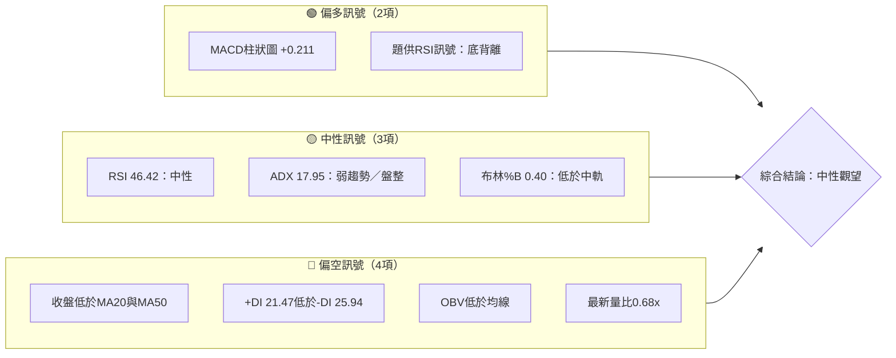
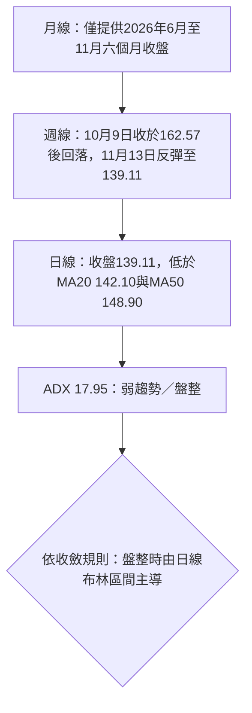
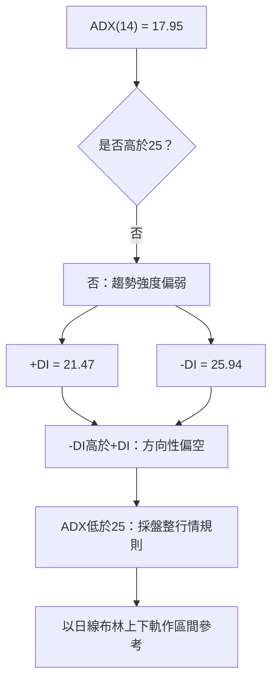
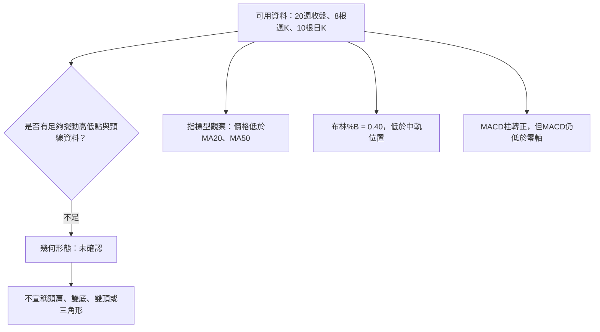
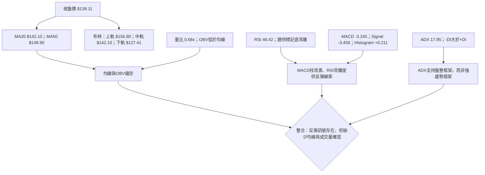
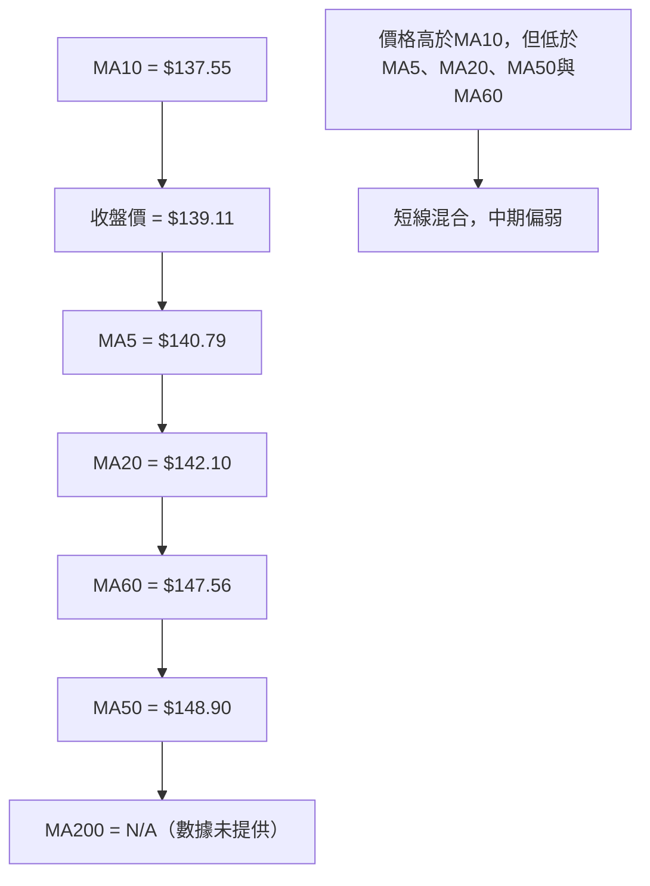
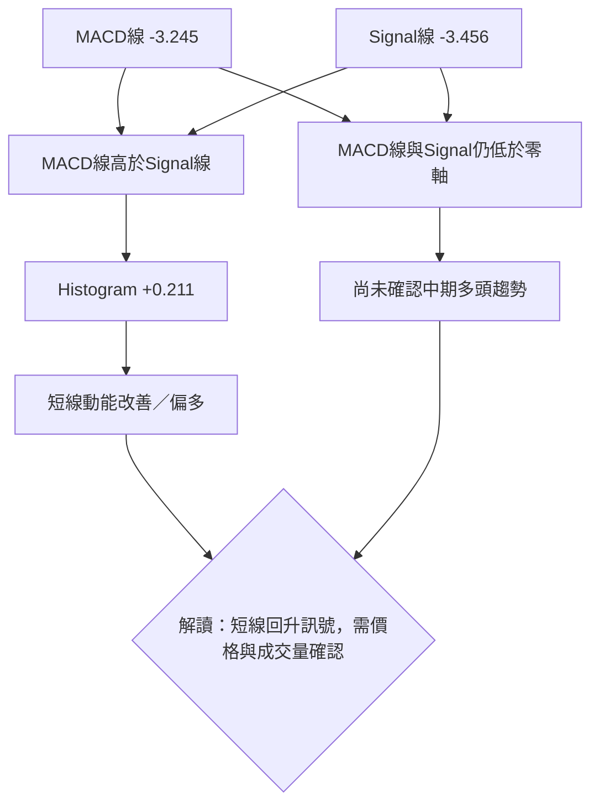
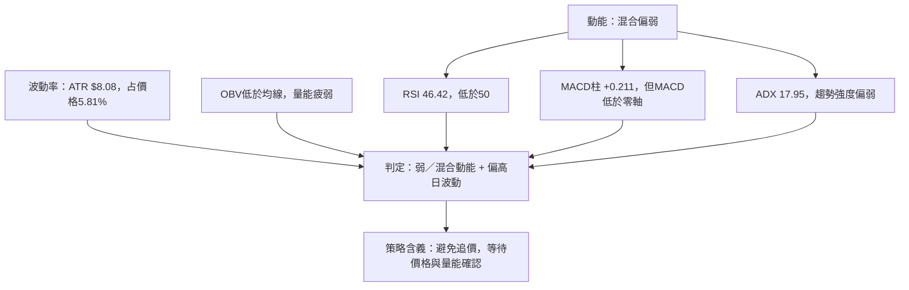
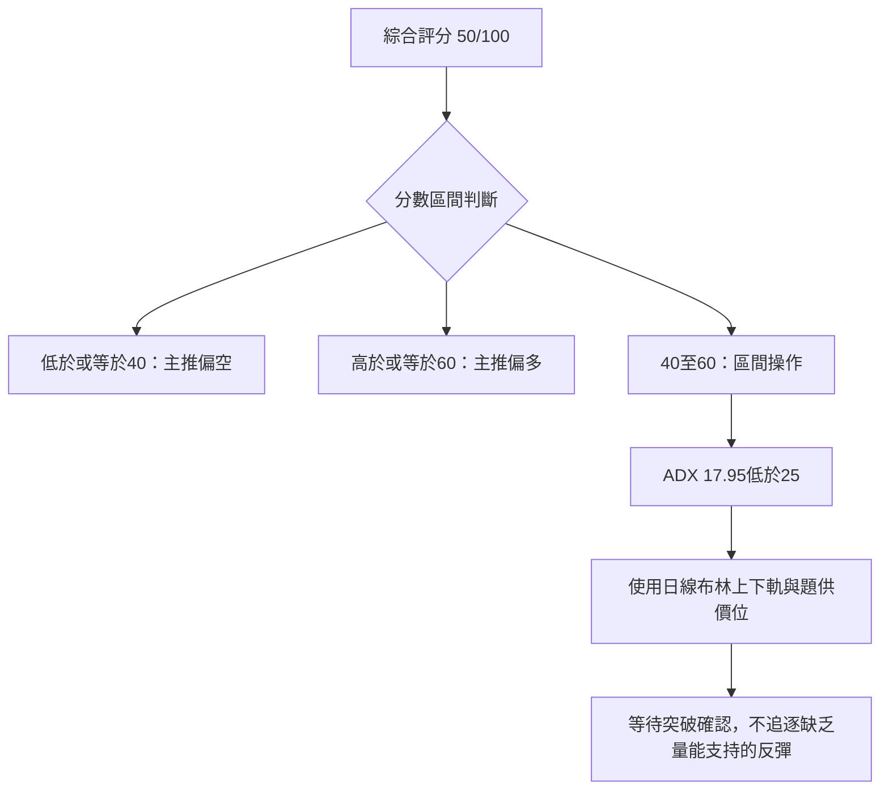
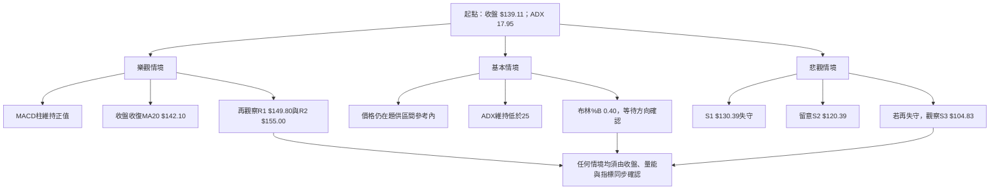

# SPCX 技術分析報告

> **報告日期**：2026-11-14 ｜ **語言**：繁體中文 ｜ **數據來源**：Yahoo Finance（依題供技術數據） ｜ **當前價格**：**$139.11**

> **數據口徑說明**：本報告只使用題供數據。價格支撐、阻力與斐波那契位依題供「關鍵價位」區塊引用；MA200、Beta 等缺漏項目依規則標示為 **N/A（數據未提供）**。題供月線價格只有 2026 年 6 月至 11 月六個月，故 12 個月圖表中的其他月份標為 N/A，不予推估。

---

## 目錄

| 章節 | 內容 |
|------|------|
| 1. 技術面概覽 | 訊號儀表板、核心指標、評分卡 |
| 2. 趨勢分析 | 多時框趨勢、長中短期走勢、ADX |
| 3. 圖表形態分析 | 形態識別、K 線組合、形態目標價 |
| 4. 支撐與阻力 | 關鍵價位、斐波那契回調 |
| 5. 技術指標深度解讀 | MA、RSI、MACD、布林、成交量 |
| 6. 動能與波動率 | 動能、ATR、Beta |
| 7. 多時框架總結 | 時框評分矩陣、訊號收斂 |
| 8. 交易策略建議 | 區間策略、條件式突破策略、風控 |
| 9. 風險提示與監控 | 監控清單、情境風險 |
| 報告總結 | 核心結論與策略摘要 |

---

## 1. 技術面概覽

### 🎯 技術訊號儀表板

目前訊號並非全面看多或看空：MACD 柱狀圖轉正、RSI 題供訊號為底背離，代表短線動能有改善；但價格仍低於 MA20 與 MA50、OBV 低於其均線，且 ADX 顯示趨勢偏弱、-DI 高於 +DI。整體更接近**弱趨勢盤整、等待確認**，而非成熟的趨勢行情。



### 📊 核心指標速覽表

| 指標類別 | 指標名稱 | 當前數值 | 訊號 | 解讀 |
|----------|----------|----------:|------|------|
| 價格 | 收盤價 | $139.11 | 🟡 | 價格位於52週區間的28.4%位置 |
| 均線 | MA20 | $142.10 | 🔴 | 收盤低於MA20，短線未收復趨勢均線 |
| 均線 | MA50 | $148.90 | 🔴 | 收盤低於MA50，中期壓力仍在 |
| 均線 | MA200 | N/A（數據未提供） | ⚪ | 不作長期均線判讀 |
| 動能 | RSI(14) | 46.42 | 🟡 | 位於30–70中性區，略低於50 |
| 動能 | MACD | -3.245；柱狀圖+0.211 | 🟡 | MACD仍在零軸下，但柱狀圖轉正 |
| 趨勢 | ADX(14) | 17.95 | 🟡 | 趨勢強度偏弱，依規則視為盤整行情 |
| 波動 | ATR(14) | $8.08 | 🟡 | 約為收盤價5.81%，日波動偏高 |
| 成交量 | 最新量比 | 0.68x | 🔴 | 最新成交量低於20日均量 |
| 量價 | OBV | OBV < MA | 🔴 | 量能尚未確認價格反彈 |

### 🏆 技術評分卡

六項子評分採 1–10 分；總分依規則使用算術平均，再四捨五入至整數。未四捨五入的平均為 **4.50/10**，四捨五入後為 **5/10**，即 **50/100**。

```text
技術評分卡 — SPCX（2026-11-14）
╔══════════════════════════════════════════════════════════╗
║ 趨勢強度      ▓▓▓▓░░░░░░  4/10   🟡  ADX低於25、空方DI領先   ║
║ 動能指標      ▓▓▓▓▓▓░░░░  6/10   🟡  MACD柱轉正、RSI仍低於50  ║
║ 支撐穩定度    ▓▓▓▓▓░░░░░  5/10   🟡  S1與布林下軌接近但未確認  ║
║ 成交量配合    ▓▓▓▓░░░░░░  4/10   🔴  量比0.68x、OBV低於均線    ║
║ 形態完整度    ▓▓▓▓▓░░░░░  5/10   🟡  幾何形態資料不足          ║
║ 均線排列      ▓▓▓░░░░░░░  3/10   🔴  價格低於MA20、MA50         ║
╠══════════════════════════════════════════════════════════╣
║ 子評分合計    27/60；算術平均 4.50/10；四捨五入為 5/10       ║
║ 綜合評分      ▓▓▓▓▓░░░░░  50/100 🟡  中性：區間操作、等待突破 ║
╚══════════════════════════════════════════════════════════╝
```

評分條與量化評分的換算：子評分平均四捨五入為 5/10，故綜合評分為 50/100。這個分數反映訊號互相抵銷，不代表價格必然維持在區間內。

### 本章結論

- **偏多依據**：MACD柱狀圖為正；題供 RSI 背離標記為底背離。
- **偏空依據**：價格低於 MA20、MA50；+DI 低於-DI；OBV 低於均線；成交量低於20日均量。
- **主要判斷**：ADX 17.95 < 25，因此採用盤整行情框架；以日線布林通道與已列支撐／阻力作為短線區間參照。
- **綜合評分**：**50/100，中性**。第7、8章均沿用此評分與中性策略方向。

---

## 2. 趨勢分析

### 🌐 多時框趨勢分析



**資料限制**：月線歷史區塊僅列出六個月份，不能據此補齊12個月月線序列；MA200為 N/A（數據未提供），故無法用 MA200 驗證長期趨勢。

### 📈 長期趨勢 — 月線價格走勢圖

下圖只呈現已提供的2026年6月至11月收盤價。圖中其餘月份依資料缺漏標註為 N/A，並不以插值或外推補值。數值及漲跌幅均以題供月收盤價計算。

```text
SPCX 月線收盤走勢（題供資料只有最近6個月份；其他月份 N/A）

價格
$180 ┤ ● Jun 170.86
$170 ┤  ╲
$160 ┤   ╲
$150 ┤    ╲                          ● Sep 150.86
$140 ┤     ╲               ● Aug 143.69 ╲        ● Nov 139.11
$130 ┤      ╲                           ╲ ● Oct 134.72
$120 ┤       ╲
$110 ┤        ● Jul 108.37
     └────────────────────────────────────────────────────
       Dec* Jan* Feb* Mar* Apr* May* Jun   Jul   Aug   Sep   Oct   Nov
       N/A   N/A  N/A  N/A  N/A  N/A  170.86 108.37 143.69 150.86 134.72 139.11

*題供月線資料未提供該月份收盤價。
```

圖表依月份連接已知收盤點，僅作視覺化；不能視為逐日或逐週價格路徑，也不表示月內高低點。

### 📊 月線階段變化表

| 階段 | 收盤價變化 | 月對月變化 | 技術解讀 |
|------|-----------:|-----------:|----------|
| 2026-06 → 2026-07 | $170.86 → $108.37 | -36.57% | 六個已知月份中最大單月跌幅，反映價格大幅回落 |
| 2026-07 → 2026-08 | $108.37 → $143.69 | +32.59% | 從月度低點顯著反彈，但尚不足以判定長期反轉 |
| 2026-08 → 2026-09 | $143.69 → $150.86 | +4.99% | 反彈延續，漲幅放緩 |
| 2026-09 → 2026-10 | $150.86 → $134.72 | -10.70% | 再度回落，月收盤未維持前一階段漲勢 |
| 2026-10 → 2026-11 | $134.72 → $139.11 | +3.26% | 月收盤回升，但仍低於2026年9月的收盤價 |
| 2026-06 → 2026-11 | $170.86 → $139.11 | -18.58% | 六個已知月度收盤整體低於起點 |

### 📊 中期趨勢（週線分析）

週線資料顯示，10月9日收盤 $162.57 之後，價格在10月16日降至 $146.03，10月30日降至 $134.72，11月6日再收於 $134.27，11月13日回升至 $139.11。這代表近期有反彈，但尚未收復 MA20 $142.10 或 MA50 $148.90。

| 週末日期 | 收盤價 | 周度收盤變化 | RSI | MACD柱 | 解讀 |
|----------|-------:|-------------:|----:|-------:|------|
| 2026-10-09 | $162.57 | — | 59.1 | +0.937 | 近期資料中的一個較高收盤 |
| 2026-10-16 | $146.03 | -10.17% | 43.9 | -1.979 | 價格與動能同步轉弱 |
| 2026-10-23 | $147.49 | +1.00% | 46.7 | -1.719 | 小幅回升，但 MACD 柱仍為負 |
| 2026-10-30 | $134.72 | -8.66% | 37.5 | -1.994 | 收盤及 RSI 均偏弱 |
| 2026-11-06 | $134.27 | -0.33% | 42.7 | -2.020 | 收盤近乎持平，動能柱仍負 |
| 2026-11-13 | $139.11 | +3.60% | 46.4 | +0.211 | 價格及 MACD 柱改善，但仍未回到均線上方 |

```text
近期週收盤與關鍵價位示意（非比例尺）

$162.57  ● 2026-10-09
          ╲
$146.03    ● 2026-10-16 ── $147.49 ● 2026-10-23
                         ╲
$142.10  ───────── MA20 / 布林中軌 ─────────────
$139.11                                     ● 2026-11-13（現價）
$134.72                           ● 2026-10-30
$134.27                                  ● 2026-11-06
$130.39  ───────── S1 ──────────────────────────
$127.41  ───────── 布林下軌 ────────────────────
$120.39  ───────── S2 ──────────────────────────
```

週線示意圖中的支撐與阻力只引用題供價位；MA20 及布林下軌則是題供指標值，並非另行計算的支撐位。

### ⚡ 趨勢強度評估（ADX 解讀）



| ADX 區間 | 常見技術解讀 | SPCX當前狀態 |
|----------|--------------|--------------|
| ADX < 20 | 趨勢力道偏弱，較易出現盤整 | **17.95，符合** |
| ADX 20–25 | 趨勢形成中的過渡區 | 未達此區間 |
| ADX > 25 | 趨勢較具方向性 | 未達此門檻 |
| DI方向 | +DI高於-DI偏多；-DI高於+DI偏空 | **-DI 25.94 > +DI 21.47，方向偏空** |

**趨勢判斷**：依規則，ADX 低於25，主要分類為**盤整行情**；但 DI 組合顯示空方方向性稍占優勢。因此不能把 ADX 解讀成「空頭趨勢已確認」，較準確的說法是：趨勢強度弱、方向指標偏空，價格仍須由支撐或阻力突破確認。

---

## 3. 圖表形態分析

### 🔍 形態識別系統

提供資料包含週收盤序列與有限週K、日K，但不足以穩健確認頭肩、雙底、雙頂或三角形等幾何形態。依規則，不以稀疏資料臆測複雜形態；本章只評估有明確指標或 OHLC 依據的型態特徵。



### 形態信心度表

| 形態／訊號 | 信心度 | 判斷依據（引用數據） | 完成度 | 目標價 |
|------|------:|----------------------|------|------|
| 頭肩頂／頭肩底 | 低於50%；資料不足 | 題供週線窗口不足以確認三個清晰波峰／波谷與頸線 | N/A（不確認） | 數據中未偵測到 |
| 雙底 | 低於50%；資料不足 | 週線可見7月低點資料及11月回落區，但不是同一時段內具備可驗證的等高雙底結構；不得將它們直接連成形態 | N/A（不確認） | 數據中未偵測到 |
| 三角形／旗形 | 低於50%；資料不足 | 近週K有較大波動，無足夠一致的收斂邊界或旗桿後整理結構 | N/A（不確認） | 數據中未偵測到 |
| 指標型回升 | 中等，非幾何形態 | MACD柱狀圖由前週 -2.020 變為 +0.211；最新收盤高於前週收盤 | 僅屬初步改善 | 不據此推算形態目標價 |
| 布林位置 | 中等，非幾何形態 | 現價 $139.11，布林中軌 $142.10、下軌 $127.41，%B為0.40 | 區間內偏下方 | 不據此創設額外目標價 |

> **結論**：目前沒有足夠證據宣稱已完成反轉形態。題供 RSI 背離訊號可列為動能改善線索，但它不是已完成的價格形態，也不能單獨導出形態目標價。

### 🕯️ 重要 K 線形態分析

以下只使用題供「近10根日K」及「近8根週K」的開、高、低、收。形態描述限於列出的 K 棒，不延伸至區塊外日期。

| 日期（日K/週K） | 開 | 高 | 低 | 收 | K線形態判讀 | 解讀 | 訊號 |
|------|----:|----:|----:|----:|-------------|------|------|
| 2026-11-05（日K） | $131.34 | $131.87 | $120.39 | $123.62 | 下影線較長的收跌K；下影線$3.23、實體$7.72 | 盤中低點後回升，但收盤仍低於開盤，不能視為已確認錘頭反轉 | 🟡 |
| 2026-11-06（日K） | $130.94 | $135.32 | $128.57 | $134.27 | 收漲K；實體$3.33 | 收盤高於開盤，顯示短線反彈，但無法單根確認趨勢反轉 | 🟡 |
| 2026-11-12（日K） | $137.85 | $147.60 | $137.75 | $139.94 | 上影線較長；上影線$7.66，實體$2.09 | 盤中上探後回落，顯示較高價格遭遇賣壓 | 🔴 |
| 2026-11-13（日K） | $140.17 | $142.24 | $136.64 | $139.11 | 小型收跌K；實體$1.06 | 當日小幅回落，尚未顯示強勢突破 | 🟡 |
| 2026-10-16（週K） | $164.66 | $167.07 | $140.66 | $146.03 | 長實體收跌週K；實體$18.63 | 該週賣壓顯著，且收盤低於開盤 | 🔴 |
| 2026-10-30（週K） | $146.84 | $151.36 | $134.50 | $134.72 | 長實體收跌週K；收盤接近該週低位 | 週線弱勢延續，收盤距低點$0.22 | 🔴 |
| 2026-11-06（週K） | $137.01 | $142.74 | $120.39 | $134.27 | 收跌週K，且有較長下影線；下影線$13.88 | 低點後收復部分跌幅，但週收仍低於開盤 | 🟡 |
| 2026-11-13（週K） | $136.51 | $147.60 | $135.37 | $139.11 | 收漲週K；實體$2.60 | 週收高於開盤，屬反彈線索，但仍低於MA20與MA50 | 🟡 |

K線形態本身不構成獨立交易訊號。近期週K反彈需配合收盤能否回到均線上方、成交量是否改善，以及 MACD 柱是否延續轉正一併觀察。

### 📉 ASCII 價格結構示意圖

```text
SPCX 近期收盤與價位結構示意（標示價位均來自題供資料）

$176.42 ── 2026-10-09週高（近8根週K資料）
   │
$162.57 ── 2026-10-09週收
   │       10月中旬後週線回落
$158.13 ── R3／近一年波段高點聚類
$155.00 ── R2
$150.98 ── 61.8%斐波那契回調位
$149.80 ── R1
$148.90 ── MA50
$147.60 ── 2026-11-12日高／2026-11-13週高
$142.10 ── MA20／布林中軌
$139.11 ── 現價
$130.68 ── 78.6%斐波那契回調位
$130.39 ── S1
$127.41 ── 布林下軌
$120.39 ── S2／2026-11-05日低及2026-11-06週低
$104.83 ── S3／52週低
```

本圖將相互接近的技術參考位並列，不代表所有價位都是同等強度的支撐或阻力；例如 $130.68 是斐波那契位，$130.39 才是題供支撐聚類位。

### 🎯 形態目標價計算

目前未確認可量度的頭肩、雙底、雙頂、旗形或三角形幾何形態，因此沒有可採用的「頸線 ± 形態高度」目標計算。

- **形態目標價**：數據中未偵測到。
- **技術交易參考價位**：在第4章列示的 R1–R3、S1–S3 及題供布林／斐波那契數值。
- **避免的作法**：不以未確認的形態強行計算價格目標，也不將分析師目標價稱作圖表形態目標。

---

## 4. 支撐與阻力

### 🗺️ 關鍵價位分布圖

```text
SPCX 價位結構分布圖（價位均引用題供資料）
══════════════════════════════════════════════════════
$158.13 ║████████████████████████║ R3 強阻力候選
$155.00 ║████████████████████    ║ R2 阻力
$150.98 ║························║ 61.8%斐波那契
$149.80 ║████████████████████████║ R1 首要阻力
$148.90 ║------------------------║ MA50
$142.10 ║------------------------║ MA20／布林中軌
$139.11 ╠════════════════════════╣ ◄ 現價（2026-11-13收盤）
$130.68 ║························║ 78.6%斐波那契
$130.39 ║▓▓▓▓▓▓▓▓▓▓▓▓▓▓▓▓        ║ S1 首要支撐
$127.41 ║------------------------║ 布林下軌
$120.39 ║████████████████████████║ S2 強支撐參考
$104.83 ║████████████████████████║ S3／52週低
══════════════════════════════════════════════════════
圖例：█ 波段價位聚類　· 斐波那契位　— 均線／布林指標
```

### 🚧 阻力位分析表

阻力價位只引用題供關鍵價位區塊中的 R1、R2、R3；阻力形成解讀則結合現有均線與週線資料，不另外創造價位。

| 阻力級別 | 價位 | 形成原因／交叉參照 | 突破難度 | 重要性 |
|----------|------:|--------------------|----------|--------|
| R1 | $149.80 | 題供近一年波段高點聚類；且接近 MA50 $148.90 與61.8%回調位$150.98所在區域 | 中高 | 首要觀察位；突破後仍需量能確認 |
| R2 | $155.00 | 題供波段高點聚類；位於現價上方，且介於61.8%回調位與R3之間 | 中高 | 若收復R1後，作為下一阻力觀察 |
| R3 | $158.13 | 題供波段高點聚類 | 高 | 上方主要波段阻力參考；突破需明確延續性 |

**阻力解讀**：現價與 R1 相距 $10.69，約為現價的7.68%。MA50 位於 $148.90，與 R1 僅相差 $0.90，形成可觀察的均線／阻力重疊區；但這不是由本報告重新計算的支撐阻力位。若價格無法收復 MA20 $142.10，R1 的測試仍需等待。

### 🛡️ 支撐位分析表

| 支撐級別 | 價位 | 形成原因／交叉參照 | 守住評估 | 重要性 |
|----------|------:|--------------------|----------|--------|
| S1 | $130.39 | 題供近一年波段低點聚類；鄰近78.6%回調位$130.68 | 中等，尚未經後續資料確認 | 首要支撐 |
| S2 | $120.39 | 題供波段低點聚類；亦為近10根日K的2026-11-05低點及近8根週K的2026-11-06低點 | 中等偏高，屬近期明確觀察低點，但仍可能失守 | 重要支撐 |
| S3 | $104.83 | 題供52週低點及近一年波段低點聚類 | 不作機率保證；失守S2後的深層風險參考 | 長週期支撐參考 |

「守住評估」是根據價位與題供資料作出的技術判讀，不是統計勝率，也不保證價位會守住。

### 📐 斐波那契回調位分析

以下直接引用題供斐波那契數值，未重新計算：

| 回調比例 | 題供價位 | 相對現價的判讀 |
|----------|---------:|----------------|
| 23.6% | $197.13 | 現價遠低於此位 |
| 38.2% | $179.49 | 現價遠低於此位 |
| 50.0% | $165.24 | 現價低於此位 |
| 61.8% | $150.98 | 現價低於此位 |
| 78.6% | $130.68 | 現價高於此位 |
| 100.0% | $104.83 | 52週低點 |

現價 **$139.11** 位於題供 **61.8%回調位 $150.98** 與 **78.6%回調位 $130.68** 之間。這表示價格已處於52週區間較深的回撤區，但不能只因接近較深回調位就推定已經見底。值得留意的是，$130.68 的78.6%回調位與支撐 S1 $130.39 接近，形成技術觀察區；兩個價位仍須各自標示，不能混為同一數值。

---

## 5. 技術指標深度解讀

### 🎛️ 指標訊號總覽



### 📈 移動平均線排列分析

| 均線 | 數值 | 收盤與均線關係 | 短線含義 |
|------|-----:|----------------|----------|
| MA5 | $140.79 | 收盤低於MA5 $1.68 | 短線收盤略弱於近期短期均線 |
| MA10 | $137.55 | 收盤高於MA10 $1.56 | 近期短線均線略有支撐作用 |
| MA20 | $142.10 | 收盤低於MA20 $2.99 | 短線尚未收復趨勢中軸 |
| MA50 | $148.90 | 收盤低於MA50 $9.79 | 中期均線壓力仍明顯 |
| MA60 | $147.56 | 收盤低於MA60 $8.45 | 中期方向尚弱 |
| MA120 | N/A（數據未提供） | N/A（數據未提供） | 不作推算 |
| MA200 | N/A（數據未提供） | N/A（數據未提供） | 不作推算 |



題供均線排列為「混合排列」，與數值一致：收盤價高於 MA10，但低於 MA5、MA20、MA50、MA60。MA200 不可用，因此不能把短中期的均線關係外推為完整長期排列。收盤站回 MA20 是短線改善的第一個均線觀察條件；MA50 則是更高一層的中期壓力參考。

### 📉 RSI(14) 分析

```text
RSI(14) 強弱刻度（0–100）
超賣         偏弱             中性               偏強         超買
  0────────30────────40────────50────────60────────70──────100
                                  ▲
                               46.42
強度條：▓▓▓▓▓▓▓▓▓░░░░░░░░░░░░░░░░░░░░░░░░░░░░░░░░░░░░ 46.42%
```

- **RSI 46.42**：位於30至70的常用中性區，沒有進入典型超買或超賣區；低於50表示多方動能尚未占優。
- **題供背離判定**：資料明確標示「底背離」，並說明是比較近20根K棒首尾價格與 RSI 的方向。依題供結果，本報告記錄為**底背離訊號存在**。
- **訊號限制**：未提供近20根每日價格與 RSI 的逐根序列，因此無法獨立重新檢驗背離的峰谷位置或幅度。故此背離只能視為題供的動能提示，而非完整驗證的反轉確認。
- **整合判斷**：RSI 背離偏多，但 RSI 數值仍低於50、價格仍低於 MA20 與 MA50，量能亦偏弱；因此不將底背離直接等同於趨勢反轉。

### 📊 MACD(12/26/9) 訊號解讀

| MACD項目 | 題供數值 | 解讀 |
|----------|---------:|------|
| MACD線 | -3.245 | 仍低於零軸，較大方向動能尚未轉強 |
| Signal線 | -3.456 | 亦低於零軸 |
| MACD Histogram | +0.211 | 柱狀圖為正，代表相對訊號線的短線動能改善 |



MACD 柱狀圖與 MACD 線相對位置提供短線改善訊號，但兩條線都仍在零軸下方。因此較合理的技術描述是「空方動能有減弱跡象」，而不是「多頭趨勢已確認」。若柱狀圖重新轉負，或價格繼續受制於 MA20，短線改善訊號可能失效。

### 📦 布林通道分析

題供布林值如下：上軌 **$156.80**、中軌 **$142.10**、下軌 **$127.41**；%B為 **0.40**。現價低於中軌但高於下軌，位於通道下半部。

```text
布林通道位置示意（非比例尺）

$156.80 ─────────────────── 布林上軌
                 │
                 │   現價低於中軌
$142.10 ─────────┼───────── 布林中軌（MA20）
          現價   ● $139.11
                 │  %B = 0.40
$127.41 ─────────────────── 布林下軌
```

- **%B = 0.40**：低於0.50的中軌位置，支持「價格處於通道下半部」的判讀。
- **盤整框架**：ADX 17.95低於25，依多時框收斂規則，短線以布林上下軌作主要區間參考。
- **不等同反轉**：價格位於下半部並不代表必然回到中軌；若下探至下軌或失守支撐，仍需依實際收盤與量能重新評估。
- **目標限制**：策略目標優先引用題供 R1–R3、S1–S3或已列出指標值，不另以布林通道推算新價格。

### 💹 成交量分析（量價配合度）

| 成交量指標 | 數值 | 相對比較 | 解讀 |
|------------|-----:|----------|------|
| 最新日成交量 | 77,314,900 | — | 最新交易日量能 |
| 20日均量 | 113,403,575 | 最新量為0.68倍 | 最新成交量低於短期均量 |
| 50日均量 | 100,642,730 | 最新量低於50日均量 | 缺乏明顯放量確認 |
| 最新週成交量 | 473,093,500 | 低於前週586,532,000 | 週成交量較前週減少 |
| OBV趨勢 | OBV < MA | 量能疲弱 | 題供指標未確認價格反彈 |

價格自2026年11月6日收盤 $134.27 回升至11月13日 $139.11，週收盤漲幅約3.60%；但最新日量比只有0.68倍，最新週成交量也低於前一週。這表示**價格反彈尚未得到成交量確認**。由於缺少完整逐日 OBV 與價格序列，無法獨立量化量價背離的斜率或持續期間；本報告依題供「OBV < MA」判斷為量能疲弱。

---

## 6. 動能與波動率

### ⚡ 動能評估四象限

| 象限 | 動能 | 波動 | 當前狀態 | 評估 |
|------|------|------|----------|------|
| Q1 | 強 | 低 | — | 趨勢延續較佳，但目前不符合 |
| Q2 | 弱 | 低 | — | 低波動盤整，但不符合現有ATR比例 |
| Q3 | 強 | 高 | — | 高風險動能行情，目前沒有足夠趨勢確認 |
| Q4 | 弱／混合 | 高 | **✓** | ADX低、RSI低於50、ATR占比5.81%，且短線訊號互有矛盾 |



四象限分類不是對未來方向的保證。此處的「偏高波動」是依 ATR 占收盤價5.81%判讀，不是與市場或同業統計分布比較後的分位數結論。

### 📊 ATR 波動率分析

| 指標 | 數值 | 技術含義 |
|------|-----:|----------|
| ATR(14) | $8.08 | Wilder ATR，題供日波動參考 |
| ATR／收盤價 | 5.81% | 相對價格的日波動幅度不低 |
| 1 ATR參考距離 | $8.08 | 僅作風險尺度參考，不直接轉為新支撐或目標價 |

ATR不是預測方向的指標。若交易策略以支撐位為止損，需同時考慮 $8.08 的日波動尺度：止損過於貼近現價，可能被一般波動觸及；止損過寬則會增加單筆風險。下單前應以可承受損失決定倉位，而不是因為 ATR 數值而擴大風險額度。

本報告的策略止損使用題供支撐或均線數值，並非把「現價減去若干 ATR」另行創造新價位。

### 📐 Beta 與市場相關性

- **Beta**：**N/A（數據未提供）**。
- 因缺少 Beta 數值與相同期間的大盤回報序列，不能量化 SPCX 對大盤的敏感度、相關係數或市場中性特徵。
- 技術交易者仍需監控整體市場波動與重大新聞，但本報告不把新聞內容轉化為未提供的價格目標或 Beta 估計。

---

## 7. 多時框架總結

### 📋 時框架評分表

表內時框判讀以題供資料可支持的範圍為限。月線只有六個月資料，且 MA200 為 N/A，故長期評分可信度較低。

| 時框架 | 趨勢方向 | 動能 | 均線排列 | 形態 | 綜合評分 | 建議 |
|--------|----------|------|----------|------|----------|------|
| 月線／長期 | 六個已知月度收盤整體下跌18.58%；但資料不完整 | 不完整 | MA200：N/A（數據未提供） | 無法確認幾何形態 | 4/10（低信心） | 不以月線資料推導長期買賣點 |
| 週線／中期 | 10月9日後回落，11月13日反彈 | MACD柱由負轉正；週收高於前週 | 週線均線序列未提供；現價仍低於日線MA50 | 未確認反轉形態 | 5/10（中低信心） | 觀察反彈能否延續並收復阻力 |
| 日線／短期 | ADX顯示盤整；DI方向偏空 | RSI中性、MACD柱轉正 | 收盤低於MA20與MA50 | 布林區間內偏下方 | 5/10 | 區間操作，等待突破確認 |

### 🔲 綜合訊號矩陣

| 維度 | 短期（日線） | 中期（週線） | 長期（月線） | 一致性 |
|------|--------------|--------------|--------------|--------|
| 價格方向 | 低於MA20、MA50 | 10月以來回落後反彈 | 六個已知月度收盤整體較6月低 | 🟡 部分偏空 |
| 動能 | RSI 46.42；MACD柱轉正 | 11月13日MACD柱由負轉正 | 資料不足以確認月線動能 | 🟡 改善但未確認 |
| 趨勢強度 | ADX 17.95，弱趨勢 | 近期週線有回落與反彈 | 長期ADX數據未提供 | 🟡 盤整 |
| 成交量 | 量比0.68x；OBV低於均線 | 最新週量低於前週 | 長期量能序列不足 | 🔴 未確認反彈 |
| 關鍵價位 | 現價高於S1、低於MA20 | S1、S2與R1為觀察位 | 52週區間位置28.4% | 🟡 區間較下方 |

### ⚖️ 多時框收斂結論

1. **先判斷行情類型**：ADX(14) = **17.95 < 25**，依規則屬於**弱趨勢／盤整行情**。
2. **主導框架**：盤整時由**日線布林通道上下軌**作為主要交易區間參考；週線與月線用於確認較大方向，但不凌駕於日線區間規則。
3. **時框訊號衝突處理**：週線最新一週回升，MACD柱亦轉正，屬短線改善；然而日線收盤仍低於 MA20、MA50，成交量與 OBV 未確認。因此以「短線反彈、整體尚未轉強」收斂。
4. **唯一方向性結論**：**中性觀望／區間操作，等待突破確認**。
5. **一致性檢查**：本結論與第1章 **50/100中性評分**及第8章區間操作主策略一致。

---

## 8. 交易策略建議

### 🗺️ 策略決策流程圖



### 🧭 策略路由

**當前主策略方向 = 中性區間操作（依綜合評分 50/100）。**

依評分卡，當前不是偏多主策略，也不是偏空主策略。策略重點是等待價格靠近已提供的區間參考位、或等待阻力突破後再確認；以下策略為條件式交易框架，並非同時強烈推薦多空押注。

### 🎯 價格情境階梯

| 觸發條件 | 下一目標 | 後續延伸 | 情境含義 |
|----------|----------|----------|----------|
| 站上R1 $149.80並有延續 | R2 $155.00 | R3 $158.13 | 反彈轉強的條件式情境；需觀察量能及收盤持續性 |
| 價格維持區間內 | 布林中軌$142.10為指標參考 | 上方觀察R1 $149.80；下方觀察S1 $130.39 | ADX低於25下的區間震盪情境 |
| 跌破S1 $130.39 | S2 $120.39 | S3 $104.83 | 支撐失守後偏弱情境，屬風險監控而非必然目標 |
| 回落至布林下軌$127.41 | 觀察S1 $130.39與S2 $120.39 | 不預設反彈 | 需等止跌訊號，不能僅因觸及下軌買入 |

情境價位均引用題供 R1–R3、S1–S3 或已提供布林值，不另外推算新支撐阻力。價格到達某一價位不等於情境已確認，收盤與成交量仍需配合。

### 📊 情境機率分佈

以下為根據當前技術狀態所作的**主觀情境權重**，不是歷史回測概率或統計模型預測；三項合計100%。

| 情境 | 機率估計 | 主要依據 |
|------|---------:|----------|
| 反彈／繼續上行 | 25% | MACD柱+0.211、題供RSI底背離、週收盤回升；但價格仍低於MA20、MA50且量能未確認 |
| 區間震盪 | 45% | ADX 17.95低於25；布林%B 0.40；訊號多空互有矛盾 |
| 回落／再探支撐 | 30% | +DI低於-DI、OBV低於均線、量比0.68x，價格尚未收復MA20 |

### 🟡 主策略詳情（中性區間操作）

策略A為支撐區附近的條件式反彈策略；策略B為上破R1後的條件式突破策略。两者是不同觸發情境，不代表同時持有或同時下單。

| 策略要素 | 策略 A：下緣區間反彈 | 策略 B：R1突破確認 |
|----------|-----------------------|--------------------|
| 進場條件 | 價格回到布林下軌附近後出現止跌確認；不因單純觸及價位自動進場 | 收盤有效站上R1 $149.80，並觀察後續延續及量能 |
| 進場價格 | $127.41（布林下軌；限條件觸發） | $149.80（以R1為條件式參考進場） |
| 目標價 T1 | $139.11（題供當前價格，作為第一段反彈參考） | $155.00（R2） |
| 目標價 T2 | $149.80（R1） | $158.13（R3） |
| 止損價格 | $120.39（S2） | $142.10（MA20；若突破後跌回此參考位下方，突破假設失效） |
| 風險報酬比 | **1 : 1.67（以T1計）**；1 : 3.19（以T2計） | **1 : 0.68（以T1計）**；1 : 1.08（以T2計） |
| 成功機率估計 | 低至中等；屬條件式情境，非歷史勝率 | 低至中等；須確認突破及成交量 |
| 建議倉位 | 低倉位；以個人可承受風險決定，不預設固定百分比 | 低倉位；T1風險報酬比不足1，應更審慎 |

**風險報酬比驗算：**

- 策略A進場 $127.41、止損 $120.39、T1 $139.11：  
  風險 = $127.41 − $120.39 = **$7.02**；報酬 = $139.11 − $127.41 = **$11.70**。  
  報酬／風險 = $11.70 ÷ $7.02 = **1.67**。  
  T2報酬 = $149.80 − $127.41 = $22.39；$22.39 ÷ $7.02 = **3.19**。

- 策略B進場 $149.80、止損 $142.10、T1 $155.00：  
  風險 = $149.80 − $142.10 = **$7.70**；報酬 = $155.00 − $149.80 = **$5.20**。  
  報酬／風險 = $5.20 ÷ $7.70 = **0.68**。  
  T2報酬 = $158.13 − $149.80 = $8.33；$8.33 ÷ $7.70 = **1.08**。

策略B的第一目標風險報酬比低於1，屬於相對不理想的突破交易條件；不能因為突破情境成立就忽略其風險報酬比。策略A也需要價格回到指定參考區並出現止跌確認，若價格直接跌破支撐，不應將策略A視為仍然有效。

### 🔴 反向風險觸發點（風控提示）

- **S1 $130.39失守**：區間下緣支撐假設轉弱，進一步留意 S2 $120.39。
- **S2 $120.39失守**：近期低點支撐失效；下一個題供較低參考位為 S3 $104.83。
- **反彈無法收復MA20 $142.10**：短線回升可能仍只是區間內反彈。
- **觸及R1 $149.80但無法站穩**：需防止阻力區遭遇賣壓。
- **MACD柱重新轉負、OBV繼續低於均線**：反彈訊號的可信度進一步下降。
- 以上是風險監控條件，不構成完整反向做空建議。

### ⭐ 整體訊號強度評星

```text
做多訊號強度：★★☆☆☆  (2/5)
理由：MACD柱轉正與題供RSI底背離偏多，但均線與成交量未確認。

做空訊號強度：★★★☆☆  (3/5)
理由：價格低於MA20、MA50，-DI領先+DI，OBV量能偏弱；
      但ADX低於25，不足以確認強空頭趨勢。

整體可信度：  ★★★☆☆  (3/5)
理由：短線指標可供判讀，但月線資料不完整、MA200與Beta缺漏，
      幾何圖表形態亦未能確認。
```

---

## 9. 風險提示與監控

### ✅ 關鍵監控指標 Checklist

```text
╔══════════════════════════════════════════════════════════════╗
║                 SPCX 技術風險監控清單                        ║
╠══════════════════════════════════════════════════════════════╣
║ □ 收盤能否站回 MA20：$142.10                                  ║
║ □ 收盤能否站回 MA50：$148.90                                  ║
║ □ R1：$149.80 是否有效突破及延續                              ║
║ □ S1：$130.39 是否守住                                         ║
║ □ 若失守S1，監控S2：$120.39                                    ║
║ □ MACD柱是否維持正值（目前 +0.211）                           ║
║ □ RSI是否回到50以上；目前為46.42                              ║
║ □ ADX是否仍低於25；目前為17.95                                ║
║ □ +DI是否仍低於-DI；目前21.47低於25.94                         ║
║ □ 日成交量是否回到20日均量上方；目前量比0.68x                  ║
║ □ OBV是否仍低於均線                                            ║
║ □ 留意事件新聞與跳空風險，但不以新聞推算未提供的價格位          ║
╚══════════════════════════════════════════════════════════════╝
```

### ⚠️ 風險場景分析



| 情境 | 技術觸發 | 可能影響 | 監控重點 |
|------|----------|----------|----------|
| 樂觀 | MACD柱持續正值、收盤收復MA20 $142.10，後續挑戰R1 $149.80 | 短線反彈改善；仍須突破後才能提高趨勢判斷 | R1能否有效站上，量能是否改善 |
| 基本 | ADX維持低於25，價格在布林與關鍵位附近震盪 | 區間特徵延續，方向訊號仍互相矛盾 | RSI、MACD柱、布林%B |
| 悲觀 | S1 $130.39失守，進一步回落 | S2 $120.39成為下方風險觀察位；更深層參考為S3 $104.83 | 收盤是否跌破、OBV與成交量是否同步偏弱 |

### 🛡️ 風險管理重要提醒

1. **ATR占比不低**：ATR $8.08約為收盤價5.81%。部位大小應以預設可承受損失計算，不能單純依照看多或看空判斷加倉。
2. **避免在低量反彈追價**：最新成交量僅為20日均量的0.68倍，且OBV低於均線。若價格上行但量能持續不足，反彈延續性仍需折價看待。
3. **支撐不等於保證止跌**：S1、S2、S3是歷史價位聚類參考，不是保證價格會反彈的底部。
4. **策略失效條件要事先定義**：區間交易必須事先確認哪一個支撐或阻力失效時退出，不宜在失守後任意放寬止損。
5. **資料缺漏影響長期判斷**：MA200、Beta與完整12個月月線資料均缺漏，長期趨勢與市場敏感度的判讀有限。
6. **新聞與技術訊號可能同時影響波動**：題供新聞包括發射任務與市場事件，但本報告不以新聞推導價格方向或新增支撐阻力；事件期間應防範跳空、流動性與波動放大。
7. **機率不是保證勝率**：第8章機率為主觀情境權重，不是經回測的交易成功率。
8. **分散風險**：不宜讓單一股票或單一交易情境成為投資組合的主要風險來源。

---

## 📋 報告總結

```text
SPCX 技術分析報告總結
══════════════════════════════════════════════════════════
報告日期：2026-11-14
當前價格：$139.11
分析評級：🟡 中性觀望；盤整行情下的區間操作

關鍵結論：
├─ 長期趨勢：🟡 六個已知月收盤整體較2026年6月低18.58%；
│             12個月資料不完整，MA200為N/A（數據未提供）
├─ 中期趨勢：🟡 週線近期回落後反彈，尚未確認趨勢反轉
├─ 短期趨勢：🟡 ADX 17.95，弱趨勢／盤整；價格低於MA20、MA50
├─ 關鍵支撐：S1 $130.39；S2 $120.39；S3 $104.83
├─ 關鍵阻力：R1 $149.80；R2 $155.00；R3 $158.13
└─ 分析師共識目標：$256.41（外部分析師共識，非技術形態目標）

最優策略組合：
1. 🥇 最佳機會：等待價格於區間下緣出現止跌確認，再依S2風險界線
2. 🥈 次選機會：收盤有效突破R1 $149.80後，觀察R2與R3；注意策略B的T1風險報酬比僅1:0.68
3. 🥉 保守選擇：等待價格收復MA20 $142.10並觀察成交量與OBV改善，再評估下一步

評分卡：
六項平均 4.50/10 → 四捨五入5/10 → 綜合評分 50/100（中性）
══════════════════════════════════════════════════════════
```

**核心判斷**：SPCX目前的技術狀態偏向弱趨勢盤整。MACD柱轉正與題供 RSI 底背離提供短線改善線索；不過價格仍低於 MA20、MA50，成交量偏低、OBV未確認，且 -DI 高於 +DI。依多時框規則，主策略採**區間操作、等待突破確認**，不宜將短線反彈直接視為已確認的中長期反轉。

> ⚠️ **免責聲明**：本報告為依據題供技術數據生成的研究分析，僅供研究與學術參考，不構成任何投資建議。技術指標與歷史價位不保證未來走勢；投資有風險，交易前應自行評估風險承受能力並設定停損與倉位上限。

*報告生成時間：2026-11-14 ｜ 數據來源：題供 Yahoo Finance 技術數據 ｜ 分析框架：多時框技術分析*