# TSLA 技術分析報告

> **報告日期**：2026-10-12 ｜ **語言**：繁體中文 ｜ **數據來源**：Yahoo Finance ｜ **當前價格**：$382.70

---

## 目錄

| 章節 | 內容 |
|------|------|
| [1. 技術面概覽](#1-技術面概覽) | 訊號儀表板、核心指標、評分卡 |
| [2. 趨勢分析](#2-趨勢分析) | 多時框趨勢、長中短期走勢、ADX強度 |
| [3. 圖表形態分析](#3-圖表形態分析) | 形態識別、K線組合、形態目標價 |
| [4. 支撐與阻力](#4-支撐與阻力) | 關鍵價位結構、斐波那契回調區間 |
| [5. 技術指標深度解讀](#5-技術指標深度解讀) | 均線系統、RSI、MACD、布林通道、OBV |
| [6. 動能與波動率](#6-動能與波動率) | 動能四象限、ATR風控、Beta彈性分析 |
| [7. 多時框架總結](#7-多時框架總結) | 時框矩陣、多時框收斂與方向定調 |
| [8. 交易策略建議](#8-交易策略建議) | 策略路由、價格情境、多頭策略與風控 |
| [9. 風險提示與監控](#9-風險提示與監控) | 監控Checklist、三表情境、部位管理 |
| [📋 報告總結](#-報告總結) | 執行摘要與綜合評級卡 |

---

## 1. 技術面概覽

### 🎯 技術訊號儀表板

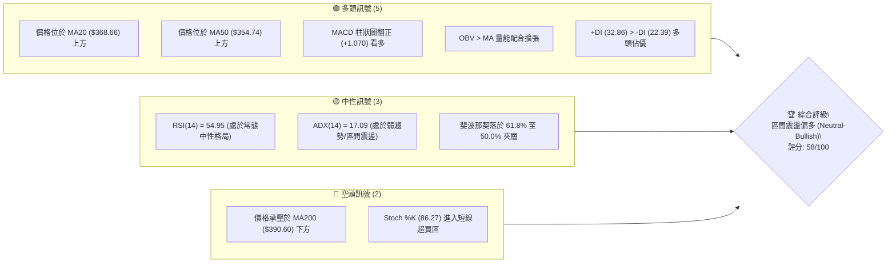

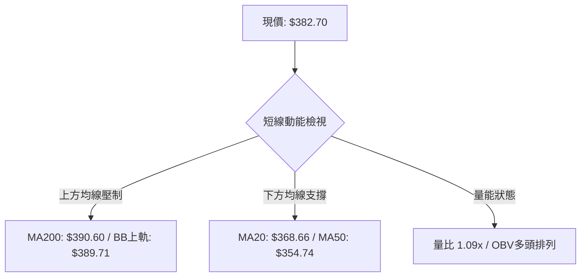

### 📊 核心指標速覽表

| 指標類別 | 指標名稱 | 當前數值 | 訊號 | 解讀 |
|----------|----------|----------|------|------|
| **價格** | 當前收盤價 | $382.70 | 🟢 | 站穩短期均線，處於 52 週區間之 42.4% 分位 |
| **均線** | MA20 (短) | $368.66 | 🟢 | 價格在均線上方 +3.81%，短期多頭排列確立 |
| **均線** | MA50 (中) | $354.74 | 🟢 | 價格在均線上方 +7.88%，中期波段重回升軌 |
| **均線** | MA200 (長) | $390.60 | 🔴 | 價格在長期生命線下方 -2.02%，存在中長期技術反壓 |
| **動能** | RSI(14) | 54.95 | 🟡 | 位於 50 多空分水嶺微幅上方，無超買超賣，中性擴張 |
| **動能** | MACD (12,26,9) | 5.071 / 4.001 | 🟢 | DIF 線位於 Signal 線上方，柱狀圖 +1.070 維持金叉 |
| **動能** | Stoch %K / %D | 86.27 / 78.45 | 🔴 | 短線技術指標進入 >80 超買鈍化區，慎防假突破衝高拉回 |
| **趨勢** | ADX (14) | 17.09 | 🟡 | 數值低於 25，屬於低波弱趨勢，技術面以箱體盤整為主 |
| **趨勢** | DMI 系統 | +DI: 32.86 / -DI: 22.39 | 🟢 | 正向動向線高於負向動向線，多頭掌控短線發牌權 |
| **波動** | ATR(14) | $11.03 (2.88%) | 🟡 | 單日波動率中等，提供健康的止損與風控緩衝區間 |
| **通道** | Bollinger Bands | 上: $389.71 / 下: $347.61 | 🟡 | %B 為 0.83，正向布林上軌靠攏，進入通道上緣測試區 |
| **量能** | 成交量 / 20MA | 38.89M / 35.84M | 🟢 | 量比 1.09x，OBV 趨勢高於均線，資金呈現溫和淨流入 |

### 🏆 技術評分卡

```
╔══════════════════════════════════════════════════════════════════╗
║                 技術評分卡 — TSLA (2026-10-12)                   ║
╠══════════════════════════════════════════════════════════════════╣
║ 趨勢強度 (Trend)     ████████░░░░░░░░░░░░  42/100  🟡 (ADX<25)   ║
║ 動能指標 (Momentum)  ████████████░░░░░░░░  62/100  🟢 (MACD金叉) ║
║ 支撐穩定度 (Support) ██████████████░░░░░░  70/100  🟢 (S1-S3堅固)║
║ 成交量配合 (Volume)  ████████████░░░░░░░░  60/100  🟢 (OBV支撐)  ║
║ 形態完整度 (Pattern) ██████████░░░░░░░░░░  52/100  🟡 (箱體盤整) ║
║ 均線排列 (MAs)       ████████████░░░░░░░░  60/100  🟡 (混亂修復) ║
╠══════════════════════════════════════════════════════════════════╣
║ 綜合技術評分         ███████████░░░░░░░░░  58/100  中性偏多      ║
╚══════════════════════════════════════════════════════════════════╝
```

---

## 2. 趨勢分析

### 🌐 多時框趨勢分析

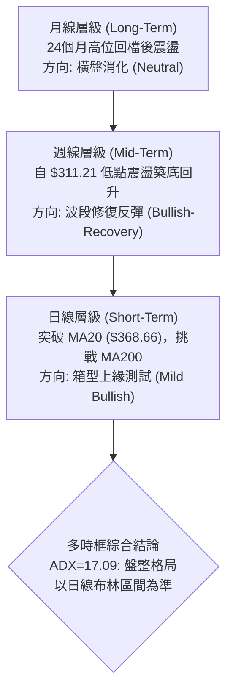

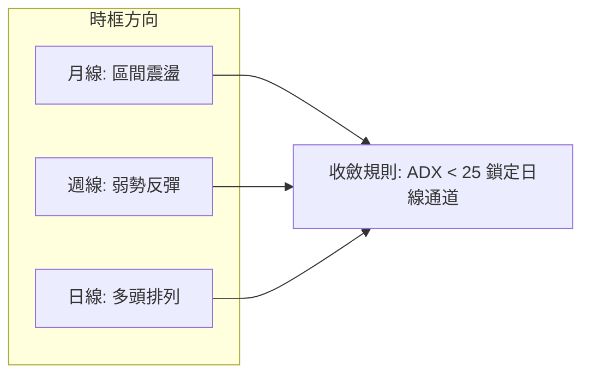

### 📈 長期趨勢 — 12個月走勢圖（Unicode）

```
TSLA 月線走勢圖（2025-10 至 2026-10）
價格軸 ($)
$460 ┤   ● $456.56 (2025-10)
$440 ┤       ●         ● $449.72 (2025-12)
$420 ┤           ●         ●                   ● $435.79 (2025-05)
$400 ┤                         ● $402.51           ●
$380 ┤                                 ● $381.63       ●──────● $382.70 (現價)
$360 ┤                             ●                       ●
$340 ┤                                                         ● $354.81
$320 ┤                                             ● $311.21 (2026-07 低點)
     └─┬────┬────┬────┬────┬────┬────┬────┬────┬────┬────┬────┬────
     10   11   12   01   02   03   04   05   06   07   08   09   10 (月)
      (2025)       (2026)
```

#### 走勢特徵分析表格

| 階段區間 | 時間跨度 | 起訖收盤價 | 漲跌幅 | 波段結構特徵 |
|----------|----------|------------|--------|--------------|
| **高位派發期** | 2025-10 ~ 2026-01 | $456.56 → $430.41 | -5.73% | 於 $430~$456 高檔形成多重頂部，量能逐步萎縮 |
| **主跌下行期** | 2026-01 ~ 2026-03 | $430.41 → $371.75 | -13.63% | 連續三個月收黑，跌破中期上升趨勢線 |
| **中繼反彈期** | 2026-03 ~ 2026-05 | $371.75 → $435.79 | +17.23% | 強力反彈測試前高壓力，但未能突破 52 週高點 $498.83 |
| **恐慌探底期** | 2026-05 ~ 2026-07 | $435.79 → $311.21 | -28.59% | 出現單月崩跌，7月收盤 $311.21 逼近 52 週低點 $297.38 |
| **打底復甦期** | 2026-07 ~ 2026-10 | $311.21 → $382.70 | +22.97% | 築底回升，重返 MA20/MA50 上方，目前處於估值修復區間 |

### 📊 中期趨勢（週線分析）

```
TSLA 近20週核心價格通道結構示意
$440 ┤ [5月高點 $435.79] ───┐ (高點回落)
$410 ┤                       ├─────────┐
$390 ┤                                 │      [MA200 反壓 $390.60 / R1: $385.43]
$380 ┤                                 │      ▲ 現價: $382.70
$360 ┤                                 └──────┼─── [S1 支撐: $366.31]
$340 ┤                                        │    [S2 支撐: $354.05]
$310 ┤                 [7/8月雙底支撐 $311.21]┘
     └─────────────────────────────────────────────────────────────
      W1  W3  W5  W7  W9  W11  W13  W15  W17  W19  W20
```

中期走勢顯示，TSLA 在 2026 年 7 月下旬至 8 月初經歷了極端恐慌拋售（週收盤價來到 $313.03 及 $311.21，週 RSI 跌至 15.7 極度超賣區），成交量同步放大至 2.75 億股，確立了中期的「恐慌性拋售放量底」（Selling Climax）。隨後週線連續出現反彈，週 MACD 柱狀圖由 -8.365 大幅收斂至 +1.070，顯示空方動能耗盡，中期格局由單邊下跌轉化為箱型築底震盪。

### ⚡ 趨勢強度評估（ADX 解讀）

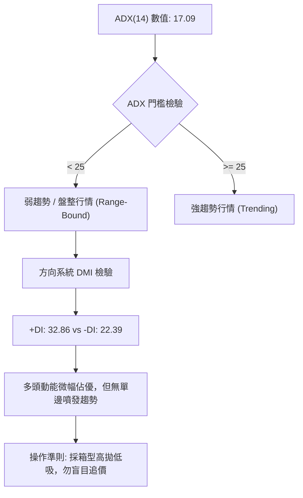

#### ADX 強度對照表

| ADX 數值區間 | 當前數值 | 行情特徵分類 | 操作策略指引 |
|--------------|----------|--------------|--------------|
| **0.00 – 19.99** | **17.09 (當前)** | **極弱趨勢 / 無方向震盪** | **避免突破追價，嚴守布林上下軌進行高拋低吸** |
| 20.00 – 24.99 | - | 盤整蓄勢 / 趨勢萌芽 | 密切注意三角形收斂突破與成交量爆發 |
| 25.00 – 49.99 | - | 明確單邊趨勢 (趨勢市) | 順勢交易，以 MA20 與均線回踩為加碼點 |
| 50.00 – 100.0 | - | 極強單邊走勢 / 趨勢過熱 | 隨時提防動能衰竭與天花板反轉 |

---

## 3. 圖表形態分析

### 🔍 形態識別系統

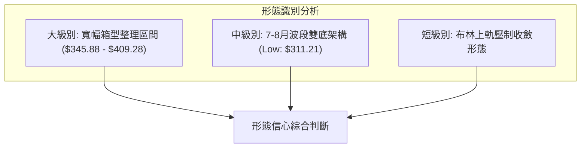

#### 形態信心度評估表

| 形態名稱 | 信心度 | 判斷依據（嚴格引用數據） | 完成度 | 目標價計算方式與數值 |
|----------|--------|--------------------------|--------|----------------------|
| **波段雙重底 (W底)** | **75%** | 兩次波段低點出現在 2026-07-26 收盤 $313.03 與 2026-08-02 收盤 $311.21（接近 52W 低點 $297.38）。隨後 8 月中突破 $345 並於 9 月回踩 S2 $354.05 不破。 | 85% | 頸線取 R1 $385.43，形態高度 = $385.43 - $311.21 = $74.22。<br/>量度目標 = 頸線 $385.43 + $74.22 = **$459.65**（此數值接近阻力群與 Fib 23.6% $451.29）。 |
| **箱型整理 (Rectangle)** | **80%** | 下界支撐聚類於 S2 $354.05 / S3 $345.88；上界阻力密集於 R1 $385.43 與 R2 $409.28。現價 $382.70 正處於箱體中上部。 | 70% | 若有效向上突破箱頂 R2 $409.28，箱體高度 = $409.28 - $345.88 = $63.40。<br/>量度目標 = $409.28 + $63.40 = **$472.68**。 |
| **頭肩底形態** | **35%** | 數據中左肩與右肩對稱性不足，缺乏標準右肩低點聚類。 | 未成形 | **訊號不足，僅做指標型解讀，不預設目標價**。 |

### 🕯️ 重要K線形態分析

| 週期/月份 | 基準價位 | K線形態特徵 | 技術面解讀 | 訊號強度 |
|-----------|----------|-------------|------------|----------|
| **2026-07 月線** | 收盤 $311.21 | 長黑帶下影線 (恐慌長陰) | 觸及 52W 低點 $297.38 支撐帶，形成空頭情緒極致宣洩 | 🔴 極度偏空但孕育轉折 |
| **2026-08 月線** | 收盤 $367.95 | 長紅反轉吞噬 (Bullish Engulfing) | 月漲幅達 +18.23%，全數包覆 7 月跌幅，確認中線底部確立 | 🟢 強烈看多反轉 |
| **2026-09 月線** | 收盤 $354.81 | 窄幅回踩陰十字 (Pullback Test) | 縮量測試 MA50 支撐，未跌破 8 月中長紅實體半數 | 🟡 良性洗盤中繼 |
| **2026-10 近期** | 現價 $382.70 | 溫和走揚紅K棒 (Advancing White) | 站上日線 MA20 與 MA50，形成溫和多頭反彈波 | 🟢 短線溫和看多 |

### 📉 ASCII 走勢形態示意圖

```
TSLA 雙重底頸線突破與箱型結構示意圖
價格
$410 ┤─────────────────────────────── [箱體頂部 / R2: $409.28]
     │                                     ▲ (若突破量度目標 $459.65)
$385 ┤───────────────────────●────── [頸線阻力 / R1: $385.43]
     │                      / ╲     ▲ 現價: $382.70
$366 ┤                     /   ●────┴─ [回踩支撐 S1: $366.31]
$354 ┤           ●        /            [回踩打底 S2: $354.05]
     │          / ╲      /
$311 ┤         ●   ●────●              [底 1: $313.03]  [底 2: $311.21]
     └─────────┴────┴────┴───────────────────────────────────────
             7月下旬 8月初  8月中  9月中   10月當前
```

### 🎯 形態目標價計算

根據完成度最高之「雙重底」架構推導：
1. **基底確認**：波段雙底低點取值 $311.21。
2. **關鍵頸線**：阻力位 R1 之聚類價格 **$385.43**。
3. **垂直形態高度 (H)**：$385.43 - $311.21 = **$74.22**。
4. **理論突破目標價 (T_Pattern)**：頸線價位 + 垂直高度 = $385.43 + $74.22 = **$459.65**。
   - 此量度目標若成立，將直接挑戰斐波那契 23.6% 回調位 **$451.29** 與 52 週次高點聚類。
   - **前提條件**：日線需帶量實質收高於 R1 $385.43 與 MA200 $390.60 之上，否則形態仍受限於箱體。

---

## 4. 支撐與阻力

### 🗺️ 關鍵價位分布圖（Unicode）

```
TSLA 價位結構分布圖 (由 OHLCV 與斐波那契回調精確計算)
═════════════════════════════════════════════════════════════════
$498.83 ║████████████████████████████████║ 52週最高點 (0.0% Fib)
$451.29 ║██████████████████████          ║ 斐波那契 23.6% 回調位
$421.88 ║████████████████                ║ 斐波那契 38.2% 回調位
$418.36 ║████████████████████████        ║ 強阻力 R3 (波段高點聚類)
$409.28 ║████████████████████            ║ 阻力 R2 (箱體震盪上邊界)
$398.10 ║████████████                    ║ 斐波那契 50.0% 中間平衡位
$390.60 ║████████████████████████        ║ MA200 年線生死分水嶺
$385.43 ║████████████████████████████    ║ 關鍵阻力 R1 (頸線/通道頂)
$382.70 ╠════════════════════════════════╣ ◄ 當前市價 ($382.70)
$374.33 ║▓▓▓▓▓▓▓▓▓▓▓▓▓▓▓▓                ║ 斐波那契 61.8% 黃金回調位
$368.66 ║▓▓▓▓▓▓▓▓▓▓▓▓▓▓▓▓▓▓▓▓            ║ MA20 / 布林中軌支撐
$366.31 ║▓▓▓▓▓▓▓▓▓▓▓▓▓▓▓▓▓▓▓▓▓▓▓▓        ║ 近期核心支撐 S1 (波段低點)
$354.05 ║████████████████████████████    ║ 中期強支撐 S2 (波段低點聚類)
$347.61 ║████████████                    ║ 布林通道下軌
$345.88 ║████████████████████████████████║ 極限防守支撐 S3 (箱體下邊界)
$297.38 ║████████████████████████████████║ 52週最低點 (100.0% Fib)
═════════════════════════════════════════════════════════════════
```

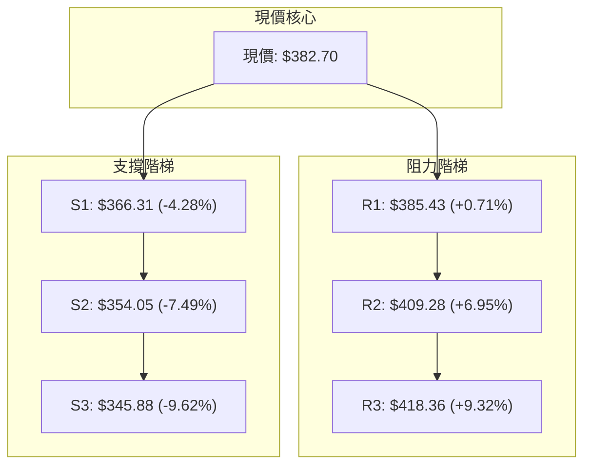

### 🚧 阻力位分析表

| 阻力級別 | 價位 | 距現價幅標 | 形成原因與技術共振 | 突破難度 | 重要性 |
|----------|------|------------|--------------------|----------|--------|
| **R1** | **$385.43** | +0.71% | 近一年波段高點聚類、雙底潛在頸線位置，與布林上軌 ($389.71) 形成共振阻力帶 | 🟡 中等 | ★★★★☆ |
| **R2** | **$409.28** | +6.95% | 近一年波段次高點密集堆積區、整數心理關卡 $400 之上強壓，接近 Fib 50% ($398.10) | 🔴 偏高 | ★★★★☆ |
| **R3** | **$418.36** | +9.32% | 近一年大波段頭部聚類高點，上方緊鄰 Fib 38.2% ($421.88) 重壓 | 🔴 極高 | ★★★★★ |

### 🛡️ 支撐位分析表

| 支撐級別 | 價位 | 距現價幅標 | 形成原因與技術共振 | 守住機率 | 重要性 |
|----------|------|------------|--------------------|----------|--------|
| **S1** | **$366.31** | -4.28% | 近一年波段低點聚類，與 20 日移動平均線 MA20 ($368.66) 形成多頭防守重疊區 | 🟢 80% | ★★★★☆ |
| **S2** | **$354.05** | -7.49% | 近一年波段低點聚類，與 50 日均線 MA50 ($354.74) 完美貼合，為中期波段防線 | 🟢 85% | ★★★★★ |
| **S3** | **$345.88** | -9.62% | 近一年波段極限低點聚類，貼近布林下軌 ($347.61) 及 Fib 78.6% ($340.49) | 🟢 90% | ★★★★★ |

### 📐 斐波那契回調位分析

依據 52 週極值區間（低點 **$297.38** 至 高點 **$498.83**，垂直震幅 **$201.45**）精確回調階梯如下：

```
0.0%  (52W High) ────────── $498.83  [天花板極限]
23.6%            ────────── $451.29  [強勢多頭防守區]
38.2%            ────────── $421.88  [重要壓力位，與 R3 呼應]
50.0%            ────────── $398.10  [多空強弱分水嶺]
                     ▲ MA200: $390.60
                     ▲ 當前價格: $382.70 (落於 61.8% 與 50.0% 之間)
61.8%            ────────── $374.33  [黃金分割關鍵支撐]
78.6%            ────────── $340.49  [深度回調防守區]
100.0% (52W Low) ────────── $297.38  [年度波段鐵底]
```

**技術解讀**：
當前收盤價 **$382.70** 精確運行於 **61.8% ($374.33)** 與 **50.0% ($398.10)** 之間的過渡夾層。
- 價格已站穩黃金分割位 61.8% ($374.33) 之上，顯示 7-8 月探底以來的反彈具備實質技術修復力道。
- 向上挑戰 50.0% 平衡中線 ($398.10) 之前，面臨著 **MA200 ($390.60)** 與 **R1 ($385.43)** 的雙重攔截。唯有突破 $398.10，整體架構才能由「弱勢修復」轉為「強勢回升」。

---

## 5. 技術指標深度解讀

### 🎛️ 指標訊號總覽

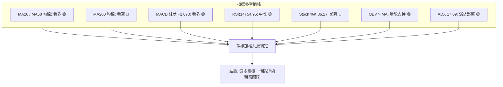

### 📈 移動平均線排列分析

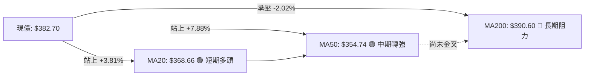

#### 均線階梯明細表

| 均線週期 | 數值 | 價格相距 | 正負差比例 | 走勢斜率特徵 | 訊號意涵 |
|----------|------|----------|------------|--------------|----------|
| **MA 5** | $378.98 | +$3.72 | +0.98% | 陡峭向上 ▅▇██ | 超短線極強多頭 |
| **MA 10** | $368.47 | +$14.23 | +3.86% | 穩定上升 ▆▇██ | 短線支撐迅速墊高 |
| **MA 20** | $368.66 | +$14.04 | +3.81% | 拐頭向上 ▅▆██ | 月線級別翻多，提供回踩緩衝 |
| **MA 50** | $354.74 | +$27.96 | +7.88% | 走平微升 ▃▄▅ | 季線底座確立，中期底部成形 |
| **MA 60** | $351.62 | +$31.08 | +8.84% | 低位走平 ▂▂▁ | 承接買盤紮實 |
| **MA 120**| $378.43 | +$4.27 | +1.13% | 走平震盪 ▃▄▃ | 現價剛穿過半年線，進入爭奪區 |
| **MA 200**| $390.60 | -$7.90 | -2.02% | 緩步下移 ▆▅▄ | **核心年線壓力，多空決戰點** |
| **MA 240**| $399.17 | -$16.47 | -4.13% | 緩降壓制 ▃▂▁ | 長期大週期籌碼套牢成本區 |

**均線結構綜合判定**：當前呈現「短多長空」的混亂排列（Mixed Alignment）。短期均線（MA5、10、20）已完成多頭發散，但中長期均線（MA200、240）依然處於價格上方呈下行態勢，表明當前上漲性質仍屬於「中期震盪修復」，尚未轉化為單邊大牛市。

### 📉 RSI(14) 分析

```
RSI(14) 動能刻度表
0 ──────── 30 ───────────────── 54.95 ──────────── 70 ──────── 100
[超賣區]        [弱勢區]       ▲ [現值]  [強勢區]      [超買區]
進度條: ███████████████░░░░░░░░░░░░ 54.95% (常態中性偏強)
```

- **當前數值**：54.95，位於 50 多空分界點上方。
- **超買超賣判定**：未觸及 70 超買或 30 超賣，指標空間充裕，具備進一步向上推升潛能。
- **背離分析結論**：檢視近 20 週數據，7 月下旬低點收盤 $311.21 對應 RSI 18.1，隨後 9-10 月價格震盪向上至 $382.70 對應 RSI 55.0，RSI 走勢與價格走勢同步墊高；**目前未發現頂背離或底背離跡象**，動能發展健康。

### 📊 MACD(12/26/9) 訊號解讀

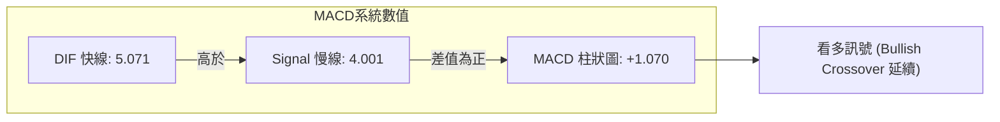

- **差離值 (DIF)**：5.071
- **訊號線 (Signal)**：4.001
- **柱狀圖 (Histogram)**：+1.070（大於 0）
- **動能解析**：DIF 穩定運行於 Signal 之上，柱狀圖自 2026-10-04 的 -1.498 翻正為 +1.070，顯示週線級別短期震盪回檔結束，多頭動能重新掌控節奏。

### 📦 布林通道分析

```
TSLA 日線布林通道 (20, 2) 結構示意圖
$395 ┤
$389 ┤ ─────────────────────────────── BB 上軌: $389.71 (波段阻力區)
$382 ┤                     ●現價: $382.70 (%B = 0.83)
$375 ┤
$368 ┤ ─────────────────────────────── BB 中軌 (MA20): $368.66 (回踩支撐線)
$360 ┤
$350 ┤
$347 ┤ ─────────────────────────────── BB 下軌: $347.61 (超跌防守線)
     └──────────────────────────────────────────────────────────
```

- **上軌**：$389.71
- **中軌 (MA20)**：$368.66
- **下軌**：$347.61
- **通道帶寬**：$42.10 (約佔價格 11.0%)，通道開口微幅擴張但未暴衝。
- **%B 指標**：0.83，價格貼近布林上軌。依據均值回歸理論與 ADX 弱勢特徵，%B 接近 0.8-1.0 且接近 R1 時，容易出現短線衝高後受阻拉回中軌 ($368.66) 的震盪走勢。

### 💹 成交量分析（量價配合度）

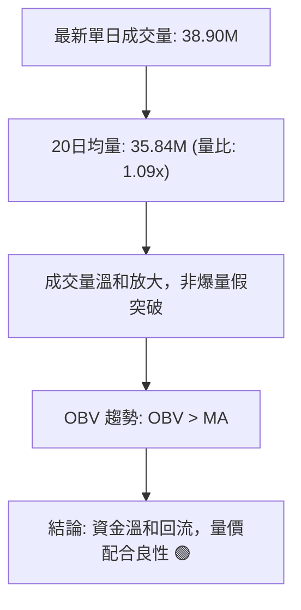

- **量比檢驗**：最新量 38.90M / 20日均量 35.84M = 1.09x，處於健康溫和放量狀態，未見主力竭盡性出貨量（Exhaustion Volume）。
- **OBV 能量潮**：OBV > MA，且呈現階梯式走高，量能曲線領先價格收復 9 月平台，量價配合良好，未見量價背離。

---

## 6. 動能與波動率

### ⚡ 動能評估四象限

```
TSLA 技術動能與波動率象限分布表
┌─────────────────────────────────┬─────────────────────────────────┐
│ Q2: 弱動能 / 低波動             │ Q1: 強動能 / 低波動             │
│ (沉悶盤整 / 橫向築底)           │ (穩健牛市 / 最佳買點)           │
│ 狀態: ADX=17.09 處於此區過渡邊緣│                                 │
├─────────────────────────────────┼─────────────────────────────────┤
│ Q4: 弱動能 / 高波動             │ Q3: 強動能 / 高波動 (★ 當前定位)│
│ (恐慌拋售 / 避免進場)           │ (高彈性修復 / 嚴設風控)         │
│ (2026年7月曾處於此區)           │ 狀態: Beta=1.92, ATR=$11.03     │
│                                 │       MACD金叉, %B=0.83         │
└─────────────────────────────────┴─────────────────────────────────┘
```

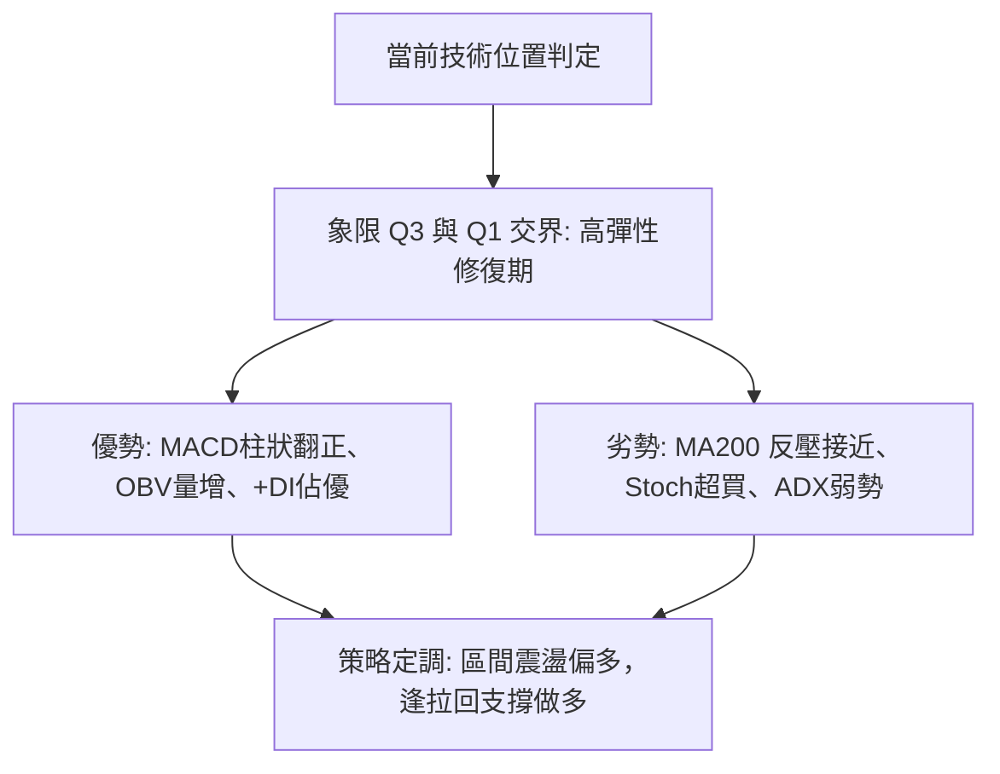

### 📊 ATR 波動率分析

- **ATR(14)**：**$11.03**（佔現價 **2.88%**）
- **單日正常波動範圍**：$382.70 ± $11.03 = **$371.67 ～ $393.73**
- **動態止損建議**：
  - **保守型 (2.0 × ATR)**：止損距離 $22.06，止損參考價設於 **$360.64**（低於 S1 $366.31）。
  - **積極型 (1.5 × ATR)**：止損距離 $16.55，止損參考價設於 **$366.15**（精確貼合 S1 $366.31 支撐）。

### 📐 Beta 與市場相關性

- **Beta 係數**：**1.916**（高貝塔高彈性標的）
- **市場特徵解讀**：TSLA 價格波動度約為 S&P 500 指數的 1.92 倍。在目前大盤環境下，一旦大盤出現反彈，TSLA 具備強大的向上彈升槓桿；反之，若指數拉回，TSLA 回踩支撐的力道亦相對劇烈，操作上部位必須維持彈性（建議 10-15% 總資金），嚴禁過度槓桿。

---

## 7. 多時框架總結

### 📋 時框架評分表

| 時框架 | 趨勢方向 | 動能狀態 | 均線排列 | 圖表形態 | 綜合評分 | 交易建議 |
|--------|----------|----------|----------|----------|----------|----------|
| **月線 (長期)** | 🟡 橫向震盪 | 52W 區間 42.4% | MA200 壓制 | 高檔回落後築底 | **50 / 100** | 長線定期定額或觀望 |
| **週線 (中期)** | 🟢 築底反彈 | MACD 翻正 (+1.07) | 挑戰 MA50 | 波段雙底架構 | **65 / 100** | 偏多波段持有，逢回加碼 |
| **日線 (短期)** | 🟢 震盪走揚 | RSI 55 / Stoch超買 | 短多長空混合 | 箱型上緣測試 | **60 / 100** | 箱體操作，靠近上軌防拉回 |

### 🔲 綜合訊號矩陣

```
時框共振度分析矩陣
─────────┬──────────────┬──────────────┬──────────────
  維度   │  短期 (日線)  │  中期 (週線)  │  長期 (月線)  
─────────┼──────────────┼──────────────┼──────────────
趨勢方向 │  🟢 偏多     │  🟢 偏多     │  🟡 中性     
均線系統 │  🟢 站上短均 │  🟡 穿越中均 │  🔴 承壓年線 
動能強度 │  🟡 中性偏強 │  🟢 動能回升 │  🔴 歷史高壓 
形態結構 │  🟡 箱體上軌 │  🟢 雙底成形 │  🟡 寬幅箱形 
量能配合 │  🟢 量增價揚 │  🟢 溫和放大 │  🟡 中性縮量 
─────────┴──────────────┴──────────────┴──────────────
共振結論：日週雙時框呈現弱多頭共振，但長期月線仍受壓於下降週期。
```

### ⚖️ 多時框收斂結論

> **依據「嚴格要求 14」之多時框收斂原則執行定調**：
> 1. **趨勢強度檢驗**：當前 **ADX(14) = 17.09 < 25**，客觀數據確認當前市場處於**「盤整行情（Range-Bound Market）」**，而非單邊強趨勢行情。
> 2. **主導維度確立**：依收斂規則，盤整行情應**以日線布林通道上下軌 ($347.61 ～ $389.71) 與關鍵水平聚類價位為主要交易區間**。中長期 MA200 ($390.60) 則扮演震盪區間的天花板反壓。
> 3. **唯一方向性結論**：**【中性偏多箱體操作（Neutral-Bullish Range Trading）】**。短線動能雖受制於布林上軌與 R1 ($385.43)，但下方有 S1 ($366.31) 及 MA20 ($368.66) 形成多頭防守護城河，整體架構偏向「拉回找買點」，堅決不宜在阻力區盲目追高。

---

## 8. 交易策略建議

### 🗺️ 策略決策流程圖

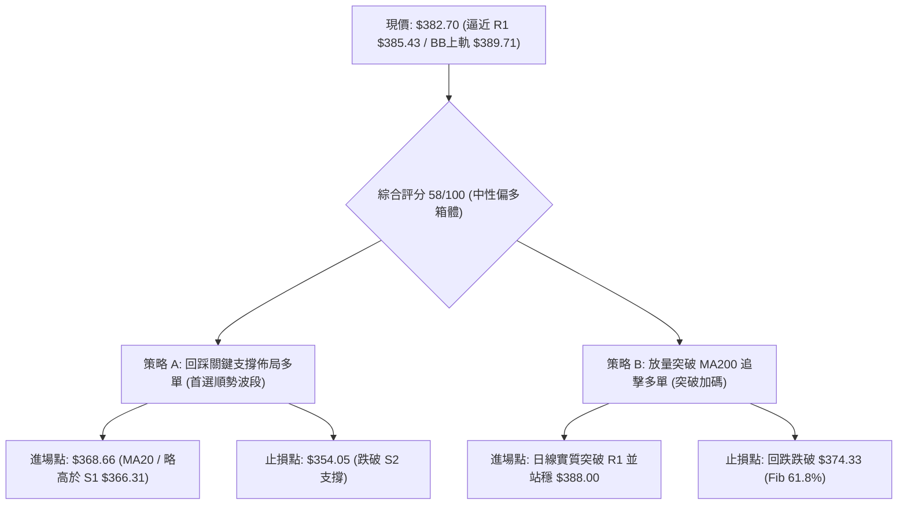

### 🧭 策略路由（依評分卡分流）

**當前主策略方向 = 【中性偏多之箱體震盪操作】（依技術綜合評分 58/100）**
綜合評分落於 40–60 分之區間，同時 ADX < 25 且 Stoch 進入短線超買，系統嚴禁單邊追高，**主推以「回調支撐低吸多單」為核心，並搭配「放量實質突破阻力」為輔**。空頭僅列為反轉跌破支撐時的風控對沖信號。

### 🎯 價格情境階梯（Price Scenarios）

| 觸發條件 | 下一目標價位 | 後續延伸價位 | 情境含義與技術研判 |
|----------|--------------|--------------|--------------------|
| **帶量突破 R1 $385.43** | **R2 $409.28** | **R3 $418.36** | **短線突破轉強**：突破布林上軌，挑戰 Fib 50% ($398.10) 及 $400 大關 |
| **受阻於 $385-$390 震盪** | **MA20 $368.66** | **S1 $366.31** | **常態箱體洗盤**：化解 Stoch 超買，回踩確認短期均線支撐強度 |
| **有效跌破 S1 $366.31** | **S2 $354.05** | **S3 $345.88** | **波段結構轉弱**：跌破月線支撐，回測季線 MA50 及雙底次級防線 |

### 📊 情境機率分佈

| 價格運行情境 | 發生機率 | 主要技術數據支撐依據 |
|--------------|----------|----------------------|
| **情境一：震盪蓄勢後上行突破** | **55%** | MACD 柱狀圖翻正 (+1.070)、OBV 走勢高於 MA、+DI (32.86) 明顯壓制 -DI (22.39) |
| **情境二：箱體區間持續震盪** | **30%** | ADX 僅 17.09 缺乏單邊動能、Stoch 超買壓制、上方逼近 MA200 ($390.60) 強阻力 |
| **情境三：跌破支撐再次探底** | **15%** | 僅於突發系統性風險、大盤急跌且有效跌破 S2 $354.05 季線時方才觸發 |

### 🟢 主策略詳情

本策略報價所有價位均嚴格引用關鍵價位（S1-S3、R1-R3、Fib 比例位、均線）。

| 策略要素 | 策略 A：回踩支撐低吸佈局（首選） | 策略 B：突破頸線順勢追擊（次選） |
|----------|----------------------------------|----------------------------------|
| **適用時機** | 短線受阻於 R1 回踩 MA20 支撐時 | 帶量突破 R1 並越過年線壓制時 |
| **進場條件** | 價格拉回至 MA20 附近獲支撐收下影線 | 日線收盤價突破 R1 $385.43 且量比 > 1.3x |
| **進場價格** | **$368.66** (精確取 MA20 / 布林中軌) | **$388.00** (確認突破 R1 $385.43) |
| **目標價 T1** | **$385.43** (阻力位 R1) | **$409.28** (阻力位 R2) |
| **目標價 T2** | **$409.28** (阻力位 R2) | **$418.36** (阻力位 R3) |
| **止損價格** | **$354.05** (跌破支撐位 S2 / MA50) | **$374.33** (跌回 Fib 61.8% 下方) |
| **風險空間** | $368.66 - $354.05 = $14.61 (3.96%) | $388.00 - $374.33 = $13.67 (3.52%) |
| **報酬空間 (T2)**| $409.28 - $368.66 = $40.62 (11.02%) | $418.36 - $388.00 = $30.36 (7.82%) |
| **風險報酬比** | **1 : 2.78** (優質風險收益比) | **1 : 2.22** (合理風險收益比) |
| **預估勝率** | **65%** | **55%** |
| **建議倉位** | **15% 總資金倉位** | **10% 總資金倉位** |

### 🔴 反向風險觸發點（對沖提示）

若出現以下訊號，多頭主策略即刻失效，投資人應即刻執行停損或建立對沖防護：
1. **關鍵價位跌破**：日線收盤價跌破 **S1 $366.31**，代表短期上升通道遭到破壞；若進一步灌破 **S2 $354.05**（MA50），波段反彈架構徹底翻空。
2. **指標空頭背離或翻黑**：MACD 柱狀圖若再度由正轉負跌破 0 軸，且 RSI 跌破 45 弱勢區間。
3. **對沖建議**：一旦跌破 S1 $366.31，多頭部位應即刻減倉 50%；若失守 S2 $354.05，應出清多頭部位，並可考慮買入以 S3 $345.88 為目標的看跌期權（Put）進行反向避險。

### ⭐ 整體訊號強度評星

```
做多訊號強度：★★★☆☆  (3.5/5星 — 短中期均線量能良好，但受制於年線壓制)
做空訊號強度：★★☆☆☆  (2.0/5星 — 空頭動能衰退，僅有超買與阻力反壓)
整體可信度：  ★★★★☆  (4.0/5星 — 多時框指標收斂一致，箱型邊界明確)
```

---

## 9. 風險提示與監控

### ✅ 關鍵監控指標 Checklist

```
╔══════════════════════════════════════════════════════════════════╗
║              TSLA 技術面每日盤後監控清單 (Checklist)              ║
╠══════════════════════════════════════════════════════════════════╣
║ [ ] 價位檢驗: 收盤價是否站穩 MA20 ($368.66) 與 S1 ($366.31)    ║
║ [ ] 阻力檢驗: 盤中挑戰 R1 ($385.43) 是否伴隨成交量放大至 40M 以上║
║ [ ] 年線得失: 能否突破並連續三日站穩 MA200 ($390.60)           ║
║ [ ] 動能跟蹤: RSI(14) 是否在 50-65 區間健康運行，有無頂背離     ║
║ [ ] 指標跟蹤: MACD 柱狀圖是否持續大於 0 (+1.070 以上擴張)      ║
║ [ ] 超買釋放: Stoch %K (86.27) 能否在不深跌情況下鈍化或降溫    ║
║ [ ] 趨勢確認: ADX(14) 數值是否自 17.09 拐頭向上突破 25 臨界線   ║
║ [ ] 量能檢驗: 單日成交量比是否維持在 1.0x 以上 (大於 35.84M)   ║
╚══════════════════════════════════════════════════════════════════╝
```

### ⚠️ 風險場景分析

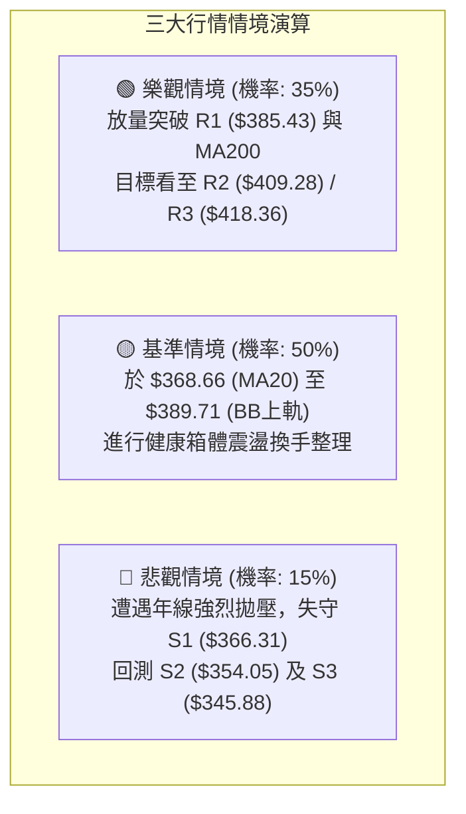

### 🛡️ 風險管理重要提醒

1. **Beta 高彈性部位控管**：TSLA Beta 高達 1.916，單日波動極劇烈。單筆交易部位風險曝險（最大容許虧損）建議嚴格限制在總投資組合淨值的 **1.0% ～ 1.5%** 之內。
2. **ATR 風險緩衝原則**：ATR 數值高達 $11.03，日內正常震盪即可達 3%。止損點設定萬萬不可過於緊密（切勿設在 $3-$5 內），務必保留至少 1.5 倍 ATR（約 $16.55）之技術緩衝空間，建議統一置於關鍵技術關卡 S1 ($366.31) 或 S2 ($354.05) 之外側。
3. **假突破防範機制**：目前 ADX = 17.09，在弱趨勢盤整市況中，「向上假突破」與「向下假跌破」發生頻率極高。盤中若見價格衝破 R1 $385.43 但成交量未能同步放大（量比 < 1.0x），切忌市價追價，必須等待日線收盤確認或回踩確認有撐再行進場。

---

## 📋 報告總結

```
╔══════════════════════════════════════════════════════════════════╗
║                    TSLA 技術分析報告總結                         ║
╠══════════════════════════════════════════════════════════════════╣
║ 報告日期：2026-10-12                                             ║
║ 當前價格：$382.70                                                ║
║ 綜合評級：⚖️ 中性偏多震盪 (Neutral-Bullish / 評分: 58/100)        ║
╠══════════════════════════════════════════════════════════════════╣
║ 關鍵結論：                                                       ║
║ ├─ 長期趨勢：🟡 中性橫盤 (月線高檔回檔後於 $300-$450 寬幅震盪)  ║
║ ├─ 中期趨勢：🟢 偏多回升 (自 $311.21 確立雙底，週 MACD 翻正)    ║
║ ├─ 短期趨勢：🟢 震盪走揚 (站上 MA20 與 MA50，考驗年線反壓)       ║
║ ├─ 關鍵支撐：S1: $366.31 │ S2: $354.05 │ S3: $345.88            ║
║ ├─ 關鍵阻力：R1: $385.43 │ R2: $409.28 │ R3: $418.36            ║
║ └─ 年線反壓：MA200: $390.60 │ 布林上軌: $389.71                 ║
╠══════════════════════════════════════════════════════════════════╣
║ 最優策略組合：                                                   ║
║ 1. 🥇 最佳機會 (策略 A)：等待價格良性回踩 MA20/布林中軌 $368.66   ║
║    佈局多單，止損設於 S2 $354.05，目標看 R1 $385.43 與 R2 $409.28║
║    (風險報酬比達 1:2.78)。                                      ║
║ 2. 🥈 次選機會 (策略 B)：若日線帶量實質收過 R1 $385.43，於 $388.00║
║    進場順勢追擊，止損設於 $374.33，目標看 R2 $409.28。          ║
║ 3. 🥉 保守選擇：在 ADX 突破 25 前視為箱型整理，於 $368-$389 間嚴格 ║
║    執行高拋低吸，維持 10% 輕倉操作。                             ║
╚══════════════════════════════════════════════════════════════════╝
```

---

> ⚠️ **免責聲明**：本報告為技術分析研究，所有數據、圖表及價位推算均基於市場歷史價格與客觀技術指標公式。本報告**僅供學術研究與投資策略討論參考**，**不構成任何形式的個人化投資建議或買賣邀約**。金融市場瞬息萬變，投資人應獨立評估風險並自行承擔交易損益。

---

*報告生成時間：2026-10-12 ｜ 數據來源：Yahoo Finance ｜ 分析框架：多時框技術分析模型*