# TSLA 技術分析報告

> **報告日期**：2026-10-13 ｜ **語言**：繁體中文 ｜ **數據來源**：Yahoo Finance ｜ **當前價格**：$378.03

---

## 目錄

| 章節 | 內容 |
|------|------|
| [1. 技術面概覽](#1-技術面概覽) | 訊號儀表板、核心指標、評分卡 |
| [2. 趨勢分析](#2-趨勢分析) | 多時框趨勢、長中短期走勢 |
| [3. 圖表形態分析](#3-圖表形態分析) | 形態識別、K線組合、目標價 |
| [4. 支撐與阻力](#4-支撐與阻力) | 關鍵價位、斐波那契回調 |
| [5. 技術指標深度解讀](#5-技術指標深度解讀) | MA/RSI/MACD/布林/成交量 |
| [6. 動能與波動率](#6-動能與波動率) | 動能評估、ATR、Beta |
| [7. 多時框架總結](#7-多時框架總結) | 時框架評分矩陣 |
| [8. 交易策略建議](#8-交易策略建議) | 多空策略、風險報酬比 |
| [9. 風險提示與監控](#9-風險提示與監控) | 監控指標、風險場景 |

---

## 1. 技術面概覽

### 🎯 技術訊號儀表板

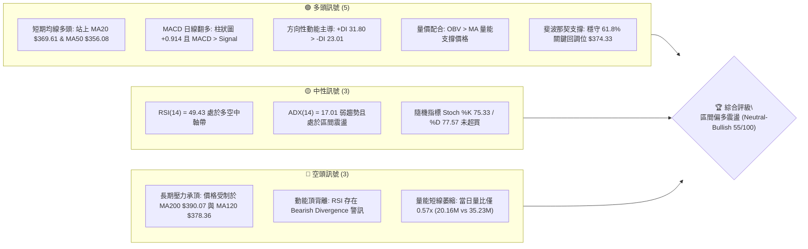

### 📊 核心指標速覽表

| 指標類別 | 指標名稱 | 當前數值 | 訊號 | 解讀 |
|----------|----------|----------|------|------|
| **價格** | 當前價格 | $378.03 | 🟡 | 位於52週區間40.0%分位，中軌上方整理 |
| **均線** | MA20 | $369.61 | 🟢 | 現價高出2.28%，短期多頭排列穩固 |
| **均線** | MA50 | $356.08 | 🟢 | 現價高出6.16%，中期生命線向上發散 |
| **均線** | MA200 | $390.07 | 🔴 | 現價低於3.09%，年線壓力位尚未突破 |
| **動能** | RSI(14) | 49.43 | 🟡 | 處於50中軸爭奪區，附帶頂背離風險提示 |
| **動能** | MACD | 5.143 | 🟢 | 快線大於慢線(4.229)，柱狀圖+0.914持續放正 |
| **趨勢** | ADX(14) | 17.01 | 🟡 | ADX < 25 處於無顯著單邊趨勢之箱體盤整 |
| **波動** | ATR(14) | $10.86 | 🟡 | 佔股價2.87%，波幅中等，適合區間操作 |
| **成交量** | 量比 (Volume Ratio) | 0.57x | 🔴 | 20.16M vs 35.23M均量，反彈缺乏積極追價動能 |

### 🏆 技術評分卡

```
╔══════════════════════════════════════════════════════════════════╗
║                技術評分卡 — TSLA (2026-10-13)                   ║
╠══════════════════════════════════════════════════════════════════╣
║ 趨勢強度 (ADX=17.01)    ██████░░░░░░░░░░░░░░  35/100  🔴 弱趨勢 ║
║ 動能指標 (MACD+/RSI中性)████████████░░░░░░░░  60/100  🟢 偏多   ║
║ 支撐穩定度 (S1/Fib守穩) ██████████████░░░░░░  70/100  🟢 強韌   ║
║ 成交量配合 (OBV+/量比低)██████████░░░░░░░░░░  50/100  🟡 中性   ║
║ 形態完整度 (箱體整理)   ████████████░░░░░░░░  60/100  🟡 待確認 ║
║ 均線排列 (短多長空)     ████████████░░░░░░░░  55/100  🟡 混合   ║
╠══════════════════════════════════════════════════════════════════╣
║ 綜合評分                ███████████░░░░░░░░░  55/100  中性偏多  ║
╚══════════════════════════════════════════════════════════════════╝
```

---

## 2. 趨勢分析

### 🌐 多時框趨勢分析

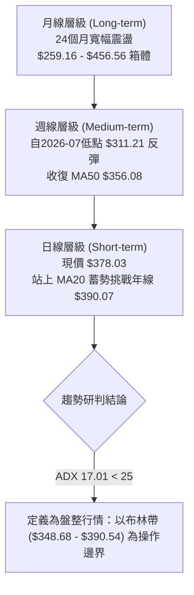

### 📈 長期趨勢 — 12個月走勢圖（Unicode）

```
TSLA 月線走勢圖（2025-10 至 2026-10）
價格軸 ($)
$456.56 ┤ ● (高點 2025-10)
$440.00 ┤     ●           ●
$420.00 ┤         ●           ●       ●
$400.00 ┤                         ●       ●
$380.00 ┤                                     ●←現價 $378.03
$360.00 ┤                                 ●       ●
$340.00 ┤
$311.21 ┤                                             ● (波段低點 2026-07)
        └─────────────────────────────────────────────────────────────
          10  11  12  01  02  03  04  05  06  07  08  09  10 (月份)
```

**走勢特徵分析表格**：

| 階段區間 | 時間跨度 | 起訖收盤價 | 區間漲跌幅 | 走勢特徵與結構意涵 |
|----------|----------|------------|------------|--------------------|
| 高位雙頂 | 2025/10 - 2025/12 | $456.56 → $449.72 | -1.50% | 構築歷史高位平台，量能衰退，未能突破歷史天花板 |
| 震盪走跌 | 2026/01 - 2026/03 | $430.41 → $371.75 | -13.63% | 連續收陰，跌破短期支撐，高點逐步下移形成下降通道 |
| 次級反彈 | 2026/04 - 2026/05 | $381.63 → $435.79 | +14.19% | 快速回抽確認年線壓力，形成反彈誘多頂部結構 |
| 深度下殺 | 2026/06 - 2026/07 | $420.60 → $311.21 | -26.01% | 週線放量崩跌（週量275M），確立中期結構性修正低點 |
| 震盪築底與爬升 | 2026/08 - 2026/10 | $367.95 → $378.03 | +2.74% | 於 $345-$365 聚類支撐築底成功，短均線上翹，進入收斂三角 |

### 📊 中期趨勢（週線分析）

從週線數據觀察，自2026年7月26日週收盤低點 $313.03 及 8月2日收盤 $311.21 形成雙重探底以來，週線 RSI 由超賣區 15.7 快速拉升至 72.7（8月23日），隨後於 50-60 區間健康換手。近期三週收盤價分別為 $372.11、$370.59、$382.70，現報 $378.03，低點呈現 Higher Lows（階梯式抬升）。然而，上方正面臨 120日均線 $378.36 以及 200日均線 $390.07 之密集均線反壓。

```
中期週線空間架構示意圖：
[強阻力 R2]    $409.28 ════════════════════════════════ (近一年強波段高點)
[年線反壓]     $390.07 ┄┄┄┄┄┄┄┄┄┄┄┄┄┄┄┄┄┄┄┄┄┄┄┄┄┄┄┄┄ (MA200 / BB上軌 $390.54)
[短線阻力 R1]  $385.43 ──────────────────────────────── (2026-10-11 前高附近)
               ▲
[現價位置]     $378.03 ◄─── (多空博弈中樞，受制於 MA120 $378.36)
               ▼
[斐波回調]     $374.33 ┄┄┄┄┄┄┄┄┄┄┄┄┄┄┄┄┄┄┄┄┄┄┄┄┄┄┄┄┄ (Fib 61.8% 關鍵黃金分割)
[短線支撐 S1]  $366.31 ──────────────────────────────── (20日均線緩衝防線 $369.61)
[強波段底 S2]  $354.05 ════════════════════════════════ (MA50 $356.08 與 9月低點聚類)
```

### ⚡ 趨勢強度評估（ADX 解讀）

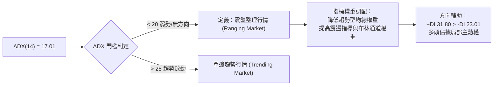

**ADX 趨勢強度對照解讀表**：

| 指標名稱 | 實際數值 | 狀態評定 | 交易哲學指引 |
|----------|----------|----------|--------------|
| **ADX(14)** | 17.01 | 🔴 弱趨勢/休眠期 | 行情缺乏持續性推動力，突破往往伴隨假突破，不可盲目追價。 |
| **+DI** | 31.80 | 🟢 多頭推動佔優 | 多方能量高於空方，逢支撐位做多勝率高於逢阻力摸頂。 |
| **-DI** | 23.01 | 🟡 空頭壓制受挫 | 賣方動能處於退潮期，尚未具備發動崩跌波段之勢能。 |
| **動向差值 (+DI - -DI)** | +8.79 | 🟢 多頭淨偏置 | 在無趨勢震盪中，價格重心傾向以緩慢震盪向上為主。 |

---

## 3. 圖表形態分析

### 🔍 形態識別系統

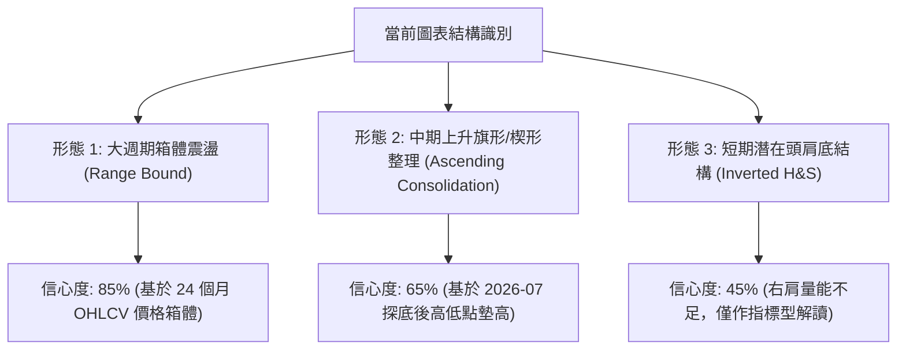

**圖表形態信心度與目標評估表**：

| 形態類別 | 信心度 | 判斷依據（引用數據） | 完成度 | 目標價（附嚴謹計算式） |
|----------|--------|----------------------|--------|------------------------|
| **矩形箱體震盪** | **85%** | 底部受 $345.88 (S3) 支撐，頂部受制於波段高點 $409.28 (R2) 與 $418.36 (R3) | 70% | 區間震盪操作：箱頂為 $409.28，箱底為 $345.88 |
| **中級上升波段通道** | **65%** | 自 2026-07 底 $311.21 墊高至 08月 $348.75 及 09月 $354.08，低點抬升 | 60% | 測幅目標：波段低點 $311.21 漲至前高 $382.70 幅度 $71.49；若突破 R1 $385.43，推算 $385.43 + (382.70 - 354.08) = $414.05（貼近 R3 $418.36） |
| **短期反轉形態 (頭肩底)** | **40%** | 左肩 2026-08 ($328.58)、頭部 2026-07 ($311.21)、右肩 2026-09 ($354.08) | 45% | **訊號不足，信心度低於50%**；量比僅 0.57x 無法確認頸線突破，僅做均線指標型解讀 |

### 🕯️ 重要K線形態分析

| 統計週期/月份 | 收盤價 | K線形態特徵 | 技術面深度解讀 | 訊號評定 |
|---------------|--------|-------------|----------------|----------|
| 2026-07 | $311.21 | 長陰探底後帶下影 | 放量洗盤（週量達 275M），確立 52 週次低點區域 | 🟢 觸底反彈 |
| 2026-08 | $367.95 | 中長實體大陽線 | 吞沒 7 月失地，MACD 柱狀圖大幅翻正（+4.956） | 🟢 多頭反攻 |
| 2026-09 | $354.81 | 帶上下影線之十字小陰線 | 縮量拉回確認支撐，於 S2 $354.05 處尋求二次確認 | 🟡 蓄勢整理 |
| 2026-10 (即時) | $378.03 | 上影小陽線 | 衝高 $382.70 受制於 R1 $385.43，量能遞減顯示追價謹慎 | 🟡 阻力承壓 |

### 📉 ASCII 走勢形態示意圖

```
TSLA 中期箱體向上震盪形態示意圖 (2026-07 至 2026-10)

價格 ($)
$418.36 ┼                                                       [阻力 R3]
$409.28 ┼                                           ●(預期箱頂)  [阻力 R2]
$390.07 ┼----------------- 年線 MA200 反壓 ----------------------[MA200 / BB上軌]
$385.43 ┼                                     ●(前週高點)       [阻力 R1]
$378.03 ┼───────────────────────────────● 現價 ───────────────────
$366.31 ┼                             ●(頸線/MA20)               [支撐 S1]
$354.05 ┼                     ●(9月次回踩)                       [支撐 S2]
$345.88 ┼             ●(8月整理平台)                             [支撐 S3]
$311.21 ┼     ● (7月大底)
        └─────────────────────────────────────────────────────
             2026-07         2026-08        2026-09       2026-10
```

### 🎯 形態目標價計算

依據確立度最高之**箱體整理結構 (Rectangular Range)** 進行客觀量化測算：
1. **箱體下邊界 (支撐核心)**：S2 $354.05 與 S1 $366.31 之密集買盤帶（中樞約 $360.18）。
2. **箱體上邊界 (阻力核心)**：波段密集高點 R2 $409.28。
3. **箱體高度**：$409.28 - $360.18 = $49.10。
4. **現階段路徑推演**：
   - 若維持無方向震盪（ADX=17.01），價格將於 **S1 $366.31 至 R1 $385.43** 間收斂。
   - 若放量突破 R1 $385.43，以等距推算第一目標位為波段高點聚集處 **R2 $409.28**。

---

## 4. 支撐與阻力

### 🗺️ 關鍵價位分布圖（Unicode）

```
╔══════════════════════════════════════════════════════════════════╗
║               TSLA 價位結構分布圖 (由 OHLCV 精確計算)            ║
╠══════════════════════════════════════════════════════════════════╣
║ $498.83 ║████████████████████████║ 52W High (Fib 0.0%)         ║
║ $418.36 ║████████████████████    ║ 強阻力 R3 (+10.67%)         ║
║ $409.28 ║████████████████        ║ 次級阻力 R2 (+8.27%)        ║
║ $390.07 ║████████████████████    ║ 均線強阻 MA200 / BB上軌     ║
║ $385.43 ║████████████            ║ 關鍵阻力 R1 (+1.96%)        ║
║ $378.03 ╠════════════════════════╣ ◄ 當前市價 (At Market)      ║
║ $374.33 ║▓▓▓▓▓▓▓▓▓▓▓▓▓▓▓▓▓▓▓▓    ║ 關鍵黃金分割 Fib 61.8%      ║
║ $366.31 ║▓▓▓▓▓▓▓▓▓▓▓▓▓▓▓▓        ║ 第一道防線 S1 (-3.10%)      ║
║ $354.05 ║████████████████████    ║ 波段關鍵支撐 S2 (-6.34%)    ║
║ $345.88 ║████████████████████████║ 箱體強底 S3 (-8.50%)        ║
║ $297.38 ║████████████████████████║ 52W Low (Fib 100.0%)        ║
╚══════════════════════════════════════════════════════════════════╝
```

### 🚧 阻力位分析表

所有價位嚴格引用自 OHLCV 計算之阻力聚類：

| 阻力級別 | 價位 | 形成原因與數據佐證 | 突破難度 | 重要性 |
|----------|------|--------------------|----------|--------|
| **R1** | **$385.43** | 近期波段高點（2026-10-11 高點 $382.70 延伸之密集解套賣壓，離現價 +1.96%） | 🟡 中等（需放量超越 20日均量 35.22M） | 🟢 短線多空分水嶺 |
| **均線阻力** | **$390.07** | 200日長期移動平均線 (MA200) 與布林通道上軌 ($390.54) 高度重合 | 🔴 極高（長線機構法人年線壓制點） | 🔴 中期多空生命線 |
| **R2** | **$409.28** | 近一年次高點聚類位（2026-06-14 週收盤 $406.43 及 07-12 週收盤 $407.76，離現價 +8.27%） | 🔴 高（具備強烈籌碼密集套牢區特性） | 🟡 強波段目標位 |
| **R3** | **$418.36** | 近一年大級別波段頂部（2026-06 月收盤 $420.60 震盪中樞，離現價 +10.67%） | 🔴 極高（大週期下降通道上軌處） | 🔴 長期結構性壁壘 |

### 🛡️ 支撐位分析表

所有價位嚴格引用自 OHLCV 計算之支撐聚類：

| 支撐級別 | 價位 | 形成原因與數據佐證 | 守住機率 | 重要性 |
|----------|------|--------------------|----------|--------|
| **黃金分割** | **$374.33** | 52週區間 ($297.38 → $498.83) 之 61.8% 斐波那契回調位，現價下方僅 0.98% | 🟢 75% | 🟢 極強心理支撐 |
| **S1** | **$366.31** | 近一年波段低點聚類（貼近 MA20 $369.61 與 2026-09-20 週低點，離現價 -3.10%） | 🟢 70% | 🟢 短期進場防禦點 |
| **S2** | **$354.05** | 2026-09-06 週收盤 $354.08 與 MA50 $356.08 形成的均線共振帶（離現價 -6.34%） | 🟢 85% | 🔴 中期底線支撐 |
| **S3** | **$345.88** | 2026-08-30 週收盤 $348.75 及布林通道下軌 $348.68 下方聚類（離現價 -8.50%） | 🟢 90% | 🔴 戰略性抄底防線 |

### 📐 斐波那契回調位分析

依據基準 52 週高點 **$498.83** 至 52 週低點 **$297.38** 計算之完整斐波那契序列：

```
0.0%  (52W High)  $498.83 ────────────────────── 歷史天花板
23.6%             $451.29 ────────────────────── 2025-10 高峰區
38.2%             $421.88 ────────────────────── 貼近 R3 $418.36
50.0%             $398.10 ────────────────────── 多空中軸 (MA240 $398.86 共振)
61.8%             $374.33 ────── ◄ 現價 $378.03 處於 50% 與 61.8% 之間
78.6%             $340.49 ────────────────────── 超跌緩衝帶
100.0% (52W Low)  $297.38 ────────────────────── 年度絕對底部
```

**斐波那契技術解讀**：
- 現價 **$378.03** 精準運行於 **61.8% ($374.33)** 與 **50.0% ($398.10)** 之間的關鍵反轉回調帶。
- 在技術分析中，61.8% 回調位被視為多頭防守的「黃金生命線」。TSLA 自 7 月低點強勢拉回並企穩於 $374.33 之上，確認了 2026-07 探底 $297.38-$311.21 的有效性；若能有效守住 $374.33，回抽 50.0% 水平 ($398.10) 將是標準幾何路徑。

---

## 5. 技術指標深度解讀

### 🎛️ 指標訊號總覽

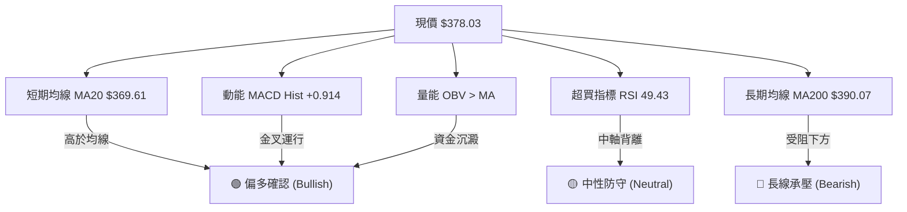

### 📈 移動平均線排列分析

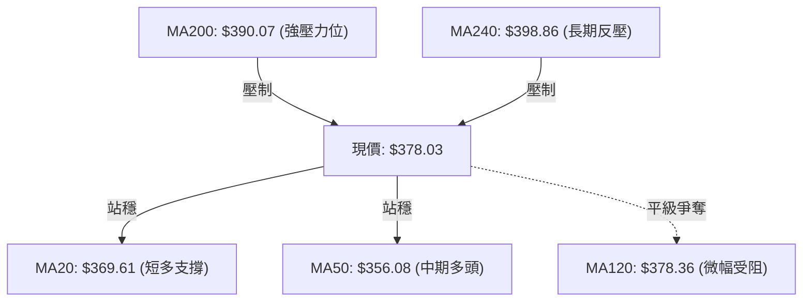

**均線系統詳細參數與趨勢矩陣**：

| 均線名稱 | 數值 | 現價與均線差 | 偏離率 (%) | 均線走勢形態 | 訊號意涵 |
|----------|------|--------------|------------|--------------|----------|
| **MA 5** | $378.84 | -$0.81 | -0.21% | 短期高位微幅鈍化 | 🟡 極短線回踩考驗 |
| **MA 10** | $370.53 | +$7.50 | +2.02% | 向上陡峭發散 | 🟢 短多保護有力 |
| **MA 20** | $369.61 | +$8.42 | +2.28% | 穩定向上爬升 | 🟢 構成第一波段下檔緩衝 |
| **MA 50** | $356.08 | +$21.95 | +6.16% | 斜率走平轉向上揚 | 🟢 中期趨勢已正式扭轉走多 |
| **MA 60** | $351.57 | +$26.46 | +7.53% | 底部回升形態 | 🟢 季線提供堅實籌碼基底 |
| **MA 120**| $378.36 | -$0.33 | -0.09% | 橫盤平移 | 🟡 現價正位於半年線刀鋒上 |
| **MA 200**| $390.07 | -$12.04 | -3.09% | 緩慢下行趨勢 | 🔴 牛熊分界線，存在解套拋壓 |
| **MA 240**| $398.86 | -$20.83 | -5.22% | 穩定下行壓制 | 🔴 與Fib 50% ($398.10) 重疊成強阻力 |

**綜合均線型態結論**：呈典型「**短多長空之混合排列**」。短中期均線（MA10/20/50）形成多頭排列，支撐行情向上反彈；但長週期均線（MA200/240）於上方形成蓋頂，預示短期直接反轉走出大牛市難度高，極大機率在 $369 - $390 間反覆拉鋸。

### 📉 RSI(14) 分析

```
RSI(14) 當前水平: 49.43
[超賣 0] ────────── [30] ────────── [49.43] ────────── [70] ────────── [超買 100]
進度條:  ████████████████████░░░░░░░░░░░░░░░░░░░░  49.43%
```

- **背離識別 (⚠️ Bearish Divergence)**：
  - **觀察**：數據標註「RSI 頂背離 (Bearish Divergence)」。檢視近幾週數據，2026-08-23 收盤價 $362.86 時 RSI 達到高點 **72.7**；至 2026-10-11 價格攀升至 **$382.70**（創波段新高）時，RSI 僅能回升至 **55.0**（現為 49.43）。
  - **結論**：**典型動能頂背離確立**。價格創新高而 RSI 高點大幅鈍化下移，顯示推動股價突破 $380 的內部買盤能量正在衰減，嚴格警示此處不可激進追高，面臨短線回踩修正指標的壓力。

### 📊 MACD(12/26/9) 訊號解讀

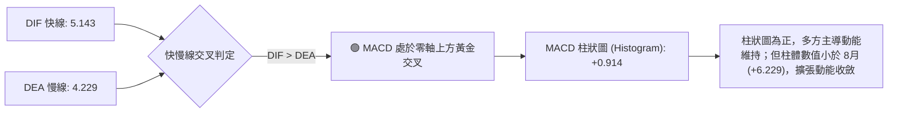

- **技術診斷**：MACD 線 5.143 > 訊號線 4.229，柱狀圖 +0.914，確認日線層級仍處於買方市場。然而對比 8 月份動能高潮時的 +6.229，當前柱狀圖正值相對溫和，顯示上攻速率轉為溫和推升，而非單邊逼空。

### 📦 布林通道分析

```
TSLA 布林通道 (20, 2) 結構圖
─────────────────────────────────────────────────────────────
上軌 (Upper Band): $390.54  ║  (與 MA200 $390.07 形成共振強壓)
                            ║
現價 (Current):    $378.03  ╠══ ◄ 當前位置 (%B = 0.70)
                            ║
中軌 (MA20):       $369.61  ║  (短線重要多頭動能防線)
                            ║
下軌 (Lower Band): $348.68  ║  (與 S3 $345.88 形成共振支撐)
─────────────────────────────────────────────────────────────
```

- **帶寬與位置解讀**：
  - 當前 **%B 指標為 0.70**，顯示價格運行在中軌（0.50）與上軌（1.00）之間偏多區域，多頭仍握有發球權。
  - 布林帶寬為 $390.54 - $348.68 = $41.86（帶寬佔中軌比例約 11.3%），通道處於平行微幅開口狀態，上軌 $390.54 與 MA200 $390.07 極度吻合，構成堅不可摧的技術封頂線。

### 💹 成交量分析（量價配合度）

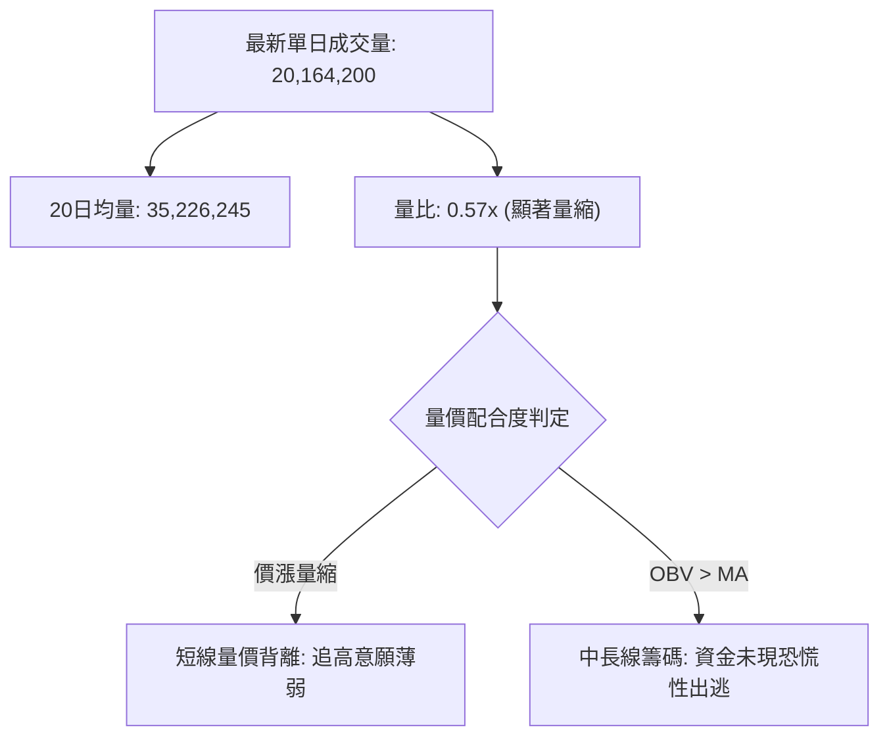

- **量能評估**：
  - 現量僅有均量的 57%，週線成交量亦由 7 月底的高峰 275M 降至目前約 20M–162M 水平。
  - **正面訊號**：OBV > MA，說明在 8-9 月的底部墊高過程中，累積的資金偏向淨流入，籌碼穩定度高。
  - **警惕訊號**：反彈至阻力位 R1 $385.43 附近未能配合成交量放大（Volume Dry-up），此種「縮量推升」隨時會因偶發拋盤而引發技術性回踩。

---

## 6. 動能與波動率

### ⚡ 動能評估四象限

| 象限 | 動能強度 (RSI/MACD) | 波動率水準 (ATR/帶寬) | 當前判定 | 特徵與策略建議 |
|------|----------------------|----------------------|----------|----------------|
| **第一象限 (Q1)** | 強動能 (>60) | 低波動 (<2.5%) | — | 最佳趨勢單邊順勢突破機會 |
| **第二象限 (Q2)** | **中弱動能 (45-55)** | **中低波動 (2.87%)** | **✓ (TSLA)** | **區間震盪、高拋低吸、不可追高** |
| **第三象限 (Q3)** | 強動能 (>60) | 高波動 (>4.0%) | — | 高風險高收益、爆發性逼空或破位 |
| **第四象限 (Q4)** | 弱動能 (<40) | 高波動 (>4.0%) | — | 恐慌崩跌、避免盲目摸底 |

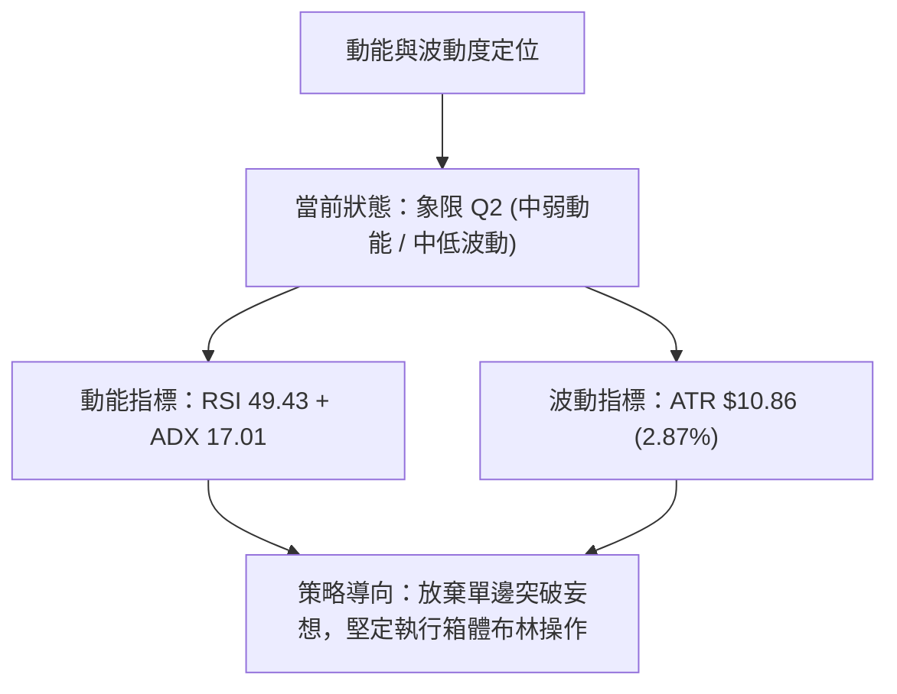

### 📊 ATR 波動率分析

- **當前數值**：**ATR(14) = $10.86**（佔當前股價 $378.03 之 **2.87%**）。
- **日內波動範疇**：TSLA 過去 14 天平均每日震盪空間約 $10.86，屬於歷史波動偏溫和期。
- **止損與風控設置指引**：
  - **短線防守緩衝**：以 1.0 × ATR ($10.86) 為最小安全邊界。若現價 $378.03 進場，日線動態止損應設於 $378.03 - $10.86 = **$367.17**（恰好覆蓋 S1 $366.31 支撐）。
  - **波段交易防守**：建議使用 1.5 × ATR ($16.29) 作為緩衝，防範假跌破。

### 📐 Beta 與市場相關性

- **Beta 係數**：**1.916**。
- **意涵解讀**：
  - TSLA 的系統性風險敞口極高，波動率為標普 500 指數的近 2 倍。大盤若回調 1%，TSLA 理論跌幅將接近 1.92%。
  - 在大盤未見強勢單邊行情且 TSLA 自身 ADX 僅 17.01 的背景下，高 Beta 特性意味著個股極易受到大盤突發波動的干擾，拉長持倉週期將承受額外的市場波動風險，因此嚴格限縮每筆交易的持倉規模至關重要。

---

## 7. 多時框架總結

### 📋 時框架評分表

| 時框架 | 趨勢方向 | 動能狀態 | 均線排列 | 形態特徵 | 綜合評分 | 戰略建議 |
|--------|----------|----------|----------|----------|----------|----------|
| **月線 (長期)** | 🟡 橫盤震盪 | 🟡 中性 (24M箱體中位) | 🔴 MA200/240 下行反壓 | 大級別箱體整理 ($259-$456) | 50/100 | 長期投資者維持底倉觀望，不宜追高 |
| **週線 (中期)** | 🟢 弱勢上升 | 🟢 柱狀微幅擴張 / 低點抬高 | 🟢 站穩 MA50 $356.08 | 7月探底回升，高低點階梯上移 | 60/100 | 逢回調至 S1/S2 布局中線反彈倉位 |
| **日線 (短期)** | 🟡 震盪偏多 | 🔴 RSI頂背離 / 縮量 | 🟢 站穩 MA20 $369.61 | 挑戰 R1 $385.43 受阻回落 | 55/100 | 以布林通道為邊界進行波段網格操作 |

### 🔲 綜合訊號矩陣

```
╔══════════════════════════════════════════════════════════════════╗
║                    多時框多空訊號共振矩陣                        ║
╠══════════════════════════════════════════════════════════════════╣
║ 維度         短期 (日線)          中期 (週線)          長期 (月線) ║
╠══════════════════════════════════════════════════════════════════╣
║ 趨勢方向     🟡 橫盤 ($369-$385)  🟢 震盪上行 (反彈)   🟡 寬幅箱體 ║
║ 均線結構     🟢 MA20 短多支撐     🟢 突破 MA50 支撐    🔴 MA200 壓制║
║ 動能指標     🔴 RSI 頂背離        🟢 MACD 翻正共振     🟡 RSI 50中性║
║ 量能表現     🔴 縮量 (量比0.57)   🟡 溫和換手          🟡 總量萎縮 ║
║ 關鍵邊界     S1 $366.31/R1 $385.43 S2 $354.05/R2 $409.28 $297 / $456║
╠══════════════════════════════════════════════════════════════════╣
║ 共振評定     短期動能鈍化         中期結構健康         長期頂部受阻║
╚══════════════════════════════════════════════════════════════════╝
```

### ⚖️ 多時框收斂結論

> **依嚴格規則 14 執行多時框收斂邏輯**：
> 1. **趨勢模式判定**：當前 **ADX(14) = 17.01 (< 25)**，明確定義當前為**「盤整震盪行情」**。
> 2. **主導層級選定**：在盤整行情中，中長期趨勢不具備單邊突破牽引力，**必須以日線布林通道上下軌 ($348.68 - $390.54) 為核心操作空間**。
> 3. **方向性終審結論**：**【中性偏多震盪 (Neutral-Bullish Consolidation)】**。
>    - **收斂理由**：日線雖有 RSI 頂背離與縮量等回調訊號，但下方擁有週線級別突破之 MA50 ($356.08) 與日線 MA20 ($369.61) 之堅固防托，且斐波那契 61.8% ($374.33) 形成硬支撐。
>    - **結論方向**：**不具備做空崩跌條件，亦無單邊追多動能；主策略定調為「依託支撐逢低吸納，接近年線高拋」的區間操作**。

---

## 8. 交易策略建議

### 🗺️ 策略決策流程圖

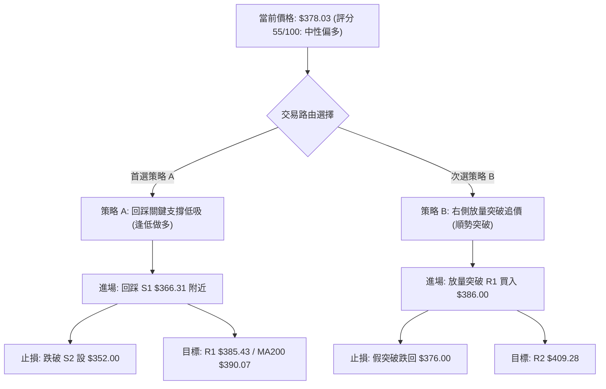

### 🧭 策略路由（依評分卡分流）

**當前主策略方向 = 中性偏多區間操作（依綜合評分 55/100，40–60 區間操作規則，以低吸高拋、等待突破確認為主）**。

### 🎯 價格情境階梯（Price Scenarios）

所有價位精確引用自數據中之計算聚類點位：

| 觸發條件 | 第一目標 (T1) | 後續延伸 (T2) | 情境技術含義 |
|----------|---------------|---------------|--------------|
| **強勢突破 R1 $385.43** | **$390.07** (MA200/BB上軌) | **$409.28** (波段高點 R2) | 短線化解 RSI 頂背離，發動補量逼空行情 |
| **站穩現價區間 ($374 - $385)** | **$385.43** (R1) | **$390.07** (MA200) | 在 Fib 61.8% 之上維持窄幅高位換手，時間換取空間 |
| **跌破 S1 $366.31** | **$354.05** (波段低點 S2) | **$345.88** (箱體下軌 S3) | 短期多頭防線失守，進入深度洗盤與均線回抽考驗 |

### 📊 情境機率分佈

| 情境劇本 | 發生機率 | 主要技術依據 |
|----------|----------|--------------|
| **箱體區間震盪 (主要劇本)** | **55%** | ADX 僅 17.01 表明趨勢動力渙散；布林帶上下軌開口有限；量比 0.57x 缺乏方向性突破資金。 |
| **震盪盤升 / 反彈挑戰年線** | **30%** | MACD 處於金叉柱狀正值（+0.914）；+DI 31.80 主導；OBV 長期健康，多頭結構維持 Higher Lows。 |
| **向下破位回踩深底** | **15%** | RSI 出現頂背離警訊；MA200 長期反壓沉重；若失守 $366.31 易引發短線多殺多回測 $354.05。 |

### 🟢 主策略詳情（方向依上方路由）

以下所有點位嚴格依據第 4 章關鍵支撐阻力數值量化制定：

| 策略要素 | 策略 A：波段回踩低吸（首選） | 策略 B：右側突破確認（次選） |
|----------|------------------------------|------------------------------|
| **操作邏輯** | 消化 RSI 頂背離後，於均線密集支撐處低吸 | 放量跨越 R1 阻力後，順勢博弈年線與 R2 |
| **進場條件** | 價格回調至 S1 附近獲得確認且 1小時線出底分型 | 日K線實體放量收盤突破 R1 $385.43，量比 > 1.2x |
| **進場價格** | **$366.31** (S1 關鍵支撐位) | **$386.00** (突破 R1 $385.43 之確認點) |
| **目標價 T1** | **$385.43** (R1 波段高點，獲利 +5.22%) | **$400.00** (Fib 50% $398.10 心理整數關，獲利 +3.63%) |
| **目標價 T2** | **$390.07** (MA200 年線大壓，獲利 +6.49%) | **$409.28** (R2 次級阻力位，獲利 +6.03%) |
| **止損價格** | **$354.05** (S2 波段支撐跌破，虧損 -3.35%) | **$376.00** (跌回突破點下方，虧損 -2.59%) |
| **風險報酬比** | **1.94 : 1** (以 T2 計) | **2.33 : 1** (以 T2 計) |
| **預估勝率** | **65%** | **50%** (受制於 ADX 弱勢假突破風險) |
| **建議倉位** | **15% - 20%** (標準波段部位) | **10%** (右側輕倉試單) |

### 🔴 反向風險觸發點（對沖提示）

- **多頭波段止損觸發點**：**$354.05 (S2)**。
  - 若日K線實體跌破 $354.05，宣告 MA50 中期生命線徹底失守，短中期底部結構瓦解，應立即無條件平掉所有多頭多單，並可建立微量對沖空單下看 S3 **$345.88** 甚至 52W 低點區。
- **頂部力竭訊號觸發點**：若價格再次衝高至 **$385.43 - $390.07** 區間時，成交量比持續低於 0.6x 且 RSI 於 60 附近鈍化拐頭向下，多頭部位應在 **$388.00** 附近全數獲利了結。

### ⭐ 整體訊號強度評星

```
╔══════════════════════════════════════════════════════════════════╗
║                    技術分析訊號評星體系                          ║
╠══════════════════════════════════════════════════════════════════╣
║ 做多訊號強度：★★★☆☆  (3.0/5星) — 短期均線支撐完好，但頂背離限制空間║
║ 做空訊號強度：★★☆☆☆  (2.0/5星) — 弱趨勢且下方均線密集，缺乏做空動能║
║ 整體可信度：  ★★★★☆  (4.0/5星) — 價位聚類清晰，布林與斐波共振度極高║
╚══════════════════════════════════════════════════════════════════╝
```

---

## 9. 風險提示與監控

### ✅ 關鍵監控指標 Checklist

```
╔══════════════════════════════════════════════════════════════════╗
║                TSLA 日常技術面風控清單 (Daily Checklist)        ║
╠══════════════════════════════════════════════════════════════════╣
║ [ ] 價位警戒：收盤價是否跌破 Fib 61.8% ($374.33) 或 MA20 ($369.61) ║
║ [ ] 壓力警戒：向上測試 MA200 ($390.07) 時，是否有爆量滯漲長上影 ║
║ [ ] 動能警戒：RSI(14) 能否突破 60 以化解當前日線頂背離結構      ║
║ [ ] 趨勢警戒：ADX(14) 是否放量拉升突破 25，判定單邊趨勢是否啟動 ║
║ [ ] 量能警戒：日成交量是否放大至 20日均量 (35.22M) 以上水準     ║
║ [ ] 外部風險：Beta 高達 1.916，需即時關注納斯達克大盤系統性波動  ║
╚══════════════════════════════════════════════════════════════════╝
```

### ⚠️ 風險場景分析

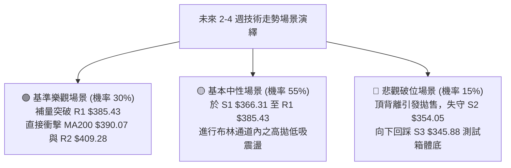

### 🛡️ 風險管理重要提醒

1. **資金管理與部位分配**：
   - 由於當前技術評分為 **55/100**，且 ADX = 17.01 表明處於弱趨勢行情，**總技術交易部位嚴格控制在總投資資金的 20% 以內**。
   - 單筆交易最大虧損風險額度（Risk per Trade）不得超過總帳戶權益的 **1.0%**。
2. **防範假突破風險**：
   - 在 ADX < 25 的環境中，突破阻力位（如 R1 $385.43）有高達 60% 機率為假突破。**切忌在突破當下以市價單市價追買**，必須等待收盤確認或回踩不破次日再行介入。
3. **高 Beta 波動防護**：
   - 考慮到 Beta = 1.916 及 ATR = $10.86，隔夜持倉常伴隨跳空風險。若大盤指數面臨重要通膨數據公布或聯準會決策，應在當日收盤前將短線合約或高槓桿融資部位降低 50% 以上。

---

## 📋 報告總結

```
╔══════════════════════════════════════════════════════════════════╗
║                   TSLA 技術分析報告總結                          ║
╠══════════════════════════════════════════════════════════════════╣
║ 報告日期：2026-10-13                                             ║
║ 當前價格：$378.03                                                ║
║ 分析評級：⚖️ 中性偏多區間震盪 (Neutral-Bullish 55/100)          ║
║                                                                  ║
║ 關鍵結論：                                                       ║
║ ├─ 長期趨勢：🟡 中性橫盤 (大級別受制於 MA200 $390.07 反壓)      ║
║ ├─ 中期趨勢：🟢 震盪反彈 (站穩 MA50 $356.08，低點逐步抬高)       ║
║ ├─ 短期趨勢：🟡 高位蓄勢 (受制於 R1 $385.43，RSI 出現頂背離)     ║
║ ├─ 關鍵支撐：S1 $366.31 ｜ S2 $354.05 ｜ Fib 61.8% $374.33      ║
║ ├─ 關鍵阻力：R1 $385.43 ｜ MA200 $390.07 ｜ R2 $409.28          ║
║ └─ 機構目標：分析師平均目標價 $397.83 (極度貼近 Fib 50% $398.10)║
║                                                                  ║
║ 最優策略組合：                                                   ║
║ 1. 🥇 最佳機會：策略 A (逢回踩 S1 $366.31 低吸，止損設 $354.05)   ║
║ 2. 🥈 次選機會：布林區間操作 (接近上軌 $390 減碼，中軌 $369 承接)║
║ 3. 🥉 保守選擇：維持場外觀望，靜待放量站穩 MA200 年線後順勢介入 ║
╚══════════════════════════════════════════════════════════════════╝
```

---

> ⚠️ **免責聲明**：本報告為技術分析專用報告，所有數據、指標評估及支撐阻力點位均嚴格基於所提供之歷史交易數據進行量化推演。本報告**僅供研究與學術參考**，**不構成任何形式的投資買賣建議**。金融市場具有高度風險，投資人應自行承擔交易決策之所有盈虧風險。

---

*報告生成時間：2026-10-13 ｜ 數據來源：Yahoo Finance ｜ 分析框架：多時框架技術分析與量化價位收斂體系*