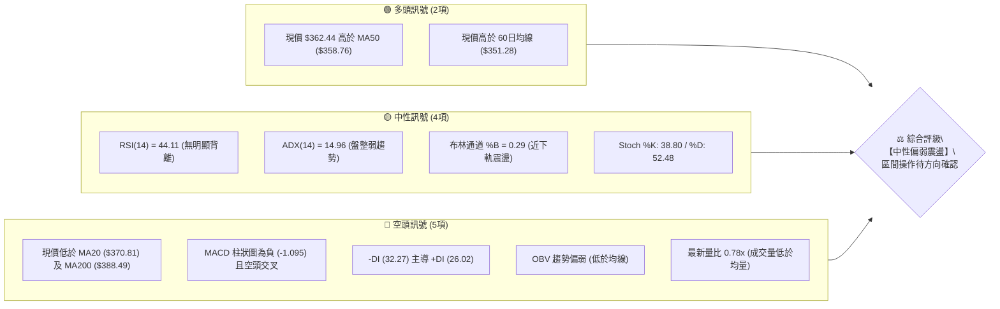
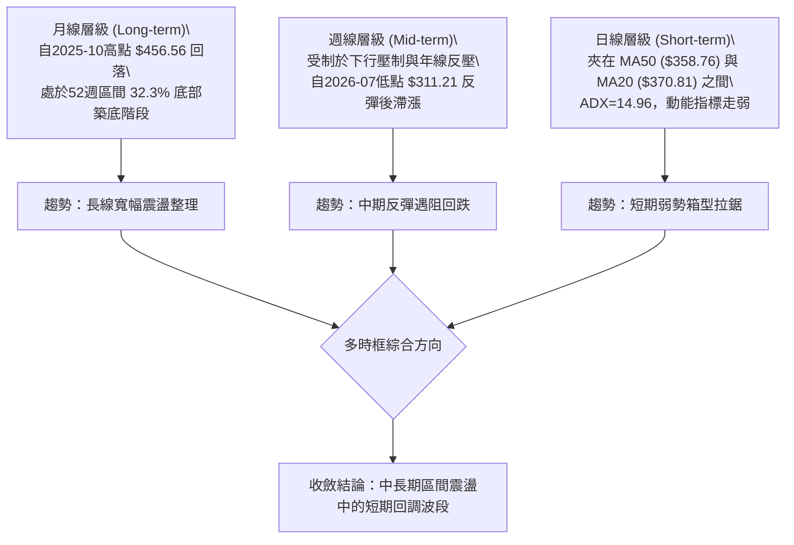
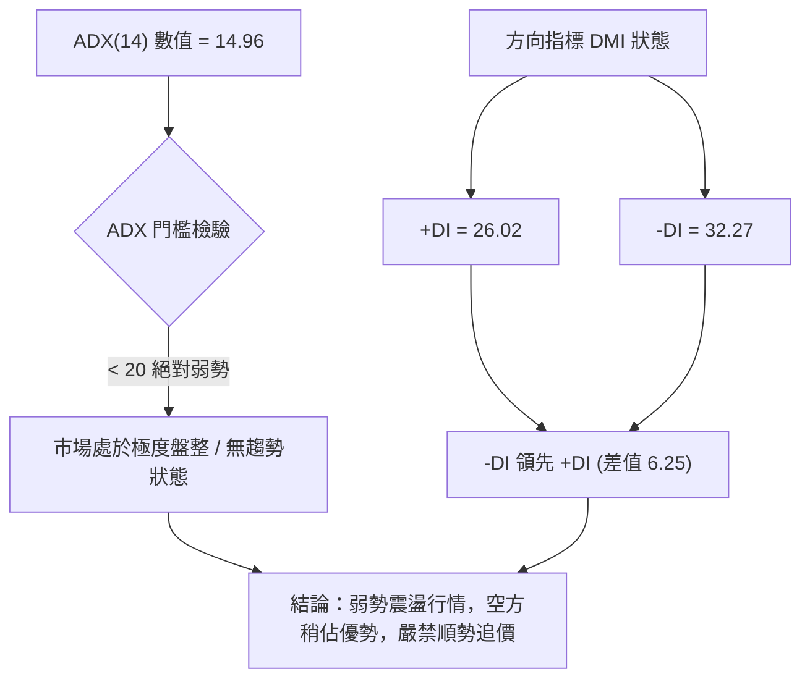
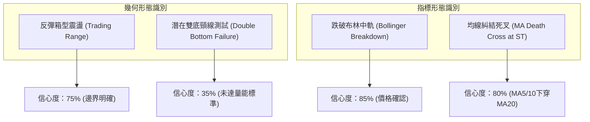
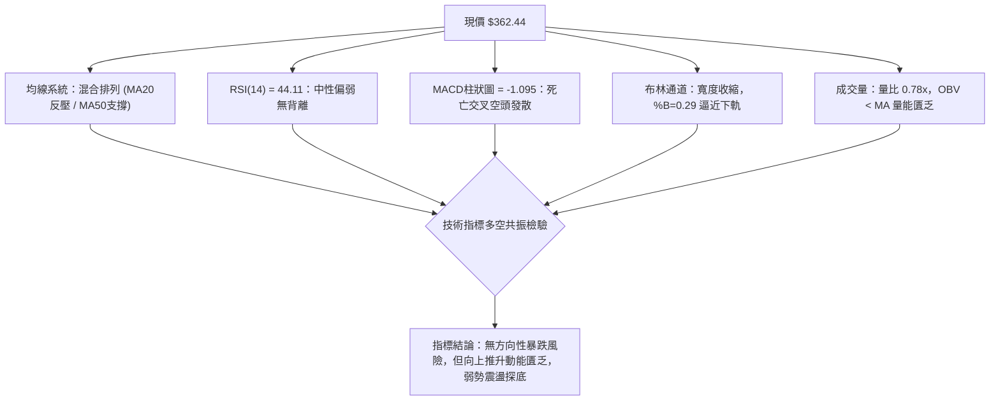
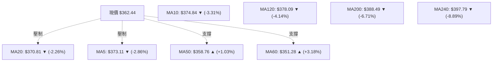
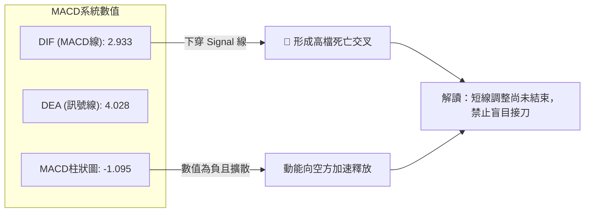
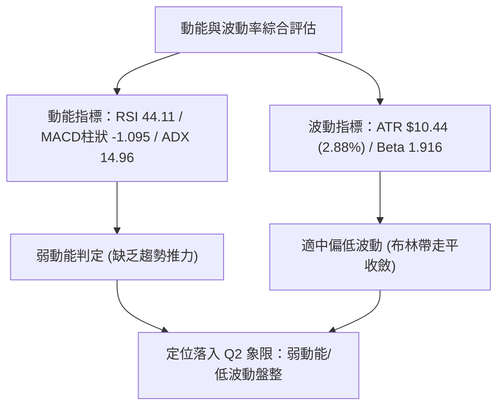
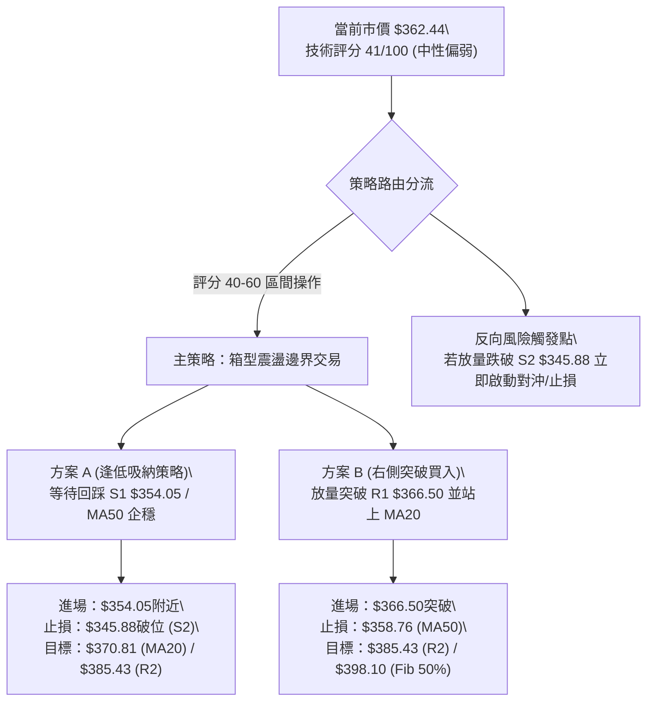
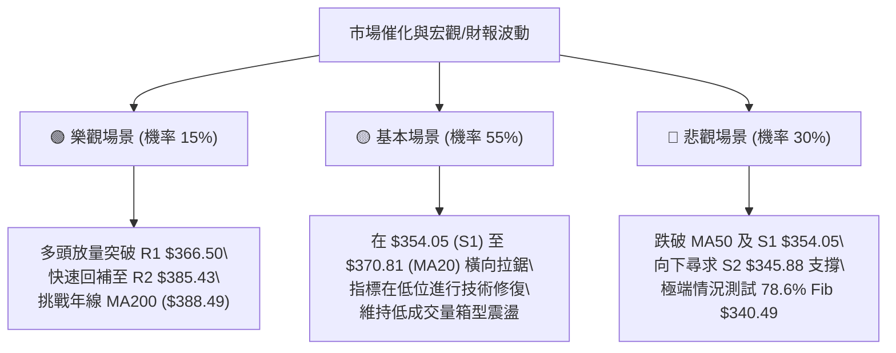

# TSLA 技術分析報告

> **報告日期**：2026-10-15 ｜ **語言**：繁體中文 ｜ **數據來源**：Yahoo Finance ｜ **當前價格**：$362.44

---

## 目錄

| 章節 | 內容 |
|------|------|
| [1. 技術面概覽](#1-技術面概覽) | 訊號儀表板、核心指標、評分卡 |
| [2. 趨勢分析](#2-趨勢分析) | 多時框趨勢、長中短期走勢、ADX 解讀 |
| [3. 圖表形態分析](#3-圖表形態分析) | 形態識別與信心度、K線組合、目標價計算 |
| [4. 支撐與阻力](#4-支撐與阻力) | 關鍵價位分布、阻力與支撐表、斐波那契回調 |
| [5. 技術指標深度解讀](#5-技術指標深度解讀) | 均線系統、RSI、MACD、布林通道、成交量與 OBV |
| [6. 動能與波動率](#6-動能與波動率) | 動能評估四象限、ATR 波動率、Beta 與大盤關聯 |
| [7. 多時框架總結](#7-多時框架總結) | 時框架評分矩陣、多時框收斂結論 |
| [8. 交易策略建議](#8-交易策略建議) | 策略路由、價格情境階梯、主策略詳情、風控點 |
| [9. 風險提示與監控](#9-風險提示與監控) | 監控清單、情境分析、倉位管理建議 |
| [📋 報告總結](#-報告總結) | 全方位核心結論與策略速查 |

---

## 1. 技術面概覽

### 🎯 技術訊號儀表板

Tesla (TSLA) 當前收盤價為 **$362.44**。整體技術架構呈現「中長期震盪整理、短期動能偏弱、區間盤整為主」的技術特徵。以下為多空指標訊號的分佈狀態：



---

### 📊 核心指標速覽表

| 指標類別 | 指標名稱 | 當前數值 | 訊號 | 專業解讀 |
|:---|:---|:---|:---:|:---|
| **價格體系** | 當前收盤價 | $362.44 | 🟡 | 位於 52 週區間 ($297.38–$498.83) 之 32.3% 分位，偏向中下區間 |
| **短期均線** | MA20 | $370.81 | 🔴 | 現價在 MA20 之下 (-2.26%)，短線面臨中軌反壓 |
| **中期均線** | MA50 | $358.76 | 🟢 | 現價守在 MA50 之上 (+1.03%)，提供第一道動態緩衝 |
| **長期均線** | MA200 | $388.49 | 🔴 | 現價低於年線牛熊分水嶺 (-6.71%)，中長期多頭結構尚未修復 |
| **趨勢強度** | ADX (14) | 14.96 | 🟡 | 數值遠低於 25，表明當前處於無趨勢或寬幅箱型震盪行情 |
| **動能方向** | MACD (12,26,9) | 2.933 / 4.028 | 🔴 | MACD 跌破 Signal 線，柱狀圖為 -1.095，動能偏向空方釋放 |
| **超買超賣** | RSI (14) | 44.11 | 🟡 | 處於 40–50 偏弱中性區間，尚未進入超賣，但反彈力道匱乏 |
| **通道位置** | Bollinger Bands | $351.20–$390.42 | 🟡 | %B 為 0.29，價格靠近布林下軌支撐，波動帶處於收斂後震盪 |
| **波動風險** | ATR (14) | $10.44 | 🟡 | 每日平均真實波動幅度為 2.88%，日線交易風控需留出足夠安全邊際 |
| **量能狀態** | 成交量 / 20MA | 26.48M / 33.95M | 🔴 | 量比僅 0.78x，量能萎縮且 OBV < MA，缺乏機構買盤推升量能 |

---

### 🏆 技術評分卡

```
╔══════════════════════════════════════════════════════════════════╗
║                TSLA 技術評分卡 (2026-10-15)                      ║
╠══════════════════════════════════════════════════════════════════╣
║ 趨勢強度 (Trend)     ████░░░░░░░░░░░░░░░░  25/100 🔴 弱勢盤整    ║
║ 動能指標 (Momentum)  ████████░░░░░░░░░░░░  40/100 🔴 空方微控    ║
║ 支撐穩定度 (Support) ████████████░░░░░░░░  60/100 🟡 MA50護盤    ║
║ 成交量配合 (Volume)  ██████░░░░░░░░░░░░░░  30/100 🔴 量能疲弱    ║
║ 形態完整度 (Pattern) ██████████░░░░░░░░░░  50/100 🟡 箱型構築    ║
║ 均線系統 (MA System) ████████░░░░░░░░░░░░  40/100 🔴 混合糾結    ║
╠══════════════════════════════════════════════════════════════════╣
║ 綜合評分             ████████░░░░░░░░░░░░  41/100 🟡 中性偏弱    ║
╚══════════════════════════════════════════════════════════════════╝
```

---

## 2. 趨勢分析

### 🌐 多時框趨勢分析

依據多時框架分析體系，將 TSLA 的時間週期切分為月線、週線與日線進行遞進觀察：



---

### 📈 長期趨勢 — 12個月走勢圖（Unicode）

以下為 TSLA 自 2025 年 11 月至 2026 年 10 月之月線收盤價歷史走勢圖：

```
TSLA 月線走勢圖（過去12個月歷史軌跡）
價格軸 ($)
$460 ┤  ● $456.56 (2025-10歷史次高點)
$440 ┤    ●(11月:430.17) ●(12月:449.72)
$420 ┤          ●(01月:430.41)                     ●(05月:435.79) ●(06月:420.60)
$400 ┤                ●(02月:402.51)
$380 ┤                      ●(04月:381.63)
$360 ┤                            ●(03月:371.75)                 ●(08月:367.95)   ●(10月現價:362.44)
$340 ┤                                                                 ●(09月:354.81)
$320 ┤                                                     ●(07月低點:311.21)
     └─────────────────────────────────────────────────────────────────────────────
        11    12    01    02    03    04    05    06    07    08    09    10 (月份)
       '25   '25   '26   '26   '26   '26   '26   '26   '26   '26   '26   '26
```

#### 走勢特徵分析表格

| 階段區間 | 月份起訖 | 收盤價變化 | 漲跌幅 | 波段技術特徵與驅動要素 |
|:---|:---|:---:|:---:|:---|
| **頂部高位構築** | 2025-10 → 2025-12 | $456.56 → $449.72 | -1.50% | 於 $450 附近構築高檔雙頂，量能開始背離 |
| **春季下行回調** | 2025-12 → 2026-03 | $449.72 → $371.75 | -17.34% | 跌破 20 日及 60 日均線，空方加速釋放 |
| **初夏反彈測試** | 2026-03 → 2026-05 | $371.75 → $435.79 | +17.23% | 築底反彈測試前高頸線，但在 $435.79 受阻 |
| **夏季急跌探底** | 2026-05 → 2026-07 | $435.79 → $311.21 | -28.59% | 出現恐慌性拋售，單月重挫創下 52 週低點附近波段底 |
| **秋季震盪修復** | 2026-07 → 2026-10 | $311.21 → $362.44 | +16.46% | 自超賣區展開技術性反彈，目前於 $355–$375 區間糾結 |

---

### 📊 中期趨勢（週線分析）

從近 20 週的收盤價觀察，TSLA 經歷了三個顯著的中期波段：
1. **恐慌拋售段 (2026-07)**：價格自 7 月中旬的 $380.84 崩跌至 7 月底的 $313.03 及 8 月初的 $311.21，週線 RSI 一度跌至 15.7 極度超賣區。
2. **修復反彈段 (2026-08 至 2026-10-11)**：週線伴隨 MACD 翻紅（最高達 +6.229），價格推升至 2026-10-11 的高點 $382.70，反彈接近 50% 斐波那契回調位 ($398.10) 及 200 日線前受阻。
3. **近期回吐段 (2026-10-18 週)**：價格自 $382.70 快速拉回至 $362.44，單週成交量降至 96.12M，MACD 柱狀圖轉為 -1.095，週線 RSI 降至 44.1，顯示反彈動能衰竭。

```
中期週線阻力與支撐示意：
  $385.43 (R2 / 前高聚類) ────────────────────── 阻力強固 (近期高點 $382.70 遇阻)
               ▲
  $370.81 (MA20 / BB中軌) ┈┈┈┈┈┈┈┈┈┈┈┈┈┈┈┈┈┈┈┈┈┈ 短線跌破中軌，轉為反壓
               ▼
  $362.44 (當前價格)     ◄ 現價處於多空膠著處
               ▲
  $358.76 (MA50 防線)    ────────────────────── 中期多頭最後防守位
  $354.05 (S1 / 近期低點) ────────────────────── 波段支撐
```

---

### ⚡ 趨勢強度評估（ADX 解讀）



#### ADX 趨勢強度對照

| 指標名稱 | 當前數值 | 門檻標準 | 狀態評定 | 交易指導意義 |
|:---|:---:|:---:|:---:|:---|
| **ADX (14)** | **14.96** | < 20 (弱趨勢/盤整) | 🟡 無趨勢盤整 | 趨勢跟隨策略（如突破追單）失效，勝率極低 |
| **+DI (14)** | **26.02** | - | 🟡 多方動能偏弱 | 買盤力道不足以形成持續推升浪 |
| **-DI (14)** | **32.27** | - | 🔴 空方力量主導 | 賣方壓迫力道持續存在，反彈容易遭受拋壓 |
| **DMI 差值** | **-6.25** | -DI > +DI | 🔴 空頭佔據微弱優勢 | 價格易跌難漲，下行測試機率高於向上突破 |

---

## 3. 圖表形態分析

### 🔍 形態識別系統

在日線與週線結構中，TSLA 自 2026 年 7 月低點 $311.21 反彈至 10 月初 $382.70，隨後出現回調。以下為圖表幾何與指標形態的量化檢驗：



#### 形態信心度評估表

| 識別形態 | 形態類型 | 信心度 | 判斷依據（引用數據） | 完成度 | 形態目標價（附計算式） |
|:---|:---|:---:|:---|:---:|:---|
| **水平箱型整理** | 盤整形態 | **75%** | 價格受制於 R2 ($385.43) 與 S1 ($354.05) 之間，ADX=14.96 確認無趨勢 | 85% | 區間震盪無方向目標；上下軌分別為 **$385.43** 與 **$354.05** |
| **潛在頭肩頂(微型)** | 反轉形態 | **35%** | 僅左肩($372.11)、頭部($382.70)，右肩與頸線未完整成形，信心度不足 | 30% | 訊號不足，依規則 15 不予計算虛構目標價，僅做指標型解讀 |
| **布林帶跌破中軌** | 指標型形態 | **85%** | 最新價 $362.44 明確跌破中軌 $370.81，%B 降至 0.29 | 100% | 下軌回測目標：布林下軌 **$351.20** |
| **短期均線空頭排列** | 指標型形態 | **80%** | MA5 ($373.11) 及 MA10 ($374.84) 轉頭向下且壓制現價 | 90% | 回測中期支撐：MA50 **$358.76** 及 S1 **$354.05** |

---

### 🕯️ 重要 K 線形態分析（近 5 個月收盤演變）

| 月份 | 收盤價 | 實體幅度 | K線形態名稱 | 形態專業解讀 | 訊號方向 |
|:---:|:---:|:---:|:---|:---|:---:|
| **2026-06** | $420.60 | -3.49% | 高檔陰線吞噬 | 自 5 月高點 $435.79 受阻，空頭反轉訊號確認 | 🔴 看空 |
| **2026-07** | $311.21 | -26.01% | 恐慌長黑大陰線 | 帶量長陰貫穿各路均線，拋售潮湧現，形成 52 週低點附近支撐 | 🔴 極空 |
| **2026-08** | $367.95 | +18.23% | 破底翻長陽線 | 低檔強力報復性反彈，收復 7 月大半失土，空頭力竭 | 🟢 看多 |
| **2026-09** | $354.81 | -3.57% | 縮量高檔十字星 | 漲勢停滯，多空在 $355 處展開爭奪，買盤跟進不足 | 🟡 中性 |
| **2026-10** | $362.44 | +2.15% | 帶上影線小陽線 | 盤中衝高至 $382.70 後大幅回落，留下長上影線，顯露高檔賣壓 | 🔴 偏空反轉 |

---

### 📉 ASCII 走勢形態示意圖

```
TSLA 近期日線/週線形態結構示意：
      $385.43 (R2 / 10月高點聚類)
          ┌───┐ (高點測試 $382.70 遇阻)
          │   └───┐
          │       └───┐
  $370.81 ┼───────────┴──┐ (跌破 MA20 / BB中軌)
          │              └───┐
  $362.44 ┼──────────────────● (當前價格 $362.44，空方下壓)
          │                  │
  $358.76 ┼┈┈┈┈┈┈┈┈┈┈┈┈┈┈┈┈┈┈┴──┐ (下探測試 MA50 動態支撐)
          │                     │
  $354.05 ┼─────────────────────┴─── (S1 箱型底部支撐防線)
```

---

### 🎯 形態目標價計算

根據布林中軌跌破與短期均線下壓形態推算：
*   **基準破位點**：跌破 MA20 中軌 **$370.81**。
*   **形態跌幅滿足點（由布林軌道推算）**：中軌 $370.81 與下軌 $351.20 距離為 $19.61。
    *   計算式：現價向下之第一技術目標 = 布林下軌 **$351.20**。
    *   若進一步失守 S1 ($354.05)，則滿足點指向 S2 **$345.88**。

---

## 4. 支撐與阻力

### 🗺️ 關鍵價位分布圖（Unicode）

```
TSLA 價位結構分布圖 (由 OHLCV 聚類計算)
════════════════════════════════════════════════════════════════════
$409.28 ║██████████████████████████████║ 強阻力 R3 (波段重大頭部反壓)
$385.43 ║████████████████████          ║ 關鍵阻力 R2 (近週高點密集成交區)
$366.50 ║████████████                  ║ 短線阻力 R1 (+1.12% 短期均線壓制)
$362.44 ╠══════════════════════════════╣ ◄ 當前市價 ($362.44)
$354.05 ║▓▓▓▓▓▓▓▓▓▓▓▓                  ║ 近期支撐 S1 (-2.31% 箱體下沿防線)
$345.88 ║▓▓▓▓▓▓▓▓▓▓▓▓▓▓▓▓▓▓            ║ 強支撐 S2 (-4.57% 前波平台起漲點)
$337.24 ║████████████████████████      ║ 核心防守 S3 (-6.95% 斐波那契回調帶)
════════════════════════════════════════════════════════════════════
```

---

### 🚧 阻力位分析表

所有阻力價位均依據 OHLCV 波段高點聚類數據嚴格提取：

| 阻力級別 | 阻力價位 | 距現價幅 | 形成原因與技術共振 | 突破難度 | 戰略重要性 |
|:---|:---:|:---:|:---|:---:|:---:|
| **R1** | **$366.50** | +1.12% | 近期波段密集成交小高點，鄰近 MA20 ($370.81) | 🟡 中等 | 短線多空翻轉門檻，站上始能化解下行壓力 |
| **R2** | **$385.43** | +6.34% | 近一年波段高點聚類，與 MA200 ($388.49) 高度重合 | 🔴 極高 | 牛熊分水嶺，若未放量突破，中長期結構仍屬空頭 |
| **R3** | **$409.28** | +12.92% | 2026年6月反彈高點聚類區，套牢籌碼極重 | 🔴 極高 | 長期波段分水嶺，多頭徹底扭轉頹勢之終極目標 |

---

### 🛡️ 支撐位分析表

所有支撐價位均依據 OHLCV 波段低點聚類數據嚴格提取：

| 支撐級別 | 支撐價位 | 距現價幅 | 形成原因與技術共振 | 守住機率 | 戰略重要性 |
|:---|:---:|:---:|:---|:---:|:---:|
| **S1** | **$354.05** | -2.31% | 近一年波段低點聚類，貼近 MA60 ($351.28) 及布林下軌 | 🟢 70% | 短線箱型下邊界，跌破則箱型破位 |
| **S2** | **$345.88** | -4.57% | 2026年8月中旬整理平台起漲點聚類區 | 🟡 60% | 中期關鍵多頭緩衝區，具備次級防守價值 |
| **S3** | **$337.24** | -6.95% | 波段低點密集成交帶，逼近 78.6% 斐波那契位 ($340.49) | 🟢 80% | 多頭核心防守堡壘，若失守恐再次回測 $311 低點 |

---

### 📐 斐波那契回調位分析

依據 52 週絕對區間（低點 **$297.38** → 高點 **$498.83**，全波段震盪幅度 $201.45）量化計算：

```
斐波那契回調結構尺 (52W Range: $297.38 → $498.83)
  0.0%  (52W High)  $498.83 ──────────────────────────────────
  23.6% 回調位      $451.29 ──────────────────────────────────
  38.2% 回調位      $421.88 ──────────────────────────────────
  50.0% 回調位      $398.10 ────────────────────────────────── (中樞分水嶺)
  61.8% 黃金分割    $374.33 ──────────────────────────────────
  ─── 當前價格 $362.44 位於 61.8% 與 78.6% 之間 (深次回調區) ───
  78.6% 回調位      $340.49 ────────────────────────────────── (深層防守線)
  100.0%(52W Low)   $297.38 ──────────────────────────────────
```

#### 斐波那契深度解讀
1.  **現價所屬區間**：TSLA 現價 **$362.44** 落於 **61.8% ($374.33)** 與 **78.6% ($340.49)** 之間。
2.  **壓制效應**：61.8% 黃金分割位 **$374.33** 目前與 MA10 ($374.84) 及 MA5 ($373.11) 形成三重共振壓制區。10 月上旬反彈突破該位後無法企穩，迅速跌回該位下方，確認該位置已從「回調支撐」轉化為「強大動態阻力」。
3.  **支撐效應**：下方 78.6% 回調位 **$340.49** 與波段核心支撐 S3 ($337.24) 形成共振支撐帶，是防止股價回測 52 週低點 $297.38 的最後技術屏障。

---

## 5. 技術指標深度解讀

### 🎛️ 指標訊號總覽



---

### 📈 移動平均線排列分析



#### 均線數據量化表

| 均線名稱 | 數值 | 距現價差距 | 狀態 | 均線斜率與走勢涵義 |
|:---|:---:|:---:|:---:|:---|
| **MA5** | $373.11 | -2.86% | 🔴 價格在下方 | 連續向下扣折，短線拋壓沉重 |
| **MA10** | $374.84 | -3.31% | 🔴 價格在下方 | 拐頭向下，短線形成反壓阻力帶 |
| **MA20** | $370.81 | -2.26% | 🔴 價格在下方 | 月均線下彎，短線正式轉弱 |
| **MA50** | $358.76 | +1.03% | 🟢 價格在上方 | 緩步上揚，提供中期首要動態支撐防線 |
| **MA60** | $351.28 | +3.18% | 🟢 價格在上方 | 走平微升，與布林下軌形成重合支撐 |
| **MA120** | $378.09 | -4.14% | 🔴 價格在下方 | 半年線持續下行，中期空方壓制不變 |
| **MA200** | $388.49 | -6.71% | 🔴 價格在下方 | 年線下壓，長期格局仍未脫離熊市調整期 |
| **MA240** | $397.79 | -8.89% | 🔴 價格在下方 | 兩年線下壓，長期上檔重壓 |

*結論*：均線呈現典型「混合糾結排列」。超短期均線（MA5/10/20）反轉向下形成蓋頭反壓，但中短期均線（MA50/60）在 $351–$358 形成承接緩衝，限制了暴跌空間，整體結構為「上下夾擊的狹幅收斂」。

---

### 📉 RSI(14) 分析

*   **當前數值**：**44.11**（中性偏弱區間）
*   **強度進度條**：`████████░░░░░░░░░░░░` 44.11%
*   **背離檢驗**：
    *   2026-10-11 週價格衝高至 $382.70，週線 RSI 為 55.0；對比 2026-09-27 價格 $372.11 時 RSI 為 63.9。日線級別微幅存在「量價動能微背離」，但尚未形成標準頂背離。
    *   底背離方面：當前價格 $362.44，RSI 44.11，未出現底背離訊號。
    *   **結論**：RSI 位於 40–50，顯示多方動能熄火，空方暫居主導，但未達超賣狀態（RSI < 30），下行仍有慣性空間。

---

### 📊 MACD(12, 26, 9) 訊號解讀



*   **數值狀態**：DIF (2.933) < DEA (4.028)，柱狀圖為 **-1.095**。
*   **結構解讀**：DIF 與 DEA 仍在零軸上方，表明從 $311 反彈的大級別結構未被全盤摧毀；然而雙線在高檔形成死叉，柱狀圖翻負且呈現擴大趨勢，確認短線進入修正波段。

---

### 📦 布林通道分析

```
TSLA 布林通道結構分布圖 (BB 20, 2)
  $390.42 ┼──────────────────────────────── 上軌 (Upper Band)
          │
  $370.81 ┼┈┈┈┈┈┈┈┈┈┈┈┈┈┈┈┈┈┈┈┈┈┈┈┈┈┈┈┈┈┈┈┈ 中軌 (MA20 反壓線)
          │  ● $362.44 (現價位於此處，%B = 0.29)
          │
  $351.20 ┼──────────────────────────────── 下軌 (Lower Band / 支撐線)
```

*   **通道參數**：上軌 **$390.42** ｜ 中軌 **$370.81** ｜ 下軌 **$351.20** ｜ 帶寬 $39.22。
*   **%B 指標**：**0.29**（位於下半區間，靠近下軌）。
*   **通道狀態**：布林帶帶寬目前呈現收斂後的平移走勢，並無單向開口暴衝跡象。現價跌破中軌 $370.81 後向下跌落，預期布林下軌 **$351.20** 將是短線最具支撐韌性的技術目標。

---

### 💹 成交量分析（量價配合度）

1.  **量能萎縮**：最新成交量為 **26,484,292 股**，遠低於 20 日均量 (33,953,225 股) 及 50 日均量 (35,621,738 股)，**量比僅為 0.78x**。
2.  **OBV 能量潮**：當前數值呈現 **OBV < MA**，代表資金以流出或場外觀望為主，成交量無法確認前期的反彈走勢（典型量價背離）。
3.  **機構動向**：機構持股比例為 43.7%，在當前 $360–$380 區間未見大額買盤建倉跡象，顯示當前價位對長線機構資金的吸引力有限。

---

## 6. 動能與波動率

### ⚡ 動能評估四象限

評估 TSLA 在「動能強度」與「市場波動率」兩大維度所處的技術位置：

| 象限代號 | 動能維度 | 波動維度 | 象限特徵 | 當前歸屬判定 | 技術解讀與應對策略 |
|:---:|:---:|:---:|:---|:---:|:---|
| **Q1** | 強動能 | 低波動 | 穩定趨勢盤（最佳波段） | — | 適合持股續抱，順勢加碼 |
| **Q2** | 弱動能 | 低波動 | **窄幅弱勢箱型整理** | **✓ (TSLA所處位置)** | **謹慎觀望，以箱型下緣低吸高拋為宜** |
| **Q3** | 強動能 | 高波動 | 暴衝突破行情（高風險高回報）| — | 突破單操作，嚴格執行動態止損 |
| **Q4** | 弱動能 | 高波動 | 恐慌崩跌段（避免進場） | — | 現金為王，切忌逆勢接刀 |



---

### 📊 ATR 波動率分析

*   **ATR(14) 數值**：**$10.44**（佔當前股價 2.88%）。
*   **波動解讀**：每日平均真實波動約 $10.44 美元，屬於 TSLA 歷史相對平穩之波動期。
*   **止損與風控設置建議**：
    *   日內短線交易：止損幅度應大於 1.0 倍 ATR（即 **$10.44**）。
    *   波段交易：保護性止損建議設定為 1.5 至 2.0 倍 ATR（即 **$15.66 至 $20.88**），可有效防禦隨機市場雜訊的掃單風險。

---

### 📐 Beta 與市場相關性

*   **Beta 係數**：**1.916**（高彈性成長股屬性）。
*   **市場連動**：TSLA 的波動率接近標普 500 指數的 1.92 倍。當大盤（S&P 500 / QQQ）出現系統性回調時，TSLA 往往呈現放大式下修；在當前技術指標疲弱的背景下，大盤若有風吹草動，TSLA 容易向下尋求支撐。

---

## 7. 多時框架總結

### 📋 時框架評分表

| 時框架 | 趨勢方向 | 動能狀態 | 均線系統排列 | 圖表形態狀態 | 綜合評分 | 戰術操作建議 |
|:---|:---:|:---:|:---:|:---:|:---:|:---|
| **長期 (月線)** | 🟡 寬幅箱型 | 🟡 中性整理 | 🔴 價格低於年線 | 52週中下部震盪 | **45/100** | 逢低定額配置，不追高 |
| **中期 (週線)** | 🔴 弱勢反彈受阻 | 🔴 MACD柱轉負 | 🟡 夾於均線群中 | 受制於 50% 斐波那契 | **40/100** | 減持高檔籌碼，等待打底 |
| **短期 (日線)** | 🔴 震盪下探 | 🔴 死叉釋放中 | 🔴 跌破 MA20 | 布林中軌破位下探 | **38/100** | 短線嚴禁做多，逢支撐觀察 |

---

### 🔲 綜合訊號矩陣

```
╔═══════════════════════════════════════════════════════════════════════╗
║                      TSLA 多時框訊號一致性矩陣                        ║
╠═══════════════╦═══════════════╦═══════════════╦═══════════════════════╣
║ 指標維度      ║ 短期 (日線)   ║ 中期 (週線)   ║ 長期 (月線)           ║
╠═══════════════╬═══════════════╬═══════════════╬═══════════════════════╣
║ 趨勢方向      ║ 🔴 偏空回調   ║ 🟡 震盪整理   ║ 🟡 寬幅拉鋸           ║
║ 均線位置      ║ 🔴 < MA20     ║ 🟢 > MA50     ║ 🔴 < MA200            ║
║ 動能指標      ║ 🔴 MACD負柱   ║ 🔴 RSI降至44  ║ 🟡 歷史分位32%        ║
║ 籌碼量能      ║ 🔴 縮量 (0.78x)║ 🔴 OBV疲弱   ║ 🟡 機構持股43.7%      ║
╠═══════════════╬═══════════════╬═══════════════╬═══════════════════════╣
║ 維度共振度    ║ 偏空向下共振  ║ 處於方向選擇  ║ 底部修復中           ║
╚═══════════════╩═══════════════╩═══════════════╩═══════════════════════╝
```

---

### ⚖️ 多時框收斂結論

依據多時框收斂規則（規則 14）：
1.  **市場屬性判讀**：當前 **ADX(14) = 14.96 (< 25)**，嚴格判定當前市場處於**「盤整/箱型震盪行情」**而非單邊趨勢行情。
2.  **主導結構定義**：以日線布林通道 ($351.20–$390.42) 及波段支撐/阻力聚類為核心交易區間。趨勢跟隨型多頭突破或空頭摜壓策略均不具備持續性。
3.  **唯一方向性結論**：**【中性偏弱區間震盪，短期向下回測箱底】**。
    *   日線短期雖受制於 MA5/10/20 空頭壓制，但受制於下方 MA50 ($358.76) 與 S1 ($354.05) 的密集買盤緩衝，暴跌空間受限。
    *   策略核心為**「拒絕追高，耐心等待價格下探至關鍵支撐區 S1/布林下軌處的低吸機會」**。

---

## 8. 交易策略建議

### 🗺️ 策略決策流程圖



---

### 🧭 策略路由

依據第 1 章技術評分卡之綜合評分 **41/100（介於 40–60 之間的中性偏弱區間）**：
*   **當前主策略方向 = 【區間震盪操作（等待支撐確認或突破確認），以布林通道與波段邊界為準】**。
*   不具備單向強烈追空或無腦追多的條件，交易重點在於「關鍵位階的風險報酬比」。

---

### 🎯 價格情境階梯（Price Scenarios）

所有價位均嚴格引用第 4 章及數據源關鍵價位：

| 觸發條件 | 下一目標 | 後續延伸目標 | 情境技術涵義 |
|:---|:---:|:---:|:---|
| **強勢突破 R1 ($366.50)** | **R2 ($385.43)** | **R3 ($409.28)** | 站上短期均線，扭轉日線頹勢，測試年線大關 |
| **站穩現價區間 ($358–$366)** | **MA20 ($370.81)** | **R1 ($366.50)** | 縮量橫盤整理，時間換取空間，等待均線走平 |
| **跌破支撐 S1 ($354.05)** | **S2 ($345.88)** | **S3 ($337.24)** | 破位下探，回測布林下軌及 78.6% 斐波那契深層支撐 |

---

### 📊 情境機率分佈

| 運行情境 | 發生機率 | 主要技術依據 |
|:---|:---:|:---|
| **情境一：回踩支撐後區間震盪** | **55%** | ADX=14.96 鎖定震盪本質；MA50 ($358.76) 與 S1 ($354.05) 具備強大技術承接力 |
| **情境二：震盪走低摜破 S1** | **30%** | MACD 柱狀圖 -1.095 發散；OBV < MA 量能匱乏；-DI (32.27) 佔據主導 |
| **情境三：直接放量逆轉上攻** | **15%** | 上方短期均線密集壓制；最新成交量萎縮 (量比 0.78x)，缺乏大資金推升跡象 |

---

### 🟢 主策略詳情

本報告依據「評分 41/100 之區間操作原則」，制定兩套精準風控交易方案：

| 策略要素 | 策略 A（左側：箱底支撐低吸策略） | 策略 B（右側：突破反轉確認策略） |
|:---|:---|:---|
| **操作邏輯** | 價格下測 S1 獲得支撐，博弈區間反彈 | 價格放量突破 R1 阻力，確認短線止跌 |
| **進場條件** | 股價回踩 S1 出現下影線或日線收陽 | 日線收盤價帶量突破 R1 ($366.50) |
| **進場價格** | **$354.05** | **$366.50** |
| **目標價 T1** | **$370.81** (MA20 / BB中軌) | **$385.43** (R2 / 波段高點聚類) |
| **目標價 T2** | **$385.43** (R2 / 年線共振區) | **$398.10** (50% 斐波那契回調位) |
| **止損價格** | **$345.88** (嚴格跌破 S2 止損) | **$358.76** (跌破 MA50 支撐止損) |
| **止損幅度** | -$8.17 (-2.31%) | -$7.74 (-2.11%) |
| **第一目標空間** | +$16.76 (+4.73%) | +$18.93 (+5.16%) |
| **風險報酬比** | **2.05 : 1** (以 T1 計算) | **2.45 : 1** (以 T1 計算) |
| **勝率估計** | **60%** | **55%** |
| **建議倉位** | **10% - 15%** (分批建倉) | **15% - 20%** (突破加碼) |

---

### 🔴 反向風險觸發點（對沖與風控提示）

若出現以下訊號，代表「區間震盪」結構被向下擊穿，主策略失效，應啟動風控：
1.  **關鍵破位價**：**$345.88 (S2)**。若日線收盤價跌破此位，意味著自 8 月以來的反彈格局徹底瓦解。
2.  **量能異動訊號**：日成交量突發放大至 50M 以上（>1.5 倍均量）且收大長陰線，-DI 向上突破 40，ADX 突破 25。
3.  **風控應對措施**：多頭部位無條件停損出場，或買入 Put 選擇權對沖現貨下行風險，下看 S3 **$337.24** 乃至 52 週低點 **$297.38**。

---

### ⭐ 整體訊號強度評星

```
╔══════════════════════════════════════════════════════════╗
║ 做多訊號強度：  ★★☆☆☆  (2/5星 - 缺乏動能與均線支撐)       ║
║ 做空訊號強度：  ★★★☆☆  (3/5星 - 短線偏空但面臨支撐)     ║
║ 策略勝率評估：  ★★★☆☆  (3/5星 - 震盪市需嚴格執行紀律)   ║
║ 整體技術可信度：★★★★☆  (4/5星 - 關鍵位階與指標共振清晰) ║
╚══════════════════════════════════════════════════════════╝
```

---

## 9. 風險提示與監控

### ✅ 關鍵監控指標 Checklist

```
╔══════════════════════════════════════════════════════════════════╗
║               TSLA 交易日常監控清單 (Checklist)                  ║
╠══════════════════════════════════════════════════════════════════╣
║ [ ] 價格防守線：每日收盤價是否守穩 MA50 ($358.76) 與 S1 ($354.05)║
║ [ ] 動態阻力線：反彈是否遭受 MA20 ($370.81) 壓制且無法放量突破  ║
║ [ ] MACD 翻轉：MACD 柱狀圖是否由 -1.095 開始收斂並翻紅           ║
║ [ ] 波動率指標：ATR 是否突破 $15（警惕高波動突破行情爆發）       ║
║ [ ] 量能確認度：日成交量是否回升至 35M (50日均量) 以上           ║
║ [ ] ADX 趨勢度：ADX(14) 是否站上 25（預告單邊趨勢行情來臨）     ║
║ [ ] 外部連動性：Beta 為 1.916，密切留意納斯達克/大盤回調風險     ║
╚══════════════════════════════════════════════════════════════════╝
```

---

### ⚠️ 風險場景分析



---

### 🛡️ 風險管理重要提醒

1.  **嚴禁在震盪市追漲殺跌**：ADX 數值 14.96 明確告知當前「無趨勢」。在 $362 附近不上不下的位置切忌盲目開高槓桿部位，極易遭受雙向打臉。
2.  **單筆交易虧損限制**：嚴格執行帳戶總資金「2% 止損原則」。若以本報告策略 A（止損幅度 $8.17）操作，單筆交易買入股數不應使總曝險金額超過本金的 2%。
3.  **高估值倍數引發的波動溢價**：當前 TSLA 滾動市盈率 (P/E TTM) 高達 341.9 倍，遠高於產業平均水準。技術面若失守關鍵支撐，估值回調引發的賣壓可能極具穿透力，務必尊重技術停損點位。

---

## 📋 報告總結

```
╔════════════════════════════════════════════════════════════════════╗
║                   TSLA 技術分析報告總結                          ║
╠════════════════════════════════════════════════════════════════════╣
║ 報告日期：2026-10-15                                               ║
║ 當前價格：$362.44                                                  ║
║ 分析評級：⚖️ 中性偏弱 (技術評分: 41/100) — 區間震盪整理          ║
╠════════════════════════════════════════════════════════════════════╣
║ 關鍵結論：                                                         ║
║ ├─ 長期趨勢：🟡 寬幅箱型震盪 (受制於 MA200 $388.49 阻力)          ║
║ ├─ 中期趨勢：🔴 弱勢反彈受阻 (受制於 50% 斐波那契位 $398.10)       ║
║ ├─ 短期趨勢：🔴 跌破布林中軌，向 MA50 / S1 支撐回調尋求支撐      ║
║ ├─ 關鍵支撐：S1: $354.05 ｜ S2: $345.88 ｜ S3: $337.24             ║
║ ├─ 關鍵阻力：R1: $366.50 ｜ R2: $385.43 ｜ R3: $409.28             ║
║ └─ 分析師目標：共識買入 (38位分析師均價 $397.83 / 當前偏向區間交易) ║
╠════════════════════════════════════════════════════════════════════╣
║ 最優策略組合：                                                     ║
║ 1. 🥇 最佳機會：策略 A (左側低吸) — 於 S1 $354.05 企穩低吸，風報比 ║
║    高達 2.05:1，止損設於 S2 $345.88。                              ║
║ 2. 🥈 次選機會：策略 B (右側突破) — 放量突破 R1 $366.50 順勢加碼，  ║
║    目標看向 R2 $385.43。                                           ║
║ 3. 🥉 保守選擇：空倉觀望 — 等待 ADX 回升至 25 以上、趨勢方向明朗 ║
║    後再行介入。                                                    ║
╚════════════════════════════════════════════════════════════════════╝
```

---

> ⚠️ **免責聲明**：本報告為技術分析研究成果，所有引用的支撐、阻力與技術指標均基於歷史 OHLCV 價格數據計算得出。本報告**僅供研究與學術參考**，**不構成任何要約、招攬或投資建議**。美股交易具備極高風險，特別是高 Beta 標的可能面臨劇烈價格波動，投資人應獨立評估自身風險承受能力並嚴格執行風控紀律。

---
*報告生成時間：2026-10-15 ｜ 數據來源：Yahoo Finance ｜ 分析框架：多時框技術分析模型*