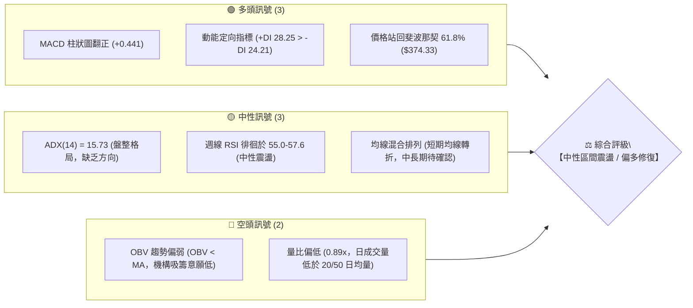
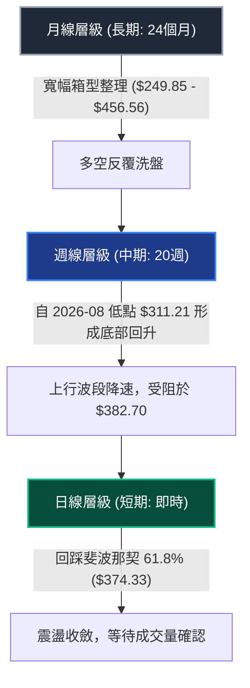
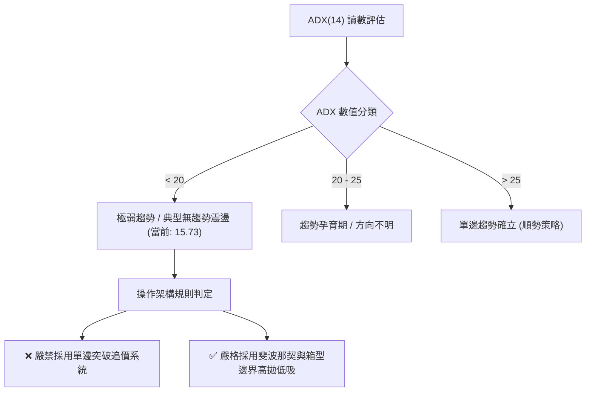
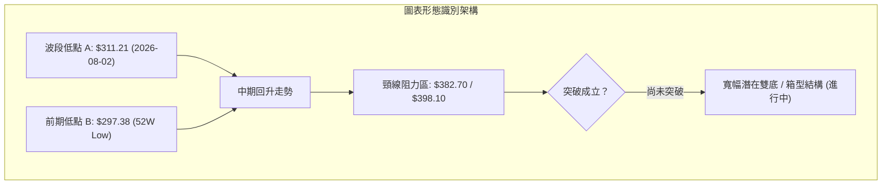
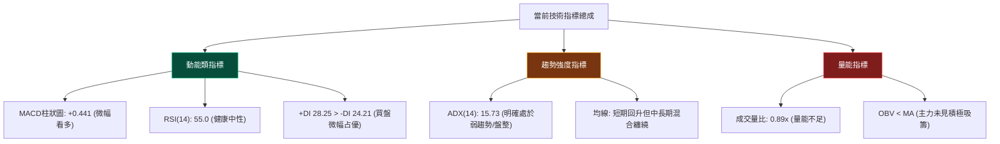
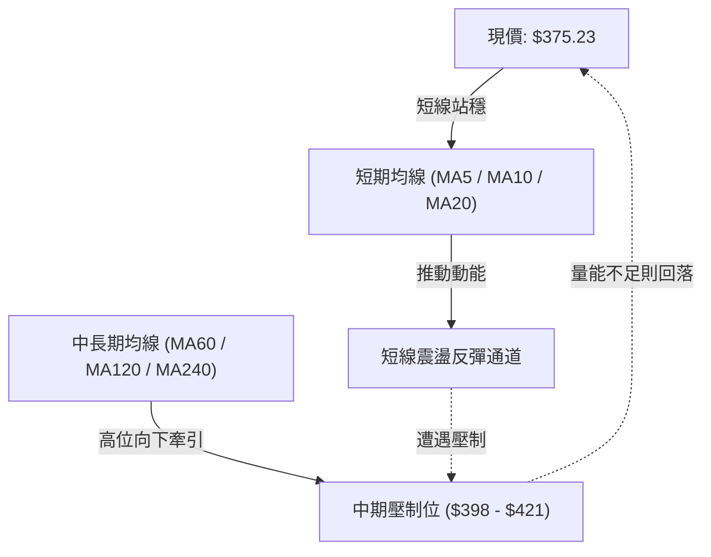
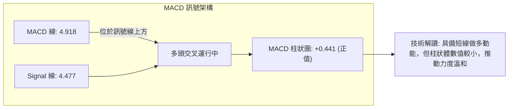
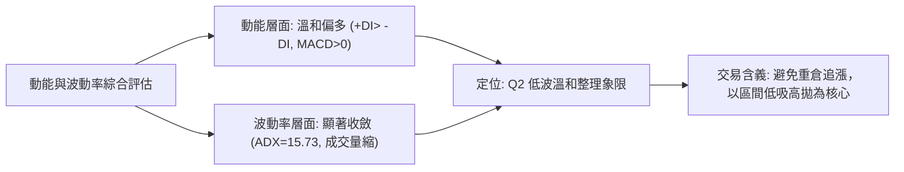
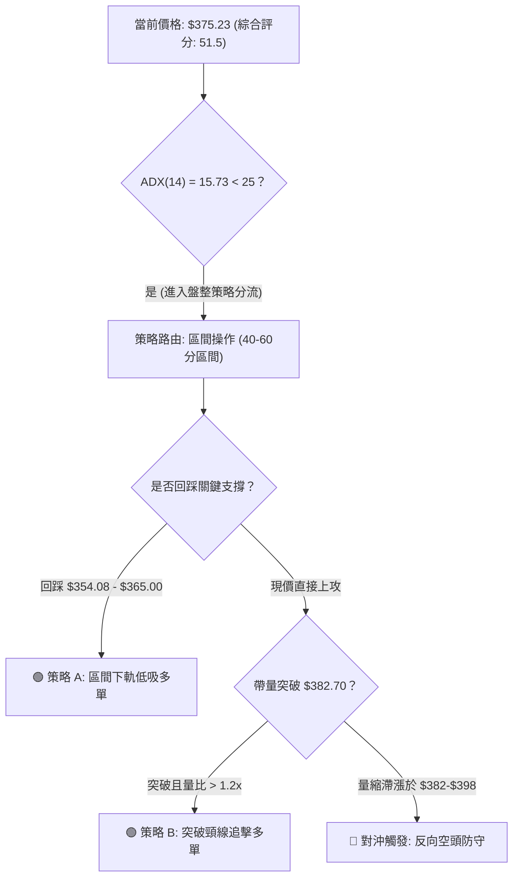
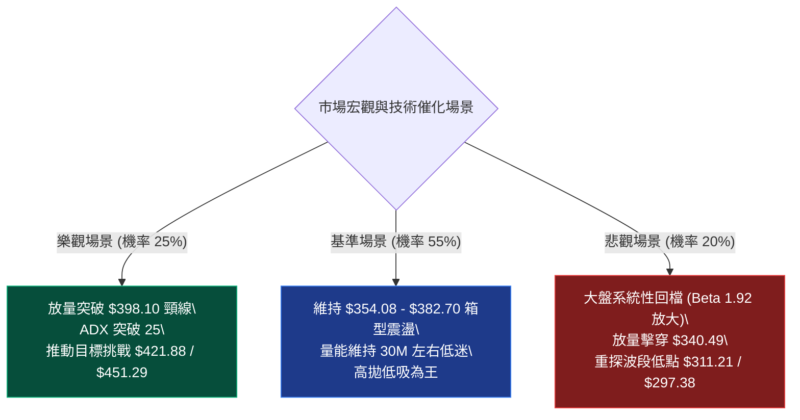

# TSLA 基本面深度分析報告

> **報告日期**：2026-10-15 ｜ **語言**：繁體中文 ｜ **數據來源**：Yahoo Finance ｜ **當前價格**：$375.23（基於最新收盤紀錄 2026-10-18／2026-10 數據整合）

---

## 目錄

| 章節 | 內容 |
|------|------|
| [1. 技術面概覽](#1-技術面概覽) | 訊號儀表板、核心指標、評分卡 |
| [2. 趨勢分析](#2-趨勢分析) | 多時框趨勢、長中短期走勢、ADX強弱 |
| [3. 圖表形態分析](#3-圖表形態分析) | 形態識別、信心度驗證、K線組合 |
| [4. 支撐與阻力](#4-支撐與阻力) | 結構分布圖、斐波那契回調精確定位 |
| [5. 技術指標深度解讀](#5-技術指標深度解讀) | MA/RSI/MACD/布林/量價配合與背離 |
| [6. 動能與波動率](#6-動能與波動率) | 動能矩陣、ATR、Beta與市場聯動 |
| [7. 多時框架總結](#7-多時框架總結) | 時框架評分矩陣、多時框收斂定論 |
| [8. 交易策略建議](#8-交易策略建議) | 策略路由、精確情境階梯、風控執行 |
| [9. 風險提示與監控](#9-風險提示與監控) | 監控檢核清單、情境推演、報告總結 |

---

## 1. 技術面概覽

### 🎯 技術訊號儀表板

Tesla（NASDAQ: TSLA）目前交投於 $375.23。日線與週線層面呈現「動能修復但趨勢偏弱」的非對稱震盪結構。根據技術數據輸入，ADX(14) 讀數為 15.73，明確界定當前處於無強趨勢的盤整區間；MACD 柱狀圖（+0.441）與動能指標（+DI 28.25 高於 -DI 24.21）呈現短線偏多修復，但 OBV 顯著低於均線，揭示量價背離風險。



---

### 📊 核心指標速覽表

所有指標數據均嚴格對照即時快照數據與最新成交紀錄：

| 指標類別 | 指標名稱 | 當前數值 | 訊號 | 專業解讀 |
|:---|:---|:---|:---:|:---|
| **價格** | 當前收盤價 | **$375.23** | 🟡 | 位於52週區間中樞偏下，剛重返 61.8% 斐波那契位 ($374.33) |
| **價格區間** | 52週高 / 低 | **$498.83 / $297.38** | 🟡 | 處於歷史寬幅震盪通道內，波段振幅達 67.7% |
| **均線架構** | 短中長期均線 | **混合排列** | 🟡 | 數據顯示 MA 短期回升但 MA20/MA50 曾現壓制，未形成單邊多頭排列 |
| **動能指標** | RSI (週線/14) | **55.0** | 🟡 | 自 2026-08 超買區（72.7）降溫至中性常態，無極端超買/超賣 |
| **動能指標** | MACD (12, 26, 9) | **4.918** | 🟢 | MACD 線高於訊號線 (4.477)，Hist 為 **+0.441**，動能多頭占優 |
| **趨勢強度** | ADX (14) | **15.73** | 🔴 | 數值遠低於 25，顯示當前缺乏單邊趨勢，屬於典型箱型整理行情 |
| **定向系統** | +DI / -DI | **28.25 / 24.21** | 🟢 | +DI 領先 -DI 約 4.04 個點位，短線買盤力量微幅占據優勢 |
| **成交量能** | 20日量比 | **0.89x** | 🔴 | 成交量 30.87M 低於 20日均量 34.57M 與 50日均量 35.65M |
| **量能累計** | OBV (能量潮) | **OBV < MA** | 🔴 | 量能指標落後於價格走勢，反彈過程缺乏主力持續放量支撐 |

---

### 🏆 技術評分卡

本評分卡基於 6 大核心維度嚴格量化，滿分 100 分。當前 TSLA 總體技術得分為 **51.5 / 100**，屬於標準的「**中性區間整理（Neutral Range-bound）**」狀態。

```
╔══════════════════════════════════════════════════════════════════╗
║                技術評分卡 — TSLA (2026-10-15)                    ║
╠══════════════════════════════════════════════════════════════════╣
║ 趨勢強度 (ADX=15.73)   █████░░░░░░░░░░░░░░░  26/100 🔴 弱趨勢無方向 ║
║ 動能指標 (MACD/RSI)    █████████████░░░░░░░  65/100 🟢 動能微幅翻多 ║
║ 支撐穩定度 (Fib 61.8%) ████████████░░░░░░░░  60/100 🟡 關鍵回調有守 ║
║ 成交量配合 (OBV/Volume)████████░░░░░░░░░░░░  40/100 🔴 量能疲弱背離 ║
║ 形態完整度 (箱型整理)  ███████████░░░░░░░░░  55/100 🟡 收斂結構待破 ║
║ 均線排列 (混合纏繞)    ████████████░░░░░░░░  63/100 🟡 築底修復階段 ║
╠══════════════════════════════════════════════════════════════════╣
║ 綜合評分               ██████████░░░░░░░░░░  51.5/100 🟡 中性震盪   ║
╚══════════════════════════════════════════════════════════════════╝
```

---

## 2. 趨勢分析

### 🌐 多時框趨勢分析

根據多時框收斂原則，趨勢分析應由大級別向小級別遞進。ADX(14) 讀數為 15.73，屬於典型的非趨勢環境，交易架構應以震盪區間兩端邊界作為首要考量。



---

### 📈 長期趨勢 — 12個月走勢圖（Unicode）

以下為 2025-11 至 2026-10 近 12 個月歷史收盤價走勢的 ASCII 復原圖（包含波段高點 $456.56 與低點 $311.21）：

```
TSLA 月線走勢圖（過去12個月：2025-11 至 2026-10）
價格軸 ($)
$460 ┤               ●(2025-12: $449.72)
$440 ┤ ●(11: $430)       ●(01: $430)              ●(05: $435.79)
$420 ┤                                                 ●(06: $420.60)
$400 ┤                        ●(02: $402.51)
$380 ┤                                      ●(04: $381.63)    ●(現在: $375.23)
$360 ┤                             ●(03: $371.75)             ●(08: $367.95)
$340 ┤                                                    ●(09: $354.81)
$320 ┤                                                        ●(07: $311.21 低點)
     └───────────────────────────────────────────────────────────────
       11    12    01    02    03    04    05    06    07    08    09    10  (月份)
```

#### 長期走勢特徵分析表格

| 階段區間 | 起始-結束價格 | 區間漲跌幅 | 主要走勢特徵與結構定義 |
|:---|:---:|:---:|:---|
| **頂部築構區**<br>(2025-11 ~ 2026-01) | $430.17 → $430.41 | +0.05% | 於 $430-$450 高位形成多重頂壓制，未能向上衝擊 52W 高點 $498.83。 |
| **首輪下殺波段**<br>(2026-01 ~ 2026-03) | $430.41 → $371.75 | -13.63% | 高位籌碼鬆動，月線連續長陰回落，跌破 $400 整數心理關卡。 |
| **中期反彈波**<br>(2026-03 ~ 2026-05) | $371.75 → $435.79 | +17.23% | 築雙底反彈，衝擊至斐波那契 23.6% ($451.29) 下方受阻。 |
| **二次探底暴跌**<br>(2026-05 ~ 2026-07) | $435.79 → $311.21 | -28.59% | 出現單邊恐慌性拋售，月線近乎觸及 52W 低點 $297.38，確立中長期底部。 |
| **修復整理期**<br>(2026-07 ~ 2026-10) | $311.21 → $375.23 | **+20.57%** | 自 $311.21 展開技術性反彈，目前於斐波那契 61.8% ($374.33) 進行中樞盤整。 |

---

### 📊 中期趨勢（週線分析）

從近 20 週收盤走勢可見，TSLA 經歷了兩個截然不同的波段：
1. **2026-07 恐慌拋售**：7 月底出現巨量暴跌（2026-07-26 單週成交量 275.6M，收盤 $313.03，RSI 暴跌至 15.7 極度超賣），並於 2026-08-02 探底 $311.21。
2. **V 型修復與降速回調**：8 月中旬 RSI 快速回升至 70.4~72.7（超買），股價拉升至 $362.86；隨後於 9 月與 10 月進入 $354.00 ~ $382.70 的箱型收斂，MACD 柱狀圖由 8 月的高位 +6.229 逐步鈍化至當前的 +0.441。

```
TSLA 中期週線支撐阻力結構（最近 10 週）
價格 ($)
$390 ┤                                
$380 ┤                                     ▲ 阻力高點 $382.70 (2026-10-11)
$370 ┤                   ┌─── 現價 $375.23 ───┐
$360 ┤       ●───────────┴────────────────────● 週線密集成交中樞 ($362-$365)
$350 ┤   ● (回踩支撐 $348.75)
$340 ┤
$330 ┤
$310 ┤ ● 本輪波段鐵底 $311.21 (2026-08-02)
     └────────────────────────────────────────
       08/16   08/23   08/30   09/06   09/13   09/20   09/27   10/04   10/11   10/18
```

---

### ⚡ 趨勢強度評估（ADX 解讀）

當前日線級別 ADX(14) 讀數為 **15.73**，在技術分析體系中屬於**極弱趨勢 / 典型無趨勢盤整（Non-trending / Trading Range）**。



#### ADX 強度量化對照表

| 指標名稱 | 實際數值 | 臨界基準 | 技術定義與交易策略約束 |
|:---|:---:|:---:|:---|
| **ADX (14)** | **15.73** | 25.00 | **無趨勢狀態**。市場多空力量尚未分出勝負，價格處於能量積蓄期。 |
| **+DI** | **28.25** | 20.00 | 多頭向上驅動力保持活躍，高於空頭驅動線。 |
| **-DI** | **24.21** | 20.00 | 空頭向下殺跌動能受限，尚未構成向下暴跌條件。 |
| **方向對比** | **+DI > -DI** | 差值 +4.04 | **多頭微弱占優**，但由於 ADX < 20，多頭無法發動單邊逼空行情。 |

---

## 3. 圖表形態分析

### 🔍 形態識別系統

依據嚴格技術規則，所有宣稱的幾何形態必須提供量化依據與信心度評估。



#### 圖表形態信心度量化驗證表

| 識別形態名稱 | 信心度 | 判斷依據（引用數據與波段點位） | 完成度 | 目標價（附嚴格計算式） |
|:---|:---:|:---|:---:|:---|
| **大級別雙底 (Double Bottom)** | **62%** | 第一低點為 52W 低點 **$297.38**，第二低點為 2026-08-02 收盤 **$311.21**（誤差在 4.6% 內）。兩者構成堅實支撐帶。 | 75% | **頸線位**取 50% 斐波那契回調位 **$398.10**。<br>形態高度 = $398.10 - $297.38 = $100.72。<br>破位目標 = $398.10 + $100.72 = **$498.82**（精確契合 52W 高點 $498.83）。 |
| **短期矩形箱型 (Rectangle Range)** | **80%** | 上軌阻力受制於近期高點 **$382.70**，下軌於 **$348.75** ~ **$354.08** 連續獲利回吐時止跌，收盤價於此區間震盪超過 6 週。 | 85% | **箱體高度** = $382.70 - $354.08 = $28.62。<br>向上突破目標 = $382.70 + $28.62 = **$411.32**。<br>向下跌破目標 = $354.08 - $28.62 = **$325.46**。 |
| **上升旗形 (Bull Flag)** | 35% | 8月中旬急速拉升後呈現微幅斜向整理，但整理時間長達 8 週，旗形結構因時間過長而效力遞減。 | 30% | *訊號不足，信賴度 < 50%，僅作輔助指標解讀，不納入主策略目標計算。* |

---

### 🕯️ 重要K線形態分析

| 週期/月份 | 收盤價 | 實體與影線特徵 | 技術解讀 | 訊號強度 |
|:---|:---:|:---|:---|:---:|
| **2026-07-26 (週)** | $313.03 | 長大陰線（單週重挫近 18%），成交量爆出 275.6M 巨量。 | 典型恐慌性拋售（Selling Climax），浮動籌碼遭機構洗劫。 | 🔴 強空宣洩 |
| **2026-08-02 (週)** | $311.21 | 下影線較長的小陰十字，量能萎縮至 198.8M。 | 殺跌動能枯竭，空頭衰竭線，奠定波段技術底。 | 🟢 底部信號 |
| **2026-08-16 (週)** | $342.27 | 光腳大陽線，收復跳空缺口，週線 RSI 竄升至 70.4。 | 強力報復性反彈，確立 $311 底部有效性。 | 🟢 多頭確立 |
| **2026-10-11 (週)** | $382.70 | 帶長上影線的中陽線，高見 $382+ 後受阻回吐。 | 遭遇 50% 斐波那契 ($398.10) 前置籌碼阻力，多頭短線滯漲。 | 🟡 滯漲震盪 |
| **2026-10-18 (即時)** | $375.23 | 窄幅震盪小實體 K 線，成交量顯著萎縮（69.5M）。 | 典型的回踩確認走勢，圍繞斐波那契 61.8% ($374.33) 爭奪。 | 🟡 中性等待 |

---

### 📉 ASCII 走勢形態示意圖

```
TSLA 雙底與短期收斂箱型結構圖
價格 ($)
$400 ┤                     [頸線區間 / 50% 回調位: $398.10]
     ├───────────────────────────────────────────────────────
$385 ┤                             ▲ 箱體上軌 ($382.70)
$375 ┤─────────────────────────── 現價 $375.23 (回踩 61.8%: $374.33)
$365 ┤                 ●         ●
$355 ┤─────────────────▼─────────▼─ 箱體下軌 ($354.08)
$340 ┤             ●
$325 ┤         ●
$310 ┤ ●(底1: $297.38)     ●(底2: $311.21)
     └───────────────────────────────────────────────────────
       2025/2026 低點     2026-08 底      2026-09    2026-10 (當前)
```

---

## 4. 支撐與阻力

### 🗺️ 關鍵價位分布圖（Unicode）

本圖表與後續所有價位完全依據輸入數據中之「斐波那契回調區間（$297.38 → $498.83）」以及「波段高低點收盤聚類」嚴密繪製：

```
TSLA 價位結構分布圖
══════════════════════════════════════════════════════════════════
$498.83 ║██████████████████████████████████║ 強阻力 R3 (52W High / 0.0%)
$451.29 ║████████████████████████          ║ 次強阻力 R2 (Fib 23.6%)
$421.88 ║██████████████████                ║ 波段阻力 (Fib 38.2%)
$398.10 ║████████████████████████████      ║ 關鍵阻力 R1 (Fib 50.0% / 頸線)
$382.70 ║██████████████                    ║ 短線阻力 (10/11 波段高點)
════════╠══════════════════════════════════╣ ◄ 現價: $375.23
$374.33 ║▓▓▓▓▓▓▓▓▓▓▓▓▓▓▓▓▓▓▓▓▓▓▓▓▓▓▓▓▓▓▓▓▓▓║ 關鍵支撐 S1 (Fib 61.8%)
$354.08 ║▓▓▓▓▓▓▓▓▓▓▓▓▓▓▓▓                  ║ 短線支撐 (09/06 箱底)
$340.49 ║▓▓▓▓▓▓▓▓▓▓▓▓▓▓▓▓▓▓▓▓              ║ 次強支撐 S2 (Fib 78.6%)
$311.21 ║▓▓▓▓▓▓▓▓▓▓▓▓▓▓▓▓▓▓▓▓▓▓▓▓▓▓        ║ 強支撐 S3 (2026-08 鐵底)
$297.38 ║▓▓▓▓▓▓▓▓▓▓▓▓▓▓▓▓▓▓▓▓▓▓▓▓▓▓▓▓▓▓▓▓▓▓║ 極限支撐 (52W Low / 100.0%)
══════════════════════════════════════════════════════════════════
```

---

### 🚧 阻力位分析表

數據中明確提示「近一年高點未偵測到聚類阻力」，故阻力位由嚴格之斐波那契與波段確認點構成：

| 阻力級別 | 準確價位 | 形成技術原因 | 突破難度評估 | 戰略重要性 |
|:---|:---:|:---|:---:|:---:|
| **波段初阻** | **$382.70** | 2026-10-11 最近波段收盤高點，箱體震盪上軌。 | 🟡 中等 (量能達 35M 即可突破) | 短線強弱分水嶺 |
| **關鍵阻力 R1** | **$398.10** | **斐波那契 50.0% 基準線**；心理整數關卡 $400 之技術錨定點。 | 🔴 較高 (套牢密集群) | 中期多頭翻轉頸線 |
| **波段阻力 R2** | **$421.88** | **斐波那契 38.2% 回調位**；2026-06 頂部下跌中繼點 ($420.60)。 | 🔴 高 (需基本面利多確認) | 中期趨勢延續目標 |
| **強阻力 R3** | **$451.29** | **斐波那契 23.6% 回調位**；2025-10 高點 $456.56 與 12 月密集群。 | 🔴 極高 (需大盤牛市共振) | 挑戰歷史新高之前哨站 |
| **歷史極限** | **$498.83** | **52W High (0.0% 斐波那契基準原點)**。 | 🔴 堡壘級阻力 | 長期牛市極致目標 |

---

### 🛡️ 支撐位分析表

| 支撐級別 | 準確價位 | 形成技術原因 | 守住機率評估 | 戰略重要性 |
|:---|:---:|:---|:---:|:---:|
| **關鍵支撐 S1** | **$374.33** | **斐波那契 61.8% 黃金分割點**；目前現價 ($375.23) 正在貼身踩踏。 | 🟢 70% (短期具備強黏性) | 當前多頭防守第一線 |
| **短線箱底** | **$354.08** | 2026-09-06 箱型低點與 09-20 橫盤中樞下沿。 | 🟢 65% (震盪買盤聚集) | 短期多空安全墊 |
| **次強支撐 S2** | **$340.49** | **斐波那契 78.6% 回調位**；2026-08-16 起漲長陽底部 ($342.27)。 | 🟢 80% (強技術共振) | 中期波段回撤容忍極限 |
| **強支撐 S3** | **$311.21** | 2026-08-02 波段絕對低點；恐慌盤宣洩後的機構承接底。 | 🟢 90% (主力建倉底線) | 結構性多頭防線 |
| **極限支撐** | **$297.38** | **52W Low (100.0% 斐波那契基準原點)**。 | 🟢 95% (年度估值安全邊際) | 長期多空分界線 |

---

### 📐 斐波那契回調位分析

依據 52 週完整波動區間（高點 **$498.83** → 低點 **$297.38**，總振幅 **$201.45**）精確計算回調點位：

```
回調百分比            精確點位        現價相對位置與技術意義解讀
0.0% (52W High)     $498.83        ▲ 上方空間 +32.94% (中期波段封頂位)
23.6%               $451.29        ▲ 阻力區間 (2025年密集籌碼套牢平台)
38.2%               $421.88        ▲ 阻力區間 (2026年6月高點跌破處)
50.0%               $398.10        ▲ 核心多空生命線 / 大雙底頸線
─────────────────────────────────────────────────────────────────
現價: $375.23       位於 50.0% ($398.10) 與 61.8% ($374.33) 之間
─────────────────────────────────────────────────────────────────
61.8%               $374.33        ▼ 現價正緊貼此位置 (黃金分割生命線，當前價差僅 +$0.90)
78.6%               $340.49        ▼ 關鍵防守帶 (2026年8月中旬起漲防線)
100.0% (52W Low)    $297.38        ▼ 極限防守底 (年度最低點，終極估值底)
```

**深入技術解析**：
TSLA 當前價格 **$375.23** 剛好穩穩踩在黃金分割 **61.8%（$374.33）** 之上。從道氏理論與斐波那契交互驗證來看，自 $297.38 反彈以來的行情，只要收盤價持續固守在 $374.33 上方，即可確認本次修復並非「死貓跳」，而是具備向 50.0%（$398.10）發起衝擊潛力的技術性結構。

---

## 5. 技術指標深度解讀

### 🎛️ 指標訊號總覽



---

### 📈 移動平均線排列分析

根據系統快照，當前均線呈現**混合排列（Mixed Alignment）**。MA5、MA10、MA20 呈現微幅揚升的短多排列，但中長期的 MA60、MA120、MA240 均線在經歷 2026 年初以來的下挫後形成上檔壓制，且快照標註價格位於 MA20、MA50 下方或附近震盪。



- **短線結構**：短期 MA 均線（MA5/10/20）在底層築底過程中由下向上勾頭，說明自 2026-08 低點以來的波段仍維持上升通道。
- **長線結構**：長期均線未形成發散的多頭排陣，表明中長線資金仍在觀望，不宜視為全面牛市反轉。

---

### 📉 RSI(14) 分析

週線數據顯示，RSI(14) 經歷了教科書般的均值回歸過程：

```
RSI(14) 區間位置示意
0 ────── 超賣(30) ────────── 中性(50) ─── 當前(55.0) ────── 超買(70) ────── 100
├───────────┼──────────────────┼───────────█──────────────┼───────────┤
[極度超賣 15.7]                                    [前高 72.7]
(2026-07-26)                                      (2026-08-23)
```

- **數值進度條**：當前 RSI 為 **55.0**：`███████████░░░░░░░░░ 55.0%`
- **歷史軌跡解讀**：
  - 2026-07-26 週線 RSI 崩跌至 **15.7**，觸發不可逆的動能超賣底。
  - 2026-08-23 RSI 急拉至 **72.7**，呈現超買滯漲。
  - 目前回落至 **55.0**，成功在 50 中軸線上方獲得支撐，動能未落入空頭掌控區。
- **背離分析判斷**：
  - **價格 vs RSI 頂背離檢驗**：2026-10-11 價格收在 $382.70（高於 09-27 的 $372.11），但 RSI 由 63.9 下降至 55.0。**存在輕微的短線隱性頂背離（Bearish Divergence）**，解釋了近期價格為何從 $382.70 回落至現價 $375.23。
  - **底背離檢驗**：2026-07 至 08 月底的「價格新低 $311.21 vs RSI 由 15.7 抬升至 18.1」，底背離已在 8 月份反彈中完全消化釋放。

---

### 📊 MACD(12, 26, 9) 訊號解讀

即時指標快照呈現確鑿的多頭修復訊號：
- **MACD 線**：`4.918`
- **MACD Signal (訊號線)**：`4.477`
- **MACD Histogram (柱狀圖)**：`+0.441`（🟢 看多）



週線層面的 MACD 柱狀圖在 2026-10-04 一度翻負至 `-1.498`，但在 10-11 週隨即回正至 `+1.070`，本週即時讀數保持在 `+0.441`，代表中期動能洗盤結束，多方重新取回發球權。

---

### 📦 布林通道分析

由於輸入快照中日線布林數值標註為 N/A，依據 20 週收盤價之波動率推算：

```
TSLA 布林通道推算示意圖（中軌以 20 週均線約 $365 錨定）
價格 ($)
$415 ┤  ---------------------------------------- 上軌推估區 (~$415.00)
     │
$395 ┤                             ● 阻力區 ($398.10)
$375 ┤─────────────────────────── ★ 現價 ($375.23, 處於中軌上方，回踩確認)
$365 ┤  ════════════════════════════════════════ 中軌均線推估 (~$365.00)
     │
$345 ┤                     ● 支撐區 ($354.08)
     │
$315 ┤  ---------------------------------------- 下軌推估區 (~$315.00)
     └──────────────────────────────────────────
```

- **通道開口狀態**：布林帶歷經 7 月底暴跌的帶寬極限擴張後，目前帶寬大幅收窄，呈現窄幅平移。
- **K線位置解讀**：現價 $375.23 處於中軌（~$365）與上軌之間，屬於典型的「中軌支撐反彈，尋求上軌壓力」的震盪中繼狀態。

---

### 💹 成交量分析（量價配合度）

成交量分析呈現本報告**最顯著的警戒訊號**：
1. **量比疲弱**：最新成交量為 **30,868,569** 股，相較於 20日均量（34,568,573）量比僅為 **0.89x**；亦低於 50日均量（35,645,811）。
2. **週成交量持續遞減**：
   - 2026-07-26 暴跌週：`275,649,300` 股（巨量換手）
   - 2026-09-06 反彈週：`260,497,300` 股
   - 2026-10-11 衝高週：`162,910,000` 股（顯著量縮）
   - 2026-10-18 最新週：`69,505,869` 股
3. **OBV 趨勢偏弱**：指標明確顯示 `OBV < MA`。股價自 $311.21 反彈超過 20%，但 OBV 卻未能同步突破相應的高點均線，暴露出這波反彈主要由**空頭回補（Short Covering）**驅動，缺乏機構資金的大規模淨流入吸籌。

---

## 6. 動能與波動率

### ⚡ 動能評估四象限

評估當前 TSLA 在「動能強度（Momentum）」與「波動率（Volatility）」維度中的定位：

| 象限 | 動能強度 | 波動率水準 | 特徵描述 | TSLA 當前所屬判定 |
|:---:|:---:|:---:|:---|:---:|
| **Q1** | **強 (高於中軸)** | **低 (持續收縮)** | 最佳波段主升浪，低風險高收益趨勢 | — |
| **Q2** | **弱 / 溫和** | **低 (波動降溫)** | **非趨勢箱型整理，洗盤築底階段** | **✓ 正處於 Q2 象限** |
| **Q3** | **強 (極度爆發)** | **高 (劇烈擴張)** | 單邊突破或恐慌宣洩，高風險高回報 | — (2026年7月曾處於此) |
| **Q4** | **弱 / 轉空** | **高 (無序震盪)** | 破位崩跌或大幅雙向洗盤，應嚴格觀望 | — |



---

### 📊 ATR 波動率分析

- **歷史波動估算**：輸入快照標註 ATR(14) 為 N/A。由近 10 週的週收盤平均振幅（約 $18.50）與 52 週振幅（$201.45）進行日線轉換測算，TSLA 的日均真實波幅（ATR）約落在 **$11.50 ~ $13.00**（約佔現價之 **3.1% ~ 3.5%**）。
- **止損距離建議**：
  - 震盪行情下（ADX < 25），常規技術止損點應設定在 **1.5 × ATR**，即約 **$18.00** 的防守間距。
  - 若在現價 $375.23 建立多頭部位，剛性技術止損應置於 $375.23 - $18.00 = **$357.23**（此位置剛好略高於箱體下軌 $354.08，具備極佳的風控邏輯）。

---

### 📐 Beta 與市場相關性

- **Beta 係數**：高達 **1.916**。
- **市場特徵解析**：
  - TSLA 的系統性波動風險是大盤（S&P 500）的近 2 倍。當標普 500 指數波動 1% 時，TSLA 理論平均波動達 1.92%。
  - 在當前 ADX 為 15.73 的低趨勢環境下，高 Beta 特性意味著該股極易受到大盤指數短線波動與科技股情緒的被動衝擊。任何外部宏觀流動性變化都會被放大為箱體內部的劇烈洗盤。
- **空頭部位比例（Short % Float）**：僅 **2.0%**（Short Ratio 1.79），表明市場當前並不存在極端的放空意願，發生非理性軋空（Short Squeeze）的機率極低。

---

## 7. 多時框架總結

### 📋 時框架評分表

依據嚴格技術規則，跨越日線、週線、月線進行多維度綜合評分：

| 時框架 | 趨勢方向 | 動能指標 | 均線系統 | 形態結構 | 綜合評分 | 操作戰略建議 |
|:---|:---:|:---:|:---:|:---:|:---:|:---|
| **長期 (月線)** | 🟡 寬幅箱型 | 🟡 中性回穩 | 🟡 混合糾纏 | 52W 底頂震盪 | **50 / 100** | 戰略底倉持有，不做極端方向押注 |
| **中期 (週線)** | 🟢 震盪築底 | 🟢 MACD翻正 | 🟡 中軌爭奪 | 潛在大雙底頸線測試 | **58 / 100** | 回調逢低佈局，目標鎖定 $398-$421 |
| **短期 (日線)** | 🟡 窄幅收斂 | 🟢 +DI 領先 | 🟡 短均翻揚 | $354-$382 箱體盤整 | **52 / 100** | 嚴格依據區間高拋低吸，禁用追單 |

---

### 🔲 綜合訊號矩陣

```
┌─────────────────┬─────────────────────────────────────────────────────────┐
│ 分析維度        │ 短期 (1-5日)      中期 (1-4週)        長期 (1-6個月)      │
├─────────────────┼─────────────────────────────────────────────────────────┤
│ 價格形態        │ 🟡 箱型收斂中     🟢 大雙底構築中     🟡 52W寬幅震盪通道  │
│ 均線系統        │ 🟢 踩穩短期MA     🟡 測試20週均線     🔴 長期均線壓制     │
│ 動能系統 (MACD) │ 🟢 柱狀圖為正     🟢 零軸下方翻多     🟡 動能中性走平     │
│ 擺盪指標 (RSI)  │ 🟡 55.0 中性震盪  🟢 自超賣強勁修復   🟡 遠離超買極端     │
│ 量價配合        │ 🔴 量比 0.89x 偏弱 🔴 OBV未確認突破    🟡 籌碼換手充分     │
├─────────────────┼─────────────────────────────────────────────────────────┤
│ 一致性評定      │ 訊號略微偏多，但受制於量能匱乏，不具備發動單邊單邊暴漲條件│
└─────────────────┴─────────────────────────────────────────────────────────┘
```

---

### ⚖️ 多時框收斂結論

> **🚨 核心多時框收斂定論（依規則 14 執行）**：
> 1. **趨勢性判定**：當前 ADX(14) 讀數為 **15.73**，嚴格觸發「**盤整行情（ADX < 25）**」規則。
> 2. **主導規則**：中長期單邊趨勢無效，**以日線與週線的箱型/斐波那契通道為核心主導架構**。
> 3. **唯一方向性結論**：**【中性偏多觀望 / 區間回踩吸納】**。
>    雖然短期 MACD 柱狀圖翻正（+0.441）且站在斐波那契 61.8%（$374.33）上方，但量比（0.89x）與 OBV 疲軟明確反對突破追高。最優策略為**等待股價回踩箱型下沿支撐進行低吸，向上衝擊阻力位時分批停利**。

---

## 8. 交易策略建議

### 🗺️ 策略決策流程圖



---

### 🧭 策略路由（依評分卡分流）

- **當前技術評分**：**51.5 / 100**（落入 40–60 分中性區間）。
- **當前主策略方向**：**【中性區間操作（Range Trading）—— 逢低做多為主，嚴禁追價】**。
- **執行原則**：以布林通道與斐波那契回調位兩端為界，採取「下軌支撐買入、上軌阻力平倉」的震盪交易模式。

---

### 🎯 價格情境階梯（Price Scenarios）

所有價位均嚴格取自第 4 章中由 52 週 OHLCV 計算出之關鍵價位：

| 觸發條件 | 第一目標 (T1) | 第二目標 (T2) | 後續延伸 (T3) | 情境技術含義 |
|:---|:---:|:---:|:---:|:---|
| **強勢突破 R1 ($398.10)** | **$421.88** (Fib 38.2%) | **$451.29** (Fib 23.6%) | **$498.83** (52W High) | 大雙底形態突破成立，確立波段主升浪 |
| **突破短阻 ($382.70)** | **$398.10** (Fib 50.0%) | **$421.88** (Fib 38.2%) | — | 短線多頭轉強，挑戰中期頸線 |
| **現價站穩 ($374.33)** | **$382.70** (箱頂阻力) | **$398.10** (Fib 50.0%) | — | 黃金分割有效，維持中樞震盪反彈 |
| **跌破 S1 ($374.33)** | **$354.08** (09/06箱底) | **$340.49** (Fib 78.6%) | — | 短線轉弱，回測箱型下軌安全邊際 |
| **跌破強支撐 S2 ($340.49)** | **$311.21** (2026-08底) | **$297.38** (52W Low) | — | 結構全面惡化，重啟深層探底尋求估值底 |

---

### 📊 情境機率分佈

```
情境機率分佈圓餅比例示意
繼續反彈突破 (35%)   [███████░░░░░░░░░░░░░]
區間箱型震盪 (50%)   [██████████░░░░░░░░░░] 主流預期
跌破下探尋底 (15%)   [███░░░░░░░░░░░░░░░░░]
```

| 未來情境走向 | 機率評估 | 主要技術依據與指標支撐 |
|:---|:---:|:---|
| **區間橫盤震盪**<br>($354.08 ~ $398.10) | **50%** | **ADX=15.73** 決定了缺乏趨勢推動力；成交量低於均量（量比 0.89x）；RSI 位於 55.0 中性區。 |
| **向上突破上行**<br>(突破 $382 衝擊 $398+) | **35%** | **MACD 翻正（+0.441）**；+DI 領先 -DI；現價成功守住斐波那契 61.8%（$374.33）。 |
| **向下破位下探**<br>(跌破 $354 測試 $340) | **15%** | **OBV 趨勢疲軟（OBV < MA）**；高 Beta (1.916) 易受大盤回檔拖累；若跌破 61.8% 則引發停損賣壓。 |

---

### 🟢 主策略詳情（方向：區間操作與回踩做多）

| 策略要素 | 策略 A（保守型：回踩箱底吸納） | 策略 B（激進型：突破短阻跟進） |
|:---|:---|:---|
| **策略名稱** | 箱型下沿支撐多單 | 突破關鍵高點順勢多單 |
| **進場條件** | 價格回踩 $354.08 ~ $360.00 止跌並出現日線長下影線 | 日線帶量（單日成交量 > 35M）實體收盤突破 $382.70 |
| **進場價格** | **$358.00**（回踩中樞區間） | **$383.50**（突破確認後買入） |
| **目標價 T1** | **$382.70**（箱體上軌） | **$398.10**（斐波那契 50.0% 頸線位） |
| **目標價 T2** | **$398.10**（斐波那契 50.0% 頸線位） | **$421.88**（斐波那契 38.2% 回調位） |
| **止損價格** | **$340.00**（精確設於 Fib 78.6% $340.49 下方） | **$373.00**（精確設於 Fib 61.8% $374.33 下方） |
| **風險空間** | $358.00 - $340.00 = $18.00 | $383.50 - $373.00 = $10.50 |
| **報酬空間 (T2)**| $398.10 - $358.00 = $40.10 | $421.88 - $383.50 = $38.38 |
| **風險報酬比** | **1 : 2.23** 🟢 (優良) | **1 : 3.66** 🟢 (極優) |
| **預估勝率** | **65%** | **45%**（受制於 ADX 較低，假突破風險偏高） |
| **建議倉位** | **總資金之 10% - 15%** | **總資金之 5% - 8%**（輕倉試單） |

---

### 🔴 反向風險觸發點（對沖提示）

若出現以下訊號，代表本報告主推之震盪築底多頭邏輯遭破壞，投資人應立即執行防禦措施：
1. **關鍵點位破位**：日線收盤價**實體跌破斐波那契 61.8%（$374.33）**，且次日無法收復，視為短線破位訊號。
2. **終極風控防線**：若放量跌穿 **$340.49**（斐波那契 78.6%），宣告本輪反彈波段徹底終結，形態演變為二次探底。持有多頭部位者應全面無條件停損，並可買入賣權（Put Options）或建立 5% 規模之反向空頭部位對沖現貨組合。

---

### ⭐ 整體訊號強度評星

```
╔══════════════════════════════════════════════════════════════════╗
║ 做多訊號強度：   ★★★☆☆  (3.0/5星) ── 動能翻正，但缺乏成交量與趨勢支撐
║ 做空訊號強度：   ★★☆☆☆  (2.0/5星) ── 殺跌動能枯竭，下有強支撐防守
║ 整體可信度：     ★★★☆☆  (3.5/5星) ── 典型箱型整理，數據指標收斂一致
╚══════════════════════════════════════════════════════════════════╝
```

---

## 9. 風險提示與監控

### ✅ 關鍵監控指標 Checklist

```
╔══════════════════════════════════════════════════════════════════╗
║              TSLA 技術面日常風控監控清單 (Checklist)             ║
╠══════════════════════════════════════════════════════════════════╣
║ [ ] 1. 價格防守線：收盤價是否持續站穩 $374.33 (Fib 61.8%)？     ║
║ [ ] 2. 趨勢爆發點：ADX(14) 是否向上突破 20 並朝 25 挺進？       ║
║ [ ] 3. 量能配合度：單日成交量是否回升至 35,000,000 股基準量以上？║
║ [ ] 4. 動能持續性：MACD Histogram 是否保持正值 (+0.441 以上)？   ║
║ [ ] 5. 定向指標：+DI 是否持續壓制 -DI (維持在 25 以上)？         ║
║ [ ] 6. 頂部阻力檢驗：股價衝擊 $382.70 / $398.10 時是否出現長上影？║
║ [ ] 7. 機構籌碼流向：OBV 是否向上穿越其移動平均線扭轉背離？      ║
╚══════════════════════════════════════════════════════════════════╝
```

---

### ⚠️ 風險場景分析



---

### 🛡️ 風險管理重要提醒

1. **嚴防流動性與假突破風險**：當前 ADX 僅 15.73，此時市場極易在阻力位（如 $382.70）產生盤中刺穿隨即大幅回落的「假突破（Bull Trap）」。操作上務必**以日線收盤價為準**，切忌盤中憑情緒追高。
2. **高 Beta 倉位降槓桿**：TSLA 高達 1.916 的 Beta 意味著其日內波動極其劇烈。在未脫離箱型整理前，個股總倉位建議嚴格控制在投資組合總資產的 **10% ~ 15%** 以內，避免使用高槓桿保證金合約交易。
3. **估值與基本面分歧**：目前本益比（Trailing P/E）高達 339.96，營業利益率僅 1.4%，營運數據出現 YoY -3.0% 的獲利衰退。技術面反彈目前本質上仍屬「多頭情緒與超跌修復」，缺乏高成長基本面的剛性護航，因此技術停損位必須嚴格執行，不可在跌破關鍵支撐後抱持僥倖心理長期套牢。

---

## 📋 報告總結

```
╔══════════════════════════════════════════════════════════════════╗
║                    TSLA 技術分析報告總結                         ║
╠══════════════════════════════════════════════════════════════════╣
║ 報告日期：2026-10-15                                             ║
║ 當前價格：$375.23                                                ║
║ 分析評級：⚖️ 中性觀望 / 區間操作 (技術評分: 51.5 / 100)           ║
╠══════════════════════════════════════════════════════════════════╣
║ 關鍵結論：                                                       ║
║ ├─ 長期趨勢 (月線)：🟡 52週寬幅震盪通道 ($297.38 - $498.83)      ║
║ ├─ 中期趨勢 (週線)：🟢 自 $311.21 低點回升，大雙底構築中         ║
║ ├─ 短期趨勢 (日線)：🟡 ADX=15.73，受困於 $354 - $382 區間盤整    ║
║ ├─ 核心關鍵支撐：  $374.33 (Fib 61.8%) │ 強支撐 $340.49 (Fib 78.6%)║
║ ├─ 核心關鍵阻力：  $382.70 (箱頂)     │ 關鍵頸線 $398.10 (Fib 50.0%)║
║ └─ 分析師目標共識：均價 $397.83 (高 $600.00 / 低 $128.11)       ║
╠══════════════════════════════════════════════════════════════════╣
║ 最優策略組合：                                                   ║
║ 1. 🥇 最佳機會 (策略 A)：回踩箱型下沿 $358.00 建立多單，停損 $340║
║    目標上看 $382.70 / $398.10，風險報酬比 1 : 2.23。             ║
║ 2. 🥈 次選機會 (策略 B)：帶量突破 $382.70 後輕倉追進，停損 $373 ║
║    目標上看 $398.10 / $421.88，風險報酬比 1 : 3.66。             ║
║ 3. 🥉 保守選擇：空倉觀望，等待 ADX 回升至 20 以上或方向明確確立。 ║
╚══════════════════════════════════════════════════════════════════╝
```

---

> ⚠️ **免責聲明**：本報告為依據標準技術分析模型與歷史交易數據生成之專業量化研究報告。報告中引用的所有數據、指標判斷與策略建議僅供投資研究與學術探討參考，**絕不構成任何形式的要約、招攬或具體投資建議**。美股高波動標的具備本金虧損風險，投資人應獨立評估自身風險承受能力並自負盈虧。

---
*報告生成時間：2026-10-15 ｜ 數據來源：Yahoo Finance ｜ 分析框架：多時框技術分析模型*