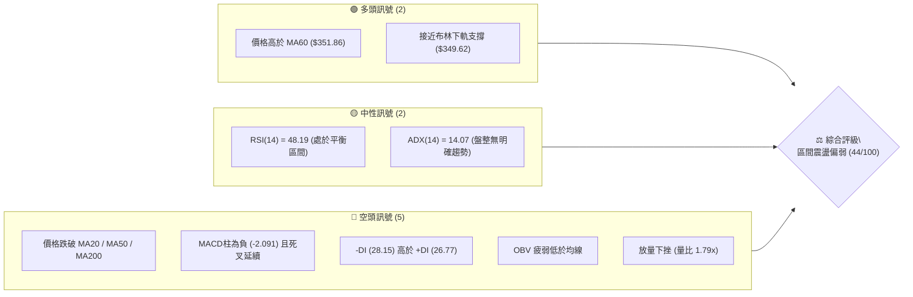
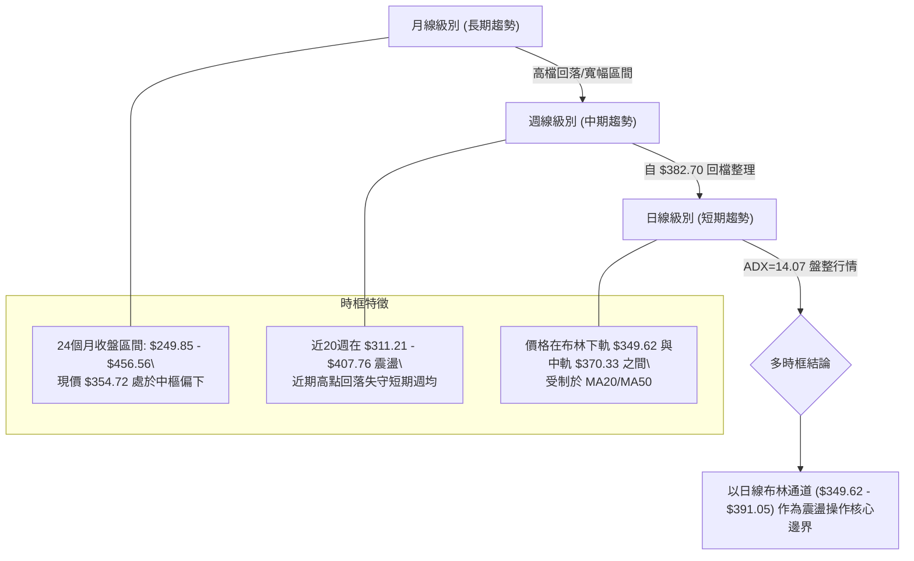
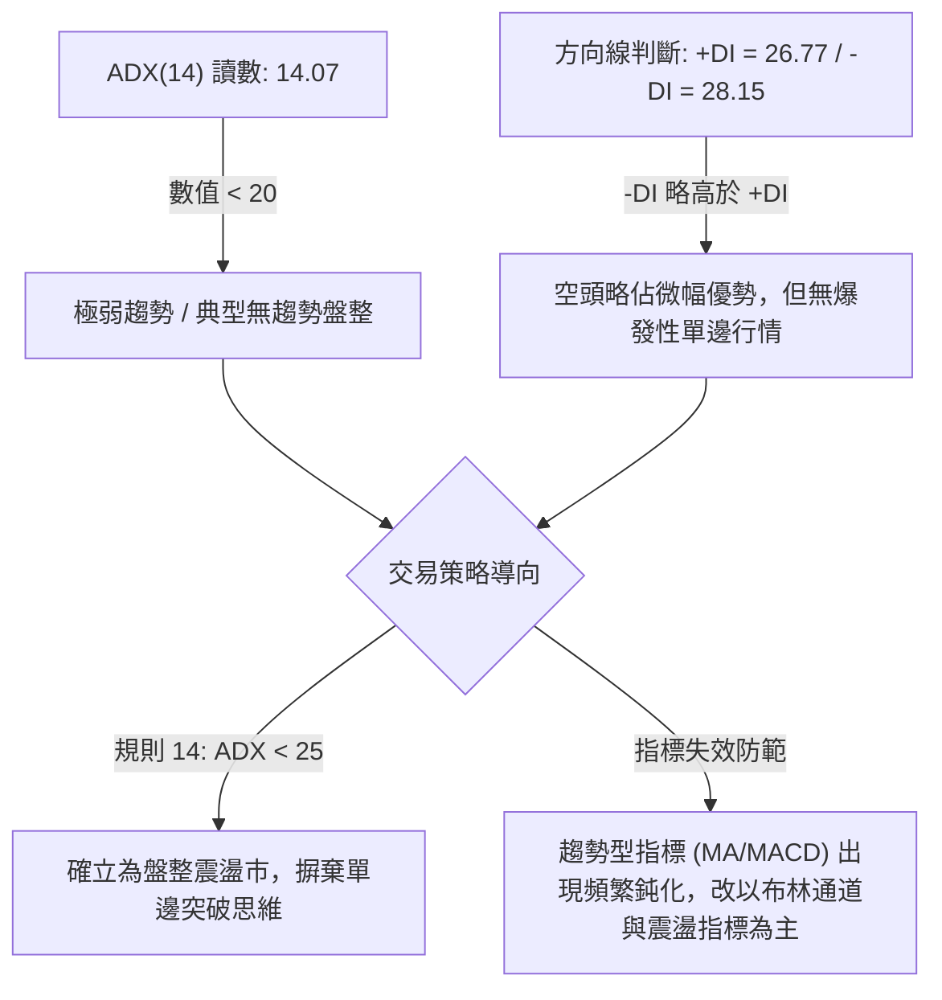
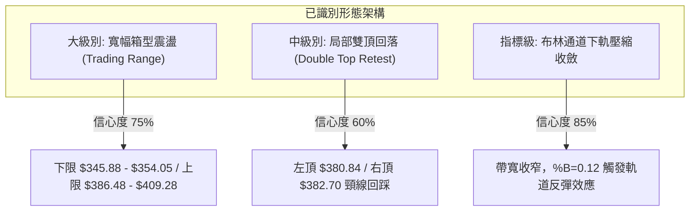
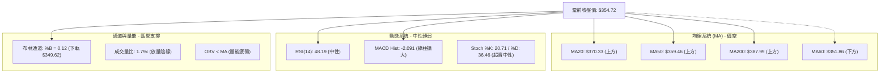
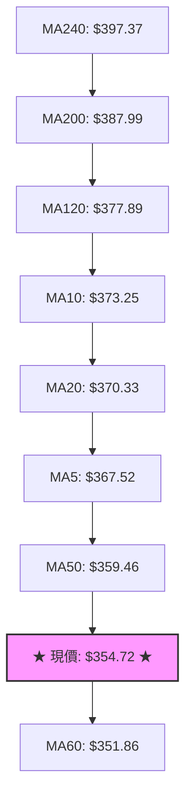
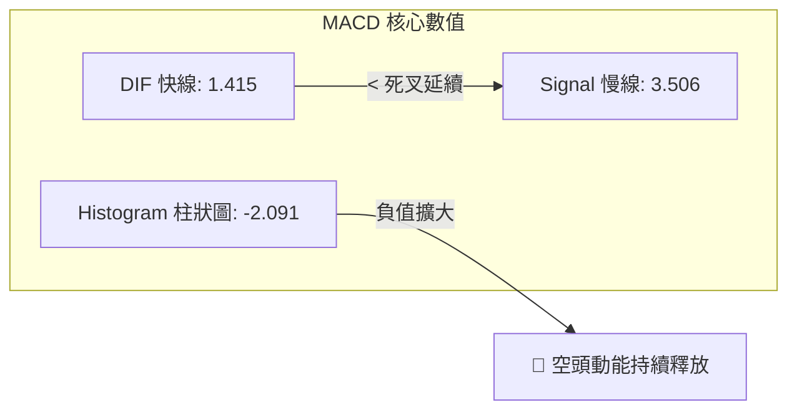
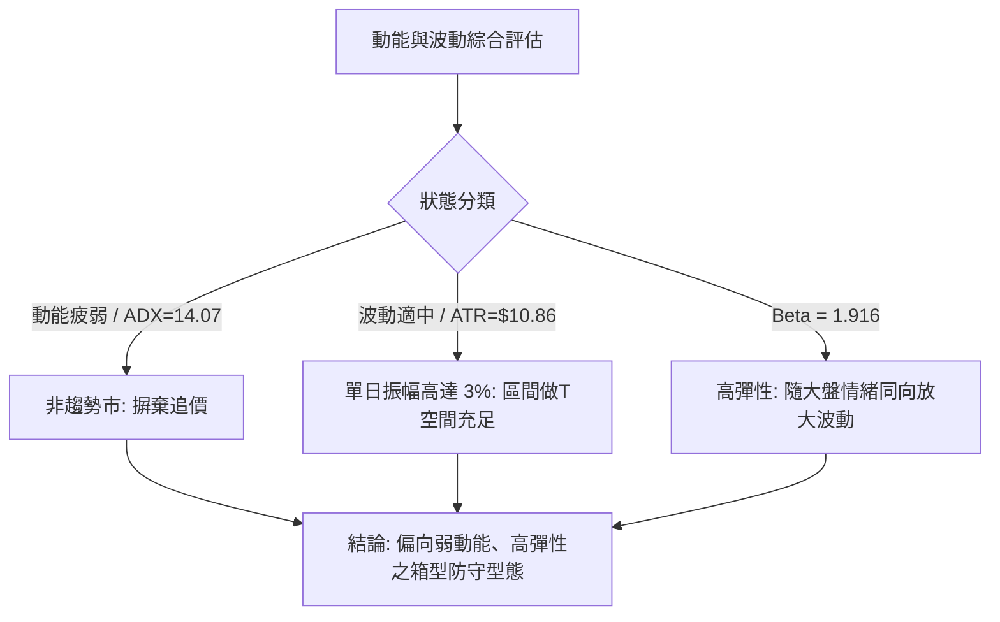
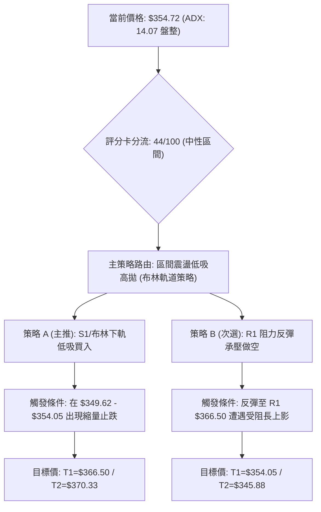
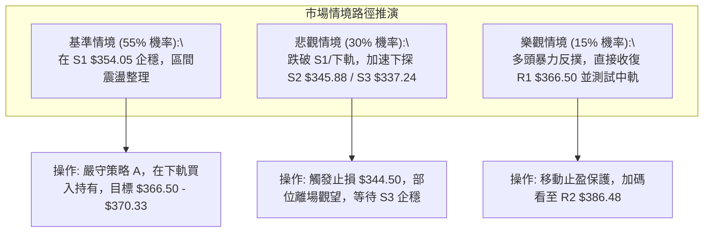

# TSLA 技術分析報告

> **報告日期**：2026-10-16 ｜ **語言**：繁體中文 ｜ **數據來源**：Yahoo Finance ｜ **當前價格**：$354.72

---

## 目錄

| 章節 | 內容 |
|------|------|
| [1. 技術面概覽](#1-技術面概覽) | 訊號儀表板、核心指標、評分卡 |
| [2. 趨勢分析](#2-趨勢分析) | 多時框趨勢、長中短期走勢 |
| [3. 圖表形態分析](#3-圖表形態分析) | 形態識別、K線組合、目標價 |
| [4. 支撐與阻力](#4-支撐與阻力) | 關鍵價位、斐波那契回調 |
| [5. 技術指標深度解讀](#5-技術指標深度解讀) | MA/RSI/MACD/布林/成交量 |
| [6. 動能與波動率](#6-動能與波動率) | 動能評估、ATR、Beta |
| [7. 多時框架總結](#7-多時框架總結) | 時框架評分矩陣 |
| [8. 交易策略建議](#8-交易策略建議) | 多空策略、風險報酬比 |
| [9. 風險提示與監控](#9-風險提示與監控) | 監控指標、風險場景 |
| [10. 報告總結](#10-報告總結) | 技術面結論與策略摘要 |

---

## 1. 技術面概覽

### 🎯 技術訊號儀表板



### 📊 核心指標速覽表

| 指標類別 | 指標名稱 | 當前數值 | 訊號 | 解讀 |
|----------|----------|----------|------|------|
| **價格** | 當前收盤價 | $354.72 | 🟡 | 位於52週區間($297.38 - $498.83)的 28.5% 分位，低檔震盪 |
| **均線** | 短期 MA20 | $370.33 | 🔴 | 現價低於 MA20 達 -4.22%，短線承壓 |
| **均線** | 中期 MA50 | $359.46 | 🔴 | 現價低於 MA50 達 -1.32%，中短期轉為空頭壓制 |
| **均線** | 長期 MA200 | $387.99 | 🔴 | 現價遠低於 MA200 達 -8.57%，長期牛熊分界線失守 |
| **動能** | RSI(14) | 48.19 | 🟡 | 位於 30–70 中性格局，無明顯超買或超賣 |
| **動能** | MACD 柱狀圖 | -2.091 | 🔴 | MACD(1.415) 低於 Signal(3.506)，空方動能增強 |
| **趨勢** | ADX(14) | 14.07 | 🟡 | 數值低於 25，市場處於典型無趨勢寬幅盤整震盪 |
| **通道** | 布林通道 %B | 0.12 | 🟢 | 接近布林下軌($349.62)，具備超賣反彈技術支撐需求 |
| **量能** | 當日成交量 | 61,706,132 | 🔴 | 量比達 1.79x（20日均量 34,454,617），長黑放量測試支撐 |
| **波動** | ATR(14) | $10.86 | 🟡 | 每日波幅達 3.06%，波動適中但單日變動空間大 |

### 🏆 技術評分卡

```
╔══════════════════════════════════════════════════════════════════╗
║                   技術評分卡 — TSLA (2026-10-16)                 ║
╠══════════════════════════════════════════════════════════════════╣
║ 趨勢強度 (ADX)     ████░░░░░░░░░░░░░░░░  20/100  🔴 極弱趨勢/盤整║
║ 動能指標 (RSI/MACD)████████░░░░░░░░░░░░  40/100  🔴 動能偏空     ║
║ 支撐穩定度 (S1-S3) ████████████░░░░░░░░  60/100  🟡 考驗S1關鍵位 ║
║ 成交量配合 (OBV/VOL)████████░░░░░░░░░░░░  40/100  🔴 放量下測支撐 ║
║ 形態完整度 (箱型)   ██████████████░░░░░░  70/100  🟢 區間邊界分明 ║
║ 均線排列 (短中長)   ██████░░░░░░░░░░░░░░  30/100  🔴 空頭壓制混合 ║
╠══════════════════════════════════════════════════════════════════╣
║ 綜合評分           █████████░░░░░░░░░░░  44/100  🟡 中性偏空震盪 ║
╚══════════════════════════════════════════════════════════════════╝
```

---

## 2. 趨勢分析

### 🌐 多時框趨勢分析



### 📈 長期趨勢 — 12個月走勢圖（Unicode）

以下展示自 2025 年 11 月至 2026 年 10 月之月線收盤價走勢圖（含歷史關鍵高低點）：

```
TSLA 月線走勢圖（過去12個月：2025-11 至 2026-10）
價格軸 ($)
$456.56 ┤ 
$449.72 ┤       ●(12月:449.72)
$435.79 ┤                  ●(05月:435.79)
$430.17 ┤ ●(11月)    ●(01月:430.41)   ●(06月:420.60)
$402.51 ┤                ●(02月:402.51)
$381.63 ┤                           ●(04月:381.63)
$371.75 ┤                      ●(03月:371.75)    ●(08月:367.95)
$354.72 ┤━━━━━━━━━━━━━━━━━━━━━━━━━━━━━━━━━━━━━━━━━●(09月:354.81) ◄現價: $354.72
$311.21 ┤                                           ●(07月低點:311.21)
        └──────────────────────────────────────────────────────────
           11   12   01   02   03   04   05   06   07   08   09   10
          2025                       2026
```

#### 月度走勢特徵分析表

| 月份 | 收盤價 ($) | 漲跌幅 (%) | 趨勢特徵 | 關鍵技術事件 |
|:---:|:---:|:---:|:---:|:---|
| 2025-11 | 430.17 | -5.78% | 高檔盤整 | 自歷史波段高位 $456.56 承壓回檔 |
| 2025-12 | 449.72 | +4.54% | 二次衝頂 | 測試 $450 整數關卡，形成雙頂結構雛形 |
| 2026-01 | 430.41 | -4.29% | 頂部鈍化 | 衝高乏力，多頭量能減退 |
| 2026-02 | 402.51 | -6.48% | 轉折下跌 | 失守 $420 支撐，跌破短天期月均線 |
| 2026-03 | 371.75 | -7.64% | 破位加速 | 跌破 $400 大關，空頭主導動能擴大 |
| 2026-04 | 381.63 | +2.66% | 技術反彈 | 於斐波那契回調位獲得短期支撐 |
| 2026-05 | 435.79 | +14.19%| 強力多頭 | 波段強勁反彈，回測 $435 阻力平台 |
| 2026-06 | 420.60 | -3.49% | 衝高回落 | 形成更低的高點（Lower High），阻力沉重 |
| 2026-07 | 311.21 | -26.01%| 崩跌破底 | 形成年度次低點 $311.21，恐慌盤湧現 |
| 2026-08 | 367.95 | +18.23%| 報復性反彈 | 築底回升，重返 $360 關卡上方 |
| 2026-09 | 354.81 | -3.57% | 縮量橫盤 | 進入區間中樞震盪，多空力量拉鋸 |
| 2026-10 | 354.72 | -0.03% | 窄幅整理 | 當前收盤價完全黏著於 9 月收盤水準 |

### 📊 中期趨勢（週線分析）

從近 20 週數據觀察，TSLA 經歷了三個鮮明波段：
1. **急跌探底期（2026-06-14 至 2026-08-02）**：股價自 $406.43 崩跌至 $311.21，週 RSI 跌至 15.7 極度超賣區，週 MACD 柱大幅擴張至 -8.365。
2. **修復反彈期（2026-08-09 至 2026-10-11）**：伴隨 RSI 修復至 72.7 高位，股價最高推升至 2026-10-11 的 $382.70。
3. **回踩整理期（當前週 2026-10-18）**：最新單週急跌至 $354.72，週 MACD 柱翻負至 -2.091，週 RSI 回落至 48.2 中性區，直接回測關鍵支撐 S1（$354.05）。

```
TSLA 週線關鍵區間示意圖
$409.28 ═══════════════════════════════════════════ R3 波段高點強阻力
$386.48 ─────────────────────────────────────────── R2 / 10月前高反彈阻力位 ($382.70)
$366.50 ------------------------------------------- R1 / MA20阻力密集區
$354.72 ━━━━━━━━━━━━━━━━━━━━━━━━━━━━━━━━━━━━━━━━━━━ ◄ 當前價格 ($354.72)
$354.05 ═══════════════════════════════════════════ S1 近期波段核心低點支撐 (-0.19%)
$345.88 ─────────────────────────────────────────── S2 關鍵緩衝支撐 (-2.49%)
$311.21 ═══════════════════════════════════════════ 7月超跌大底支撐平台
```

### ⚡ 趨勢強度評估（ADX 解讀）



#### ADX 強度對照表

| 指標變數 | 當前讀數 | 狀態門檻 | 趨勢性質定性 | 交易指導意義 |
|:---|:---:|:---:|:---:|:---|
| **ADX(14)** | 14.07 | < 20 (極弱) | 無趨勢（Chop/Sideways） | 禁止追漲殺跌，趨勢跟隨模型易遭雙巴 |
| **+DI** | 26.77 | 參照 -DI | 多方推進力疲軟 | 多頭攻擊動能不足以發起單邊漲勢 |
| **-DI** | 28.15 | 參照 +DI | 空方稍佔上風 | 空頭具有微弱控盤權，呈現緩慢下行陰跌 |
| **DI 差值** | 1.38 | 極小差值 | 均勢拉鋸狀態 | 隨時可能受短期外部消息引發微幅轉向 |

---

## 3. 圖表形態分析

### 🔍 形態識別系統



#### 形態信心度與驗證表格（嚴格遵循規則 15）

| 識別形態 | 信心度 (%) | 判斷依據（嚴格引用技術數據） | 形態完成度 (%) | 目標價（精確計算式） |
|:---|:---:|:---|:---:|:---|
| **寬幅箱型整理** | **75%** | 價格在 2026-08 至 2026-10 期間，多次受阻於 R2($386.48) 並在 S1($354.05)/S2($345.88) 獲得支撐 | 85% | 箱型底部支撐確認：$354.05；<br>箱頂目標價：$386.48 |
| **局部小雙頂** | **60%** | 2026-07-12 高點 $407.76 與 2026-10-11 高點 $382.70 形成次級頂部，本週大跌失守均線 | 70% | 頸線位 $364.27 跌破；<br>形態量度跌幅：$364.27 - ($382.70 - $364.27) = **$345.84**（極度接近 S2 $345.88） |
| **布林極限收斂** | **85%** | 布林通道 %B 達 0.12，現價 $354.72 逼近下軌 $349.62，伴隨 ATR=$10.86 之超賣壓縮 | 90% | 下軌支撐：$349.62；<br>均值回歸中軌目標：$370.33 |
| **頭肩底 / 旗形** | **25%** | 數據中未偵測到標準對稱肩部與持續量能配合 | 0% | *訊號不足，依規則 15 僅做指標型解讀，不予推算目標價* |

### 🕯️ 重要 K 線形態分析（近 5 個月月線 K 棒分析）

| 月份 | 收盤價 ($) | K 線形態與實體特徵 | 技術面深度解讀 | 訊號方向 |
|:---:|:---:|:---|:---|:---:|
| 2026-06 | 420.60 | 高位十字星變體（上影線長） | 多頭在 $435 以上遭遇猛烈拋壓，多空力量逆轉 | 🔴 空頭預警 |
| 2026-07 | 311.21 | 大陰實體棒（恐慌放量長黑） | 單月重挫 26%，實體貫穿多道均線，形成超跌低點 | 🔴 極度看空 |
| 2026-08 | 367.95 | 長下影長陽棒（破底反轉錘子） | 抄底資金大舉進場，迅速收復跌幅的一半以上 | 🟢 強烈看多 |
| 2026-09 | 354.81 | 窄幅小陰十字線（Spinning Top）| 多空在 $350–$370 區間陷入僵局，成交量顯著萎縮 | 🟡 變盤中性 |
| 2026-10 | 354.72 | 扁平小陰實體（當前進行中） | 連續兩月實體幾乎重合，展現出典型基底構築特徵 | 🟡 區間蓄勢 |

### 📉 ASCII 走勢形態示意圖（近期箱型與均線壓制架構）

```
TSLA 局部箱型與均線壓制走勢示意圖
$386.48 ┤                  ┌───┐ (10月前高 $382.70 / R2 阻力區)
        │                  │   │
$370.33 ┤───────────────┌──┘   └──┐─────── MA20 / 布林中軌 ($370.33)
        │               │         │
$359.46 ┤─────────────┌─┘         └──────── MA50 壓制線 ($359.46)
        │             │
$354.72 ┤═════════════●════════════════════ 現價 ($354.72) / S1 支撐 ($354.05)
        │             │
$349.62 ┤ - - - - - - ┴ - - - - - - - - -  布林下軌支撐 ($349.62)
        │
$345.88 ┤───────────────────────────────── S2 強支撐位 ($345.88)
        └───────────────────────────────────
         8月低點      9月中樞     當前位置
```

### 🎯 形態目標價計算

依據上述「局部小雙頂」與「寬幅箱型整理」進行幾何與波段幅度推算：
1. **雙頂回撤量度跌幅計算式**：
   - 第一頂高點：$380.84（2026-07-19）
   - 第二頂高點：$382.70（2026-10-11）
   - 區間反彈中繼頸線（Valley）：$364.27（2026-09-20）
   - 形態高度 $H = \text{雙頂均值 } \$381.77 - \text{頸線 } \$364.27 = \$17.50$
   - **空頭量度目標價** $= \text{頸線 } \$364.27 - H(\$17.50) = \mathbf{\$346.77}$（精確落於 S2 支撐位 $345.88 附近）
2. **箱型下軌超跌反彈目標價計算式**：
   - 假設現價於 S1($354.05) 與布林下軌($349.62)獲得共振支撐，回歸中軌：
   - **多頭反彈目標價 T1** $= \text{布林中軌 / MA20} = \mathbf{\$370.33}$
   - **多頭突破目標價 T2** $= \text{箱頂強阻力 R2} = \mathbf{\$386.48}$

---

## 4. 支撐與阻力

### 🗺️ 關鍵價位分布圖（Unicode）

```
TSLA 價位結構分布圖 (由 OHLCV 歷史計算，精確對應)
══════════════════════════════════════════════════════════════════
$409.28 ║████████████████████████║ 強阻力 R3 (年內波段高點密集群)
$386.48 ║████████████████████    ║ 阻力 R2 (10月反彈波段頂部)
$374.33 ║▓▓▓▓▓▓▓▓▓▓▓▓▓▓▓▓▓▓    ║ 斐波那契 61.8% 重要壓力位
$370.33 ║▒▒▒▒▒▒▒▒▒▒▒▒▒▒▒▒▒▒▒▒    ║ 布林中軌 / MA20 短期動態反壓
$366.50 ║████████████████        ║ 關鍵阻力 R1 (波段密集壓力)
$359.46 ║░░░░░░░░░░░░░░░░        ║ MA50 均線分水嶺
────────╫────────────────────────╫──────────────────────────────
$354.72 ╠════════════════════════╣ ◄ 當前價格 ($354.72)
────────╫────────────────────────╫──────────────────────────────
$354.05 ║▓▓▓▓▓▓▓▓▓▓▓▓▓▓▓▓▓▓▓▓    ║ 第一關鍵支撐 S1 (距現價 -0.19%)
$349.62 ║▒▒▒▒▒▒▒▒▒▒▒▒▒▒▒▒        ║ 日線布林下軌動態支撐
$345.88 ║████████████████████    ║ 第二核心支撐 S2 (距現價 -2.49%)
$340.49 ║▓▓▓▓▓▓▓▓▓▓▓▓▓▓▓▓▓▓    ║ 斐波那契 78.6% 深層支撐
$337.24 ║████████████████████████║ 第三強支撐 S3 (距現價 -4.93%)
══════════════════════════════════════════════════════════════════
```

### 🚧 阻力位分析表

| 阻力級別 | 精確價位 | 距現價幅標 | 形成原因與籌碼屬性 | 突破難度 | 重要性權重 |
|:---|:---:|:---:|:---|:---:|:---:|
| **R1** | **$366.50** | +3.32% | 近期波段密集成交反彈高點聚類，與 MA5 ($367.52) 形成共振壓制區 | 🟡 中等 | ★★★☆☆ |
| **R2** | **$386.48** | +8.95% | 2026年10月波段高點 ($382.70) 區域，高度逼近 MA200 ($387.99) 牛熊線 | 🔴 極高 | ★★★★★ |
| **R3** | **$409.28** | +15.38% | 2026年6-7月雙頂平台聚類高點，大量機構解套套牢盤聚集區 | 🔴 極難 | ★★★★☆ |

### 🛡️ 支撐位分析表

| 支撐級別 | 精確價位 | 距現價幅標 | 形成原因與籌碼屬性 | 守住機率 | 重要性權重 |
|:---|:---:|:---:|:---|:---:|:---:|
| **S1** | **$354.05** | -0.19% | 過去一年波段低點核心聚類，目前現價正於此價位進行微幅試探 | 🟡 55% | ★★★★☆ |
| **S2** | **$345.88** | -2.49% | 2026年8月中旬起漲頸線支撐位，雙頂形態等幅回撤技術支撐點 | 🟢 70% | ★★★★★ |
| **S3** | **$337.24** | -4.93% | 歷史波段下影線密集區，跌破將引發向 7月大底 ($311.21) 滑落風險 | 🟢 85% | ★★★☆☆ |

### 📐 斐波那契回調位分析

依據 52 週絕對高低點區間（高點 **$498.83** → 低點 **$297.38**，總波幅 **$201.45**）精確回調層級分析：

| 回調比例 | 精確價位 ($) | 空間距離 ($) | 現價所處相對位置與技術解讀 |
|:---:|:---:|:---:|:---|
| **0.0% (52W High)** | 498.83 | +144.11 | 年度最高點，長期多頭天花板 |
| **23.6%** | 451.29 | +96.57 | 2025年第四季月線雙頂壓力平台 |
| **38.2%** | 421.88 | +67.16 | 中長期空頭壓制區間（對應 2026-06 高點） |
| **50.0%** | 398.10 | +43.38 | 半數回撤多空平衡中軸（接近 MA240 $397.37 與分析師均價 $397.83） |
| **61.8%** | 374.33 | +19.61 | **黃金分割關鍵阻力**（現價已於下方，成為重要反彈天花板） |
| **當前現價** | **354.72** | **0.00** | **處於 61.8% ($374.33) 與 78.6% ($340.49) 之間的弱勢區間** |
| **78.6%** | 340.49 | -14.23 | **極深回調支撐位**，保護 S3 支撐 ($337.24) 的防線 |
| **100.0% (52W Low)**| 297.38 | -57.34 | 年度極端恐慌底，空頭終極防線 |

**解讀結論**：現價 $354.72 位於 61.8%（$374.33）下方，技術上屬於「弱勢整理波段」。若能重返 $374.33 上方，方能重啟挑戰 50%（$398.10）的多頭動能；若持續跌破 $354.05，預期將向 78.6% 回調位 $340.49 尋求深度買盤支撐。

---

## 5. 技術指標深度解讀

### 🎛️ 指標訊號總覽



### 📈 移動平均線排列分析



#### 移動平均線數據對比表

| 均線週期 | 當前價格 ($) | 乖離率 (%) | 均線斜率與形態走向 | 對當前價格的影響屬性 |
|:---|:---:|:---:|:---|:---|
| **MA 5** | 367.52 | -3.48% | 短線急速向下扣低 | 第一道短線反彈壓制線 |
| **MA 10** | 373.25 | -4.96% | 快速下行穿過 MA20 | 短期空頭死叉壓制 |
| **MA 20** | 370.33 | -4.22% | 高檔走平後反轉向下 | 布林中軌反壓，短波段多空分水嶺 |
| **MA 50** | 359.46 | -1.32% | 微幅走平震盪 | 距離現價最近的重要反壓位 |
| **MA 60** | 351.86 | +0.81% | 底部緩慢向上抬升 | **多頭唯一緊貼的動態均線護城河** |
| **MA 120** | 377.89 | -6.13% | 中期下傾扣高 | 中期波段重壓區間 |
| **MA 200** | 387.99 | -8.57% | 長期下傾走低 | 長期牛熊分界線，未收復前長線偏空 |
| **MA 240** | 397.37 | -10.73%| 長期向下延伸 | 長期成本籌碼上限 |

**均線綜合判定**：均線系統呈現「混合偏空排列」。短期 MA5/MA10/MA20 全數扣於現價上方形成蓋頭反壓，僅剩季線級別的 MA60（$351.86）在現價下方提供微幅緩衝支撐，短期技術走勢承壓顯著。

### 📉 RSI(14) 分析

- **當前讀數**：**48.19**（處於 30 至 70 之中性格局）。
- **進度條展示**：
  ```
  超賣區 (0-30)           中性平衡區 (30-70)          超買區 (70-100)
  [───────────────┬─────────────────────────────┬───────────────]
  ░░░░░░░░░░░░░░░░███████████████░░░░░░░░░░░░░░░  48.19%
  ```
- **超買超賣區間評估**：RSI 自 8 月反彈高點（72.7）持續回落，目前跌破 50 多空分界線，顯示多頭動能已完全釋放，但尚未跌入 30 以下的超賣區，短線尚未具備純指標級的強烈超賣報復性反彈條件。
- **背離分析判斷**：
  - **頂背離審視**：2026-08-23 收盤價 $362.86（RSI 72.7），隨後 2026-10-11 股價創反彈新高 $382.70，但當時週 RSI 僅達 55.0，**呈現標準的頂背離結構（Price Higher High, RSI Lower High）**，成功預示了本次自 $382.70 回落至 $354.72 的調整。
  - **底背離審視**：目前日線 RSI 數據與現價同步下行，**未偵測到底背離訊號**。

### 📊 MACD(12, 26, 9) 訊號解讀



- **快慢線位置**：DIF（1.415）位於零軸上方，但已向下跌穿 Signal 線（3.506），形成**高位死叉**形態。
- **柱狀圖動態**：MACD Histogram 當前為 **-2.091**，呈現綠柱擴張狀態。對比近數週歷史（從 10-11 的 +1.070 急轉直下至 -2.091），說明短線拋售動能仍在擴大，尚未出現紅柱收斂或翻正的右側企穩訊號。

### 📦 布林通道分析

```
TSLA 日線布林通道 (20, 2) 結構示意圖
$391.05 ┬────────────────────────────────────────── 上軌 (Upper Band)
        │
$370.33 ┼────────────────────────────────────────── 中軌 (MA20)
        │
$354.72 ┼ - - - - - - - - - - - - - - - - - - - -  ◄ 當前價格 ($354.72)
$349.62 ┴────────────────────────────────────────── 下軌 (Lower Band)
```

- **通道參數數值**：
  - **布林上軌**：**$391.05**
  - **布林中軌 (MA20)**：**$370.33**
  - **布林下軌**：**$349.62**
  - **通道帶寬**：$41.43（帶寬百分比 11.19%）
  - **%B 指標**：**0.12**
- **極值解讀**：%B 讀數為 0.12（小於 0.20），表明價格已高度貼近日線布林下軌（距離下軌僅 $5.10，約 1.44%）。在 ADX 僅為 14.07 的盤整市場中，布林通道下軌具備顯著的統計學反轉支撐效果，提示過度殺跌風險較大，隨時有向中軌 $370.33 均值回歸的拉力。

### 💹 成交量分析（量價配合度）

```
成交量放大情況 (量比: 1.79x)
當日成交量:   61,706,132  ████████████████████ (放量)
20日均量:     34,454,617  ███████████░░░░░░░░░
50日均量:     36,340,065  ████████████░░░░░░░░
```

- **量比與異動**：最新單日成交量高達 **61,706,132 股**，大幅超越 20日均量（34,454,617）達 **1.79 倍**。
- **量價配合度審查**：本次回落伴隨巨量長陰，形成了標準的「放量下挫」。
- **OBV 能量潮解讀**：數據明確提示「**OBV < MA → 量能疲弱**」。這代表在近幾個月的反彈中，累積能量潮並未有效突破其自身均線，籌碼以場內存量搏殺為主，增量資金持續沉澱不足，確認了價格反彈缺乏堅實的量能基礎。

---

## 6. 動能與波動率

### ⚡ 動能評估分析

在考量當前波動與動能維度下，TSLA 呈現出高貝塔資產在震盪市中的特徵：

| 評估維度 | 當前狀態數值 | 歷史相對分位 | 交易環境定性 | 對應操作策略 |
|:---|:---:|:---:|:---:|:---|
| **趨勢動能** | ADX: 14.07 / RSI: 48.19 | 低位中性分位 | **弱動能（Weak Momentum）** | 嚴禁趨勢突破單，採取均值回歸操作 |
| **短期波動** | ATR: $10.86 (3.06%) | 中度波動區間 | **中等波動（Moderate Volatility）** | 保留充足止損緩衝空間（至少 1.5 倍 ATR） |
| **市場敏感情** | Beta: 1.916 | 極高敏感度 | **高系統性風險（High Beta）** | 嚴格控制名義部位，防範標普大盤回調放大效應 |



### 📊 ATR 波動率分析

- **當前 ATR(14)**：**$10.86**（佔當前股價比例為 **3.06%**）。
- **單日波動區間推算**：
  - 預期單日波動上限：$354.72 + $10.86 = **$365.58**（高度契合 R1 阻力位 $366.50）
  - 預期單日波動下限：$354.72 - $10.86 = **$343.86**（落於 S2 支撐位 $345.88 之下緣）
- **止損與部位管理建議**：
  - **保守止損距離（1.5 倍 ATR）**：$10.86 \times 1.5 = \mathbf{\$16.29}$
  - **進取止損距離（1.0 倍 ATR）**：$10.86 \times 1.0 = \mathbf{\$10.86}$

### 📐 Beta 與市場相關性

- **Beta 係數**：**1.916**。
- **市場代表性意義**：TSLA 對標普 500 指數具備近乎 **2 倍的彈性槓桿效應**。當基準大盤波動 1% 時，TSLA 技術面傾向波動 1.92%。當前在宏觀流動性未出現顯著單邊寬鬆或緊縮下，高 Beta 特徵將加劇個股在 S1（$354.05）至 R1（$366.50）區間內的洗盤烈度。

---

## 7. 多時框架總結

### 📋 時框架評分表

| 時框架 | 趨勢方向 | 動能狀態 | 均線排列特徵 | 核心技術形態 | 綜合評分 | 戰術建議 |
|:---|:---:|:---:|:---|:---|:---:|:---|
| **月線級別 (長期)** | 🟡 寬幅箱型 | 中性平衡 (MACD走平) | 跌破長天期均線 | $250–$450 長期大箱型震盪 | 50/100 | 長線底倉持有，未到極限低點不重倉 |
| **週線級別 (中期)** | 🔴 震盪回落 | RSI=48.2 / MACD柱轉負 | MA20向下死叉壓制 | 10月衝高 $382.70 受阻回踩 | 42/100 | 中線反彈減碼，關注 S2($345.88) 支撐 |
| **日線級別 (短期)** | 🔴 空頭壓制 | %B=0.12 (超賣下軌) | 均線空頭混合壓制 | 放量考驗 S1($354.05) 關鍵位 | 40/100 | 短線禁止盲目追空，防範超跌反彈 |

### 🔲 綜合訊號矩陣

```
┌───────────────────────────────────────────────────────────────────┐
│                     TSLA 多時框訊號一致性矩陣                     │
├──────────────┬──────────────┬──────────────┬──────────────────────┤
│   分析維度   │  短期 (日線) │  中期 (週線) │      長期 (月線)     │
├──────────────┼──────────────┼──────────────┼──────────────────────┤
│ 均線系統     │   🔴 偏空    │   🔴 偏空    │       🟡 中性        │
│ 動能 (RSI)   │   🟡 中性    │   🟡 中性    │       🟡 中性        │
│ MACD 指標    │   🔴 空頭    │   🔴 空頭    │       🟡 走平        │
│ 形態位置     │ 🟢 支撐邊界  │   🟡 箱體中樞│       🟡 大箱體中樞  │
│ 成交量能     │   🔴 異常放量│   🔴 縮量陰跌│       🔴 缺乏大買盤  │
├──────────────┼──────────────┼──────────────┼──────────────────────┤
│ 維度綜述     │ 考驗下限防守 │ 中期回檔未止 │ 長期無方向性單邊突破 │
└──────────────┴──────────────┴──────────────┴──────────────────────┘
```

### ⚖️ 多時框收斂結論（嚴格遵守規則 14）

1. **行情定性優先級裁決**：
   - 根據技術數據，當前 **ADX(14) 讀數為 14.07，遠低於 25 的趨勢門檻**，確認市場處於典型**盤整震盪行情（Chop Market）**。
   - 依據規則 14 之收斂優先級：「**盤整行情（ADX<25）：以日線布林通道上下軌為主要交易區間**」，此時中長期單邊趨勢指標失效，週線之死叉不代表單邊崩跌，日線之均線壓制亦非破位暴跌訊號。
2. **唯一方向性結論**：
   - **「區間防守偏中性觀望，聚焦下軌反彈」**。
   - 現價 $354.72 距波段核心支撐 S1（$354.05）僅 -0.19%，且布林 %B 達 0.12，觸及下軌（$349.62），空頭勝率在下軌邊界已大幅衰減，多頭在此具備賠率優勢。策略應以「**區間下緣低吸、博弈均值回歸中軌**」為主導架構，與第 8 章策略保持完全一致。

---

## 8. 交易策略建議

### 🗺️ 策略決策流程圖



### 🧭 策略路由說明

> **當前主策略方向 = 區間震盪操作（偏向下軌防守低吸）（依評分卡綜合評分 44/100 判定）**
> 
> 因評分落於 40–60 分之「中性震盪」區間，且 ADX<25，技術面嚴禁追逐任何單邊破位單。操作嚴格依據布林通道上下軌與核心支撐阻力進行波段操作，優先採取「**下軌支撐回測企穩低吸**」策略，並以反向破位作為嚴格止損點。

### 🎯 價格情境階梯（Price Scenarios）

| 觸發條件（嚴格引用實際數據） | 下一目標價 | 後續延伸目標價 | 技術情境含義與動態反饋 |
|:---|:---:|:---:|:---|
| **向上突破 R1 ($366.50)** | **R2 ($386.48)** | **R3 ($409.28)** | 站上短期均線密集區，短線空頭排列瓦解，挑戰牛熊線 |
| **站穩現價區間 ($354.05–$354.72)** | **MA20 ($370.33)** | **R1 ($366.50)** | 守住波段核心低點 S1，展開向布林中軌的均值回歸 |
| **向下跌破 S1 ($354.05)** | **S2 ($345.88)** | **S3 ($337.24)** | 短線支撐破位，下探雙頂量度跌幅位與斐波那契 78.6% |

### 📊 情境機率分佈

| 情境劇本 | 機率估計 (%) | 主要指標依據（客觀數據支撐） |
|:---|:---:|:---|
| **區間震盪回升（反彈中軌）** | **55%** | ADX=14.07 確認盤整市；布林 %B=0.12 抵達下軌超賣邊界；S1($354.05) 具備強大籌碼支撐 |
| **延續陰跌再探底（測試 S2）** | **30%** | MACD 柱翻負擴張 (-2.091)；放量長黑（量比 1.79x）；OBV 疲軟未確認反轉 |
| **強勢突破上行（單邊暴漲）** | **15%** | 均線系統呈空頭壓制，且上方 R1($366.50) 與 R2($386.48) 套牢籌碼厚重，缺乏足夠量能支撐 |

### 🟢 主策略詳情

| 策略要素 | 策略 A（主推：下軌支撐逢低吸納） | 策略 B（次選：反彈阻力承壓沽空） |
|:---|:---|:---|
| **策略類型** | 震盪下軌均值回歸多單 | 阻力位受阻順勢短空單 |
| **進場條件** | 價格回踩至布林下軌 $349.62 至 S1 $354.05 區間，1小時或日線級別出現下影線止跌確認 | 價格弱勢反彈至 R1 $366.50 或布林中軌 $370.33 附近受阻，收出看跌吞沒或長上影線 |
| **精確進場價格** | **$352.00**（於 S1 與下軌之間掛單） | **$366.50**（精確於 R1 阻力位進場） |
| **第一目標價 T1** | **$366.50**（R1 阻力位，上漲 +4.12%） | **$354.05**（S1 支撐位，下跌 -3.40%） |
| **第二目標價 T2** | **$370.33**（布林中軌/MA20，上漲 +5.21%） | **$345.88**（S2 強支撐位，下跌 -5.63%） |
| **嚴格止損價格** | **$344.50**（跌破 S2 $345.88 與緩衝區，距進場 -2.13%） | **$372.50**（站上布林中軌 $370.33 阻力上方，距進場 +1.64%） |
| **風險報酬比 (R:R)**| **1 : 2.44**（以 T2 計算：潛在收益 $18.33 / 風險 $7.50） | **1 : 3.43**（以 T2 計算：潛在收益 $20.62 / 風險 $6.00） |
| **預估成功機率** | **58%** | **52%** |
| **建議配置倉位** | **15% - 20%**（輕倉分批參與） | **10%**（嚴禁重倉逆勢空） |

### 🔴 反向風險觸發點（對沖與風控提示）

- **多頭止損與轉空觸發點**：若日線收盤價**實體跌破 S2 ($345.88)**，代表局部雙頂跌幅徹底兌現且下軌支撐失效，箱型破位，必須無條件執行多頭止損；激進者可於跌破後反抽 $348.00 處建立對沖空單，下看 S3（$337.24）。
- **空頭止損與轉多觸發點**：若價格強勢放量突破 **布林中軌 MA20 ($370.33)** 並有效站穩，代表震盪格局可能向中級反彈演變，所有短空部位應即刻離場。

### ⭐ 整體訊號強度評星

```
╔══════════════════════════════════════════════════════════════════╗
║ 做多訊號強度：  ★★☆☆☆  (2.5/5星 — 僅限下軌左側防守，非強動能多)║
║ 做空訊號強度：  ★★★☆☆  (3.0/5星 — 均線與量能偏空，但受制於下軌)║
║ 整體技術可信度：★★★☆☆  (3.5/5星 — 盤整期震盪指標準確度較高)   ║
╚══════════════════════════════════════════════════════════════════╝
```

---

## 9. 風險提示與監控

### ✅ 關鍵監控指標 Checklist

```
╔══════════════════════════════════════════════════════════════════╗
║                   TSLA 交易日常關鍵技術監控清單                   ║
╠══════════════════════════════════════════════════════════════════╣
║ [ ] 價格收盤是否跌破核心波段支撐 S1: $354.05                     ║
║ [ ] 布林通道 %B 是否自 0.12 回升至 0.20 以上 (確認脫離極端超賣)    ║
║ [ ] MACD Histogram 負柱是否自 -2.091 出現顯著收斂 (動能衰竭信號)   ║
║ [ ] 日成交量是否回落至 20日均量 ($34.45M) 以下 (確認空頭放量告一段落)║
║ [ ] 價格反彈能否觸及並突破短期均線 MA5: $367.52                   ║
║ [ ] ADX(14) 讀數是否突破 25 (警惕單邊破位趨勢形成)               ║
╚══════════════════════════════════════════════════════════════════╝
```

### ⚠️ 風險場景分析



### 🛡️ 風險管理重要提醒

1. **ATR 動態波幅保護**：TSLA 當前單日 ATR 達 $10.86（3.06%），這意味著日內正常的技術雜訊即可輕易造成 $10 以上的價格甩轎。日內操作萬不可將止損設置在 1.0 倍 ATR（$10.86）之內，避免遭到非實質性破位的隨機波動洗出場。
2. **高 Beta 槓桿防護**：Beta 達 1.916，在標普大盤近期若出現宏觀回調時，TSLA 隨時可能出現放大式的急挫。嚴格限制個股在整體投資組合中的權重，單筆策略風險敞口建議控制在總資產的 1.5%–2% 以內。
3. **無趨勢環境下的紀律**：當前 ADX 為 14.07，技術分析歷史規律表明，在 ADX 低於 20 時，任何試圖追逐「突破買入」的策略勝率往往不足 35%。投資人必須克制情緒，堅持「**靠近下軌買、靠近上軌賣**」之高拋低吸紀律。

---

## 10. 報告總結

```
╔══════════════════════════════════════════════════════════════════╗
║                   TSLA 技術分析報告核心總結                      ║
╠══════════════════════════════════════════════════════════════════╣
║ 報告日期：2026-10-16                                             ║
║ 當前價格：$354.72                                                ║
║ 技術評級：⚖️ 中性偏弱 區間防守 (綜合評分: 44/100)               ║
╠══════════════════════════════════════════════════════════════════╣
║ 關鍵結論：                                                       ║
║ ├─ 長期趨勢：🟡 月線處於 $250 - $450 超大寬幅箱體之中軸震盪     ║
║ ├─ 中期趨勢：🔴 10月反彈至 $382.70 後遇阻回落，週 MACD 轉弱     ║
║ ├─ 短期趨勢：🔴 跌破 MA20/MA50，但抵達日線布林下軌 (%B=0.12)    ║
║ ├─ 趨勢強度：ADX(14) = 14.07，確立為「無單邊趨勢之盤整行情」    ║
║ ├─ 關鍵支撐：S1: $354.05 ｜ S2: $345.88 ｜ 下軌: $349.62         ║
║ ├─ 關鍵阻力：R1: $366.50 ｜ MA20: $370.33 ｜ R2: $386.48        ║
║ └─ 籌碼目標：分析師平均目標價 $397.83 (長期向上但短期受阻均線)  ║
╠══════════════════════════════════════════════════════════════════╣
║ 最優策略組合：                                                   ║
║ 1. 🥇 最佳機會：於 $349.62 - $352.00 逢低試多，博弈回歸中軌     ║
║    (進場: $352.00 / 止損: $344.50 / 目標: $366.50 - $370.33)    ║
║ 2. 🥈 次選機會：反彈至 R1 $366.50 遭遇受阻長上影時建立短空      ║
║ 3. 🥉 保守選擇：完全空倉觀望，等待日線實體站穩 MA20 ($370.33)    ║
╚══════════════════════════════════════════════════════════════════╝
```

---

> ⚠️ **免責聲明**：本報告為依據客觀技術分析理論所撰寫之量化技術評估，報告中所有價位與技術指標均嚴格引用歷史交易數據。本報告**僅供研究與學術參考**，**不構成任何要約、招攬或投資建議**。市場具有高風險，交易決策應依個人風險承受度獨立判斷並自負盈虧。

---

*報告生成時間：2026-10-16 ｜ 數據來源：Yahoo Finance ｜ 分析框架：多時框技術分析模型*