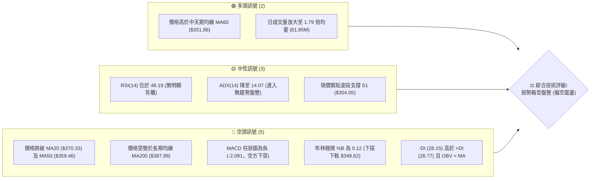
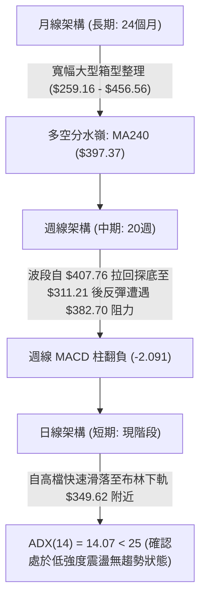
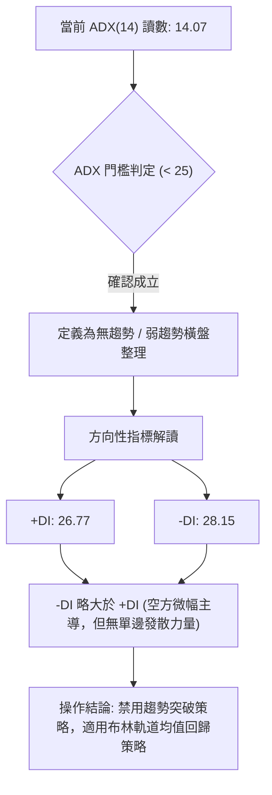
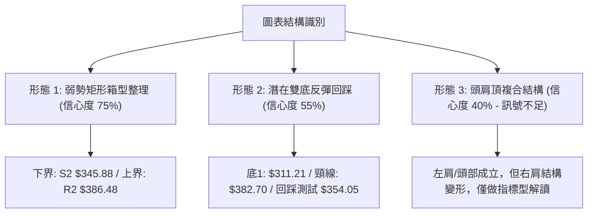
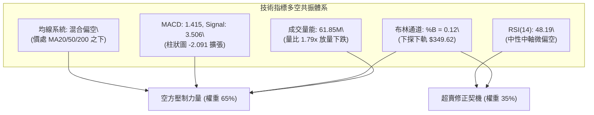
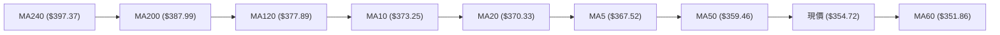
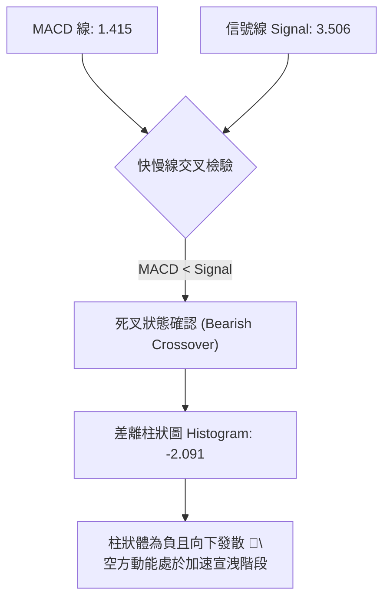
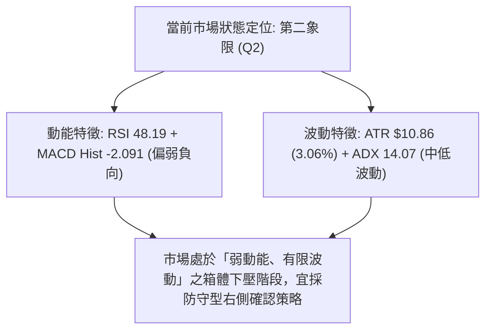
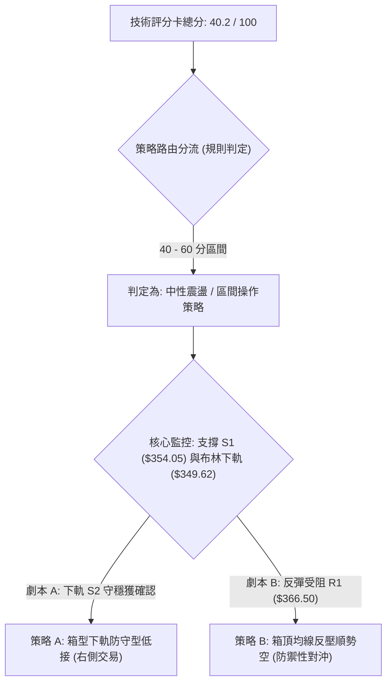
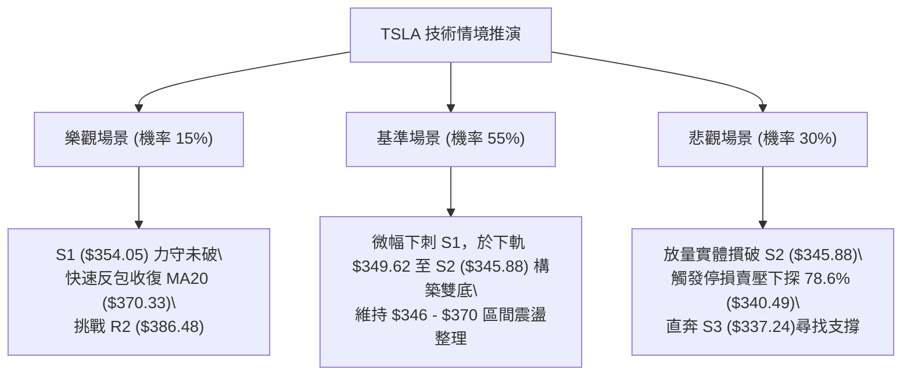

# TSLA 技術分析報告

> **報告日期**：2026-10-17 ｜ **語言**：繁體中文 ｜ **數據來源**：Yahoo Finance ｜ **當前價格**：$354.72

---

## 目錄

| 章節 | 內容 |
|------|------|
| [1. 技術面概覽](#1-技術面概覽) | 訊號儀表板、核心指標、評分卡 |
| [2. 趨勢分析](#2-趨勢分析) | 多時框趨勢、長中短期走勢、ADX強弱 |
| [3. 圖表形態分析](#3-圖表形態分析) | 形態識別、K線組合、目標價推算 |
| [4. 支撐與阻力](#4-支撐與阻力) | 關鍵價位結構、斐波那契回調深度解讀 |
| [5. 技術指標深度解讀](#5-技術指標深度解讀) | MA/RSI/MACD/布林通道/量價配合 |
| [6. 動能與波動率](#6-動能與波動率) | 動能四象限、ATR波動度、Beta相關性 |
| [7. 多時框架總結](#7-多時框架總結) | 時框架評分矩陣、多時框收斂規則結論 |
| [8. 交易策略建議](#8-交易策略建議) | 策略路由、價格情境階梯、進出場規劃 |
| [9. 風險提示與監控](#9-風險提示與監控) | 關鍵指標清單、三情境壓力測試、風控規則 |

---

## 1. 技術面概覽

### 🎯 技術訊號儀表板



### 📊 核心指標速覽表

| 指標類別 | 指標名稱 | 當前數值 | 訊號 | 專業技術解讀 |
|----------|----------|----------|------|--------------|
| **價格** | 當前收盤價 | $354.72 | 🔴 | 位於52週區間28.5%分位，短期空方動能壓制 |
| **均線** | MA20 (短中) | $370.33 | 🔴 | 現價低於MA20達-4.22%，下彎形成近端動態反壓 |
| **均線** | MA50 (中期) | $359.46 | 🔴 | 現價失守MA50，中期多頭結構遭遇實質破壞 |
| **均線** | MA200 (長期) | $387.99 | 🔴 | 現價落於年線之下-8.58%，長期架構處於修正週期 |
| **動能** | RSI(14) | 48.19 | 🟡 | 位於50中軸下方，多空動能處於均衡偏弱格局 |
| **動能** | MACD (12,26,9) | 1.415 (Hist: -2.091) | 🔴 | 快慢線死叉開口放大，空方柱狀體持續擴展 |
| **趨勢** | ADX(14) | 14.07 | 🟡 | ADX < 25 指標處於低位，表明非單邊趨勢，屬盤整行情 |
| **通道** | 布林通道 %B | 0.12 | 🔴 | 貼近布林下軌 $349.62，超賣擠壓但尚未出現帶量反轉 |
| **成交量** | 量比 (Volume Ratio) | 1.79x | 🟡 | 爆量61.85M下挫，空頭釋放流動性，OBV低於均線弱勢 |
| **波動** | ATR(14) | $10.86 (3.06%) | 🟡 | 波動率處於中等水準，單日平均波動區間約$10.86美元 |

### 🏆 技術評分卡

```
╔══════════════════════════════════════════════════════════════════╗
║              技術指標綜合評分卡 — TSLA (2026-10-17)              ║
╠══════════════════════════════════════════════════════════════════╣
║ 趨勢強度 (Trend)      ████░░░░░░░░░░░░░░░░  25/100 🔴 空頭佔優   ║
║ 動能指標 (Momentum)   ████████░░░░░░░░░░░░  40/100 🔴 偏弱動能   ║
║ 支撐穩定度 (Support)  ██████████░░░░░░░░░░  52/100 🟡 考驗S1關鍵 ║
║ 成交量配合 (Volume)   ████████░░░░░░░░░░░░  42/100 🔴 量增價跌   ║
║ 形態完整度 (Pattern)  ██████████░░░░░░░░░░  50/100 🟡 箱型震盪   ║
║ 均線系統 (Moving Avg) ██████░░░░░░░░░░░░░░  32/100 🔴 混合偏空   ║
╠══════════════════════════════════════════════════════════════════╣
║ 綜合技術評分          ████████░░░░░░░░░░░░  40.2/100 🟡 中性偏弱 ║
║ 評級結論              【區間震盪 / 箱型下軌防守測試】             ║
╚══════════════════════════════════════════════════════════════════╝
```

---

## 2. 趨勢分析

### 🌐 多時框趨勢分析



### 📈 長期趨勢 — 12個月走勢圖（Unicode）

以下為 TSLA 自 2025 年 11 月至 2026 年 10 月之月線收盤價走勢圖（縱軸區間 $300 - $460）：

```
TSLA 月線走勢圖（過去12個月收盤價變動軌跡）
價格 ($)
$460 ┤               
$440 ┤●(11月:430.17) ●(12月:449.72)                 ●(5月:435.79)
$420 ┤          ●(1月:430.41)                     ●(6月:420.60)
$400 ┤                   ●(2月:402.51)
$380 ┤                            ●(4月:381.63)
$360 ┤                                                    ●(8月:367.95)
$354 ┤━━━━━━━━━━━━━━━━━━━━━━━━━━━━━━━━━━━━━━━━━━━━━━━━━━━━●(10月現價:354.72)
$340 ┤                                      ●(9月:354.81)
$320 ┤                      ●(3月:371.75)
$300 ┤                                           ●(7月低點:311.21)
     └───────────────────────────────────────────────────────────►
       N    D    J    F    M    A    M    J    J    A    S    O  (月份)
      (25) (25) (26) (26) (26) (26) (26) (26) (26) (26) (26) (26)
```

#### 走勢特徵分析表格

| 週期階段 | 起訖月份 | 價格變動 | 區間漲跌幅 | 主要技術特徵與結構 |
|----------|----------|----------|------------|--------------------|
| 高檔盤整期 | 2025/11 - 2026/01 | $430.17 → $430.41 | +0.06% | 觸及波段高點聚類，在 $450 大關遇阻形成雙頂雛形 |
| 首波回撤期 | 2026/01 - 2026/03 | $430.41 → $371.75 | -13.63% | 連續三個月收陰，跌破短期上升趨勢線與 MA20 |
| 中期反彈期 | 2026/03 - 2026/05 | $371.75 → $435.79 | +17.23% | 多頭強力反撲，重新收復 $400，但未創新高形成次級高點 |
| 破位探底期 | 2026/05 - 2026/07 | $435.79 → $311.21 | -28.59% | 出現單月崩跌，7月收於 $311.21，逼近52週低點 $297.38 |
| 低檔修復期 | 2026/07 - 2026/08 | $311.21 → $367.95 | +18.23% | 築底反彈，帶動週線級別超賣修復，受阻於斐波那契61.8% |
| 收斂壓制期 | 2026/08 - 2026/10 | $367.95 → $354.72 | -3.60% | 均線糾纏，波幅收窄，連續兩月徘徊於 $354-$355 區間 |

### 📊 中期趨勢（週線分析）

從近 20 週的收盤價與動能軌跡來看：
- 2026-07-26 週跌至 $313.03，RSI 曾跌落至極度超賣的 15.7，隨後觸底反彈。
- 8 月中旬連續反彈推升 RSI 至 70.4 及 72.7 的超買區間（2026-08-23 收 $362.86）。
- 2026-10-11 週線上攻至 $382.70 後，受到下彎的 MA200 ($387.99) 及 R2 阻力 ($386.48) 強烈反壓，單週回撤至 2026-10-18 的 $354.72，單週收出長黑K，週 MACD 柱體再度下翻至 -2.091，確認中期處於「衝高回落後的區間二次探底」走勢。

```
週線波動區間示意圖
  $386.48 ───┬────────────────────────────────────────── 阻力位 R2 (波段回檔起跌點)
             │                 ▲ 2026-10-11 ($382.70)
  $370.33 ───┼─────────────── 突破失敗回落 ───────────── MA20 / 中軌反壓
  $354.72 ───┼──────────────── 現價 $354.72 ─────────── 測試支撐 S1 ($354.05)
  $345.88 ───┼────────────────────────────────────────── 核心防守支撐 S2
  $311.21 ───┴────────────────────────────────────────── 7月波段極值低點
```

### ⚡ 趨勢強度評估（ADX 解讀）



| 指標變數 | 當前數值 | 參考臨界值 | 狀態評定 | 市場含義解讀 |
|----------|----------|------------|----------|--------------|
| **ADX(14)** | 14.07 | 25.00 | 極弱趨勢 🟡 | 單邊趨勢動能匱乏，市場正處於多空籌碼重整的箱型拉鋸中 |
| **+DI (14)** | 26.77 | — | 多方佔比 🟡 | 多頭反撲力道未能形成連續優勢 |
| **-DI (14)** | 28.15 | — | 空方佔比 🔴 | 空方略高於多方 1.38 個點，賣方稍佔上風但尚未引發恐慌拋售 |
| **趨勢形態判定**| 橫向箱型 | ADX < 20 | 盤整行情 🟡 | 價格易於在布林帶上下軌及高低點支撐阻力之間來回震盪 |

---

## 3. 圖表形態分析

### 🔍 形態識別系統

依據形態學定義，對近 24 個月及近 20 週歷史走勢進行嚴格幾何圖形檢驗：



| 形態識別 | 信心度 | 判斷依據（嚴格引用數據） | 完成度 | 形態高度與目標價推算 |
|----------|--------|--------------------------|--------|----------------------|
| **箱型收斂區間** | **75%** | 價格受制於近一年波段高點 R2 ($386.48) 與波段低點 S2 ($345.88) 之間，近兩個月於 $354-$382 震盪 | 85% | 箱體高度 = $386.48 - $345.88 = $40.60。<br>向上突破目標：$386.48 + $40.60 = **$427.08**<br>向下跌破目標：$345.88 - $40.60 = **$305.28** |
| **雙底反彈回踩** | **55%** | 2026/07 低點 $311.21 形成初底，回升至 2026/10/11 的 $382.70 (頸線)，現拉回回踩 S1 ($354.05) | 60% | 頸線 = $382.70，底部 = $311.21，形態高度 = $71.49。<br>若 S1/S2 守住並確認突破頸線，理論目標價：$382.70 + $71.49 = **$454.19** |
| **頭肩頂形態** | **40%** | 數據不足以支撐幾何標準頭肩頂，訊號不足，僅做均線反壓之指標型解讀 | — | 訊號不足，依規則 15 不強行推算目標價 |

### 🕯️ 重要K線形態分析

| 觀測時點/月份 | 收盤價 | K線形態特徵 | 技術面解讀 | 多空訊號 |
|---------------|--------|-------------|------------|----------|
| **2026-07 月線** | $311.21 | 長黑摜壓破位帶下影線 | 空頭動能耗盡，測試 52W 低點 $297.38 前出現逢低承接買盤 | 🟡 止跌訊號 |
| **2026-08 月線** | $367.95 | 中長實體大陽線 | 多方報復性反彈，單月收復近 18%，確立 $311.21 為波段低點 | 🟢 強勢反轉 |
| **2026-09 月線** | $354.81 | 窄幅十字變盤線 | 衝高受阻於 MA200，多空於 $354 附近陷入僵局，動能趨緩 | 🟡 變盤觀望 |
| **2026-10-11 (週)** | $382.70 | 倒狀長上影線射擊之星 | 多方上攻波段高點聚類 R2 ($386.48) 遇阻，引發強烈解套賣壓 | 🔴 高檔受阻 |
| **2026-10-18 (週)** | $354.72 | 實體長陰吞噬K線 | 單週抹去前兩週漲幅，放量下殺收於最低點附近，空頭重掌主動權 | 🔴 空方吞噬 |

### 📉 ASCII 走勢形態示意圖

```
TSLA 走勢形態與箱型結構解析圖
價格 ($)
$386.48 ───────┬────────────────────────● (2026-10-11 高點: $382.70 假突破阻力區 R2)
               │                       / \
$370.33 ───────┼──────────────────────/───\───── MA20 反壓線 / 布林中軌
               │                     /     \
$354.72 ───────┼────────────────────/───────● (當前價格 $354.72，緊貼 S1)
$354.05 ───────┼───────────────────/─────────── 支撐位 S1
$345.88 ───────┼───● (2026-08起漲點)─────────── 關鍵強支撐 S2 (箱型下邊界)
               │  /
$311.21 ───────┴─● (2026-07波段極值底部)
```

---

## 4. 支撐與阻力

### 🗺️ 關鍵價位分布圖（Unicode）

```
╔════════════════════════════════════════════════════════════════════════════╗
║                   TSLA 關鍵價位結構分布圖 (由 OHLCV 聚類計算)               ║
╠════════════════════════════════════════════════════════════════════════════╣
║ $409.28 ║████████████████████████████████████║ 強阻力 R3 (波段重大高點聚類) ║
║ $386.48 ║████████████████████████            ║ 阻力位 R2 (近一年高點反壓)   ║
║ $374.33 ║▒▒▒▒▒▒▒▒▒▒▒▒▒▒▒▒▒▒▒▒▒▒▒▒            ║ 斐波那契 61.8% 重要壓力位    ║
║ $366.50 ║████████████████                    ║ 短線阻力 R1 (MA5 附近反壓)   ║
║ $354.72 ╠════════════════════════════════════╣ ◄── 現價 ($354.72)           ║
║ $354.05 ║▓▓▓▓▓▓▓▓▓▓▓▓▓▓▓▓▓▓▓▓                ║ 即時波段支撐 S1 (-0.19%)     ║
║ $345.88 ║████████████████████████            ║ 強支撐位 S2 (近一年低點聚類) ║
║ $340.49 ║▒▒▒▒▒▒▒▒▒▒▒▒▒▒▒▒▒▒▒▒▒▒▒▒▒▒          ║ 斐波那契 78.6% 回調關鍵支撐  ║
║ $337.24 ║████████████████████████████        ║ 極限防守支撐 S3 (-4.93%)     ║
╚════════════════════════════════════════════════════════════════════════════╝
```

### 🚧 阻力位分析表

所有價位均直接引用數據來源中「關鍵價位」區塊之波段高點聚類數值：

| 阻力級別 | 準確價位 | 距現價幅標 | 形成原因與技術共振 | 突破難度 | 重要性 |
|----------|----------|------------|--------------------|----------|--------|
| **R1** | **$366.50** | +3.32% | 短線波段高點聚類，與 MA5 ($367.52) 形成共振反壓區 | 🟡 中等 | 短線轉強第一關卡 |
| **R2** | **$386.48** | +8.95% | 近一年高點聚類，疊加 MA200 ($387.99) 及布林上軌 ($391.05) | 🔴 極高 | 中期牛熊多空分水嶺 |
| **R3** | **$409.28** | +15.38% | 歷史大型套牢平台，接近 2026/06 波段收盤高點 ($407.76) | 🔴 極高 | 長期格局反轉確立點 |

### 🛡️ 支撐位分析表

所有價位均直接引用數據來源中「關鍵價位」區塊之波段低點聚類數值：

| 支撐級別 | 準確價位 | 距現價幅標 | 形成原因與技術共振 | 守住機率 | 重要性 |
|----------|----------|------------|--------------------|----------|--------|
| **S1** | **$354.05** | -0.19% | 近期波段密集低點聚類，與現價差距僅 $0.67，第一道防線 | 🟡 55% | 當前即時多空焦點 |
| **S2** | **$345.88** | -2.49% | 近一年次級低點聚類，與布林下軌 ($349.62) 構成緩衝支撐帶 | 🟢 70% | 箱型下緣核心生命線 |
| **S3** | **$337.24** | -4.93% | 跌破 S2 後之最後防線，鄰近斐波那契 78.6% 回調位 ($340.49) | 🟢 85% | 中期空頭極限宣洩位 |

### 📐 斐波那契回調位分析

依據 52 週波動區間最高點 **$498.83** 下跌至最低點 **$297.38**（波幅 $201.45）計算之標準黃金分割比率數值：

```
斐波那契黃金分割分佈架構
0.0%  (52W High)  $498.83 ──────────────────────────────────
23.6%             $451.29 ──────────────────────────────────
38.2%             $421.88 ──────────────────────────────────
50.0%             $398.10 ────────────────────────────────── (中軸大關)
61.8%             $374.33 ────────────────────────────────── (黃金分割反壓)
                  ▲
                  │  【當前現價落點: $354.72 (處於 61.8% 與 78.6% 之間)】
                  ▼
78.6%             $340.49 ────────────────────────────────── (深度防守支撐)
100.0%(52W Low)   $297.38 ──────────────────────────────────
```

#### 斐波那契落點技術意義：
1. **現價位置定位**：現價 **$354.72** 處於 61.8% ($374.33) 與 78.6% ($340.49) 之間的弱勢拉回區間。
2. **反彈受阻解讀**：前次波段反彈高點 $382.70 略高於 61.8% 黃金回調位 ($374.33)，但未能有效站穩 50.0% 關鍵位 ($398.10)，表明反彈僅屬弱勢修正，非趨勢反轉。
3. **下檔防禦層次**：若 S1 ($354.05) 與 S2 ($345.88) 失守，下方的 78.6% 回調位 **$340.49** 將與 S3 ($337.24) 形成高強度雙重共振支撐區。

---

## 5. 技術指標深度解讀

### 🎛️ 指標訊號總覽



### 📈 移動平均線排列分析



#### 均線數據量化解構：
- **短天期反壓**：MA5 ($367.52) 與 MA10 ($373.25) 呈陡峭下彎態勢，短線斜率為負，對價格形成直接壓制。
- **生命線與季線**：MA20 ($370.33) 下穿 MA120，且現價落於 MA50 ($359.46) 之下 -1.32%，短中期均線形成蓋頭空頭排列。
- **長期年線**：MA200 位於 $387.99，現價負乖離達 -8.58%。
- **下檔唯一均線支撐**：僅 MA60 ($351.86) 仍位於現價下方 +0.81%，提供即時支撐緩衝。

### 📉 RSI(14) 分析

當前數值：**48.19**

```
RSI(14) 區間位置標定：
[0] ────────── [30:超賣] ────────── [48.19:現值] ─── [50:中軸] ────────── [70:超買] ────────── [100]
▓▓▓▓▓▓▓▓▓▓▓▓▓▓▓▓▓▓▓▓▓▓▓▓▓▓▓▓▓▓▓▓▓▓▓▓▓▓▓░░░░░░░░░░░░░░░░░░░░░░░░░░░░░░░░░░░░░░░░░░░░░░░░ (48.19%)
```

- **區間判斷**：RSI 處於 30–70 中性區間，目前跌破 50 多空中軸（48.19），顯示空方力量已微幅取得主控權。
- **背離檢驗**：
  - 價格自 2026-10-11 的 $382.70 回落至 $354.72，RSI 相應由 55.0 下滑至 48.19。
  - 檢視週線波段，未出現價格創新低而 RSI 抬高（底背離），亦未見價格創新高而 RSI 降低（頂背離）。
  - **結論：當前 RSI 無明顯背離現象**，指標真實反映短線價格回調動能。

### 📊 MACD(12/26/9) 訊號解讀



- **絕對數值分析**：MACD (1.415) 與 Signal (3.506) 雖仍處於零軸上方，但快線急劇下拐摜破信號線。
- **柱狀體動態**：週 MACD Histogram 由 2026-10-11 的 +1.070 急劇反轉為當前的 **-2.091**，動能落差達 -3.161，確認短線出現結構性下殺，空頭掌握動能優勢。

### 📦 布林通道分析

當前布林參數（20, 2）：
- **上軌 (Upper Band)**：$391.05
- **中軌 (Middle Band / MA20)**：$370.33
- **下軌 (Lower Band)**：$349.62
- **帶寬度 (Bandwidth)**：$391.05 - $349.62 = $41.43 (相對現價約 11.68%)
- **通道位置指標 %B**：**0.12**

```
布林通道現前結構圖 (價格與軌道相對位置)
$391.05 ┬────────────────────────────────────────── 上軌 (Upper Band)
        │
$370.33 ┼────────────────────────────────────────── 中軌 (MA20 / 多空分水嶺)
        │
$354.72 ┼─────────────── 現價 ($354.72, %B = 0.12)
$349.62 ┴────────────────────────────────────────── 下軌 (Lower Band)
```

- **通道行為解讀**：%B 數值為 **0.12**，代表價格已緊貼布林通道下軌（0 代表下軌，$349.62）。
- 在 ADX = 14.07 的盤整背景下，%B 接近 0.10 通常代表短線動能過度宣洩，若未伴隨開口持續放大跌破下軌，容易在 **$349.62 - $354.05** 區間引發技術性乖離修復反彈。

### 💹 成交量分析（量價配合度）


- **成交量異動**：最新單日成交量高達 6,185.5 萬股，較 20 日均量 (3,446.2 萬股) 放大達 **1.79 倍**。
- **量價背離檢視**：在大幅下跌之際放量，跌破短期均線，屬於典型的「放量下挫」空頭形態；疊加 OBV 趨勢持續低於其移動平均線，證實主力資金在此波回調中未見積極左側護盤進場跡象，量能結構支持防守而非追價。

---

## 6. 動能與波動率

### ⚡ 動能評估四象限

根據「動能強度（以 MACD 柱狀與 RSI 為基準）」與「波動率（以 ATR 與布林帶寬為基準）」之二維模型評估：

| 象限 | 動能維度 | 波動維度 | 當前特徵對應 | 策略評估 |
|------|----------|----------|--------------|----------|
| **第一象限 (Q1)** | 強多頭動能 | 低/中波動 | 不符合 | 最佳主動進攻機會 |
| **第二象限 (Q2)** | 弱動能/負動能 | 低/中波動 | **符合 (✓)** | **謹慎觀望，著重區間下軌防禦** |
| **第三象限 (Q3)** | 強動能 (單邊發散) | 高波動 | 不符合 | 順勢突破高風險高收益 |
| **第四象限 (Q4)** | 極端衰竭動能 | 極高波動 | 不符合 | 恐慌崩跌，嚴禁盲目摸底 |



### 📊 ATR 波動率分析

- **ATR(14) 絕對值**：**$10.86**
- **波動百分比**：占現價比率為 **3.06%**
- **日間真實波動範圍解讀**：TSLA 單日理論常態波動區間約為上下 $10.86 美元。
  - 當日波動區間上限預估：$354.72 + $10.86 = **$365.58**（緊貼阻力 R1 $366.50）
  - 當日波動區間下限預估：$354.72 - $10.86 = **$343.86**（跌破 S2 $345.88 測試緩衝區）
- **止損距離設計建議**：
  - 短線波段止損乘數：**1.5 × ATR** = 1.5 × $10.86 = **$16.29**
  - 保守緊密止損乘數：**1.0 × ATR** = 1.0 × $10.86 = **$10.86**

### 📐 Beta 與市場相關性

- **Beta 係數**：**1.916**
- **市場特徵解讀**：
  - TSLA 屬於典型的「高 Beta 成長型/週期性權值股」，其波動敏感度為 S&P 500 大盤的 **1.916 倍**。
  - 當美股大盤指數波動 1% 時，TSLA 歷史平均波動幅度約為 1.92%。
  - **避險警示**：高 Beta 特性意味著在盤整偏弱格局下，大盤若出現系統性回檔，TSLA 跌幅將被顯著放大，因此下檔支撐 S2 ($345.88) 的防守有效性高度仰賴整體市場宏觀流動性之配合。

---

## 7. 多時框架總結

### 📋 時框架評分表

| 時框架 | 趨勢方向 | 動能狀態 | 均線排列狀況 | 關鍵形態特徵 | 綜合評分 | 戰術建議 |
|--------|----------|----------|--------------|--------------|----------|----------|
| **月線 (長期)** | 震盪偏多 🟡 | 減弱中 🟡 | 價格處 MA240 之上 | $259 - $456 寬幅大箱型 | **55/100** | 逢低分批佈局，不追高 |
| **週線 (中期)** | 區間修正 🔴 | 翻負下行 🔴 | 受制於 MA200 下彎 | 觸及 $382.70 後收長陰吞噬 | **38/100** | 耐心等待底部共振確立 |
| **日線 (短期)** | 弱勢下探 🔴 | 貼近超賣 🟡 | 跌破短均，僅存 MA60 支撐 | 貼近布林下軌測試 S1 ($354.05) | **35/100** | 嚴禁搶短，觀望為主 |

### 🔲 綜合訊號矩陣

```
時框與指標訊號共振矩陣
┌──────────────┬──────────────┬──────────────┬──────────────┐
│  分析維度    │  短期 (日線) │  中期 (週線) │  長期 (月線) │
├──────────────┼──────────────┼──────────────┼──────────────┤
│ 均線系統     │  🔴 空頭排列 │  🔴 承壓年線 │  🟢 處均線上 │
│ 動能指標     │  🔴 MACD向下 │  🔴 柱狀擴大 │  🟡 RSI 中性 │
│ 支撐阻力     │  🟡 測試 S1  │  🟡 震盪中軸 │  🟢 距低點遠 │
│ 波動結構     │  🟡 %B=0.12  │  🔴 週長黑K  │  🟡 波動收斂 │
├──────────────┼──────────────┼──────────────┼──────────────┤
│ 維度整合結論 │  弱勢下探    │  回踩測試    │  大箱型整理  │
└──────────────┴──────────────┴──────────────┴──────────────┘
```

### ⚖️ 多時框收斂結論

> **依據「多時框收斂規則（規則 14）」判定：**
> 1. **趨勢強度定性**：當前 ADX(14) 讀數為 **14.07 (< 25)**，明確確認當前市場處於**「無單邊強烈趨勢之盤整行情」**。
> 2. **主導維度依歸**：在盤整行情下，市場交易主軸**以日線布林通道（上軌 $391.05 / 下軌 $349.62）及關鍵支撐阻力結構為主要交易區間**。
> 3. **收斂唯一方向結論**：**【中性觀望，區間偏弱下探】**。雖然長期月線維持大箱型格局，但日線與週線動能同步下拐，價格正向布林下軌 $349.62 與強支撐 S2 $345.88 尋求實質支撐，在未出現放量止跌K線之前，不具備主動發起多頭進攻的條件。

---

## 8. 交易策略建議

### 🗺️ 策略決策流程圖



### 🧭 策略路由說明

- **當前技術評分**：**40.2 / 100（落於 40–60 之中性震盪區間）**。
- **當前主策略方向**：**【中性區間震盪交易（Range-Bound Trading），以布林通道下軌與 S2 為防守依據，嚴格等待右側企穩訊號】**。
- 不進行單邊激進追多或追空，策略重心置於箱體上下軌之邊界效益。

### 🎯 價格情境階梯（Price Scenarios）

所有價位精確引用本報告第 4 章由 OHLCV 聚類計算之標準關鍵數值：

| 觸發條件 (Trigger) | 下一目標 (Next Target) | 後續延伸 (Extension) | 情境技術含義 |
|--------------------|------------------------|----------------------|--------------|
| **強勢突破 R1 $366.50** | **R2 $386.48** | **R3 $409.28** | 短線擺脫下下軌壓制，重新挑戰年線多空分水嶺 |
| **收復中軌 MA20 $370.33** | **斐波 61.8% $374.33** | **布林上軌 $391.05** | 日線級別確立止跌，重啟箱型中軌至上軌之擺動 |
| **守穩現價與 S1 $354.05** | **MA5 $367.52** | **R1 $366.50** | 即時超賣微幅反彈，屬弱勢技術性修正 |
| **跌破 S1 $354.05** | **強支撐 S2 $345.88** | **布林下軌 $349.62** | 探底尋求中期買盤承接，回踩關鍵支撐帶 |
| **實體跌破 S2 $345.88** | **斐波 78.6% $340.49** | **極限支撐 S3 $337.24**| 宣告箱型結構破位，空方動能向下發散 |

### 📊 情境機率分佈

| 運行情境 | 發生機率 | 主要技術與指標依據 |
|----------|----------|--------------------|
| **情境一：區間下軌震盪築底** | **55%** | ADX 僅 14.07 壓制單邊趨勢形成；布林 %B 達 0.12 接近超賣下軌，S2 ($345.88) 歷史支撐密集度高 |
| **情境二：慣性下破，探底深測** | **30%** | 最新日成交量放大 1.79 倍下殺，MACD 負向柱體 (-2.091) 擴張，且 OBV 低於均線，空方短線氣勢盛 |
| **情境三：強勢 V 型報復反彈** | **15%** | 上方短期均線 MA5/10/20 呈現負斜率密集反壓，在未經橫盤籌碼換手前，難以直接發動實體大陽線貫穿 |

### 🟢 主策略詳情（區間操作分流）

本報告根據嚴格風控邏輯，提供兩套在區間內高勝率之交易策略：

| 策略要素 | 策略 A（多頭：下軌支撐低接） | 策略 B（空頭/對沖：反彈遇阻放空） |
|----------|------------------------------|------------------------------------|
| **適用情境** | 測試布林下軌及 S2 止跌獲確認 | 反彈至短期阻力 R1 無力突破 |
| **進場條件** | 價格下探觸及 $346.00-$349.62 區間，且日K收出下影線或 RSI 出現拐點 | 價格反彈至 $366.50 (R1) 附近出現上影線或跌破小時線 MA20 |
| **精確進場點** | **$347.50** (位於 S2 $345.88 與下軌間) | **$366.00** (緊貼阻力 R1 $366.50 下方) |
| **第一目標價 T1** | **$366.50** (阻力 R1) | **$354.05** (支撐 S1) |
| **第二目標價 T2** | **$370.33** (布林中軌 MA20) | **$345.88** (強支撐 S2) |
| **精確止損點** | **$339.50** (有效跌破斐波 78.6% $340.49) | **$371.50** (有效站上中軌 MA20 $370.33) |
| **止損空間** | $347.50 - $339.50 = $8.00 | $371.50 - $366.00 = $5.50 |
| **獲利空間 (T2)**| $370.33 - $347.50 = $22.83 | $366.00 - $345.88 = $20.12 |
| **風險報酬比 (R/R)**| **1 : 2.85** | **1 : 3.66** |
| **評估勝率** | 58% | 52% |
| **建議配置倉位** | **10% - 15% (輕倉防守)** | **10% (純對沖倉位)** |

### 🔴 反向風險觸發點（對沖提示）

- **多頭全面棄守點**：若日線收盤價**實體跌破 $340.49（斐波那契 78.6% 回調位）**，宣告本次反彈架構徹底瓦解，極可能進一步下探 S3 ($337.24) 乃至 52 週最低點 $297.38，多頭投資人必須無條件停損出場或佈建看空期權。
- **空頭全面平倉點**：若價格以帶量實體長紅突破 **$386.48 (R2)** 並收復 MA200，空方趨勢將被直接逆轉，空頭策略必須立即離場避險。

### ⭐ 整體訊號強度評星

```
╔══════════════════════════════════════════════════════════════╗
║                    整體技術訊號評星標準                      ║
╠══════════════════════════════════════════════════════════════╣
║ 做多訊號強度：  ★★☆☆☆  (2.2 / 5星 — 處下軌但缺乏多頭確認)  ║
║ 做空訊號強度：  ★★★☆☆  (3.4 / 5星 — 短線受阻，動能偏空)    ║
║ 整體技術可信度：★★★★☆  (4.0 / 5星 — 關鍵點位與通道高度重合)║
╚══════════════════════════════════════════════════════════════╝
```

---

## 9. 風險提示與監控

### ✅ 關鍵監控指標 Checklist

```
╔══════════════════════════════════════════════════════════════════════════╗
║                     TSLA 盤中與每日關鍵監控 Checklist                    ║
╠══════════════════════════════════════════════════════════════════════════╣
║ [ ] 價位維度：收盤價是否跌破第一道防線 S1 ($354.05)                     ║
║ [ ] 價位維度：核心強支撐 S2 ($345.88) 是否出現實體大陰線摜破            ║
║ [ ] 通道維度：布林通道 %B 是否自 0.12 跌破 0.00 (價格脫離下軌 $349.62)   ║
║ [ ] 動能維度：MACD 柱狀體 (-2.091) 是否開始縮減收斂 (底背離初期跡象)     ║
║ [ ] 動能維度：RSI(14) 能否在 40 水準止跌回升，避免滑入 30 極端弱勢區    ║
║ [ ] 量能維度：成交量能否由 61.85M 萎縮至 34.46M (20日均量) 以下確認洗盤  ║
║ [ ] 趨勢維度：ADX(14) 讀數是否自 14.07 抬頭向上突破 20，觸發單邊動能   ║
╚══════════════════════════════════════════════════════════════════════════╝
```

### ⚠️ 風險場景分析



### 🛡️ 風險管理重要提醒

1. **嚴控個股暴險倉位**：鑒於 TSLA 具有高達 **1.916 之高 Beta 值**，且目前處於中期均線（MA20/50/200）壓制之下，個股資金配置上限建議控制在總投資組合之 **10% - 15%** 以內，切忌於震盪盤中以大部位融資槓桿摸底。
2. **ATR 動態風控原則**：目前 TSLA 之 ATR(14) 為 **$10.86 (3.06%)**，單日潛在波動空間大。在進場點設置止損時，必須預留至少 **1.2 至 1.5 倍 ATR（約 $13.00 - $16.30）** 之緩衝空間，避免因盤中正常的均線洗盤噪聲而被非理性掃損。
3. **區間破位風控紀律**：當前市場定性為 ADX < 25 之盤整行情。盤整行情的致命風險在於「箱體下邊緣破位引發趨勢啟動」。因此，若 **S2 ($345.88)** 被帶量實體擊穿，必須立即將「區間震盪思維」切換為「單邊空頭防守思維」，絕對不可在 S2 跌破後持續向下盲目攤平成本。

---

## 📋 報告總結

```
╔══════════════════════════════════════════════════════════════════════════╗
║                          TSLA 技術分析報告總結                           ║
╠══════════════════════════════════════════════════════════════════════════╣
║ 報告日期：2026-10-17          當前價格：$354.72                          ║
║ 分析評級：⚖️ 中性偏弱 / 區間下緣測試 (評分: 40.2 / 100)                  ║
╠══════════════════════════════════════════════════════════════════════════╣
║ 關鍵技術維度結論：                                                       ║
║ ├─ 長期趨勢 (月線)：🟡 中性大箱型 ($259.16 - $456.56)，處於長期收斂中軸 ║
║ ├─ 中期趨勢 (週線)：🔴 偏弱修正，上衝 $382.70 受阻於 MA200 引發長黑吞噬 ║
║ ├─ 短期趨勢 (日線)：🔴 偏空下探，跌破 MA20/MA50，貼近布林下軌 (%B=0.12) ║
║ ├─ 關鍵核心支撐：  S1: $354.05  ｜  S2: $345.88  ｜  S3: $337.24        ║
║ ├─ 關鍵核心阻力：  R1: $366.50  ｜  R2: $386.48  ｜  R3: $409.28        ║
║ └─ 華爾街共識目標：$397.83 (38位分析師，覆蓋區間 $128.11 - $600.00)     ║
╠══════════════════════════════════════════════════════════════════════════╣
║ 最優交易策略組合：                                                       ║
║ 1. 🥇 最佳機會 (低接防禦)：等待回踩 S2 $345.88 與下軌 $349.62 區間，     ║
║                          確認縮量止跌後佈局策略 A，目標看至 MA20 $370.33 ║
║ 2. 🥈 次選機會 (反彈避險)：若價格弱勢反彈至 R1 $366.50 遭遇阻力滯漲，   ║
║                          可建立策略 B 避險空單，止損設於 $371.50         ║
║ 3. 🥉 保守選擇 (空倉觀望)：ADX 僅 14.07 顯示趨勢不明，穩健投資人應待價格 ║
║                          重新站穩 MA20 ($370.33) 或跌出極端超賣再行介入  ║
╚══════════════════════════════════════════════════════════════════════════╝
```

---

> ⚠️ **免責聲明**：本報告由資深技術分析模型基於客觀市場歷史數據自動生成，所有分析數值、圖表形態與策略規劃僅供學術研究與投資策略參考，**不構成任何形式的個別投資邀約或法律建議**。金融市場具有高度不確定性與波動風險，投資人應獨立評估自身財務承受能力與風控邊界，自負盈虧責任。

---

*報告生成時間：2026-10-17 ｜ 數據來源：Yahoo Finance ｜ 分析框架：多時框技術分析體系 (CFA Level III Standards)*