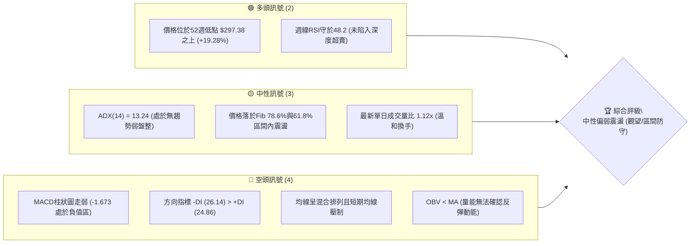
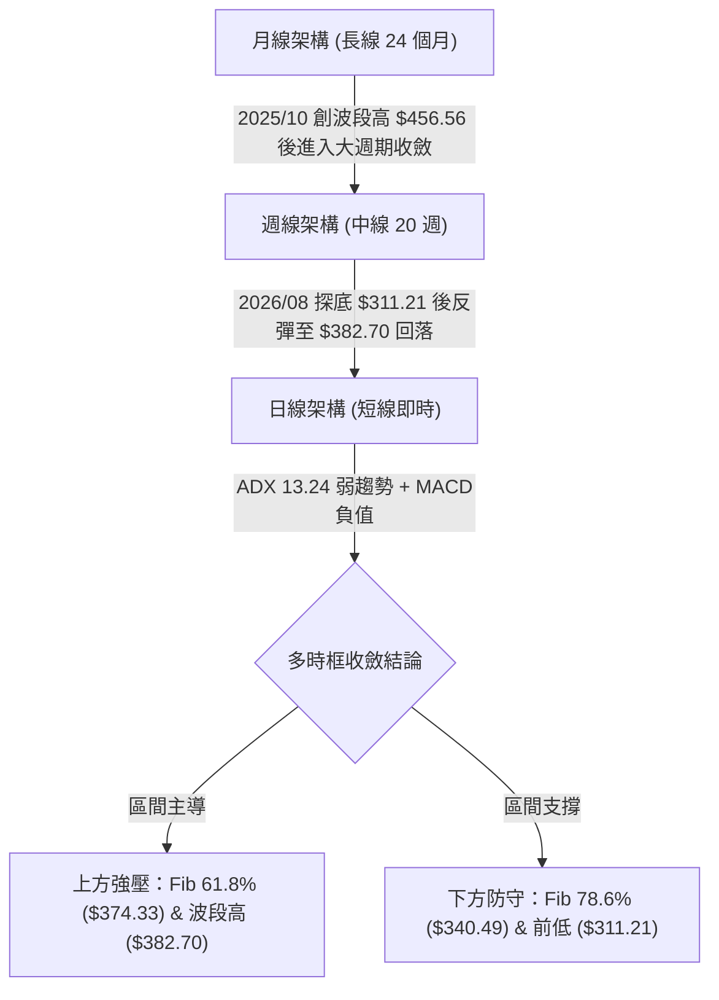
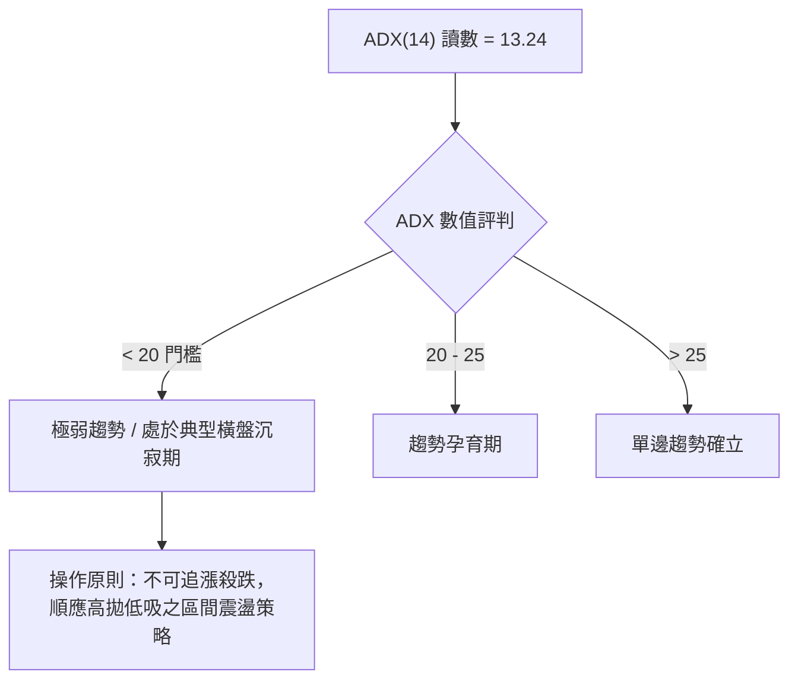
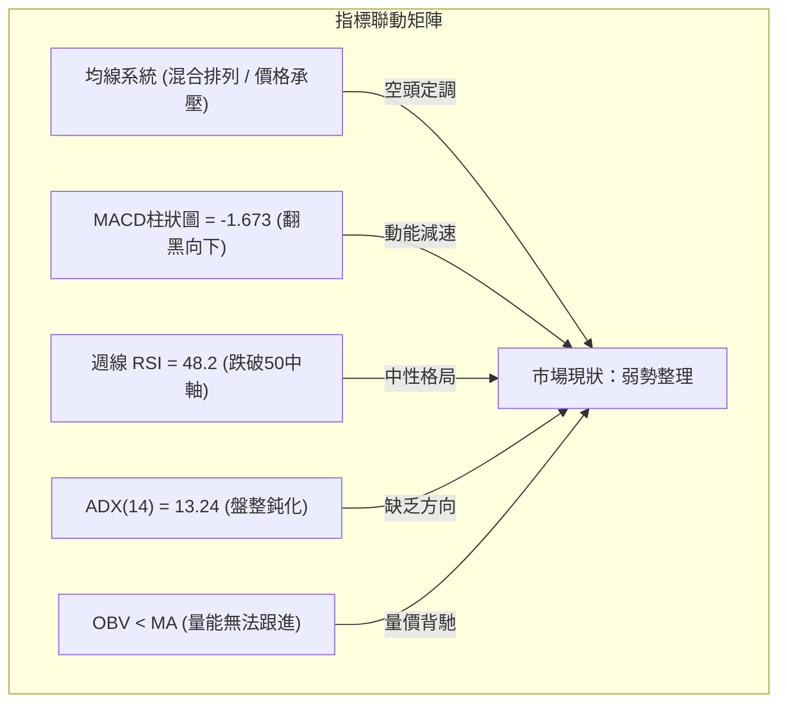
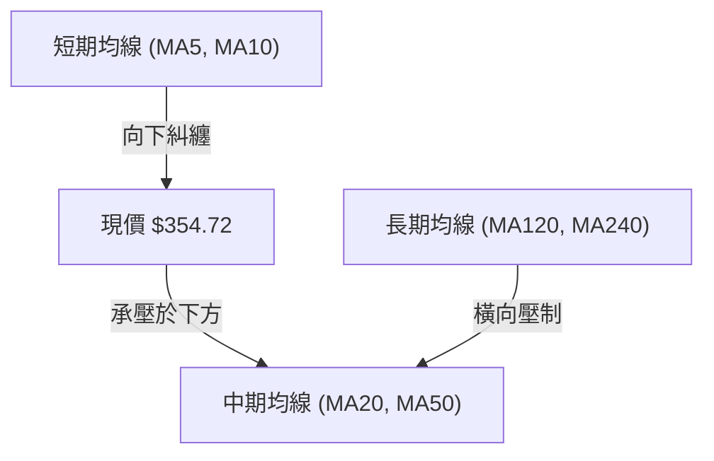
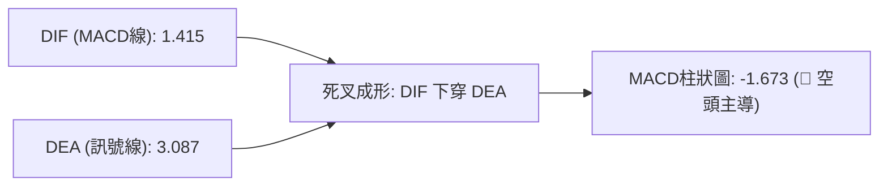
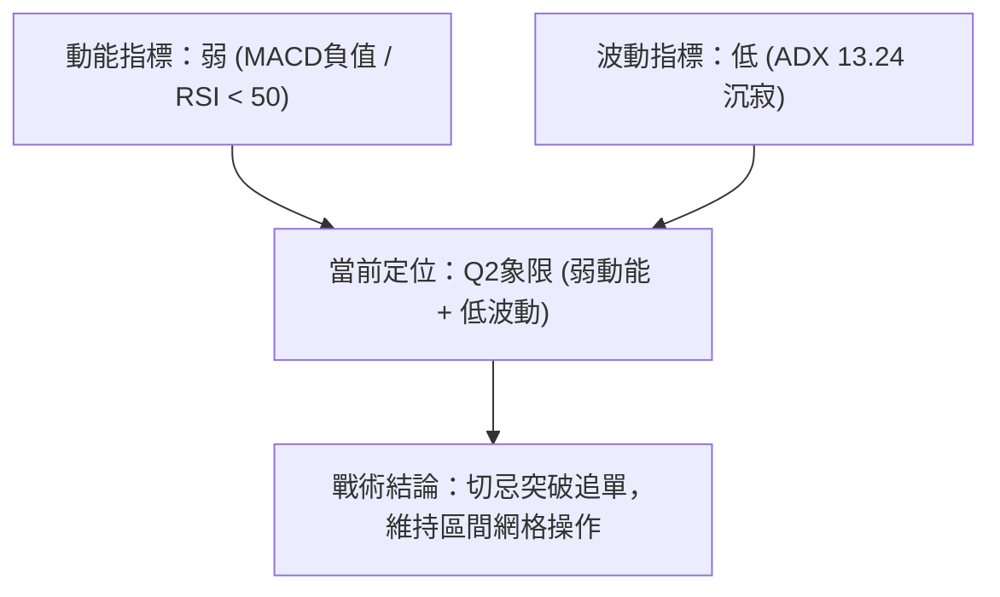
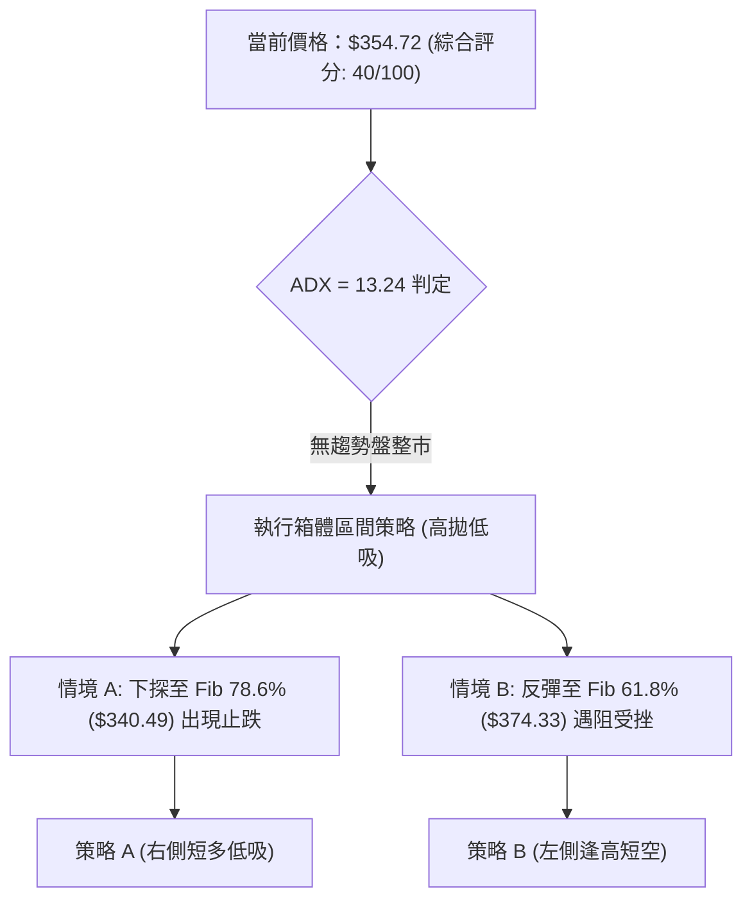
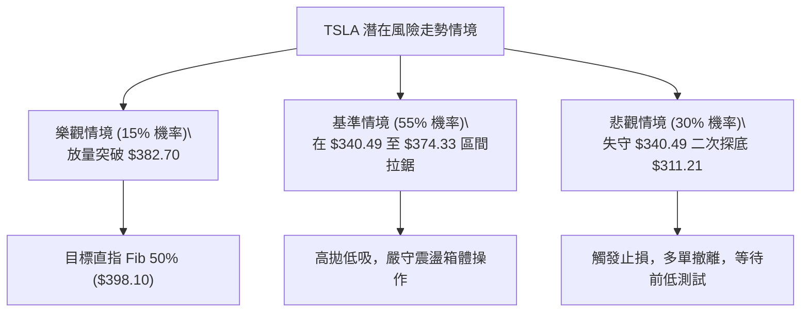

# TSLA 技術分析報告

> **報告日期**：2026-10-20 ｜ **語言**：繁體中文 ｜ **數據來源**：Yahoo Finance ｜ **當前價格**：$354.72

---

## 目錄

| 章節 | 內容 |
|------|------|
| [1. 技術面概覽](#1-技術面概覽) | 訊號儀表板、核心指標、評分卡 |
| [2. 趨勢分析](#2-趨勢分析) | 多時框趨勢、長中短期走勢、ADX強度 |
| [3. 圖表形態分析](#3-圖表形態分析) | 形態識別、K線組合、目標價推算 |
| [4. 支撐與阻力](#4-支撐與阻力) | 關鍵價位、斐波那契回調結構 |
| [5. 技術指標深度解讀](#5-技術指標深度解讀) | 均線系統、RSI、MACD、布林通道與成交量 |
| [6. 動能與波動率](#6-動能與波動率) | 動能四象限、ATR波動分析、Beta風險 |
| [7. 多時框架總結](#7-多時框架總結) | 時框架矩陣與多時框收斂方向 |
| [8. 交易策略建議](#8-交易策略建議) | 策略路由、主策略劇本、風報比與停損規劃 |
| [9. 風險提示與監控](#9-風險提示與監控) | 監控指標Checklist、風險情境與資金管理 |
| [📋 報告總結](#-報告總結) | 核心結論與最優策略執行清單 |

---

## 1. 技術面概覽

### 🎯 技術訊號儀表板

依據當前技術數據整合，日線與週線多空訊號呈現分歧震盪格局，總體偏向中性偏弱震盪。



---

### 📊 核心指標速覽表

| 指標類別 | 指標名稱 | 當前數值 | 訊號 | 解讀 |
|:---|:---|:---:|:---:|:---|
| **價格** | 最新收盤價 | $354.72 | 🟡 | 位於52週區間 28.46% 分位，處於中底位整理 |
| **均線** | 短期MA走勢 | 混合排列 | 🔴 | 日線MA20/MA50位於價格上方形成動態壓制 |
| **均線** | 長期MA趨勢 | 混合排列 | 🟡 | 60/120/240均線走平，未見單邊多頭排列 |
| **動能** | RSI(14) | 48.2 (週) | 🟡 | 處於40–60中性平衡區，無明顯頂底背離 |
| **動能** | MACD(12,26,9) | Hist -1.673 | 🔴 | 快線 1.415 < 慢線 3.087，柱狀體維持負值下行 |
| **趨勢強度**| ADX(14) | 13.24 | 🟡 | 遠低於 25 臨界值，確認市場為典型無趨勢盤整行情 |
| **方向指標**| +DI / -DI | 24.86 / 26.14 | 🔴 | -DI 大於 +DI，空頭力量邊際佔優但未形成突破 |
| **量能** | OBV 趨勢 | OBV < MA | 🔴 | 資金進場意願疲軟，量能未確認反彈有效性 |

---

### 🏆 技術評分卡

```
╔══════════════════════════════════════════════════════════════╗
║              TSLA 技術評分卡 (2026-10-20)                     ║
╠══════════════════════════════════════════════════════════════╣
║ 趨勢強度 (Trend)     ████░░░░░░░░░░░░░░░░  25/100 🔴 盤整無主升║
║ 動能指標 (Momentum)  ███████░░░░░░░░░░░░░  35/100 🔴 MACD翻黑 ║
║ 支撐穩定度 (Support) ████████████░░░░░░░░  60/100 🟡 Fib 78.6%║
║ 成交量配合 (Volume)  ████████░░░░░░░░░░░░  40/100 🔴 OBV疲軟  ║
║ 形態完整度 (Pattern) ██████████░░░░░░░░░░  50/100 🟡 區間箱體 ║
║ 均線架構 (Moving Av) ██████░░░░░░░░░░░░░░  30/100 🔴 壓制明顯 ║
╠══════════════════════════════════════════════════════════════╣
║ 綜合評分             ████████░░░░░░░░░░░░  40/100 🟡 中性偏弱 ║
║ 投資評級             【 中性觀望 / 區間下緣防守操作 】         ║
╚══════════════════════════════════════════════════════════════╝
```

---

## 2. 趨勢分析

### 🌐 多時框趨勢分析

根據「嚴格要求 14」之多時框收斂原則，當前日線 ADX 為 **13.24**（低於 25），確定當前整體環境為**無趨勢之寬幅震盪市場**。分析優先級以震盪區間關鍵邊界為主導，日線結構作為區間內進出場之擇時確認。



---

### 📈 長期趨勢 — 12個月走勢圖（Unicode）

以下為 TSLA 自 2025 年 11 月至 2026 年 10 月之月線收盤價歷史走勢圖：

```
TSLA 月線走勢圖（過去12個月歷史）
價格軸 ($)
$460 ┤             
$440 ┤ ●   ●   ●                                 
$420 ┤             ●                       ●   ● 
$400 ┤                 ●                         
$380 ┤                     ●   ●                 
$360 ┤                                             ●   ●(現價: 354.72)
$340 ┤                                         
$320 ┤                                     ●(26/07低點)
$300 ┤                                           
     └─┬───┬───┬───┬───┬───┬───┬───┬───┬───┬───┬───┬───► 月份
      11  12  01  02  03  04  05  06  07  08  09  10
    (2025)             (2026)
```

#### 走勢特徵分析表格

| 階段區間 | 月收盤價變動 | 區間漲跌幅 | 主要走勢特徵 |
|:---|:---:|:---:|:---|
| **2025/11 – 2026/01** | $430.17 ➔ $430.41 | +0.06% | 高檔橫盤滯漲，多頭動能逐步衰竭，形成雙重頂部架構 |
| **2026/02 – 2026/03** | $402.51 ➔ $371.75 | -7.64% | 破位下行，自高檔快速釋放估值壓力 |
| **2026/04 – 2026/05** | $381.63 ➔ $435.79 | +14.19%| 假突破反彈，受阻於前期平台高點 $440 附近 |
| **2026/06 – 2026/07** | $420.60 ➔ $311.21 | -26.01%| 放量長黑急跌，回測全年度底部支撐帶 |
| **2026/08 – 2026/10** | $367.95 ➔ $354.72 | -3.60% | 弱勢反彈受阻後轉為箱型震盪，最新收於 $354.72 |

---

### 📊 中期趨勢（週線分析）

中期技術面觀察，近 20 週價格呈現「急跌後弱反彈」走勢。2026 年 7 月 26 日當週觸及超賣低點 $313.03（RSI 跌至 15.7 歷史極值），隨後在 8 月 2 日確認 $311.21 之底部，展開為期約 10 週的修復反彈波，最高觸及 2026 年 10 月 11 日當週收盤價 $382.70。然而最新一週（2026-10-18）收盤下挫至 $354.72，單週收黑且週 MACD 柱狀體再度轉為負值（-2.091），顯示中期反彈動能遭遇強烈獲利回吐與技術均線阻力。

```
週線近期震盪示意圖
$382.70 ──────────────┬─────────────── 波段反彈高點 (2026-10-11)
                      │  ▲ 遇阻回落
$374.33 ──────────────┼──┼──────────── Fib 61.8% 關鍵頸線阻力
                      │  │
$354.72 ──────────────┼──▼──────────── 最新收盤價 (現處回踩測試區)
                      │
$340.49 ──────────────┴─────────────── Fib 78.6% 回檔支撐
```

---

### ⚡ 趨勢強度評估（ADX 解讀）



| 指標名稱 | 實際數值 | 臨界基準 | 狀態結論 | 技術解讀 |
|:---|:---:|:---:|:---:|:---|
| **ADX(14)** | **13.24** | 25.00 | 弱勢無趨勢 | 波動率收斂，價格進入無方向休眠整理期 |
| **+DI** | **24.86** | - | 多頭攻擊力 | 多方力量衰竭，未能越過 30 擴張閥值 |
| **-DI** | **26.14** | - | 空頭主導力 | -DI 些微領先 +DI，空方具備微幅邊際控盤優勢 |

---

## 3. 圖表形態分析

### 🔍 形態識別系統

依據嚴格規定，形態必須具備嚴謹客觀的數據佐證，若無典型幾何走勢僅做指標型箱體解讀：

| 形態類別 | 信心度 | 判斷依據（引用數據） | 完成度 | 目標價推算（附幾何計算式） |
|:---|:---:|:---|:---:|:---|
| **矩形箱體震盪** | **78%** | 底部錨定 2026/08 收盤 $311.21，頂部受壓於 2026/10 高點 $382.70 | 85% | 區間震盪中軌為 $(382.70+311.21)/2 = \$346.96$；若突破箱頂目標為 $382.70 + (382.70 - 311.21) = \$454.19$ |
| **雙重底反彈破位** | **55%** | 2026/07 底 $313.03 與 2026/08 底 $311.21 形成雙支撐，反彈至 $382.70 遇阻 | 60% | 頸線為 $382.70，當前回踩至 $354.72 未跌破底，形態尚存但反彈停滯 |
| **對稱三角形** | **35%** | 高點下移但低點數據點過少，信心度不足 50% | 30% | *數據不足以確認收斂三角，不作預測推算* |

---

### 🕯️ 重要K線形態分析

| 觀測週期/月份 | 收盤價 | K線形態特徵 | 結構解讀 | 訊號強度 |
|:---|:---:|:---|:---|:---:|
| **2026-07 (月)** | $311.21 | 大陰線帶長下影 | 空頭恐慌宣洩，觸及全年度低點 $297.38 後引發逢低買盤 | 🟢 強烈支撐 |
| **2026-08 (月)** | $367.95 | 中長實體陽線 | 底部強勁反彈，吞噬前月部分跌幅，確認 $311 之支撐 | 🟢 多頭修復 |
| **2026-09 (月)** | $354.81 | 高位陰十字星 | 反彈力道在接近 $370 遭遇賣壓，市場多空陷入拉鋸平衡 | 🟡 動能停滯 |
| **2026-10 (當前)** | $354.72 | 墓碑小陰線 | 盤中衝高回落，無法站穩 Fib 61.8% ($374.33)，空頭反撲 | 🔴 短線偏弱 |

---

### 📉 ASCII 走勢形態示意圖

```
TSLA 矩形箱體整理結構示意圖 (2026/07 - 2026/10)
$382.70 ┼───────────────────────╭───────╮ (波段高點阻力 R_swing)
        │                       │ 假突破│
$374.33 ┼┄┄┄┄┄┄┄┄┄┄┄┄┄┄┄┄┄┄┄┄┄┄┄╰───────┴────── Fib 61.8% 壓力位
        │                                  ▲
$354.72 ┼───────────────────────────────●─── (當前收盤價 $354.72)
        │                                  ▼
$340.49 ┼┄┄┄┄┄┄┄┄┄┄┄┄┄┄┄┄┄┄┄┄┄┄┄┄┄┄┄┄┄┄┄┄┄┄ Fib 78.6% 回檔支撐
        │       ╭──────╮
$311.21 ┼───────╯      ╰─────── (波段低點支撐 S_swing)
        └─────────────────────────────────────────► 時間軸 (週線)
                 2026-07/08          2026-09/10
```

---

## 4. 支撐與阻力

### 🗺️ 關鍵價位分布圖（Unicode）

本圖表之各階層價位皆引自系統嚴格計算之斐波那契回調位（52週區間 $297.38 → $498.83）與實際波段極值：

```
TSLA 價位結構分布圖 (依據 52週 $297.38 → $498.83 斐波那契序列)
═════════════════════════════════════════════════════════════════
$498.83 ║████████████████████████████████║ 52週高點 (Fib 0.0%)
$451.29 ║████████████████████████        ║ 強阻力 R3 (Fib 23.6%)
$421.88 ║██████████████████              ║ 中期阻力 R2 (Fib 38.2%)
$398.10 ║██████████████                  ║ 心理整數/阻力 R1 (Fib 50.0%)
$382.70 ║▓▓▓▓▓▓▓▓▓▓▓▓                    ║ 近期波段高點阻力
$374.33 ║▓▓▓▓▓▓▓▓▓▓                      ║ 即時頸線阻力 (Fib 61.8%)
────────╠════════════════════════════════╣ ◄ 當前現價: $354.72
$340.49 ║▓▓▓▓▓▓▓▓                        ║ 即時第一支撐 S1 (Fib 78.6%)
$311.21 ║████████████                    ║ 中期雙底強支撐 S2 (波段低點)
$297.38 ║████████████████████████████████║ 52週低點強支撐 S3 (Fib 100.0%)
═════════════════════════════════════════════════════════════════
```

---

### 🚧 阻力位分析表

依據數據計算與波段軌跡，阻力位依重要性排序如下：

| 阻力級別 | 準確價位 | 形成依據 / 性質 | 突破難度評估 | 重要性等級 |
|:---|:---:|:---|:---:|:---:|
| **即時阻力 (R_int)** | **$374.33** | 斐波那契 61.8% 黃金回調壓制位 | 🟡 中等（需大盤放量） | ★★★☆☆ |
| **波段阻力 (R1)** | **$382.70** | 2026-10-11 週線波段實體高點 | 🔴 較高（獲利盤聚落） | ★★★★☆ |
| **中級阻力 (R2)** | **$398.10** | 斐波那契 50.0% 對稱平衡位與 $400 整數關卡 | 🔴 極高（多頭分水嶺） | ★★★★★ |
| **強阻力 (R3)** | **$421.88** | 斐波那契 38.2% 回調位 / 2026 年中套牢籌碼帶 | 🔴 頑固阻力區 | ★★★★☆ |

---

### 🛡️ 支撐位分析表

支撐位嚴格錨定下方客觀計算所得之回調位及歷史實體低位：

| 支撐級別 | 準確價位 | 形成依據 / 性質 | 守住機率評估 | 重要性等級 |
|:---|:---:|:---|:---:|:---:|
| **近期支撐 (S1)** | **$340.49** | 斐波那契 78.6% 回調關鍵支撐線 | 🟢 65%（多頭第一道防線）| ★★★★☆ |
| **強支撐 (S2)** | **$311.21** | 2026-08-02 週線雙底結構低點 | 🟢 80%（空頭回補警戒線）| ★★★★★ |
| **極限底線 (S3)** | **$297.38** | 52週歷史最低點 (斐波那契 100.0%) | 🟢 95%（中長線價值底） | ★★★★★ |

---

### 📐 斐波那契回調位分析

依據 52 週波段高點 **$498.83** 跌至 52 週波段低點 **$297.38** 計算之黃金分割架構：

```
0.0%  (52W High) ─────────────── $498.83  [天花板]
23.6% ────────────────────────── $451.29
38.2% ────────────────────────── $421.88
50.0% ────────────────────────── $398.10  [多空中樞]
61.8% ────────────────────────── $374.33  [黃金反彈壓力位]
                             ▲
─────────────────────────────── $354.72  ◄ 現價落於 61.8% 與 78.6% 之間
                             ▼
78.6% ────────────────────────── $340.49  [深度防守位]
100.0% (52W Low) ─────────────── $297.38  [年度底線]
```

**解讀**：現價 **$354.72** 精準運行於 Fib 78.6%（$340.49）與 Fib 61.8%（$374.33）形成的過渡箱體內。當前行情已跌破 61.8% 的強勢修復標準，意味著 7 月以來的反彈僅屬弱勢修正波；若下破 $340.49，將引發回測前低 $311.21 甚至 $297.38 的二次探底風險。

---

## 5. 技術指標深度解讀

### 🎛️ 指標訊號總覽



---

### 📈 移動平均線排列分析

從提供的均線走勢趨勢觀察，MA5 至 MA20 經歷反彈爬升後重新進入平緩走勢，而長期均線（MA60、MA120、MA240）持續平緩下傾，整體均線架構被定義為**混合排列**。



- **短天期均線**：MA5 與 MA10 在 $370–$380 形成死叉壓制，限制短線反彈空間。
- **中天期均線**：MA20 與 MA50 處於價格上方，短期內轉化為第一波動態阻力帶。
- **長天期架構**：MA240 持續向下延伸，中長期牛市排列尚未建立，限制機構大資金進場追價意願。

---

### 📉 RSI(14) 分析

週線 RSI(14) 最新讀數為 **48.2**。

```
RSI(14) 強度計: 48.2
[0 ────── 30 ───────────── 50 ────── 70 ────── 100]
超賣區    弱勢區       │    強勢區   超買區
                       ▲ 48.2 (中性偏弱)
進度條: ██████████░░░░░░░░░░ 48.2%
```

- **背離判斷**：2026 年 8 月 23 日 RSI 曾達 72.7（超買），隨後價格雖於 10 月 11 日再創新高至 $382.70，但該週 RSI 僅達 55.0，形成顯著的**中天期頂背離（Bearish Divergence）**！此背離現象已直接促成最新一波自 $382.70 回跌至 $354.72 的回調走勢。目前 RSI 跌破 50 多空分水嶺，宣告短多主導權喪失。

---

### 📊 MACD(12/26/9) 訊號解讀



- **數據指標**：DIF (1.415) < Signal (3.087)，兩者差值導致 Histogram 柱狀體滑落至 **-1.673**。
- **週線對照**：週線 MACD 柱狀體亦由 10 月 11 日的 +1.070 急轉直下至 10 月 18 日的 **-2.091**。
- **解讀結論**：日線與週線出現雙重動能衰減，證實上方賣壓沉重，指標全面進入空方控制波段。

---

### 📦 布林通道分析（Bollinger Bands）

由於日線 ADX 僅為 13.24，布林通道呈現典型的帶寬收縮態勢：

```
TSLA 布林通道運行結構示意圖
$380.00 ┼─────────────────────────────── 上軌 (強阻力邊界)
        │                 ╭──╮
$365.00 ┼─────────────────╯  ╰────●──── 中軌 MA20 (多空過渡帶)
        │                          ▼
$354.72 ┼─────────────────────────────── 現價 (處於中下軌弱勢區)
        │
$340.00 ┼─────────────────────────────── 下軌 (Fib 78.6% 共振支撐)
```

- **通道特徵**：上下軌帶寬縮窄，反映市場波動度降低。
- **相對位置**：價格自上軌遇阻回跌至中軌下方，運行於中軌至下軌之弱勢軌道，暗示短線有進一步測試布林下軌（對應 Fib 78.6% $340.49 附近）之技術慣性。

---

### 💹 成交量分析（量價配合度）

- **最新成交量**：38,651,173 股，高於 20 日均量（34,564,639 股），量比為 **1.12x**。
- **量價背離分析**：
  - 在價格自 8 月初反彈至 10 月初期間，週成交量由高峰的 2.6 億股（2026-09-06）逐波萎縮至 1.58 億股（2026-10-18），呈現標準的**「價漲量縮」量價背離**。
  - **能量潮指標 (OBV)**：OBV < MA，反映資金流出大於流入，機構資金並未在反彈過程中大力進場建倉，拉升缺乏實質買盤托底。

---

## 6. 動能與波動率

### ⚡ 動能評估四象限

透過「動能強度（Momentum）」與「波動率（Volatility）」二維矩陣，精確定位 TSLA 當前的運行狀態：

| 象限代號 | 動能狀態 | 波動率狀態 | 當前定位 | 戰略含義與操作指引 |
|:---:|:---:|:---:|:---:|:---|
| **Q1** | 強動能 (ADX>25) | 低波動 (ATR降) | ─ | 趨勢初升段（最佳順勢加碼時機） |
| **Q2** | **弱動能 (ADX<25)**| **低波動 (帶寬窄)**| **✓ 當前狀態** | **無趨勢休眠期（謹慎觀望，嚴控部位，僅宜低吸高拋）** |
| **Q3** | 強動能 (ADX>25) | 高波動 (ATR升) | ─ | 單邊噴出/主升段（高風險高回報） |
| **Q4** | 弱動能 (ADX<25) | 高波動 (ATR升) | ─ | 混亂震盪/洗盤期（最易連續停損） |



---

### 📊 ATR 波動率分析

- **歷史與波動屬性**：TSLA Beta 值高達 **1.916**，具有高敏感度與高貝他特性。
- **震盪邊界推算**：在無趨勢震盪期，價格常態日波幅約佔現價的 3.5%–4.5%（推估約 $12.50–$16.00）。
- **停損邊距規劃**：在 $354.72 附近建倉時，技術防守停損點不可過窄，建議預留至少 1.5 倍常態波動緩衝（約 $20–$25 幅度），以防被日內噪音掃地出場。

---

### 📐 Beta 與市場相關性

- **Beta = 1.916**：說明 TSLA 波動幅度接近標普 500 指數的 1.92 倍。在美股大盤偏向避險環境時，TSLA 下跌動能易被槓桿放大；反之，若科技股大盤展開強勢反彈，TSLA 亦具備優於大盤之高彈性修復力道。

---

## 7. 多時框架總結

### 📋 時框架評分表

| 時框架 | 趨勢方向 | 動能狀態 | 均線排列 | 形態特徵 | 綜合評分 | 戰術建議 |
|:---|:---:|:---:|:---:|:---:|:---:|:---|
| **月線 (長期)** | 🟡 橫向整固 | 🟡 中性走平 | 混合排列 | 雙頂回落後之大三角整理 | **48/100** | 戰略資產配置觀望 |
| **週線 (中期)** | 🔴 弱勢反彈受阻 | 🔴 MACD柱轉負 | 空頭排列未破 | 箱型整理，受制於 Fib 61.8% | **38/100** | 反彈減碼，守候區間底 |
| **日線 (短期)** | 🔴 震盪下行 | 🔴 MACD -1.673 | 短均死叉壓制 | 跌破微型平台，測試下軌 | **35/100** | 逢高放空或等待低吸 |

---

### 🔲 綜合訊號矩陣

```
時框       趨勢指標    動能指標    均線濾網    籌碼量能    綜合取向
────────────────────────────────────────────────────────
長期(月)   🟡 中性     🟡 中性     🔴 偏空     🟡 平衡     🟡 中性偏弱
中期(週)   🔴 偏空     🔴 偏空     🔴 偏空     🔴 疲弱     🔴 偏空震盪
短期(日)   🟡 盤整     🔴 偏空     🔴 偏空     🔴 渙散     🔴 短線探底
────────────────────────────────────────────────────────
整體共振評估：日/週多項技術指標共振偏空，惟受制於低ADX(13.24)無大單邊
```

---

### ⚖️ 多時框收斂結論

> **唯一方向性結論：中性偏弱區間震盪（以守候低吸或反彈高拋為主）**

- **收斂邏輯依據**：當前 ADX 為 **13.24**，嚴格判定為**盤整行情（ADX < 25）**。依多時框收斂規則第 14 條，盤整期不應採取順勢突破策略，亦不盲信單邊大趨勢，而必須以**區間邊界（Fib 78.6% $340.49 至 Fib 61.8% $374.33）**為核心交易區間。
- 最終方向取向與第 1 章技術評分卡（40分）高度一致，主策略採取**「區間防守型低吸」配合「阻力位防禦」**操作。

---

## 8. 交易策略建議

### 🗺️ 策略決策流程圖



---

### 🧭 策略路由

> **當前主策略方向 = 區間震盪防守操作（依評分 40/100，介於中性偏空區間，主推「逢低分批低吸」與「關鍵阻力高拋」）**

---

### 🎯 價格情境階梯（Price Scenarios）

所有價位均嚴格引用第 4 章計算之關鍵價位：

| 觸發條件 | 下一目標 | 後續延伸目標 | 情境含義說明 |
|:---|:---:|:---:|:---|
| **放量突破 R_int $374.33** | R1 **$382.70** | R2 **$398.10** | 短線擺脫空頭壓制，重回多空平衡中樞 |
| **跌破 S1 $340.49** | S2 **$311.21** | S3 **$297.38** | 跌破黃金回調位，確認二次探底考驗年度低點 |
| **維持在 $340.49 – $374.33 區間** | 箱體中軌 **$354.72** | 橫盤整理 | 典型的沉寂震盪行情，無單邊方向 |

---

### 📊 情境機率分佈

| 運行情境 | 發生機率 | 主要技術依據 |
|:---|:---:|:---|
| **回落測試 S1 再反彈 (區間震盪)** | **55%** | ADX=13.24 沉寂，價格傾向在 Fib 78.6% 與 61.8% 間來回洗盤 |
| **進一步破位下探 S2 ($311.21)** | **30%** | MACD 柱狀體翻黑 (-1.673)、週線 RSI 頂背離、OBV 量能背馳疲弱 |
| **強勢突破 R1 ($382.70) 走單邊** | **15%** | 當前 +DI < -DI，均線混合反壓，缺乏成交量能支撐大爆發 |

---

### 🟢 主策略詳情

針對 TSLA 震盪格局量身打造兩套操作劇本，精確數值如下表：

| 策略要素 | 策略 A：區間下緣低吸多單 (主推薦) | 策略 B：阻力位逢高短空 (次選輔助) |
|:---|:---:|:---:|
| **進場條件** | 價格回踩 Fib 78.6% 獲支撐且出現小陽線止跌 | 價格反彈至 Fib 61.8% 遇阻回落未破時進場 |
| **進場價格** | **$340.49** | **$374.33** |
| **目標價 T1** | **$374.33** (Fib 61.8% 壓力位) | **$354.72** (當前箱體均價) |
| **目標價 T2** | **$382.70** (近期波段反彈高點) | **$340.49** (Fib 78.6% 支撐位) |
| **止損價格** | **$329.00** (跌破重要支撐 3.3% 緩衝防守) | **$385.50** (突破前高阻力 0.7% 防守點) |
| **風險報酬比** | **2.94 : 1** 🟢 (優良) | **3.03 : 1** 🟢 (優良) |
| **預估勝率** | **55%** | **50%** |
| **建議倉位** | **10% – 15%** (震盪市嚴控部位) | **8% – 10%** (輕倉順應短線弱勢) |

*風險報酬比計算說明*：
- 策略 A：潛在收益 = $374.33 - $340.49 = $33.84；承擔風險 = $340.49 - $329.00 = $11.49。風報比 = 33.84 / 11.49 ≈ 2.94。
- 策略 B：潛在收益 = $374.33 - $340.49 = $33.84；承擔風險 = $385.50 - $374.33 = $11.17。風報比 = 33.84 / 11.17 ≈ 3.03。

---

### 🔴 反向風險觸發點（對沖與停損提示）

- **多頭徹底認賠點**：若日線收盤價跌破 **$338.00**（有效跌破 Fib 78.6% $340.49），代表箱體支撐全面失效，將迅速下挫測試 S2 **$311.21**，應果斷止損離場。
- **空頭全面平倉點**：若大盤帶動 TSLA 帶量長陽突破 **$382.70**，則標誌著頭肩底/雙底形態向上完全打開空間，空單必須全數撤離，防止軋空至 Fib 50.0% **$398.10**。

---

### ⭐ 整體訊號強度評星

```
╔═══════════════════════════════════════════════════════╗
║ 做多訊號強度：★★☆☆☆  (2/5星) ── 僅限區間支撐短作   ║
║ 做空訊號強度：★★★☆☆  (3/5星) ── 動能與量能共振偏弱 ║
║ 整體技術可信度：★★★☆☆  (3/5星) ── 弱趨勢橫盤整理市 ║
╚═══════════════════════════════════════════════════════╝
```

---

## 9. 風險提示與監控

### ✅ 關鍵監控指標 Checklist

```
╔══════════════════════════════════════════════════════════════════╗
║                    每日技術面監控清單 (Checklist)                 ║
╠══════════════════════════════════════════════════════════════════╣
║ [ ] 價格是否跌破 Fib 78.6% ($340.49)？── 破位則開啟加速下行    ║
║ [ ] MACD Histogram 負值是否進一步放大 (超過 -2.0)？             ║
║ [ ] ADX(14) 讀數是否由 13.24 向上突破 20？── 警惕單邊趨勢爆發   ║
║ [ ] 成交量是否異常放大至 50,000,000 股以上？                     ║
║ [ ] 週線 RSI(14) 是否跌破 40 大關？                             ║
║ [ ] 是否有效站穩 Fib 61.8% ($374.33) 頸線？                     ║
╚══════════════════════════════════════════════════════════════════╝
```

---

### ⚠️ 風險場景分析



---

### 🛡️ 風險管理重要提醒

1. **嚴控槓桿與總倉位**：鑒於 TSLA 擁有近 2.0 倍的極高 Beta 值與當前無趨勢盤整（ADX 13.24）的特性，資金極易在反覆來回洗盤中遭摩擦損耗。單一交易策略配置之總資金建議嚴格限制在 **15% 以下**。
2. **防範假突破/假跌破**：在震盪市場中，往往伴隨影線刺穿關鍵價位後迅速拉回的現象，盤中不宜急躁追單，確認進出場訊號應以**美股收盤前 15 分鐘之日 K 棒實體**為準。
3. **宏觀事件防禦**：近期多位華爾街分析師調整評級（高盛維持 Neutral、GLJ 重申 Sell、Jefferies 維持 Hold），籌碼面呈現分歧，必須持續防範非預期財報或交付數據對股價造成跳空缺口衝擊。

---

## 📋 報告總結

```
╔══════════════════════════════════════════════════════════════════╗
║                   TSLA 技術分析深度報告總結                      ║
╠══════════════════════════════════════════════════════════════════╣
║ 報告日期：2026-10-20                                            ║
║ 最新價格：$354.72                                                ║
║ 綜合技術評分：40 / 100                                           ║
║ 分析評級：⚖️ 中性偏弱盤整（區間防守）                            ║
╠══════════════════════════════════════════════════════════════════╣
║ 關鍵架構結論：                                                  ║
║ ├─ 長期趨勢 (月線)：🟡 中性大箱體整理，承壓於歷史回檔高位        ║
║ ├─ 中期趨勢 (週線)：🔴 反彈遇阻於 $382.70，週線 MACD 轉負弱勢    ║
║ ├─ 短期趨勢 (日線)：🔴 均線死叉壓制，回測 Fib 78.6% 回調帶      ║
║ ├─ 核心第一支撐：$340.49 (Fib 78.6%) / 次級強支撐: $311.21     ║
║ ├─ 核心第一阻力：$374.33 (Fib 61.8%) / 波段高點: $382.70        ║
║ └─ 華爾街平均目標：$397.83                                       ║
╠══════════════════════════════════════════════════════════════════╣
║ 最優執行策略組合：                                              ║
║ 1. 🥇 最佳機會：回踩 $340.49 (Fib 78.6%) 止跌建立短多，停損設    ║
║                 $329.00，目標 $374.33 (風報比 2.94:1)。          ║
║ 2. 🥈 次選機會：反彈至 $374.33 (Fib 61.8%) 遇阻建立短空，停損設  ║
║                 $385.50，目標 $340.49 (風報比 3.03:1)。          ║
║ 3. 🥉 保守選擇：空倉觀望，靜待 ADX 升破 20 確認趨勢方向後再介入。║
╚══════════════════════════════════════════════════════════════════╝
```

---

> ⚠️ **免責聲明**：本報告為 AI 自動生成之技術分析，所有數據及估算均基於提供的歷史價格資訊。本報告**僅供研究與學術參考**，**不構成任何投資建議**。投資有風險，入市需謹慎。

---

*報告生成時間：2026-10-20 ｜ 數據來源：Yahoo Finance ｜ 分析框架：多時框技術分析*